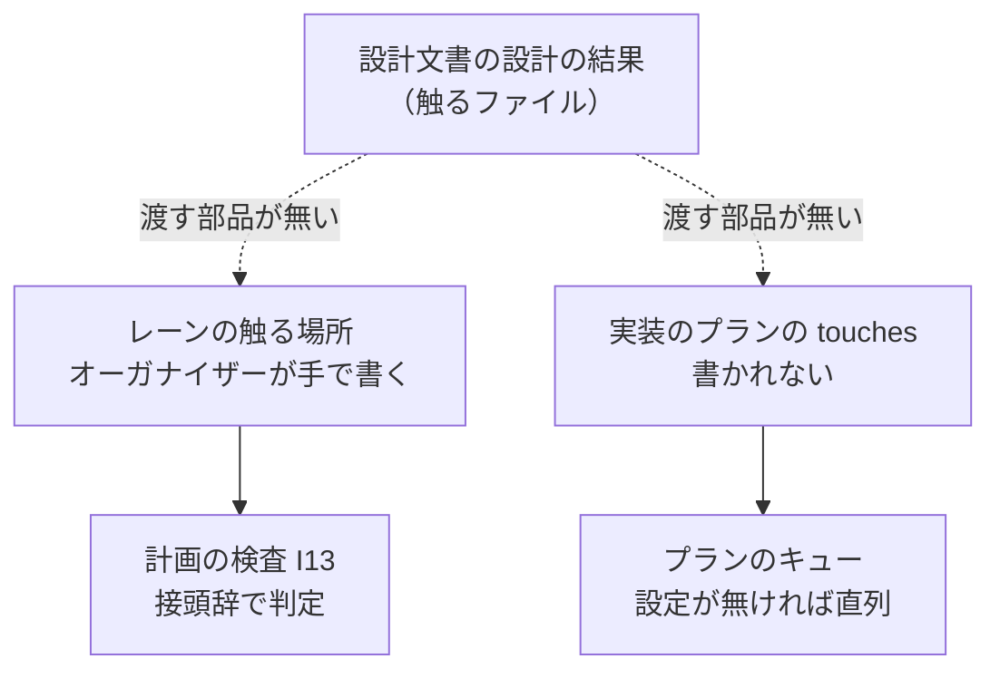
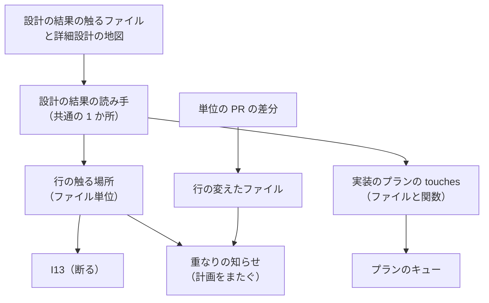
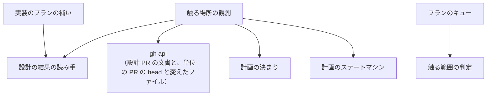
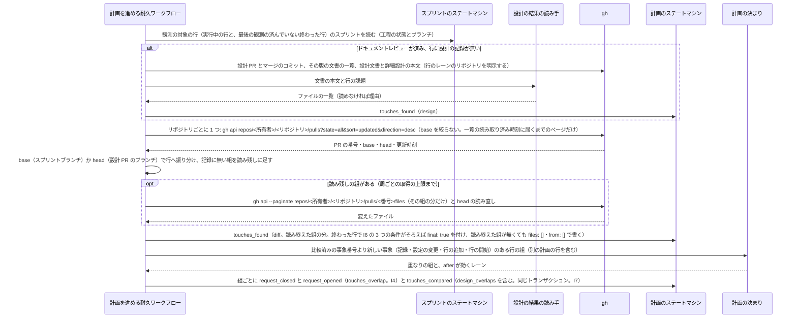
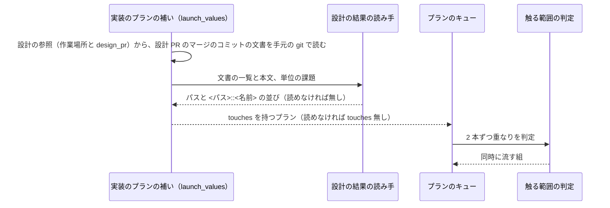

# 並列の計画とプランのキュー: 設計で確定した触るファイルと関数で重なりを決め、実際に変えたファイルの重なりを知らせる（#4295 #2037）

これまで、並列の計画のレーンは、ディレクトリ単位で書いた触る場所で待たされていた。スプリントの中の実装のプランは、触るファイルを持たないため、すべて直列になっていた。この設計では、設計の結果の「触るファイル」を両方の重なりの判定へ機械で渡し、レーンはファイル単位、プランは関数の単位まで分けて判定するようにする。実装の途中で触る範囲が広がっても止めない。単位の PR が変えたファイルを拾い、ほかのレーンと重なればオーガナイザーへ知らせるようにする。比べた案は「決定の記録」に、調べた製品と標準は末尾の「外部の調査」にある。

## 今の姿

何が起きたか・目的・受け入れ条件は、次の 2 つの要求仕様にある。この文書は「どう解くか」と「なぜその解き方か」だけを書く。この章に書くのは、この設計で変える前（これまで）の状態である。

- [issue-4295-requirements.md](./issue-4295-requirements.md)（正は #4295 の本文）
- [issue-2037-requirements.md](./issue-2037-requirements.md)（正は #2037 の本文）

**2 つの課題の根本原因は共通である。これまで、設計で確定した触るファイル（設計の結果の表の列）を、重なりの判定へ渡す部品が無かった。** そのため判定は、人が手で書いた粗い触る場所か、触る範囲が無いこと（すべてと重なるとみなす）を見ていた。この設計では 2 つの判定が同じ「触る範囲」の値を読むようにするので、1 本の設計で読み手と書き方をそろえる。

変える前の流れは次の図のとおりである。



この文書の番号 `I1`〜`I9` は、この設計の不変条件（「ドメインモデル」の「不変条件」）である。次の 3 つは、従来の計画の決まり（`progress/lane/rules.py`）の番号で、別の体系である。

- `I13`: 従来は、同時に動き得る別のレーンの行どうしで、触る場所が重なれば誤りにしてきた
- `I16`: 従来は、全レーンの行が完了か中止で、回答していないリクエストが無いときだけ、計画を完了にしてきた
- `I19`: 従来は、終わっていない 2 つのレーンの行が同じ課題を持てば誤りにしてきた

設計に要る、変える前の構造は次のとおりだった（main `c04537518`、2026-11-25 に確かめた）。

| 箇所 | これまでの振る舞い |
| --- | --- |
| レーンの触る場所 | 計画のステートマシンのレーンの行（`LaneSpec.touches`。`plugins/ndf/src/ndf/progress/lane/types.py`）がレーンに 1 つだけ持っていた。変えるのはオーガナイザーの `ndf lanes set` だけで、新しい I13 の誤りが出れば断っていた（`progress/plan/__init__.py` の `change_lane`） |
| I13 | 同時に動き得る別のレーンの行どうしで、レーンの触る場所が接頭辞か glob で重なれば誤りだった（`progress/lane/rules.py` の `_touch_errors`・`touch_hit`）。行の追加（`lane/__init__.py`）・レーンの追加と変更（`plan/__init__.py`）は新しく出た誤りで断っていた |
| 計画を進める耐久ワークフロー | `ndf lanes run` の 1 周ごとに、実行中の行のスプリントのステートマシンを読み、止まりを知らせていた（`progress/plan/run.py`）。マシンのほかの計画は索引（`<状態の保存先>/parallel/plans/`）と中継の登録簿から読めた（`progress/lane/machine.py`） |
| プランのキュー | 2 本のプランの `touches` に同じファイルがあれば重なるとしていた。設定の無いプランはすべてと重なり、`/` で終わる値は数えなかった（`core/plan/queue_decide.py`） |
| 実装のプランを組む所 | `ndf route render implement` と工程の経路は、`review` と `acceptance` を補う同じ関数（`core/route/__init__.py` の `launch_values`）を通るが、`touches` を書いていなかった。テンプレート `contracts/templates/impl.json` に `touches` の差し込みは無かった |
| 設計の結果を読む所 | `domains/materials/collect.py` の `design_rows`・`design_files` だけが読んでいた。名前の正規表現（`DESIGN_FILE`）は先頭の番号だけと突き合わせるため、`issue-4295-2037-design.md` のような複数の番号の設計文書を拾えなかった（`re.match` で確かめて `False`） |

## 文脈と制約

- 計画に書いた触る場所の外のファイルを変えることを、手順書・hook・検査のどれでも禁じない（#4295 の受け入れ条件 5・8。利用者の決定、2026-11-24）
- 設計のフェーズの排他は、7 つのフェーズを分ける課題（ https://github.com/devbasex/ai-plugins/issues/4050 、未実装）が持つ。#4050 は、実装のフェーズに入る前に、触る場所が確定しているかを確かめる。何をもって確定とするかは、この設計が定める（決定 3）
- 今の `ndf lanes init`・`start` は、設計の前に書いた予想の触る場所で I13 を判定する。予想は粗いので、別のファイルを変えるレーンどうしも重なる。それを避けるためにレーンへ `after` を付けると、後で設計の値が出ても解けない（`after` はレーンに付く値で、同じ計画の中の、まだ始まっていない行を前のレーンの終わりまで待たせる。`rules.py` の `next_row`）。設計で確定した値で判定するには、次の 2 つが要る
  - 設計がまだ済んでいない行は、予想で書いた触る場所を I13 の比較に使わない
  - 重なりを避けるための `after` を書かない
- ただし、設計の記録の無い計画では、今の I13 の振る舞いを変えない（#4295 の受け入れ条件 3。`test_touch_overlap_errors_as_they_are_now` の行は、既定のモードのスプリントの行である）。そのため、比較から外すのは、オーガナイザーが印を付けたレーンの行だけにする（決定 3）
- 同じ計画の、同じリポジトリの 2 つのレーンは、同じ課題を持てない（I19。`rules.py` の `_issue_errors`）。設計文書の名前は、その設計を書く行の課題の番号でできている（`issue-<番号の並び>-design*.md`）。そのため、同じ計画の別々のレーンが同じ設計文書を書くことは無い
- レーンの触る場所の設定は、設計を読めないときの代わりの値でもある（#4295 の受け入れ条件 4「今の宣言のまま動く」）。そのため、オーガナイザーは設計の前でも、今のとおり変えると予想する範囲を書く
- 計画の JSON（`plan.json`）の `touches` の形（パスか glob の文字列の並び）と、プランの JSON の `touches` の形（文字列の並び）は変えない。計画の JSON のレーンには、任意の印 `touches_from_design` を 1 つ足すだけにする
- プランの `touches` が無いときはすべてと重なり、ディレクトリの値は数えない（#2037 の受け入れ条件 5・6。退行させない）
- 計画のステートマシンの事象は追記のみで保存し、現在の値は事象を順に適用して求める（MVV の Value 8「正しいデータ構造で作られる」）
- 判定の関数は DB とプロセスを読まない純粋な関数に置く（今の `rules.py`・`queue_decide.py` の形）

## 解き方の全体像

この設計では、次の形にする。



- 設計の結果を読む部品を 1 か所に置き、レーンとプランの両方がそこから触る範囲を得るようにする
- 行のドキュメントレビュー（設計 Pull Request のマージ）が済むと、計画を進める耐久ワークフローがその行の触る場所を、設計の結果と地図のファイルの一覧へ置き換えるようにする。I13 は行の単位で、置き換えた一覧を見るようにする
- 計画を作る時点では、オーガナイザーはこれまでのとおり、変えると予想する範囲（粗くてよい）をレーンの触る場所に書く。設計で触る場所を決めるレーンには、新しい印 `touches_from_design: true` を付けることにする。印のあるレーンの行のうち、設計の記録がまだ無い「設計中の行」は I13 の触る場所の比較から外すので、粗い範囲が重なっても断られず、重なりを避けるための `after` も要らなくなる。設計を読めなかった行は、この範囲で判定する（決定 3）
- 単位の PR を出した後は、耐久ワークフローが PR の変えたファイルを行へ記録するようにする。同じリポジトリで同じ時間帯に動くほかのレーン（別の計画を含む）の触る場所か変えたファイルと重なれば、オーガナイザーへリクエストで知らせるようにする。変えたファイルでは I13 で断らず、レーンも止めない
- 実装のプランは、組む時点で設計の結果の触るファイルを `touches` に持つようにする。触るファイルのセルに `<パス>::<名前>` と書いた関数は、同じファイルでも名前が交わらなければ重ならないとする

## ドメインモデル

### コンテキスト

| コンテキスト | 何の語が 1 つの意味に決まるか |
| --- | --- |
| `ndf-design`（NDF の設計） | 設計の結果・触るファイル・触るシンボル |
| `ndf-parallel`（NDF の並列の計画） | レーンの触る場所・変えたファイル・重なりの知らせ |
| `ndf-supervise`（NDF のプランの実行） | プランの `touches`・重なりの組 |

コンテキストマップの関係: `ndf-design` の設計の結果の表を**公表された言語**とし、`ndf-parallel` と `ndf-supervise` はその表を同じ読み手で読む。表の形は `ndf-design` だけが変える。

### 集約

| 集約 | オーナー（書き換えてよいもの） | 根 | エンティティ | 値オブジェクト |
| --- | --- | --- | --- | --- |
| 計画（計画のステートマシン） | オーガナイザー（触る場所の設定の変更・リクエストを閉じる）と計画を進める耐久ワークフロー（設計の触る場所・変えたファイル・重なりの知らせ） | 計画 | レーン・リクエスト | 触る場所の並び・行ごとの設計の触る場所・行ごとの変えたファイル |
| プラン（プランの JSON） | プランを組む `ndf route`（工程の経路と単発の経路） | プラン | ステップ | `touches`（ファイルか `<パス>::<名前>` の並び） |

### 不変条件

| # | 集約 | 条件 | 破れたときの扱い |
| --- | --- | --- | --- |
| I1 | 計画 | 行の触る場所は、行の状態に応じて、設計の触る場所の記録かレーンの触る場所の設定になる。設計中の行は、I13 と触る場所どうしの比較に入らない（下の「触る場所の値の決め方」） | 畳み込みが常にこの規則で値を出す。破れる経路を持たない |
| I2 | 計画 | 変えたファイルは I13 の誤りに入らない。計画の検査が断るのは、触る場所の設定と設計の触る場所の重なりだけである | テストで縛る（#4295 の受け入れ条件 5） |
| I3 | 計画 | 設計の触る場所を置き換えられないとき、行の状態と触る場所の設定を変えない。置き換えられないのは、取得できた資料に必要な記載が無いとき（設計の結果が無い、設計の結果の表に課題の記載が無い、別ファイルの詳細設計があるのにその地図を読めない）と、資料の取得の失敗が上限の回数続いたときである | 「置き換えなかった」記録（`files: null` と理由）を 1 度だけ残す。取得の失敗が上限に達する前は、失敗の回数だけを記録して次の観測で取得し直す（I9、「設計の結果の読み方」）。#4050 の「確定」の確かめは、`files: null` の記録も確定とみなして行を止めない（決定 3） |
| I4 | 計画 | 重なりの知らせは、行の組（自分の行と相手の計画・レーン・行）ごとに、開いたものを多くて 1 件に保つ。新しく書くのは、次のどちらかに当たるときだけである。(1) 重なったファイルが増えた（最後の知らせの `files` に無いファイルがある）。(2) 実装の入口の待ちが要るファイルが増えた（触る場所どうしで新しく重なり始めたファイルがある）。書く知らせの `files`・`design_files` の作り方は、「重なりの知らせ」の表に従う | 書く前に、同じ組の開いた・閉じた知らせを計画のステートマシンから読んで突き合わせる。打ち直しても、記録した知らせとの突き合わせで同じ知らせを書かない（決定 7） |
| I5 | プラン | `touches` が無いプランはすべてと重なる。`/` で終わる値は重なりに数えない。同じファイルで片方が名前を持たなければ重なる。両方が名前を持てば、名前が等しいか一方が `<名前>.` で始まるときだけ重なる | テストで縛る（#2037 の受け入れ条件 2〜6） |
| I6 | 計画 | 終わった行の変えたファイルは、終わった後の最後の観測（`final: true` の記録）を書くまで観測の対象に残す。計画の完了（I16）は、終わった行すべてに最後の観測の記録があるまで待つ（下の「最後の観測」） | 読み終えられない周が上限の回数（`parallel-run.touches` の `attempts`）続けば、`files: null` で最後の観測を書いて終える（I9） |
| I7 | 計画 | 比較済みの事象番号（`touches_compared`）は、その周の知らせを書いたのと同じトランザクションでだけ進める。比べる対象は、どの計画でも、比較済みの事象番号より新しい次の事象のある行である。`touches_found`、触る場所の設定の変更（`lane_changed`）、行の追加（`row_added`・`lane_added`）、行の開始（`row_started`）。行の開始を含めるのは、別の計画の行は実行中になって初めて比べる相手になり、新しい観測の記録も設定の変更も無いまま相手が増えるためである | 記録の直後に中断しても、比較済みの事象番号が進んでいないので次の周で比べ直す。知らせは I4 の突き合わせで重ならない |
| I8 | 計画 | 設計中の行（I1）だった行は、自分の設計の記録を自分の計画が比べ終えるまで、実装の入口で待つ。相手の行がすでに実装に入っていた組は止められない（下の「実装の入口の待ちが保証する範囲」） | 比較が中断しても、比較済みの事象番号が進まないので行は待ち続け、次の周の比較の後に進む（決定 3） |
| I9 | 計画 | 取得の失敗の回数は、行と取得の種類（`source` の `design` か `diff`）ごとに計画のステートマシンへ記録し、再起動をまたいで数える。失敗した周ごとに 1 つ増やし、取得に成功した周で 0 に戻す。成功すると、その行のその種類の取得は終わる（設計は記録ができ、最後の観測は `final: true` を書く）ので、0 に戻した後に数え直すことは無い。上限（`parallel-run.touches` の `attempts`）に届いたら、理由付きの `files: null` を書く。数えるのは、設計の資料の取得（I3）と、終わった行の最後の観測（I6）である | 事象 `touches_retry` に今の回数を書く。書くのは、失敗した周と、失敗の後に初めて成功した周だけである。失敗が無い間は書かないので、事象は増えない |

### 触る場所の値の決め方（I1）

行の触る場所は、行の状態で次のように決まる。「設定」は、レーンの触る場所の設定（計画に書いた値と `ndf lanes set` の値）である。

| 行の状態 | 行の触る場所 |
| --- | --- |
| 設計の触る場所を記録した | 記録した一覧 |
| 記録の後にオーガナイザーが `ndf lanes set --touches` を打った（終わっていない行） | 設定（記録より設定が勝つ） |
| 記録が無い | 設定 |
| `files: null` の記録がある | 設定 |

「設計中の行」は、次の 4 つをすべて満たす行である。

1. レーンに印 `touches_from_design: true` がある
2. スプリントの行（`kind: sprint`）である
3. モード（行の入力の `--mode`、無ければ `lane/launch.py` の `DEFAULT_MODE`）の定義に工程 `document-review` がある
4. 設計の記録がまだ無い

設計中の行は、I13 と、触る場所どうしの比べ方（「重なりの知らせの組の規則」の表の 3 行目）から外れる。変えたファイルとの比べ方では、設計中の行も設定の値で比べる。印の無いレーンの行は、今のとおり設定の値で I13 に入る。設計中の行を外しても、設計の段階で行が書く設計文書は、I19 によってレーンどうしで重ならない（「文脈と制約」）。

### 最後の観測（I6）

終わった行の直前の PR を落とさないために、次の 3 つがそろった周にだけ `final: true` を書く（決定 6）。

1. その周に、行のリポジトリの PR の一覧を、一覧の読み取り済み時刻まで全ページ読めた
2. その周の一覧の読み取り済み時刻（前に全ページを読めた走査の開始の時刻）が、行の終わった時刻より後である。走査の間にページをまたいで動いた PR を、次の走査で読むための確かめである
3. 周の終わりに、その行の読み残し（記録に無い PR と head の組）が空である

ファイルを読めなかった PR、読む間に head が変わった PR、取得の上限（1 周でファイル一覧を取得する PR の本数の上限）で次の周へ回した PR が 1 本でも読み残しに残れば、最後の観測を次の周へ持ち越す。状況ごとの扱いは次のとおりである。

| 周の状況 | 記録するもの | 取得の失敗に数えるか |
| --- | --- | --- |
| 3 つがそろった | `final: true` の記録。新しく読み終えた組が無くても `files: []`・`from: []` で書く。PR を出さずに終わった行や、すべての PR を終わる前に記録した行も、この記録で最後の観測を終える | 数えない |
| 取得の上限で次の周へ回しただけの PR が残る | 読み終えた組を、`final` を付けずに記録する | 数えない |
| ファイルを読めなかった PR が残る | 読み終えた組を、`final` を付けずに記録する | 数える |
| 読む間に head が変わった PR が残る | 読み終えた組を、`final` を付けずに記録する | この設計では定めていない |
| 一覧の全ページを読めなかった | `final` は、読み残しが空でも付けない。一覧の読み取り済み時刻も進めない | そのリポジトリの、最後の観測の済んでいない終わった行すべての失敗として数える |

読み終えられない周が上限の回数（`parallel-run.touches` の `attempts`）続けば、`files: null` で最後の観測を書いて終える。理由には、読めなかった一覧（リポジトリと最後に読めたページ）と、分かっている読み残しの PR の番号を並べる。それまでに読み終えた組の記録は残る。回数の数え方は I9 に従う。

### 実装の入口の待ちが保証する範囲（I8）

保証するのは行の単位で 1 つだけである。**行は、自分の設計の記録との重なりを比べ終え、見つかった知らせを開くまで、実装に入らない。**

- 比べ終えたかは、自分の計画の比較済みの事象番号（`touches_compared` の `seen` の、自分の計画の値）が、その行の最後の `source: design` の記録の事象の番号に届いたかで決める
- 比較済みの事象番号は、知らせと同じトランザクションで進む（I7）。そのため、番号が記録に届いた時点で、その記録で触る場所どうしが重なっていれば、`design_files` を持つ知らせは開いている
- 相手の行への知らせと待ちは、同じ計画の行なら自分の計画が比べた時点、別の計画の行ならその計画の耐久ワークフローが比べた時点で始まる
- その時点より前に相手の行が実装に入っていた組（先に設計を比べ終えた行など）は、順序を付け直せない。後にマージする側が base-sync で直す（決定 7）

### ドメインイベント

番号は要求のドメインイベントを `<課題>-E<番号>` で引き継ぐ。

| # | イベント | 発生元 | 受け手 |
| --- | --- | --- | --- |
| 4295-E1 | レーンを計画に書いた触る場所で載せた | オーガナイザー | I13 |
| 4295-E2 | 行の設計 Pull Request をマージした（ドキュメントレビューの工程が済んだ） | スプリントのステートマシン | 計画を進める耐久ワークフロー |
| 4295-E3 | 行の触る場所を設計の触るファイルで置き換えた（読めなければ置き換えなかったと記録した） | 耐久ワークフロー（事象 `touches_found`、`source: design`） | I13・#4050 の「確定」の確かめ |
| 4295-E4 | 置き換えた触る場所で I13 を確かめ直し、重なれば知らせた | 耐久ワークフロー（`request_opened`、`kind: touches_overlap`） | オーガナイザー |
| 4295-E5 | 単位の PR の変えたファイルを行へ記録した | 耐久ワークフロー（事象 `touches_found`、`source: diff`） | 重なりの知らせ |
| 4295-E6 | 変えたファイルがほかのレーンと重なったことを知らせた | 耐久ワークフロー（`request_opened`、`kind: touches_overlap`） | オーガナイザー |
| 4295-E7 | オーガナイザーが順序を付け直した、またはそのまま進めた | オーガナイザー（`ndf lanes set`・`request close`） | 計画 |
| 2037-E1 | 設計の結果に触るファイルと関数を書いた | 設計の工程 | 設計の結果の読み手 |
| 2037-E2 | 実装のプランを組み、`touches` を入れた（読めなければ入れなかった） | `ndf route`（`launch_values`） | プランのキュー |
| 2037-E3 | キューが同時に流す組を決めた | `ndf plan queue` | — |
| 2037-E4 | 同じファイルの 2 本がマージの順で衝突し、base-sync がマージ先をマージした | 2 本目のマージ | — |

## 構成要素

| 要素 | 責務 |
| --- | --- |
| 設計の結果の読み手（新設。`core/design_results.py`） | 版（コミット）の中の文書の一覧と本文から、課題ごとの設計の結果の行（扱い・統合先・触るファイル。`<パス>::<名前>` を含む）と詳細設計の地図の表のパスを返し、「設計の結果の読み方」の手順 2〜4 で課題の並びの触る範囲を決める。表にその課題の記載が無いことと、記載の触るファイルのセルが空であることを分けて返す。`domains/materials/collect.py` の `design_rows`・`design_files` をここへ移し、複数の番号の名前も拾う。版の中の一覧と本文を読む口は呼び出し側が渡す（レーンは `gh api`、プランは作業場所の git。「設計を読む先」） |
| 触る範囲の判定（`core/plan/queue_decide.py`） | 値を「パス」と「名前」に分け、不変条件 I5 で 2 本のプランの重なりを決める |
| 実装のプランの補い（`core/route/__init__.py` の `launch_values`） | `touches` を渡されなければ、呼び出し側が渡す設計の参照（作業場所のリポジトリと設計 PR の番号）で単位の課題の設計の結果を読んで補う。読めなければ補わない（「設計を読む先」） |
| 行の触る場所の畳み込み（`progress/lane/fold.py`・`types.py`） | 事象 `touches_found` から、行ごとの設計の触る場所と変えたファイルを持つ。`touches_retry` から行と取得の種類ごとの失敗の回数（I9）を、`touches_compared` から組ごとの最後の `design_overlaps`（I4）を持つ |
| 計画の決まり（`progress/lane/rules.py`） | I13 を行の触る場所で判定し、設計中の行（I1）を外す。工程 `document-review` を持つモードの名前の集まりは、呼び出し側がモードの定義（`contracts/workflow/modes/*.json`）から読んで渡す（判定の関数はファイルを読まない）。重なりの知らせの組を「重なりの知らせの組の規則」で求め、組ごとに `after` が効くレーンを添える。実装の待ちの判定に、比べ終える前の設計の記録（I8）と、`design_files` を持つ開いた知らせ（知らせの両端で照らし合わせる）を足す。計画の完了（`plan_complete`）に I6 を足す |
| 触る場所の観測（`progress/plan/run.py`・`run_decide.py`） | 間隔（新設の上限 `parallel-run.touches` の `interval`）ごとに、実行中の行と最後の観測の済んでいない終わった行（I6）のスプリントを読み、設計の触る場所と変えたファイルを記録し、知らせを書く・閉じる（I4）。GitHub は行のレーンのリポジトリを明示して読む。PR の一覧はリポジトリごとに差分だけ読み、1 周でファイル一覧を取得する PR の本数は、取得の上限（同じ上限の `fetches`）までにする（決定 6） |
| 事象のコントラクト（`contracts/workflow/progress.json`・`stages/document-review.json`） | 事象 `touches_found`・`touches_compared`・`touches_retry`（書き込み元 `workflow`）を足す。ドキュメントレビューの工程に出力 `design_pr`（実際にマージした設計 PR の番号。下の「設計 PR の番号の記録」）を宣言する |
| 工程の出力の付け替え（`progress/run.py` の `_stage_output`・`progress/definition.py`） | タスクの `outputs_as` に従って出力の名前を付け替えてから、工程の宣言した出力だけを残す（`stages.keep_declared`）。定義の検査は、付け替え先が工程の `outputs` に宣言されていることを確かめる |
| オーガナイザーの手順（`skills/development-workflow/references/parallel.md` の知らせの表） | 今の表は `launch_failed`・`lane_stalled` などの種類ごとに扱いを持ち、`touches_overlap` の行が無い。知らせの `reorderable` に載ったレーンへ `after` を足して順序を付け直すか、そのまま進めて base-sync で直すかを決めて閉じる行を足す。`reorderable` が空の組（実装に入った行・別の計画の行）は base-sync で直すと書く（決定 7） |
| 計画の書き方（`skills/issue-plan-strategy/references/parallel-plan.md`）と計画の JSON の規約（`contracts/workflow/parallel-plan.schema.json`） | レーンに任意の真偽値 `touches_from_design` を足す（`LaneSpec` にも足す。`touches` の形は変えない）。レーンの `touches` には、今のとおり変えると予想する範囲を書く。設計を読めないときはこの範囲で判定されるので、設計文書のパスだけにしない。ドキュメントレビューの工程を持つモードのスプリントのレーンには `touches_from_design: true` を付け、粗い範囲の重なりを避けるための `after` を付けない、と書く（決定 3） |

### 設計 PR の番号の記録

`design_pr` に記録するのは、工程の最後の `docs-merge` が実際にマージした PR の番号である。`docs-pr` が最初に作った PR の番号ではない。クロスレビューは、収束しない PR を閉じて新しい番号で出し直すことがあり（`skills/cross-review/docs/02-fix-and-rotation.md`）、最初の番号はマージされないことがあるためである。

- マージのプラン（`contracts/templates/merge.json`）は、マージした PR の番号を `outputs.pr` に返すようにする
- `docs-merge` のタスクの `metadata.ndf.outputs_as`（新設。`{"pr": "design_pr"}`）で、その値を `design_pr` の名前で記録する
- `docs-pr` の `outputs.pr` は、工程の宣言に無いので記録されない
- スプリントの文脈の `pr` は、今のとおり工程「Pull Request」だけが書く



## データ構造

計画のステートマシンへ事象の種類を 3 つ足す。テーブルの形は変えず、移行は無い。

| 事象 | 書き込み元 | 行のキー | 中身（`payload`） |
| --- | --- | --- | --- |
| `touches_found`（新設） | `workflow` | レーンの名前 | `row`（レーンの行のキー）・`source`（`design` か `diff`）・`files`（パスの並び。読めなかったときは `null`）・`from`（出典の並び。下の表）・`final`（`diff` で、行が終わった後の最後の観測なら `true`。I6）・`reason`（読めなかった理由。読めたときは無い） |
| `touches_compared`（新設） | `workflow` | 計画（`scope: table`） | `seen`（計画ごとの、比べ終えた計画のステートマシンの最後の事象の番号。`{"<計画の ID>": <番号>}`。自分の計画と、比べた別の計画を並べる）。I7。`design_overlaps`（この周で比べ直した組ごとの、触る場所どうしで今重なっているファイルの並び。`[{"lane", "row", "with", "files"}]`。重なりが無くなった組は `files: []` で書く）。比べ直さなかった組は前の値を引き継ぐ。I4 |
| `touches_retry`（新設） | `workflow` | レーンの名前 | `row`・`source`（`design` か `diff`）・`failures`（連続した取得の失敗の回数。成功した周では `0`）・`reason`（最後の失敗の理由）。I9 |
| `request_opened`（今の事象） | `workflow` | レーンの名前 | 今の形のまま。中身の `kind` に `touches_overlap` を足す（下の「入出力のコントラクト」） |

`from` は出典ごとに 1 つの要素を持つ並びである。複数の課題の設計文書と別ファイルの詳細設計を合わせたときは、読んだ文書をすべて並べる。

| `source` | `from` の要素 | 例 |
| --- | --- | --- |
| `design` | `{"repo": <所有者>/<リポジトリ>, "path": <文書のパス>, "role": "design" か "detail", "issues": [<その文書から読んだ課題の番号>], "commit": <読んだ版のコミット>}` | `{"repo": "devbasex/ai-plugins", "path": "issues/issue-4295-2037-design.md", "role": "design", "issues": [4295], "commit": "<設計 PR のマージのコミット>"}` |
| `diff` | `{"repo": <所有者>/<リポジトリ>, "pr": <単位の PR の番号>, "head": <head のコミット>}`。1 つの事象に、その周で新しく読んだ PR をすべて並べる | `{"repo": "devbasex/ai-plugins", "pr": 4289, "head": "0c0f0ed5d…"}` |

畳み込みは、`source: design` の最後の事象を行の設計の触る場所に、`source: diff` の事象の `files` の和を行の変えたファイルにする。`from` に載ったリポジトリ・PR・head の組は 2 回読まない。PR の番号はリポジトリの中でだけ一意なので、組はリポジトリを含めて見分ける。

## 入出力のコントラクト

### 設計の結果の触るファイルのセル

| 書き方 | 意味 | 例 |
| --- | --- | --- |
| `` `<パス>` `` | ファイル全体を触る（今と同じ） | `` `plugins/ndf/src/ndf/core/plan/queue_decide.py` `` |
| `` `<パス>::<名前>` `` | ファイルの中の関数・クラス・メソッドを触る。名前は `<クラス>.<メソッド>` の形も書ける。1 つの名前を 1 つのバッククォートに書き、同じパスを繰り返してよい | `` `plugins/ndf/src/ndf/core/plan/queue_decide.py::overlaps` `` |

読み手はどちらの形も触るファイルとして読み、ファイルの存在を見る側（材料の収集）は `::` より前をパスとして扱う。レーンは `::` より前だけを使う（決定 4）。

### プランの `touches`

形は文字列の並びのまま変えない。値は上のセルの形のどちらかで、判定は不変条件 I5 に従う。

### 設計の結果の読み方

レーンの行の置き換えと実装のプランの補いは、同じ読み手（`core/design_results.py`）で、同じ版の文書を読む。版は、利用者が承認した設計、つまり設計 Pull Request（設計 PR）がマージされたコミットである。行や単位の課題ごとに設計文書と詳細設計を対応付け、1 つでも読めない課題があれば全体を「読めなかった」とする。2 つの経路で違うのは、その版の文書の一覧と本文を読む口だけである（次の「設計を読む先」）。

レーンの行の置き換えでは、読めないときの扱いが原因で 2 つに分かれる。GitHub からの取得に失敗したとき（リポジトリの名前、設計 PR、文書の一覧、設計文書の本文、詳細設計の本文のどれでも）は、失敗の回数を `touches_retry` に記録して、次の観測で取得し直す。回数は再起動をまたいで数え、取得に成功した周で 0 に戻す（I9）。取得の失敗が上限の回数（`parallel-run.touches` の `attempts`）続いたときと、取得できた資料に必要な記載が無いときは、理由付きの `files: null` を 1 度だけ書き、同じ行では読み直さない（I3）。実装のプランの補いは取得し直さず、読めなければ `touches` を書かない。

| 手順 | 読むもの | 読めないときの扱い |
| --- | --- | --- |
| 1. 設計 PR と版を決める | スプリントの文脈の `design_pr`（ドキュメントレビューの工程の出力。「構成要素」の事象のコントラクト）の番号の PR を、`gh pr view <番号> --repo <所有者>/<リポジトリ> --json state,mergeCommit` で読む。マージ済みなら、マージのコミットを版にする。後の工程「Pull Request」は `pr` を書き、`design_pr` は書かないので、スプリントの PR と取り違えない | `design_pr` が無い、または PR がマージ済みでない: 全体を読めなかったとする。GitHub を読めない: 取得の失敗とする |
| 2. 課題ごとに設計文書を決める | 版の `issues/` の一覧から、`issue-<番号の並び>-design.md` と `issue-<番号の並び>-design-<名前>.md`（`-design-detail.md` を除く）のうち、`-` で区切った番号の並びに課題の番号を含むものを候補にする。設計 PR がその文書を変えたかは問わない。同じ版に前からある設計も候補になる。`issue-4295-2037-design.md` は課題 4295 と 2037 の両方の候補になる。候補の本文を読み、「設計の結果」の表にその課題の記載がある文書がちょうど 1 つなら、それを採る。分割した設計では、設計テンプレート（`skills/design/references/design-template.md`）が触るファイルを先頭の文書の表へすべて写すことを求めるので、表を持つ文書が主文書として 1 つに決まる | 一覧か候補の本文を取得できない: 取得の失敗とする。候補が無い、またはどの候補の表にも課題の記載が無い: 全体を読めなかったとする。課題の記載がある候補が 2 つ以上ある（`issue-7-design.md` と `issue-7-8-design.md` の両方の表に課題 7 の記載がある）: 採る文書を決められないので、候補のパスを理由に残し、全体を読めなかったとする |
| 3. 課題の記載の扱いで触るファイルを決める | 2 の文書の、その課題の記載の「扱い」で決める（下の表） | 下の表 |
| 4. 詳細設計を対応付ける | 3 で触るファイルを足した課題（`実装する` か `マージする`）が 1 つ以上ある文書についてだけ、同じ番号の並びの `issues/issue-<番号の並び>-design-detail.md` を、同じ版から読む。文書の課題がすべて `閉じる` なら、地図を読まず、和にも入れない | 版の一覧に無い: 詳細設計を畳んだ設計として、設計の結果だけを使う。本文を取得できない: 取得の失敗とする。あるのに「地図」の表か「パス」の列を読めない: 全体を読めなかったとする（受け入れ条件 4） |
| 5. 和を取る | 課題ごとの 3 の触るファイルと、4 の地図の「パス」の列の和。レーンは `::` より前だけを使い、プランは `<パス>::<名前>` のまま使う | — |

この節の「課題の記載」は、設計の結果の表のうち、その課題を書いた 1 件を指す。単に「行」と書くときは、計画のレーンの行（スプリント）を指す。

設計の結果の書き方（`design-template.md`）では、触るファイルを書くのは扱いが「実装する」の記載だけである。そのため読み手は、課題の記載が無いことと、触るファイルのセルが空であることを分けて返し、手順 3 では次のとおり扱う。

| 課題の記載 | 手順 3 で足すファイル |
| --- | --- |
| 無い | 全体を読めなかったとする |
| `実装する` で、触るファイルが 1 つ以上ある | そのファイル |
| `実装する` で、触るファイルのセルが空 | 変更の範囲が分からないので、全体を読めなかったとする |
| `マージする` | 統合先の課題の記載の触るファイル。この課題の変更は統合先の実装に含まれるためである。統合先の記載が同じ文書に無いか、扱いが `実装する` でなければ、全体を読めなかったとする |
| `閉じる` | 足さない。実装の PR を持たないためである |

そのスプリントの課題がすべて扱い `閉じる` なら、手順 4 で地図を読まないので、版に詳細設計があっても触る範囲は空の一覧になり、どの行とも重ならない。同じ文書を 2 つの課題で使うときは 1 回だけ読む。読んだ文書は `touches_found` の `from` にすべて残る（「データ構造」）。

### 設計を読む先

2 つの経路は、同じ設計 PR の同じマージのコミットを読む。作業場所の手元の変更や HEAD は読まないので、起動した場所や手元の編集によって `touches` が変わることは無い。

| 項目 | レーンの行の置き換え | 実装のプランの補い（工程の経路） | 実装のプランの補い（単発の経路） |
| --- | --- | --- | --- |
| 呼ぶ所 | 触る場所の観測（`progress/plan/run.py`） | `progress/invoke.py` の `template_values` から `route.launched` | `core/route/__init__.py` の `_write_plan` から `launched` |
| リポジトリ | 行のレーンのリポジトリ（`PlanView.lane_repo` のクローン。無ければ計画のリポジトリ）。そのクローンで `gh repo view --json nameWithOwner` を打って `<所有者>/<リポジトリ>` を得て、耐久ワークフローが動いている間だけ覚える | 工程の作業場所（`worktree`）のリポジトリ | 打った作業場所のリポジトリ |
| 設計 PR の番号 | 行のスプリントの文脈の `design_pr` | 工程のスプリントの文脈の `design_pr`（`FILL_SOURCES` に足す） | `--add design_pr=<番号>`。渡さなければ補わない |
| 版（手順 1） | `gh pr view <番号> --repo <所有者>/<リポジトリ>` のマージのコミット | 作業場所で `gh pr view <番号>` を打ったマージのコミット | 同じ |
| 一覧と本文（手順 2・4） | `gh api repos/<所有者>/<リポジトリ>/git/trees/<コミット>` で根の木から `issues` の木を引き、その木の一覧を `gh api repos/<所有者>/<リポジトリ>/git/trees/<木の SHA>` で読む。本文は `gh api repos/<所有者>/<リポジトリ>/contents/<パス>?ref=<コミット>` で読む | 作業場所の git の `git ls-tree --name-only <コミット> issues/` と `git show <コミット>:<パス>`。コミットが手元に無ければ `git fetch <remote> <コミット>` を 1 回打つ | 同じ |
| 読めないとき | 上の「読めないときの扱い」（取得し直しと `files: null`） | `touches` を書かない（すべてと重なる）。プランを組む処理は止めない | 同じ |

レーンが GitHub を `gh api` で読むのは、計画を進める耐久ワークフローが、レーンのクローンを取得し直してよいとは限らないためである。プランの補いは、設計 PR のマージのコミットが作業場所のブランチの祖先にあるので、手元の git で読める。どちらも同じコミットの同じパスを読むので、同じ文書から同じ値が出る。

### 重なりの知らせの組の規則

重なりの知らせは、同じリポジトリの 2 つの行の組について、下の表の値どうしを比べて決める。2 つの行のリポジトリは `PlanView.lane_repo` で決め、別の計画の行はその計画の `lane_repo` で決める。リポジトリが違う組は、同じ相対パスでも比べない。

| 自分の行の値 | 相手の行の値 | 知らせるか | `source` |
| --- | --- | --- | --- |
| 変えたファイル | 触る場所（I1 の規則で決まる今の値） | 重なれば知らせる | `diff` |
| 変えたファイル | 変えたファイル | 重なれば知らせる。両方が宣言の外で同じファイルを変えた組はここで拾う | `diff` |
| 触る場所（I1 の今の値） | 触る場所（I1 の今の値） | 同じ計画の組は I13 の誤りになり、それに加えて知らせる。別の計画の組も知らせる。重なったファイルは知らせの `design_files` に載せる。`design_files` が空でない開いた知らせがある間は、両方の行を実装の入口で待たせる（決定 3） | `design` |

- 相手の行は、同じ時間帯に動き得る行である。同じ計画では、前後の鎖の無い別のレーンの、終わっていない行（まだ始まっていない行を含む）を相手にする。別の計画では、実行中の行を相手にする。どちらでも、終わった行は次の 2 つを満たす間だけ相手に残る
  - 比べる期間: 終わった行の終わりの事象より前に、こちらの行が始まっていた（`row_started`）こと。終わった後に始まった行とは比べない。別の計画の事象の番号は比べられないので、前後は事象の時刻で決める
  - 相手に残す条件: 次のどちらかの間は、相手に残す
    - 終わった行の最後の観測（`final: true` か、上限に届いた `files: null`。I6）が、まだ記録されていない
    - 最後の観測は記録されたが、比べる側の計画がまだ比べていない（比較済みの事象番号、つまり `touches_compared` の `seen` の終わった行の計画の値が、最後の観測の事象の番号に届いていない）
  - 比べる側が同じ計画なら、最後の観測と同じ周に比べ終える。別の計画なら、その計画の耐久ワークフローが次に比べた周で読む。そのため、終わる直前の PR を初めて記録した最後の観測も、並行していたほかの計画が比べる前に外れない
- 「触る場所」は、どの行でも I1 の規則で決まる今の値である。設計を記録した後にオーガナイザーが `ndf lanes set --touches` で直した行は、直した値で比べる
- 比べるのは、比較済みの事象番号（`touches_compared`）より新しい事象のある行だけである。対象の事象は、`touches_found`・`lane_changed`・`row_added`・`lane_added`・`row_started` で、自分の計画と別の計画のどちらの事象でもよい（I7）。別の計画で行が実行中になると、その行は新しい観測の記録も設定の変更も無いまま相手になるので、`row_started` で比べ直す。別の計画の新しい事象は、その計画のステートマシンの事象の番号で見分ける。比較済みの事象番号は、その周の知らせと同じトランザクションで進める
- 表の比べ方は、2 つの行を入れ替えた向きでも行う。1 つの組で 2 つ以上の比べ方が重なれば、1 件の知らせにまとめる。知らせは組ごとに書き、同じ計画の組は名前の順で先の行を「自分の行」（`lane`・`row`）にして 1 件だけ書き、もう一方の行は `with` に載る。別の計画の組は、それぞれの計画の耐久ワークフローが自分の計画に書く
- 実装の入口の待ち（決定 3）は、行が知らせの両端のどちらに載っていても効く。待ちの判定は、行が次のどちらかに当たる開いた知らせを探す。(1) 知らせの `lane`・`row` が行と一致する。(2) `with` の `plan` が自分の計画で、`with` の `lane`・`row` が行と一致する
- 重なりの判定は `touch_hit` で行い、`::` より後ろは使わない

### 重なりの知らせ（`request_opened` の `body`）

```json
{
  "kind": "touches_overlap",
  "lane": "lphase",
  "row": "r1",
  "source": "diff",
  "files": ["plugins/ndf/src/ndf/progress/plan/run.py", "plugins/ndf/src/ndf/progress/lane/launch.py"],
  "added": ["plugins/ndf/src/ndf/progress/lane/launch.py"],
  "design_files": [],
  "with": {"plan": "p9", "lane": "lsplit", "row": "r2"},
  "reorderable": ["lphase"]
}
```

- `files` はこの組で今までに重なったファイルのすべてである。`design_files` をすべて含む
- `design_files` は、触る場所どうしが重なったファイルのうち、オーガナイザーがまだ回答していないものである。空でない開いた知らせは、両方の行を実装の入口で待たせる（決定 3）
- `source` は、`design_files` が空でなければ `design`、空なら `diff` である
- `added` は、オーガナイザーがこの知らせで新しく判断するファイルである。I4 の 2 つの条件で見つけたファイルの和で、(1) 初めて知らせるファイル（最後の知らせの `files` に無い）と、(2) 新しく重なり始めたファイルを合わせる。前の知らせとの差分では作らない。同じファイルだけが再び重なったときは、前の知らせと `files`・`design_files` が同じになっても、そのファイルが `added` に載る。最初の知らせでは `files` と同じになる
- `reorderable` は、`after` を足せば順序を付け直せるレーンの並びである（決定 7）。空なら、どちらのマージを先にするかを `after` では変えられない
- `ndf lanes wait` は今のリクエストと同じに知らせ、オーガナイザーが `ndf lanes request close` で閉じる

オーガナイザーの回答は、触る場所どうしの重なりが途切れずに続く間だけ有効である。重なりが一度無くなってから同じファイルが再び重なれば、新しく重なり始めたファイルとして扱い、もう一度回答を求める。重なりが無くなっていたのが観測と観測の間だけでも、同じに扱う。たとえば、並行してよいと回答して知らせを閉じた後に、`ndf lanes set --touches` で重なりを解き、その後の設定の変更で同じファイルがまた重なった組は、再び実装の入口で待つ。

「新しく重なり始めたファイル」は、この周で触る場所どうしが重なっているファイルのうち、次のどちらかに当たるものである。重なりが続いているファイルは、回答済みでも開いた知らせに載っていても、これに当たらない。

1. 前回この組を比べたときの `touches_compared` の `design_overlaps` に無い。差分で知らせ済みのファイルが、後から触る場所どうしでも重なった場合も、これに当たる
2. 前回の比較の後に、重なりが途中で途切れていた。観測と観測の間に `ndf lanes set --touches` で重なりを解いて戻すと、前回と今回の比較の結果には同じファイルが残るので、1 だけでは見分けられない。そこで、比較済みの事象番号より新しい、触る場所を変える事象（`lane_changed` と `source: design` の `touches_found`）を、行ごとに事象の順に当てていく。どちらかの行の触る場所が、途中のどこかでそのファイルを含まなかったら、重なりが途切れたとみなす。行ごとに見るので、別の計画の事象との前後は比べない

I4 の条件に当たったとき、耐久ワークフローは次の表のとおりに知らせを書く。開いた知らせを閉じるときは「重なるファイルが増えた」を理由にし、開き直す知らせと同じトランザクションで書く。

| 書く時点の状態 | `files` | `design_files` | 理由 |
| --- | --- | --- | --- |
| 同じ組に開いた知らせがある | 開いた知らせの `files` と、この周で重なったファイルの和 | 開いた知らせの `design_files` と、新しく重なり始めたファイルの和 | まだ回答されていない待ちを落とさない。差分で見つけたファイルだけを足すときも、待ちは続く |
| 開いた知らせが無い（初めての知らせか、回答済みの知らせの後） | この組で今までに重なったファイルのすべて | 新しく重なり始めたファイルだけ | 回答済みで重なりが続くファイルで、もう一度待たせない |

## 処理の流れ



- 設計の記録（`touches_found` の `design`）を書いてから、比較済みの事象番号を進めるまでの間は、その行は実装の入口で待つ（I8）。差分の取得中や、設計の記録の直後に中断しても、番号は進んでいないので、行は待ったまま次の周で比べ直す。同じ計画の相手の行は、この計画が比べた時点で待ち始める。別の計画の相手の行は、その計画の耐久ワークフローが比べた時点で待ち始める。それより前に相手の行が実装に入っていた組は、base-sync で直す（I8・決定 7）
- 単位の PR やスプリントを読めない周は、次の周で読み直す（行は止めない）。実行中の行では何も書かない。終わった行では失敗の回数を `touches_retry` に記録し、上限の回数に届けば `files: null` の最後の観測を書く（I6・I9）
- 設計 PR・設計文書・詳細設計の取得に失敗した周は、失敗の回数を `touches_retry` に記録して、次の周で取得し直す。回数は再起動をまたいで数え、取得に成功した周で 0 に戻す（I9）。上限の回数に達したときと、取得できた資料に必要な記載が無いときは、理由付きの `files: null` を 1 度だけ書き、同じ行では読み直さない（I3、「設計の結果の読み方」）

実装のプランを組んで流す側は次のとおりである。



図に含めない要素は、呼び出しを持たない定義と文書である。行の触る場所の畳み込みは、計画のステートマシンの読み出しの中で働く。事象のコントラクトとオーガナイザーの手順は呼ばれない。

## 決定の記録

各決定の「根拠」の Value は、プロジェクト MVV（`.ndf/mvv.md`）の次の項目である。

| Value | 項目 |
| --- | --- |
| 1 | 人の判断を、読み切れる量の大事な所だけにする |
| 2 | 安く使える |
| 3 | 同じ手順は毎回同じ結果になる |
| 5 | 速く届く |
| 7 | 不具合が根本原因から直される |
| 8 | 正しいデータ構造で作られる |
| 9 | 責務の分かれた設計で作られる |
| 11 | 重複と冗長が無い |
| 13 | 確かめたことだけが済んだとされる |
| 14 | 判断の理由が残り、語がそろっている |
| 15 | 人も AI も同じ入口から使える |

### 決定 1: 2 つの判定が同じ値を読むよう、設計の結果の読み手を core に 1 つ置く

- **質問**: レーンとプランが設計の触るファイルを読む部品を、どこに何本置くか
- **選んだ案**: `domains/materials/collect.py` の `design_rows`・`design_files` を `core/design_results.py` へ移す。材料の収集・レーンの観測・プランの補いの 3 か所がそこを呼ぶ。設計文書の名前は `-` で区切った番号のどれかと一致するものを拾う
- 採らなかった案: レーンとプランでそれぞれ読み手を書く（同じ表の解釈が 2 か所に分かれ、片方だけ直されて食い違う）
- 採らなかった案: `progress`・`core` から `domains/materials` をそのまま呼ぶ（下の層が上の層を読む依存になる。`plugins/ndf/src/ndf/core` に `from ndf.domains` は 0 件）
- **代償**: 材料の収集のテストの import を移す作業が増える
- 根拠: Value 11 / Value 9（MVV バージョン 11）

### 決定 2: AC1 の「地図に載ったファイル」を漏らさないよう、置き換えの元を設計の結果と地図の表のパスの和にする

- **質問**: 行の触る場所を、設計文書のどの表から作るか
- **選んだ案**: 行の課題ごとに、設計の結果の触るファイルと、詳細設計を別ファイルにしたときの地図の表の「パス」の列の和を取る。詳細設計を畳んだ設計では、設計の工程が「どこを変えるか」と設計の結果の触るファイルを一致させるため、設計の結果だけを読む。#4295 の受け入れ条件 1・4 は、この形に合わせて「設計で確定した変えるファイル」と書き直した（ [issue-4295-requirements.md](./issue-4295-requirements.md) ）
- 地図を省いた設計と、地図を読めない設計は分ける。別ファイルの詳細設計が設計 Pull Request の版に無ければ、地図を省いた設計として設計の結果だけで置き換える。別ファイルがあるのに地図の表か「パス」の列を読めなければ、地図だけに載ったファイルが落ちるので置き換えず、元の触る場所の設定を保つ（I3。「設計の結果の読み方」）
- 採らなかった案: 地図の表だけを読む（詳細設計を畳んだ設計には地図が無く、多くの行で置き換わらない）
- 採らなかった案: 設計の結果だけを読む（別ファイルの地図と設計の結果の一致を確かめる検査が無く、地図だけに載ったファイルが落ちる）
- **代償**: 2 つの表が食い違うと、広い側（和）で判定する。待ちが減る量は小さくなる
- 根拠: Value 3 / Value 13（MVV バージョン 11）

### 決定 3: オーガナイザーが打たなくても置き換わるよう、計画を進める耐久ワークフローがドキュメントレビューの完了を見て置き換える

- **質問**: 置き換えをいつ、だれが行うか
- **選んだ案**: `ndf lanes run` の観測が、実行中の行のスプリントでドキュメントレビューの工程（設計 Pull Request のマージ）が済んだのを見て置き換える。行の課題とブランチはスプリントの文脈から読む
- 計画を作る時点から実装を始めるまでを、次のようにつなぐ。粗い触る場所で I13 に断られないことと、暫定の `after` で待たされないことを、この並びで満たす

| 時点 | 行の触る場所 | 検査と順序 |
| --- | --- | --- |
| 計画を作る（`ndf lanes init`・`start`・`lane add`） | どのレーンも、今のとおり変えると予想する範囲（粗くてよい）を書く。設計で触る場所を決めるレーン（ドキュメントレビューの工程を持つモードのスプリントのレーン）には `touches_from_design: true` を付け、重なりを避けるための `after` は付けない（`parallel-plan.md` に書く） | 設計中の行（I1）は I13 の触る場所の比較から外れるので、粗い範囲が重なっても断らない。印の無いレーンの行は、今のとおり設定の値で判定する。同じ課題を 2 つのレーンに載せる計画は、今のとおり I19 が断る |
| 設計のフェーズ | 設定のまま（設計中の行） | #4050 では設計のフェーズは排他を持たず、`after` と I13 の外にある。この間に行が書く設計文書は、課題の番号でできた名前なので、I19 によってレーンどうしで重ならない。別の計画の行と同じ課題を持つ場合は、設計 PR の変えたファイルが変えたファイルとして記録され、知らせになる |
| ドキュメントレビューが済んだ後の観測 | 設計の触る場所の記録へ置き換わる（I1）。読めなかった（`files: null`）行は、計画に書いた予想の範囲（設定）のまま | 記録が一覧でも `files: null` でも、行は設計中の行でなくなるので、I13 の比較に入る。I13 を計算し直し、重なる組は `touches_overlap`（`source: design`）で知らせる（決定 7）。読めなかった行も予想の範囲で比べるので、設計を読めない行が実装のファイルの重なりを見落とすことは無い。以後の `ndf lanes set`・`lane add` の I13 も、この値を見る |
| 実装のフェーズの入口（#4050 の `after_touches`） | 設計の記録を待つのは、I1 の設計中の行に当たる行だけである。設計中の行は、記録ができれば「確定」になる。`files: null` の記録も確定とみなす（受け入れ条件 4。止めない）。それ以外の行は、レーンに印があっても（工程 `document-review` を持たないモードの行や開発ループの行）、今のとおり設定の値で確定とする | 設計中の行（記録が無い）は、未確定として待つ。記録があっても、自分の計画の比較済みの事象番号がその記録に届いていない行は待つ（I8）。`design_files` が空でない開いた `touches_overlap` に、`lane`・`row` か `with` のどちらかで載った行も待つ（「重なりの知らせの組の規則」）。オーガナイザーは、`after` で順序を付けてから閉じるか、並行を許すと決めて閉じる。閉じた後は、足した `after` に従って待つか進む |

- 実装の入口で待たせるのは、設計で確定した値（I1 の今の値）どうしの重なりだけである。設計の段階で分かった重なりは、実装を始める前に順序を付けられるので、オーガナイザーが決めるまで待たせる。単位の PR の実際の差分だけが重なった組（`design_files` が空の知らせ。`source: diff`）では待たせず、レーンも止めない（受け入れ条件 5）。この待ちは #4050 の実装の待ちの判定（`rules.implementation_wait`）が返す待つ先に、`touches_overlap` の印として足す
- 既に付けた暫定の `after` は、耐久ワークフローが外さない。`after` はオーガナイザーの値で、本当に重なる組の順序か暫定の順序かを機械は見分けられないためである。計画の書き方で暫定の `after` を付けないようにし、残っていればオーガナイザーが `ndf lanes set --after` で外す
- 採らなかった案: 印を付けず、モードだけで設計中の行を決める（設計の記録の無い計画でも、既定のモードのスプリントの行が I13 から外れ、`test_touch_overlap_errors_as_they_are_now` が守る今の振る舞いが変わる。受け入れ条件 3 に反する）
- 採らなかった案: 設計の前の触る場所に、課題の設計文書のパスだけを書く（設計を読めなかった行が設計文書のパスだけで判定され、別の行と同じ実装のファイルを変えても重なりなしとされる。受け入れ条件 4 の「今の宣言のまま動く」が、変えると予想した範囲を失う）
- 計画の書き方の変更は、#4050 の実装のフェーズの入口の待ちを前提にする。入口の待ちが無いと、設計の値で重なりが見つかっても実行中の行を待たせる手段が無いためである。そのため #4050 を先に実装する（「影響と危険」）
- 採らなかった案: 設計 Pull Request をマージするステップの後に、スプリントからコマンドを打つ。スプリントは自分のレーンと計画を知らない。計画のステートマシンの書き込み元も 2 つに分かれる
- 採らなかった案: オーガナイザーが `ndf lanes set` を打つ今の形を手順で求める（受け入れ条件 1 が打たなくても置き換わることを求める）
- **代償**: 置き換わるまでに、観測の間隔（上限 `parallel-run.touches`）ぶん遅れる。#4050 より先には入れられない
- 根拠: Value 3「判断の要らない手順（待ち・集計・検査・記録・整形・起動の組み立て）は仕組みが進める」（MVV バージョン 11）

### 決定 4: 行ごとに確定した値で判定するよう、触る場所を行の単位で持ち、レーンの判定はファイル単位にする

- **質問**: 触る場所をレーン・行・レビューの単位のどれに持つか（#4295 の未決 2）。レーンの判定に関数の名前を使うか
- **選んだ案**: 設計の触る場所と変えたファイルは行（スプリント）ごとに持ち、I13 は行の組ごとに判定する。記録の無い行はレーンの触る場所の設定を使う。レビューの単位ごとの待ちは、スプリントの中の実装のプランのキューが受け持つ（決定 8）。レーンの判定は `::` より前のファイルだけを見る
- 採らなかった案: レーンに 1 つの値を持ち、設計で上書きする（後の行が前の行の設計の値で判定され、後の行が触る別のディレクトリが漏れる）
- 採らなかった案: レーンをまたいでレビューの単位ごとに待たせる（キューはスプリントごとにあり、別のスプリントの単位を待たせる仕組みが無い。#4295 の受け入れ条件 7 はこの形を採ったときだけの条件で、採らない）
- 採らなかった案: レーンの判定も関数の名前で分ける（スプリントブランチが分かれて長く並行するため、同じファイルの衝突を直す費用がプランの間より大きい）
- **代償**: 同じファイルの別の関数だけを触る 2 本のレーンは、今と同じく前後の鎖を求められる
- 根拠: Value 5 / Value 8（MVV バージョン 11）

### 決定 5: 本当に重なる組の順序を残すため、先に書いた触る場所で I13 が断る形を続け、その外の変更は知らせで補う

- **質問**: 触る場所を先に書いて排他を掛ける形を続けるか、排他を多くのレーンが書き足すファイルだけに絞って残りを base-sync と CI に任せるか（#4295 の未決 3）
- **選んだ案**: I13 の排他を続け、粒度をファイルへ下げる。書いた触る場所の外へ広がった分は、変えたファイルとして拾って知らせる
- 採らなかった案: 排他をやめ、衝突したら base-sync と CI で直す。lsplit と lphase のように 14 ファイルで重なる組を同時に流すと、同じファイルの衝突を後から AI が直すことになる。merge queue も SubmitQueue も、衝突しうる変更を検出して順に並べる（PRD1・PRD2）
- 採らなかった案: 排他を多くのレーンが書き足すファイル（`contracts/limits/`・用語集など）だけに絞る（同じ関数を書き換える組を見分けられず、上の組を同時に流す）
- **代償**: ファイルが重なる組は、関数が交わらなくてもレーンの間では待つ
- 作り方: 標準に倣う・自前で作る
- 比べた候補: STD1 / PRD1 / PRD2 / PRD3
- 根拠: Value 5「決められた範囲の資源はできるだけ使われる」・Value 7（MVV バージョン 11）。STD1・PRD2

### 決定 6: 重なりに早く気づけるよう、変えたファイルは単位の PR を出した後、head が変わるたびに拾う

- **質問**: 単位の PR の差分を拾う時点（#4295 の未決 4）
- **選んだ案**: PR の一覧を更新の新しい順に差分だけ読み、記録に無い PR と head の組だけファイルを読む。1 周でファイル一覧を取得する PR の本数に上限（20 本）を設ける。この上限を、以下「取得の上限」と呼ぶ。観測の間隔は新設の上限 `parallel-run.touches` の `interval`（300 秒）、取得の上限は同じ上限の `fetches`（20 本）にする
  - PR の一覧は、行ごとではなく、観測の対象の行が動くリポジトリごとに 1 つ読む。`gh api "repos/<所有者>/<リポジトリ>/pulls?state=all&sort=updated&direction=desc&per_page=100&page=<n>"` を 1 ページずつ打ち、PR の番号・base・head のブランチ・head のコミット・更新時刻を読む。base は絞らない（LIB3）
  - 読んだ PR は、次のどちらかに当たれば行の単位の PR として振り分ける。(1) base がその行のスプリントブランチである。(2) head のリポジトリ（`head.repo.full_name`）が行のリポジトリ（`<所有者>/<リポジトリ>`）と同じで、かつ head のブランチが、その行のドキュメントレビューの工程の入力 `branch`（設計 PR を出すブランチ。スプリントの文脈から読む）である。設計 PR は行のリポジトリのブランチから出すので、フォークから同じ名前のブランチで送られた PR は振り分けない。(2) があるのは、`branch_strategy.sprint.doc_prs` が `base` の設定では設計 PR の宛先がベースブランチになり、(1) だけでは設計 PR を拾えないためである。(2) は出し直した設計 PR も同じブランチなので拾う
  - 一覧の読み取り済み時刻（PR の一覧を、どの更新時刻まで読んだか）と、ファイルを読み残した組は、別々に持つ。どちらも耐久ワークフローのメモリに持ち、記録には書かない。この時刻は、計画のステートマシンに記録する比較済みの事象番号（`touches_compared`。どの事象まで重なりを比べたか）とは別のものである
    - 一覧の読み取り済み時刻: ページは、更新時刻が読み取り済み時刻より古い PR が現れたところで止める。全ページを読めた周の終わりに、読み取り済み時刻をその周の走査の開始の時刻（1 ページ目の応答の `Date` ヘッダ。GitHub の時刻）へ進める。最新の更新時刻ではなく走査の開始の時刻にするのは、走査の間に更新された PR が、まだ読んでいないページから読み終えたページへ動き、その周のどの応答にも現れないことがあるためである。その PR の更新時刻は走査の開始より後なので、次の周の走査に現れる。一覧のページを 1 つでも読めなかった周は、読み取り済み時刻を進めず、読めたページで見つけた組だけを読み残しに足す。耐久ワークフローの起動の後の最初の周は、観測の対象の行のうち最も早く始まった行の開始の時刻（`row_started`）を読み取り済み時刻にする。スプリントの単位の PR は、スプリントが始まる前には更新されないためである。ページ送りで読むので、`gh pr list` の既定の 30 件で閉じた PR が枠を使い切ることは無い
    - 読み残した組: 一覧で振り分けた PR のうち、記録（`from` のリポジトリ・PR・head）に無い組を、行ごとの読み残しに入れる。ファイルを読んで記録できた組だけを読み残しから外す。取得の上限で回した組、ファイルの一覧を読めなかった組、読む間に head が変わった組は、一覧の読み取り済み時刻が進んでも読み残しに残り、次の周で読む。head が変わった組は、読み直した head の組に置き換える。同じ PR が次の周の一覧に新しい head で現れたときも、新しい head の組に置き換える
    - 起動し直すとメモリは消えるが、最初の周は最も早く始まった行の開始から一覧を読み直すので、記録に無い組はすべて読み残しに戻る。この周の読み取り済み時刻は行の終わった時刻より前なので、最後の観測は次の周の確かめを待つ（I6 の (2)）
  - 読み残しの組だけ、`gh api --paginate "repos/<所有者>/<リポジトリ>/pulls/<番号>/files?per_page=100"` で変えたファイル（名前を変えたファイルは元の名前も）を読む。1 本の PR につき 3000 件まで返る（LIB3）。1 周で読む組が取得の上限（`fetches`）を超えたら、終わった行の組を先に、残りは更新の古い順に読む。取得の上限で回しただけの組は、取得の失敗に数えない
  - ファイルの一覧は番号で引くので、読む間に push されると別の版の一覧になる。読んだ後に `gh api repos/<所有者>/<リポジトリ>/pulls/<番号> --jq .head.sha` で head を読み直し、一覧の前に読んだ head と同じときだけ、その head の組として `from` に記録する。違えば記録せず、次の周で新しい head として読み直す
  - 観測の対象は、実行中の行と、終わった後の最後の観測の済んでいない行である（I6）。行が終わった後の周で、終わる直前に出た PR と更新された head を読む。`final: true` を書くのは、I6 の 3 つの条件（一覧の全ページを読めた、読み取り済み時刻が行の終わった時刻より後、読み残しが空）がそろった周だけである。行が終わった直後の周は読み取り済み時刻が終わりより前なので、最後の観測は早くても終わった後の 2 周目になり、300 秒ほど遅れる。呼び出しの回数は増えない。読み残しが残る間は、読み終えた組だけを `final` を付けずに記録し、最後の観測を次の周へ持ち越す。条件がそろった周は、新しく読み終えた組が無くても `files: []`・`from: []`・`final: true` を書く。計画の完了はこの記録を待つ
- 計画を進める耐久ワークフローは今 GitHub を読まない（`progress/plan/run.py` に `gh` の呼び出しが無い）。生死の判定が読むのはスプリントのステートマシンとラッパーの一覧で、PR の状態は持たない。そのため、再利用できる PR の取得は無い
- 費用は、次の仮定で見積もった。観測の対象の行は 6 本で、どれも同じリポジトリで動く。1 本のスプリントの単位の PR は 7 本（p12 の U1〜U7）、head の更新は行 1 本あたり 1 時間に 2 回とする。単位の PR の変えたファイルは 100 件以下で、1 周の間に更新される PR も 100 本以下とする（どちらもファイルか一覧の 1 ページに収まる）。どれも測った値ではなく、見積もりのための仮の値である。CLI の起動（`gh` を打つ回数）と REST の要求（GitHub の API を呼ぶ回数）は、ページ数だけ違いうるので分けて書く

| 場面 | CLI の起動 | REST の要求 |
| --- | --- | --- |
| 更新が無いとき（head が動かない） | 1 時間に 12 回（一覧の 1 ページを 1 周に 1 回） | 1 時間に 12 回 |
| 通常の更新があるとき（head の更新が、6 行の合計で 1 時間に 12 回） | 1 時間に 36 回（一覧 12 回＋ファイルの読み 12 回＋head の読み直し 12 回） | 1 時間に 36 回。PR のファイルが 100 件を超えると、100 件ごとに 1 回増える |
| 初回（6 行に既存の PR が各 7 本、計 42 本） | 3 周に分かれる。1 周目と 2 周目は 41 回（一覧 1 回＋ファイルの読み 20 回＋head の読み直し 20 回）、3 周目は 5 回。計 87 回 | CLI と同じ 87 回。一覧の対象が 100 本を超えると、100 本ごとに 1 回増える |
| 1 周の上限 | 一覧のページ数に、取得の上限の 2 倍（20 本なら 40 回）を足した数 | CLI に、100 件を超えるファイルのページを足した数 |
| 設計の読み（行ごとに 1 回だけ） | 約 6〜8 回（リポジトリの名前 1 回、設計 PR 1 回、文書の一覧 2 回、設計文書と詳細設計の本文 2〜4 回）。リポジトリの名前は、耐久ワークフローの起動ごとにリポジトリにつき 1 回だけ読む | CLI と同じ |

| 比べた案 | 1 時間の CLI の起動（通常の更新があるとき。head の更新 12 回を含む） | 気づくまでの遅れ |
| --- | --- | --- |
| 60 秒ごとに `gh pr list --json files` で全 PR のファイルを読む | 360 回。head が動かない間も全 PR のファイルを読む。31 件目からは読めない | 60 秒 |
| 行ごとに一覧の全ページを読み、head を先に確かめる、300 秒ごと | 72 回＋ファイルの読みと head の読み直し 24 回。一覧の REST の要求は、行ごとのページ数だけ増える | 300 秒 |
| リポジトリごとに一覧の差分だけを読み、head を先に確かめる、300 秒ごと（選んだ案） | 12 回＋ファイルの読みと head の読み直し 24 回 | 300 秒。この見積もりの初回（42 本）は、取得の上限で 2 周（600 秒）延びる |

- 採らなかった案: マージしたときだけ拾う（マージの時点ではもう衝突が起きていて、知らせても順序を付け直せない）
- 採らなかった案: 手元の `git diff --name-only` で拾う（単位の worktree が消えた後と、別のマシンで動く単位を読めない）
- 採らなかった案: 60 秒の周ごとに読む（起動が 5 倍になる。p12 の待ちは 24 時間で、5 分の遅れは順序の付け直しに影響しない）
- 採らなかった案: 行ごとに一覧の全ページを読む（変化の無い行にも毎時 12 回の起動と全ページの取得が増え、6 行では一覧だけで毎時 72 回になる）
- **代償**: 初回を除くと、1 時間に 12 回（更新が無いとき）から 36 回（通常の更新があるとき）`gh` を起動する（REST の上限は 1 時間に 5000 回で、利用者のほかの `gh` の利用と分け合う）。重なりに気づくのが最大 300 秒遅れ、既存の PR が多い初回はさらに遅れる。耐久ワークフローを起動し直した後の最初の周は、最も早く始まった行の開始から後に更新された PR の一覧をすべて読む
- 作り方: ライブラリやサービスを使う
- 比べた候補: LIB1 / LIB2 / LIB3
- 根拠: Value 5 / Value 2（MVV バージョン 11）。LIB3

### 決定 7: 触る場所の外の変更で止めないよう、耐久ワークフローの書き込みは I13 で断らず、重なりはリクエストで知らせる

- **質問**: 設計の触る場所や変えたファイルを書いた結果、I13 の誤りや重なりが新しく出たとき、断るか知らせるか
- **選んだ案**: 耐久ワークフローの `touches_found` は断らずに書く。設計の触る場所で新しく出た I13 の誤りと、変えたファイルを含めた重なりは、`touches_overlap` のリクエストでオーガナイザーへ知らせる。変えたファイルは I13 に入れない（不変条件 I2）
- `after` で順序を付け直せるのは、次の表で「効く」の組だけである。`after` は同じ計画のレーンにだけ書け（`rules.py` の `_after_errors`）、まだ始まっていない行を待たせる（`next_row`）。#4050 が入った後は、実行中の行も実装のフェーズの入口で待たせる。耐久ワークフローは、効くレーンを知らせの `reorderable` に載せる

| 待たせたい行 | `after` を足すと |
| --- | --- |
| 同じ計画の、まだ始まっていない行 | 効く。行が始まらない |
| 同じ計画の、実行中で実装のフェーズに入っていない行 | #4050 が入った後は効く。実装のフェーズの入口で待つ |
| 同じ計画の、実装のフェーズに入った行 | 効かない |
| 別の計画の行 | 効かない。別の計画のレーンを `after` に書けない |

- 効かない組について、マージの順を変える入口は作らない。オーガナイザーはそのまま進め、後にマージする側が base-sync で直す。#4295 の前提 2 が挙げる 2 つの選び方のうち、base-sync はどの組でも選べるためである
- 採らなかった案: 変えたファイルを触る場所の設定へ足して I13 で判定する（オーガナイザーの変更やレーンの行の追加が、新しく出た誤りで断られ、レーンが止まる。受け入れ条件 5 に反する）
- 採らなかった案: 重なりを見つけたら後の行を止める（止める判断はオーガナイザーが持つ。#4295 の前提 2）
- **代償**: 知らせのリクエストを閉じるまで計画は完了しない（今の I16）。オーガナイザーが閉じる手間が増える。実装に入った組と別の計画の組は、知らせても順序を付け直せない
- 根拠: Value 1「AI が決められないことは、理由と根拠を添えて人へ戻ってくる」・Value 5（MVV バージョン 11）

### 決定 8: 設計が関数で分けたプランを並べるよう、関数の交わりは設計に書いた名前で決める

- **質問**: 関数が交わるかを、設計書に書いた名前で決めるか、実際の差分の行で確かめるか（#2037 の未決 1）
- **選んだ案**: 触るファイルのセルの `<パス>::<名前>` の名前で決める（不変条件 I5）。マージの順で衝突したら、今の base-sync がマージ先をマージして直す
- 採らなかった案: 差分の行で確かめる（キューが組を決めるのはプランを流す前で、差分はまだ無い）
- 採らなかった案: 構文解析で関数の範囲を求めて比べる（言語ごとの解析器が要り、業務文書だけのリポジトリでは使えない）
- **代償**: 設計に書いた名前の外の関数を実装で変えると、重ならないとされた 2 本が同じ箇所を変えることがある。git は別の箇所の変更を自動でマージし、同じ箇所なら base-sync で直す（STD1）
- 作り方: 標準に倣う・自前で作る
- 比べた候補: STD1 / STD2
- 根拠: Value 5（MVV バージョン 11）。STD1

### 決定 9: 設計の結果の 1 か所に書けるよう、関数は触るファイルのセルに `<パス>::<名前>` で書く

- **質問**: 関数の名前を設計文書のどこにどの形で書くか
- **選んだ案**: 設計の結果の触るファイルのセルに、`` `<パス>::<名前>` `` を 1 つの名前ごとに書く。区切りは pytest のノード ID と同じ `::` にする（STD2）
- 採らなかった案: 設計の結果に関数の列を足す（4 列の見出しを読む既存の読み手と文書を、すべて書き換える）
- 採らなかった案: 括弧の注記に関数を書く（括弧の中は読まない決まりで、注記と値の区別が崩れる）
- 採らなかった案: 詳細設計の地図の「メソッドと最上位の関数」の列から読む（詳細設計を畳んだ設計には地図が無い）
- **代償**: 同じパスを名前の数だけ繰り返して書く
- 作り方: 標準に倣う
- 比べた候補: STD2
- 根拠: Value 11 / Value 14（MVV バージョン 11）。STD2

### 決定 10: 工程の経路と単発の経路で同じ値になるよう、実装のプランの `touches` は `launch_values` が設計の結果から補う

- **質問**: 触る範囲を設計書から実装のプランへ入れる時点と担当（#2037 の未決 2）
- **選んだ案**: プランを組む時点で、`launch_values` が単位の課題（`acceptance` の `--issue` の並び。無ければ `issue`）の設計の結果の触るファイルの和を `touches` に入れる。`--add touches=` で渡されたときは渡された値を使う。単位の課題のうち 1 つでも設計の結果を読めなければ、読めた課題の分も入れず `touches` を書かない（すべてと重なる。#2037 の受け入れ条件 5）。読めない課題の変更範囲は分からないので、読めた分だけで確定すると、その課題と同じファイルを変える別のプランと同時に流れるためである
- 読む文書は、呼び出し側が渡す設計の参照で決める。参照は、作業場所のリポジトリと設計 PR の番号（`design_pr`）の組である。工程の経路はスプリントの文脈の `design_pr` を、単発の経路は `--add design_pr=` の値を渡す。`launch_values` は、その設計 PR のマージのコミットの文書だけを、「設計の結果の読み方」の手順で読む。作業場所の手元の変更と HEAD は読まないので、同じ課題と同じ設計 PR からは、起動した場所によらず同じ `touches` が出る。採る文書の候補が 2 つ以上あるときは、レーンと同じく読めなかったとする（「設計を読む先」）
- 採らなかった案: 作業場所の手元のファイル（`issues/issue-<番号の並び>-design.md`）を読む（起動した場所や手元の編集で値が変わり、利用者が承認した設計と違う組でプランが流れうる）
- 採らなかった案: `ndf progress new` が書き出すときに入れる（実装のフェーズの supervisor がレビューの単位ごとにプランを組み直すと値が落ちる）
- 採らなかった案: supervisor が手で `--add touches=` を渡す手順にする（手順が増え、渡し忘れると直列に戻る）
- 採らなかった案: 読めないとき空の並びを入れる（空の並びはどれとも重ならず、すべてと同時に流れる）
- **代償**: 同じ課題を分けたレビューの単位どうしは、同じ触るファイルを持つので直列に流れる。複数の課題をまとめた単位は、1 つの課題の設計を読めないだけで直列に戻る
- 根拠: Value 3 / Value 15（MVV バージョン 11）

## 影響と危険

- **働く範囲**: 利用先のリポジトリでも働く。並列の計画を使うリポジトリではレーンの判定と知らせが、スプリントを流すリポジトリではプランのキューが変わる
- **プロジェクトごとに違うもの**: 無い。観測の間隔は上限の設定（`contracts/limits/parallel-run.touches.json`）で持つ
- **当たるモード**: レーンの置き換えは、`touches_from_design: true` を付けたレーンの、工程 `document-review` を持つモード（`standard`・`legacy-refactor`・`documentation`）の行。設計の結果が無いとき（`documentation` で多い）は `files: null` になり、予想の範囲で判定する。プランの `touches` は、設計 PR（`design_pr`）を持ち、その版に設計の結果があるスプリント
- **書きかけの文書**（この設計が変える文書を、未マージの PR も変えていないか）: 構成要素の手順書のうち `skills/development-workflow/references/agent-layers.md` を、開いている 2 本の PR が変えている。確定仕様化の自動のプランを直す PR（ https://github.com/devbasex/ai-plugins/pull/4502 ）と、承認ゲートの手前の MVV 判定を直す PR（ https://github.com/devbasex/ai-plugins/pull/4488 ）である（2026-11-25 に確かめた）。この設計は同じ文書の「スプリントの中の並列」だけを変えるので、後にマージする側が base-sync で直す。ほかの構成要素の文書と、この設計の 3 本の文書を変える開いた PR は無い
- **同じファイルを触る別の変更**: #4050（ https://github.com/devbasex/ai-plugins/issues/4050 ）の設計が `progress/plan/run.py`・`progress/lane/*.py` を変える。この設計は #4050 の実装のフェーズの入口の待ちを前提にするので（決定 3）、#4050 を先に実装し、後に入るこの設計の側が base-sync で直す
- **壊れうる箇所**: I13 を行の単位に変える。そのため、設計の記録の無い計画で、今の `test_touch_overlap_errors_as_they_are_now` の期待が変わらないことを確かめる。設計の結果の読み手を移すため、材料の収集（`ndf materials`）の結果が変わらないことを確かめる。ドキュメントレビューの工程の出力は `design_pr` の名前で記録し、スプリントの文脈の `pr` には書かない。そのため、進捗の記録（`progress/records.py` の `sync_records`。文脈の `pr` の PR の本文へ進捗を書く）の書き先は今と変わらない。工程の出力の付け替えを足すので、ドキュメントレビューの後も文脈に `pr` が無く、工程「Pull Request」の後にだけ `pr` があることを確かめる
- **費用**: 観測の対象の行が動くリポジトリごとに、300 秒ごとに PR の一覧の差分を読む `gh api` を 1 ページにつき 1 回打ち、head が変わった PR の分だけ、ファイルを読む `gh api` と head を読み直す `gh api` を足す。1 周でファイル一覧を取得する PR の本数は、取得の上限（`fetches`）までである。初回を除くと 1 時間に 12 回（更新が無いとき）から 36 回（通常の更新があるとき）、初回は既存の PR 42 本で 3 周に分けて計 87 回と見積もった（決定 6 の表）。設計の文書は行ごとに 1 回だけ読む（約 6〜8 回）。実装のプランを組むときは、設計 PR のマージのコミットを読む `gh pr view` を 1 回足し、文書は手元の git で読む

### 代表のリポジトリでの振る舞い

| 代表のリポジトリ | 設定の要点 | 直した後に起きること | この種類で扱えなくなること |
| --- | --- | --- | --- |
| Web サービス | 言語とテストのコマンドは設定で受ける | 設計の結果のファイルと関数の名前で、レーンとプランが分かれて流れる。関数の名前は言語を問わない文字列として比べる | 無し |
| モバイルアプリ | 同上 | 同上。画面の定義のように関数を持たないファイルは、ファイルの単位で判定する | 無し |
| 業務文書だけ | テストのコマンドを持たない | 触るファイルは文書のパスで、`::` を書かなければファイルの単位で判定する | 無し |

### ai-plugins だけの事情

- 無し（ブランチの運用やリリースの形に依らない仕組みで、ai-plugins の値を製品へ入れない）

## 用語

| 用語 | 意味 | 用語集への反映 |
| --- | --- | --- |
| 触るシンボル | 設計の結果の触るファイルのセルに `<パス>::<名前>` で書く、ファイルの中の関数・クラス・メソッドの名前。同じファイルでも触るシンボルが交わらない実装のプランは同時に流れる | 追加（`ndf-design`） |
| 変えたファイル | 単位の PR の差分に現れたファイル。計画を進める耐久ワークフローが拾ってレーンの行に記録し、重なりの知らせだけに使う。I13 の判定には入れない | 追加（`ndf-parallel`） |
| 重なりの知らせ | 同じ時間帯に動く 2 本のレーンの触る場所か変えたファイルが重なったことを、オーガナイザーへ伝えるリクエスト（`touches_overlap`）。別の計画のレーンとの重なりも含む | 追加（`ndf-parallel`） |

## テスト設計

| 受け入れ条件・不変条件 | どの振る舞いで縛るか | どう壊したら落ちるべきか |
| --- | --- | --- |
| #4295 の 1 | ドキュメントレビューが済んだスプリントの行で、観測の 1 周の後に行の触る場所が置き換わる。オーガナイザーのコマンドを打たない。別ファイルの詳細設計がある設計では設計の結果と地図のパスの和に、版に詳細設計が無い（畳んだ）設計では設計の結果だけになる。複数の課題の行では、課題ごとに名前の番号で対応付けた設計文書と詳細設計をすべて `from` に残す | 置き換えを `ndf lanes set` の経路だけに残すと落ちる。地図のパスを読み落とすと落ちる。畳んだ設計を「読めない」と扱うと落ちる。設計 PR のマージのコミットでない版を読むと落ちる |
| #4295 の 2 | 計画の作成から実装の入口までを 1 本のテストで通す。同じディレクトリを予想の範囲に書き、`touches_from_design: true` を付けた 2 本のレーンを `after` 無しで計画に載せると `ndf lanes init`・`start` が通る。両方の行の設計の記録が同じディレクトリの別々のファイルになった後、I13 の誤りも `touches_overlap` も出ず、#4050 の実装の待ちの判定（`rules.implementation_wait`）が両方の行に待つ先を返さない | 設計中の行を I13 に入れると落ちる。記録の後も I13 がレーンの触る場所の設定（ディレクトリ）を見続けると落ちる。記録のある行を未確定と扱うと落ちる |
| I1（設計中の行と I19） | (a) 印の無い 2 本のレーンは、予想の範囲が重なれば今のとおり I13 に断られる（`test_touch_overlap_errors_as_they_are_now` が通る）。(b) 印があっても、工程 `document-review` を持たないモード（`--mode light`）の行と開発ループの行は、設定の値で I13 に入る。(c) 課題 4295 と 2037 をまとめた行のレーンと、課題 2037 の行のレーンを同じリポジトリで載せると、I19 が断る。課題 42 と課題 4295 の、印のある 2 本のレーンは、予想の範囲が重なっても通る。(d) 別の計画の行が同じ設計文書を変えた設計 PR を出すと、変えたファイルの重なりとして知らせが開く | 印の無いレーンやモードの合わない行まで外すと (a)・(b) で落ちる。設計文書の重なりを接頭辞の glob で判定すると (c) の 42 と 4295 か、複数の課題の設計文書で落ちる。設計 PR を差分の観測から外すと (d) で落ちる |
| I1・I3（読めなかった行の代わりの値） | 印のあるレーンの 2 本の行のうち、片方の設計の記録が `files: null` になり、もう片方の設計の記録は、片方の予想の範囲に含まれるファイルを持つ。その後の観測で I13 の誤りと `source: design` の知らせが開き、両方の行が実装の入口で待つ | 読めなかった行を設計文書のパスだけで判定すると落ちる。`files: null` の行を比較から外すと落ちる |
| #4295 の 3・I1 | 2 本の行の設計の触る場所に同じファイルがあれば I13 が誤りを出す。`test_touch_overlap_errors_as_they_are_now` は設計の記録の無い計画で今のまま通る | 行の単位の判定で設計の値を無視すると落ちる |
| #4295 の 4・I3 | 予想の範囲が相手の行と重ならない入力で、次の 3 つの行を試す。どの行も触る場所の設定のまま判定され、`files: null` の記録が 1 回だけ残り、行の状態は変わらない。I8 の比較が済んだ後は、設計を読めなかったことを理由に実装の入口で待ち続けない（予想の範囲が重なるときの待ちは、「I1・I3（読めなかった行の代わりの値）」の行で試す）。(a) 設計 PR の版に、行の課題の設計文書が無い行。(b) 2 つの課題のうち 1 つだけ設計の結果の表に記載がある行。(c) 別ファイルの詳細設計があるのに地図の表を読めない行 | 読めないときに行を止める・空の並びで置き換えると落ちる。読めた課題や設計の結果だけで置き換えると (b)・(c) で落ちる |
| #4295 の 5・I2 | 触る場所の外のファイルを変えた PR を観測しても、計画の検査の誤りが増えず、行の追加とレーンの変更が断られない | 変えたファイルを I13 へ入れると落ちる |
| #4295 の 6 | 「重なりの知らせの組の規則」の 3 つの比べ方で、それぞれ重なったレーンとファイルを持つ `touches_overlap` が開く。触る場所どうしの比べ方では、同じ計画の組でも I13 の誤りに加えて `source: design` の知らせが開く。相手は同じ計画の同時に動き得る行と、別の計画の実行中の行の両方を試す。両方の行が宣言の外で同じファイルを変えた組でも開く。同じ相対パスでもリポジトリの違う組では開かない | 別の計画を読まないと落ちる。変えたファイルを相手の宣言だけと比べると落ちる。リポジトリを比べないと落ちる |
| I4 | 同じ組の重なりを 2 周続けて観測しても、知らせは 1 件のまま。開いた知らせがある組でファイルが増えると、前の知らせが閉じて全部のファイルの知らせが 1 件開く。閉じた知らせの後にファイルが増えると、増えた分を `added` に持つ知らせが 1 件開く。観測を打ち直しても件数が変わらない | 組で 2 回書くと落ちる。増えた分を書かないと落ちる。開いた知らせを残したまま開くと落ちる |
| I4（ファイルの追加と待ちの要否を別々に判定する） | 次の 3 つを試す。(a) 差分で `source: diff` の知らせを書いたファイルが、後から触る場所どうしでも重なると、`files` が増えなくても `design_files` にそのファイルを持つ `source: design` の知らせが開き、両方の行が実装の入口で待つ。前の知らせが開いていても閉じていても試す。(b) `design_files` を持つ開いた知らせに、差分で見つけたファイルが足されると、開き直した知らせが前の `design_files` を引き継ぎ、行は待ち続ける。(c) 回答済みの `design` の知らせの後に差分のファイルだけが増えると、新しい知らせの `design_files` は空で、行は待たない | `files` の増加だけで判定すると (a) で落ちる。開き直しで `design_files` を落とすと (b) で落ちる。閉じた知らせの `design_files` を引き継ぐと (c) で落ちる |
| I4（回答が有効な範囲） | 3 つを分けて試す。(a) 継続: 触る場所どうしの重なりを並行してよいと回答して閉じた後、同じファイルの重なりが続いたまま別の事象で比べ直しても、新しい知らせは開かず、行は待たない。(b) 観測を挟む再発: 回答して閉じた後、`ndf lanes set --touches` で重なりを解き、観測で比べ直して（`design_overlaps` が `files: []` になる）から、その後の設定の変更で同じファイルが再び重なる。(c) 観測を挟まない再発: 回答して閉じた後、次の観測までの間に `ndf lanes set --touches` を 2 回打って重なりを解いて戻す。前回と今回の比較の結果には同じファイルが残る。(b)・(c) のどちらでも、そのファイルを `design_files` と `added` に持つ知らせが開き、両方の行が実装の入口で待つ。前の知らせと `files`・`design_files` が同じでも、`added` は空にならない | 過去の知らせの `design_files` に載ったことで待ちを免除すると (b) で落ちる。前回と今回の比較の結果だけで判定すると (c) で落ちる。`added` を前の知らせとの差分で作ると (b)・(c) で落ちる。重なりが続くファイルを毎回新しいとみなすと (a) で落ちる |
| 決定 3（設計の重なりの待ち） | 同じ計画の 2 本の行の設計の記録が同じファイルを持つと、I13 の誤りに加えて `source: design` の `touches_overlap` が 1 件だけ開き、閉じるまで両方の行に `implementation_wait` が待つ先を返す。知らせの `lane`・`row` に載った行と、`with` にだけ載った行の両方を確かめる。閉じた後は足した `after` に従う。`source: diff` の知らせだけがある行には待つ先を返さない | 設計の重なりで知らせを書かないと落ちる。知らせを閉じる前に実装へ入れると落ちる。待ちの判定が知らせの `lane`・`row` だけを照らし合わせると、`with` の行で落ちる。差分だけの重なりで待たせると落ちる |
| I8（設計の記録から比較までの待ち） | 設計の記録を書いた後、同じ周の比較を終える前に中断した場合を 2 つ試す。(a) 設計の記録の直後。(b) 単位の PR の差分の取得中。どちらでも、比較済みの事象番号が記録に届いていないので、その行に `implementation_wait` が待つ先を返す。次の周で比べ終えると、重なりがあれば知らせが開いて待ち続け、重なりが無ければ待つ先を返さない。(c) 別の計画の行が自分の計画の比較を済ませて実装に入った後に、こちらの行の設計の記録が書かれると、こちらの行は自分の計画の比較が済むまで待ち、相手の計画には次にその計画が比べた周で知らせが開く。相手の行は実装に入っているので、知らせの `reorderable` は空である | 記録があるだけで確定と扱うと (a)・(b) で落ちる。比較済みの事象番号を知らせと別のトランザクションで進めると落ちる。別の計画の比較済みの事象番号で待ちを判定すると (c) で落ちる |
| ドキュメントレビューの出力（出し直した設計 PR） | `docs-pr` が PR を作った後、クロスレビューの途中でその PR を閉じ、同じブランチから新しい番号の PR を出し直してマージする。文脈の `design_pr` は新しい番号になり、レーンの観測と実装のプランの補いの両方が、新しい PR のマージのコミットを読む | `docs-pr` の番号を記録すると、閉じた PR を読んで `files: null` になり落ちる |
| 手順 1・2（設計文書の決め方） | (a) 同じスプリントのブランチからマージされた別の PR があっても、文脈の `design_pr` の版の文書を読む。(b) 1 つの課題に `issue-7-design.md` と `issue-7-8-design.md` の両方の候補があり、両方の表に課題 7 の記載があると、候補のパスを理由に持つ `files: null` になる。(c) 設計 PR が変えていない、同じ版に前からある `issue-7-design.md` の表に課題 7 の記載があれば、それで置き換わる。(d) `issue-7-design.md` と分割した `issue-7-design-loop.md` があり、表を持つのが `issue-7-design.md` だけなら、それを採る | ブランチで PR を探すと (a) で落ちる。候補の片方を選ぶと (b) で落ちる。候補を設計 PR の変えたファイルに限ると (c) で落ちる。`-design-<名前>.md` を候補にしないか、表の無い文書を採ると (d) で落ちる |
| 手順 3（課題の記載の扱い） | 2 つの課題を持つ行で試す。(a) `実装する` の課題と、それを統合先にした `マージする` の課題は、統合先の触るファイルで置き換わる。(b) `実装する` の課題と `閉じる` の課題は、`実装する` の課題の触るファイルだけで置き換わる。(c) すべて `閉じる` なら、版に地図を持つ詳細設計があっても空の一覧になる。(d) `実装する` の記載の触るファイルのセルが空なら、全体が `files: null` になる。(e) 表に課題の記載が無ければ `files: null` になる。実装のプランの補いでも、同じ表で `touches` が決まる | 記載が無いことと空のセルを同じに扱うと (d)・(e) のどちらかで落ちる。`マージする` か `閉じる` の課題を読めないと扱うと (a)・(b) で落ちる。すべて `閉じる` の文書でも地図を和に入れると (c) で落ちる |
| 決定 6・データ構造（リポジトリの識別） | 2 つのリポジトリに同じ番号の PR がある。行のレーンのリポジトリの設計 PR と単位の PR だけを読み、`from` にリポジトリを残す。もう一方のリポジトリの同じ番号の PR を記録済みとみなさない | `--repo` を付けずに計画の作業場所で PR を読むと落ちる。`from` の組をリポジトリ抜きで見分けると落ちる |
| 決定 10（設計を読む先） | (a) 同じ課題と同じ `design_pr` で、工程の経路と単発の経路が同じ `touches` を出す。(b) 作業場所の設計文書を手元で書き換えても、`touches` は変わらない。(c) `design_pr` が無い（単発の経路で渡さない）と、`touches` を書かない。(d) 候補が 2 つ以上あると `touches` を書かない | 作業場所のファイルか HEAD を読むと (b) で落ちる。`design_pr` が無いときに手元の文書で補うと (c) で落ちる |
| ドキュメントレビューの出力 | ドキュメントレビューの工程が済んだ後、スプリントの文脈に `design_pr` があり、`pr` は無い。工程「Pull Request」の後にだけ `pr` があり、進捗の記録はスプリントの PR の本文にだけ書かれる | 出力を `pr` の名前で記録すると、設計 PR の本文へ進捗が書かれて落ちる |
| 手順 1〜3・I9（取得の失敗と上限） | 設計 PR、設計文書の本文、詳細設計の本文のそれぞれで、取得に 1 回失敗した周は `touches_retry` の `failures: 1` だけが書かれ、次の周で取得できれば設計の値で置き換わり、`failures: 0` が書かれ、その行の設計の取得はそれで終わる（後の周で設計の資料を読まない）。終わった行の最後の観測（I6）でも、失敗の後に成功した周で `failures: 0` と `final: true` が書かれ、その行の観測が終わる。成功した後に同じ行・同じ種類の取得をもう一度行うことは無いので、成功の後の再失敗は試さない。取得の失敗が上限の回数続くと、理由付きの `files: null` が 1 回書かれ、それより後の周では設計 PR を読まない。予想の範囲が相手の行と重ならない入力では、I8 の比較が済んだ後、行は設計の取得の失敗を理由に実装の入口で待ち続けない。上限より 1 回少ない失敗の後に耐久ワークフローを再起動し、再起動後の最初の周でも失敗すると、上限に届いて `files: null` が書かれる。終わった行の最後の観測（I6）でも、同じ再起動の場合を試す | 上限を持たないと読みの回数で落ちる。最初の取得の失敗で `files: null` を書くと、次の周で置き換わらずに落ちる。回数をメモリだけに持つと再起動の場合で落ちる。成功の周で `failures: 0` を書かないと落ちる。成功の後も設計の資料か最後の差分を読み直すと、取得の回数で落ちる |
| I7 | `touches_found` を書いた直後に中断して打ち直すと、次の周で同じ組の知らせが 1 件開く。別の計画だけに書かれた新しい記録でも、自分の計画の知らせが開く。`ndf lanes set --touches` で設計の後の値を直すと、直した値と既にある PR の変えたファイルが比べられる。比較済みの事象番号を進めた後、既に設計の記録を持つ別の計画の行が実行中になると（新しい観測の記録も設定の変更も無い）、次の周で比べられ、重なれば知らせが開く | 比較済みの事象番号を記録と別のトランザクションで進めると落ちる。自分の計画の記録しか見ないと落ちる。設定の変更で比べないと落ちる。行の開始（`row_started`）で比べないと落ちる |
| 決定 6（head の一致） | ファイルの一覧を読む間に head が変わった PR は、その周では `from` に記録されず、次の周で新しい head の一覧が記録される | 一覧を前の head の組として記録すると落ちる |
| I6・決定 6 | 前の周の後に更新された PR が 101 本以上ある周で、101 本目の PR の変えたファイルも記録される。head が変わらない周では、ファイルを読む呼び出しが 0 回である。行が終わる直前に出た PR は、終わった後の観測で `final: true` の記録に入り、その記録まで計画が完了しない | 1 ページだけ読むと落ちる。head を確かめずにファイルを読むと呼び出しの数で落ちる。終わった行を観測から外すと落ちる |
| I6（最後の観測の持ち越し） | (a) 終わった行の最後の観測の周で、ファイルを読む間に head が変わった PR が残る。読み終えた組は `final` の無い `touches_found` に記録され、`final: true` は書かれず、計画は完了しない。次の周で残りを読み終えると `final: true` が書かれる | 読み残しがあっても `final: true` を書くと落ちる。読み終えた組を捨てると落ちる |
| I6（最後の観測の持ち越し） | (b) 同じ周で、ファイルの一覧を読めなかった PR が残る。読み終えた組は `final` の無い `touches_found` に記録され、`final: true` は書かれず、計画は完了しない。次の周で残りを読み終えると `final: true` が書かれる。上限の回数続くと、読み終えられなかった PR の番号を理由に持つ `files: null` の最後の観測が書かれ、それまでの記録は残る | 読み残しがあっても `final: true` を書くと落ちる。読み終えた組を捨てると落ちる |
| I6（最後の観測の持ち越し） | (c) 同じ周で、取得の上限で次の周へ回した PR が残る。読み終えた組は `final` の無い `touches_found` に記録され、`final: true` は書かれず、計画は完了しない。次の周で残りを読み終えると `final: true` が書かれる。この PR だけが残る周は `touches_retry` を増やさない | 読み残しがあっても `final: true` を書くと落ちる。読み終えた組を捨てると落ちる。取得の上限で回した周を失敗に数えると落ちる |
| I6（最後の観測の持ち越し） | (d) 一覧の 2 ページ目を読む前に、まだ読んでいない 2 ページ目の PR が更新されて 1 ページ目へ動く。その周は読み残しが空でも、一覧の読み取り済み時刻が行の終わりより前なら `final: true` を書かず、次の周の走査でその PR が読まれてから書かれる | 読み取り済み時刻を最新の更新時刻へ進めるか、確かめの周を待たないと落ちる |
| I6（最後の観測の持ち越し） | (e) 一覧の 2 ページ目の取得に失敗した周。読み残しが空でも `final: true` を書かず、読み取り済み時刻を進めず、行の取得の失敗を 1 つ数える。上限に届くと、読めなかった一覧と分かっている読み残しの番号を理由に持つ `files: null` が書かれる | 一覧の失敗を読み残しの PR だけで数えると落ちる |
| I6（最後の観測の持ち越し） | (f) PR を出さずに終わった行と、すべての PR を終わる前に記録した行。条件がそろった周に `files: []`・`from: []`・`final: true` が書かれて計画が完了する。その後も、行の変えたファイルは前の記録の和のまま消えない | 新しい組が無い周に記録を書かないと計画が完了せず落ちる。空の記録で変えたファイルを上書きすると落ちる |
| 決定 6（一覧の差分と取得の上限） | (a) 同じリポジトリで観測の対象の行が 6 本あっても、1 周に一覧を読む呼び出しは 1 ページにつき 1 回である。(b) 前の周の最新の更新時刻より古い PR が現れたページで一覧の読みが止まる。起動の後の最初の周は、最も早く始まった行の開始の時刻で止まる。(c) 記録に無い組が 42 本ある初回は、1 周に 20 本までファイルを読み、終わった行の組を先に読む。(d) 取得の上限で回した 22 本は、2 周目の一覧に現れなくても（更新時刻が一覧の読み取り済み時刻より古くても）、2 周目と 3 周目で読まれて記録される。ファイルの一覧を読めなかった組と、読む間に head が変わった組も、次の周で読まれる。(e) 読み残しがある間に耐久ワークフローを起動し直しても、最初の周で読み残しが戻り、記録される | 行ごとに一覧を読むと (a) の呼び出しの数で落ちる。全ページを読むと (b) で落ちる。取得の上限を超えて読むか、終わった行の組を後に回すと (c) で落ちる。読み残しを一覧の読み取り済み時刻だけで決めると (d) で落ちる。読み残しを起動の後に作り直さないと (e) で落ちる |
| 決定 6（設計 PR の振り分け） | `branch_strategy.sprint.doc_prs` が `base` の設定で、設計 PR の宛先がベースブランチになる。その設計 PR は head のブランチで行に振り分けられ、変えたファイルが記録される。別の計画の行の設計 PR が同じ設計文書を変えると、知らせが開く。`doc_prs` が `sprint` の設定でも、同じ設計 PR を 2 回記録しない。フォークから、行の設計 PR と同じ名前のブランチで送られた PR は、どの行にも振り分けられない | base だけで振り分けると `doc_prs: base` の設定で落ちる。head のブランチの名前だけを比べると、フォークの PR で落ちる |
| 組の規則（終わった行の最後の観測を読む資格） | 計画 A の行が終わる直前に単位の PR を出し、A の耐久ワークフローがそれを最後の観測（`final: true`）で初めて記録する。計画 B の行は、その PR と同じファイルを変えていて、A の行が終わる前に始まっていた。B の耐久ワークフローが次に比べた周で、B の計画に知らせが開く。B が比べ終えた後は、A の終わった行は B の相手から外れる。A の行が終わった後に始まった B の行とは比べない | 最後の観測を書いた時点で相手から外すと落ちる。比べる期間を見ずに、終わった行をいつまでも相手に残すと落ちる |
| 決定 7 | 知らせの `reorderable` に、まだ始まっていない同じ計画の行のレーンが載り、実装に入った行と別の計画の行のレーンは載らない | 効かないレーンを載せると落ちる |
| #4295 の 7 | 採らない（決定 4）。スプリントの中のレビューの単位の待ちは #2037 の 2・3 の行が縛る | — |
| #4295 の 8 | 触る場所の外の変更を断る分岐を足していないことを、#4295 の 5 の行で縛る | 触る場所の外の変更で単位を落とすと落ちる |
| #2037 の 1 | 設計の結果の触るファイルが重ならない 2 課題について、`launch_values` が組んだ 2 本のプランを `ndf plan check` に渡すと 1 組で返る | `touches` を補わないと 2 組になって落ちる |
| #2037 の 2・I5 | 同じファイルの別々の名前（`a.py::f` と `a.py::g`）のプラン 2 本が 1 組になる | ファイルの単位だけで比べると落ちる |
| #2037 の 3・I5 | 同じ名前か、`a.py::C` と `a.py::C.m` のプランは別の組になる | 名前の前方一致を無視すると落ちる |
| #2037 の 4・I5 | `a.py` と `a.py::f` のプランは別の組になる | 名前の無い値を「どれとも重ならない」と扱うと落ちる |
| #2037 の 5 | 設計の結果を読めない課題のプランは `touches` を持たず、すべてと別の組になる。2 つの課題をまとめた単位で 1 つの課題だけ読めないときも `touches` を持たない。`test_a_plan_without_touches_overlaps_every_plan` が通る | 空の並びを入れると落ちる。読めた課題の分だけで `touches` を書くと落ちる |
| #2037 の 6 | ディレクトリの値は重なりに数えない。`test_a_test_directory_does_not_serialize_plans_touching_other_files` が通る | `::` の分解でディレクトリの判定を外すと落ちる |
| 決定 1 | `issue-4295-2037-design.md` を、4295 と 2037 のどちらの番号でも拾う。`78` のような番号の一部とは合わせない | 先頭の番号だけと突き合わせると落ちる |

## 設計の結果

| 課題 | 扱い | 統合先 | 触るファイル |
| --- | --- | --- | --- |
| #4295 | 実装する | — | `plugins/ndf/src/ndf/progress/lane/types.py`、`plugins/ndf/src/ndf/progress/lane/fold.py`、`plugins/ndf/src/ndf/progress/lane/rules.py`、`plugins/ndf/src/ndf/progress/lane/__init__.py`、`plugins/ndf/src/ndf/progress/lane/machine.py`、`plugins/ndf/src/ndf/progress/plan/__init__.py`、`plugins/ndf/src/ndf/progress/plan/run.py`、`plugins/ndf/src/ndf/progress/plan/run_decide.py`、`plugins/ndf/contracts/workflow/progress.json`、`plugins/ndf/contracts/workflow/stages/document-review.json`、`plugins/ndf/contracts/workflow/parallel-plan.schema.json`、`plugins/ndf/contracts/limits/parallel-run.touches.json`（新設）、`plugins/ndf/src/ndf/progress/run.py`、`plugins/ndf/src/ndf/progress/definition.py`、`plugins/ndf/skills/issue-plan-strategy/references/parallel-plan.md`、`plugins/ndf/skills/development-workflow/references/parallel-checks.md`、`plugins/ndf/skills/development-workflow/references/parallel.md`、`plugins/ndf/tests/progress/test_lane.py`、`plugins/ndf/tests/progress/test_plan_run.py`、`plugins/ndf/tests/progress/test_lane_machine.py`、`plugins/ndf/tests/progress/test_run.py`、`plugins/ndf/tests/progress/test_definition.py` |
| #2037 | 実装する | — | `plugins/ndf/src/ndf/core/design_results.py`（新設）、`plugins/ndf/src/ndf/domains/materials/collect.py`、`plugins/ndf/src/ndf/core/plan/queue_decide.py`、`plugins/ndf/src/ndf/core/route/__init__.py`、`plugins/ndf/src/ndf/progress/invoke.py`、`plugins/ndf/contracts/templates/impl.json`、`plugins/ndf/contracts/templates/merge.json`、`plugins/ndf/contracts/templates/params.json`、`plugins/ndf/skills/design/references/design-template.md`、`plugins/ndf/skills/development-workflow/references/agent-layers.md`、`plugins/ndf/tests/core/plan/test_queue.py`、`plugins/ndf/tests/core/test_design_results.py`（新設）、`plugins/ndf/tests/route/test_templates.py`、`plugins/ndf/tests/progress/test_invoke_template_values.py`、`plugins/ndf/tests/domains/materials/test_materials_cli.py` |

## 未確認のまま残ること

| 項目 | 内容 |
| --- | --- |
| 3000 件を超えるファイルを変えた単位の PR | REST は 1 本の PR につき 3000 件までしか返さない（LIB3）。それより後のファイルは記録されず、重なりを知らせられない。そうした PR が出たかは、実機の観測で分かる |
| 待ちの短縮の量 | p12 で 24 時間だった待ちがどれだけ減るかは、次の並列の計画の記録で分かる。計測は #4293（ https://github.com/devbasex/ai-plugins/issues/4293 ）が持つ |

## 外部の調査

| 種類 | 調べるか | 理由 |
| --- | --- | --- |
| 標準・仕様 | 調べる | 同じファイルの別の箇所の変更がマージで衝突しないか（git の 3 方向のマージ）と、ファイルの中の名前を指す書き方の慣例を確かめる |
| 主要な製品 | 調べる | 並行する変更の衝突を、先に排他するか後で直すかを主要な製品がどう解いているかを比べる |
| ライブラリとサービス | 調べる | 単位の PR が変えたファイルを得る手段を比べる |

### 標準・仕様

| # | 標準・仕様 | 何を定めているか | 設計への反映 | 出典 |
| --- | --- | --- | --- | --- |
| STD1 | git の 3 方向のマージ（`git merge-file`） | 両方の側が共通の行の範囲を変えたときだけ衝突し、重ならない変更はそのまま結果に入る | 同じファイルの別の関数を触るプランを並べてよい根拠（決定 8）。レーンの間はスプリントブランチが長く分かれるので使わない（決定 4） | https://www.man7.org/linux/man-pages/man1/git-merge-file.1.html （2026-11-25） |
| STD2 | pytest のノード ID | `module.py::class::method`・`module.py::function` の形でファイルの中の名前を指す | 触るシンボルの区切りを `::` にする（決定 9） | https://sources.debian.org/src/pytest/8.4.1-1/doc/en/example/markers.rst （2026-11-25） |

### 主要な製品

| # | 製品 | どう解いているか | 設計への反映 | 出典 |
| --- | --- | --- | --- | --- |
| PRD1 | GitHub merge queue | マージ先・先に並んだ PR・自分の PR を含む一時ブランチで CI を流し、落ちた PR を列から外す。衝突は一時ブランチの CI の失敗として現れる | 後で直す形は CI の時間を待ちに替えるだけで、重なる組の衝突は残る（決定 5） | https://docs.github.com/en/enterprise-server@3.20/repositories/configuring-branches-and-merges-in-your-repository/configuring-pull-request-merges/managing-a-merge-queue （2026-11-25） |
| PRD2 | Uber SubmitQueue | ビルドの対象（target）の単位で変更の衝突のグラフを作り、衝突しない変更を並行に流す | 先に書いた触る場所で排他を掛けつつ、単位を細かくして見かけの衝突を減らす形に倣う（決定 5） | https://blog.acolyer.org/2019/04/18/keeping-master-green-at-scale/ （2026-11-25） |
| PRD3 | Claude Code のエージェントチーム | 同じファイルを 2 人が編集すると上書きが起きるので、担当ごとに別のファイルを持たせることを勧める | 並行する AI の変更はファイルの単位で分けるのが基本で、同じファイルの並行はプランの間に限る（決定 4・5） | https://code.claude.com/docs/en/agent-teams （2026-11-25。本文は取得できず、検索の要約で確かめた） |

### ライブラリとサービス

| # | 候補 | バージョン | ライセンス | 最後のリリースの日付 | 終了のアナウンス | 要件を満たすか | 出典 |
| --- | --- | --- | --- | --- | --- | --- | --- |
| LIB1 | GitHub CLI（`gh pr list --json number,headRefOid,files`） | 2.105.0（手元は 2.103.3） | MIT | 2026-11-18 | 無し | 一部。スプリントブランチを起点にした PR の変えたファイルを 1 回で返す。ただし `--limit` の既定は 30 件で、閉じた PR も枠を使う。head が変わらない PR のファイルも毎回読む（`gh pr list --help` で確かめた）（`gh pr list --base main --state merged --json number,files` で確かめた） | https://cli.github.com/manual/gh_pr_view 、`gh api repos/cli/cli/releases/latest`（2026-11-25） |
| LIB2 | git（`git diff --name-only <起点>...<ブランチ>`） | 2.53.0（手元） | GPL-2.0 | 確かめていない | 無し | 一部。手元にブランチがある間だけ読め、消えた単位の worktree と別のマシンの単位を読めない | `git diff --name-only origin/main...HEAD` を手元で実行（2026-11-25） |
| LIB3 | GitHub の REST API（`gh api` で `pulls?state=all&sort=updated&direction=desc` と `pulls/<番号>/files`） | API の版 2022-11-28 | —（サービス） | — | 無し | 満たす。PR の一覧はページ送りで全件を返し、番号と head だけを読める。ファイルの一覧は 1 本の PR につき 3000 件まで返る（文書の記載）。このリポジトリで `gh api "repos/devbasex/ai-plugins/pulls?base=main&state=all&per_page=3"` と `pulls/4509/files` を打って確かめた | https://docs.github.com/en/rest/pulls/pulls （2026-11-25） |

### 確かめられなかったこと

| 対象 | 試した手段 | 結果と理由 |
| --- | --- | --- |
| Claude Code のエージェントチームの公式の本文 | 検索「Claude Code agent teams avoid file conflicts each teammate owns different set of files docs」 | 検索の結果に公式の本文が載らず、第三者の要約だけが返った。URL の取得は試していない |
| 3000 件を超えるファイルを変えた PR での REST の振る舞い | 文書を読んだ。実機では試していない | 「未確認のまま残ること」に書いた |

調べた量: 候補 8 件・取得の試み 11 回。
