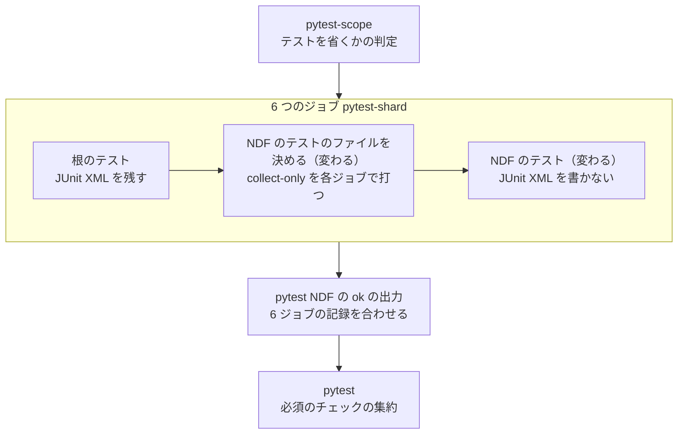
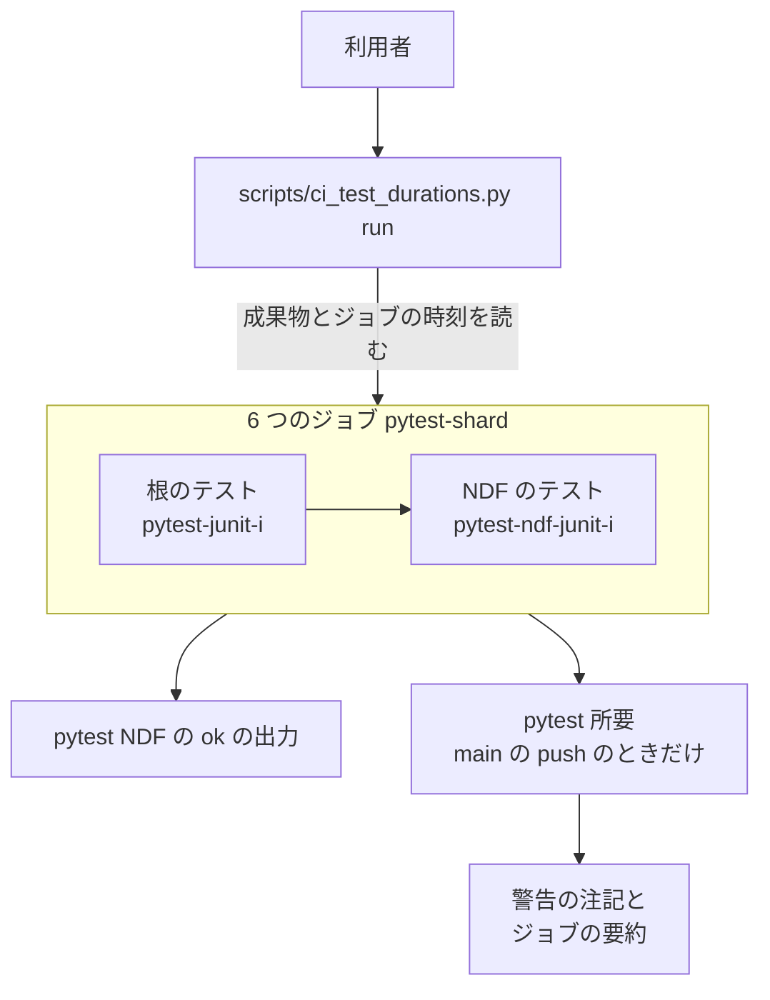
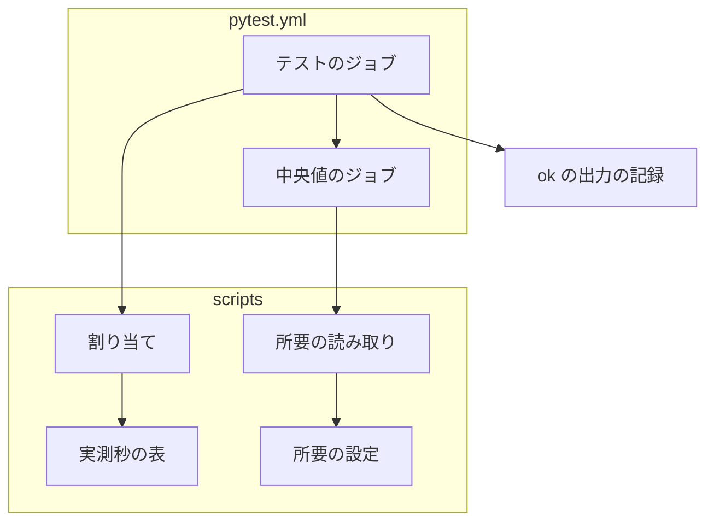
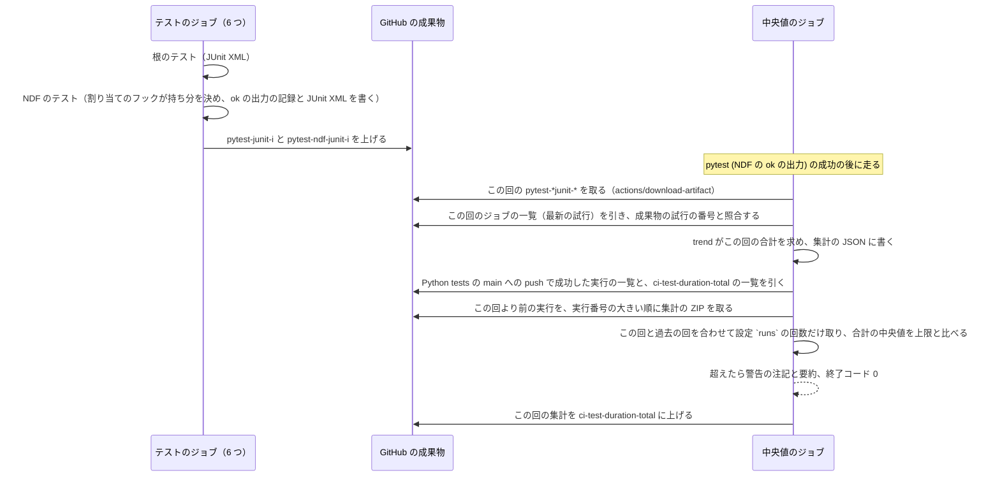

# テストの所要: CI のテスト 1 件ごとの秒を残し、main の中央値が上限を超えたら知らせる（#4331）

テストの量の目安が件数の上限だけで、機能を足すたびに上限を上げ直し、遅いテストも見つけられない。NDF のテストにも JUnit XML を書かせて 1 件ごとの秒を CI の成果物に残し、`main` の直近 10 回の中央値が上限を超えたら `main` の実行に警告を出す（1 回の所要はこのリポジトリのスクリプトで読む）。あわせて NDF のテストを実測の秒でジョブへ分けて 6 つのジョブの収集だけの手順をなくし、このリポジトリの設定からテストの件数の上限を外す。比べた案は決定の記録に、調べた製品とライブラリは末尾の外部の調査にある。

省いた文書: 実行計画（課題 1・PR 1）

## 今の姿

何が起きたか・目的・受け入れ条件は、要求仕様（[issue-4331-requirements.md](./issue-4331-requirements.md) ）にある。正は [#4331](https://github.com/devbasex/ai-plugins/issues/4331) の本文である。この文書は「どう解くか」と「なぜその解き方か」だけを書く。

変わるのは、ワークフロー `Python tests` の 2 か所である。定義は [.github/workflows/pytest.yml](../.github/workflows/pytest.yml) にある。

| 変わる所 | 図での位置 |
| --- | --- |
| 6 つのジョブの中の NDF のテストの手順 | 「（変わる）」を付けた 2 つの手順 |
| その後ろに足すジョブ | 図に無い（解き方の全体像の図にある） |

### この文書での呼び方

この文書では、テストを 2 つに分けて呼ぶ。パスは、断りが無ければリポジトリのルートから見たパスである。

| 呼び方 | 指すもの |
| --- | --- |
| 根のテスト | リポジトリのルートで `pytest .` を打って流すテスト（ルートの `conftest.py` と `scripts/tests` などのテスト）。`plugins/ndf` の下の NDF のテストは集めない |
| NDF のテスト | `plugins/ndf` を起点（pytest の `rootdir`）にして流す、`plugins/ndf/tests` の下のテスト |

**ok の出力の確かめ**は、NDF の各サブコマンドについて、正常終了（結果 JSON の状態が `ok`）の出力を検証したテストが少なくとも 1 件あることを確かめる仕組みである。検証とは、結果 JSON が結果のコントラクトとサブコマンドの結果のスキーマに合うことを、テストの間に確かめることを指す。1 件も無いサブコマンドがあれば、その名前を出して失敗にする。CI では、各ジョブが検証済みのサブコマンドの名前を記録する。後のジョブ `pytest (NDF の ok の出力)` が 6 ジョブの記録を合わせ、NDF の全サブコマンド（`cli.COMMANDS`）を網羅していなければ失敗にする。このジョブが失敗すると、必須のチェック `pytest` も失敗する。

### 設計に要る今の構造

設計に要る今の構造は次のとおりである。

| 対象 | 今の形 | 保存先 |
| --- | --- | --- |
| ジョブへの割り当て | 重いファイルから順に、いちばん空いているジョブへ入れる（`assign_files`）。根のテストは、ルートの `conftest.py` が全件を集めた後に持ち分でない項目を外す | [scripts/pytest_shard.py](../scripts/pytest_shard.py)、[conftest.py](../conftest.py) |
| ファイルごとの実測秒 | リポジトリのルートから見たパスをキーにした秒。根のテストの JUnit XML から `seconds` で作り直す | [scripts/pytest-shard-seconds.json](../scripts/pytest-shard-seconds.json) |
| NDF のテストの割り当て | `--collect-only` の出力のテストの数で分け、ファイルの一覧を引数で渡す。JUnit XML の `classname` は `plugins/ndf` から見た名前で、実測秒のキーと合わない | `pytest.yml` の「NDF のテストのファイルを決める」 |
| ok の出力の確かめ | NDF の `conftest.py` は、全体の実行（引数が `plugins/ndf` か `testpaths` のディレクトリだけで、絞り込みが無い）のときだけ自分で確かめる。CI はファイルを引数で渡すので全体の実行にならない。そのため各ジョブは記録を `NDF_OK_TOOLS_OUT` のファイルへ書き、後のジョブが合わせる | [plugins/ndf/tests/conftest.py](../plugins/ndf/tests/conftest.py) |
| 件数の上限 | 規則 `budget` は、設定 `budget` にキーがある項目だけ上限と比べる。件数はキーの有無にかかわらず結果 JSON の `metrics.budget` に出る | [plugins/ndf/src/ndf/checks/budget.py](../plugins/ndf/src/ndf/checks/budget.py)、`.ndf/project.json` の `budget.tests`（6,000） |

### 今の手順の所要

2026-11-25（JST）の `main` の実行（run 45495601478）で、ジョブ `pytest (0/6)` の手順の所要は次のとおりだった。値は `gh api repos/devbasex/ai-plugins/actions/runs/45495601478/jobs` の手順の時刻の差である。

| 手順 | 秒 |
| --- | ---: |
| NDF のテストのファイルを決める | 18 |
| NDF のテスト | 54 |
| 根のテスト | 14 |

成果物は 12 個で、根のテストの `pytest-junit-0`〜`5` と ok の記録の `ndf-ok-tools-0`〜`5` である。NDF のテストの JUnit XML は無い。

## 文脈と制約

- テストの所要の秒で Pull Request を落とさない。実行機の速さで秒が変わり、コードと関係なく落ちるためである。根拠は [#3423](https://github.com/devbasex/ai-plugins/issues/3423) の方針と要求の S1 である
- 分ける単位はファイルのままにする。同じファイルのテストを別のジョブへ割ると、ファイル単位の前提が割れる。前提とはモジュールの読み込みと一時ディレクトリである（ルートの `conftest.py` の説明）
- どのファイルもちょうど 1 つのジョブで流れる（受け入れ条件 10）。6 つのジョブがそれぞれ同じ入力から同じ割り当てを決めることで成り立たせる
- ok の出力の確かめの形を変えない。6 つのジョブが検証済みのサブコマンドの名前を記録し、後のジョブ `pytest (NDF の ok の出力)` が合わせて、全サブコマンドを網羅しているかで合否を決める（受け入れ条件 11）
- ワークフローのジョブの数は 39 で、設定の上限 `budget.ci_jobs` は 40 である（`.github/workflows/*.yml` の `jobs` のキーを数えた値）。足せるジョブは 1 つだけである
- 成果物の保存期間は、リポジトリの設定で 90 日である。値は `gh api repos/devbasex/ai-plugins/actions/permissions/artifact-and-log-retention` の `days` で見た。過ぎた回は読めなくてよい（要求の前提 2）
- 中央値の上限は設定ファイルの 1 か所に置き、上限を変えるのにコードの変更を要らないようにする（要求の非機能の条件）

## 解き方の全体像

- 6 つのジョブは、根のテストと NDF のテストの両方で JUnit XML を書き、成果物 `pytest-junit-<番号>` と `pytest-ndf-junit-<番号>` に残す
- NDF のテストは、ファイルごとの実測秒からジョブへ分ける。分けるのは収集の前に持ち分を決める pytest のプラグイン（`scripts/pytest_shard.py` を `-p` で読む）で、収集だけの手順はなくなる
- 利用者は `python3 scripts/ci_test_durations.py run <run の ID>` で 1 回の所要を読む。根と NDF の両方について、合計・遅い順の上位・ジョブごとの所要が出る
- `main` への push の実行では、足したジョブ `pytest (所要)` が直近 10 回の中央値を上限（`scripts/ci-test-duration.json`）と比べる。超えたら、超えた秒を警告の注記とジョブの要約に書く。どの場合も終了コードは 0 である
- このリポジトリの `.ndf/project.json` から `budget.tests` を外す。規則 `budget` のテストの件数の上限は、NDF の機能としては残る

## 機能一覧

| # | 機能 | 誰が使うか |
| --- | --- | --- |
| F1 | CI の 1 回ごとに、根と NDF のテスト 1 件ごとの秒を成果物に残す | CI（`main` と Pull Request の両方） |
| F2 | 1 回の実行を指して、所要の合計・遅い順の上位・ジョブごとの所要を出す | このリポジトリの開発者と AI |
| F3 | `main` の直近の中央値が上限を超えたことと、超えた秒を知らせる | `main` の CI と、その結果を見る開発者 |
| F4 | NDF のテストを、ファイルごとの実測秒でジョブへ分ける | CI |

## 構成要素

| 要素 | 責務 | 保存先 |
| --- | --- | --- |
| テストのジョブ | 根と NDF のテストを流し、それぞれの JUnit XML を成果物に上げる | `.github/workflows/pytest.yml` のジョブ `pytest-shard` |
| 割り当て | ファイルの一覧と実測秒から各ファイルの持ち分のジョブを決める。NDF のテストでは pytest のプラグインとして、持ち分でないファイルを収集の前に外す。JUnit XML から実測秒を作り直す | `scripts/pytest_shard.py` |
| 実測秒の表 | ファイルごとの秒。キーはリポジトリのルートから見たパスで、根と NDF のテストの両方を持つ | `scripts/pytest-shard-seconds.json` |
| 所要の読み取り | 成果物の JUnit XML とジョブの時刻を GitHub から読み、1 回の所要（`run`）を出す。`main` の 1 回の合計を集計の JSON に書き、過去の回の集計と合わせて直近の中央値（`trend`）を出す | `scripts/ci_test_durations.py`（新設） |
| 所要の設定 | 中央値に数える回数と上限の秒、遅い順に出す件数 | `scripts/ci-test-duration.json`（新設） |
| 中央値のジョブ | `main` への push の実行で、この回の JUnit XML を取って `trend` を打ち、結果を注記と要約に書く。この回の集計を成果物 `ci-test-duration-total` に上げる。失敗してもワークフローの結論に入らない | `.github/workflows/pytest.yml` のジョブ `pytest-duration`（新設、名前は `pytest (所要)`） |
| ok の出力の記録 | `NDF_OK_TOOLS_OUT` を渡された実行は、記録を書き出すだけにして、自分では確かめない | `plugins/ndf/tests/conftest.py` |

## 処理の流れ

`main` への push の 1 回で、所要が残り、中央値が比べられるまでの順序である。

中央値のジョブは、テストと ok の出力の確かめがどちらも成功した `main` への push の回だけを数え、その回の合計を集計として残す。過去の回は XML を読み直さず、残した集計だけを読む。

### 起動の条件と権限

- **起動の条件**: `needs` に `pytest-shard` と `pytest-ndf-ok-tools` を置く。走るのは、`github.event_name == 'push'`・`github.ref == 'refs/heads/main'`・両方の `result == 'success'` のときだけである。ok の出力の確かめが失敗した回は、必須のチェック `pytest` も失敗する回なので数えない（要求の前提 1）
- **ワークフローの結論に入れない**: ジョブに `continue-on-error: true` を付け、集約のジョブ `pytest` の `needs` にも入れない。checkout・成果物の取得が失敗しても、`main` のワークフローは失敗にならない（決定 3）
- **認証と権限**: `trend` の手順に、環境変数 `GH_TOKEN` としてジョブの `${{ github.token }}` を渡す（ジョブ `pytest-scope` と同じ渡し方）。ジョブの `permissions` は、成果物と実行の一覧を読む `actions: read` と、checkout に要る `contents: read` だけにする

### この回の合計

**この回の合計**: `trend` は、この回の集計の JSON を必ず書く。集計には有効か無効かの印を付け、成果物 `ci-test-duration-total` に上書きで上げる（集計の JSON の形は入出力のコントラクト）。

- **XML の取得**: この回は実行の途中なので、成果物 `pytest-*junit-*` を同じ回の中で `actions/download-artifact` で取る（STD3）
- **有効な集計**: 次の 3 つがそろったときだけ、`valid` を真にして合計の秒を書く。根と NDF の XML がテストのジョブの数（6）だけそろうこと、すべて読めること、下の「試行の照合」で 6 つの組がそろうことである
- **無効な集計**: そろわなければ、`valid` を偽にし、秒を `null` にして理由を書く。無効な集計も上げるのは、再実行で集計に失敗したときに、前の試行の有効な集計が上書きされずに残らないようにするためである
- **試行の番号**: どちらの集計にも、次の 2 つを書く。集計を作った中央値のジョブの試行の番号（`attempt`）と、採ったテストのジョブごとの試行の番号（`shard_attempts`）である
- **ファイルが無いとき**: `trend` が途中で止まってファイルが無いときは、上げる手順が警告を出す（`if-no-files-found: warn`）。このとき前の試行の集計が残ることがある。過去の回として読む側が、`attempt` を実行の最新の試行の番号と比べて外す（「候補ごとの取得」）

### 再実行での成果物

**再実行での成果物**: 失敗したジョブだけを再実行した場合は、テストのジョブごとに最新の試行の成果物をそろえ、その組から集計を作り直す。組が欠けた回は中央値に数えない。決めることは次の 6 つである。

- **上書きで上げる**: 同じ回の中では、成果物の名前は 1 つにしか使えない。
  - 固定した `actions/upload-artifact` の v7.0.2 では、入力 `overwrite` の既定が false である。同じ名前の成果物があると、上げる手順が失敗する（[action.yml](https://github.com/actions/upload-artifact/blob/cf430e030ddbb5b0abf93d22962f4752f3646cd9/action.yml) の `overwrite`）
  - 今の `ndf-ok-tools-<番号>` も上書きの指定が無い。記録を上げた後に落ちたジョブを再実行すると、記録を上げる手順で再び落ちる
  - そこで、次の 4 つとも `overwrite: true` で上げる。テストのジョブが上げる 3 つ（`pytest-junit-<番号>`・`pytest-ndf-junit-<番号>`・`ndf-ok-tools-<番号>`）と、集計の `ci-test-duration-total` である
- **残る組**: 失敗したジョブだけを再実行すると、再実行したテストのジョブの成果物は新しい試行のもので上書きされる。成功していたジョブは再実行されず、前の試行の成果物が残る。どちらも、そのジョブの最新の試行の成果物である。再実行したジョブに頼るジョブ（`pytest (NDF の ok の出力)` と中央値のジョブ）も GitHub が一緒に再実行する。そのため、ok の出力の確かめと集計は、そろえた組から作り直される
- **試行の照合**: 照合で確かめるのは、XML が最新の試行のものかどうかだけである。ジョブが成功したかは照合に含めない。
  - テストのジョブは、ファイル `shard-attempt-<番号>.txt` を、根と NDF の JUnit XML の成果物の両方に入れる。中身は `${{ github.run_attempt }}`（そのジョブの試行の番号）である
  - `trend` は、この回のジョブの一覧を最新の試行だけ引く（`gh api 'repos/{owner}/{repo}/actions/runs/<run の ID>/jobs?filter=latest&per_page=100'`、1 回）
  - テストのジョブ `pytest (<番号>/6)` ごとに、一覧の `run_attempt` が 2 つの成果物の試行の番号と同じなら、その番号の組は最新の試行のものとみなす
- **`trend` が数える組**: `trend` は、照合が通り、かつ一覧の `conclusion` が `success` のジョブだけを、そろった組として数える。中央値のジョブはテストのジョブがすべて成功した回にしか走らないので、ふつうは 6 つとも成功している。サブコマンド `run` は成功の条件を使わない（入出力のコントラクトの `run` の失敗の形）
- **組が欠けたとき**: 6 つの番号のどれかで組がそろわなければ、無効な集計を書き、その回を中央値に数えない。読めない XML と同じ扱いで、欠けた番号を警告に書く（下の「読めないものの扱い」の表）
- **再実行できる期間と記録の保存期間**: `ndf-ok-tools-<番号>` の保存期間を 30 日にする。
  - GitHub では、実行を最初に走らせてから 30 日まで、失敗したジョブだけを再実行できる（[GitHub Docs の Re-running workflows and jobs](https://docs.github.com/en/actions/how-tos/manage-workflow-runs/re-run-workflows-and-jobs) ）。成功していたジョブの成果物は、この 30 日の間残っている必要がある
  - JUnit XML の成果物はリポジトリの設定の 90 日残る。しかし今の `ndf-ok-tools-<番号>` は保存期間が 1 日（`retention-days: 1`）である。翌日以降に失敗したジョブだけを再実行すると、成功していたジョブの記録が期限切れになり、ok の出力の確かめが落ちる
  - 記録は数百バイトのテキストで、6 つを 30 日残しても保存量はほぼ増えない

### 過去の回の探し方

- **数える候補**: 成果物の名前だけでは、作ったワークフローも実行の結果も保証されない。そこで候補は、ワークフロー `Python tests` の実行の一覧から決める。この回の実行番号は、ジョブが `${{ github.run_number }}` を `--run-number` で渡す（API では引かない）。`trend` が引くのは次の 2 つの一覧で、どちらも新しい順に 1 ページ 100 件ずつ、要るページだけを読む
  1. 実行の一覧: `gh api 'repos/{owner}/{repo}/actions/workflows/pytest.yml/runs?branch=main&event=push&status=success&per_page=100&page=<n>'`
  2. 成果物の一覧: `gh api 'repos/{owner}/{repo}/actions/artifacts?name=ci-test-duration-total&per_page=100&page=<n>'`
- **候補の順序**: 実行の一覧のうち、実行番号がこの回より小さい実行だけを、実行番号の大きい順に並べる。成果物の作成時刻では並べない。
  - `main` への push は並んで走るので、後から始まった実行が先に集計を上げることがある。古い実行を再実行すると、新しい時刻の成果物ができることもある。どちらも、実行番号で並べれば順序が変わらない
  - テストを省いた回や、この回より新しい回も実行の一覧の 1 ページに入る。候補が足りなければ次のページを読む
- **候補ごとの取得**: 並べた実行ごとに、成果物の一覧から次の成果物を探す。`workflow_run.id` がその実行の ID と同じで、`expired` が偽の成果物である。
  - **ページの読み進め方**: 成果物は実行が始まった後に作られるので、成果物の作成時刻は実行の作成時刻より後である。そのため、読んだ成果物の一覧の最も古い作成時刻が候補の実行の作成時刻より新しいうちは、成果物の一覧の次のページを読んでから判断する。最も古い作成時刻が候補の実行より古くなっても見つからなければ、その実行に集計は無いので数えない（ZIP は取らない）
  - **数える条件**: 見つかれば ZIP を取り、次の 3 つがすべて当たるときだけ数える。(1) 集計の JSON の `run` がその実行の ID と同じ。(2) `valid` が真。(3) 集計の `attempt`（集計を作った中央値のジョブの試行の番号）が、実行の一覧にあるその実行の `run_attempt`（最新の試行の番号）と同じ
  - **(3) で外れる回**: 最新の試行で集計を作り直せず、前の試行の集計が残った回を外す。最新の試行で中央値のジョブが走らなかった回も外れるが、数えないほうへ倒すだけで、誤った秒は入らない。`run_attempt` は実行の一覧に載っているので、この照合で API の呼び出しは増えない
  - **集計の無い回**: 集計は起動の条件を満たした回にしか無い。そのため、テストを省いた回・NDF の JUnit XML を残す前の回・保存期間を過ぎた回は、ZIP を取らずに外れる（要求の前提 1・2）
- **探索の上限**: 次のどれかに当たったら、その先は読まない
  - この回を含めて、有効な集計が設定 `runs`（10）回そろった
  - ZIP の取得が、読めない集計を飛ばした分も含めて `2 ×（runs − 1）` 回（18 回）に達した
  - 一覧のページの取得が、2 つの一覧の合計で 10 ページに達した
  - 候補の実行の作成時刻が、成果物の保存期間（90 日）より前になった。その先の回の集計は期限切れである
  - `trend` の時間の予算を使い切った。予算は、中央値のジョブ全体の目標 60 秒から、集計を上げる手順の分を引いた時刻までである。回数の上限だけでは、`gh` の 1 回の上限 30 秒の呼び出しが最大 29 回並ぶと 870 秒かかるためである。`trend` は、ジョブの最初の手順が記録した時刻から締め切りを求め、`gh` を打つたびに締め切りまでの残りの秒を上限に渡す。残りが無ければ `gh` を打たずに止める
- **判定するか**: 上限は追加の取得を止めるだけである。判定するかは、取得を止めた時点で有効な集計がそろったかで決める。18 回目の ZIP の取得で 10 回そろえば判定する。そろわなければ、超えたかの判定をしない。何回そろったかと止めた理由（ZIP の取得の上限・ページの上限・保存期間・候補が尽きた・時間の上限）を、`::notice title=テストの所要::` の行とジョブの要約に書く（下の「知らせの出し分け」）
- **`runs` が 1 のとき**: 中央値に数えるのはこの回だけなので、過去の回を探さず（一覧のページも ZIP も取らない）、この回の合計を上限と比べる

### 知らせの出し分け

**知らせの出し分け**: `trend` が出す知らせは、何が起きたかで出し分ける。警告（`::warning`）は、上限を超えたときと、読めないものがあったときだけに出す。回数が足りないのは、記録を残し始めた直後の `main` では普通に起きるので、警告にしない。

| 起きたこと | 注記の行 | ジョブの要約 |
| --- | --- | --- |
| 中央値が上限を超えた | `::warning title=テストの所要::`（中央値・上限・超えた秒） | 数えた回・中央値・上限・差の表 |
| 中央値が上限以下 | 出さない | 数えた回・中央値・上限・差の表 |
| そろった回が `runs` に満たず、判定しなかった | `::notice title=テストの所要::`（そろった回数と止めた理由） | そろった回数と止めた理由 |
| 読めないものがあった（下の表） | `::warning title=テストの所要の読み取り::`（読めなかったものと回の ID） | 読めなかったもの |

1 回の `main` への push で増える GitHub API の呼び出しは、次のとおりである。この回の XML の成果物 12 個（根と NDF の 6 個ずつ）の取得は、`actions/download-artifact` で行い、下の数に含めない。

| 場合 | この回のジョブの一覧 | 一覧のページの取得 | 過去の回の集計の ZIP（数百バイト）の取得 |
| --- | ---: | ---: | ---: |
| 正常（10 回が 1 ページ目にそろい、読めない集計が無い） | 1 回 | 2 回 | 9 回 |
| 候補が 1 ページ目で足りない | 1 回 | 3 回以上、多くて 10 回 | 9 回 |
| 読めない集計がある | 1 回 | 2 回以上、多くて 10 回 | 多くて 18 回 |

### 読めないものの扱い

`trend` が読めないものに当たったときは、次のように扱う。どの場合も理由を上の `::warning title=テストの所要の読み取り::` の行で出し、終了コードは 0 である。

| 読めないもの | 扱い |
| --- | --- |
| この回の XML（そろわない・壊れていて読めない・成果物の試行の番号がジョブの最新の試行と違う） | 無効な集計を書き、判定もしない |
| この回のジョブの一覧（取得の失敗） | 試行を照合できないので、無効な集計を書き、判定もしない |
| 実行の一覧・成果物の一覧のページ（`gh` を使えない・認証できない・API の呼び出しが失敗した） | 判定しない。この回の集計の JSON は書く |
| 過去のある回の集計（ZIP の取得の失敗・JSON が壊れている・キーが足りない・集計 JSON のキー `run` が実行の ID と違う） | その回を数えず、並べた順で次の回を取る。数えなかった回の ID を警告に並べる。探索の上限に達した後の扱いは「判定するか」のとおり |

### 実測秒の作り直し

実測秒の作り直し（要求の E7）は、今と同じく手で打つ。使う回は、サブコマンド `run` が部分集計とも失敗したジョブを含むとも出さなかった回に限る。6 つのジョブの根と NDF の XML がすべてそろい、すべて最新の試行のもので、6 つのジョブがすべて成功した回である。外す理由は次の 3 つである。欠けたジョブのファイルは表から抜けて代わりの値で数えられる。古い試行の XML は最新の計測でない秒を表に入れる。落ちたジョブの XML は途中で止まったテストの秒を表に入れてしまう。

1. `gh run download <run の ID> -p 'pytest-*junit-*' -D <保存先>` で成果物を取る
2. `python3 scripts/pytest_shard.py seconds <保存先>` が、根と NDF の両方の XML から表を作り直す

`classname` はファイルのパスではなく、`tests.test_example.TestX` のようにドットで区切った名前である。今の `seconds` は、この名前の先頭からの部分を `/` でつないで `.py` を付け、実在するファイルを長い方から探す（`scripts/pytest_shard.py` の `_file_of`）。探す起点は、根のテストではリポジトリのルートである。`seconds` は成果物の名前 `pytest-ndf-junit-<番号>` で NDF の XML を見分け、探す起点を `plugins/ndf` にする。見つかったファイルは、リポジトリのルートから見たパスをキーにする。たとえば `tests.test_example.TestX` は、`plugins/ndf/tests/test_example.py` をキーにする。`classname` の先頭に `plugins/ndf/` を足すだけでは、ファイルのパスにならない。

## 入出力のコントラクト

足すのはこのリポジトリのスクリプトで、NDF のコマンドと結果 JSON は変わらない。

| 項目 | `run` | `trend` |
| --- | --- | --- |
| 名前 | `python3 scripts/ci_test_durations.py run <run の ID> [--top <件数>]` | `python3 scripts/ci_test_durations.py trend <XML のディレクトリ> --run <run の ID> --run-number <実行番号> --attempt <試行の番号> --out <集計の JSON>` |
| 入力 | run の ID（必須）。`--top` は遅い順に出す件数で、省けば設定の `top` | `<XML のディレクトリ>` は、この回の成果物 `pytest-*junit-*` を取った先。`--run` はこの回の ID で、集計の JSON に書く。`--run-number` はこの回の実行番号で、これより小さい実行番号の回を過去の回として数える。`--attempt` は中央値のジョブの試行の番号で、集計の JSON の `attempt` に書く。CI では `${{ github.run_id }}`・`${{ github.run_number }}`・`${{ github.run_attempt }}` を渡す。手で打つときも 3 つとも渡す。集計したい回の ID と実行番号に加え、その回の最新の試行の番号を `--attempt` に渡す（`gh run view <run の ID> --json attempt` の `attempt`）。最新の試行の番号でないと、その集計は過去の回として数えられない。`--out` はこの回の集計を書くファイル。リポジトリは `gh` の既定（作業ディレクトリの `origin`） |
| 出力（成功） | 標準出力へ、根と NDF のそれぞれの合計の秒と件数、両方の合計、遅い順の上位（秒・根と NDF のどちらのテストか・テストの id）、ジョブごとの所要（ジョブ全体・根のテストの手順・NDF のテストの手順の秒）、最も長いジョブ | `--out` へこの回の集計の JSON。標準出力へ、数えた回の ID と合計の秒、中央値、上限、差。`GITHUB_STEP_SUMMARY` があれば同じ内容を Markdown の表で書き足す。注記の行は処理の流れの「知らせの出し分け」の表のとおりに出す。最後に、この回の GitHub API の呼び出しの数（ジョブの一覧・一覧のページ・集計の ZIP）を書く |
| 失敗の形 | 根か NDF の JUnit XML が 1 つも読めない（残す前の回・保存期間を過ぎた回）ときは、どちらが無いかを標準エラーへ書いて 1 で終わる。一部のジョブの XML が無いときと、最新の試行の XML でないときは、部分集計として 0 で終わる。最新の試行かどうかは、`trend` と同じ「試行の照合」で決める。`run` はジョブごとの所要を読むためにジョブの一覧を最新の試行だけ引く（`filter=latest`）ので、照合で呼び出しは増えない。部分集計では、出力の先頭の行に「部分集計（欠けたジョブ: <番号>、古い試行のジョブ: <番号>）」と書く。合計と遅い順の上位は、照合が通ったジョブの XML だけから出す。 `run` は、CI が落ちた回の遅いテストを調べるのにも使うので、ジョブの成否で XML を外さない。落ちたジョブでも、照合が通った最新の試行の XML は合計と遅い順の上位に入れる。ジョブごとの所要の表には、各ジョブの結果（`conclusion`）を並べる。落ちたジョブがあれば、出力の先頭の行に「失敗したジョブを含む（<番号>）」と書く。終了コードは 0 のままである。 上限の初めの値と実測秒の表の作り直しに使えるのは、6 つのジョブの根と NDF の XML がすべてそろい、すべて最新の試行のもので、6 つのジョブがすべて成功した回だけである。部分集計の回と、失敗したジョブを含む回は使わない。落ちたテストは途中で止まり、秒が正常な回と違うことがあるためである。 引数の誤りと `gh` を使えないときは 2 で終わる | 引数の誤りは 2。読めないものに当たったときは、処理の流れの表のとおりに扱い、0 で終わる。超えたときも 0 |
| 互換性 | 新設 | 新設 |

所要の設定（`scripts/ci-test-duration.json`）の形:

| キー | 型 | 意味 |
| --- | --- | --- |
| `runs` | 整数（1 以上） | 中央値に数える回数（10）。1 ならこの回の合計だけで判定する |
| `limit_seconds` | 数 | 中央値の上限の秒（テスト 1 件ごとの秒の、根と NDF の合計） |
| `top` | 整数 | `run` が遅い順に出す件数（20） |

集計の JSON（`trend` の `--out`、成果物 `ci-test-duration-total`）の形:

| キー | 型 | 意味 |
| --- | --- | --- |
| `run` | 整数 | この回の ID（`--run`） |
| `attempt` | 整数 | 集計を作った中央値のジョブの試行の番号（`--attempt`。CI では `${{ github.run_attempt }}`） |
| `shard_attempts` | 配列。要素は 6 つで、ジョブの番号 0〜5 の順に並べる。各要素は整数か `null` | 採ったテストのジョブごとの試行の番号。照合できなかったジョブは `null` |
| `valid` | 真偽 | 6 つのジョブの組がそろい、すべて読めたら真 |
| `root_seconds`・`ndf_seconds`・`total_seconds` | 数か `null` | 根・NDF・両方の合計の秒。`valid` が偽なら `null` |
| `reason` | 文字列か `null` | `valid` が偽の理由（欠けたジョブ・古い試行のジョブ・読めない XML・ジョブの一覧を取れない） |

過去の回として数えるのは、次の 3 つがすべて当たる集計だけである（処理の流れの「候補ごとの取得」）。集計 JSON のキー `run` が実行の ID と同じであること、`valid` が真であること、`attempt` が実行の一覧の `run_attempt` と同じであることである。

## 非機能の実現方式

| 大項目 | 要求の条件 | 実現方式 | 確かめ方 |
| --- | --- | --- | --- |
| 性能・拡張性（テストの 6 ジョブ） | 所要を残す仕組みを足した後も、`Python tests` の 6 ジョブの所要の合計が変更前より増えない（受け入れ条件 9 の前と後の秒で示す） | 6 ジョブがそれぞれ打っていた収集だけの手順をなくす。持ち分でないファイルは収集の前に外すので、NDF のテストの手順が集めるのは持ち分のファイルだけで今と変わらない。持ち分の計算はジョブごとに 1 回だけ行う（決定 6）。足すのは JUnit XML の書き出しと成果物 1 つの上げだけである | 実装の Pull Request の CI の実行を指して `run` を打ち、変更前の run 45280461372 と同じ形（6 ジョブの合計と最も長いジョブ）で Pull Request に書く。収集だけの手順をなくした効果は、持ち分の計算を含む「NDF のテスト」の手順の秒で、変更前の「NDF のテストのファイルを決める」と「NDF のテスト」の 2 つの手順の秒の和と比べる |
| 性能・拡張性（ワークフロー全体） | 中央値のジョブを足しても、`main` の push 1 回で増える時間と取得の数が、下の許容の範囲に収まる | 中央値のジョブは `main` への push のときだけ走る。uv は準備せず、実行機の `python3` で `trend` を打つ（スクリプトは標準ライブラリだけを使う。決定 4）。取得は、この回の XML の成果物 12 個と、処理の流れの表の API の呼び出しだけである。見積もりは約 30 秒で、内訳は XML の成果物 12 個が約 13 秒、実行の一覧が約 6 秒、過去の回の集計の ZIP 9 個が約 10 秒である（決定 10 の測った読む秒） | 許容する増分は、push 1 回につき次の 3 つとする。(1) 中央値のジョブ 1 つの所要が 60 秒以内。これは目標である。`trend` は `gh` の呼び出しを締め切りで止め、止めた回は判定せずに集計を残す。ほかの手順は分単位の上限（`timeout-minutes`）で止めるだけで、60 秒は保証しない（詳細設計の「中央値のジョブ」）。(2) ワークフローの完了時間の増分が、中央値のジョブの所要以内。(3) 取得の数が、XML の成果物 12 個と、処理の流れの表のとおりの API の呼び出し（正常で 12 回、多くて 29 回）以内。有効な集計が 10 回そろって判定が出た最初の `main` の実行で、全ジョブの所要の合計・ワークフローの完了時間（`run_started_at` から `updated_at`）・`trend` が出した呼び出しの数を読む。比べる相手は、変更前の `main` の push の実行（run 45495601478）を同じ形で読んだ値である。結果は要求の Issue（[#4331](https://github.com/devbasex/ai-plugins/issues/4331)）の本文に書く。許容を超えたら、中央値のジョブの取得を減らす変更を起票する |
| 運用・保守性 | 中央値の上限は設定ファイルの 1 か所に置き、上限を変えるのにコードの変更が要らない | 上限と回数は `scripts/ci-test-duration.json` だけに置き、スクリプトはそこから読む | 設定の `limit_seconds` だけを変えて `trend` を打ち、判定が変わることを範囲テストで見る |

## 決定の記録

各決定の「根拠」の行の「Value <番号>」は、このリポジトリのプロジェクト MVV（判断の基準を書いた文書。バージョン 11、[.ndf/mvv.md](../.ndf/mvv.md)）の Value の番号と、その文の引用である。

### 決定 1: 実行機と分け方が変わっても値が跳ねないよう、主に見る量をテスト 1 件ごとの秒の合計にする

- **質問**: 中央値と上限で見る量を、テスト 1 件ごとの秒の合計・最も長いジョブの秒・ワークフローの所要のどれにするか
- **選んだ案**: 根と NDF の JUnit XML の `testcase` の `time` の合計にする。最も長いジョブの秒とジョブごとの所要は、`run` の出力に並べて読めるようにする
- 採らなかった案: 最も長いジョブの秒（分け方・準備の手順・実行機の割り当てで変わり、分け方を変えるたびに値が不連続に変わる。テストを足したことと区別できない）
- 採らなかった案: ワークフローの所要（キューの待ちと起動の時間を含み、2026-11-24 の直近 60 回で 36〜583 秒とぶれた）
- **代償**: 利用者が待つ時間（最も長いジョブ）は上限の対象にならない。分け方の偏りは `run` の出力で読むことになる
- 根拠: Value 2「CI の時間」・Value 13「効果は実測（費用・秒・件数）で示され」（MVV バージョン 11）。STD1

### 決定 2: ぶれで知らせが出ないよう、main の push の直近 10 回の中央値で比べ、10 回そろうまでは判定しない

- **質問**: 中央値に数える回数と、回数が足りないときの扱いをどうするか
- **選んだ案**: 成功した `main` への push の回のうち、両方の JUnit XML がそろった直近 10 回の中央値で比べる。そろった回が 10 回に満たなければ、そろった回数を書いて判定しない。回数は設定の `runs` に置く
- 採らなかった案: 1 回の秒で比べる（実行機の速さで秒が変わり、コードと関係なく知らせが出る。#3423 の方針）
- 採らなかった案: そろった回が少なくても、ある回だけで中央値を出す（NDF の JUnit XML を残し始めた直後は 1〜2 回で判定することになり、1 回の秒で比べるのと変わらない）
- **代償**: 変更をマージしてから 10 回の `main` の実行が終わるまで、超えたかの判定が出ない
- 根拠: Value 3「同じ手順は毎回同じ結果になる」（MVV バージョン 11）。回数は NDF の設定の解析にそろえる。そちらも実行の記録の中央値を直近 10 件で求めている（`plugins/ndf/src/ndf/domains/project/measure_ci.py` の `RECENT`）

### 決定 3: Pull Request を落とさず課題の一覧も増やさないよう、超えたことは main の実行の警告の注記とジョブの要約で知らせる

- **質問**: 中央値が上限を超えたことを、いつ誰が求め、どこへ知らせるか
- **選んだ案**: `main` への push の実行に足したジョブ `pytest (所要)` が求める。中央値・上限・超えた秒を、`::warning` の注記とジョブの要約（`GITHUB_STEP_SUMMARY`）へ書く。終了コードは常に 0 で、`main` の実行も失敗にしない。スクリプトの前の準備（checkout・成果物の取得）の失敗も、ワークフローの結論に入れない。そのため、ジョブに `continue-on-error: true` を付け、集約のジョブ `pytest` の `needs` にも入れない
- 採らなかった案: 超えたら Issue を自動で起票する（上限を超えている間は `main` の実行ごとに起票か更新が要り、課題の一覧が作業の残りで膨らむ）
- 採らなかった案: Pull Request へコメントする（1 回の秒が Pull Request の判断に入り、要求の S1 と受け入れ条件 6 に反する）
- 採らなかった案: 定期の別のワークフローで求める（`budget.ci_jobs` の残りの 1 つを使うのは同じで、マージから知らせまでに定期の間隔の遅れが入る）
- **代償**: 知らせは `main` の実行の画面と注記を見たときにしか目に入らない。人が気付くかは見る習慣に頼る
- 根拠: Value 6「利用者の Issue の一覧は、作業の残りや思いつきで膨らまない」・Value 5（MVV バージョン 11）。STD2

### 決定 4: このリポジトリの CI の形を NDF へ持ち込まないよう、所要の読み取りと上限をこのリポジトリのスクリプトと設定ファイルに置く

- **質問**: 所要を読むコマンドと中央値の上限を、NDF（コマンドと `.ndf/project.json`）に置くか、このリポジトリのスクリプトと設定ファイルに置くか
- **選んだ案**: `scripts/ci_test_durations.py` と `scripts/ci-test-duration.json` を新設する。GitHub からは `gh api` で読み、XML は標準ライブラリで読む。NDF のコードは import しない
- 採らなかった案: NDF のサブコマンドにし、上限を `.ndf/project.json` に置く（次の 3 つは、このリポジトリの CI の形である。6 つのジョブ・根と NDF の 2 つのテストの組・成果物の名前である。ほかのリポジトリで同じ形を前提にできない。使うのがまだこのリポジトリだけなのに、NDF の設定とスキーマへこの形を足すことになる）
- 採らなかった案: 結果を公開するアクション（LIB2）を足す（1 回の結果を Pull Request のチェックとして出すもので、直近の複数回の中央値と上限の比べ方を持たない。`checks: write` の権限も要る）
- **代償**: ほかのリポジトリで同じことをするには、NDF の機能として作り直す必要がある。`gh` で CI の記録を読むコードが、NDF の `measure_ci.py` と別にもう 1 つできる
- 作り方: 集計と判定は自前で作る。GitHub からの読み取りは GitHub CLI（LIB3）、XML の読み取りと中央値は Python の標準ライブラリ（LIB4）を使う
- 比べた候補: LIB2 / LIB3 / LIB4
- 根拠: Value 4「ai-plugins の流儀を、使う側のプロジェクトに持ち込まない」・Value 9「まだ要らない仕組みは先回りして作らず」（MVV バージョン 11）

### 決定 5: 件数の上限の上げ直しをやめるため、このリポジトリの設定から `budget.tests` を外し、NDF の規則は残す

- **質問**: テストの件数の上限 `budget.tests` を無くすか残すか
- **選んだ案**: このリポジトリの `.ndf/project.json` から `budget.tests` のキーを外す。規則 `budget` のコードと設定のスキーマは変えず、テストの件数は今と同じく `metrics.budget.tests` に出る。確定仕様（`docs/specifications/ndf-split-tables-toolchain-and-budget.md`）には次の 2 つを書く。このリポジトリはテストの量を実行時間で見ること、件数の上限は NDF の機能として残ることである
- 採らなかった案: NDF の規則からテストの件数の上限を無くす（実行時間を測る仕組みを持たないリポジトリから、量の上限を置く手段がなくなる。規則は設定にキーがあるときだけ効くので、残しても使わないリポジトリに影響しない）
- 採らなかった案: このリポジトリでも上限を残す（機能を足すたびに上限の上げ直しの作業と Pull Request が要り、遅いテストを見つける役にも立たない）
- **代償**: このリポジトリではテストの件数がいくら増えても Pull Request は落ちない。量の歯止めは決定 3 の知らせだけになる
- 根拠: Value 4「設定か引数を渡せば同じ工程が使える」・Value 10「コード・テスト・文書の量と未解決の不具合の数が測られ」（MVV バージョン 11）

### 決定 6: 収集だけの手順をなくすため、NDF のテストの持ち分を収集の前に pytest のプラグインで決める

- **質問**: NDF のテストを実測の秒でジョブへ分け、6 ジョブがそれぞれ打つ `--collect-only` の重なりをどう減らすか
- **選んだ案**: `scripts/pytest_shard.py` に pytest のフックを置き、NDF のテストの手順で `-p pytest_shard` を付けて読み込む。置くフックは `pytest_configure`・`pytest_configure_node`・`pytest_ignore_collect` である。
  - 読めるよう `scripts` を `PYTHONPATH` に足す。足すと、`scripts/` のモジュールが NDF のテストの import と同じ名前で衝突しうる。そこで 2026-11-25 に、`scripts/` の最上位のモジュール 24 個と、NDF の環境と `tests/support` のモジュール名を比べた。重なりは 0 件だった
  - 持ち分は、テストのジョブごとに 1 回だけ決める。pytest-xdist で並べて流すとき、テストを集めるのは各 worker で、それらを起動する controller は集めない。そこで、ファイルの探索と割り当ては controller の `pytest_configure` で 1 回だけ行い、結果を worker へ渡す。worker は計算しない
    - **controller**（`config` に `workerinput` が無いプロセス）: `pytest_configure` で、ファイルの一覧を探し、実測秒の表を読む。続けて `assign_files` で、一覧のすべてのファイルの担当のジョブを決める。その結果（ファイルから担当のジョブの番号への対応）を、そのまま `config` に保存する。このジョブの持ち分の集合だけを保存すると、ほかのジョブが持つファイルと一覧に無いファイルを見分けられない。一覧は、設定の `testpaths` の下で `python_files` に当たるファイルである
    - **worker への受け渡し**: pytest-xdist のフック `pytest_configure_node` で、controller が対応を `node.workerinput` に入れる。worker は `pytest_configure` で `config.workerinput` から対応を受け取って保存する。ファイルの探索・表の読み取り・割り当ては行わない
    - **xdist を使わない実行**（`-n` を付けない手元の実行）: そのプロセスが controller と同じく 1 回だけ計算し、自分で集める
  - `pytest_ignore_collect` は、収集の候補のパス（ディレクトリとファイル）ごとに呼ばれる。ディレクトリでは何も決めず（`None` を返し）、中の走査を pytest に任せる。テストのファイル（`python_files` に当たるファイル）でだけ、保存した対応から担当のジョブを引く。ファイルの探索と表の読み取りはしない。担当がこのジョブでなければ、収集の前に外す
  - 対応にキーが無いテストのファイル（一覧に無いファイル）を pytest が訪れたときだけ、ジョブ 0 を担当にする。どのジョブでも同じ結果になる。ディレクトリにはこの規則を当てないので、ジョブ 0 以外が持つファイルがディレクトリごと外れることはない
  - 環境変数は根のテストと同じ `SHARD_TOTAL`・`SHARD_INDEX` を使う
- 採らなかった案: pytest-split（LIB1）を使う（テスト 1 件の単位で割り、同じファイルのテストが別のジョブへ分かれる。文脈と制約のファイル単位の前提が割れる）
- 採らなかった案: 1 つのジョブで 1 回だけ収集し、結果を成果物で 6 ジョブへ配る（6 ジョブがその 1 つを待つので、最も長いジョブが延びる）
- 採らなかった案: `git ls-files` で作ったファイルの一覧を引数で渡す（一覧に無いファイルは、どのジョブにも渡らないので流れない。まだコミットしていないテストのファイルや、pytest の設定と `git ls-files` の絞り方が食い違ったファイルがこれに当たる。選んだ案では、pytest が訪れたファイルを必ずどれかのジョブが持つ。一覧に無ければジョブ 0 が持つので、流れないファイルが出ない）
- **代償**: NDF のテストの手順が `scripts/` のモジュールに頼るようになる。根のテストは今の割り当て（全件を集めた後に外す）のままで、2 つの外し方が並ぶ
- 作り方: 自前で作る
- 比べた候補: LIB1 / LIB5
- 根拠: Value 2「CI の時間」・Value 11「同じ規則・定数・処理は 1 か所にまとまり」（MVV バージョン 11）。割り当ての関数 `assign_files` は根のテストと同じものを使う

### 決定 7: 実測秒の表を 1 つに保つため、キーをリポジトリのルートから見たパスにそろえる

- **質問**: NDF のテストの実測秒を、今の表に入れるか別の表にするか
- **選んだ案**: 今の `scripts/pytest-shard-seconds.json` に入れ、キーはリポジトリのルートから見たパス（`plugins/ndf/tests/...`）にそろえる。`seconds` は成果物の名前で根と NDF の XML を見分ける。NDF の `classname` は `plugins/ndf` を起点に実在するファイルへ解決し、リポジトリのルートから見たパスをキーにする（処理の流れ）。フックはファイルのパスをリポジトリのルートから見たパスへ直して表を引く
- 採らなかった案: NDF のテスト用の表を別のファイルにする（同じ形の表が 2 つになり、作り直しのコマンドも 2 つ要る）
- **代償**: `seconds` が成果物の名前の付け方（名前に `ndf` を含むか）に頼る
- 根拠: Value 8「同じ事実を 2 か所に持たない」・Value 11（MVV バージョン 11）

### 決定 8: 分けて流す実行が自分で落ちないよう、`NDF_OK_TOOLS_OUT` を渡された実行は記録を書き出すだけにする

- **質問**: 引数でファイルを渡さなくなると、NDF の `conftest.py` は各ジョブを全体の実行とみなし、そのジョブの中だけで ok の出力の確かめを行う。各ジョブが流すのは持ち分のファイルだけなので、ok の出力を検証したテストがほかのジョブにしか無いサブコマンドが出る。そのサブコマンドの名前で、ジョブが失敗する。分けて流す実行をどう見分けるか
- **選んだ案**: `NDF_OK_TOOLS_OUT` を渡された実行は、検証済みのサブコマンドの名前をそのファイルへ書いて、自分では確かめない。網羅の確かめは、6 つのファイルを読む後のジョブ `pytest (NDF の ok の出力)` が今と同じく行う。記録が欠けたサブコマンドがあれば、そのジョブが失敗し、必須のチェック `pytest` も失敗する
- 採らなかった案: NDF の `conftest.py` が `SHARD_TOTAL` を読んで見分ける（このリポジトリの CI の環境変数の名前を NDF のテストへ持ち込む）
- 採らなかった案: 外したファイルがあったかで見分ける（pytest-xdist では収集が各 worker で起き、確かめを行う controller からは外したファイルが見えない）
- **代償**: `NDF_OK_TOOLS_OUT` を渡して手元で全体を流すと、ok の出力の確かめが行われない
- 根拠: Value 9「責務の分かれた設計で作られる」（MVV バージョン 11）

### 決定 9: 実測秒の作り直しは、今と同じく手で打つ

- **質問**: 実測秒の表をいつ誰が作り直すか（要求の E7）
- **選んだ案**: 偏りが目立ったときに、開発者が成果物を取って `seconds` を打ち、Pull Request で直す。最初の作り直しは実装の Pull Request の CI の成果物で行う
- 採らなかった案: `main` の CI が表を作り直して自動でコミットする（`main` への直接の push は ruleset が禁じる。Pull Request を作らせると、その Pull Request が CI のたびに増える）
- **代償**: 表が古いと割り当ての偏りが戻る。偏りは `run` の出力のジョブごとの所要で読むことになる
- 根拠: Value 6「使うほど散らからない」（MVV バージョン 11）。`scripts/pytest_shard.py` の説明（値が古くても割り当ては成り立ち、偏りが戻るだけである）

### 決定 10: 中央値のジョブが同じ回の XML を毎回読み直さないよう、各回の合計を集計の成果物に残し、過去の回はそれだけを読む

- **質問**: 直近 10 回の合計を、各回の JUnit XML から毎回求め直すか、各回で求めた合計を残して読むか
- **選んだ案**: 中央値のジョブが、この回の合計を集計の JSON に書いて成果物 `ci-test-duration-total` に上げる。過去の回は、実行の一覧で選んだ回の集計だけを取る（処理の流れ）
- 採らなかった案: 過去の回の XML を毎回読み直す（1 回の `main` への push で、9 回分の成果物の一覧と 108 個（9 回 × 12 個）の ZIP の取得が要る。直前の回とほぼ同じ 9 回分の集計を、push のたびに繰り返す）
- **測った読む秒**: 2026-11-25（JST）に、開発用のコンテナから `gh api` で `main` の run 45495601478 の成果物を 3 回ずつ取って測った。GitHub の実行機では測っていない。NDF の JUnit XML の成果物はまだ無いので、根の成果物と同じ秒で取れるとして見積もった

  | 取得したもの | 秒（3 回） |
  | --- | --- |
  | 1 回分の成果物の一覧 | 0.32〜0.34 |
  | 根の JUnit XML の ZIP 6 個（1 個 2.7〜9.6 KB） | 6.44〜6.78 |
  | ok の記録の ZIP 1 個（集計と同じ数百バイト） | 1.02〜1.14 |
  | 名前で絞った成果物の一覧 | 0.41 |
  | `Python tests` の `main` への push で成功した実行の一覧（100 件） | 5.67（1 回） |

  どちらの方式も、数える回を選ぶのに実行の一覧（約 5.7 秒）が要る。それに加えて、XML を読み直す方式は 1 回分が一覧 0.3 秒と ZIP 12 個の約 13 秒で、9 回分で約 120 秒かかり、合計は約 126 秒になる。集計を読む方式は、名前で絞った成果物の一覧の約 0.4 秒と、ZIP 9 個の約 9.5 秒が加わり、合計は約 16 秒になる
- 採らなかった案: 直近 10 回の合計を 1 つの成果物に持ち回す（前の回の値をそのまま引き継ぐので、1 回の誤った値がそれ以後のすべての回に残る。前の回の成果物が無いと、つながりが切れる）
- **代償**: 合計は XML の写しになり、合計の求め方を変えても、過去の回の集計は前の求め方のままである。求め方を変えたときは、保存期間の内で 10 回が入れ替わるまで、新旧の値が混ざる
- 根拠: Value 8「正本の外に写した値（集計・キャッシュ）は、読む速さや費用を実測した根拠を設計文書に書いてから足される」・Value 2「CI の時間」（MVV バージョン 11）。読む秒は上の表のとおりで、実行機での秒は「未確認のまま残ること」で確かめる

## 影響と危険

- **働く範囲**: このリポジトリの CI とスクリプトだけである。NDF のコマンド・結果 JSON・設定のスキーマ・規則 `budget` は変わらない。NDF の配布物で変わるのは、テストの `plugins/ndf/tests/conftest.py` の ok の出力の確かめだけで、利用者のリポジトリでは働かない
- **プロジェクトごとに違うもの**: 上限と回数はこのリポジトリの設定ファイル `scripts/ci-test-duration.json` で受ける。NDF の設定には置かない
- **当たるモード**（NDF が工程を進める形の種類。`standard`・`light` など）: 無い（NDF の工程の振る舞いを変えない）
- **ジョブの数**: ジョブを 1 つ足すと 40 になり、上限 `budget.ci_jobs` の 40 に並ぶ。次にジョブを足す変更は、上限を上げるかジョブをまとめる必要がある
- **最初の割り当て**: `assign_files` は、表に秒の無いファイルを、割り当てる NDF のファイルのうち表に秒のあるものの秒の中央値で数える。秒のある NDF のファイルが 1 つも無ければ、1 秒で数える。根のテストの秒は、この代わりの値に使わない。実装の途中で NDF の実測秒が表に無い間は、すべての NDF のファイルが 1 秒で数えられ、ファイルの数で分けることになる。実装の Pull Request の CI の成果物で表を作り直してから、受け入れ条件 8・9 の秒を測る
- **既存の CI 計測（`ndf project measure`）**: このリポジトリを NDF で解析すると、JUnit の ZIP が 6 個から 12 個に増える。ZIP は `Python tests` の実行から取る。合計の時間は約 7 秒増えるが、制限時間に収まる見込みである
  - **増える理由**: NDF の CI 計測（`plugins/ndf/src/ndf/domains/project/measure_ci.py` の `_junit_of_run`）は、代表に選んだ実行の成果物の ZIP を取る。取るのは、名前が `JUNIT_NAME`（`junit`・`pytest` などを含む名前）に当たるものすべてである。`pytest-ndf-junit-<番号>` もこれに当たる
  - **集計の成果物の名前**: 集計の成果物は、`JUNIT_NAME` に当たらない `ci-test-duration-total` にする。`pytest` を含む名前にすると、XML の無い ZIP を 1 つ余分に取ることになる
  - **時間**: 増える 6 個の取得は、決定 10 の測った秒（根の ZIP 6 個で 6.44〜6.78 秒）から約 7 秒と見積もる。測定の締め切りは 120 秒である（[plugins/ndf/contracts/limits/project.measure.json](../plugins/ndf/contracts/limits/project.measure.json) ）。`gh` の 1 回の上限は 30 秒である（[plugins/ndf/contracts/limits/project.measure-call.json](../plugins/ndf/contracts/limits/project.measure-call.json) ）
  - **測る値**: テストの所要の候補（`ci-junit`）に NDF のテストの秒が加わり、値が大きくなる。今は NDF のテストの秒が入っていないので、実際のテストの所要に近づく変化である
  - **取得の数**: 代表の実行 1 回の計測で、JUnit の ZIP の取得とそのための `gh` の起動が、どちらも 6 回から 12 回に増える。成果物の一覧の取得（1 回）は変わらない
  - **許容する増分**: 増分が 10 秒以内であること。増分は、マージの前は ZIP の取得の秒の差で、マージの後は `elapsed_seconds` の差である。マージの後は、変更後の `elapsed_seconds` が測定の締め切り 120 秒に収まることも確かめる。10 秒は、見積もりの約 7 秒に 3 秒の余裕を足した値である。見積もりは 3 回の計測から求め、回ごとの差は 0.34 秒（6 個で 6.44〜6.78 秒）だったが、計測した日以外の回線の混み具合は測っていないため、余裕を置く
  - **比べる実行の決め方**: `ndf project measure` は、計測する実行を指定できない。`Python tests` の代表は、リポジトリ全体の成功した実行のうち、ジョブを飛ばしていない最新の実行である（`measure_ci.py` の `_measure_runs` と `_representative`）。変更後は、Pull Request の実行では中央値のジョブが飛ばされるので、代表に選ばれるのは `main` への push の実行だけになる。そのため、マージの前の判定は、実行の ID を指定して ZIP を直接取る秒で行う。`ndf project measure` は、マージの後に、選ばれた実行の ID を確かめてから値を読む
  - **マージの前の判定**: 変更前は `main` の run 45495601478 の根の JUnit の成果物 6 個、変更後は実装の Pull Request の CI の実行の 12 個を測る。どちらも、`ndf project measure` と同じく `gh api repos/devbasex/ai-plugins/actions/artifacts/<成果物の ID>/zip` で 1 個ずつ順に取り、合計の秒を 3 回ずつ測る。2 つは同じ機械で同じ日に続けて測る。変更後の中央値から変更前の中央値を引いた秒が増分である。2 つの実行の ID と 6 回の秒を Pull Request に書く
  - **マージの後の確かめ**: 変更前の値は、実装に着手するときに `ndf project measure` を打って読む。変更後の値は、マージの後の最初の `main` への push の実行が成功してから、同じ機械で同じコマンドを打って読む。どちらも、結果の `test_duration` の `ci-junit` の説明（`run <ID>（.github/workflows/pytest.yml）の JUnit <本数> 本の合計`）から、選ばれた実行の ID と XML の本数を読む。変更前は変更を含まない実行で 6 本、変更後はマージの後の `main` の実行で 12 本であることを確かめる。違う実行が選ばれていたら、その値は使わず、意図した実行が最新になってから打ち直す。2 回の `elapsed_seconds`・実行の ID・本数を、要求の Issue（[#4331](https://github.com/devbasex/ai-plugins/issues/4331)）の本文に書く。マージの後で増分が 10 秒を超えたら、下の「まとめる形」へ変える変更を起票する
  - **超えたとき**: マージの前の判定で増分が 10 秒を超えたら、同じ Pull Request の中で、根と NDF の XML を 1 つの成果物にまとめ（まとめる形）、ZIP を 6 個に戻してからマージする。変えるのは次の 4 か所で、最後に `run` で確かめる
    - ワークフロー: 根の成果物を上げる手順を NDF のテストの後へ移し、`pytest-junit-<番号>` に根の XML・NDF の XML・試行の番号のファイルの 3 つを入れる。成果物 `pytest-ndf-junit-<番号>` は作らない
    - `fetch_run` の展開の規則: 成果物 `pytest-junit-<番号>` の中の `pytest-junit-<番号>.xml`・`pytest-ndf-junit-<番号>.xml`・`shard-attempt-<番号>.txt` の 3 つを受け入れる。今の規則は、この成果物の中の NDF の XML を飛ばすので、変えないと `run` に NDF の XML が届かない
    - `read_parts`: 根と NDF の部品を、成果物の名前でなく中のファイルの名前で見分ける。試行の番号のファイルは、同じ番号の根と NDF の両方の部品に使う
    - `seconds`（`scripts/pytest_shard.py` の `_seconds`）: `pytest-ndf-junit-` を含むかを、成果物のディレクトリの名前でなく XML のファイルの名前で見る
    - 確かめ: まとめる形の CI の実行を `run` で読み、終了コードが 0 で、部分集計の行が出ず、根と NDF の両方の合計が出ることを確かめる
- **同じファイルを触る別の変更**: `.github/workflows/pytest.yml` と `.ndf/project.json` は多くの変更が触る。マージの前に `main` を取り込み、ジョブの数を数え直す

### 代表のリポジトリでの振る舞い

NDF の配布物で変わるのはテストの `conftest.py` だけで、利用者のリポジトリでは読まれない。

| 代表のリポジトリ | 設定の要点 | 直した後に起きること | この種類で扱えなくなること |
| --- | --- | --- | --- |
| Web サービス | テストのコマンドと CI のジョブを `.ndf/project.json` の `test` に書く | 規則 `budget` のテストの件数の上限は、設定にキーがあれば今と同じく効く。設計・設計の検査・cross-review・MVV 判定の振る舞いは変わらない | 無し |
| モバイルアプリ | 同上 | 同上 | 無し |
| 業務文書だけ | テストを持たないことがある | 同上（テストのファイルが無ければ件数は 0 件） | 無し |

### ai-plugins だけの事情

| 値 | 置く所 | 持つ Issue |
| --- | --- | --- |
| 中央値に数える回数・上限の秒・遅い順に出す件数 | `scripts/ci-test-duration.json` | [#4331](https://github.com/devbasex/ai-plugins/issues/4331) |
| テストを 6 つのジョブへ分けること、根と NDF の 2 つのテストの組、成果物の名前 | `.github/workflows/pytest.yml` | [#4331](https://github.com/devbasex/ai-plugins/issues/4331) |
| テストの件数の上限を置かないこと | `.ndf/project.json` の `budget`（`tests` のキーを持たない） | [#4331](https://github.com/devbasex/ai-plugins/issues/4331) |

## テスト設計

| 受け入れ条件・不変条件 | どの振る舞いで縛るか | どう壊したら落ちるべきか |
| --- | --- | --- |
| 1. 1 件ごとの所要が成果物に残る | ワークフローの NDF のテストの手順が `--junitxml` を付け、成果物 `pytest-ndf-junit-<番号>` を上げる（実装の Pull Request の CI の成果物の一覧で見る） | ワークフローの検査ではなく手動確認で見る。リリース後の確認の計画の条件 1 |
| 2. 1 回の所要がコマンド 1 つで出る | `run` が、根と NDF の XML を読んで、両方の合計・遅い順の上位・ジョブごとの所要を出す（`gh` の応答を差し替えた範囲テスト） | NDF の XML を数えない・遅い順を逆にする・ジョブの手順の秒を取り違えると落ちる |
| 3. 記録が無い回は 0 以外で終わる | 根か NDF の XML が 1 つも無い回で、`run` が無い側を標準エラーに出して 1 を返す。期限切れ（`expired`）の成果物も無いとして扱う。一部のジョブの XML だけが無い回と、`shard-attempt-<番号>.txt` の試行の番号がジョブの一覧（最新の試行）の `run_attempt` と違うジョブがある回では、0 を返し、出力の先頭の行に「部分集計（欠けたジョブ: <番号>、古い試行のジョブ: <番号>）」と書く。合計には照合が通ったジョブの XML だけを足す。落ちたジョブの最新の試行の XML は合計と遅い順の上位に入れ、ジョブごとの表にジョブの結果を並べ、先頭の行に「失敗したジョブを含む（<番号>）」と書く | 片方だけ無い回を 0 で返す・期限切れの成果物を読みに行く・部分集計と書かずに合計を出す・古い試行の XML を合計に足す・落ちたジョブの最新の XML を外す・失敗したジョブを含むと書かないと落ちる |
| 4. 中央値が上限を超えたら分かる | そろった回が 10 回あり中央値が上限を超えると、`trend` が中央値・上限・超えた秒と `::warning title=テストの所要::` の行を出す | 平均で比べる・超えた秒の符号を逆にする・注記を出さないと落ちる |
| 5. 上限以下なら知らせが出ない | 中央値が上限と等しいとき・下回るとき、`trend` が `::warning` の行を出さない。そろった回が 10 回に満たず読めないものも無いときは、`::warning` の行を出さず、そろった回数と止めた理由を書いた `::notice title=テストの所要::` の行を 1 つ出す | 等しいときに警告を出す・回数が足りないのに判定する・回数が足りないときに警告を出す・判定しなかった理由を出さないと落ちる |
| 再実行した回の試行の照合 | この回のジョブの一覧（最新の試行）の `run_attempt` と、各ジョブの 2 つの成果物の `shard-attempt-<番号>.txt` を比べる。6 つのジョブのすべてで一致し `conclusion` が `success` のときだけ、`valid` が真の集計を書く。1 つでも違えば `valid` が偽で秒が `null` の集計を書き、欠けた番号を `::warning title=テストの所要の読み取り::` の行に出す。どちらの集計にも `attempt` と `shard_attempts` が入る。過去の回の集計は、`valid` が偽のものと、`attempt` が実行の一覧の `run_attempt` と違うもの（前の試行の集計が残った回）を数えずに次の回へ進む（`gh` の応答と成果物を差し替えた範囲テスト）。4 つの成果物の手順が `overwrite: true` を持ち、`ndf-ok-tools-<番号>` の保存期間が 30 日であることはワークフローの定義で見る | 試行の番号が違う成果物で有効な集計を書く・ジョブの一覧が取れないのに有効な集計を書く・照合に失敗したときに集計のファイルを書かない・`valid` が偽の集計を数える・`attempt` が最新の試行と違う集計を数えると落ちる |
| 6. Pull Request の CI を落とさない | `trend` は超えたときも `gh` を使えないときも 0 を返す。中央値のジョブは `main` への push のときだけ走り、`continue-on-error: true` を持ち、集約のジョブ `pytest` の `needs` に入らない（ワークフローの定義で見る） | 超えたときに 0 以外を返すと落ちる |
| 数える回の選び方と読めない回の扱い | `main` への push で成功した `Python tests` の実行のうち、この回より実行番号の小さい回だけを、実行番号の大きい順に数える。過去の回の集計のうち 1 回が壊れていても、次の回を取って 10 回そろえて判定する。18 回目の ZIP の取得で 10 回そろえば判定し、18 回目でもそろわなければ判定しない。候補が 1 ページ目で足りないときは、次のページを読んでそろえる。一覧が取れないときは判定せず 0 を返す。この回の XML がそろわないときは `valid` が偽の集計を書く（`gh` の応答を差し替えた範囲テスト） | 一覧に無い実行の集計を数える・成果物の作成時刻で並べる・`run` の違う集計を数える・壊れた 1 回で探索をやめる・18 回目でそろったのに判定しない・上限を超えて取得を続ける・2 ページ目以降を読まない・そろわない XML で有効な集計を書くと落ちる |
| 7. `budget.tests` の決定がそろう | `.ndf/project.json` の `budget` に `tests` が無く、`ndf check` の規則 `budget` がテストの件数を上限と比べない（既存の `plugins/ndf/tests/checks/test_budget.py` の「キーが無い項目は比べない」で縛られている） | 規則の側は既存のテストが持つ。設定と確定仕様の一致はテストで縛らず、cross-review で見る |
| 8. 実測の秒で分ける | フックが、実測秒の表の秒で持ち分を決める。表に重いファイルを置くと、そのファイルが空いているジョブへ入る。`workerinput` に対応を持つ worker の `config` を渡すと、ファイルの探索と表の読み取りをせずにその対応を使う（探索の関数を差し替えた範囲テストで、呼ばれた数が 0 であることを見る） | 項目の数で分ける・リポジトリのルートから見たパスへ直さずに表を引く・worker で割り当てを計算し直すと落ちる |
| 9. 収集の手順の秒が減り、前と後が示される | ワークフローから「NDF のテストのファイルを決める」の手順が無くなる。秒は実装の Pull Request に書く（手動確認） | テストでは縛らない。秒は実行機で変わる |
| 10. どのファイルもちょうど 1 つのジョブで流れる | 同じファイルの一覧と表から 6 つの持ち分を作ると、和が一覧と一致し、重ならない。一覧に無いファイルも 1 つのジョブだけが持つ。サブディレクトリの中のファイルをジョブ 0 以外に割り当てたとき、そのジョブで流れ、ディレクトリが外されない。ルートのテストの振り分けを出すコマンド `python3 scripts/pytest_shard.py files --total 2 --index <番号>` の出力も変わらない。要求仕様の受け入れ条件 10 の確かめと同じ入力（`tests/a.py` に 2 件、`tests/b.py` と `tests/c.py` に 1 件ずつ）を渡すと、ジョブ 0 が `tests/a.py`、ジョブ 1 が `tests/b.py` と `tests/c.py` を持つ | 一覧に無いファイルをどのジョブも外す・2 つのジョブが持つ・ディレクトリにジョブ 0 の規則を当てると落ちる |
| 11. ok の出力の確かめが 6 ジョブの記録で決まる | `NDF_OK_TOOLS_OUT` を渡した全体の実行は、検証済みのサブコマンドの名前を書いて、検証済みでないサブコマンドがあっても落ちない。渡さない全体の実行は、今と同じく、検証済みでないサブコマンドがあれば落ちる | 渡したときに確かめる・渡さないときに確かめないと落ちる |
| 実測秒の作り直し | `seconds` が根と NDF の XML から、リポジトリのルートから見たパスをキーにした表を作る | NDF の `classname` をリポジトリのルートから見たパスへ戻さないと、表に `plugins/ndf/tests/...` のキーが入らず落ちる |

## 設計の結果

詳細設計は [issue-4331-design-detail.md](./issue-4331-design-detail.md) にある。新設する関数が 2 つ以上あり、既存の関数のシグネチャを 1 つ（`scripts/pytest_shard.py` の `_file_of`）変えるため、別ファイルにした。

| 課題 | 扱い | 統合先 | 触るファイル |
| --- | --- | --- | --- |
| #4331 | 実装する | — | `.github/workflows/pytest.yml`、`scripts/pytest_shard.py`、`scripts/pytest-shard-seconds.json`、`scripts/ci_test_durations.py`（新設）、`scripts/ci-test-duration.json`（新設）、`scripts/tests/test_pytest_shard.py`（新設）、`scripts/tests/test_ci_test_durations.py`（新設）、`plugins/ndf/tests/conftest.py`、`plugins/ndf/tests/test_ok_tools_record.py`（新設）、`.ndf/project.json`、`docs/specifications/ndf-split-tables-toolchain-and-budget.md` |

## 人へ残す判断

当たるレッドラインの番号は、NDF の共通原則の「必ず人の承認が要る操作」の表の番号である。表は [plugins/ndf/contracts/data/ndf-common-principles.md](../plugins/ndf/contracts/data/ndf-common-principles.md) にある。C7 は、利用者の設定（`.ndf/`）と指示書を書き換える操作である。

| 判断 | 当たるレッドライン | なぜ当たるか |
| --- | --- | --- |
| このリポジトリの `.ndf/project.json` から `budget.tests` を外す（決定 5） | C7 | 利用者の設定（`.ndf/`）を書き換える。変更は実装の中でコミットし、設計承認ゲートとリリース承認ゲートで人が見る |

## 未確認のまま残ること

| 項目 | 内容 |
| --- | --- |
| 上限の初めの値 | NDF のテストの JUnit XML がまだ無く、根と NDF の合計の秒が分からない（根だけは 2026-11-24 の 1 回で 136 秒）。実装の Pull Request の CI の実行で `run` を打って合計を測り、その 1.25 倍を 10 秒単位で切り上げた値を `limit_seconds` に置く。測る回は、サブコマンド `run` が部分集計とも失敗したジョブを含むとも出さなかった回（6 つのジョブの根と NDF の XML がすべてそろい、すべて最新の試行のもので、6 つのジョブがすべて成功した回）に限る。欠けた XML の合計から決めると上限が低くなり、正常な所要でも上限を超えたと知らせることになる |
| ルートの `conftest.py` が NDF のテストで読まれないこと | NDF のテストの手順は `plugins/ndf` を起点に流すので、ルートの `conftest.py`（`SHARD_TOTAL` で項目を外す）は読まれない見込みである。実装で同じ環境変数を渡して流し、ルートの側の外し方が働かないことを NDF のテストの件数で確かめる |
| 実行機での読む秒 | 決定 10 の読む秒は、開発用のコンテナから測った値である。GitHub の実行機では測っていない。実装の後の最初の `main` の実行では、過去の回の集計がまだ無いので、集計の成果物が残ることだけを確かめる。有効な集計が 10 回そろって通常の判定が出た最初の実行で、非機能の実現方式の「ワークフロー全体」の行の値（全ジョブの所要の合計・ワークフローの完了時間・取得の数）を読み、許容の範囲と比べる |
| 収集の前に外したときの手順の秒 | 持ち分でないファイルを外すと各 worker の収集が持ち分だけになる見込みで、受け入れ条件 9 の前と後の秒は実装の Pull Request の CI で分かる |

## 外部の調査

| 種類 | 調べるか | 理由 |
| --- | --- | --- |
| 標準・仕様 | 調べる | テスト 1 件ごとの秒は JUnit XML の形と pytest の書き方に、知らせの形と成果物の読める時期は GitHub Actions の仕様に従う |
| 主要な製品 | 調べない | 比べる相手は CI の上でテストの結果と秒を扱うアクションとプラグインで、ライブラリとサービスの表で比べる |
| ライブラリとサービス | 調べる | ジョブへの分け方（pytest-split・pytest-xdist）と、結果を出すアクションを使えるかを決める |

### 標準・仕様

| # | 標準・仕様 | 何を定めているか | 設計への反映 | 出典 |
| --- | --- | --- | --- | --- |
| STD1 | pytest の JUnit XML（`--junitxml`・`junit_duration_report`） | `testcase` の `time` は既定で準備・本体・後始末の合計（`total`） | 決定 1 の合計は `time` をそのまま足す | https://raw.githubusercontent.com/pytest-dev/pytest/main/doc/en/reference/reference.rst の `junit_duration_report`（2026-11-25） |
| STD2 | GitHub Actions の workflow commands | `::warning title=...::` の行が注記になり、`GITHUB_STEP_SUMMARY` のファイルがジョブの要約になる | 決定 3 の知らせの形 | https://raw.githubusercontent.com/github/docs/main/content/actions/reference/workflows-and-actions/workflow-commands.md の「Setting a warning message」（2026-11-25） |
| STD3 | GitHub Actions の成果物 v4 | 上げた直後から API で取得できる。保存期間は既定 90 日で 1〜90 日 | 処理の流れで、実行の途中のこの回の成果物を、同じ回の中央値のジョブが取る。保存期間は前提 2 のとおり | https://github.blog/changelog/2023-12-14-github-actions-artifacts-v4-is-now-generally-available/ 、https://raw.githubusercontent.com/actions/upload-artifact/main/README.md の「Retention Period」（2026-11-25） |

### ライブラリとサービス

| # | 候補 | バージョン | ライセンス | 最後のリリースの日付 | 終了のアナウンス | 要件を満たすか | 出典 |
| --- | --- | --- | --- | --- | --- | --- | --- |
| LIB1 | pytest-split | 0.11.0 | MIT | 2026-02-03 | 無し | 満たさない。テスト 1 件の単位で割り、ファイル単位の前提を保てない（アルゴリズムは `duration_based_chunks` と `least_duration`） | https://pypi.org/pypi/pytest-split/json 、https://raw.githubusercontent.com/jerry-git/pytest-split/master/README.md （2026-11-25） |
| LIB2 | EnricoMi/publish-unit-test-result-action | v2.26.0 | Apache-2.0 | 2026-11-06 | 無し | 満たさない。1 回の結果をチェックとして出すもので、直近の複数回の中央値と上限の比べ方を持たない。`checks: write` が要る | https://raw.githubusercontent.com/EnricoMi/publish-unit-test-result-action/master/README.md の「Permissions」、https://api.github.com/repos/EnricoMi/publish-unit-test-result-action/releases/latest （2026-11-25） |
| LIB3 | GitHub CLI（`gh api`・`gh run download`） | 2.x（このリポジトリの NDF が既に使う） | MIT | 確かめていない | 無し | 満たす。成果物の一覧・取得とジョブの時刻を読める | `plugins/ndf/src/ndf/domains/project/measure_ci.py` の `Gh`（2026-11-25） |
| LIB4 | Python 標準ライブラリ `xml.etree.ElementTree`・`statistics` | Python 3.13 | PSF | — | 無し | 満たす。JUnit XML の読み取りと中央値 | `plugins/ndf/src/ndf/domains/project/measure_ci.py` の `junit_seconds`・`ndf_record`（2026-11-25） |
| LIB5 | pytest-xdist | 根と NDF の `uv.lock` の固定のもの | MIT | 確かめていない | 無し | 一部だけ。1 つのジョブの中の並列（`-n auto`）は使い続けるが、ジョブをまたいだ割り当ては持たない | `.github/workflows/pytest.yml` の `-n auto`、`plugins/ndf/pyproject.toml`（2026-11-25） |

### 確かめられなかったこと

| 対象 | 試した手段 | 結果と理由 |
| --- | --- | --- |
| GitHub CLI と pytest-xdist の最後のリリースの日付 | 試していない | どちらも既に使っている依存で、この設計で使い方を変えない |

調べた量: 候補 8 件・取得の試み 10 回。
