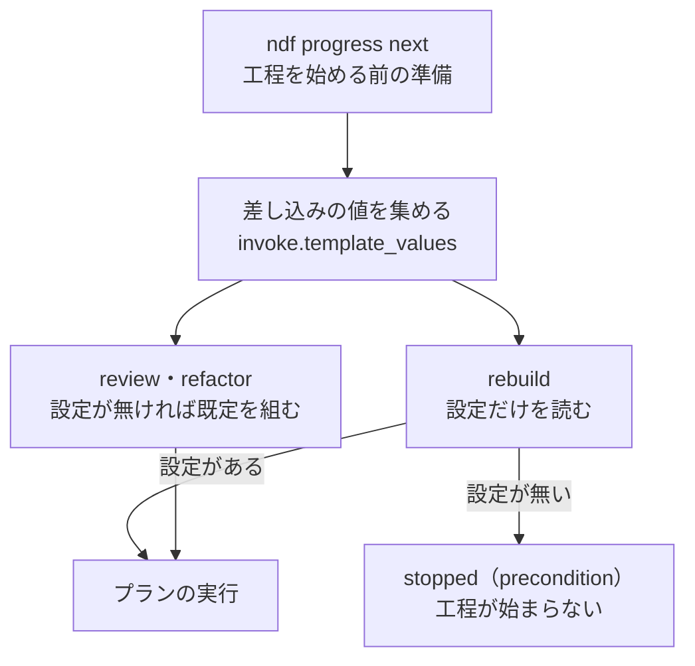
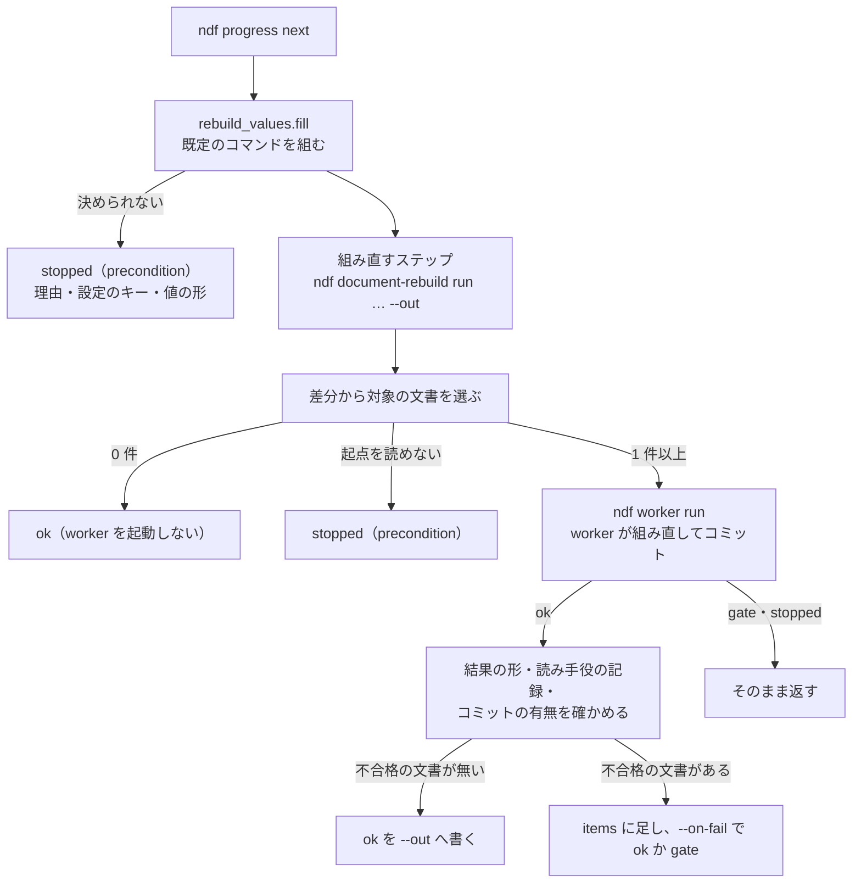
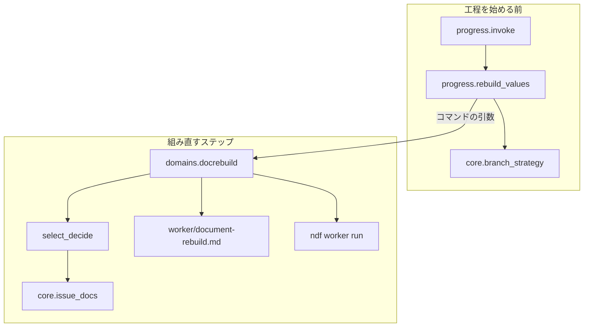
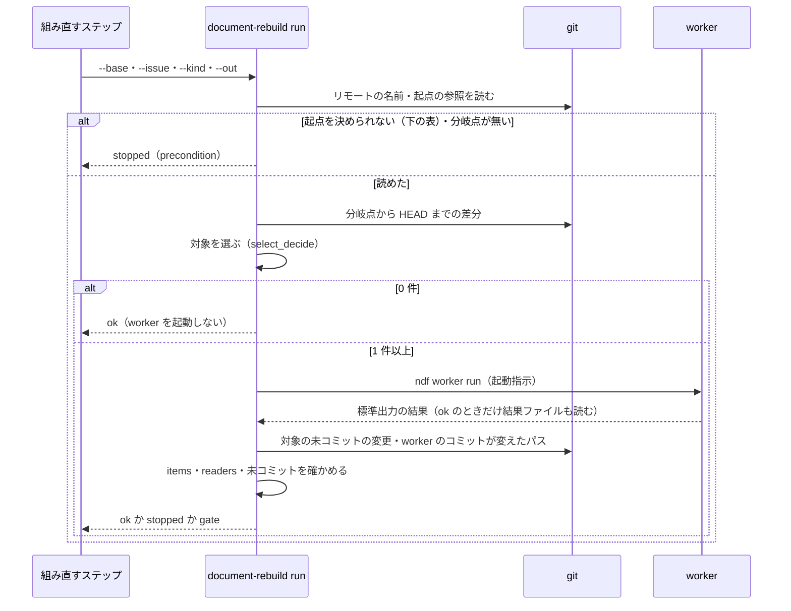

# 文書の組み直し: 起動の設定が無いリポジトリでも、設計とドキュメント再構成が流れる（#4337）

文書を組み直すコマンド（差し込み `rebuild`）に既定が無く、設定を足していないリポジトリでは、工程「設計」と「ドキュメント再構成」のプランが始まらない。工程を始める前には既定のコマンドだけを組み、組み直すステップで新しいサブコマンド `ndf document-rebuild run` が、差分から文書を選んで worker を 1 回起動する。結果ファイルは、このサブコマンドが形を確かめてから書く。採らなかった案は「決定の記録」に、外部の調査を省いた理由は末尾にある。

## 今の姿

何が起きたか・目的・受け入れ条件は、要求仕様（[issue-4337-requirements.md](./issue-4337-requirements.md)、正は #4337 の本文）にある。この文書は「どう解くか」と「なぜその解き方か」だけを書く。文中の「条件 N」「前提 N」「影響の表」「要求の未決」は、要求仕様のものを指す。



| 部品 | 今の振る舞い |
| --- | --- |
| 差し込みの値を集める処理（`plugins/ndf/src/ndf/progress/invoke.py`） | `rebuild` の出所は `.ndf/project.json` の `workflow.launch.rebuild` だけで、無ければ `TemplateValuesMissing` を上げる。根本原因は、`rebuild` だけが既定を組む処理を持たないことである |
| リファクタリングの既定（`plugins/ndf/src/ndf/progress/refactor_values.py`） | 同じ集める処理の中で、ブランチ戦略の設定から起点を決めて既定のコマンドを組む。差分はコマンドを打つ時点に読む |
| 工程「ドキュメント再構成」の定義 | 入力は課題の番号（`issues`）と作業場所（`worktree`）だけで、モードを受けない |
| 既定の代わりのスクリプト（`scripts/launch-document-rebuild.sh`） | worker が結果ファイルを直接書き、形を確かめる処理が無い。対象の選び方の問題 3 つは要求仕様の「事象」にある |

## 文脈と制約

- 設計書は、工程を始める前の準備の時点ではまだ無い。対象の文書は、組み直すステップを打った時点でしか決められない
- 組み直すステップの形は、テンプレートが `[<rebuild>, "--out", "{state_dir}/rebuild.json"]` と決めている。設定のコマンドも既定のコマンドも、同じ引数を受ける（条件 15）
- 工程の入力に、スプリントブランチの名前と設計 PR のマージ先は無い
- 影響の表が「worker を 1 回ずつ起動する」と定めるので、読み手役の確かめのために 2 本目の worker を起動しない
- 差し込み `base` を決める処理は、ブランチ戦略の設定が無いと先に別の理由（`invalid`）で止まる。条件 14 の理由を出すには、`rebuild` をそれより先に決める
- `invoke.py` は 982 行で、1 ファイル 1,000 行の上限に近い。既定を組む処理は別のモジュールに置く
- `ndf` のモジュールの層は下から `contracts`・`adapters`・`core`・`progress`・`domains` で、下の層は上の層を読まない

## 解き方の全体像



- 工程を始める前の準備は、ベースブランチ・課題の番号・選ぶ文書の種類を引数に持つ既定のコマンドを組む。差分は読まない
- `ndf document-rebuild run` は、起点から `HEAD` までの差分から、引数の課題の設計書・設計書を省いた実装計画・原稿だけを選ぶ。worker へは選んだ文書だけを渡す
- worker は `document-rebuild` の手順を通して作業場所でコミットし、読み手役の確かめの記録を結果に残す。push と Pull Request は今のとおり後ろのステップが行う
- 設定 `workflow.launch.rebuild` があれば、今のとおり設定のコマンドだけを使う

## ドメインモデル

### コンテキスト

| コンテキスト | 何の語が 1 つの意味に決まるか |
| --- | --- |
| NDF のプランの実行（`ndf-supervise`） | 工程を始める前に、差し込みの値をどこから決めるか |
| NDF の文書の組み直し（`ndf-document`） | どの文書を組み直し、何を確かめた記録として残すか |

プランの実行が供給者、文書の組み直しが顧客の関係（顧客 / 供給者）である。文書の組み直しは、コマンドの引数（ベースブランチ・課題・文書の種類）だけを受け、工程とモードの表を読まない。

### 集約

| 集約 | オーナー（書き換えてよいもの） | 根 | エンティティ | 値オブジェクト |
| --- | --- | --- | --- | --- |
| 組み直しの実行 | `ndf.domains.docrebuild` | 組み直しの結果（`--out`） | — | 対象の文書・足すべき内容・読み手役の記録 |

### 不変条件

| # | 集約 | 条件 | 破れたときの扱い |
| --- | --- | --- | --- |
| I1 | 組み直しの実行 | worker に渡す文書は、起点からの差分にあり、引数の種類と課題に合うものだけである | 選ばない |
| I2 | 組み直しの実行 | 起点を決められなければ、対象を 0 件とみなさない | `stopped`（`precondition`） |
| I3 | 組み直しの実行 | `ok` の結果は、足すべき内容を 1 件ずつ `id` と `text` で持つ | `stopped`（`bad_report`） |
| I4 | 組み直しの実行 | worker を起動した `ok` の結果は、対象の文書ごとに、読み手役の確かめの結果か、立てられなかった理由を持つ | `stopped`（`incomplete`。欠けた文書を `gaps` に挙げる） |
| I5 | 組み直しの実行 | 読み手役が不合格（`fail`）とした文書は、`items` に 1 件ずつ現れる。判断する人のいない `ok` では終わらない | 工程「設計」は `ok`（レビューと設計承認ゲートが判断する）、「ドキュメント再構成」は `gate` |
| I6 | 組み直しの実行 | worker の後に、対象の文書の未コミットの変更が作業場所に残っていない | `stopped`（`incomplete`。残った文書を `gaps` に挙げる） |

### ドメインイベント

| # | イベント | 発生元 | 受け手 |
| --- | --- | --- | --- |
| E1 | 組み直しのコマンドを決めた | `rebuild_values.fill` | 工程の開始（`progress.run`） |
| E2 | 工程を始めた | `progress.run` | プランの実行 |
| E3 | 設計書を書いてコミットした | 設計書を書く worker（作業 `design`） | 組み直すステップ |
| E4 | 組み直す文書を選んだ | `ndf document-rebuild run` | worker の起動 |
| E5 | 対象が無いと分かった | `ndf document-rebuild run` | プランの次のステップ |
| E6 | 文書を組み直してコミットした | worker | `ndf document-rebuild run` |
| E7 | 足すべき内容を結果に残した | `ndf document-rebuild run` | 設計のレビュー（`ndf cross-review run --findings`） |
| E8 | 代わりの設定とスクリプトを消した | リリースの後の PR（決定 8） | ai-plugins のスプリント |

## 構成要素

| 要素 | 責務 |
| --- | --- |
| 既定の組み立て（新設。`ndf.progress.rebuild_values`） | 設定が無いときの既定のコマンドを組む。工程とモードから文書の種類と `--on-fail` への対応を持つ。ベースブランチは、値がまだ無ければ読み込み済みの設定から 1 回だけ決め、テンプレートが `base` を使うなら `base` の値としても返す。決められなければ理由・設定のキー・値の形を返す |
| 差し込みの値を集める処理（変更。`ndf.progress.invoke`） | `rebuild` を打った場所の値（`route.derived_locally`）より先に埋め、`rebuild_values.fill` が返した `base` も差し込みに入れる。`derived_locally` は値のある `base` を求め直さないので、設計のプランの `rebuild` と `base` は同じ解決済みのマージ先になり、ブランチ戦略の設定の読み込みと検証は 1 回で済む。欠けの `items` に上の 3 つを載せる |
| サブコマンド `ndf document-rebuild run`（新設。`ndf.domains.docrebuild`） | 起点を決め、対象を選び、起動指示を組み、`ndf worker run` を打ち、結果を確かめて `--out` と標準出力へ出す。`push` と GitHub への書き込みを持たない |
| 対象の選択（新設。`ndf.domains.docrebuild.select_decide`） | 差分のパスと実装計画の頭から対象を選ぶ。ファイルも git も読まない純粋な処理 |
| 課題の文書の名前（新設。`ndf.core.issue_docs`） | 設計書のパスの形と、名前に含む課題の番号。`ndf loop design-tests` が持つ同じ正規表現をここへ移し、両方が読む |
| 起動指示のテンプレート（新設。`contracts/worker/document-rebuild.md`） | 組み直す worker への指示。差し込みは `string.Template` の `$名前` |
| 工程の定義（変更。`contracts/workflow/stages/document-rebuild.json`） | 入力に `mode` を足す |
| worker の規則（変更。`development-workflow` の `agent-layers.md`） | 読み手役を立ててよい worker の例外を 1 つ足す（決定 5） |



## 入出力のコントラクト

### `ndf document-rebuild run`

**引数と作業場所**:

| 項目 | 内容 |
| --- | --- |
| `--base <ブランチ>`（必須） | ベースブランチの名前（スプリントの PR のマージ先）。リモートの名前は `Git.remote()`（`adapters/git.py`）で 1 回だけ求める。メインディレクトリの `.ndf/worktree.json` の `remote` を読み、設定かキーが無ければ既存の既定値（`default_remote()`）を使う。作業場所の worktree にある設定は読まない。`remote` の値の形が誤っている（`Git.remote()` が `RemoteError` を上げる）か、その名前のリモートが登録されていなければ、起点を決められないときと同じく `stopped`（`precondition`）にする。登録の確かめ方と手元の参照へ切り替える条件は「処理の流れ」の表にある |
| `--issue <番号>`（1 回以上） | 工程が扱う課題 |
| `--kind <design・plan・manuscript>`（1 回以上） | 選ぶ文書の種類（下の表） |
| `--on-fail <items・gate>`（必須） | 読み手役が不合格とした文書があるときの終わり方。`items` は `items` に足して `ok`、`gate` は `items` に足して `gate` |
| `--state-dir <保存先>`（必須） | 起動指示と worker の結果ファイルの保存先。既定のコマンドでは `{state_dir}`。この文字列は `values.json` とプランにはそのまま残り、プランの実行（`core/plan`）がステップを打つ時に絶対パスへ置き換える |
| `--out <ファイル>`（必須） | 結果 JSON を書くファイル。テンプレートが後ろに足す |
| 作業場所 | 打った場所（プランの作業場所） |

**選ぶ文書**:

| `--kind` | 選ぶ文書 |
| --- | --- |
| `design` | `issues/issue-<番号の並び>-design` で始まる Markdown（前提 1）のうち、番号の並びに `--issue` の番号のどれかを含むもの |
| `plan` | `issues/issue-<番号>-plan.md` のうち、番号が `--issue` にあり、最初の `##` の見出しより前に `省いた文書: 設計書` の行を持つもの |
| `manuscript` | `issues/` の外の Markdown（`*.md`） |

要求仕様のコピーと、条件に合わない実装計画は、どの種類にも当たらない（前提 2・3）。

**終わり方**:

| 終わり方 | 結果 |
| --- | --- |
| 組み直した | `ok`。`items` は足すべき内容の `{"id", "text"}`、`metrics` は `targets`（対象のパス）・`readers`（文書ごとの読み手役の記録）・`touched`（worker のコミットが変えたパス） |
| 対象が 0 件 | `ok`。`summary` は「組み直す文書が無い（種類・起点）」、`items` は空、`metrics.targets` は空。worker を起動しない |
| 起点を決められない | `stopped`（`precondition`）。`summary` に読めない参照の名前（リモートの名前の形が誤っている・登録されていないときは、その名前と設定のキー `.ndf/worktree.json` の `remote`）。worker を起動しない |
| worker が判断を求めた・作業を残した・起動に失敗した | `ndf worker run` の `gate`、または `stopped` の種類（`kind`）・`gaps` をそのまま返す |
| 足すべき内容の形が違う | `stopped`（`bad_report`） |
| 読み手役の記録が欠けた文書がある | `stopped`（`incomplete`）。`gaps` に文書ごとに 1 件 |
| 対象の文書の変更がコミットされていない | `stopped`（`incomplete`）。`gaps` に文書ごとに 1 件 |
| 読み手役が不合格とした文書がある | `--on-fail items` は `ok`、`--on-fail gate` は `gate`。どちらも、`items` に文書ごとに 1 件（`id` は `reader-<番号>`、`text` は文書・不合格の質問・理由）を足す |

どの終わり方でも、標準出力の最後の 1 行と `--out` に同じ結果 JSON を書く。

**worker の終わりの読み方**: `ndf worker run` の標準出力と、worker が書いた結果ファイルは中身が違う。次の順に読む。

1. 標準出力の結果 JSON を先に読む。`_cmd_run`（`core/worker.py`）が結果ファイルを検査した後の `status`・`kind`・`gaps`・`routes` である。`ok` でなければ、これをそのまま返して結果ファイルを読まない
2. 標準出力が `ok` のときだけ、worker の結果ファイルを読み、足すべき内容（`items`）と `metrics.readers` を取る。標準出力の `items` はセッションの情報（`{"kind": "session", …}`）なので、足すべき内容として読まない

**不合格の扱い**: `document-rebuild` の手順は、2 回目も不合格なら直さずに報告し、進めるかを承認する人が判断すると定める。コードはこの判断の渡し先だけを決める。

| 工程 | `--on-fail` | 判断する所 |
| --- | --- | --- |
| 設計 | `items` | 続くレビューが `--findings` で 1 件ずつ直すか見送り、残ったものを設計承認ゲートで承認する人が見る |
| ドキュメント再構成 | `gate` | 後ろに `items` を読むステップが無いので、push の前にプランを承認ゲートで終える。`approved` なら次のステップ（push）から続き、`rejected` なら続けない（`ndf plan` が `rebuild` のステップの `gate` を今もそう扱う）。不合格が無ければ止まらない |

**読み手役の記録**（worker の結果ファイルの `metrics.readers` の要素。対象の文書 1 件に 1 つ）:

| キー | 値 |
| --- | --- |
| `doc` | 対象の文書のパス |
| `verdict` | 最後の結果。`pass`（合格）・`fixed`（不合格の箇所を直したが、読み直させていない。`plan` と `manuscript` だけ）・`fail`（不合格が残った）・`not_run`（1 回も立てられなかった） |
| `checks` | 確かめの並び（行った順）。要素は `{"verdict": "pass・fail", "restatements": [質問ごとの言い直し], "reason": "不合格の質問と理由"}`。`restatements` は必須、`reason` は `fail` のとき必須。`not_run` では空 |
| `reason` | `not_run` では立てられなかった理由、`fail` の設計書で 2 回目を行えなかったときはその理由。どちらも必須 |

`document-rebuild` の手順の回数に合わせ、`checks` の数を種類ごとに確かめる。合わなければ記録の欠け（I4）とする。

| 種類 | `checks` の数 | 最後の結果 |
| --- | --- | --- |
| `design` | 1 回目が合格なら 1。不合格なら直して読み直した 2（両方を残す）。2 回目を行えなければ 1 と `reason` | 最後の `checks` の `verdict` |
| `plan`・`manuscript` | 1（読み直させない） | 合格なら `pass`。不合格で、語の置き換えと順の入れ替えですべて直せたなら `fixed`、直さずに足すべき内容へ残したものがあれば `fail` |

### 既定のコマンド

工程の定義の名前とモードから、選ぶ種類を決める。

| プラン | モード | `--kind` | `--on-fail` |
| --- | --- | --- | --- |
| `design` | すべて | `design` | `items` |
| `document-rebuild` | `documentation` のほか | `design` と `plan` | `gate` |
| `document-rebuild` | `documentation` | `design`・`plan`・`manuscript` | `gate` |

例（課題 4337・ベースブランチ `main` の工程「設計」）:

```text
ndf document-rebuild run --base main --issue 4337 --kind design --on-fail items --state-dir {state_dir}
```

### 既定を決められないときの `ndf progress next`

`stopped`（`precondition`）の `items` の `rebuild` の行に、今のキー（`key`・`source`）に加えて次の 3 つを載せる。工程の記録は書かない。

| キー | 値の例 |
| --- | --- |
| `reason` | `.ndf/project.json に branch_strategy の設定が無い`（ブランチ戦略の設定を読む処理が返す理由の文） |
| `setting` | `workflow.launch.rebuild` |
| `shape` | `コマンドの語の並び（空でない文字列を 1 つ以上持つ配列）` |

互換性: 設定 `workflow.launch.rebuild` の形・結果 JSON の今のキー・差し込みの名前は変えない。`ndf route render`・`run` は今のとおり `rebuild` を引数で渡す。

## 処理の流れ



起点は、下の表で決めた参照と `HEAD` との分岐点（`git merge-base HEAD <参照>`）である。`Git.remote()` は値の形だけを確かめ、その名前のリモートがあるかを見ない。そこで、リモート追跡の参照 `refs/remotes/<リモート>/<ベース>` が読めないときだけ、登録済みのリモートの一覧（`git remote`）を読んで分ける。

| リモート追跡の参照 | 登録済みのリモート | 起点の参照 |
| --- | --- | --- |
| 読める | 読まない | リモート追跡の参照 |
| 読めない | 求めた名前がある（ベースブランチを取得していない） | 手元の参照 `refs/heads/<ベース>`。これも読めなければ `stopped`（`precondition`） |
| 読めない | 1 つも無い（リモートの無いリポジトリ） | 同上 |
| 読めない | ほかの名前だけがある（設定の誤記、`remote` の設定漏れ） | 手元へ切り替えず `stopped`（`precondition`） |

差分は `git diff --name-only -z --diff-filter=d <分岐点> HEAD` で読む。参照は 1 つだけ渡す。`git merge-base HEAD <手元> <リモート追跡>` は、2 つの参照を仮にマージしたものとの分岐点を求めるので、手元だけにあるコミットまで差分から外す。

git の子プロセスの回数は次のとおりである。`Git.remote()` は中で `git worktree list --porcelain -z` を打つので、リモートの名前を求めるだけで 1 回増える。これは対象を選ぶ前なので、対象が 0 件でも打つ。

| 場面 | 打つもの | 回数 |
| --- | --- | --- |
| 対象を選ぶまで（0 件でも） | `git worktree list`・リモート追跡の参照の `git rev-parse`・`git merge-base`・`git diff` | 4 |
| リモート追跡の参照が読めないとき | 上に加えて `git remote`・手元の参照の `git rev-parse` | +2 |
| worker を起動したとき | 起動の前の `HEAD` の `git rev-parse`、終わりの後の `git status --porcelain`・`git diff --name-only` | +3 |

使い捨てのリポジトリで確かめた結果は次のとおりである（2026-11-24、git 2.53.0）。

| 確かめたこと | 結果 |
| --- | --- |
| 手元の `trunk` が古く、リモート追跡の参照だけが進んでいる | 差分は、リモート追跡の参照より後のファイルだけ。手元を起点にすると、先に入った他人のファイルも入る |
| 手元の `trunk` だけが進み（未 push のコミット `l.md`）、そこからスプリントを切った | リモート追跡を起点にすると `l.md` と自分のファイル。手元か、2 つの参照の両方を渡すと `l.md` が外れる |
| 手元とリモート追跡が分かれ、手元からスプリントを切った | 同上（リモート追跡だけが `l.md` を差分に残す。リモートにだけあるファイルは入らない） |
| 手元とリモート追跡が分かれ、リモート追跡からスプリントを切った | リモート追跡を起点にすると自分のファイルだけ。手元を起点にすると、リモートにある他人のファイルも入る |
| 設計のブランチがベースブランチへ、マージコミットで入った | 起点が `HEAD` そのものになり、差分は空 |
| 設計のブランチがベースブランチへ、squash で入った | 起点が動かず、設計書は差分に残る |
| 読めない参照を `git merge-base` に渡す | 終了コード 128。渡す前に `git rev-parse -q --verify <参照>^{commit}`（読めなければ終了コード 1）で読めるものだけにする |
| 履歴を共有しない 2 つのブランチ | 分岐点が無い（`git diff <参照>...HEAD` は終了コード 128） |
| 日本語と空白を含むファイル名 | `-z` を付けると引用されずに読める |

## 非機能の実現方式

| 大項目 | 要求の条件 | 実現方式 | 確かめ方 |
| --- | --- | --- | --- |
| 移行性 | ai-plugins の代わりの設定とスクリプトを消した後も、既定を持たない NDF（11.0.28 以前）で動いている ai-plugins のスプリントが、設計の始めで止まらない。利用者のリポジトリで要る移行は無い | 消す変更をリリースの後の別の PR に分ける（決定 8）。設定とスクリプトは作業場所のリポジトリの根から読むので、消す前に切った作業場所には残る | PR をマージする前に、決定 8 の 2 つの条件を確かめて PR の本文に書く |

## 決定の記録

決定の根拠に書く Value は、このリポジトリの判断基準（`.ndf/mvv.md`）の項目である。

### 決定 1: 設計書がまだ無い時点で対象を決めないため、工程の前はコマンドだけを組み、対象はステップを打つ時に選ぶ

- **質問**: 既定をどの部品が持ち、対象の文書をいつ決めるか
- **選んだ案**: 工程の前の準備では `rebuild_values.fill` がコマンドを組む。対象の選択・worker の起動・結果の確かめは、新しいサブコマンド `ndf document-rebuild run` が行う。リファクタリングの既定（`refactor_values`）と同じ分け方である
- 採らなかった案: リファクタリングの既定と同じく、シェルの 1 文にすべてを書く（課題の番号の照合・実装計画の頭の読み取り・結果の確かめをシェルで書くと、単体テストで確かめられない）
- 採らなかった案: 作業の定義（`kinds.json`）に作業を足して `ndf answer work` で起動する（対象は起動の時点で決まるため、工程の前に書く `values.json` から渡せない。テンプレートが後ろに足す `--out` も受けない）
- 採らなかった案: `ndf worker` の下にサブコマンドを足す（`core/worker.py` は 991 行で上限に近く、worker の受け渡しの層が文書の種類を知ることになる）
- **代償**: サブコマンドが 1 つ増え、引数と結果のスキーマを足す
- 根拠: Value 4「どのプロジェクトでもそのまま使える」・Value 9「責務の分かれた設計で作られる」（MVV バージョン 11）

### 決定 2: 別の課題の設計書を書き換えないため、起点を変えずに課題の番号で対象を絞る

- **質問**: スプリントブランチにマージ済みの別の課題の設計書を、どう対象から外すか（条件 3・4）
- **選んだ案**: 起点はどの `doc_prs` でもベースブランチとし、設計書は名前の番号が工程の課題に当たるものだけを選ぶ。作業場所がスプリントブランチそのものでも、設計のブランチでも同じ結果になる
- 採らなかった案: `doc_prs` が `sprint` のとき、スプリントブランチを起点にする（工程の入力にスプリントブランチの名前が無い。作業場所がスプリントブランチそのものだと起点が自分自身になり、条件 4 が空になる）
- 採らなかった案: 作業 `design` の worker が書いたファイルの一覧を受け取る（手で書いた設計書を流すときに一覧が無く、打ち直しで前の回のファイルが落ちる）
- **代償**: 名前に課題の番号を持たない設計書は選ばれない。文書の名前は `design` の手順が決めているので、その形から外れた文書だけが当たる
- 根拠: Value 3「同じ手順は毎回同じ結果になる」・Value 4（MVV バージョン 11）

### 決定 3: 手元のベースブランチの古さや未 push のコミットで対象が変わらないため、リモート追跡の参照を起点にする

- **質問**: 差分の起点を、どの参照から求めるか（条件 5・11）
- **選んだ案**: リモートの名前は、作業場所を用意する `ndf worktree create` と同じ `Git.remote()` で求める。取得した参照と、起点に使う参照が同じリモートのものになる。リモート追跡の参照が読めれば、手元の参照の状態によらずそれだけを使う。読めないときは、そのリモートが登録されているか、リモートが 1 つも無いときだけ手元の参照を使う（「処理の流れ」の表）。求めた名前だけが登録されていなければ、手元へ切り替えずに止まる。設定の誤記のまま古い手元の参照を使うと、取り込み済みの他人の原稿を組み直すからである。スプリントの PR の差分は、リモートのマージ先に対して決まるからである。手元だけが進んだ場合も、手元とリモート追跡が分かれた場合も、リモート追跡が基準になる。どちらも読めないか分岐点が無ければ、参照の名前を示して止まる
- 採らなかった案: 準備の時点で求めたリモートの名前を引数で渡す（`git worktree list` が準備の側へ移るだけで減らない。設定のコマンドがあるときは使わない値を求めることになる）
- 採らなかった案: 手元とリモート追跡の両方を `git merge-base` に渡す（リモートに入っていない手元のコミットまで起点の側に数え、PR の差分にある原稿が選ばれない。「処理の流れ」の実測）
- 採らなかった案: 工程の条件とリファクタリングの既定が使う規則 `command.base_ref` を使う（この規則は、手元で読めれば手元だけを使う。手元のベースブランチが古いと、`documentation` で、ベースブランチへ先に入った他人の Markdown まで原稿として組み直す。リファクタリングの既定は対象範囲に含まないので、規則のほうは変えない）
- 採らなかった案: 打つたびにリモートから取得する（ネットワークの失敗でステップが止まる。作業場所の用意の工程が取得している）
- **代償**: 起点を求める規則が 2 つになる。リモートの名前を求めるために、ステップの実行 1 回につき（対象が 0 件でも）git の子プロセスが 1 回増える。リモート追跡の参照が古いときは、古い起点から選ぶ。未 push の手元のベースブランチからスプリントを切ると、その未 push のコミットの原稿も対象になる（スプリントの PR の差分にも入る文書である）
- 根拠: Value 4・Value 10「使い続けても、読みやすく直しやすい」（MVV バージョン 11）

### 決定 4: 工程の入力を増やさずに原稿を見つけるため、原稿は差分から選び、`documentation` だけに限る

- **質問**: 原稿のパスを差分から決めるか、工程の入力で受け取るか（要求の未決）
- **選んだ案**: 差分の `issues/` の外の Markdown を原稿とする。工程「ドキュメント再構成」の入力に `mode` を足し、`documentation` のときだけ選ぶ
- 採らなかった案: 工程の入力に原稿のパスを足す（どの工程の出力もパスを書かないので、conductor が毎回手で入れることになる）
- 採らなかった案: `documentation` では設計書を選ばない（設計の後に直した設計書が、`standard` と違って組み直されない）
- 採らなかった案: 原稿を、コミットの件名の課題の番号や、スプリントブランチへ直接積んだコミットかどうかで絞る（件名に番号の無いコミットや、PR で取り込んだ自分の原稿が、知らせなく対象から落ちる。組み直されないまま `ok` で進む害のほうが大きい）
- **代償**: 次の 2 つも対象になる。どちらも許す
    - 同じブランチで直した、原稿でない Markdown（変更履歴など）
    - スプリントブランチにマージ済みの、別の課題の原稿。原稿の名前は課題の番号を持たず、前提 4 は原稿を作業場所の差分で決めるので、設計書のように番号で絞れない。worker は内容を変えず、組み直す所が無ければコミットしない。書き換えた差分は、次の工程「ドキュメントレビュー」がスプリントの差分（`sprint_diff`）として見る。別の課題の原稿 1 件ごとに、読み手役の確かめが 1 回増える。別の課題が同じ原稿を同時に直していると、後からマージする側で衝突する
- 根拠: Value 1「人の判断を、読み切れる量の大事な所だけにする」・Value 3（MVV バージョン 11）

### 決定 5: 読み手役の確かめを省かせないため、組み直す worker だけに読み手役の起動を許し、記録が無ければ済んだとしない

- **質問**: ほかのサブエージェントを起動しない規則の下で、組み直す worker がどう読み手役を立てるか（要求の未決、条件 16）
- **選んだ案**: 組み直す worker への起動指示に、「読み手役に限り、サブエージェントを文書 1 件につき最大 2 回立ててよい」と書く。同じことを `agent-layers.md` の規則に例外として足す。例外は `ndf worker run` が起動する worker だけに当て、`ndf:worker` のサブエージェントには当てない（下の表）。文書ごとの記録は結果ファイルの `metrics.readers` に書かせる。欠ければ `ndf document-rebuild run` が `incomplete` で止める（I4）

    | 起動の経路 | サブエージェントの Tool | 根拠 | 例外 |
    | --- | --- | --- | --- |
    | `ndf worker run`（CLI。組み直しの既定のコマンドはこれだけを使う） | 許している | `core/worker.py` の `_args_for` が `Permission.FULL` で起動し、`adapters/claude.py` の `permission_args` が `--allowed-tools` に `FULL_TOOLS`（`Agent` を含む）を渡す。エージェントの定義は読まず、規則文（`WORK_RULES`）もサブエージェントの起動を禁じない | 当てる |
    | `ndf:worker`（supervisor がサブエージェントとして起動） | 外している | `agents/worker.md` の `disallowedTools: Skill, Agent` と規則 1 | 当てない |

    `agents/worker.md` は変えない。この定義が効くのは `subagent_type: ndf:worker` で起動したときだけで、CLI の起動は通らないからである。起動指示に「立ててよい」と書いても、`ndf:worker` では Tool が無く立てられない。supervisor が工程を代行するときは、今のとおり `document-rebuild` の「立てられないとき」の扱いになる。`agent-layers.md` に足す文にも、例外が `ndf worker run` の組み直しの worker だけであることを書く。組み直しの起動指示は `contracts/worker/prompt.md`（規則 1 で起動を禁じる）から作らず、`contracts/worker/document-rebuild.md` から作る
- 採らなかった案: `agents/worker.md` から `Agent` の禁止を外す（組み直しのほかの作業の worker までサブエージェントを立てられる）
- 採らなかった案: サブコマンドが読み手役を `claude -p` で起動し、答えを渡して worker を続ける（worker が 2 回になり、要求の影響の「1 回ずつ」に反する。合否の判定と直しの手順をコードに書くことになり、`document-rebuild` の手順と 2 か所になる）
- 採らなかった案: 外部の CLI（`external-ai`）を読み手役にする（別の CLI が導入されていないリポジトリでは立てられない）
- 採らなかった案: 記録を起動指示で頼むだけにする（PR #4379 で、指示の書き方ひとつで確かめが省かれた）
- **代償**: worker の下にもう 1 つの層ができる。記録が事実かどうか（本当に読ませたか）はコードで確かめられない。記録が欠けると、組み直しの worker を打ち直す費用がかかる
- 根拠: Value 13「確かめたことだけが済んだとされる」・Value 2「安く使える」（MVV バージョン 11）

### 決定 6: レビューが足すべき内容を必ず読めるように、結果ファイルは worker でなくサブコマンドが書く

- **質問**: `--out` の結果ファイルを、だれが書くか（条件 12）
- **選んだ案**: worker は自分の結果ファイルへ書く。サブコマンドは `ndf worker run` の標準出力の `status` を先に見て、`ok` のときだけ結果ファイルの `items`・`metrics.readers` を確かめ、`--out` へ書く（「worker の終わりの読み方」）
- 採らなかった案: 代わりのスクリプトと同じく、worker に `--out` を直接書かせる（`text` の無い項目や記録の欠けがそのままレビューへ渡る）
- **代償**: 結果ファイルが 2 つになる（worker の結果は保存先に残る）
- 根拠: Value 3・Value 13（MVV バージョン 11）

### 決定 7: 何を直せば始まるかが読めるように、`rebuild` を先に決め、理由と設定のキーと値の形を同じ行に載せる

- **質問**: 既定を決められないとき、何をどの順に出すか（条件 14）
- **選んだ案**: `rebuild` を、差し込み `base` を求めるより前に決め、決めたマージ先を `base` にも使う（「構成要素」）。設定 `workflow.launch.rebuild` があるときは `base` を今のとおり求める。決められなければ `TemplateValuesMissing` の `items` の `rebuild` の行へ 3 つのキーを足す
- 採らなかった案: 今の順のまま、ブランチ戦略の設定の誤りだけを出す（工程「設計」では `base` の誤りが先に `invalid` で出る。そのため、`workflow.launch.rebuild` があることが結果で分からない）
- 採らなかった案: 出所の文（`source`）へ 3 つをつなげて書く（呼ぶ側の AI が、設定のキーを文から切り出すことになる）
- **代償**: 設定のキーだけを足しても、ブランチ戦略の設定が無ければ工程「設計」は次に `base` で止まる。`reason` にブランチ戦略の設定が無いことを書くので、直す先は先に分かる
- 根拠: Value 1・Value 4（MVV バージョン 11）

### 決定 8: 動いているスプリントを止めないため、代わりの設定とスクリプトはリリースの後の別の PR で消す

- **質問**: 代わりの設定とスクリプトを消す変更を、既定を足す PR に含めるか（要求の未決、条件 17）
- **選んだ案**: 既定を足す PR では消さない。既定を持つバージョンのリリース後テスト（条件 1・2）が通った後に、`.ndf/project.json` の `workflow.launch.rebuild` と `scripts/launch-document-rebuild.sh` だけを消す PR を出す。`workflow`・`workflow.launch` は、ほかのキーが残っていれば消さない（空になったときだけ一緒に消す）。この PR をマージしてからスプリントを閉じる。マージの前に次の 2 つを確かめ、PR の本文に書く
    1. ai-plugins の各レーンのセッションが使う `ndf` のバージョンが、既定を持つバージョン以上である
    2. 既定を持たないバージョンで始めた ai-plugins のスプリントに、工程「ドキュメント再構成」を終えていないものが無い。あるなら、その作業場所は消す前に切ったもので、`main` を取り込む予定が無い

    条件 1 は、確かめる時点の各レーンの版だけを見る。条件 2 は、その時点では動いていなくても、後で旧版の実行環境から再開されるスプリントと、その作業場所が設定とスクリプトを持ち続けるかを見る。条件 1 を満たしても、止めてあるスプリントは条件 1 に現れないので、条件 2 も要る
- 採らなかった案: 既定を足す PR に含める（マージの時点では、どのセッションもまだ 11.0.28 以前で動いている。消した後の `main` から切った作業場所の設計が止まる）
- 採らなかった案: リリースの PR に含める（導入済みのセッションが新しいバージョンへ切り替わるのは、リリースの後である）
- **代償**: PR が 1 本増える。消すまで、ai-plugins のスプリントでは既定のコマンドが使われない
- 根拠: 要求仕様の非機能の条件（移行性）。Value 3・Value 6「使うほど散らからない」（MVV バージョン 11）

## 影響と危険

- **働く範囲**: NDF を導入したすべてのリポジトリ。`workflow.launch.rebuild` を設定したリポジトリの振る舞いは変わらない
- **プロジェクトごとに違うもの**: 設定から読む。ベースブランチは `branch_strategy`、リモートの名前はメインディレクトリの `.ndf/worktree.json` の `remote`（`Git.remote()`）、組み直しのコマンドは `workflow.launch.rebuild` である。`origin` と `main` を前提にしない
- **当たるモード**: 工程「設計」「ドキュメント再構成」を通る `standard`・`legacy-refactor`・`documentation`

| 危険 | 扱い |
| --- | --- |
| 対象の外の文書を worker が書き換える | 起動指示に対象のパスだけを渡し、ほかを変えないと書く。コードは止めない。worker は作業を妨げる不具合をその場で直してよい規則（`agent-layers.md` の worker の規則 7）なので、対象の外の変更がすべて誤りとは限らないからである。変えたパスは `metrics.touched` に残し、対象の外のものを結果の `warnings` に 1 件ずつ載せる。検出する後続は、工程「設計」では設計 PR のレビューである。「ドキュメント再構成」のプランの後続は push だけだが、次の工程「ドキュメントレビュー」の `docs-review` が、スプリントの差分（`sprint_diff`）をレビューする（`contracts/workflow/stages/document-review.json`。`standard`・`legacy-refactor`・`documentation` のどれも、この 2 工程が続けて並ぶ） |
| worker が対象を直したままコミットしない | worker の後に、対象のパスの未コミットの変更を `git status --porcelain` で 1 回読み、残っていれば `incomplete` で止める（I6）。コミットしなければ push されず、後続のどの工程も気づけないからである |
| 設計書を省いた変更の工程「設計」で、対象が 0 件になる | 前提 3 のとおり。`ok` で次へ進む |
| 設計を終えて設計 PR をマージした後の工程「ドキュメント再構成」で、設計書が起点からの差分に無い | 対象が 0 件なら `ok` で進む。起点は変えない。完了とみなせるのは、起点を読めて（I2）、起点から後に選ぶ種類の文書が足されも変わりもしていないときである。差分から外れた設計書は、工程「設計」で組み直し・レビュー・設計承認ゲートを済ませてベースブランチに入ったものである。その後に書いた詳細設計書や、直した設計書は差分に出るので選ばれる |
| 設計書がスプリントブランチの差分に残り、「設計」と「ドキュメント再構成」の両方で選ばれる（`doc_prs` が `sprint` のとき、設計 PR を squash でマージしたとき） | もう一度組み直す。設計書は最初の組み直しの後のレビューで直り、詳細設計書も足されるので、多くは中身が変わっている。変わっていないかどうかを知るには、工程をまたぐ記録が要り、作業場所の作り直しで失われる。費用は、変わっていない設計書だけでも、スプリントあたり worker の起動が 1 回増え、設計書 1 件ごとに読み手役が最大 2 回増える。worker の起動は影響の表が 2 工程に 1 回ずつと見込んだ範囲である。組み直す所が無ければ worker はコミットしない |
| 文書の基準を worker の指示へ入れる #4285 が、`core/worker.py`・`document-rebuild` の SKILL.md・`agent-layers.md` を変える | この課題が変えるのは `agent-layers.md` の例外だけである。#4285 は conductor が読み手役を立ててよいことを足すので、例外の文は別の行に書く。後にマージする側が両方の文を残す |
| ステップの実行 1 回ごとの git の子プロセス | 対象が 0 件でも 4 回（うち 1 回は `Git.remote()` の `git worktree list --porcelain -z`）、リモート追跡の参照が読めないときは 6 回、worker を起動するとさらに 3 回（「処理の流れ」）。ネットワークと GitHub は使わない |
| 進行中のスプリントの `values.json` | 形を変えない。始まった工程は組んだ値をそのまま使う |

### 代表のリポジトリでの振る舞い

`branch_strategy` の設定が無いリポジトリは、どの種類でも既定を決められず、2 つの工程は条件 14 の理由を示して始まらない。今もこの 2 つの工程は始まらないので、この変更で扱えなくなるものではない。表の「無し」は `branch_strategy` があるときを指す。

| 代表のリポジトリ | 設定の要点 | 直した後に起きること | この種類で扱えなくなること |
| --- | --- | --- | --- |
| Web サービス | `branch_strategy` だけでよい | `standard` の工程「設計」「ドキュメント再構成」が、組み直しの設定なしで流れる | 無し |
| モバイルアプリ | 同上 | 同上 | 無し |
| 業務文書だけ | 同上。リモートの名前が違えば `.ndf/worktree.json` の `remote` | `documentation` の工程「ドキュメント再構成」が、設計書と原稿を組み直す | 無し |

### このリポジトリだけの事情

| 値 | 置く所 | 持つ Issue |
| --- | --- | --- |
| 組み直しの代わりのコマンド `scripts/launch-document-rebuild.sh` | `.ndf/project.json` の `workflow.launch.rebuild`（決定 8 で消す） | #4337 |

## テスト設計

worker の起動は偽物に替え、渡った対象と結果を見る。条件 16・17 と、条件 1・2 のリリース後の確かめは手で行う。

| 受け入れ条件・不変条件 | どの振る舞いで縛るか | どう壊したら落ちるべきか |
| --- | --- | --- |
| 1・2 | 設定の無いリポジトリの `standard` のスプリントで、2 つの工程のプランの組み直すステップに `ndf document-rebuild run` と `--out` が入る | 既定を組む処理を外す |
| 3 | 別の課題の設計書がスプリントブランチにあり、設計のブランチにこの課題の設計書がある作業場所で、渡る対象がこの課題の設計書だけになる | 課題の番号で絞らない |
| 4 | 作業場所がスプリントブランチそのもので、対象にこの課題の設計書が入る | 起点を作業場所のブランチにする |
| 5 | ベースブランチが `trunk`、リモートが `up` の作業場所で、条件 4 と同じ結果になる | `origin` か `main` を文字列で書く |
| 5（決定 3） | メインディレクトリと作業場所の `.ndf/worktree.json` の `remote` が違うとき、メインディレクトリの値のリモート追跡の参照が起点になる。`remote` が無ければ既定値になる | 作業場所の設定を読む |
| 3・7（決定 3） | 手元のベースブランチが古いとき、ベースブランチへ先に入った文書が対象にならない。手元だけが進んだとき・手元とリモート追跡が分かれたときに、手元だけのコミットの原稿が対象に残る | 手元の参照だけを使う。両方の参照を `git merge-base` に渡す |
| 6 | 工程「設計」で、設計書・要求仕様のコピー・実装計画のうち設計書だけが渡る | 種類の照合を外す |
| 7・8 | `documentation` の差分が原稿だけなら原稿が渡り、`standard` の差分の `docs/` は渡らない | モードを見ずに種類を決める |
| 9 | 頭に `省いた文書: 設計書` の行を持つ実装計画が渡り、行の無い実装計画と、`##` より後に行がある実装計画は渡らない | 行の有無を見ない |
| 10・I1 | 対象が 0 件なら worker を起動せず `ok` で、`summary` に対象が無かったことがある | 0 件でも worker を起動する |
| 11・I2 | 起点の参照（リモート追跡・手元）がどちらも読めない作業場所で、`stopped`（`precondition`）と参照の名前が返る | 読めないときに 0 件とみなす |
| 11・I2（決定 3） | `remote` の名前が未登録でほかのリモートだけがあるとき、手元の参照が読めても `stopped`（`precondition`）で、名前と設定のキーが返る。名前が登録済みで追跡の参照が無いときと、リモートが 1 つも無いときは手元の参照を使う（git の読み取りは偽物に替える） | `Git.remote()` の成功だけで手元へ切り替える |
| 12・I3 | `--out` の `items` が `id` と `text` を持ち、レビューの読み取り（`as_handed`）が読む。`text` の無い項目は `bad_report` になる | worker の結果をそのまま `--out` へ書く |
| 13 | サブコマンドの起動する子が `git` の読み取りと `ndf worker run` だけで、起動指示に push と Pull Request を行わないことがある | push の呼び出しを足す |
| 2（決定 7） | 設計のプランの差し込み `base` と、`rebuild` の `--base` が同じ値で、ブランチ戦略の設定を読むのは 1 回である | `rebuild_values` と `derived_locally` がそれぞれ読む |
| 14 | `branch_strategy` の無いリポジトリで、2 つの工程とも、記録を書かずに `reason`・`setting`・`shape` を持つ行が返る | 既定の失敗を `RouteError` のまま上げる |
| 15 | 設定があるリポジトリで、2 つの工程とも設定のコマンドが入る（今のテストを残す） | 設定より既定を先に使う |
| I4 | `readers` に対象の文書の行が無い・`checks` の言い直しが無い・`checks` の数が種類に合わない・`not_run` で理由が無い結果は `incomplete` になり、欠けた文書が `gaps` に出る。`plan` の `fixed`（`checks` 1 つ）と、設計書の `fail`（`checks` 2 つ）は欠けにならない | 記録を確かめない。設計書の回数を原稿にも求める |
| I5 | `fail` の文書がある `ok` の報告は、`--on-fail items` で `ok`、`--on-fail gate` で `gate` になり、どちらも `items` に `reader-1` が入る | `fail` を記録があるだけで通す |
| I6 | 対象の文書に未コミットの変更があれば `incomplete`、対象の外のパスを変えたコミットだけなら `ok` と `warnings`（git の読み取りは偽物に替える） | 未コミットを見ない。対象の外の変更で止める |
| 「worker の終わりの読み方」 | `ndf worker run` が `gate`・`stopped` なら結果ファイルを読まずにそのまま返る。`ok` なら標準出力のセッション情報でなく結果ファイルの `items` が渡る | 標準出力の `items` を足すべき内容として読む |
| 16 | 使い捨ての worktree で、実物の worker に設計書 1 本を組み直させ、`--out` の `metrics.readers` を読む（手で確かめる） | — |
| 17・移行性 | 決定 8 の PR のマージの後、`main` に設定とスクリプトが無いことを見る（手で確かめる） | — |

## 設計の結果

| 課題 | 扱い | 統合先 | 触るファイル |
| --- | --- | --- | --- |
| #4337 | 実装する | — | `plugins/ndf/src/ndf/progress/rebuild_values.py`（新設）、`plugins/ndf/src/ndf/progress/invoke.py`、`plugins/ndf/src/ndf/domains/docrebuild/__init__.py`（新設）、`plugins/ndf/src/ndf/domains/docrebuild/cli.py`（新設）、`plugins/ndf/src/ndf/domains/docrebuild/drive.py`（新設）、`plugins/ndf/src/ndf/domains/docrebuild/select_decide.py`（新設）、`plugins/ndf/src/ndf/core/issue_docs.py`（新設）、`plugins/ndf/src/ndf/domains/loop/design_tests.py`、`plugins/ndf/src/ndf/cli.py`、`plugins/ndf/src/ndf/checks/children.json`、`plugins/ndf/contracts/worker/document-rebuild.md`（新設）、`plugins/ndf/contracts/workflow/stages/document-rebuild.json`、`plugins/ndf/contracts/templates/params.json`、`plugins/ndf/contracts/schemas/io/document-rebuild.args.schema.json`（生成）、`plugins/ndf/contracts/schemas/io/document-rebuild.result.schema.json`（新設）、`plugins/ndf/contracts/schemas/io/progress.result.schema.json`、`plugins/ndf/docs/contracts/commands.md`（生成）、`plugins/ndf/skills/development-workflow/references/agent-layers.md`、`plugins/ndf/tests/progress/test_invoke_rebuild.py`（新設）、`plugins/ndf/tests/progress/test_sprint_templates.py`、`plugins/ndf/tests/domains/docrebuild/test_docrebuild_select.py`（新設）、`plugins/ndf/tests/domains/docrebuild/test_docrebuild_run.py`（新設） |

`plugins/ndf/src/ndf/checks/children.json` を変えるのは、規則 `child-deps` が、持ち主の無いモジュールを指摘するからである。`ndf.progress.rebuild_values` を `P1b`、`ndf.domains.docrebuild` と `ndf.core.issue_docs` を `M1`（`ndf.domains.loop` の持ち主）の `packages` に足す。

`plugins/ndf/agents/worker.md` は変えない（決定 5）。`.ndf/project.json` と `scripts/launch-document-rebuild.sh` は、決定 8 のリリースの後の PR で変える。

## 未確認のまま残ること

| 項目 | 内容 |
| --- | --- |
| 組み直す worker が読み手役を立てられるか | `ndf worker run` の起動はサブエージェントの Tool を許すが、この設計の起動指示で実物を打っていない。条件 16 の手動確認（マージ前）で分かる。立てられなければ `not_run` と理由が残り、条件 16 は満たす |

## 外部の調査

省く: 既定を持つ差し込み（レビュー・リファクタリング）と同じ形を `rebuild` へ足す変更で、対象の選び方も NDF の文書の名前の規約だけで決まる。外部の標準・製品・ライブラリから決まる値が無い
