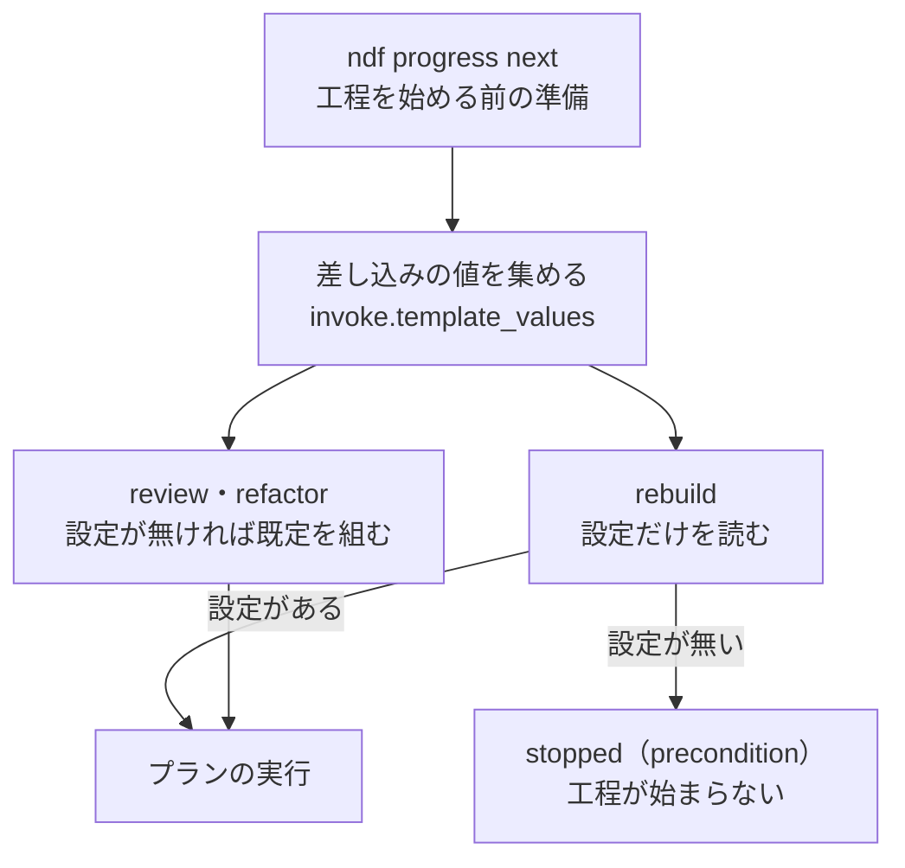
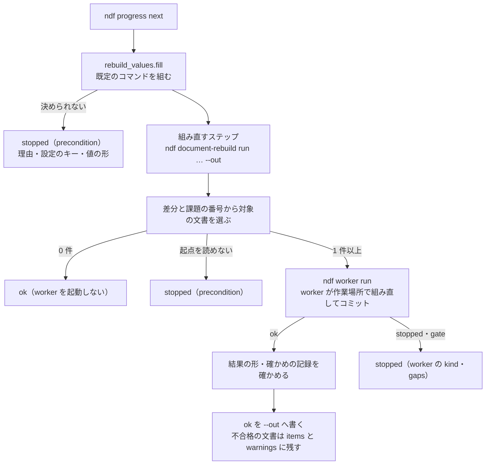
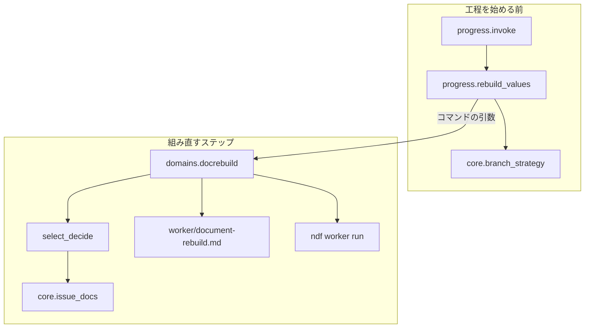
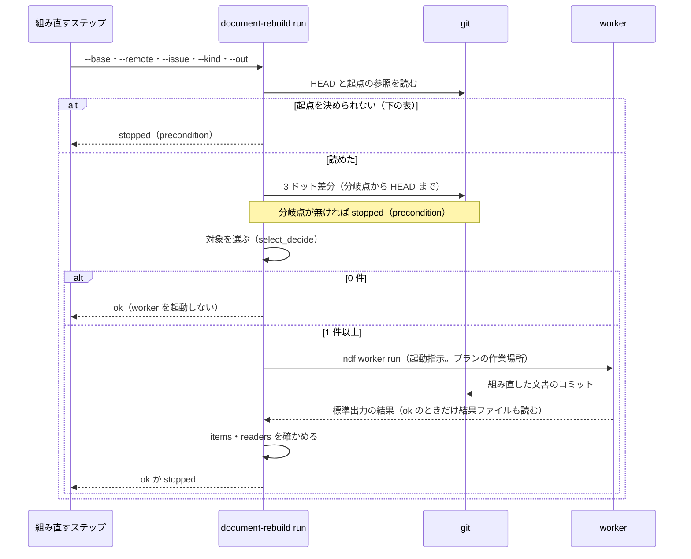

# 文書の組み直し: 起動の設定が無いリポジトリでも、設計とドキュメント再構成が流れる（#4337）

文書を組み直すコマンド（差し込み `rebuild`）に既定が無く、設定を足していないリポジトリでは、工程「設計」と「ドキュメント再構成」のプランが始まらない。工程を始める前には既定のコマンドだけを組み、組み直すステップで新しいサブコマンド `ndf document-rebuild run` が、差分と課題の番号から文書を選んで worker を 1 回起動する。worker はほかの worker と同じくプランの作業場所で組み直してコミットし、サブコマンドは worker の結果を確かめてから結果ファイルを書く。採らなかった案は「決定の記録」に、外部の調査を省いた理由は末尾にある。

## 今の姿

何が起きたか・目的・受け入れ条件は、要求仕様（[issue-4337-requirements.md](./issue-4337-requirements.md)、正は #4337 の本文）にある。この文書は「どう解くか」と「なぜその解き方か」だけを書く。文中の「条件 N」「前提 N」「影響の表」「要求の未決」は、要求仕様のものを指す。



| 部品 | 今の振る舞い |
| --- | --- |
| 差し込みの値を集める処理（`plugins/ndf/src/ndf/progress/invoke.py`） | `rebuild` の出所は `.ndf/project.json` の `workflow.launch.rebuild` だけで、無ければ `TemplateValuesMissing` を上げる。根本原因は、`rebuild` だけが既定を組む処理を持たないことである |
| リファクタリングの既定（`plugins/ndf/src/ndf/progress/refactor_values.py`） | 同じ集める処理の中で、ブランチ戦略の設定から起点を決めて既定のコマンドを組む。差分はコマンドを打つ時点に読む |
| 工程「ドキュメント再構成」の定義 | 入力は課題の番号（`issues`）と作業場所（`worktree`）だけで、モードを受けない |
| 既定の代わりのスクリプト（`scripts/launch-document-rebuild.sh`） | worker が結果ファイルを直接書き、形を確かめる処理が無い。対象の選び方の問題 3 つは要求仕様の「事象」にある |

## 文脈と制約

- 設計書は、工程を始める前の準備の時点ではまだ無い。対象の文書は、組み直すステップを打った時点でしか決められない
- 組み直すステップの形は、テンプレートが `[<rebuild>, "--out", "{state_dir}/rebuild.json"]` と決めている。設定のコマンドも既定のコマンドも、同じ引数を受ける（条件 15）
- 工程の入力に、スプリントブランチの名前と設計 PR のマージ先は無い
- 組み直すステップ 1 回が打つ `ndf worker run` は 1 回まで（対象が 0 件なら 0 回）である（影響の表の「既存の振る舞い」）。`ndf worker run` は、プランのステップが CLI から `claude -p` で worker を別のプロセスとして起動するコマンドである。worker の下で立てる読み手役はこの回数に数えない。読み手役の確かめのために 2 本目の `ndf worker run` を打たない。`ndf worker run` の中の `claude -p` の再起動と、読み手役の回数は、「影響と危険」の Claude の起動の行で別に数える
- 差し込み `base` を決める処理は、ブランチ戦略の設定が無いと先に別の理由（`invalid`）で止まる。条件 14 の理由を出すには、`rebuild` をそれより先に決める
- `invoke.py` は 982 行で、1 ファイル 1,000 行の上限に近い。既定を組む処理は別のモジュールに置く
- `ndf` のモジュールの層は下から `contracts`・`adapters`・`core`・`progress`・`domains` で、下の層は上の層を読まない
- 設計書を書く worker と指摘を直す worker は、プランの作業場所で動いて自分でコミットする。変えたファイルの範囲はコードで止めず、設計 PR の差分とレビューで見る

## 解き方の全体像



- 工程を始める前の準備は、ベースブランチ・リモートの名前・課題の番号・選ぶ文書の種類を引数に持つ既定のコマンドを組む。差分は読まない
- `ndf document-rebuild run` は、起点から `HEAD` までの差分から、引数の課題の設計書と原稿だけを選ぶ。設計書を省いた実装計画は、差分によらず課題の番号で決まるパスから選ぶ。worker へは選んだ文書だけを渡す
- worker は `document-rebuild` の手順をプランの作業場所で通し、組み直した文書をコミットし、読み手役の確かめの記録を結果に残す。サブコマンドは worker の結果を確かめて `--out` を書く
- push と Pull Request は今のとおり後ろのステップが行う。テンプレートは変えない
- 設定 `workflow.launch.rebuild` があれば、今のとおり設定のコマンドだけを使う

## ドメインモデル

### コンテキスト

| コンテキスト | 何の語が 1 つの意味に決まるか |
| --- | --- |
| NDF のプランの実行（`ndf-supervise`） | 工程を始める前に、差し込みの値をどこから決めるか |
| NDF の文書の組み直し（`ndf-document`） | どの文書を組み直し、何を確かめた記録として残すか |

表の `ndf-supervise`・`ndf-document` は、この文書の中だけで使うコンテキストの呼び名である。2 つの関係は次のとおりである。

| コンテキスト | 位置 | 役割 |
| --- | --- | --- |
| 文書の組み直し | 上流 | コマンドの引数の形を決める。引数（ベースブランチ・リモート・課題・文書の種類など）だけを受け、工程とモードの表を読まない |
| プランの実行 | 下流 | その引数に合わせてコマンドを組む |

この関係のため、工程とモードから文書の種類を決める対応は下流の側（`ndf.progress.rebuild_values`）が持つ。`ndf.domains.docrebuild` は `ndf.progress` を読まない。工程やモードを足しても、組み直しの側は変わらない。

### 集約

| 集約 | オーナー（書き換えてよいもの） | 集約ルート | エンティティ | 値オブジェクト |
| --- | --- | --- | --- | --- |
| 組み直しの実行 | `ndf.domains.docrebuild` | 組み直しの結果（`--out`） | — | 対象の文書・足すべき内容・確かめの記録 |

### 不変条件

| # | 集約 | 条件 | 破れたときの扱い |
| --- | --- | --- | --- |
| I1 | 組み直しの実行 | worker に渡す文書（要求仕様のコピーを含む）は、引数の種類と課題に合う、作業場所の中の通常ファイルだけである。末尾も、途中のディレクトリもリンクでない。設計書と原稿は起点からの差分にあり、起点の参照と内容が違うものに限る（設計書を省いた実装計画は差分によらない。決定 9） | 選ばない |
| I2 | 組み直しの実行 | 起点を決められなければ、対象を 0 件とみなさない | `stopped`（`precondition`） |
| I3 | 組み直しの実行 | `ok` の結果は、足すべき内容を 1 件ずつ `id` と `text` で持つ。worker の足すべき内容は、どの対象の文書のものか（`doc`。条件 12 の `id`・`text` に、この設計が足した必須のキー）を持つ | `stopped`（`bad_report`） |
| I4 | 組み直しの実行 | worker を起動した `ok` の結果は、対象の文書ごとに、読み手役の確かめの結果・立てられなかった理由・worker 自身が読み直した文書の種類のどれかを持つ | `stopped`（`incomplete`。欠けた文書を `gaps` に挙げる） |
| I5 | 組み直しの実行 | 読み手役が不合格（`fail`）とした文書は、`items` と `warnings` に 1 件ずつ現れる | 項目はサブコマンドが記録から組むので、worker の報告では破れない。不合格の文書があっても、どちらの工程も `ok` で進む（「不合格の扱い」） |
| I6 | 組み直しの実行 | `items` の `id` は 1 つの結果の中で重ならない | `id` はサブコマンドが振るので、worker の報告では破れない（worker の `id` は使わない） |
| I7 | 組み直しの実行 | worker が作業を残した・判断を求めた組み直しは、`ok` にも `gate` にもならない | `stopped`。`ndf worker run` の結果の `kind`・`gaps` を載せる |

### ドメインイベント

| # | イベント | 発生元 | 受け手 |
| --- | --- | --- | --- |
| E1 | 組み直しのコマンドを決めた | `rebuild_values.fill` | 工程の開始（`progress.run`） |
| E2 | 工程を始めた | `progress.run` | プランの実行 |
| E3 | 設計書を書いてコミットした | 設計書を書く worker（作業 `design`） | 組み直すステップ |
| E4 | 組み直す文書を選んだ | `ndf document-rebuild run` | worker の起動 |
| E5 | 対象が無いと分かった | `ndf document-rebuild run` | プランの次のステップ |
| E6 | 文書を組み直してコミットした | 組み直す worker（プランの作業場所でコミットする） | プランの次のステップ |
| E7 | 足すべき内容を結果に残した | `ndf document-rebuild run` | 設計のレビュー（`ndf cross-review run --findings`） |
| E8 | 代わりの設定とスクリプトを消した | リリースの後の PR（決定 8） | ai-plugins のスプリント |

## 構成要素

| 要素 | 責務 |
| --- | --- |
| 既定の組み立て（新設。`ndf.progress.rebuild_values`） | 設定が無いときの既定のコマンドを組む。工程とモードから文書の種類への対応を持つ。ベースブランチは、値がまだ無ければ読み込み済みの設定から 1 回だけ決め、テンプレートが `base` を使うなら `base` の値としても返す。リモートの名前も、値がまだ無ければ `Git.remote()` で 1 回だけ求め、`remote` の値としても返す。決められなければ理由・設定のキー・値の形を返す |
| 差し込みの値を集める処理（変更。`ndf.progress.invoke`） | `rebuild` を、`route.derived_locally` が作業場所の git と設定から求める差し込み（`base`・`remote` など）より先に埋める。`rebuild_values.fill` が返した `base` と `remote` も差し込みに入れる。`derived_locally` は値のある `base`・`remote` を求め直さない。そのため、設計のプランの `rebuild` と `base` は同じ解決済みのマージ先になる。ブランチ戦略の設定の読み込みと検証、`Git.remote()` の `git worktree list` はそれぞれ 1 回で済む。欠けの `items` に、`rebuild_values.fill` が返した理由・設定のキー・値の形の 3 つを載せる |
| サブコマンドの入口（新設。`ndf.domains.docrebuild.cli`。`__init__.py` はパッケージの説明だけ） | `ndf document-rebuild run` の引数を定義し、`drive` を呼ぶ。`ndf/cli.py` の `COMMANDS` に登録する。引数のスキーマ `document-rebuild.args.schema.json` と `docs/contracts/commands.md` は、規約の生成（`checks/spec_render.py`）が、`checks/spec_model.py` の読んだこの引数の定義から作る。手では書かない |
| 組み直しの駆動（新設。`ndf.domains.docrebuild.drive`） | 起点を決め、git から差分を読み、`select_decide` で対象を選び、起動指示を組み、`ndf worker run` を打ち、結果を確かめ、`--out` と標準出力へ出す。コミット・`push`・GitHub への書き込みを持たない |
| 対象の選択（新設。`ndf.domains.docrebuild.select_decide`） | 差分のパス・実装計画の頭・通常ファイルかどうかから対象を選ぶ。ファイルも git も読まない純粋な処理 |
| 課題の文書の名前（新設。`ndf.core.issue_docs`） | 設計書のパスの形・名前に含む課題の番号・実装計画のパスの書式を持つ。`ndf loop design-tests` が持つ設計書の正規表現と、リファクタリングの既定（`refactor_values`）が持つ実装計画のパスの書式をここへ移し、元の場所とドキュメント再構成の両方がここを読む |
| 起動指示のテンプレート（新設。`contracts/worker/document-rebuild.md`） | 組み直す worker への指示。差し込みは `string.Template` の `$名前` |
| 工程の定義（変更。`contracts/workflow/stages/document-rebuild.json`） | `metadata.ndf.inputs` に `mode` を足す。値はスプリントの文脈の `mode` で、`ndf progress new --mode` がステートマシンの作成時に書き（`progress/command.py` の 597 行目）、どの工程も出力で上書きしない。工程を始めるとき、`invoke.resolve_inputs` が定義の `inputs` のキーを文脈から取り（`invoke.py` の 215〜224 行目、呼び出しは `run.py` の 492 行目）、`invoke.stage_run` が `StageRun.inputs` に入れる（`invoke.py` の 238〜244 行目）。工程「設計」の定義は既に `mode` を持つ。値を入れるコードは足さず、`rebuild_values.fill` が `run.inputs["mode"]` を読む。テンプレートの `params` に `mode` は無いので、差し込みの値（`values.json`）には入らない（`invoke.py` の 548 行目） |
| 差し込みの説明（変更。`contracts/templates/params.json`） | `rebuild` の説明に、工程では設定が無ければ既定のコマンド `ndf document-rebuild run` を組むことを、`review` の説明（「省けば …を組む」）と同じ形で書き足す |
| worker の規則（変更。`development-workflow` の `agent-layers.md`） | 読み手役を立ててよい worker の例外を 1 つ足す（決定 5） |



## 入出力のコントラクト

### `ndf document-rebuild run`

**引数と作業場所**:

| 項目 | 内容 |
| --- | --- |
| `--base <ブランチ>`（必須） | ベースブランチの名前（スプリントの PR のマージ先） |
| `--remote <名前>`（必須） | 起点の参照を探すリモートの名前。既定のコマンドでは、準備の時点で `rebuild_values.fill` が求めた値を入れ、ステップは求め直さない。求め方は「処理の流れ」、起点の決め方は同じ節の表にある |
| `--issue <番号>`（1 回以上） | 工程が扱う課題 |
| `--kind <design|plan|manuscript>`（1 回以上） | 選ぶ文書の種類（下の表） |
| `--state-dir <保存先>`（必須） | 起動指示と worker の結果ファイルの保存先。既定のコマンドでは `{state_dir}`。この文字列は `values.json` とプランにはそのまま残り、プランの実行（`core/plan`）がステップを打つ時に絶対パスへ置き換える |
| `--out <ファイル>`（必須） | 結果 JSON を書くファイル。テンプレートが後ろに足す |
| 作業場所 | 打った場所（プランの作業場所）。worker もここで動く |

**選ぶ文書**:

| `--kind` | 選ぶ文書 |
| --- | --- |
| `design` | `issues/issue-<番号の並び>-design` で始まる Markdown（前提 1）のうち、番号の並びを `-` で区切った番号の 1 つが `--issue` の番号のどれかと一致するもの。名前の形は `core.issue_docs` の正規表現 `^issues/issue-(\d+(?:-\d+)*)-design[^/]*\.md$` で、1 つ目のグループを `-` で分けて整数で比べる（課題 433 は `issue-4337-design.md` に当たらない） |
| `plan` | `--issue` の番号ごとの `issues/issue-<番号>-plan.md` のうち、設計書を省いた行を持つもの。差分にあるかは見ない（決定 9） |
| `manuscript` | `issues/` の外の Markdown（`*.md`） |

要求仕様のコピーと、条件に合わない実装計画は、どの種類にも当たらない（前提 2・3）。

**確かめ済みの文書を組み直さない**: 差分から選ぶ設計書と原稿のうち、起点の参照と `HEAD` で内容が同じものは外す。設計 PR を squash でマージすると、設計書は 3 ドット差分に残るが、ベースブランチには工程「設計」で組み直し・レビュー・設計承認ゲートを済ませた同じ内容が入っている。内容が同じなら、組み直しても読み手役の確かめを繰り返すだけになる（MVV の「役に立たない繰り返しに費用を使わない」）。工程「設計」の後に直した設計書は内容が変わるので選ばれる。外した文書は `warnings` に載せない（選ぶ条件に合わないだけで、外したのではない）。差分によらず選ぶ実装計画には当てない（決定 9）。

**設計書を省いた行**: 最初の `##` の見出しより前にある、行頭が `省いた文書: 設計書` で、その直後が `（` か行末の行である。行全体は照合しない。`implementation-plan` の手順が書く行は、後ろに満たした条件の値が続くからである。

| 当たるか | 行の例 |
| --- | --- |
| 当たる | `省いた文書: 設計書（課題 1・公開インタフェース 変わらない・触るファイル 3・新設する関数 0・シグネチャを変える関数 0）` |
| 当たらない | `省いた文書: 実行計画（課題 1・PR 1）`、`省いた文書: 詳細設計書（別ファイル）（…）` |

**作業場所の中の通常ファイルに限る**: worker に渡す文書と、サブコマンドが読む実装計画は、作業場所の中にある通常ファイルだけにする（I1）。末尾だけを `lstat` で確かめると、`issues/` などの途中のディレクトリがリンクのときに作業場所の外の文書を読み、worker がそれを書き換えるからである。そこで、作業場所を記述子で開き、途中のディレクトリをリンクを辿らずに 1 段ずつ開いて、末尾が通常ファイルであることを確かめる。実装計画の本文も、確かめたのと同じ記述子から読む（既存の `contracts.worker_paths` の関数を使う）。確かめた後に名前を差し替えられても、作業場所の外は読まない。worker は Tool でパスを開くので、この境界を worker の中までは持ち込めない。そこで worker が終わった後に同じ確かめを当て直し、外れていればその回を `stopped`（`precondition`）で止め、結果を後ろの工程へ渡さない。要求仕様のコピーも同じ確かめを通ったものだけを起動指示に載せる。外したパス（リンク・途中にリンクのあるもの・サブモジュール・作業場所に無いもの）は `warnings` に 1 件ずつ載せる。

**終わり方**:

| 終わり方 | 結果 |
| --- | --- |
| 組み直した | `ok`。`items` は足すべき内容の `{"id", "text", "doc"}`、`metrics` は `targets`（対象のパス）・`readers`（文書ごとの確かめの記録） |
| 対象が 0 件 | `ok`。`summary` は「組み直す文書が無い（種類・起点）」、`items` は空、`metrics.targets` は空。worker を起動しない |
| 起点を決められない | `stopped`（`precondition`）。`summary` に読めない参照の名前（ほかの名前のリモートだけがあるときは、求めた名前と設定のキー `.ndf/worktree.json` の `remote`）。分岐点が無いとき（`git diff A...B` の 3 ドット差分の失敗）も同じで、参照の名前と git の文を載せる。worker を起動しない。条件 11 が挙げるのは参照が読めないときだけで、ほかの 2 つは要求仕様の E4 の行にある |
| worker が作業を残した・起動に失敗した・判断を求めた | `stopped`。`ndf worker run` の結果の `kind`・`gaps` を載せる（I7。下の「worker の終わりの読み方」） |
| 足すべき内容の形が違う（`text` が無い、`doc` が対象の文書でない） | `stopped`（`bad_report`） |
| 確かめの記録が欠けた文書がある | `stopped`（`incomplete`）。`gaps` に文書ごとに 1 件 |
| 読み手役が不合格とした文書がある | `ok`。`items` に不合格の文書を 1 件ずつ（`id` は `reader-<番号>`、`text` は文書・不合格の質問・理由）足し、`warnings` にも文書ごとに 1 件載せる（I5） |

どの終わり方でも、標準出力の最後の 1 行と `--out` に同じ結果 JSON を書く。書く前に結果を共通の結果スキーマと専用の結果スキーマで確かめ、形が違えば両方とも `stopped`（`invalid`）に差し替える。標準出力だけを差し替えると、プランが止まったと判断した回の項目を、`--out` を読むレビューが引き継ぐからである。

**`items` の `id`**: worker の足すべき内容には結果ファイルの並びの順に `add-1`・`add-2` …、読み手役の不合格には文書のパスの順に `reader-1`・`reader-2` … を振る。worker が書いた `id` は使わない。レビューの指摘の結果は `id` をキーに数えるので、worker の `id` を残すと、重なった 2 件の片方の処置で両方が処置済みになるからである。接頭辞が違うので、worker の書き方によらず 1 つの結果の中で重ならず、どの項目も捨てない（I6）。

**worker の終わりの読み方**: `ndf worker run` の標準出力と、worker が書いた結果ファイルは中身が違う。次の順に読む。

1. 標準出力の結果 JSON を先に読む。`_cmd_run`（`core/worker.py`）が結果ファイルを検査した後の `status`・`kind`・`gaps` である。`ok` でなければ、結果ファイルを読まずに `stopped` を返す（I7）
2. 標準出力が `ok` のときだけ、worker の結果ファイルを読み、足すべき内容（`items`）と `metrics.readers` を取る。標準出力の `items` はセッションの情報（`{"kind": "session", …}`）なので、足すべき内容として読まない

worker の `gate` は `stopped` にする。ステップの結果の `routes` は、`approved` に承認したときの行き先を、`rejected` に却下したときの行き先を持つ。ステップが `gate` を返すと、プランの実行（`runner._result_of`）は `routes` に何を書いたかを見ずに、`approved` の行き先（push の側）を次のステップにする。そのため `gate` のまま返すと、承認だけで組み直しと確かめを飛ばして push に進む。止まった後は、プランを打ち直す（`ndf progress retry`）。組み直すステップが対象を選び直し、worker を新しく起動する。

**起動指示**: 次のことを書く。

- 対象のパス
- 組になる要求仕様のコピーのパス
- 作業場所でコミットし、push も Pull Request もしないこと
- 要求仕様のコピーを変えないこと
- 対象の外で直すべきことは、当たる対象の `doc` を添えて足すべき内容に書くこと
- 文書ごとに、誰がどう確かめたかの記録を `metrics.readers` に書くこと（下の「確かめの記録」）
- 実装計画と、読み手役の対象に当たらない種類の原稿は、読み手役を立てずに自分で読み直すこと

**誰が確かめるか**: 文書ごとに、`document-rebuild` の手順の「読み手役に読ませる」の「対象」の行に従って決める。手順書は、設計書・ビジネス文書・変更履歴・README などを読み手役に読ませ、実装計画・AI への手順書・Issue の本文などは書いた担当が自分で読み直すと定めている。起動指示・手順書・記録の確かめの 3 か所で、この分け方をそろえる。

| 対象の種類 | 確かめる人 | 記録の `verdict` |
| --- | --- | --- |
| `design` | 読み手役 | `pass`・`fail`・`not_run` |
| `plan` | 組み直した worker 自身 | `self` |
| `manuscript` | 手順書の「対象」に当たる種類（ビジネス文書・変更履歴・README・利用者への案内など）なら読み手役。当たらない種類（AI への手順書など）なら worker 自身 | 読み手役なら `pass`・`fail`・`not_run`。worker 自身なら `self` |

原稿がどちらの種類かは、worker が文書を読んで決め、`self` の記録の `reason` に種類を書く。コードはその判断が正しいかを確かめない（決定 5 の代償と同じく、記録の中身が事実かは確かめない）。

**確かめの記録**（worker の結果ファイルの `metrics.readers` の要素。対象の文書 1 件に 1 つ）:

| キー | 値 |
| --- | --- |
| `doc` | 対象の文書のパス |
| `verdict` | 最後の結果。`pass`（読み手役が合格とした）・`fail`（不合格が残った）・`not_run`（読み手役の対象だが、1 回も立てられなかった）・`self`（読み手役の対象でない文書を、worker 自身が読み直した） |
| `checks` | 読み手役の確かめの並び（行った順）。要素は `{"verdict": "pass・fail", "restatements": [質問ごとの言い直し], "reason": "不合格の質問と理由"}`。`restatements` は必須、`reason` は `fail` のとき必須。`not_run` と `self` では空 |
| `reason` | `not_run` では立てられなかった理由。`self` では読み手役の対象でないと判断した文書の種類（手順書の「対象」の行の語。例: `実装計画`・`AI への手順書`）。`fail` で 2 回目を行えなかったときはその理由。どれも必須 |

読み手役の回数は、`document-rebuild` の手順の「回数」（1 回の確認につき立場ごとに 2 回まで）に合わせる。設計書と原稿は、文書の書き方の基準の表で読み手の立場が 1 つに決まる（立場が 3 つあるのは要求仕様だけで、要求仕様のコピーは組み直さない）。そのため、読み手役は文書 1 件につき最大 2 回で、`checks` の数もそれに合わせて確かめる。合わなければ記録の欠け（I4）とする。`not_run` と `self` では `checks` の数を見ず、`checks` が空で `reason` があるかだけを見る。`self` は `items` にも `warnings` にも足さず、記録（`metrics.readers`）にだけ残す。読み手役が確かめたことにはせず、確かめた範囲を偽らない（Value 13「確かめたことだけが済んだとされる」）。

| 記録の `verdict` | 使える種類 | `checks` の数 | 最後の結果 |
| --- | --- | --- | --- |
| `not_run` | `design`・`manuscript` | 0（空の並び）。空でない `reason` が要る | — |
| `self` | `plan`・`manuscript` | 0（空の並び）。空でない `reason` が要る | — |
| `pass`・`fail` | `design`・`manuscript` | 1 回目が合格なら 1。不合格なら直して読み直した 2（両方を残す）。2 のときは先頭が `fail` でなければ欠け。2 回目を行えなければ 1 と `reason` | 最後の `checks` の `verdict` |

**不合格の扱い**: `document-rebuild` の手順は、2 回目も不合格なら直さずに報告し、進めるかを承認する人が判断すると定める。コードは承認ゲートを足さず、判断の材料を後ろの工程へ渡すだけにする（I5）。

| 工程 | 判断する所 |
| --- | --- |
| 設計 | 続くレビューが `--findings` で `items` を 1 件ずつ直すか見送り、残ったものを設計承認ゲートで承認する人が見る |
| ドキュメント再構成 | 続く工程「ドキュメントレビュー」がスプリントの差分と合わせて見て、承認する人がリリース承認ゲートで判断する。不合格の文書は、ステップの結果の `items` と `warnings` に残る |

### 既定のコマンド

工程の定義の名前とモードから、選ぶ種類を決める。

| プラン | モード | `--kind` |
| --- | --- | --- |
| `design` | すべて | `design` |
| `document-rebuild` | `documentation` 以外 | `design` と `plan` |
| `document-rebuild` | `documentation` | `design`・`plan`・`manuscript` |

例（課題 4337・ベースブランチ `main` の工程「設計」）:

```text
ndf document-rebuild run --base main --remote origin --issue 4337 --kind design --state-dir {state_dir}
```

### 既定を決められないときの `ndf progress next`

`stopped`（`precondition`）の `items` の `rebuild` の行に、今のキー（`key`・`source`）に加えて次の 3 つを載せる。工程の記録は書かない。

| キー | 値の例 |
| --- | --- |
| `reason` | `.ndf/project.json に branch_strategy の設定が無い`（ブランチ戦略の設定を読む処理が返す理由の文） |
| `setting` | `workflow.launch.rebuild` |
| `shape` | `コマンドの語の並び（空でない文字列を 1 つ以上持つ配列）` |

互換性: 設定 `workflow.launch.rebuild` の形・結果 JSON の今のキー・差し込みの名前・プランのテンプレートは変えない。`ndf route render`・`run` は今のとおり `rebuild` を引数で渡す。

## 処理の流れ



リモートの名前は `Git.remote()`（`adapters/git.py`）で求める。メインディレクトリの `.ndf/worktree.json` の `remote` を読み、設定かキーが無ければ既存の既定値（`default_remote()`。`worktree.schema.json` の `remote` の `default` で、今は `origin`）を使う。作業場所の worktree にある設定は読まない。値の形が誤っている（`RemoteError`）ときは、既定を決められないものとして準備で止める（条件 14 の行）。起点は、下の表で決めた参照と `HEAD` との分岐点である。`Git.remote()` は値の形だけを確かめ、その名前のリモートがあるかを見ない。そこで、リモート追跡ブランチ `refs/remotes/<リモート>/<ベース>` が読めないときだけ、登録済みのリモートの一覧（`git remote`）を読んで分ける。

| リモート追跡ブランチ | 登録済みのリモート | 起点の参照 |
| --- | --- | --- |
| 読める | 読まない | リモート追跡ブランチ |
| 読めない | 求めた名前がある（ベースブランチを取得していない） | 手元の参照 `refs/heads/<ベース>`。これも読めなければ `stopped`（`precondition`） |
| 読めない | 1 つも無い（リモートの無いリポジトリ） | 同上 |
| 読めない | ほかの名前だけがある（設定の誤記、`remote` の設定漏れ） | 手元へ切り替えず `stopped`（`precondition`） |

差分は `git diff --name-only -z --diff-filter=d <解決済みのコミット>...<HEAD の SHA>`（3 ドット差分）で読む。どちらも `git rev-parse` で解決した SHA である。分岐点を求める `git merge-base` を別に打たない。分岐点が無ければ git が終了コード 128 で終わるので、`stopped`（`precondition`）にする。参照は 1 つだけ渡す。`git merge-base HEAD <手元> <リモート追跡>` は、2 つの参照を仮にマージしたものとの分岐点を求めるので、手元だけにあるコミットまで差分から外す。

git の子プロセスの回数は次のとおりである。`Git.remote()` は中で `git worktree list --porcelain -z` を打つ。準備では差し込み `remote` を求めるために今も 1 回打っており、その値を `--remote` で渡すので、準備もステップも増えない。

| 場面 | 打つもの | 回数 |
| --- | --- | --- |
| 準備（`ndf progress next`）のリモートの名前 | `git worktree list`（今も `derived_locally` が打つ 1 回を移す） | ±0 |
| ステップ: 対象を選ぶまで（0 件でも） | `HEAD` の `git rev-parse`・リモート追跡ブランチの `git rev-parse`・3 ドット差分の `git diff` | 3 |
| ステップ: リモート追跡ブランチが読めないとき | 上に加えて `git remote`・手元の参照の `git rev-parse` | +2 |
| ステップ: 差分から選んだ設計書か原稿の候補が 1 件以上あるとき | 起点と `HEAD` の内容を比べる 2 ドット差分の `git diff --name-only -z <起点の SHA> <HEAD の SHA>` | +1 |

通常ファイルの確かめと実装計画の頭の読み取りは、ファイルを直に扱うので git を打たない。worker の中で打つ git は worker の作業に含め、この表に数えない。

使い捨てのリポジトリで確かめた結果は次のとおりである（2026-11-24、git 2.53.0）。

| 確かめたこと | 結果 |
| --- | --- |
| 手元の `trunk` が古く、リモート追跡ブランチだけが進んでいる | 差分は、リモート追跡ブランチより後のファイルだけ。手元を起点にすると、先に入った他人のファイルも入る |
| 手元の `trunk` だけが進み（未 push のコミット `l.md`）、そこからスプリントを切った | リモート追跡を起点にすると `l.md` と自分のファイル。手元か、2 つの参照の両方を渡すと `l.md` が外れる |
| 手元とリモート追跡が分かれ、手元からスプリントを切った | 同上（リモート追跡だけが `l.md` を差分に残す。リモートにだけあるファイルは入らない） |
| 手元とリモート追跡が分かれ、リモート追跡からスプリントを切った | リモート追跡を起点にすると自分のファイルだけ。手元を起点にすると、リモートにある他人のファイルも入る |
| 設計のブランチがベースブランチへ、マージコミットで入った | 起点が `HEAD` そのものになり、差分は空 |
| 設計のブランチがベースブランチへ、squash で入った | 起点が動かず、設計書は差分に残る |
| 読めない参照を `git merge-base` に渡す | 終了コード 128。渡す前に `git rev-parse -q --verify <参照>^{commit}`（読めなければ終了コード 1）で読めるものだけにする |
| 履歴を共有しない 2 つのブランチ | 分岐点が無い（`git diff <SHA>...HEAD` は終了コード 128、`no merge base`） |
| 差分に `.md` のシンボリックリンクがある | パスが差分に出る（`--name-only` では通常ファイルと見分けられないので、`lstat` で外す） |
| 消したファイルと、日本語と空白を含むファイルがある差分を、3 ドット差分に `--diff-filter=d -z` を付けて読む | 消したファイルは出ず、名前は引用されない（`-z` を付けると引用されずに読める） |

## 非機能の実現方式

| 大項目 | 要求の条件 | 実現方式 | 確かめ方 |
| --- | --- | --- | --- |
| 移行性 | ai-plugins の代わりの設定とスクリプトを消した後も、既定を持つ版より前の NDF で動いている ai-plugins のスプリントが、設計の始めで止まらない。利用者のリポジトリで要る移行は無い | 消す変更をリリースの後の別の PR に分ける（決定 8）。設定とスクリプトは作業場所のリポジトリの根から読むので、消す前に切った作業場所には残る | PR をマージする前に、決定 8 の確認 1・確認 2 を確かめて PR の本文に書く |

## 決定の記録

決定の根拠に書く Value は、このリポジトリの判断基準（`.ndf/mvv.md`）の項目である。「MVV バージョン 11」は、2026-11-22 に利用者が承認した今の版を指す。

### 決定 1: 設計書がまだ無い時点で対象を決めないため、工程の前はコマンドだけを組み、対象はステップを打つ時に選ぶ

- **質問**: 既定をどの部品が持ち、対象の文書をいつ決めるか
- **選んだ案**: 工程の前の準備では `rebuild_values.fill` がコマンドを組む。対象の選択・worker の起動・結果の確かめは、新しいサブコマンド `ndf document-rebuild run` が行う。リファクタリングの既定（`refactor_values`）と同じ分け方である。worker は、設計書を書く worker・指摘を直す worker と同じく、プランの作業場所で動いて自分でコミットする
- 採らなかった案: リファクタリングの既定と同じく、シェルの 1 文にすべてを書く（課題の番号の照合・実装計画の頭の読み取り・結果の確かめをシェルで書くと、単体テストで確かめられない）
- 採らなかった案: 作業の定義（`kinds.json`）に作業を足して `ndf answer work` で起動する。`ndf answer work` は、工程の前に書いた `values.json` から起動指示を組み、`ndf worker run` を打つコマンドである（対象は起動の時点で決まるため、工程の前に書く `values.json` から渡せない。テンプレートが後ろに足す `--out` も受けない）
- 採らなかった案: `ndf worker` の下にサブコマンドを足す（`core/worker.py` は 991 行で上限に近く、worker の受け渡しの層が文書の種類を知ることになる）
- 採らなかった案: worker を別の一時の worktree で動かす。対象の文書だけをサブコマンドが取り込み、確かめたコミットだけを push する（worktree の作成と片付け・取り込み・push するコミットの照合が要り、受け入れ条件の外の仕組みになる。ほかの worker と同じく、対象の外の変更は設計 PR の差分とレビューで見る）
- **代償**: サブコマンドが 1 つ増え、引数と結果のスキーマを足す。worker が対象の外を変えてもコードでは止まらない（「影響と危険」）
- 根拠: Value 4「どのプロジェクトでもそのまま使える」・Value 9「責務の分かれた設計で作られる」（MVV バージョン 11）

### 決定 2: 別の課題の設計書を書き換えないため、起点を変えずに課題の番号で対象を絞る

- **質問**: スプリントブランチにマージ済みの別の課題の設計書を、どう対象から外すか（条件 3・4）
- **選んだ案**: 起点はどの `doc_prs` でもベースブランチとし、設計書は名前の番号が工程の課題に当たるものだけを選ぶ。作業場所がスプリントブランチそのものでも、設計のブランチでも同じ結果になる。対象は毎回、差分と課題の番号だけから選ぶ
- 採らなかった案: `doc_prs` が `sprint` のとき、スプリントブランチを起点にする（工程の入力にスプリントブランチの名前が無い。作業場所がスプリントブランチそのものだと起点が自分自身になり、条件 4 が空になる）
- 採らなかった案: 作業 `design` の worker が書いたファイルの一覧を受け取る（手で書いた設計書を流すときに一覧が無く、打ち直しで前の回のファイルが落ちる）
- 採らなかった案: 前の工程で確かめ済みの文書を、内容のハッシュの記録で次の工程の対象から外す（記録のファイルと引き継ぎの規則が要る。確かめ済みの内容はベースブランチにあるので、記録を持たずに起点の参照との比較で外せる。「確かめ済みの文書を組み直さない」）
- **代償**: 名前に課題の番号を持たない設計書は選ばれない。文書の名前は `design` の手順が決めているので、その形から外れた文書だけが当たる。設計 PR を squash でマージした後は、工程「ドキュメント再構成」で内容を比べる `git diff` が 1 回増える。その代わり、内容の変わっていない設計書は組み直さない
- 根拠: Value 3「同じ手順は毎回同じ結果になる」・Value 4（MVV バージョン 11）

### 決定 3: 手元のベースブランチの古さや未 push のコミットで対象が変わらないため、リモート追跡ブランチを起点にする

- **質問**: 差分の起点を、どの参照から求めるか（条件 5・11）
- **選んだ案**: リモートの名前は、作業場所を用意する `ndf worktree create` と同じ `Git.remote()` で、準備の時点に 1 回だけ求めて `--remote` で渡す。取得した参照と、起点に使う参照が同じリモートのものになる。リモート追跡ブランチが読めれば、手元の参照の状態によらずそれだけを使う。読めないときは、そのリモートが登録されているか、リモートが 1 つも無いときだけ手元の参照を使う（「処理の流れ」の表）。求めた名前だけが登録されていなければ、手元へ切り替えずに止まる。設定の誤記のまま古い手元の参照を使うと、取り込み済みの他人の原稿を組み直すからである。リモート追跡ブランチを先に使うのは、スプリントの PR の差分がリモートのマージ先に対して決まるためである。手元だけが進んだ場合も、手元とリモート追跡が分かれた場合も、リモート追跡が基準になる。どちらも読めないか分岐点が無ければ、参照の名前を示して止まる
- 採らなかった案: ステップが打つたびに `Git.remote()` で求める（対象が 0 件でも、`git worktree list` の子プロセスがステップの実行 1 回につき 1 回増える）
- 採らなかった案: 手元とリモート追跡の両方を `git merge-base` に渡す（リモートに入っていない手元のコミットまで起点の側に数え、PR の差分にある原稿が選ばれない。「処理の流れ」の実測）
- 採らなかった案: 工程の条件とリファクタリングの既定が使う規則 `command.base_ref` を使う（この規則は、手元で読めれば手元だけを使う。手元のベースブランチが古いと、`documentation` で、ベースブランチへ先に入った他人の Markdown まで原稿として組み直す。リファクタリングの既定は対象範囲に含まないので、規則のほうは変えない）
- 採らなかった案: 打つたびにリモートから取得する（ネットワークの失敗でステップが止まる。作業場所の用意の工程が取得している）
- **代償**: 起点を求める規則が 2 つになる。リモートの名前は工程の始めに決まり、途中で設定を変えても、その試行のステップには効かない（差し込み `remote` と同じ）。リモート追跡ブランチが古いときは、古い起点から選ぶ。未 push の手元のベースブランチからスプリントを切ると、その未 push のコミットの原稿も対象になる（スプリントの PR の差分にも入る文書である）
- 根拠: Value 4・Value 10「使い続けても、読みやすく直しやすい」（MVV バージョン 11）

### 決定 4: 工程の入力を増やさずに原稿を見つけるため、原稿は差分から選び、`documentation` だけに限る

- **質問**: 原稿のパスを差分から決めるか、工程の入力で受け取るか（要求の未決）
- **選んだ案**: 差分の `issues/` の外の Markdown を原稿とする。工程「ドキュメント再構成」の入力に `mode` を足し（値の出どころは「構成要素」の工程の定義の行）、`documentation` のときだけ選ぶ
- 採らなかった案: 工程の入力に原稿のパスを足す（どの工程の出力もパスを書かないので、conductor が毎回手で入れることになる）
- 採らなかった案: `documentation` では設計書を選ばない（設計の後に直した設計書が、`standard` と違って組み直されない）
- 採らなかった案: 原稿を、コミットの件名の課題の番号や、スプリントブランチへ直接積んだコミットかどうかで絞る（件名に番号の無いコミットや、PR で取り込んだ自分の原稿が、知らせなく対象から落ちる。組み直されないまま `ok` で進む害のほうが大きい）
- **代償**: 次の 2 つも対象になる。どちらも許す
    - 同じブランチで直した、原稿でない Markdown（変更履歴など）
    - スプリントブランチにマージ済みの、別の課題の原稿。原稿の名前は課題の番号を持たず、前提 4 は原稿を作業場所の差分で決めるので、設計書のように番号で絞れない。worker は文書の意味を変えず、組み直す所が無ければコミットしない。書き換えた差分は、次の工程「ドキュメントレビュー」がスプリントの差分（`sprint_diff`。ベースブランチからのスプリントブランチの差分）として見る。別の課題の原稿 1 件ごとに、読み手役の確かめが 1 回増える。別の課題が同じ原稿を同時に直していると、後からマージする側で衝突する
- 根拠: Value 1「人の判断を、読み切れる量の大事な所だけにする」・Value 3（MVV バージョン 11）

### 決定 5: 読み手役の確かめを省かせないため、組み直す worker だけに読み手役の起動を許し、記録が無ければ済んだとしない

- **質問**: ほかのサブエージェントを起動しない規則の下で、組み直す worker がどう読み手役を立てるか（要求の未決、条件 16）
- **選んだ案**: 組み直す worker への起動指示に、次の許可を書く。「読み手役に限り、サブエージェントを、読み手役の対象の文書（設計書と、手順書の『対象』に当たる種類の原稿）1 件につき最大 2 回（1 回目が不合格のときだけ 2 回目）立ててよい。実装計画と、対象に当たらない種類の原稿は、立てずに自分で読み直す」。回数と確かめる人は `document-rebuild` の手順と、`checks` の数の確かめ（I4）に合わせる（「誰が確かめるか」）。同じことを `agent-layers.md` の規則に例外として足す。例外は `ndf worker run` が起動する worker だけに当て、`ndf:worker` で起動した worker には当てない（下の表）。`ndf:worker` は、supervisor が Claude Code のサブエージェントとして worker を起動するときのエージェントの定義である。文書ごとの記録は結果ファイルの `metrics.readers` に書かせる。欠ければ `ndf document-rebuild run` が `incomplete` で止める（I4）。不合格が残った文書は止めずに `items` と `warnings` へ残し、後ろの工程の判断へ渡す（I5）

    | 起動の経路 | サブエージェントの Tool | 根拠 | 例外 |
    | --- | --- | --- | --- |
    | `ndf worker run`（CLI。組み直しの既定のコマンドはこれだけを使う） | 許している | `core/worker.py` の `_args_for` が `Permission.FULL` で起動し、`adapters/claude.py` の `permission_args` が `--allowed-tools` に `FULL_TOOLS`（`Agent` を含む）を渡す。エージェントの定義は読まず、規則文（`WORK_RULES`）もサブエージェントの起動を禁じない | 当てる |
    | `ndf:worker`（supervisor がサブエージェントとして起動） | 外している | `agents/worker.md` の `disallowedTools: Skill, Agent` と規則 1 | 当てない |

    例外が要る理由は、規則の置き場所にある。「worker は別のサブエージェントを起動しない」という規則は `agent-layers.md` の役割の表（worker の行）にあり、起動の経路によらずすべての worker に当たる。`ndf worker run` では Tool は使えるが、規則が起動を禁じているので、規則を変えずに立てさせると規則に反する。`agents/worker.md` は変えない。この定義は Tool を外して規則を守らせるもので、`ndf:worker` で起動したときだけ効き、`ndf worker run` の起動はこの定義を読まないからである。起動指示に「立ててよい」と書いても、`ndf:worker` では Tool が無く立てられない。立てられなかったとき（どちらの経路でも）は、`document-rebuild` の「立てられないとき」の扱いになる。理由を残し、読み手役の代わりに、書いた worker 自身が書いた経緯を知らない読み手のつもりで読み直す。文書ごとに `not_run` と理由を記録に残す。ステップは `ok` で進み、設計には戻らない。止めるのは、記録（`metrics.readers` の文書ごとの行）が欠けたか形が違うときだけで、記録の中身が事実かは確かめない。supervisor が工程を代行するときは、今のとおり `document-rebuild` の「立てられないとき」の扱いになる。`agent-layers.md` に足す文にも、例外が `ndf worker run` の組み直しの worker だけであることを書く。組み直しの起動指示は `contracts/worker/prompt.md`（規則 1 で起動を禁じる）から作らず、`contracts/worker/document-rebuild.md` から作る
- 採らなかった案: `agents/worker.md` から `Agent` の禁止を外す（組み直しのほかの作業の worker までサブエージェントを立てられる）
- 採らなかった案: サブコマンドが読み手役を `claude -p` で起動し、答えを渡して worker を続ける（ステップが打つ `ndf worker run` が 2 回になる。これは要求の影響の「既存の振る舞い」（ステップ 1 回につき worker 1 回）に反する。合否の判定と直しの手順をコードに書くことになり、`document-rebuild` の手順と 2 か所になる）
- 採らなかった案: 外部の CLI（`external-ai`）を読み手役にする（別の CLI が導入されていないリポジトリでは立てられない）
- 採らなかった案: 記録を起動指示で頼むだけにする（PR #4379 で、指示の書き方ひとつで確かめが省かれた）
- 採らなかった案: 工程「ドキュメント再構成」で不合格が残ればプランを承認ゲートで止め、承認の材料をプランの結果へ表示する（承認ゲートを足すことになる。ゲートの数と置き場所は `development-workflow` だけが持つ。表示のためにプランの実行の部品も変わる）
- **代償**: worker の下にもう 1 つの層ができる。記録が事実かどうか（本当に読ませたか）はコードで確かめられない。記録が欠けると、組み直しの worker を打ち直す費用がかかる。工程「ドキュメント再構成」の不合格は、ドキュメントレビューと承認する人が `items` と `warnings` を読まなければ見落とされる
- 根拠: Value 13「確かめたことだけが済んだとされる」・Value 2「安く使える」（MVV バージョン 11）

### 決定 6: レビューが足すべき内容を必ず読めるように、結果ファイルは worker でなくサブコマンドが書く

- **質問**: `--out` の結果ファイルを、だれが書くか（条件 12）
- **選んだ案**: worker は自分の結果ファイルへ書く。サブコマンドは `ndf worker run` の標準出力の `status` を先に見て、`ok` のときだけ結果ファイルの `items`・`metrics.readers` を確かめ、`--out` へ書く。`ok` でなければ、判断を求めた `gate` も含めて `stopped` で返す（「worker の終わりの読み方」）
- 採らなかった案: 代わりのスクリプトと同じく、worker に `--out` を直接書かせる（`text` の無い項目や記録の欠けがそのままレビューへ渡る）
- 採らなかった案: worker が判断を求めたとき、判断待ちの記録と答えのファイルを保存先に置く。答えを載せて worker を起動し直す（記録と答えの形・打ち直しの規則が要り、受け入れ条件の外の仕組みになる）
- **代償**: 結果ファイルが 2 つになる（worker の結果は保存先に残る）。worker が判断を求めたときは、判断の材料を作業場所に足してからプランを打ち直す
- 根拠: Value 3・Value 13（MVV バージョン 11）

### 決定 7: 何を直せば始まるかが読めるように、`rebuild` を先に決め、理由と設定のキーと値の形を同じ行に載せる

- **質問**: 既定を決められないとき、何をどの順に出すか（条件 14）
- **選んだ案**: `rebuild` を、差し込み `base` を求めるより前に決め、決めたマージ先を `base` にも使う。リモートの名前も同じく `remote` に使う（「構成要素」）。設定 `workflow.launch.rebuild` があるときは `base` を今のとおり求める。決められなければ `TemplateValuesMissing` の `items` の `rebuild` の行へ 3 つのキーを足す
- 採らなかった案: 今の順のまま、ブランチ戦略の設定の誤りだけを出す（工程「設計」では `base` の誤りが先に `invalid` で出る。そのため、設定 `workflow.launch.rebuild` を置けば始まることが結果で分からない）
- 採らなかった案: 出所の文（`source`）へ 3 つをつなげて書く（呼ぶ側の AI が、設定のキーを文から切り出すことになる）
- **代償**: 設定のキーだけを足しても、ブランチ戦略の設定が無ければ工程「設計」は次に `base` で止まる。`reason` にブランチ戦略の設定が無いことを書くので、直す先は先に分かる
- 根拠: Value 1・Value 4（MVV バージョン 11）

### 決定 8: 動いているスプリントを止めないため、代わりの設定とスクリプトはリリースの後の別の PR で消す

- **質問**: 代わりの設定とスクリプトを消す変更を、既定を足す PR に含めるか（要求の未決、条件 17）
- **選んだ案**: 既定を足す PR では消さない。既定を持つバージョンのリリース後テスト（条件 1・2）が通った後に、消す PR を出す。消すのは `.ndf/project.json` の `workflow.launch.rebuild` と `scripts/launch-document-rebuild.sh` だけである。`workflow`・`workflow.launch` は、ほかのキーが残っていれば消さない（空になったときだけ一緒に消す）。この PR をマージしてから #4337 を閉じる。既定を足すスプリントは、普段どおりスプリントの PR のマージとリリースまで進めて閉じ、#4337 だけを、消す PR のマージまで開いたままにする（条件 17）。消す PR のマージの前に、次の 2 つ（確認 1・確認 2）を確かめ、PR の本文に書く
    1. ai-plugins の各レーンのセッションが使う `ndf` のバージョンが、既定を持つバージョン以上である
    2. 既定を持たないバージョンで始めた ai-plugins のスプリントのうち、工程「ドキュメント再構成」を終えていないものについて、次のどちらかが成り立つ。(a) 1 つも無い。(b) どれも、その作業場所を設定とスクリプトを消す PR より前に切っていて、これから `main` を取り込む予定が無い

    確かめるセッションは、メインディレクトリの conductor と、各レーン（計画が並行して動かす conductor のセッション。[ndf-parallel-model.md](../docs/ndf-parallel-model.md)）である。確認 1 は、確かめる時点の各レーンの版だけを見る。確認 2 は、その時点では動いていなくても、後で旧版の実行環境から再開されるスプリントと、その作業場所が設定とスクリプトを持ち続けるかを見る。確認 1 を満たしても、止めてあるスプリントは確認 1 に現れないので、確認 2 も要る。満たせないときは、消す PR をマージせずに保留し、#4337 も閉じずに待つ。条件 17 は課題を閉じる時点の条件なので、保留しても衝突しない
- 採らなかった案: 既定を足す PR に含める（マージの時点では、どのセッションもまだ既定を持つ版より前で動いている。消した後の `main` から切った作業場所の設計が止まる）
- 採らなかった案: リリースの PR に含める（導入済みのセッションが新しいバージョンへ切り替わるのは、リリースの後である）
- **代償**: PR が 1 本増える。消すまで、ai-plugins のスプリントでは既定のコマンドが使われない
- 根拠: 要求仕様の非機能の条件（移行性）。Value 3・Value 6「使うほど散らからない」（MVV バージョン 11）

### 決定 9: 設計 PR を取り込んだ後も組み直せるように、設計書を省いた実装計画は差分でなく課題の番号で選ぶ

- **質問**: 設計 PR がベースブランチへマージコミットで入った後の工程「ドキュメント再構成」で、省いた行を持つ実装計画をどう見つけるか（条件 9）
- **選んだ案**: `--issue` の番号からパスを決め、作業場所にあって省いた行を持てば選ぶ。設計 PR は工程「設計」の終わりにマージされる。マージコミットで入ると起点が `HEAD` そのものになり、差分が空になる（「処理の流れ」の実測の表）。実装計画は工程「設計」の対象でないため、差分から選ぶと、どちらの工程でも組み直されない
- 採らなかった案: 起点をマージの前へ戻す（どのコミットまで戻すかを知る入力が工程に無く、ほかの課題の文書まで差分に入る）
- 採らなかった案: 工程「設計」でも実装計画を選ぶ（前提 3 と条件 6 に反する）
- **代償**: 前のスプリントで組み直した同じ課題の実装計画が省いた行を持ったまま残っていれば、次のスプリントで 1 回組み直す
- 根拠: Value 3（MVV バージョン 11）

## 影響と危険

- **働く範囲**: NDF を導入したすべてのリポジトリ。`workflow.launch.rebuild` を設定したリポジトリの振る舞いは変わらない
- **プロジェクトごとに違うもの**: 設定から読む。`origin` と `main` を前提にしない
    - ベースブランチ: `branch_strategy`
    - リモートの名前: メインディレクトリの `.ndf/worktree.json` の `remote`（`Git.remote()`）
    - 組み直しのコマンド: `workflow.launch.rebuild`
- **当たるモード**（`development-workflow` の工程表。要求仕様の前提 7）
    - 工程「設計」: すべてのモード（`light`・`operation` は設計が要るときだけ）
    - 工程「ドキュメント再構成」: `standard`・`documentation` と、設計 PR を分けた `legacy-refactor`

| 危険 | 扱い |
| --- | --- |
| 対象の外の文書やファイルを worker が書き換えてコミットする | コードでは止めない。工程「設計」では設計 PR の差分とレビューで、工程「ドキュメント再構成」ではドキュメントレビューがスプリントの差分として見る。設計書を書く worker と指摘を直す worker も同じ作業場所でコミットし、変えた範囲をレビューで見ており、組み直す worker だけを別の扱いにしない（決定 1）。起動指示には、対象の外で直すべきことを足すべき内容に書くことを書く |
| 読み手役が不合格とした文書が残ったまま進む | `items`（`reader-<番号>`）と `warnings` に残す（I5）。工程「設計」は続くレビューと設計承認ゲート、工程「ドキュメント再構成」は続くドキュメントレビューとリリース承認ゲートで承認する人が判断する |
| worker が途中で止まる・判断を求める | `stopped` で返し、push へ進まない（I7）。途中までのコミットは作業場所に残り、打ち直しで対象を選び直す |
| 設計書を省いた変更の工程「設計」で、対象が 0 件になる | 前提 3 のとおり。`ok` で次へ進む |
| 設計を終えて設計 PR をマージした後の工程「ドキュメント再構成」で、設計書が起点からの差分に無い | 設計書は、差分に無ければ選ばない。起点は変えない。差分から外れた設計書は、工程「設計」で組み直し・レビュー・設計承認ゲートを済ませてベースブランチに入ったものである。その後に書いた詳細設計書や、直した設計書は差分に出るので選ばれる。設計書を省いた実装計画は工程「設計」で組み直していないので、この根拠を使わず、差分によらずに選ぶ（決定 9）。どちらも無ければ、起点を読めたとき（I2）に限り、0 件の `ok` で進む |
| 設計書がスプリントブランチの差分に残り、「設計」と「ドキュメント再構成」の両方で選ばれる（設計 PR を squash でマージしたとき。今の NDF は `doc_prs` によらず設計 PR をベースブランチへ出す。要求仕様の「含まない」と前提 6） | 起点の参照（ベースブランチ）と内容が同じ設計書は外し、工程「設計」の後に変わった設計書だけを組み直す（「確かめ済みの文書を組み直さない」）。比べるための `git diff` が 1 回増える（決定 2 の代償） |
| 文書の基準を worker の指示へ入れる #4285 が、`core/worker.py`・`document-rebuild` の SKILL.md・`agent-layers.md` を変える | この課題が変えるのは `agent-layers.md` の例外だけである。#4285 は conductor が読み手役を立ててよいことを足すので、例外の文は別の行に書く。後にマージする側が両方の文を残す |
| Claude の起動の回数 | 組み直すステップ 1 回につき、次の 3 つを分けて数える。設定の無いリポジトリでは、この分が今より増える（今は工程が始まらない）。<br>・CLI の呼び出し: `ndf worker run` は 1 回（対象が 0 件なら 0 回）<br>・その中の worker の `claude -p`: 通常は 1 回。worker が結果ファイルを書かずに応答を終えると、`core/worker.py` が同じ会話を `RESUMES`（今は 3）回まで再起動するので、最大 4 回<br>・読み手役のサブエージェント: 上限は「2 ×（設計書の数 + 読み手役の対象に当たる原稿の数）」。実装計画と、対象に当たらない原稿では立てない。再起動は同じ会話を続けるので、起動指示の上限は再起動の回数を掛けて増えない |
| ステップの実行 1 回ごとの git の子プロセス | 対象を選ぶまでに 3 回、リモート追跡ブランチが読めないときは 5 回。差分から選んだ設計書か原稿の候補があれば、内容を比べるために 1 回足す（「処理の流れ」）。`Git.remote()` の `git worktree list --porcelain -z` は準備で 1 回だけ打ち、今の回数から増えない。ネットワークと GitHub は使わない |
| 進行中のスプリントの `values.json` | 形を変えない。始まった工程は組んだ値をそのまま使う |

### 代表のリポジトリでの振る舞い

この表は `branch_strategy` を持つリポジトリについて書く。`branch_strategy` の設定が無いリポジトリは、どの種類でも既定を決められず、2 つの工程は条件 14 の理由を示して始まらない。今もこの 2 つの工程は始まらず、工程「作業場所の用意」もこの設定が無いと止まるので、この変更で扱えなくなるものではない。

| 代表のリポジトリ | 設定の要点 | 直した後に起きること | この種類で扱えなくなること |
| --- | --- | --- | --- |
| Web サービス | `branch_strategy` だけでよい | `standard` の工程「設計」「ドキュメント再構成」が、組み直しの設定なしで流れる | 無し |
| モバイルアプリ | 同上 | 同上 | 無し |
| 業務文書だけ | 同上。リモートの名前が違えば `.ndf/worktree.json` の `remote` | `documentation` の工程「ドキュメント再構成」が、設計書と原稿を組み直す | 無し |

### このリポジトリだけの事情

| 値 | 置く所 | 持つ Issue |
| --- | --- | --- |
| 組み直しの代わりのコマンド `scripts/launch-document-rebuild.sh` | `.ndf/project.json` の `workflow.launch.rebuild`（決定 8 で消す） | #4337 |

## テスト設計

worker の起動は偽物に替え、渡った対象と結果を見る。条件 16・17 と、条件 1・2 のリリース後の確かめは手で行う。

| 受け入れ条件・不変条件 | どの振る舞いで縛るか | どう壊したら落ちるべきか |
| --- | --- | --- |
| 1・2 | 設定の無いリポジトリの `standard` のスプリントで、2 つの工程のプランの組み直すステップに `ndf document-rebuild run` と `--out` が入る | 既定を組む処理を外す |
| 3 | 別の課題の設計書がスプリントブランチにあり、設計のブランチにこの課題の設計書がある作業場所で、渡る対象がこの課題の設計書だけになる | 課題の番号で絞らない |
| 4 | 作業場所がスプリントブランチそのもので、対象にこの課題の設計書が入る | 起点を作業場所のブランチにする |
| 5 | ベースブランチが `trunk`、リモートが `up` の作業場所で、条件 4 と同じ結果になる | `origin` か `main` を文字列で書く |
| 5（決定 3） | メインディレクトリと作業場所の `.ndf/worktree.json` の `remote` が違うとき、メインディレクトリの値のリモート追跡ブランチが起点になる。`remote` が無ければ既定値の `origin` になる | 作業場所の設定を読む |
| 3・7（決定 3） | 手元のベースブランチが古いとき、ベースブランチへ先に入った文書が対象にならない。手元だけが進んだとき・手元とリモート追跡が分かれたときに、手元だけのコミットの原稿が対象に残る | 手元の参照だけを使う。両方の参照を `git merge-base` に渡す |
| 6 | 工程「設計」で、設計書・要求仕様のコピー・実装計画のうち設計書だけが渡る | 種類の照合を外す |
| 7・8 | `documentation` の差分が原稿だけなら原稿が渡り、`standard` の差分の `docs/` は渡らない | モードを見ずに種類を決める |
| 9 | 頭に `省いた文書: 設計書（課題 1・公開インタフェース 変わらない・…）` の行を持つ実装計画が渡る。行の無い実装計画・`##` より後に行がある実装計画・`省いた文書: 実行計画（…）` や `省いた文書: 詳細設計書（…）` だけの実装計画は渡らない | 行の有無を見ない。行全体を `省いた文書: 設計書` と照合する |
| 決定 2（確かめ済みの文書） | 設計 PR を squash で取り込み済み（3 ドット差分にこの課題の設計書があり、起点の参照と `HEAD` で内容が同じ）の作業場所で、工程「ドキュメント再構成」に設計書が渡らない。工程「設計」の後に設計書を直した作業場所では渡る。候補が無ければ 2 ドット差分を打たない（git の読み取りは偽物に替える） | 内容を比べない。比べた結果で実装計画も外す |
| 9（決定 9） | 設計 PR をマージコミットで取り込み済み（3 ドット差分が空。git の読み取りは偽物に替える）の作業場所で、工程「ドキュメント再構成」に省いた行を持つ実装計画が渡る。工程「設計」では渡らない | 実装計画も差分から選ぶ |
| I1 | 差分にある `.md` のシンボリックリンク・リンクの実装計画・作業場所の外を指すリンクのディレクトリ `issues/` の下の設計書と要求仕様のコピーが、対象にも起動指示にも入らず、外したパスが `warnings` に出る | 拡張子だけで選ぶ。末尾だけを `lstat` する |
| 10・I1 | 対象が 0 件なら worker を起動せず `ok` で、`summary` に対象が無かったことがある | 0 件でも worker を起動する |
| 11・E4・I2 | 起点の参照（リモート追跡・手元）がどちらも読めない作業場所と、3 ドット差分が終了コード 128 で終わる（分岐点が無い）作業場所で、`stopped`（`precondition`）と参照の名前が返る。`git merge-base` を打たない（git の読み取りは偽物に替える） | 読めないときに 0 件とみなす |
| E4・I2（決定 3） | `remote` の名前が未登録でほかのリモートだけがあるとき、手元の参照が読めても `stopped`（`precondition`）で、名前と設定のキーが返る。名前が登録済みでリモート追跡ブランチが無いときと、リモートが 1 つも無いときは手元の参照を使う（git の読み取りは偽物に替える） | リモート追跡ブランチが読めないだけで手元へ切り替える |
| 12・I3 | `--out` の `items` が `id` と `text` を持ち、レビューの読み取り（`as_handed`。`ndf cross-review` が結果の `items` を、直すか見送る項目に変える関数）が読む。`text` の無い項目と、`doc` が対象に無い項目は `bad_report` になる | worker の結果をそのまま `--out` へ書く |
| 13 | 既定のコマンドのコミットは、`ndf worker run` の worker が作業場所で行う。`run` 自身が起動する子は `git` の読み取りと `ndf worker run` だけで、push も `git commit` も含まない。起動指示に、作業場所でコミットし push と Pull Request を行わないことがある（git と worker は偽物に替える） | push の呼び出しを足す |
| 1・14（決定 7） | 設計のプランの差し込み `base` と、`rebuild` の `--base` が同じ値で、差し込み `remote` と `--remote` も同じ値である。ブランチ戦略の設定を読むのと `Git.remote()` を呼ぶのは 1 回ずつである | `rebuild_values` と `derived_locally` がそれぞれ読む |
| 14 | `branch_strategy` の無いリポジトリで、2 つの工程とも、記録を書かずに `reason`・`setting`・`shape` を持つ行が返る | 既定の失敗を `RouteError` のまま上げる |
| 15 | 設定があるリポジトリで、2 つの工程とも設定のコマンドが入る（今のテストを残す） | 設定より既定を先に使う |
| I4 | `readers` に対象の文書の行が無い・同じ対象の文書の行が 2 件ある・`checks` の言い直しが無い・`checks` の数が合わない・`not_run` か `self` で理由が無いか `checks` が空でない・`checks` が 2 つで先頭が `pass`・`plan` に `self` 以外・`design` に `self` の結果は `incomplete` になり、欠けた文書が `gaps` に出る。`design` と `manuscript` の `not_run`、`plan` と `manuscript` の `self`、設計書と原稿の `fail`（`checks` 2 つ）は欠けにならない | 記録を確かめない。実装計画にも読み手役の記録を求める。`not_run` と `self` に回数を求める。2 つの `checks` で最後だけを見る |
| I5 | `fail` の文書がある `ok` の報告は、どちらの工程の既定のコマンドでも `ok` になり、`items` に文書のパス・質問・理由を含む `reader-1` が入り、`warnings` にその文書が出る。対象の外の文書の記録は、`fail` でも形が違っても、`items` にも `metrics.readers` にも出ず、`ok` のまま書かれる | `fail` を記録があるだけで通す。`items` に足さない。対象の外の記録まで項目にする |
| I6 | worker の `items` が同じ `id` を 2 件持つ・`reader-1` を持つ・`id` を持たないとき、結果の `items` は全件が残り、`id` が重ならない。レビューの読み取り（`as_handed`）でも別々の項目になる | worker の `id` をそのまま使う |
| I7・「worker の終わりの読み方」 | `ndf worker run` が `stopped` か `gate` なら、結果ファイルを読まずに `stopped` が返り、`kind`・`gaps` が載る。`ok` なら標準出力のセッション情報でなく結果ファイルの `items` が渡る | `gate` をそのまま返す。標準出力の `items` を足すべき内容として読む |
| 16 | 使い捨ての worktree で、実物の worker に設計書 1 本を組み直させ、`--out` の `metrics.readers` を読む（手で確かめる） | — |
| 17・移行性 | 決定 8 の PR のマージの後、`main` に設定とスクリプトが無いことを見る（手で確かめる） | — |

ファイルと関数の粒度の設計は、詳細設計書 [issue-4337-design-detail.md](./issue-4337-design-detail.md) にある。新設する関数が 2 つ以上あり、`TemplateValuesMissing` の引数も変えるため別ファイルにした。

## 設計の結果

| 課題 | 扱い | 統合先 | 触るファイル |
| --- | --- | --- | --- |
| #4337 | 実装する | — | `plugins/ndf/src/ndf/progress/rebuild_values.py`（新設）、`plugins/ndf/src/ndf/progress/invoke.py`、`plugins/ndf/src/ndf/domains/docrebuild/__init__.py`（新設）、`plugins/ndf/src/ndf/domains/docrebuild/cli.py`（新設）、`plugins/ndf/src/ndf/domains/docrebuild/drive.py`（新設）、`plugins/ndf/src/ndf/domains/docrebuild/select_decide.py`（新設）、`plugins/ndf/src/ndf/core/issue_docs.py`（新設）、`plugins/ndf/src/ndf/domains/loop/design_tests.py`、`plugins/ndf/src/ndf/progress/refactor_values.py`、`plugins/ndf/src/ndf/cli.py`、`plugins/ndf/src/ndf/checks/children.json`、`plugins/ndf/contracts/worker/document-rebuild.md`（新設）、`plugins/ndf/contracts/workflow/stages/document-rebuild.json`、`plugins/ndf/contracts/templates/params.json`、`plugins/ndf/contracts/schemas/io/document-rebuild.args.schema.json`（生成）、`plugins/ndf/contracts/schemas/io/document-rebuild.result.schema.json`（新設）、`plugins/ndf/docs/contracts/commands.md`（生成）、`plugins/ndf/skills/development-workflow/references/agent-layers.md`、`plugins/ndf/tests/progress/test_invoke_rebuild.py`（新設）、`plugins/ndf/tests/progress/test_sprint_templates.py`、`plugins/ndf/tests/domains/docrebuild/test_docrebuild_select.py`（新設）、`plugins/ndf/tests/domains/docrebuild/test_docrebuild_run.py`（新設） |

`plugins/ndf/src/ndf/checks/children.json` を変えるのは、規則 `child-deps` が、持ち主の無いモジュールを指摘するからである。このファイルは、ndf の作り直し（#3347）でモジュールを受け持つ子の課題の表で、各行の持ち主はその子の呼び名である。`ndf.progress.rebuild_values` を `P1b`（#3092。`ndf.progress.invoke` などプランの実行の準備の持ち主）、`ndf.domains.docrebuild` を `M1`（#3300。`ndf.domains.loop` の持ち主）、`ndf.core.issue_docs` を `C3`（#3292。`ndf.core.route` の持ち主）の `packages` に足す。持ち主は、新しいモジュールと同じ層で同じ部品を使うモジュールの持ち主から選んだ。`rebuild_values` は `invoke` と同じく工程を始める前の準備なので `P1b` にする。`docrebuild` は、`loop` と同じ domains 層で worker を起動して結果を読むので、`ndf.core.worker` の持ち主 `C5` を `needs` に既に持つ `M1` にする。`issue_docs` は、`M1` のモジュール（`design_tests`・`docrebuild`）と `P1b` の `refactor_values` の両方が読む。規則 `child-deps` は、子が読む別の子のモジュールの持ち主が、その子の `needs` の推移の閉包に入ることを求める（IG1）。`M1` は既に `P1b` を `needs` に持つので、`issue_docs` を `M1` に置くと `P1b` から `M1` を読むことになり、この規則に反する。そこで、`P1b` と `M1` の両方が `needs` に直接持つ `C3` に置く。`C3` は同じ core 層で、起動のコマンドを組む `route` の持ち主である。`C3` は閉じた子だが、持ち主と IG1 を見る検査（`checks/child_deps.py` の `owner`・`closure`・`import_findings`）は、子が閉じているかを見ない。`needs` は変えない。

次のものは変えない。

- `plugins/ndf/agents/worker.md`（決定 5）
- プランのテンプレート（`contracts/templates/document-rebuild.json`・`design.json`）
- プランの実行（`core/plan/`）
- 工程の結果（`progress/run.py`・`progress.result.schema.json`）

`.ndf/project.json` と `scripts/launch-document-rebuild.sh` は、決定 8 のリリースの後の PR で変える。

## 未確認のまま残ること

| 項目 | 内容 |
| --- | --- |
| 組み直す worker が読み手役を立てられるか | `ndf worker run` の起動はサブエージェントの Tool を許すが、この設計の起動指示で実物を打っていない。条件 16 の手動確認（設計 PR のマージの後、スプリントの PR をマージする前）で分かる。立てられなければ文書ごとに `not_run` と理由が残り、条件 16 は満たし、設計には戻らない。`not_run` は `items` にも `warnings` にも出ないので、手動確認の結果をスプリントの PR の本文に書き、リリース承認ゲートで承認する人が見る |

## 外部の調査

省く: 既定を持つ差し込み（レビュー・リファクタリング）と同じ形を `rebuild` へ足す変更で、対象の選び方も NDF の文書の名前の規約だけで決まる。外部の標準・製品・ライブラリから決まる値が無い
