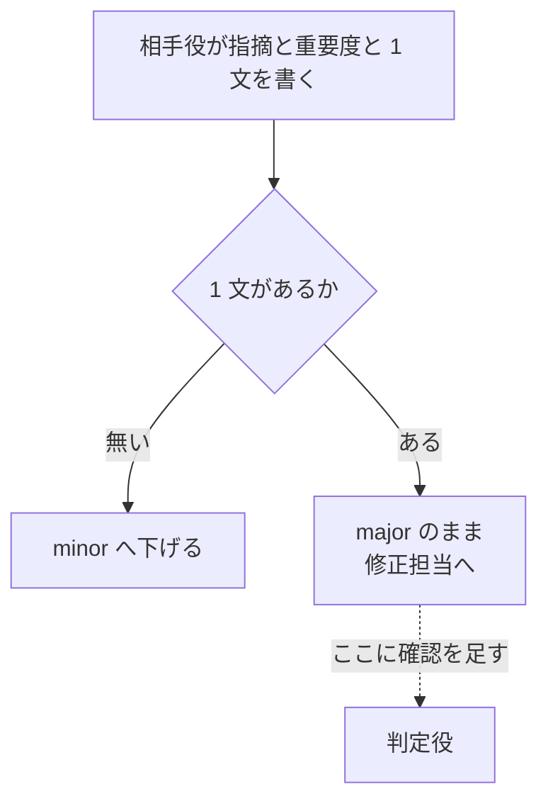
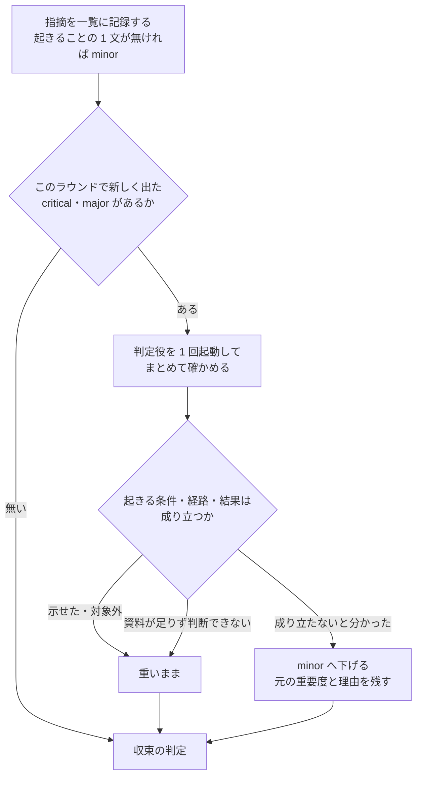
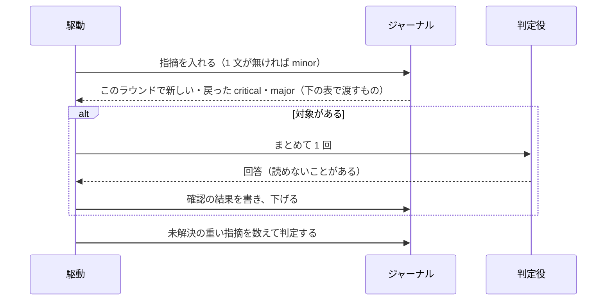

# cross-review: 実際に起きると確かめられた指摘だけを重い扱いのまま残す（#4363）

レビューする AI（以下、相手役）は重い指摘のすべてに「起きること」の 1 文を書くため、1 文の有無で下げる仕組みは一度も働かなかった。そこで、指摘を書いた AI とは別の読むだけの claude（判定役）が差分と実装を読み、起きる条件・経路・結果の 3 つを示せるかを確かめ、読んだうえで指摘が成り立たないと分かったものを軽い扱いへ下げる。資料が足りず判断できない指摘は下げない。調査と採らなかった案は、決定の記録と末尾の外部の調査にある。

## 今の姿

何が起きたか・目的・受け入れ条件は要求仕様（[issue-4363-requirements.md](./issue-4363-requirements.md)、正は #4363 の本文）にある。この文書は「どう解くか」と「なぜその解き方か」だけを書く。



- 下げる条件を決めるのは `criteria_decide.effective_severity` で、見るのは 1 文が空かどうかだけである
- 指摘をジャーナル（状態ファイルの指摘の一覧）へ入れるのは `journal.FindingJournal.enter` で、同じ指摘が出し直されると重い方の重要度を残す
- 根本原因は、下げる条件の材料を指摘を書いた本人が出すことである。求められた欄は必ず埋まる

## 文脈と制約

- 要求仕様の条件 3〜5 と、今の「1 文が無ければ下げる」決まりを保つ
- 相手役の出力には、保護の対象を書く欄 `protect` を 1 つだけ足す。ほかの出力の形とコマンドの引数は変えない
- 費用を増やす仕組みなので、起動は 1 ラウンドに 1 回までにする（MVV の Value 2）
- 判定役の結果を読めないときは、指摘を下げない

## 解き方の全体像



- 相手役の指示と出力には `protect` の欄が増え、確かめる役が 1 つ増える
- 下げた指摘は修正担当へ渡らず、収束も止めない。状態ファイルと記録のコメントに、元の重要度と理由が残る
- 相手役か判定役が保護の種類（秘密・認証認可・利用者のデータ・戻せない操作・人の安全）を示した指摘と、MVV に反する指摘は下げない

## ドメインモデル

コンテキストは「NDF の cross-review」の 1 つである。

### 集約

| 集約 | オーナー（書き換えてよいもの） | 根 | エンティティ | 値オブジェクト |
| --- | --- | --- | --- | --- |
| 指摘のジャーナル | `journal.FindingJournal` | ジャーナル | 指摘 | 確認の結果（判定役の回答） |

### 不変条件

| # | 集約 | 条件 | 破れたときの扱い |
| --- | --- | --- | --- |
| I1 | 指摘のジャーナル | 確認で下げた指摘（`check.lowered` が真）の重要度は minor である。出し直されても戻らない。例外は 2 つある。I4 の場合と、後の出し直しが MVV の項目か必ず人の承認が要る操作を挙げた場合（受け入れ条件 5 を優先する。設計の承認で確かめる）である | 出し直しで重い方を残す処理は、この指摘に当てない |
| I2 | 指摘のジャーナル | 確認の結果が無い指摘の重要度は、判定役を置かない場合と同じである | 警告に載せる |
| I3 | 指摘のジャーナル | 下げた指摘は、相手役が付けた元の重要度を持つ | — |
| I4 | 指摘のジャーナル | 相手役か判定役が一度でも保護の種類を示した指摘は、行の `protect` にその種類を残し続ける。その指摘は、判定役の確認を理由に重要度を下げない | 下げた後の出し直しで `protect` が付けば、元の重要度へ戻し、`check.lowered` を偽にする |

### ドメインイベント

| # | イベント | 発生元 | 受け手 |
| --- | --- | --- | --- |
| E1 | レビューする AI が指摘を出した | 相手役 | ジャーナル |
| E2 | 指摘の重要度を決めた | ジャーナル（判定役の回答を受けて） | 収束の判定 |
| E3 | 重い指摘を修正へ回した | 収束の判定 | 修正担当 |
| E4 | 効き目を集計した | リリース後テスト | #4363 のコメント |

## 構成要素

| 要素 | 責務 |
| --- | --- |
| 判定役の判断（`verify_decide.py`、新設） | 確かめる指摘を選ぶ・指示を組む・回答を読む・下げるかを決める。外部のコマンドを打たない |
| 判定役の起動（`verify.py`、新設） | 読むだけの claude を 1 回起動し、回答を返す。起動には、結果の無い相手役の代わりに claude を読むだけで起動する既存の経路（`seats._seat_launch` から `participants.read_only_launch`）と同じ関数を使う。作業ディレクトリはレビューする worktree、使える Tool は読み取りだけ（`participants.READ_TOOLS`）、ほかに読めるのはこの実行の資料のディレクトリ（差分のファイル）だけである |
| 駆動（`drive.py`） | 指摘をジャーナルへ入れた直後、収束の判定の前に判定役を呼ぶ |
| ジャーナル（`journal.py`） | 相手役の `protect` と確認の結果を指摘の行に書き、下げるかを決めて重要度を下げる。保護の対象と後で分かった行は元の重要度へ戻す。下げた指摘は、振動の判定（前々ラウンドの指摘が戻ったら止める）に使う指摘のキーの集合に入れない |
| 指示の文（`contracts/data/review-criteria.json` の `verify`） | 判定役への指示 |
| 記録のコメント（`report_decide.py`） | 下げた指摘の重要度の欄に元の重要度、理由の欄に判定役の理由を出す |
| 手順書（`skills/cross-review/docs/01-state-and-review.md`） | 「指摘の基準」に確認の決まりを足す |

## データ構造

状態ファイルの指摘の行に `protect` と `check` を足す。ほかの欄は変えない。

`protect` は文字列の並びで、その指摘に一度でも示された保護の種類を持つ。相手役が書いた値と、判定役の `tracks` のうち保護の種類に当たる値を足していく。足した値は外さない。当たらない指摘は持たない。

| キー | 型 | 中身 |
| --- | --- | --- |
| `check.holds` | 真偽値 | 起きると示せたか。有効な回答の `holds` をそのまま持つ（有効な回答の条件は下の「回答の形」） |
| `check.condition` | 文字列 | 誰が何をするときに起きるか |
| `check.path` | 文字列 | どの記述・コードを通って起きるか（ファイルと行） |
| `check.result` | 文字列 | 何が起きるか |
| `check.reason` | 文字列 | 成り立たないと判断した理由 |
| `check.tracks` | 文字列の並び | 判定役が付けた指摘の種類。下の「回答の形」の `tracks`。当たるものはすべて持つ |
| `check.lowered` | 真偽値 | この確認で重要度を下げたか |

- `check` の無い行（前の実行が PR に残して引き継いだ指摘・前のバージョンの行・確かめなかった行）は、今のとおり読む
- 直した指摘が戻ったとき（`_revive`）は `check` を外し、もう一度確かめる。行の `protect` は外さないので、判定役だけが示した保護の種類も、再発の後に残る
- 確認で下げた行は `check.lowered` が真である。`check.holds` が偽でも下げない行（保護の対象・MVV に反する指摘）があるので、`holds` では見分けない

## 入出力のコントラクト

### 相手役の指示と出力

指摘の JSON に `protect` を足す。秘密・認証認可・利用者のデータ・戻せない操作・人の安全に関わる指摘には、`secret`・`authz`・`user_data`・`irreversible`・`safety` のうち当たるものをすべて配列で書き、当たらなければ空の配列にする。5 つ以外の値は捨てる。

### 判定役の指示

渡すのは、指摘の一覧（番号・本文・重要度・1 文・場所）、そのラウンドの差分のファイル、作業場所、指摘の基準である。誰が書いた指摘かは渡さない。指示の要点は次のとおりである。

- 指摘を否定できないかを、差分と実装を読んで調べる。指摘の文をそのまま写して根拠にしない
- `holds` を偽にするのは、必要な記述とコードを読んだうえで、起きる条件・経路・結果のどれかが成り立たないと分かったときだけである。理由には、何を読んで何が成り立たないかを書く。読めない資料やコードがあって決められないときは、`holds` を null にし、足りないものを理由に書く
- 基準ごとの「起きること」は、相手役への指示（`impact`）と同じ定義を使う。指摘の基準は 1（利用者の経路の誤動作）・2（秘密や戻せない操作など）・3（このプロジェクトのレビューの重点）・4（設計の文書の食い違い）・5（MVV に反する）・6（通じない文）である。基準 3 は何がどの単位でどれだけ増えるか、基準 4 は実装する人が何を作り違えるか、基準 6 はどの読み手が何を取り違えるかである
- ラウンドの回数や、後のラウンドで初めて出たことは、判定の材料にしない

### 回答の形

最後の行の 1 行の JSON である。

```json
{"verdicts": [{"id": "r2-1", "holds": true, "condition": "…", "path": "src/a.py:10", "result": "…", "reason": "", "tracks": ["delivered"]}]}
```

| `tracks` の値 | 意味 |
| --- | --- |
| `secret`・`authz`・`user_data`・`irreversible`・`safety` | 秘密・認証認可・利用者のデータ・戻せない操作・人の安全 |
| `delivered`・`approval` | 利用者に届いた不具合（例: 配ったバージョンのコマンドが普段の使い方で失敗する）・承認資料の正しさ（承認する人へ見せる説明が事実と違う） |

判定役は当たる値をすべて並べ、どれでもなければ空にする。

指摘ごとの回答は、次のとおり読む。

| 回答 | 扱い |
| --- | --- |
| `holds` が真で、`condition`・`path`・`result` がすべて空でない | 有効。起きると示せた |
| `holds` が偽で、`reason` が空でない | 有効。成り立たないと分かった（3 つの文は空でよい） |
| `holds` が null | 資料が足りず判断できない。確認の結果が無いものとして扱い、`check` を書かず、重要度を保ち、理由を警告に載せる。`tracks` と、#2468 の `same_as` は使う |
| `holds` が真なのに 3 つのどれかが無いか空、`holds` が偽なのに `reason` が空、または `holds` が無いか真偽値でも null でもない | 不正な回答。結果が無いものとして扱い、`check` を書かず、重要度を保ち、理由を警告に載せる |

**指摘の種類**は、判定役の `tracks` と行の `protect` を合わせたものである。最初の行の 5 つを「保護の種類」と呼び、指摘の種類に 1 つでも含む指摘を「保護の対象の指摘」と呼ぶ。#3780・#2468 の設計もこの定義を使う。定義はここだけに置く。

`holds` が偽の回答のときの重要度は、次の表を上の行から当てて決める。

| 指摘 | 重要度 |
| --- | --- |
| 保護の対象の指摘（判定役の `tracks` が空でも、行の `protect` があれば当たる） | **下げない** |
| 判定役の `tracks` に、上の `tracks` の値の表に無い文字列がある | **下げない** |
| ほか（`delivered`・`approval` だけ、または種類が空） | minor に下げる。記録のコメントに残す。後の #3780（直さずに残す指摘の起票）と #2468（出直しと上限で残る指摘の起票）を入れても、この指摘は Issue にしない |

下げた指摘が `protect` を付けて出し直されたら、重要度を元に戻して `check.lowered` を偽にする。判定役は起動し直さない。一度保護の対象になった指摘は、後の出し直しや再確認で保護の種類が示されなくても対象のままである。

下げた指摘が MVV の項目か必ず人の承認が要る操作を挙げて出し直された場合も、`check.lowered` を偽にする。重要度は、今回の値と行の値の重い方を残す。そのうえで、MVV の項目を挙げていれば major 以上に固定する。必ず人の承認が要る操作という分類は重要度を変えず、行を人の承認を待つ指摘にする。同じ出し直しが保護の種類も示した場合は、先に上の段落のとおり元の重要度へ戻し、その後にこの段落の扱いを当てる。

## 処理の流れ



| 起きること | 扱い |
| --- | --- |
| 判定役が終わらない・失敗した・JSON を読めない・差分の読み取りを拒否された | どの指摘も下げず、警告に載せる。起動し直さない |
| 回答に無い指摘・知らない番号・不正な回答の指摘 | その指摘は下げず、警告に載せる |
| 一部の相手役の出力を読めなかったラウンド | 読めた分の指摘は確かめる |
| 渡す指摘が 1 件も無い | 判定役を起動しない |

どの指摘を判定役へ渡すかと、重要度を変えるかは次のとおりである。対象は、このラウンドで新しく出たか戻った critical・major である。

上の行から順に当てる。

| 指摘 | 判定役へ渡す | `holds` が偽のときの重要度 |
| --- | --- | --- |
| 行が `redline` を持つ（必ず人の承認が要る操作の指摘）か、`by` が NDF（NDF が機械で作った指摘） | 渡さない | 変えない |
| それ以外で、行が `mvv`（MVV に反する指摘）か `protect`（保護の対象。判定の結果で下がらない）を持つ | 下の条件に当たるラウンドだけ渡す。使うのは `tracks`（#2468 を入れた後は `same_as` と `skip_broken` も） | 変えない |
| ほかの相手役の指摘 | 渡す | 上の「回答の形」の表で決める |

MVV に反する指摘と承認の要る操作の指摘を下げないこと（条件 5）は、判定役の回答でなく、ジャーナルが行の `mvv`・`redline`・`by` を見て守る。判定役へ MVV の本文は渡さない。

MVV に反する指摘と保護の対象の指摘は、確認しても重要度が変わらない。起動の費用を修正や再レビューの削減で取り返せないので、回答の `tracks` を使う処理があるときだけ判定役を起動する理由にする。判定役へ渡すのは、次のどれかに当たるラウンドである。どれにも当たらなければ渡さず、この 2 種類の指摘だけのラウンドでは判定役を起動しない。

渡さないと決めた指摘を**判定対象外**、渡したのに有効な回答が無い指摘（失敗・読めない回答・不正な回答・`holds` が null・上限で起動しなかった）を**確認できなかった指摘**と呼ぶ。重要度はどちらも変えないが、#3780 と #2468 はこの 2 つを区別して扱う。

| 条件 | `tracks` を使う処理 |
| --- | --- |
| 同じラウンドに、ほかに判定役へ渡す指摘がある | 起動の回数が増えないので一緒に渡す |
| #3780（2 ラウンド目以降の major のうち、変えていない行のものなどを直さずに残し、一部を起票する決まり）の線引きが当たるラウンドである。実装の PR の 2 ラウンド目以降で、相手役の全員が読んだ前の head があるラウンドを指す。ただし、比較基点が変わって新しく PR の変更になったファイルを足して渡すラウンドは、線引きをしないので当たらない。当たるラウンドでも、この理由で渡すのは、線引きで直さずに残る側の MVV の指摘がある場合だけである（保護の対象の指摘は進むと決まっていて起票もしないので、この理由では起動しない） | 起票するかの判断 |
| #2468（打ち直しをまたぐ上限と出直しの扱い。この課題より後に実装する）を入れた後、突き合わせる見送り済みか直さずに残した指摘、または振動の候補の直した指摘がある | 同じ指摘かの判定（`same_as`）と残し方 |

## 決定の記録

### 決定 1: 書いた本人の自己申告に頼らないため、別の判定役が起きる条件・経路・結果を示せた指摘だけを重く残す

- **質問**: 1 文を書いただけでは major のまま残らない決め方を、どれにするか
- **選んだ案**: 読むだけの claude を 1 ラウンドに 1 回起動し、新しい critical・major をまとめて確かめる。判定役が、指摘が成り立たないと分かった（`holds` が偽）と答えたら minor にする。資料が足りず判断できない指摘は下げない（決定 3）
- 採らなかった案: 相手役に条件・経路・結果を分けて書かせ、欠ければ下げる（#4014 の後の集計で、相手役は重い指摘 851 件のすべてに求められた 1 文を書いた。欄を増やしても同じく埋まる）
- 採らなかった案: 指摘に実装の行の引用を書かせ、引用がファイルにあるかを機械で確かめる（引用が正しくても、起きるかどうかは分からない。下がるのは写し間違いだけになる）
- 採らなかった案: 修正担当に任せる（今も理由を添えて見送れるが、修正担当を起動した時点で費用とラウンドが増える）
- **代償**: 下げうる重い指摘があるラウンドごとに claude の起動が 1 回増える。1 件も下げないラウンドの起動は費用だけになるので、リリース後の集計で省けた分と比べる（テスト設計の下）。判定役が正しい指摘を下げることがある
- 作り方: 自前で作る・標準に倣う
- 比べた候補: PRD1 / STD1
- 根拠: Value 2 / Value 12（MVV バージョン 11）。PRD1

### 決定 2: 見落としの害が大きい指摘を失わないため、相手役か判定役が保護の種類を示した指摘は確認で下げない

- **質問**: 秘密・認証認可・利用者のデータ・戻せない操作・人の安全の指摘を、足す条件の対象にするか。対象かどうかを誰が決めるか
- **選んだ案**: 相手役の `protect` と判定役の `tracks` のどちらかが保護の種類を示せば下げない。判定役が起きると示せず、分類も落とした場合に、同じ 1 回の回答だけで指摘が修正から外れないようにする

重要度は 2 つの段階で決まる。この決定が変えるのは 2 つ目だけである。

| 段階 | 決まり |
| --- | --- |
| 指摘を登録するとき | 今の判定（`criteria_decide.effective_severity`）のままにする。利用者に起きることの 1 文（`impact`）が空の critical・major は minor に下げる。必ず人の承認が要る操作の指摘は、空でも下げない |
| 判定役が確かめた後 | 成り立たないと分かれば下げる。ただし保護の対象の指摘は下げない |
- 採らなかった案: 保護の種類も同じ条件で下げる（Value 7 は、人を害する・秘密・利用者のデータ・戻せない操作の指摘を効率に寄与しなくても直すと定める）
- 採らなかった案: 利用者に届いた不具合と承認資料の正しさも下げない（Value 7 が挙げる種類でない。起きる条件・経路・結果が成り立たない指摘が、分類だけで修正へ回り続ける）
- 採らなかった案: 判定役の分類だけで決める（`holds` の誤りと分類の誤りが同じ回答で起きると、データを失う指摘が minor のまま残る）
- 採らなかった案: 相手役の申告だけで決める（申告し忘れた指摘を拾えない）
- **代償**: 相手役が `protect` を広く書くと、確認で下がらない指摘が増え、この課題の効き目が小さくなる。保護の種類の細部の指摘は、今と同じく修正へ回る。リリース後の集計で、判定役の `tracks` に保護の種類が無く、行の `protect` だけを理由に下げなかった件数を数える
- 根拠: Value 7（MVV バージョン 11）

### 決定 3: 正しい指摘を失わないため、確認できないときは下げない

- **質問**: 判定役が回答しないとき、資料が足りず判断できないとき、回答に漏れがあるときの重要度
- **選んだ案**: 相手役が付けた重要度のまま扱い、警告に載せる。起動し直さない
- 採らなかった案: minor にする（利用上限や一時の失敗で、重い指摘がすべて修正されずに収束する）
- **代償**: 判定役が失敗したラウンドは、今と同じ数の指摘が修正へ回る
- 根拠: Value 7 / Value 2（MVV バージョン 11）

## 影響と危険

- **働く範囲**: NDF を使うすべてのリポジトリの cross-review
- **プロジェクトごとに違うもの**: 無い。設定も引数も足さない
- **当たるモード**: cross-review を通るモードのすべて。設計の Pull Request の指摘にも当たる

壊れうる箇所と扱いは次のとおりである。

| 箇所 | 扱い |
| --- | --- |
| #3780・#2468 も `drive.py`・`journal.py`・`review-criteria.json` を変える | この課題を最初に実装する。2 つはこの課題の判定役の回答を使う |
| 同じ指摘が出し直されると重い方の重要度を残す処理 | 判定役の確認で下げた指摘には当てない |
| 下げすぎ | リリース後の集計で、下げた指摘を読んで確かめる（受け入れ条件 2） |

### 代表のリポジトリでの振る舞い

| 代表のリポジトリ | 設定の要点 | 直した後に起きること | この種類で扱えなくなること |
| --- | --- | --- | --- |
| Web サービス | 実装と設計の PR | 成り立たないと分かった重い指摘は修正へ回らない | 無し |
| モバイルアプリ | 同じ | 同じ。実機でしか分からない経路は、コードを読んで成り立たないと分かれば下がり、判断できなければ下がらない | 無し |
| 業務文書だけ | 文書の PR（基準 6） | 読み手が取り違えないと分かった指摘は修正へ回らない | 無し |

### このリポジトリだけの事情

- 無し（判定の基準はどのリポジトリでも同じで、MVV の無いリポジトリでも働く）

## 用語

| 用語 | 意味 | 用語集への反映 |
| --- | --- | --- |
| 判定役 | cross-review で、相手役が書いた重い指摘が実際に起きるかを確かめる読むだけの AI | 追加 |

## テスト設計

| 受け入れ条件・不変条件 | どの振る舞いで縛るか | どう壊したら落ちるべきか |
| --- | --- | --- |
| 条件 1・3 | 判定役が成り立たないと答えた major は minor になり、修正担当へ渡らず収束する。元の重要度が行に残る | 1 文があれば下げないように戻すと落ちる |
| 条件 4 | 示せたと答えた major は重要度が変わらない（修正へ回すかは #3780 が決める） | 回答を読まずに下げると落ちる |
| 条件 5 | MVV に反する指摘と必ず人の承認が要る操作の指摘は、成り立たないと答えても重要度が変わらない | 対象外の判定を外すと落ちる |
| 決定 2・I4 | 保護の対象の指摘は下がらない。判定役の `tracks` が空・知らない値でも、行の `protect` があれば下がらない。`authz` と `user_data` の両方を書いた指摘は両方を持つ。下げた指摘が `protect` を付けて出し直されると元の重要度に戻る。判定役だけが `secret` と分類した指摘は、直した後に再発して分類が空でも下がらない。`delivered`・`approval` だけの指摘は下がる | 判定役の分類だけを見ると落ちる。出し直しの `protect` を読まないと落ちる。`_revive` で保護の種類を消すと落ちる。`safety` を下げると落ちる |
| I1 | 下げた指摘が、保護の種類も MVV の項目も承認の要る操作も挙げずに出し直されても minor のままである。MVV の項目を挙げて出し直されると major 以上に戻り、承認の要る操作を挙げると人の承認を待つ指摘になる | 出し直しで重い方を戻すと落ちる。MVV の項目を挙げた出し直しを minor のままにすると落ちる |
| I2・決定 3 | 判定役の失敗と読めない回答、`holds` が null の回答、`holds` が真で 3 つの文のどれかが欠ける回答、`holds` が偽で理由の無い回答で、重要度が変わらず警告が載る | 失敗・資料不足・欄の欠けた回答を「成り立たない」と読むと落ちる |
| I3 | 記録のコメントに元の重要度と理由が出る | 欄を落とすと落ちる |
| 費用 | 渡す指摘が無いラウンド（NDF が作った指摘と承認の要る操作の指摘だけのラウンド、分類を使う処理の無い MVV の指摘と保護の対象の指摘だけのラウンドを含む）は判定役を起動しない | 毎ラウンド起動すると落ちる。MVV の指摘か `protect` の付いた指摘だけを理由に設計の PR で起動すると落ちる |
| 下げた件数 | 下げた行だけが `check.lowered` を真にする。`holds` が偽の保護の対象の指摘と MVV の指摘は数えない | `holds` が偽の行を数えると落ちる |

条件 2 はリリース後テストで確かめる。10 回以上の実行の状態ファイルから、#4014 と同じ 4 つの値を集計して #4363 に書く。下げた指摘は、確認の前が critical・major で、確認の後が minor になり、判定役の回答を理由に下げた行（`check.lowered` が真）を数え、全件を読んで実は重かったものを挙げる。行の `protect` だけを理由に下げなかった指摘（判定役へ渡さなかった指摘を含む）の件数と、判定役の費用と秒も併せて書く。

起動の費用が見合うかも同じ記録で比べる。

| 比べる値 | 数え方 |
| --- | --- |
| かかった分 | 判定役の起動の回数・費用・秒の合計。そのうち 1 件も下げなかった起動の分を分けて書く |
| 省けた分 | 下げたことで未解決の重い指摘が 0 件になったラウンドの数に、同じ実行の記録の修正担当 1 回と次のラウンド 1 回の費用と秒の中央値を掛けた値 |

かかった分が省けた分を上回れば、判定役へ渡す条件を絞るか、この仕組みをやめるかを #4363 で決め直す。

## 設計の結果

詳細設計（ファイルと関数の粒度）は [issue-4363-design-detail.md](./issue-4363-design-detail.md) にある。触るファイルのうち、`drive.py` の行数の上限のための移動と、それに伴う上限の読み手とテストの参照名は詳細設計でコードを読んで足した（理由は詳細設計の地図）。

| 課題 | 扱い | 統合先 | 触るファイル |
| --- | --- | --- | --- |
| #4363 | 実装する | — | `plugins/ndf/src/ndf/domains/crossreview/verify_decide.py`（新設）、`plugins/ndf/src/ndf/domains/crossreview/verify.py`（新設）、`plugins/ndf/src/ndf/domains/crossreview/drive.py`、`plugins/ndf/src/ndf/domains/crossreview/journal.py`、`plugins/ndf/src/ndf/domains/crossreview/criteria_decide.py`、`plugins/ndf/src/ndf/domains/crossreview/report_decide.py`、`plugins/ndf/contracts/data/review-criteria.json`、`plugins/ndf/skills/cross-review/docs/01-state-and-review.md`、`plugins/ndf/tests/domains/crossreview/test_crossreview_verify.py`（新設）、`plugins/ndf/tests/domains/crossreview/test_crossreview_journal.py`、`plugins/ndf/tests/domains/crossreview/test_crossreview_report.py`、`plugins/ndf/src/ndf/domains/crossreview/carry.py`（新設）、`plugins/ndf/src/ndf/domains/crossreview/reviewing.py`（新設）、`plugins/ndf/contracts/limits/cross-review.remark-chars.json`、`plugins/ndf/contracts/limits/cross-review.remarks-total.json`、`plugins/ndf/tests/domains/crossreview/test_crossreview_criteria.py`、`plugins/ndf/tests/domains/crossreview/test_crossreview_citations.py`、`plugins/ndf/tests/domains/crossreview/test_crossreview_documents.py`、`plugins/ndf/tests/domains/crossreview/test_crossreview_prior.py`、`plugins/ndf/tests/domains/crossreview/test_crossreview_finish.py` |

## 未確認のまま残ること

| 項目 | 内容 |
| --- | --- |
| 下がる割合 | 判定役がどれだけ下げるかは、動かすまで分からない。リリース後の 10 回の実行で分かる |
| 判定役の費用と時間 | 1 回の起動の費用は測っていない。同じ実行の記録で分かる |
| ラウンド数への効き目 | 同じ時期の #3780 の変更と分けて測れない。下げた件数と、下げた指摘の中身で効き目を見る |
| 下げた指摘が MVV に反する指摘として出し直された場合 | この設計は、受け入れ条件 5（MVV に反する指摘と承認の要る操作の指摘は下げない）を優先し、下げた印を外す（不変条件 I1 の例外）。MVV に反する指摘は major 以上に戻る。必ず人の承認が要る操作だけを挙げた出し直しは、今のコードが重要度を固定しないので、今回の値が minor なら minor のまま人の承認を待つ。設計の承認で確かめる |
| 判断できない回答の指摘の種類 | `holds` が null の回答は `check` を書かないので、その回答だけが示した「利用者に届いた不具合」と「承認資料の正しさ」の種類は行に残らない。この 2 種類だけの指摘は、後で上限に当たって残っても起票されず、記録のコメントに残る。設計の承認で確かめる |

## 外部の調査

| 種類 | 調べるか | 理由 |
| --- | --- | --- |
| 標準・仕様 | 調べる | レビューの指摘を止めるものと止めないものに分ける書き方がある |
| 主要な製品 | 調べる | AI のコードレビューが誤った指摘をどう除くかを比べる |
| ライブラリとサービス | 調べない | 指摘が実際に起きるかの判定は、コードを読む AI の起動で行う。NDF は既にその起動の仕組みを持つ |

### 標準・仕様

| # | 標準・仕様 | 何を定めているか | 設計への反映 | 出典 |
| --- | --- | --- | --- | --- |
| STD1 | Conventional Comments | 指摘に blocking・non-blocking の修飾を付ける。付けるのは指摘を書く人である | 重要度で止める・止めないを分ける今の形は保つ。指摘を書く人の申告だけに頼らない点が違う | https://conventionalcomments.org/ （2026-11-27） |

### 主要な製品

| # | 製品 | どう解いているか | 設計への反映 | 出典 |
| --- | --- | --- | --- | --- |
| PRD1 | Claude Code の Code Review | 複数のエージェントが指摘を挙げた後、確認の手順がコードと突き合わせて誤った指摘を除き、重複を除いて重要度で並べる | 指摘を挙げる役と確かめる役を分ける。除かずに minor にして記録に残す | https://code.claude.com/docs/en/code-review.md （2026-11-27） |

### ライブラリとサービス

調べていない（理由は上の表）。

### 確かめられなかったこと

| 対象 | 試した手段 | 結果と理由 |
| --- | --- | --- |
| Claude Code の code-review プラグインの確信度の点数の決め方 | https://raw.githubusercontent.com/anthropics/claude-code/main/plugins/code-review/README.md | HTTP 404。公式の原文を読めていないので、点数の方式は比べていない |

調べた量: 候補 2 件・取得の試み 6 回。
