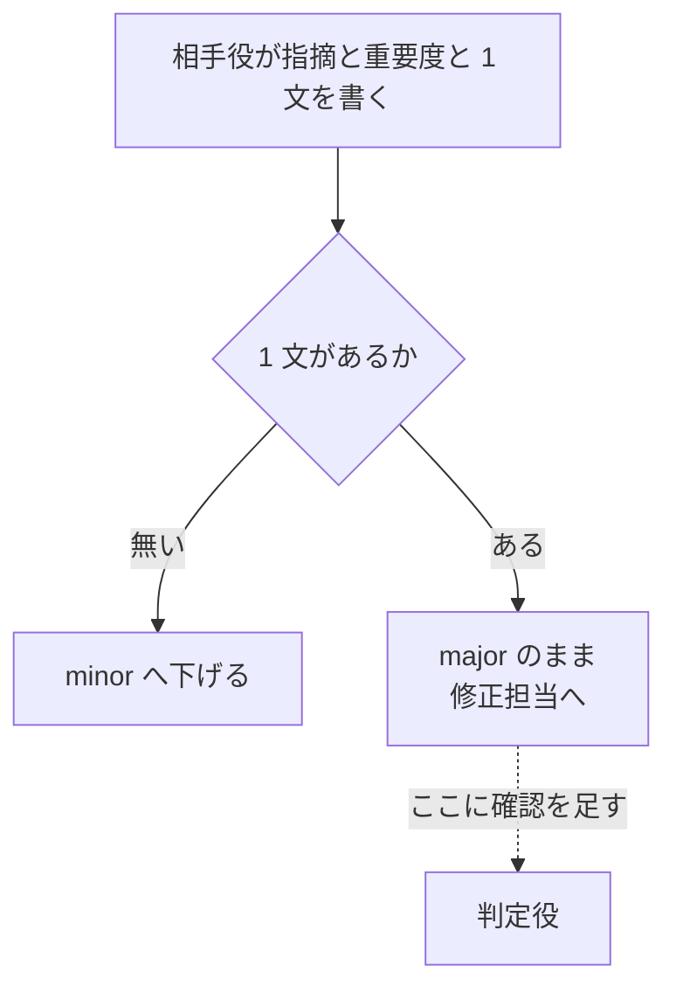
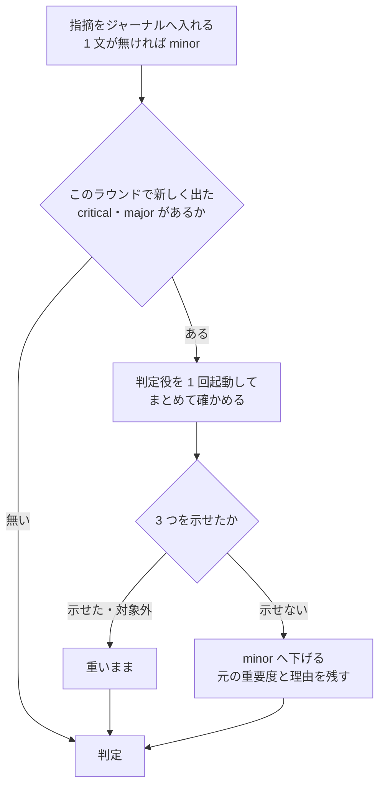
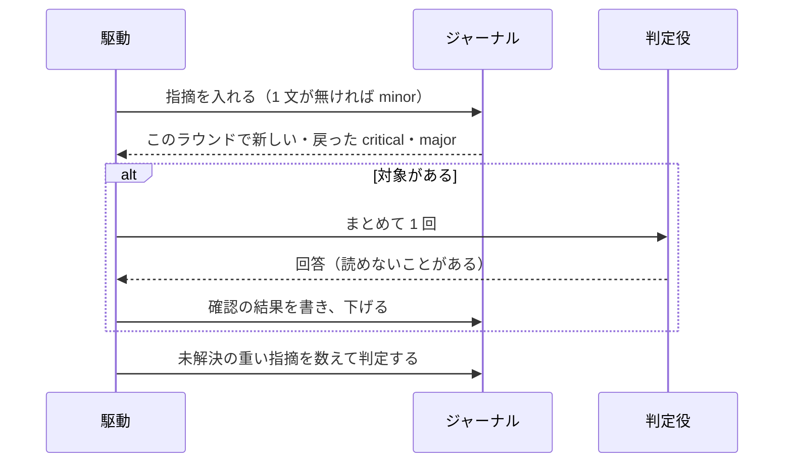

# cross-review: 実際に起きると確かめられた指摘だけを重い扱いのまま残す（#4363）

レビューする AI は重い指摘のすべてに「起きること」の 1 文を書くため、1 文の有無で下げる仕組みは一度も働かなかった。そこで、指摘を書いた AI とは別の読むだけの claude（判定役）が差分と実装を読み、起きる条件・経路・結果の 3 つを自分で示せた指摘だけを重い扱いのまま残す。調査と採らなかった案は、決定の記録と末尾の外部の調査にある。

## 今の姿

何が起きたか・目的・受け入れ条件は要求仕様（[issue-4363-requirements.md](./issue-4363-requirements.md)、正は #4363 の本文）にある。この文書は「どう解くか」と「なぜその解き方か」だけを書く。



- 下げる条件を決めるのは `criteria_decide.effective_severity` で、見るのは 1 文が空かどうかだけである
- 指摘をジャーナル（状態ファイルの指摘の一覧）へ入れるのは `journal.FindingJournal.enter` で、同じ指摘が出し直されると重い方の重要度を残す
- 根本原因は、下げる条件の材料を指摘を書いた本人が出すことである。求められた欄は必ず埋まる

## 文脈と制約

- 要求仕様の条件 3〜5 と、今の「1 文が無ければ下げる」決まりを保つ
- 相手役の出力の形は変えない。コマンドの引数も変えない
- 費用を増やす仕組みなので、起動は 1 ラウンドに 1 回までにする（MVV の Value 2）
- 判定役の結果を読めないときは、指摘を下げない

## 解き方の全体像



- 相手役の指示と出力は今のままで、確かめる役が 1 つ増える
- 下げた指摘は修正担当へ渡らず、収束も止めない。状態ファイルと記録のコメントに、元の重要度と理由が残る
- 秘密・認証認可・利用者のデータ・戻せない操作の指摘と、MVV に反する指摘は下げない

## ドメインモデル

コンテキストは「NDF の cross-review」の 1 つである。

### 集約

| 集約 | オーナー（書き換えてよいもの） | 根 | エンティティ | 値オブジェクト |
| --- | --- | --- | --- | --- |
| 指摘のジャーナル | `journal.FindingJournal` | ジャーナル | 指摘 | 確認の結果（判定役の回答） |

### 不変条件

| # | 集約 | 条件 | 破れたときの扱い |
| --- | --- | --- | --- |
| I1 | 指摘のジャーナル | 確認の結果が「起きると示せない」で、対象外でない指摘の重要度は minor である。出し直されても戻らない | 出し直しで重い方を残す処理は、この指摘に当てない |
| I2 | 指摘のジャーナル | 確認の結果が無い指摘の重要度は、判定役の有無で変わらない | 警告に載せる |
| I3 | 指摘のジャーナル | 下げた指摘は、相手役が付けた元の重要度を持つ | — |

### ドメインイベント

| # | イベント | 発生元 | 受け手 |
| --- | --- | --- | --- |
| E1 | レビューする AI が指摘を出した | 相手役 | ジャーナル |
| E2 | 指摘の重要度を決めた | ジャーナル（判定役の回答を受けて） | 収束の判定 |
| E3 | 重い指摘を修正へ回した | 収束の判定 | 修正担当 |
| E4 | 効き目を集計した | リリース後テスト | #4363 のコメント |

## 構成要素

| 要素 | 責務 |
| --- | --- |
| 判定役の判断（`verify_decide.py`、新設） | 確かめる指摘を選ぶ・指示を組む・回答を読む・下げるかを決める。外部のコマンドを打たない |
| 判定役の起動（`verify.py`、新設） | 読むだけの claude を 1 回起動し、回答を返す。起動は埋めた席と同じ組み立て（`participants.read_only_launch`）を使う |
| 駆動（`drive.py`） | 指摘をジャーナルへ入れた直後、判定の前に判定役を呼ぶ |
| ジャーナル（`journal.py`） | 確認の結果を指摘の行に書き、重要度を下げる。振動の判定に使うキーは下げた後の重要度から作る |
| 指示の文（`contracts/data/review-criteria.json` の `verify`） | 判定役への指示 |
| 記録のコメント（`report_decide.py`） | 下げた指摘の重要度の欄に元の重要度、理由の欄に判定役の理由を出す |
| 手順書（`skills/cross-review/docs/01-state-and-review.md`） | 「指摘の基準」に確認の決まりを足す |

## データ構造

状態ファイルの指摘の行に `check` を足す。ほかの欄は変えない。

| キー | 型 | 中身 |
| --- | --- | --- |
| `check.holds` | 真偽値 | 起きると示せたか。真は、回答が真で 3 つの文がすべて空でないときだけ |
| `check.condition` | 文字列 | 誰が何をするときに起きるか |
| `check.path` | 文字列 | どの記述・コードを通って起きるか（ファイルと行） |
| `check.result` | 文字列 | 何が起きるか |
| `check.reason` | 文字列 | 示せないときの理由 |
| `check.track` | 文字列 | 指摘の種類。下の「回答の形」の `track` |

- `check` の無い行（引き継いだ行・前のバージョンの行・確かめなかった行）は、今のとおり読む
- 直した指摘が戻ったとき（`_revive`）は `check` を外し、もう一度確かめる
- 下げた行は「元の重要度が重く、今が minor」で今と同じく見分ける。確認で下げた行は `check.holds` が偽である

## 入出力のコントラクト

### 判定役の指示

渡すのは、指摘の一覧（番号・本文・重要度・1 文・場所）、そのラウンドの差分のファイル、作業場所、指摘の基準である。誰が書いた指摘かは渡さない。指示の要点は次のとおりである。

- 指摘を否定できないかを、差分と実装を読んで調べる。指摘の文をそのまま写して根拠にしない
- 基準ごとの「起きること」は、相手役への指示（`impact`）と同じ定義を使う（基準 3 は何がどれだけ増えるか、基準 4 は実装する人が何を作り違えるか、基準 6 はどの読み手が何を取り違えるか）
- ラウンドの回数や、後のラウンドで初めて出たことは、判定の材料にしない

### 回答の形

最後の行の 1 行の JSON である。

```json
{"verdicts": [{"id": "r2-1", "holds": true, "condition": "…", "path": "src/a.py:10", "result": "…", "reason": "", "track": "delivered"}]}
```

| `track` | 意味 | この変更での扱い |
| --- | --- | --- |
| `secret`・`authz`・`user_data`・`irreversible` | 秘密・認証認可・利用者のデータ・戻せない操作 | **下げない** |
| `safety`・`delivered`・`approval` | 人の安全・利用者に届いた不具合・承認資料の正しさ | 扱いは #3780 と #2468 が決める |
| 空 | どれでもない | — |

## 処理の流れ



| 起きること | 扱い |
| --- | --- |
| 判定役が終わらない・失敗した・JSON を読めない・差分の読み取りを拒否された | どの指摘も下げず、警告に載せる。起動し直さない |
| 回答に無い指摘・知らない番号 | その指摘は下げない |
| 相手役の一部が読めなかったラウンド | 読めた分の指摘は確かめる |
| NDF が機械で作った指摘・必ず人の承認が要る操作の指摘・MVV に反する指摘 | 重要度を変えない（条件 5）。MVV に反する指摘は `track` だけを使う |

## 決定の記録

### 決定 1: 書いた本人の自己申告に頼らないため、別の判定役が起きる条件・経路・結果を示せた指摘だけを重く残す

- **質問**: 1 文を書いただけでは major のまま残らない決め方を、どれにするか
- **選んだ案**: 読むだけの claude を 1 ラウンドに 1 回起動し、新しい critical・major をまとめて確かめる。条件・経路・結果を判定役が自分で示せなければ minor にする
- 採らなかった案: 相手役に条件・経路・結果を分けて書かせ、欠ければ下げる（#4014 の後の集計で、相手役は重い指摘 851 件のすべてに求められた 1 文を書いた。欄を増やしても同じく埋まる）
- 採らなかった案: 指摘に実装の行の引用を書かせ、引用がファイルにあるかを機械で確かめる（引用が正しくても、起きるかどうかは分からない。下がるのは写し間違いだけになる）
- 採らなかった案: 修正担当に任せる（今も理由を添えて見送れるが、修正担当を起動した時点で費用とラウンドが増える）
- **代償**: 重い指摘があるラウンドごとに claude の起動が 1 回増える。判定役が正しい指摘を下げることがある
- 作り方: 自前で作る・標準に倣う
- 比べた候補: PRD1 / STD1
- 根拠: Value 2 / Value 12（MVV バージョン 11）。PRD1

### 決定 2: 見落としの害が大きい指摘を失わないため、秘密・認証認可・利用者のデータ・戻せない操作は確認で下げない

- **質問**: この 4 種類を、足す条件の対象にするか
- **選んだ案**: 判定役がこの 4 種類と分類した指摘は、起きると示せなくても下げない。1 文が無ければ下げる今の決まりは変えない。分類するのは判定役で、相手役の出力には欄を足さない
- 採らなかった案: 4 種類も同じ条件で下げる（Value 7 がこの種類は効率に寄与しなくても直すと定める）
- 採らなかった案: 相手役の自己申告で対象外にする（印を付けるだけで確認を避けられる）
- **代償**: この種類と分類された細部の指摘は、今と同じく修正へ回る
- 根拠: Value 7（MVV バージョン 11）

### 決定 3: 正しい指摘を失わないため、確認できないときは下げない

- **質問**: 判定役が回答しないときと、回答に漏れがあるときの重要度
- **選んだ案**: 相手役が付けた重要度のまま扱い、警告に載せる。起動し直さない
- 採らなかった案: minor にする（利用上限や一時の失敗で、重い指摘がすべて修正されずに収束する）
- **代償**: 判定役が失敗したラウンドは、今と同じ数の指摘が修正へ回る
- 根拠: Value 7 / Value 2（MVV バージョン 11）

## 影響と危険

- **働く範囲**: NDF を使うすべてのリポジトリの cross-review
- **プロジェクトごとに違うもの**: 無い。設定も引数も足さない
- **当たるモード**: cross-review を通るモードのすべて。設計の Pull Request の指摘にも当たる

壊れうる箇所と扱いは次のとおりである。

| 箇所 | 扱い |
| --- | --- |
| #3780・#2468 も `drive.py`・`journal.py`・`review-criteria.json` を変える | この課題を最初に実装する。2 つはこの課題の判定役の回答を使う |
| 出し直しで重い方を残す処理 | 確認で下げた行には当てない（I1） |
| 下げすぎ | リリース後の集計で、下げた指摘を読んで確かめる（条件 2） |

### 代表のリポジトリでの振る舞い

| 代表のリポジトリ | 設定の要点 | 直した後に起きること | この種類で扱えなくなること |
| --- | --- | --- | --- |
| Web サービス | 実装と設計の PR | 起きると示せない重い指摘は修正へ回らない | 無し |
| モバイルアプリ | 同じ | 同じ。実機でしか分からない経路は、コードを読んで示せなければ下がる | 無し |
| 業務文書だけ | 文書の PR（基準 6） | 読み手の取り違えを示せない指摘は修正へ回らない | 無し |

### このリポジトリだけの事情

- 無し（判定の基準はどのリポジトリでも同じで、MVV の無いリポジトリでも働く）

## 用語

| 用語 | 意味 | 用語集への反映 |
| --- | --- | --- |
| 判定役 | cross-review で、相手役が書いた重い指摘が実際に起きるかを確かめる読むだけの AI | 追加 |

## テスト設計

| 受け入れ条件・不変条件 | どの振る舞いで縛るか | どう壊したら落ちるべきか |
| --- | --- | --- |
| 条件 1・3 | 判定役が示せないと答えた major は minor になり、修正担当へ渡らず収束する。元の重要度が行に残る | 1 文があれば下げないように戻すと落ちる |
| 条件 4 | 示せたと答えた major は修正担当へ渡る | 回答を読まずに下げると落ちる |
| 条件 5 | MVV に反する指摘と必ず人の承認が要る操作の指摘は、示せないと答えても重要度が変わらない | 対象外の判定を外すと落ちる |
| 決定 2 | 4 種類と分類された指摘は下がらない | 分類を見ずに下げると落ちる |
| I1 | 下げた指摘が出し直されても minor のままである | 出し直しで重い方を戻すと落ちる |
| I2・決定 3 | 判定役の失敗と読めない回答で、重要度が変わらず警告が載る | 失敗を「示せない」と読むと落ちる |
| I3 | 記録のコメントに元の重要度と理由が出る | 欄を落とすと落ちる |
| 費用 | 対象が無いラウンドは判定役を起動しない | 毎ラウンド起動すると落ちる |

条件 2 はリリース後テストで確かめる。10 回以上の実行の状態ファイルから、#4014 と同じ 4 つの値を集計して #4363 に書く。下げた指摘は `check.holds` が偽の行で数え、全件を読んで実は重かったものを挙げる。判定役の費用と秒も併せて書く。

## 設計の結果

| 課題 | 扱い | 統合先 | 触るファイル |
| --- | --- | --- | --- |
| #4363 | 実装する | — | `plugins/ndf/src/ndf/domains/crossreview/verify_decide.py`（新設）、`plugins/ndf/src/ndf/domains/crossreview/verify.py`（新設）、`plugins/ndf/src/ndf/domains/crossreview/drive.py`、`plugins/ndf/src/ndf/domains/crossreview/journal.py`、`plugins/ndf/src/ndf/domains/crossreview/criteria_decide.py`、`plugins/ndf/src/ndf/domains/crossreview/report_decide.py`、`plugins/ndf/contracts/data/review-criteria.json`、`plugins/ndf/skills/cross-review/docs/01-state-and-review.md`、`plugins/ndf/tests/domains/crossreview/test_crossreview_verify.py`（新設）、`plugins/ndf/tests/domains/crossreview/test_crossreview_journal.py`、`plugins/ndf/tests/domains/crossreview/test_crossreview_report.py` |

## 未確認のまま残ること

| 項目 | 内容 |
| --- | --- |
| 下がる割合 | 判定役がどれだけ下げるかは、動かすまで分からない。リリース後の 10 回の実行で分かる |
| 判定役の費用と時間 | 1 回の起動の費用は測っていない。同じ実行の記録で分かる |
| ラウンド数への効き目 | 同じ時期の #3780 の変更と分けて測れない。下げた件数と、下げた指摘の中身で効き目を見る |

## 外部の調査

| 種類 | 調べるか | 理由 |
| --- | --- | --- |
| 標準・仕様 | 調べる | レビューの指摘を止めるものと止めないものに分ける書き方がある |
| 主要な製品 | 調べる | AI のコードレビューが誤った指摘をどう除くかを比べる |
| ライブラリとサービス | 調べない | 指摘が実際に起きるかの判定は、コードを読む AI の起動で行う。NDF は既にその起動の仕組みを持つ |

### 標準・仕様

| # | 標準・仕様 | 何を定めているか | 設計への反映 | 出典 |
| --- | --- | --- | --- | --- |
| STD1 | Conventional Comments | 指摘に blocking・non-blocking の修飾を付ける。付けるのは指摘を書く人である | 重要度で止める・止めないを分ける今の形は保つ。書き手の申告だけに頼らない点が違う | https://conventionalcomments.org/ （2026-11-27） |

### 主要な製品

| # | 製品 | どう解いているか | 設計への反映 | 出典 |
| --- | --- | --- | --- | --- |
| PRD1 | Claude Code の Code Review | 複数のエージェントが指摘を挙げた後、確認の手順がコードと突き合わせて誤った指摘を除き、重複を除いて重要度で並べる | 指摘を挙げる役と確かめる役を分ける。除かずに minor にして記録に残す | https://code.claude.com/docs/en/code-review.md （2026-11-27） |

### ライブラリとサービス

調べていない（理由は上の表）。

### 確かめられなかったこと

| 対象 | 試した手段 | 結果と理由 |
| --- | --- | --- |
| Claude Code の code-review プラグインの確信度の点数の決め方 | https://raw.githubusercontent.com/anthropics/claude-code/main/plugins/code-review/README.md | HTTP 404。公式の原文を読めていないので、点数の方式は比べていない |

調べた量: 候補 2 件・取得の試み 6 回。
