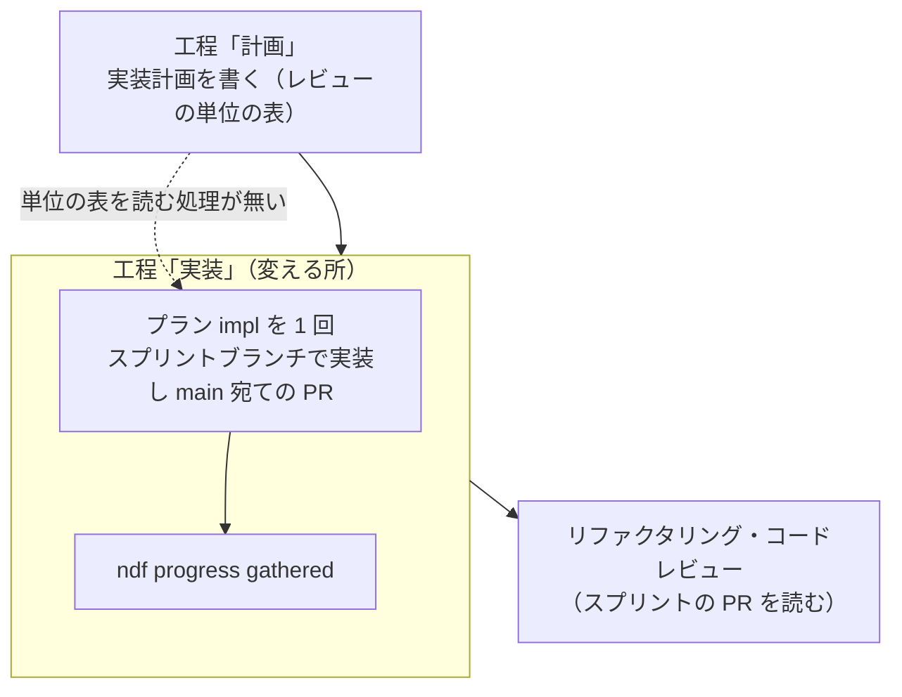
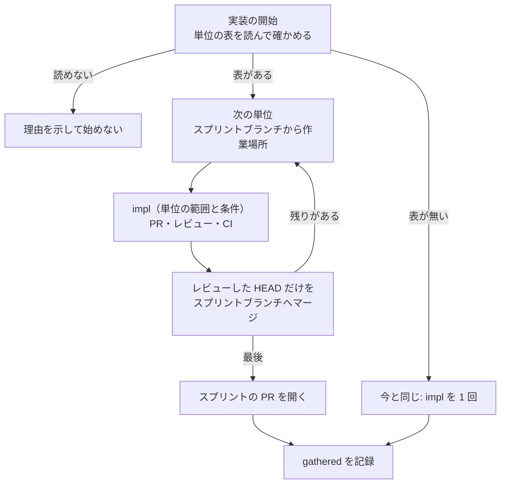
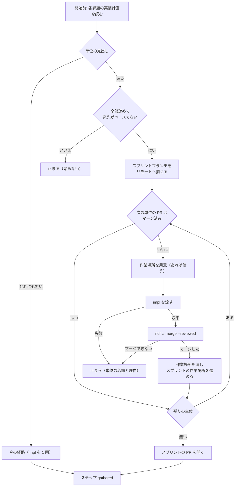

# 工程「実装」: 実装計画のレビューの単位ごとに PR とレビューを経てスプリントブランチへ集める（#4369）

`ndf progress next` で流す工程「実装」は実装計画の「レビューの単位」を読まず、分けるはずの変更がスプリントブランチの上で 1 本のまま実装される。工程「実装」が単位の表を読み、単位ごとに作業場所・実装のプラン（PR とレビューまで）・マージを順に流して、集めた時点（`gathered`。すべての単位をマージしたコミット）を記録する。この変更は、[PR の単位を機械が読むファイルにする課題](https://github.com/devbasex/ai-plugins/issues/3702)（#3702。設計は承認済みで未実装）より先に入れる。#3702 との先後、単位のファイルを持たない実装計画の扱い、[同じ内容の #3905](https://github.com/devbasex/ai-plugins/issues/3905) の扱いは、決定 1〜3 にある。

## 今の姿

何が起きたか・目的・受け入れ条件は要求仕様（[issue-4369-requirements.md](./issue-4369-requirements.md)、正は #4369 の本文）にある。この文書は「どう解くか」と「なぜその解き方か」だけを書く。

設計に要る今の構造（`plugins/ndf/` からの相対パス。2026-11-26、main `25c97daed` で確かめた）:

- 工程「実装」の定義（`contracts/workflow/stages/implement.json`）は、次の 2 ステップである。プラン（自動で順に実行する手順の定義。工程「計画」が書く実装計画とは別）`impl` を呼ぶステップと、`ndf progress gathered` のステップである。`per_issue` は、進め方 fast で工程を課題ごとの子の行に分ける指定である。normal では課題が複数でも `impl` は 1 回である
- `impl` の差し込み（テンプレートへ渡す値）は `progress/invoke.py` が組む。ブランチは作業場所が今いるブランチ、マージ先はブランチ戦略の設定のベースブランチになる
- `impl` のテンプレート（`contracts/templates/impl.json`）が行うのは、worker の実装・受け入れ条件の確かめ・PR・レビュー・CI・未解決の指摘の確かめまでである。マージはしない
- worker へ渡る入力は `issue`・`branch`・`acceptance` で、担当のタスクを絞る手段が無い
- 今の経路では `impl` がスプリントの PR（ベースブランチ宛て）を作る。後の工程「リファクタリング」「コードレビュー」はその PR を読む
- supervisor の手順（`skills/development-workflow/references/agent-layers.md` の「実装のフェーズの単位」）は、単位ごとに `impl` を組む。マージは `ndf ci merge --reviewed` で行う。この設計は同じ手順をコードにする

## 文脈と制約

- 実装計画の書式は変えない（要求の対象範囲）。単位の表の列は「単位・含むタスク・満たす受け入れ条件・見込みの差分の行数」で、「実行順」の列は任意である
- 2026-11-01 以降の実装計画のうち単位の見出しがある 22 本・129 行で、条件のセルが下の「単位の表の読み方」の形に合うかを試した。合わないのは 1 本の 2 行だけである。この 2 行は `5a`・`5b` という、受け入れ条件の番号として数えられない書き方である。試した手段は git の履歴を読む使い捨てのスクリプトである（2026-11-26）。番号が本文の件数に収まるかは試していない
- 単位を流す途中の中断と、レビューの後に PR が外から変えられた場合の備えは [#4218](https://github.com/devbasex/ai-plugins/issues/4218) が扱う
- #3702 の実装は同じ `progress/`・`contracts/` を触る。ファイルの配置と名前は #3702 の詳細設計に合わせる

## 解き方の全体像

- 工程「実装」は、課題のどれかの実装計画に単位の見出しがあれば、単位を 1 つずつ順に流す。無ければ今の経路のまま変わらない
- 単位 1 つは、専用のブランチと作業場所で今の `impl` のプランを流す。PR はスプリントブランチへ出し、レビューした HEAD でマージする
- 済んだ単位は GitHub のマージ済みの PR で見分ける。止まった工程を打ち直すと、残りの単位から続く
- すべてマージしたらスプリントの PR を開き、`gathered` を記録する。後の工程は今と同じ入力で流れる

## ドメインモデル

### コンテキスト

| コンテキスト | 何の語が 1 つの意味に決まるか |
| --- | --- |
| スプリントの進行 | レビューの単位・単位の PR・スプリントブランチ・集めた時点（どれも用語集にある語で、意味を変えない） |

### 集約

| 集約 | オーナー（書き換えてよいもの） | 根 | エンティティ | 値オブジェクト |
| --- | --- | --- | --- | --- |
| 単位の並び | 実装計画の文書（工程「計画」が書く。工程「実装」は読むだけ） | 実装計画 | レビューの単位 | 単位の名前・満たす受け入れ条件・実行順 |
| 単位の実行 | 工程「実装」 | 単位の PR | — | 単位のブランチ・レビューした HEAD |

### 不変条件

| # | 集約 | 条件 | 破れたときの扱い |
| --- | --- | --- | --- |
| I1 | 単位の並び | 単位の見出しがある実装計画は、すべての行を読めるときだけ流す。課題を 1 本にまとめて流さない | 実装を始めずに止まる |
| I2 | 単位の実行 | 単位の PR は、レビューが収束し、HEAD がレビューした HEAD と同じときだけマージする | マージせずに止まる |
| I3 | 単位の実行 | 次の単位の作業場所は、前の単位をすべてマージした後のスプリントブランチから切る | 後の単位を始めずに止まる |
| I4 | 単位の実行 | 単位の PR の宛先はベースブランチにならない（工程「実装」が承認なしに本番へ届く先へマージしない） | 実装を始めずに止まる |
| I5 | 単位の実行 | `gathered` は、すべての単位の PR をマージした後にだけ書く | 書かずに止まる |

### ドメインイベント

要求のドメインイベント E1〜E5 をそのまま使う。

| # | イベント | 発生元 | 受け手 |
| --- | --- | --- | --- |
| E1 | 実装計画の単位を読んだ | 単位の表の読み手 | 単位を流す処理 |
| E2 | 単位のブランチと作業場所を用意した | 単位を流す処理 | `impl` のプラン |
| E3 | 単位の PR のレビューが収束した | `impl` のプラン | 単位を流す処理 |
| E4 | 単位の PR をマージした | `ndf ci merge` | 次の単位 |
| E5 | 集めた時点を記録した | `ndf progress gathered` | 工程「コードレビュー」 |

## 構成要素

| 要素 | 責務 |
| --- | --- |
| 単位の表の読み手（`src/ndf/core/plan/review_units_decide.py`。新設） | 実装計画の本文と受け入れ条件の件数から、単位の並び（名前・課題・条件・順）か、読めない理由を返す。ファイルも git も読まない |
| 実装計画のパス（`src/ndf/core/issue_docs.py`） | ファイル名 `issue-<番号の並び>-plan.md` から番号の並びを読む（設計書と同じ形） |
| 単位を流す処理（`src/ndf/progress/units_invoke.py`。新設） | 開始前の確かめ、単位ごとの作業場所・`impl`・マージ・後片付け、スプリントの PR |
| 工程から作業を呼ぶ層（`src/ndf/progress/invoke.py`） | `per_unit` の工程で単位の見出しがあれば、開始前の確かめと実行を上の処理へ渡す。無ければ今のまま |
| 工程の定義（`stages/implement.json`、そのスキーマ、読み込むコード） | メタデータ `per_unit` を足す。ステップの並びは変えない |
| `impl` のテンプレートと差し込みの定義 | 任意の差し込み `unit_file`（単位の指示のファイル。空なら課題の全体）を足す |
| worker の作業の定義と起動指示（`contracts/worker/kinds.json` と読み手） | `impl` に任意の入力 `unit_file` を足し、ファイルがあればそのタスクだけを実装させる |
| 受け入れ条件の確かめ（`ndf loop acceptance check`） | 条件を持たない単位のための `--no-criteria` を足す |
| supervisor の手順（`agent-layers.md`） | `ndf progress next` の自動の経路も単位を読むことと、条件のセルの読み方を書く |

## 入出力のコントラクト

コマンドと引数の変更は 1 つだけである。工程の入力と出力（`gathered`）は変えない。

| 対象 | 変える前 | 変えた後 |
| --- | --- | --- |
| `ndf loop acceptance check --no-criteria` | 無い | 渡した `--issue` の条件を 1 件も照らさず `ok`。`--criteria` と一緒には受けない |
| 工程「実装」のステップ `implement` の結果 | `impl` の結果 | 単位の経路では、`ok` は全単位のマージとスプリントの PR の後に返し、`items` に単位ごとの名前・PR の番号・状態を持つ。`stopped` は止まった単位の名前・課題・理由を持つ |

単位の表の読み方（決定 7）:

| 項目 | 読み方 |
| --- | --- |
| 見出し | 本文のコードブロックの外にある、`レビューの単位` を含む `##` 以下の見出し。この下の最初の表を読む |
| 列 | 「単位」「満たす受け入れ条件」は必須。「実行順」は任意で、値は 1 以上の整数 |
| 条件のセル | 括弧の注記を除き、`・` `、` `,` で区切る。要素の形は下の表 |
| 読めない | 表か必須の列が無い、行が 0、名前が空か重なる、条件のセルが上の形でない、条件の課題がスプリントの外、番号が課題の本文の受け入れ条件の件数を超える、実行順が整数でない |

条件のセルの要素の形:

| 要素 | 意味 |
| --- | --- |
| `<課題>:<番号>` | その課題のその番号の条件 |
| 番号だけ | 直前の要素の課題の条件。セルの最初の要素なら、実装計画の課題が 1 つのときだけ書ける |
| 範囲 `1〜7` | その範囲の番号の条件 |
| `無し` | 条件なし |

## 処理の流れ

- **順序**: 課題の番号の小さい実装計画から順に、その中は「実行順」の列の値の順（同じ値は表の順）。列が無ければ表の順。ただし、準備のリファクタリングをするときは、最初のタスクを含む単位を先頭にする。「するとき」とは、「リファクタリングの時機」の実装の前が「しない」以外のときである
- **単位の無い課題**: 同じスプリントに単位の経路の課題があるとき、実装計画を省いた課題と見出しの無い課題は、課題 1 つを 1 単位として並びに入れる
- **打ち直し**: マージ済みの単位は飛ばす。`impl` が終わっていてレビューした HEAD が作業場所の HEAD と同じ単位はマージだけを打つ。`impl` が途中で止まった単位は、今のプランの打ち直しと同じく止まったステップから続ける
- **承認待ち**: 単位のプランが承認ゲート（人の承認待ち）を返せば、工程もそのまま返す。人の回答は最初の未マージの単位へ渡す

## 決定の記録

### 決定 1: 実装が 1 本にまとまる事象を早く止めるため、#3702 の実装を待たずに、単位を順に流す部分を先に入れる

- **質問**: #3702 の実装でこの課題を満たして確かめだけにするか、先に別の変更として入れるか（要求の未決 1）
- **選んだ案**: 先に入れる。単位を読む処理と流す処理は分ける。流す処理のファイル（`progress/units_invoke.py`）・差し込み（`unit_file`）・工程のメタデータ（`per_unit`）の名前は、#3702 の詳細設計に合わせる。#3702 の実装は読み手を単位のファイルへ差し替え、流す処理に並列と承認した入力の照合を足す
- 採らなかった案: #3702 の実装で満たす（#3702 は 9 タスク・見込み約 3,550 行である。設計のフェーズの工程の並びと承認ゲートの移動も含む。それが入るまで同じ事象が起きる。#3702 は単位のファイルだけを読むので、表を読んで流す（受け入れ条件 1）には別の実装が要る）
- 採らなかった案: #3702 の単位のファイルの形をこの課題で先に作る（実装計画の書式を変えることになり、対象範囲の外）
- **代償**: 表の読み手は #3702 の実装で置き換わる。流す処理は #3702 で並列を足すときに書き直す部分がある
- 根拠: Value 5 / Value 11（MVV バージョン 11）

### 決定 2: 分けた変更が気づかれずに 1 本にならないよう、表だけを持つ実装計画は表のとおりに流し、課題 1 つの 1 単位にしない

- **質問**: #3702 の設計は単位のファイルを持たない旧い形の実装計画を課題 1 つの 1 単位にする。受け入れ条件 1 とどちらに合わせるか（要求の未決 2）
- **選んだ案**: 受け入れ条件 1 に合わせる。この課題の後は表を読んで流す。#3702 の実装は、読み手を単位のファイルへ差し替える。その後も、単位の見出しがあるのに単位のファイルが無い実装計画は、1 単位にまとめずに止める。#3702 の設計の「旧い形は課題 1 つを 1 単位」は、#3702 の実装でこの形に改める
- 採らなかった案: #3702 の設計に合わせて 1 単位にする（表で分けた実装計画が 1 本で実装され、この課題の事象がそのまま残る）
- 採らなかった案: #3702 の後も表の読み手を残して 2 通りを読む（同じ事実の読み手が 2 つになる）
- **代償**: #3702 の実装が入った時点で終わっていないスプリントは、単位のファイルを書き足すまで工程「実装」が止まる
- 根拠: Value 3 / Value 8 / Value 11（MVV バージョン 11）

### 決定 3: 同じ仕組みを 2 回作らないため、#3905 をこの課題へ統合する

- **質問**: 自動の経路で単位を実行しマージしてから `gathered` を記録する #3905 を統合するか（要求の未決 3）
- **選んだ案**: 統合する。#3905 の受け入れ条件 3 件は、この課題の受け入れ条件 1〜5 に含まれる。3 件は、単位ごとの実行とマージの後の記録、未マージなら記録せずに止まる、欄が無ければ今のとおり、である。「設計の結果」の表で #3905 の扱いを「マージする」（受け入れ内容を統合先 #4369 の実装へ含める）とし、設計の承認で確定する
- 採らなかった案: 別の課題として残す（この課題の後には、#3905 で足すものが無くなる）
- **代償**: #3905 は自分の受け入れ条件を単独では確かめず、#4369 の確かめで閉じる
- 根拠: Value 11（MVV バージョン 11）

### 決定 4: 単位の無いスプリントの振る舞いを変えないため、工程の定義のステップは変えず、プランを呼ぶ層で単位の経路へ分ける

- **質問**: 単位の繰り返しをどこに置くか
- **選んだ案**: 工程「実装」の定義に `per_unit` を足し、プランを呼ぶ層（`invoke.py`）が単位の見出しの有無で分ける。単位 1 つの実行は、今のプランの呼び出し（差し込みの組み立て・打ち直しの開始点・承認の回答）を単位の入力で呼ぶ。単位の表の開始前の確かめも、今の差し込みの確かめと同じ時点で行う。そのため、読めない表は工程を始める前に止まる。古いステートマシンが保存しているモードの定義のスナップショットに `per_unit` が無ければ、そのステートマシンは今の経路のままである
- 採らなかった案: ステップを `ndf progress units run` の script に置き換える（単位の無いスプリントでもプランの打ち直しと差し込みの事前確認を作り直すことになる）
- 採らなかった案: 単位の数だけ工程の行やステップを足す（行はモードの定義が決め、単位の数は計画の後にしか分からない）
- **代償**: 工程の定義を読むだけでは、単位の繰り返しがあることが `per_unit` の 1 語でしか分からない。途中の単位の進みは結果の `items` とプランの記録で見る
- 根拠: Value 3 / Value 9（MVV バージョン 11）

### 決定 5: 順序の食い違いと取り込みの衝突を生まないため、単位は並列にせず 1 つずつ流す

- **質問**: 同じ実行順の単位や、準備の単位の後の残りの単位を並列に流すか
- **選んだ案**: 1 つずつ流し、前の単位のマージの後に次の作業場所を切る
- 採らなかった案: 並列に流す（今の実装計画の表は触るファイルを持たない。そのため、重ならないことを機械で確かめられない。並列は触るファイルと承認を持つ #3702 が足す）
- **代償**: 単位が多いスプリントは、supervisor が並列に回すより遅い
- 根拠: Value 3 / Value 9（MVV バージョン 11）

### 決定 6: 打ち直しの結果を 1 回流したときと同じにするため、済んだ単位は記録のファイルでなく GitHub のマージ済みの PR で見分ける

- **質問**: どの単位が済んだかを何で持つか
- **選んだ案**: 単位のブランチ名は、スプリントブランチ名・課題の番号・単位の名前の短いハッシュから決める（`<スプリントブランチ>-u<課題>-<ハッシュ>`）。そのブランチを head、スプリントブランチを base とするマージ済みの PR があれば、済みとする
- 採らなかった案: 流し方の記録のファイルを持つ（マージの事実を 2 か所に持ち、別のマシンや記録の消えた打ち直しで食い違う）
- 採らなかった案: ブランチ名に表の行の番号を使う（行を足すと番号がずれ、別の単位を済みと読む）
- **代償**: 打ち直しの間に単位の名前を変えると、その単位は新しい単位として流れる
- 根拠: Value 3 / Value 8（MVV バージョン 11）

### 決定 7: 分けたはずの単位を落とさないため、表は決めた形だけを読み、読めなければ始めずに止まる

- **質問**: 実装計画を書く側の表記の揺れ（注記・範囲・番号の省略・「無し」）をどこまで受けるか
- **選んだ案**: 「入出力のコントラクト」の読み方の表の形を受ける。表のセルの分け方は、受け入れ条件の確認の表を読む既存の部品を使う
- 採らなかった案: `<課題>:<番号>` だけを受ける（今ある実装計画の多くが範囲や番号の省略を使い、止まる）
- 採らなかった案: 読めない行を飛ばして残りを流す（落ちた単位に気づけないまま `gathered` が書かれる）
- **代償**: `5a` のような番号で条件を指す実装計画は、番号を直すまで止まる
- 根拠: Value 3 / Value 13（MVV バージョン 11）

### 決定 8: worker が単位の外まで実装しないよう、単位の指示のファイルを `impl` に渡す

- **質問**: 単位の範囲を worker へどう伝えるか
- **選んだ案**: 単位を流す処理が指示のファイルを書き、`unit_file` で渡す。書くのは、単位の名前・含むタスク・満たす条件・実装計画のパスである。worker は実装計画のそのタスクだけを実装する
- 採らなかった案: 受け入れ条件の指定だけで絞る（1 つの条件が複数の単位にまたがる表があり、条件を持たない準備の単位もある）
- 採らなかった案: 課題の本文のコピーへ範囲の指示を足す（同じファイルが PR の本文になり、課題の本文と食い違う）
- **代償**: worker の起動を設定で差し替えたリポジトリは、`unit_file` を読む側も合わせる必要がある
- 根拠: Value 3 / Value 9（MVV バージョン 11）

### 決定 9: 条件を持たない準備の単位を流せるよう、照らさないことを引数で明示する

- **質問**: 「満たす受け入れ条件」が「無し」の単位の確かめをどうするか
- **選んだ案**: `ndf loop acceptance check` に `--no-criteria` を足し、`--issue <代表の課題> --no-criteria` を渡す
- 採らなかった案: `--issue` だけを渡す（課題のすべての条件を照らし、準備の単位が必ず止まる）
- 採らなかった案: 条件の無い単位を読めない表にする（準備のリファクタリングの単位を持つ実装計画が実際にある）
- **代償**: 条件の漏れはこの単位では見つからない。工程「完了判定」がすべての条件を照らす
- 根拠: Value 11 / Value 13（MVV バージョン 11）

### 決定 10: 後の工程を今の入力のまま流すため、すべてのマージの後に工程「実装」がスプリントの PR を開く

- **質問**: 単位の経路ではスプリントの PR を誰も作らない。リファクタリングとコードレビューはそれを読む
- **選んだ案**: 最後のマージの後に、今のテンプレート `pr` を流し、スプリントブランチからベースブランチ宛ての PR を開く。開いた PR があれば作らない。マージはしない
- 採らなかった案: 後の工程の側で PR が無ければ作る（作る場所が 2 つ以上になる）
- **代償**: 工程「実装」の仕事が 1 つ増える
- 根拠: Value 3 / Value 11（MVV バージョン 11）

## 影響と危険

- **働く範囲**: 利用先のリポジトリでも働く。実装計画に単位の見出しがあるときだけ振る舞いが変わる
- **プロジェクトごとに違うもの**: ベースブランチ・リモート・レビューの起動・テストと CI は、今の設定を単位の経路でも使う。新しい設定は足さない
- **当たるモード**: 工程「実装」を持つすべてのモード。見出しが無ければ今のまま
- **PR の数**: 単位が 1 つの表でも、単位の PR とスプリントの PR の 2 本になる（supervisor の手順と同じ形）
- **同じファイルを触る変更**: #3702 の実装が `progress/`・`contracts/` を触る。後に入る側が取り込む
- **壊れうる箇所**: 次のどちらかの設定では、単位がマージできずに止まる（理由は結果に出る）。スプリントブランチ宛ての PR で CI が走らない設定か、スプリントブランチにマージキューがある設定である
- **後片付け**: 単位の作業場所とブランチは、マージを確かめた後に消す。消せなければ警告して続ける

### 代表のリポジトリでの振る舞い

| 代表のリポジトリ | 設定の要点 | 直した後に起きること | この種類で扱えなくなること |
| --- | --- | --- | --- |
| Web サービス | ベースブランチとスプリントの起点はブランチ戦略の設定。CI の必須のチェック | 単位の PR がスプリントブランチへ入り、ベースブランチへは今の承認を経て入る | 無し |
| モバイルアプリ | ストアへのリリースは工程「デプロイ」が持つ | 同上。リリースの形は変わらない | 無し |
| 業務文書だけ | 実装計画に単位の表が無いことが多い | 見出しが無ければ今のまま。あれば単位ごとに PR が出る | 無し |

### ai-plugins だけの事情

- 無し（このリポジトリの値を既定や振る舞いに入れない）

## テスト設計

| 受け入れ条件・不変条件 | どの振る舞いで縛るか | どう壊したら落ちるべきか |
| --- | --- | --- |
| 条件 1 | 単位が 2 つ以上の表で、単位ごとのプランが順に呼ばれ、ブランチ・宛先・`acceptance`・`unit_file` が単位の値になる。実行順の列があるとき・無いときの順 | 順を入れ替える、`acceptance` を課題全体にする、宛先をベースブランチにすると落ちる |
| 条件 2 | 見出しの無い実装計画と実装計画の無い課題で、今と同じプランの呼び出しになる | 単位の経路へ入るようにすると落ちる |
| 条件 3・I5 | 全単位のマージの後にステップが `ok` を返し、`gathered` が書かれる。開いた単位の PR が残れば書かれない | 途中の単位の後に `ok` を返すと落ちる |
| 条件 4・I2・I3 | マージはレビューした HEAD を渡して打ち、次の作業場所はそのマージを含むコミットから切られる | `--reviewed` を外す、マージの前に次を切ると落ちる |
| 条件 5 | 単位のプランの失敗とマージの拒否で、後の単位を呼ばず、結果に単位の名前と理由がある | 失敗の後も次を呼ぶと落ちる |
| 条件 6 | 打ち直しで、マージ済みの単位はプランもマージも呼ばれない。プランが終わった未マージの単位はマージだけになる | 先頭から流し直すと落ちる |
| 条件 7・I1 | 読めない表の各形（行 0、列が無い、条件の形、件数を超える番号、スプリントの外の課題）で、工程が始まらず理由が返る | 読めない行を飛ばす、1 本にまとめると落ちる |
| I4 | スプリントブランチがベースブランチのとき、始めずに止まる | 確かめを外すと落ちる |
| 決定 8 | `unit_file` があるときの起動指示に単位の範囲が入り、無いときは今と同じ | 入力を渡さないと落ちる |
| 決定 9 | `--no-criteria` は、確認の記録が無い受け入れ条件があっても `ok`。`--criteria` と同時は断る | 全条件を照らすと落ちる |
| 決定 10 | 最後のマージの後にスプリントの PR が 1 本だけ開かれる | PR を開かない、打ち直しで 2 本目を作ると落ちる |

手動確認（要求の検証手段）はリリース後テストで行う。単位が 2 つ以上ある実際の課題を `ndf progress next` で流し、単位の PR がマージされた後に `gathered` が書かれることを確かめる。

## 設計の結果

| 課題 | 扱い | 統合先 | 触るファイル |
| --- | --- | --- | --- |
| #4369 | 実装する | — | `plugins/ndf/src/ndf/core/plan/review_units_decide.py`（新設）、`plugins/ndf/src/ndf/core/issue_docs.py`、`plugins/ndf/src/ndf/progress/units_invoke.py`（新設）、`plugins/ndf/src/ndf/progress/invoke.py`、`plugins/ndf/src/ndf/progress/stages.py`、`plugins/ndf/src/ndf/progress/definition.py`、`plugins/ndf/contracts/workflow/stages/implement.json`、`plugins/ndf/contracts/workflow/ndf.schema.json`、`plugins/ndf/contracts/schemas/internal/stage-snapshot.schema.json`、`plugins/ndf/contracts/templates/impl.json`、`plugins/ndf/contracts/templates/params.json`、`plugins/ndf/contracts/worker/kinds.json`、`plugins/ndf/src/ndf/contracts/worker_kinds.py`、`plugins/ndf/src/ndf/progress/gate/entry.py`、`plugins/ndf/src/ndf/domains/loop/acceptance.py`、`plugins/ndf/docs/contracts/commands.md`、`plugins/ndf/skills/development-workflow/references/agent-layers.md`、`plugins/ndf/tests/core/plan/test_review_units.py`（新設）、`plugins/ndf/tests/progress/test_units_invoke.py`（新設）、`plugins/ndf/tests/progress/test_invoke.py`、`plugins/ndf/tests/domains/loop/test_loop_acceptance.py` |
| #3905 | マージする | #4369 | — |

## 未確認のまま残ること

| 項目 | 内容 |
| --- | --- |
| 実際のスプリントでの通し | 単位の PR の CI・レビュー・マージが続けて通ることは、リリース後テストで分かる |
| 工程 1 回の長さ | 単位を 1 つずつ流すので、単位が多いスプリントで工程「実装」が何時間になるかは、リリース後の実測で分かる |

## 外部の調査

省く: 既存の形の延長である。今の supervisor の手順（単位ごとのプランとレビューした HEAD でのマージ）を、同じ部品で自動の経路から呼ぶ（大きさと分け方の外部の調査は #3702 の設計書にある）
