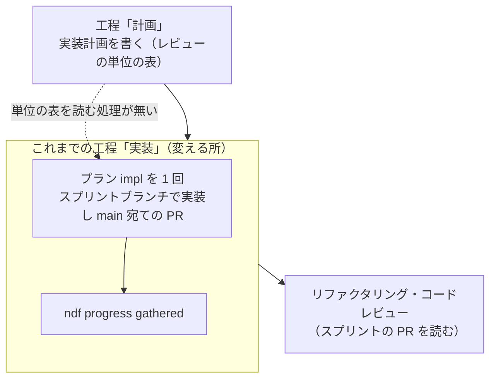
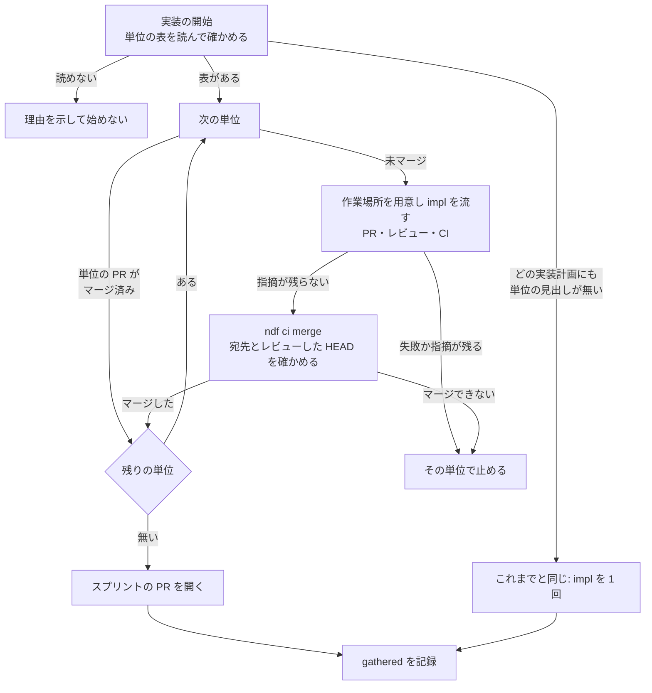
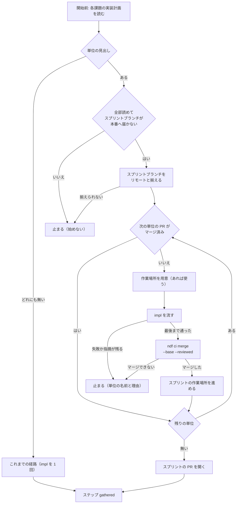

# 工程「実装」: 実装計画のレビューの単位ごとに PR とレビューを経てスプリントブランチへ集める（#4369）

これまで `ndf progress next` で流す工程「実装」は、実装計画の「レビューの単位」を読まなかった。そのため、分けるはずの変更をスプリントブランチの上で 1 本のまま実装していた。この設計では、工程「実装」が単位の表を読み、単位ごとに作業場所・PR・レビュー・マージを順に流し、すべてマージしてから集めた時点（`gathered`）を記録する。マージは今の supervisor の手順と同じコマンドを使い、専用のマージ・自動の後片付け・指摘の持ち越しは作らない（決定の記録は [issue-4369-design-decisions.md](./issue-4369-design-decisions.md)）。

## 今の姿

何が起きたか・目的・受け入れ条件は要求仕様（[issue-4369-requirements.md](./issue-4369-requirements.md)、正は #4369 の本文）にある。この文書は「どう解くか」と「なぜその解き方か」だけを書く。

これまでの流れと、変える所は次のとおりである。



設計に要る、これまでの構造は次のとおりである（パスは `plugins/ndf/` からの相対。2026-11-26、main `25c97daed` で確かめた）。

- 工程「実装」の定義（`contracts/workflow/stages/implement.json`）は、プラン `impl` を呼ぶステップと `ndf progress gathered` のステップの 2 つである。ここでいうプランは、自動で順に実行する手順の定義で、工程「計画」が書く実装計画とは別である
- 定義の指定 `per_issue`（進め方 fast で工程を課題ごとに分ける指定）は読み込まれるだけで、分ける処理は無い。`impl` は工程 1 回につき 1 回だけ呼ばれる
- `impl` へ渡す値は `src/ndf/progress/invoke.py` が組む。ブランチは作業場所が今いるブランチ、マージ先はベースブランチである
- `impl` のテンプレート（`contracts/templates/impl.json`）は、実装・受け入れ条件の確かめ・PR・レビュー・CI までを行い、マージはしない。worker に担当のタスクを絞って渡す手段は無い
- これまでの経路では `impl` がスプリントの PR（ベースブランチ宛て）を作る。後の工程「リファクタリング」「コードレビュー」はその PR を読む
- supervisor の手順は単位ごとに `impl` を組み、`ndf ci merge --reviewed` でマージする（`skills/development-workflow/references/agent-layers.md` の「実装のフェーズの単位」）
- `ndf ci merge`（`src/ndf/ci_cli.py`）は、ブランチの開いた PR をマージする。PR の宛先は確かめない
- cross-review は、直していないレッドラインの指摘（必ず人の承認が要る操作に当たる指摘）と、利用者の判断を待つ見送りが残っても `ok` で終わる（`src/ndf/domains/crossreview/finish_decide.py`）

## 文脈と制約

- 実装計画の書式は変えない（要求の対象範囲）。単位の表の列は「単位・含むタスク・満たす受け入れ条件・見込みの差分の行数」で、「実行順」の列は任意である
- 2026-11-26 の設計承認ゲートで、利用者が範囲を縮めた。専用のマージ・単位の後片付け・指摘の持ち越しの 3 つは作らず、安全さは今の supervisor の手順と同じにする
- この変更が扱う再実行は、工程が失敗か待ちを返した後の打ち直しである。実行中の中断と、レビューの後に PR が外から変えられた場合の復旧は [#4218](https://github.com/devbasex/ai-plugins/issues/4218) が扱う
- 2026-11-01 以降の実装計画のうち単位の見出しがある 22 本・129 行で、条件のセルが下の「単位の表の読み方」の形に合うかを試した。合わないのは 1 本の 2 行（`5a`・`5b` という番号）だけである。番号が課題の本文にあるかと、含むタスクがタスクの見出しにあるかは試していない
- [PR の単位を機械が読むファイルにする課題](https://github.com/devbasex/ai-plugins/issues/3702)（#3702。設計は承認済みで未実装）は同じ `progress/`・`contracts/` を触る。ファイルの配置と名前はその詳細設計に合わせる

## 解き方の全体像

この設計で実装を終えた後の流れは次のとおりである。



- 単位 1 つは、専用のブランチと作業場所でこれまでの `impl` のプランを流す。PR はスプリントブランチへ出す
- マージは `ndf ci merge --reviewed` に、宛先を確かめる引数 `--base` を足して使う（決定 11）
- 人の判断を待つ指摘か未解決の指摘が残る単位はマージせず、後の単位を始めずに止まる（決定 14）
- 打ち直しでは、スプリントブランチ宛ての単位の PR がマージ済みの単位を飛ばす（決定 6）

## ドメインモデル

### コンテキスト

| コンテキスト | 何の語が 1 つの意味に決まるか |
| --- | --- |
| スプリントの進行 | レビューの単位・単位の PR・スプリントブランチ・集めた時点（どれも用語集にある語で、意味を変えない） |

### 集約

| 集約 | オーナー（書き換えてよいもの） | 根 | エンティティ | 値オブジェクト |
| --- | --- | --- | --- | --- |
| 単位の並び | 実装計画の文書（工程「計画」が書く。工程「実装」は読むだけ） | 実装計画 | レビューの単位 | 単位の名前・満たす受け入れ条件・実行順 |
| 単位の実行 | 工程「実装」 | 単位の PR | — | 単位のブランチ・レビューした HEAD |

### 不変条件

| # | 集約 | 条件 | 破れたときの扱い |
| --- | --- | --- | --- |
| I1 | 単位の並び | 単位の見出しがある実装計画は、すべての行を読めるときだけ流す。課題を 1 本にまとめて流さない | 実装を始めずに止まる |
| I2 | 単位の実行 | 工程がマージするのは、単位の `impl` が最後まで通った PR だけである。作業場所の HEAD と PR の HEAD がレビューした HEAD と同じで、PR の宛先がスプリントブランチであること | マージせずに止まる |
| I3 | 単位の実行 | 次の単位の作業場所は、前の単位をすべてマージした後のスプリントブランチから切る | 後の単位を始めずに止まる |
| I4 | 単位の実行 | スプリントブランチは、ベースブランチでも本番ブランチでもない（承認なしに本番へ届く先へマージしない） | 実装を始めずに止まる |
| I5 | 単位の実行 | `gathered` を書くのは、読んだ並びのすべての単位が、マージ済みの PR を持つときだけである | 後の単位を始めず、`gathered` を書かずに止まる |

### ドメインイベント

要求のドメインイベント E1〜E5 をそのまま使う。

| # | イベント | 発生元 | 受け手 |
| --- | --- | --- | --- |
| E1 | 実装計画の単位を読んだ | 単位の表の読み手 | 単位を流す処理 |
| E2 | 単位のブランチと作業場所を用意した | 単位を流す処理 | `impl` のプラン |
| E3 | 単位の PR のレビューが収束した | `impl` のプラン | 単位を流す処理 |
| E4 | 単位の PR をマージした | 単位を流す処理 | 次の単位 |
| E5 | 集めた時点を記録した | `ndf progress gathered` | 工程「コードレビュー」 |

## 構成要素

| 要素 | 責務 |
| --- | --- |
| 単位の表の読み手（`src/ndf/core/plan/review_units_decide.py`。新設） | 実装計画の本文と、課題ごとの受け入れ条件の番号から、単位の並び（名前・代表の課題・タスク・条件・順）か、読めない理由を返す。タスク分解のタスクが単位に過不足なく割り当てられているかも確かめる。ファイルも git も読まない |
| 実装計画のパス（`src/ndf/core/issue_docs.py`） | ファイル名 `issue-<番号の並び>-plan.md` から番号の並びを読む（設計書と同じ形） |
| 単位を流す処理（`src/ndf/progress/units_invoke.py`。新設） | 開始前の確かめ、単位ごとの作業場所・指示のファイル・保存先・`impl`、マージ、打ち直し、スプリントの PR |
| 工程から作業を呼ぶ層（`src/ndf/progress/invoke.py`） | `per_unit` の工程で、単位の見出しがあれば単位を流す処理へ渡し、無ければこれまでのまま `impl` を呼ぶ。試行の始まりに値を消す処理（`clear_values`）は、単位の保存先の差し込みの値と課題のコピーも消す |
| 工程の定義の読み手（`src/ndf/progress/stages.py`・`definition.py`） | 工程の型に `per_unit`（既定は偽）を足し、定義とスナップショット（スプリントを作ったときに保存する定義の写し）から読む |
| 工程の定義とスキーマ（`contracts/workflow/stages/implement.json`・`contracts/workflow/ndf.schema.json`・`contracts/schemas/internal/stage-snapshot.schema.json`） | `per_unit` を足す。ステップの並びは変えない |
| `impl` のテンプレートと差し込みの定義（`contracts/templates/impl.json`・`params.json`） | 任意の差し込み `unit_file`（単位の範囲の指示のファイル）を足す。既定は空で、ステップは変えない |
| worker の作業の定義と読み手（`contracts/worker/kinds.json`・`src/ndf/contracts/worker_kinds.py`） | 作業の定義に、空でよい入力の欄 `optional_inputs` を足し、`impl`・`fix`・`ci-fix`・`fix-push`・`fix-base` に `unit_file` を置く（決定 8） |
| レビューの指示（`src/ndf/domains/crossreview/criteria_decide.py`） | 環境変数 `NDF_UNIT_FILE` があれば、相手役と修正担当の指示に単位の範囲と例外を足す（決定 8） |
| レビューの終わり方（`src/ndf/domains/crossreview/cli.py`・`finish_decide.py`・`journal.py`） | `ndf cross-review run` に `--stop-on-hold` を足す。渡した起動では、人の判断を待つ指摘が残れば `incomplete` で終える（決定 14） |
| 受け入れ条件の確かめ（`src/ndf/domains/loop/acceptance.py`） | 条件を持たない単位のための `--no-criteria` を足す（決定 9） |
| マージの宛先の確認（`src/ndf/ci_cli.py`） | `ndf ci merge` に `--base` を足す。対象の PR の宛先が違えばマージしない（決定 11） |
| 単位の PR で待つチェックの宣言（`contracts/schemas/project-workflow.schema.json`・`src/ndf/progress/invoke.py`） | 設定の `workflow.unit_required_checks` を読む（決定 13） |
| コマンドの一覧（`docs/contracts/commands.md`） | 新しい引数を載せる（`ndf check --write-spec` で生成し直す。手で直さない） |
| supervisor の手順（`agent-layers.md`） | `ndf progress next` の自動の経路も単位を読むことと、単位の表の読み方を書く |

詳細設計書は別ファイル（`issue-4369-design-detail.md`）にする。新設する関数が 2 つ以上あるためである。後の工程「詳細設計」で書く。

## 入出力のコントラクト

足すのは、コマンドの引数 3 つと設定のキー 1 つ（決定 13）である。工程の入力と出力（`gathered`）は変えない。

### 引数と工程の結果

| 対象 | 変える前 | 変えた後 |
| --- | --- | --- |
| `ndf ci merge --base <ブランチ>` | 無い | `--branch` の開いた PR の宛先が `<ブランチ>` と違えば、マージの要求を送らずに `refused` で止まる。省けばこれまでと同じ |
| `ndf cross-review run --stop-on-hold` | 無い | 人の判断を待つ指摘がその回の結果に残れば `incomplete` で終え、指摘 1 件を 1 つの欠け（結果 JSON の `gaps`）にする。欠けの `kind` は `held_finding`、`name` は指摘の id、`reason` は指摘の本文である。省けばこれまでと同じ |
| `ndf loop acceptance check --no-criteria` | 無い | 渡した `--issue` の条件を 1 件も照らさず `ok`。`--criteria` と一緒には受けない |
| 工程「実装」のステップ `implement` の結果 | `impl` の結果 | 単位の経路では、全単位のマージとスプリントの PR の後に `ok` を返し、`items` に単位ごとの名前・PR の番号・状態を持つ。`stopped` は止まった単位の名前・課題・理由・PR の番号を持つ |

### 単位の表の読み方（決定 7）

| 項目 | 読み方 |
| --- | --- |
| 見出し | 本文のコードブロックの外にある、`レビューの単位` を含む `##` 以下の見出し。この下の最初の表を読む |
| 列 | 「単位」「含むタスク」「満たす受け入れ条件」は必須。「実行順」は任意。列があれば、すべての行に 1 以上の整数を書く |
| 含むタスクのセル | 括弧の注記を除き、`・` `、` `,` で区切る。要素は `Task <番号>`、`T<番号>`、番号だけ、または範囲（`Task 1〜4`・`T1〜T4`）。番号だけの要素と範囲の終わりは接頭辞を省けるが、セルの最初の要素は接頭辞が要る。`Task 1・2` は Task 1 と Task 2 である。各番号は「タスク分解」の `###` の見出し（`### Task <番号>`）にあること |
| タスクの割り当て | 「タスク分解」のタスクは、準備のタスクも含め、どれも 1 つの単位にだけ割り当てる |
| 条件のセル | 括弧の注記を除き、`・` `、` `,` で区切る。要素の形は下の表 |
| 読めない | 次のどれか。表か必須の列が無い。行が 0。名前が空か重なる。含むタスクが空か上の形でないか見出しに無い。どの単位にも無いタスクか、2 つ以上の単位にあるタスクがある。条件のセルが下の形でない。条件の課題がスプリントの外。番号がその課題の受け入れ条件に無い。「実行順」の列があるのに 1 以上の整数でない行がある |

条件のセルの要素の形:

| 要素 | 意味 |
| --- | --- |
| `<課題>:<番号>` | その課題のその番号の条件 |
| `<課題>:<始め>〜<終わり>` | その課題の始めから終わりまでの条件。始めが終わりより大きければ読めない |
| 番号か範囲だけ（`3`・`1〜7`） | 直前の要素の課題の条件。セルの最初の要素なら、実装計画の課題が 1 つのときだけ書ける |
| `無し` | 条件なし。ほかの要素と一緒には書けない |

条件の番号は、`ndf loop acceptance check` が数える番号（課題の本文の受け入れ条件を上から 1 始まり）と同じ関数で読む。

### 単位の代表の課題と `acceptance` の組み方（決定 9）

| 単位 | 代表の課題 | `impl` に渡す `acceptance` |
| --- | --- | --- |
| 条件がある | 単位を持つ実装計画のファイル名の番号のうち最も小さいもの | 条件がある課題だけを番号の順に `--issue` で並べ、展開した条件を 1 件ずつ `--criteria` で渡す |
| 条件が「無し」 | 同上 | `--issue <代表の課題> --no-criteria` |
| 課題全体を 1 単位として補ったもの | その課題 | `--issue <代表の課題>`（その課題の全条件を照らす） |

代表の課題は、`impl` の `issue`（PR の題と本文はこの課題から作る）と、単位のブランチ名にも使う。

## 処理の流れ



### 開始前の確かめ

単位の見出しがあるときだけ行う。順は次のとおりである。

1. すべての単位の表を読む（読めなければ止まる）
2. 作業場所が今いるブランチをスプリントブランチとし、ベースブランチでも本番ブランチでもないことを確かめる（I4）
3. スプリントブランチをリモートと揃える。手元が遅れていれば `git merge --ff-only` で進め、`git push` する。リモートにブランチが無ければ、この push で作る。実装計画のコミットを単位の作業場所に含めるためである。分かれていて揃えられなければ止まる

### 順序

単位の並びは、かたまりを番号の小さい順に置いて作る。かたまりは、単位の見出しがある実装計画 1 つ（番号はファイル名の最も小さいもの）と、補った単位 1 つ（番号はその課題）の 2 種類である。実装計画の中の順は次のとおりである。

- 「実行順」の列があるときは、その値の順（同じ値は表の順）。準備の単位を前へ動かさない
- 列が無いときは表の順。ただし準備のリファクタリングをするときは、「タスク分解」の最初のタスクを含む単位を先頭にする
- 「するとき」かは、実装計画の「リファクタリングの時機」の表で決める。時機が「実装の前」で始まる行の対象が「しない」で始まらなければ「するとき」である。表か行が無ければ「しない」と読む

### 単位の無い課題

どの実装計画にも単位の見出しが無いスプリントは、これまでの経路で `impl` を 1 回だけ呼ぶ。単位の見出しがある実装計画が 1 つでもあるときは、残りの課題（実装計画を省いた課題と、見出しの無い実装計画の課題）も、課題 1 つを 1 単位として並びに入れる。例えば実装計画 `issue-20-40-plan.md`（単位 A・B）と、実装計画の無い課題 10・30 があれば、10、A、B、30 の順になる。

補った単位は `unit_file` を空にし、課題の全体を実装して、その課題の全条件を照らす。

### 単位のブランチと保存先

- ブランチ名は `<スプリントブランチ>-u<代表の課題>-<単位の名前の短いハッシュ>` である
- 作業場所があれば使い、無ければ単位のブランチから作る。ブランチも無ければ、取得し直したスプリントブランチから切る
- `impl` のプランの保存先は、工程の保存先の下の `units/<単位のブランチ名>/<回>/` とする。レビューをやり直すときは次の回の保存先を使う
- `unit_file` と環境変数 `NDF_UNIT_FILE` が指す指示のファイルは、単位を流すたびに書き直す

### 打ち直し

単位ごとに、次の表で扱いを決める。上の行を先に当てる。

| 打ち直しの時点の単位 | 扱い |
| --- | --- |
| 単位のブランチを head、スプリントブランチを宛先とする PR がマージ済み | 飛ばす（決定 6） |
| `impl` の実行の記録が無い | 最初から流す |
| `impl` がレビューで止まった（ステップ `review`・`review-delta`・`resolved`）か、最後まで通ったがマージできなかった | 次の回の保存先で、`push` のステップから流す。レビューは最初からになる（決定 14） |
| ほかの理由で `impl` が途中で止まった | これまでのプランの打ち直しと同じく、止まったステップから続ける |

### マージ

単位の作業場所で、次のコマンドを打つ。`<HEAD>` は `impl` が保存先に書いた `reviewed-head` の値である。このファイルが無ければマージせずに止まる。

```sh
ndf ci merge --branch <単位のブランチ> --base <スプリントブランチ> --reviewed <HEAD>
```

マージした後はスプリントブランチを取得し、スプリントの作業場所を `git merge --ff-only` で進める。次の単位の作業場所はこのコミットから切る。

## 決定の記録

決定の記録（決定 1〜15）は [issue-4369-design-decisions.md](./issue-4369-design-decisions.md) にある。

## 影響と危険

- **働く範囲**: 利用先のリポジトリでも働く。実装計画に単位の見出しがあるときだけ振る舞いが変わる
- **プロジェクトごとに違うもの**: ベースブランチ・リモート・レビューの起動・テストと CI は、既存の設定を単位の経路でも使う。足す設定は `workflow.unit_required_checks` だけで、書かなければ既存の必須のチェックの設定を使う（決定 13）
- **当たるモード**: 工程「実装」を持つすべてのモードと進め方（`per_unit` を足した後に作ったスプリント。決定 4）。fast の課題をベースブランチで直接進める形で単位の見出しがあれば、始めずに止まる（I4）。理由には、`git switch -c <スプリントブランチ>` を打ってから打ち直すことを書く
- **PR の数**: 単位が 1 つの表でも、単位の PR とスプリントの PR の 2 本になる（決定 12）
- **同じファイルを触る変更**: #3702 の実装が `progress/`・`contracts/` を触る。後に入る側が取り込む
- **壊れうる箇所**:
  - 待つと宣言したチェックがスプリントブランチ宛ての PR で起動しない設定では、単位がマージできずに止まる（決定 13）
  - 設定で差し替えたレビューの起動が `--stop-on-hold` を受けなければ、単位はレビューのステップで止まる
  - 人の判断を待つ指摘が出た単位は、打ち直すまで止まる（決定 14）
  - スプリントブランチの保護やマージの制限で `ndf ci merge` が断られると、単位はそこで止まる
  - 前のスプリントと同じ名前のスプリントブランチで、同じ課題と同じ単位の名前を流し直すと、前のマージ済みの PR を見て飛ばす。単位の名前を変えれば流れる

### 利用者が受け入れた代償

2026-11-26 の設計承認ゲートで、次の代償を利用者が受け入れた。この設計の中では塞がない。理由は決定の記録にある。

| 代償 | 決定 |
| --- | --- |
| マージ先を確認してからマージするまでの間に、PR の宛先が書き換えられても気づけない | 11 |
| マージした単位の変更を後で打ち消しても気づかず、完了した単位として飛ばす | 6 |
| 単位の作業場所とブランチは自動では消さない | 15 |
| 打ち直したレビューが前回と同じ指摘を挙げなければ、直していなくてもマージされる | 14 |

### 処理の回数

単位が N 個のスプリントでは、worker の実装・レビュー・CI の完了の確認・作業場所の用意・マージがそれぞれ N 回になる。単位は 1 つずつ流すので、時間はほぼ足し算になる。GitHub への照会は、開始時に課題の本文の一括読み取り 1 回と単位の PR の一覧 1 回、単位ごとに `ndf ci merge` の読み取りが加わる。単位の見出しが無いスプリントでは通信は増えない。PR で実際に走る CI の回数はリポジトリの設定で決まり、多くの設定では単位の PR N 本とスプリントの PR 1 本で走る。

### 代表のリポジトリでの振る舞い

| 代表のリポジトリ | 設定の要点 | 直した後に起きること | この種類で扱えなくなること |
| --- | --- | --- | --- |
| Web サービス | ベースブランチとスプリントの起点はブランチ戦略の設定。CI の必須のチェックと、ベースブランチのマージキュー | 単位の変更がスプリントブランチへ入り、ベースブランチへはこれまでの承認を経て入る | 無し |
| モバイルアプリ | ストアへのリリースは工程「デプロイ」が持つ | 同上。リリースの形は変わらない | 無し |
| 業務文書だけ | 実装計画に単位の表が無いことが多い | 見出しが無ければこれまでのまま。あれば単位ごとに PR が出る | 無し |

### ai-plugins だけの事情

- 無し（このリポジトリの値を既定や振る舞いに入れない）

## テスト設計

| 受け入れ条件・不変条件 | どの振る舞いで縛るか | どう壊したら落ちるべきか |
| --- | --- | --- |
| 条件 1 | 単位が 2 つ以上の表で、単位ごとのプランが順に呼ばれ、ブランチ・宛先・`acceptance`・`unit_file`・保存先が単位の値になる | 順を入れ替える、`acceptance` を課題全体にする、保存先を共有する、宛先をベースブランチにすると落ちる |
| 順序 | 実行順の列があるとき・無いとき、準備のリファクタリングをする・しないの順。実装計画の単位と補った単位が混ざるときは課題番号の順 | 列の値より準備を優先する、補った単位を先頭か末尾へ固めると落ちる |
| 条件 2 | どの実装計画にも見出しが無い複数課題のスプリントで、プランの呼び出しが 1 回になり、単位の経路の通信が無い | 課題ごとに `impl` を呼ぶ、単位の経路へ入ると落ちる |
| 条件 3・I5 | 全単位のマージの後にステップが `ok` を返し、`gathered` が書かれる。未マージの単位があれば書かれない | 途中の単位の後に `ok` を返すと落ちる |
| 条件 4・I2 | `ndf ci merge --base` は、PR の宛先が違えばマージの要求を送らない。HEAD がレビューした HEAD と違う場合と `reviewed-head` が無い場合もマージしない | 宛先の確認を外す、`--reviewed` を渡さないと落ちる |
| 条件 4・決定 14 | `--stop-on-hold` を渡したレビューは、直していないレッドラインの指摘と、区分が `needs_user`・無い・知らない値の見送りのそれぞれで `incomplete` になり、欠けに指摘が並ぶ。区分が `filed`・`not_applicable` の見送りだけなら `ok`。引数の無い結果はこれまでと同じ。単位の経路は初回と差分のレビューの両方に渡す | 一部の分類だけを止める、差分のレビューに渡さないと落ちる |
| 条件 4・I3 | 次の単位の作業場所は、前の単位のマージを含むコミットから切られる | マージの前に次を切る、取得せずに切ると落ちる |
| 条件 5 | 単位のプランの失敗とマージの拒否で、後の単位を呼ばず、結果に単位の名前と理由がある | 失敗の後も次を呼ぶと落ちる |
| 条件 6 | 打ち直しで、スプリントブランチ宛てのマージ済みの PR を持つ単位は、プランもマージも呼ばれない。残りの単位から続く | 先頭から流し直す、宛先を見ずにマージ済みと読むと落ちる |
| 打ち直し | レビューで止まった単位と、通ったがマージできなかった単位は、新しい保存先で `push` から流れる。ほかの途中の停止は止まったステップから続く | 前の回の保存先を使い、前の結果を返すと落ちる |
| 条件 7・I1 | 読めない表の各形（行 0、列が無い、含むタスクが見出しに無い、未割当のタスク、重複した割り当て、条件の形、課題の無い範囲、番号の無い条件、スプリントの外の課題、実行順の空欄・0・負の数）で、工程が始まらず理由が返る。`implementation-plan` の手順書の例の行は、単位の名前を埋めれば読める | 読めない行を飛ばす、未割当のタスクを通すと落ちる |
| I4 | スプリントブランチがベースブランチか本番ブランチのとき、単位の見出しがあれば始めずに止まる。見出しが無ければこれまでどおり流れる | 確かめを外すと落ちる |
| 開始前の確かめ | リモートにスプリントブランチが無ければ push で作る。手元とリモートが分かれていれば止まる | 揃えずに単位を切る、強制 push すると落ちる |
| 決定 4 | `per_unit` の無い定義を保存したスプリントは、単位の見出しがあっても `impl` を 1 回呼ぶ | 今の定義を読んで単位の経路へ入ると落ちる |
| 決定 8 | `unit_file` があるとき、5 つの作業の起動指示とレビューの指示に単位の範囲と例外が入る。無いときは範囲を足さず、欠けの検査に掛からない | 修正の経路に渡さない、必須の入力にする、秘密などの指摘を後の単位へ先送りできる指示にすると落ちる |
| 決定 9 | `--no-criteria` は、確認の記録が無い受け入れ条件があっても `ok`。`--criteria` と同時は断る | 全条件を照らすと落ちる |
| 決定 10 | 最後のマージの後にスプリントの PR が 1 本だけ開かれ、`refs` が全課題になる | PR を開かない、打ち直しで 2 本目を作ると落ちる |
| 決定 13 | `workflow.unit_required_checks` を書かない・名前の並び・空の並びのそれぞれで、単位の PR が待つチェックが変わる | 宣言を読まない、空の並びを未指定と読むと落ちる |

手動確認（要求の検証手段）はリリース後テストで行う。単位が 2 つ以上ある実際の課題を `ndf progress next` で流し、単位の PR がマージされた後に `gathered` が書かれることを確かめる。

## 設計の結果

| 課題 | 扱い | 統合先 | 触るファイル |
| --- | --- | --- | --- |
| #4369 | 実装する | — | `plugins/ndf/src/ndf/core/plan/review_units_decide.py`（新設）、`plugins/ndf/src/ndf/core/issue_docs.py`、`plugins/ndf/src/ndf/progress/units_invoke.py`（新設）、`plugins/ndf/src/ndf/progress/invoke.py`、`plugins/ndf/src/ndf/progress/stages.py`、`plugins/ndf/src/ndf/progress/definition.py`、`plugins/ndf/contracts/workflow/stages/implement.json`、`plugins/ndf/contracts/workflow/ndf.schema.json`、`plugins/ndf/contracts/schemas/internal/stage-snapshot.schema.json`、`plugins/ndf/contracts/templates/impl.json`、`plugins/ndf/contracts/templates/params.json`、`plugins/ndf/contracts/schemas/project-workflow.schema.json`、`plugins/ndf/contracts/schemas/io/`（生成し直す）、`plugins/ndf/contracts/worker/kinds.json`、`plugins/ndf/src/ndf/contracts/worker_kinds.py`、`plugins/ndf/src/ndf/domains/crossreview/criteria_decide.py`、`plugins/ndf/src/ndf/domains/crossreview/cli.py`、`plugins/ndf/src/ndf/domains/crossreview/finish_decide.py`、`plugins/ndf/src/ndf/domains/crossreview/journal.py`、`plugins/ndf/src/ndf/domains/loop/acceptance.py`、`plugins/ndf/src/ndf/ci_cli.py`、`plugins/ndf/docs/contracts/commands.md`、`plugins/ndf/skills/development-workflow/references/agent-layers.md`、`plugins/ndf/tests/core/plan/test_review_units.py`（新設）、`plugins/ndf/tests/progress/test_units_invoke.py`（新設）、`plugins/ndf/tests/progress/test_invoke.py`、`plugins/ndf/tests/adapters/test_ci_cli.py`、`plugins/ndf/tests/domains/loop/test_loop_acceptance.py`、`plugins/ndf/tests/domains/crossreview/test_crossreview_finish.py`、`plugins/ndf/tests/domains/crossreview/test_crossreview_criteria.py`、`plugins/ndf/tests/contracts/test_worker_kinds_shape.py` |
| #3905 | マージする | #4369 | — |

## 未確認のまま残ること

| 項目 | 内容 |
| --- | --- |
| 実際のスプリントでの通し | 単位の PR の CI・レビュー・マージが続けて通ることは、リリース後テストで分かる |
| 工程 1 回の長さ | 単位が多いスプリントで工程「実装」が何時間になるかは、リリース後の実測で分かる |
| 指摘で止まる頻度 | 人の判断を待つ指摘が残って単位が止まる回数は、リリース後の実測で分かる |
| タスクの重複の割り当て | 今ある実装計画に、1 つのタスクを 2 つ以上の単位に書いたものがあるかは調べていない。あればその計画は直すまで止まる |

## 外部の調査

省く: 既存の形の延長である。これまでの supervisor の手順（単位ごとのプランと、レビューした HEAD でのマージ）を、同じ部品で自動の経路から呼ぶ。大きさと分け方の外部の調査は #3702 の設計書にある。
