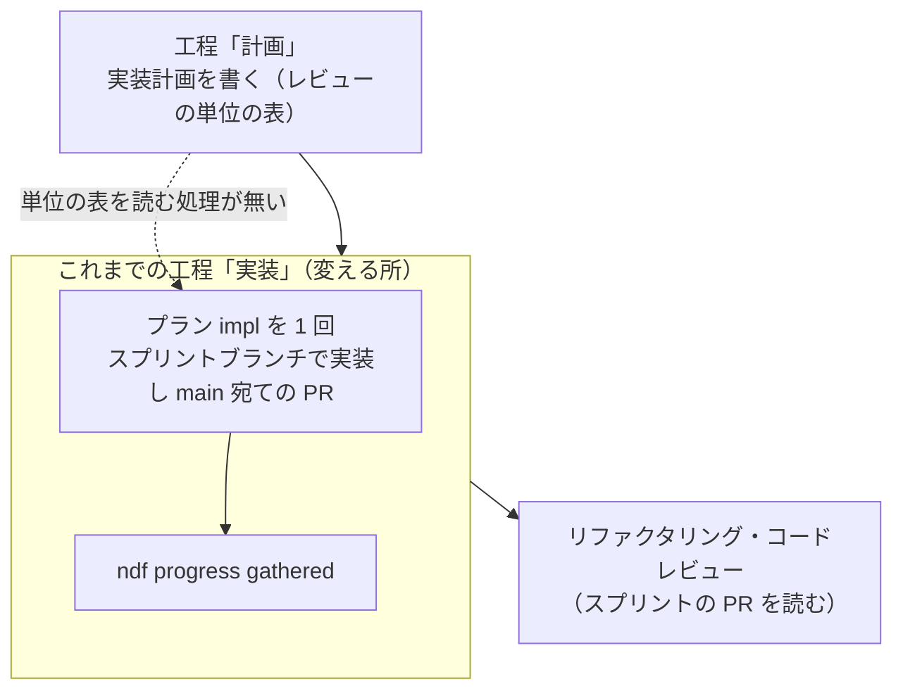
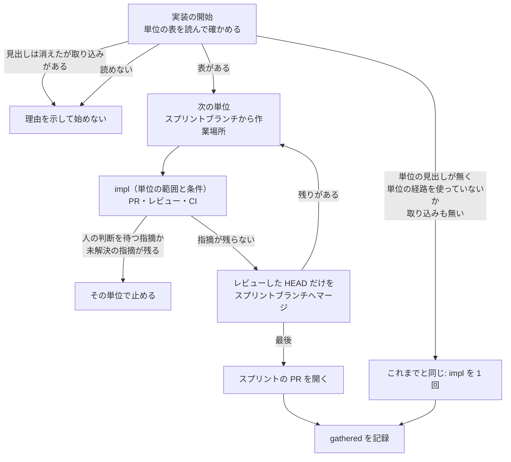
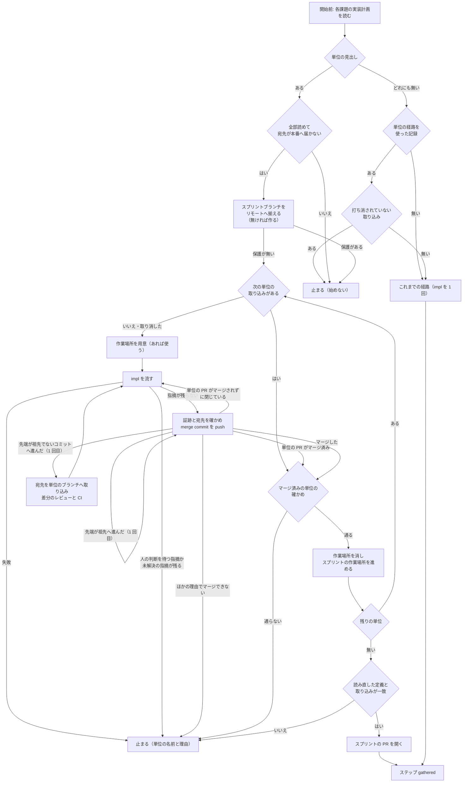

# 工程「実装」: 実装計画のレビューの単位ごとに PR とレビューを経てスプリントブランチへ集める（#4369）

これまで `ndf progress next` で流す工程「実装」は、実装計画の「レビューの単位」を読まなかった。そのため、分けるはずの変更をスプリントブランチの上で 1 本のまま実装していた。この設計では、工程「実装」が単位の表を読み、単位ごとに作業場所・実装のプラン（PR とレビューまで）・マージを順に流し、すべてマージしてから集めた時点（`gathered`。すべての単位をマージしたコミット）を記録する。レビューで人の判断を待つ指摘が 1 件でも残った単位は、この設計ではマージせずにそこで止める。[PR の単位を機械が読むファイルにする課題](https://github.com/devbasex/ai-plugins/issues/3702)（#3702。設計は承認済みで未実装）との先後と、[同じ内容の #3905](https://github.com/devbasex/ai-plugins/issues/3905) の扱いは、決定 1〜3 にある。

## 今の姿

何が起きたか・目的・受け入れ条件は要求仕様（[issue-4369-requirements.md](./issue-4369-requirements.md)、正は #4369 の本文）にある。この文書は「どう解くか」と「なぜその解き方か」だけを書く。

これまでの流れと、変える所は次のとおりである。



設計に要る、これまでの構造（`plugins/ndf/` からの相対パス。2026-11-26、main `25c97daed` で確かめた）:

- 工程「実装」の定義（`contracts/workflow/stages/implement.json`）は、次の 2 ステップである。プラン（自動で順に実行する手順の定義。工程「計画」が書く実装計画とは別）`impl` を呼ぶステップと、`ndf progress gathered` のステップである。工程の定義には指定 `per_issue` もある。進め方 fast で工程を課題ごとの子の行に分ける指定である。ただしこれまでのコードはこの値を読み込むだけで、子の行を作る処理は無い（`plugins/ndf/src/ndf/progress/` を `per_issue` で検索した。2026-11-26）。そのため `impl` は、どの進め方でも、課題が複数でも、工程 1 回につき 1 回だけ呼ばれる
- `impl` の差し込み（テンプレートへ渡す値）は `progress/invoke.py` が組む。ブランチは作業場所が今いるブランチ、マージ先はブランチ戦略の設定のベースブランチになる
- `impl` のテンプレート（`contracts/templates/impl.json`）は、次の処理を行い、マージはしない。worker の実装、受け入れ条件の確かめ、PR、レビュー、CI、未解決の指摘の確かめである
- worker へ渡る入力は `issue`・`branch`・`acceptance` で、担当のタスクを絞る手段が無い
- これまでの経路では `impl` がスプリントの PR（ベースブランチ宛て）を作る。後の工程「リファクタリング」「コードレビュー」はその PR を読む
- supervisor の手順は、単位ごとに `impl` を組む。手順は `skills/development-workflow/references/agent-layers.md` の「実装のフェーズの単位」にある。マージは `ndf ci merge --reviewed` で行う。この設計では同じ順の手順をコードにする。変えるのは 2 点で、マージの打ち方を変え、人の判断を待つ指摘が残る単位を止める（決定 11・14）

## 文脈と制約

- 実装計画の書式は変えない（要求の対象範囲）。単位の表の列は「単位・含むタスク・満たす受け入れ条件・見込みの差分の行数」で、「実行順」の列は任意である
- 2026-11-01 以降の実装計画のうち単位の見出しがある 22 本・129 行で、条件のセルが下の「単位の表の読み方」の形に合うかを試した。合わないのは 1 本の 2 行だけである。この 2 行は `5a`・`5b` という、受け入れ条件の番号として数えられない書き方である。試した手段は git の履歴を読む使い捨てのスクリプトである（2026-11-26）。番号が課題の本文の受け入れ条件の番号にあるかと、含むタスクがタスクの見出しにあるかは試していない
- この変更が保証する再実行は、工程が失敗か待ちを返した後の打ち直しである。実行中にプロセスを中断した場合の復旧と、レビューの後に PR が外から変えられた場合の復旧は [#4218](https://github.com/devbasex/ai-plugins/issues/4218) が扱う。外から変えられた PR をマージしない確かめ（I2）は、この変更に含める
- #3702 の実装は同じ `progress/`・`contracts/` を触る。ファイルの配置と名前は #3702 の詳細設計に合わせる

## 解き方の全体像

この設計で実装を終えた後の流れは次のとおりである。



- 工程「実装」は、課題のどれかの実装計画に単位の見出しがあれば、単位を 1 つずつ順に流す。どれにも無ければこれまでの経路のまま、課題が複数でも `impl` を 1 回だけ呼ぶ。ただし、このスプリントが単位の経路を使った後で、工程の取り込みコミットが残っていれば止まる（決定 4・6）
- 単位 1 つは、専用のブランチと作業場所でこれまでの `impl` のプランを流す。PR はスプリントブランチへ出す。マージは工程が行う。レビューした HEAD を取り込む merge commit を作り、スプリントブランチを指定して push する（決定 11）
- 人の判断を待つ指摘が 1 件でも残る単位はマージせず、後の単位を始めずに止まる。利用者が直して打ち直す（決定 14）
- 済んだ単位は、工程が作った取り込みコミットがスプリントブランチに残っているかで見分ける（決定 6）。止まった工程を打ち直すと、残りの単位から続く
- すべてマージしたらスプリントの PR を開き、`gathered` を記録する。後の工程はこれまでと同じ入力で流れる

## ドメインモデル

### コンテキスト

| コンテキスト | 何の語が 1 つの意味に決まるか |
| --- | --- |
| スプリントの進行 | レビューの単位・単位の PR・スプリントブランチ・集めた時点（どれも用語集にある語で、意味を変えない） |

### 集約

| 集約 | オーナー（書き換えてよいもの） | 根 | エンティティ | 値オブジェクト |
| --- | --- | --- | --- | --- |
| 単位の並び | 実装計画の文書（工程「計画」が書く。工程「実装」は読むだけ） | 実装計画 | レビューの単位 | 単位の名前・満たす受け入れ条件・実行順 |
| 単位の実行 | 工程「実装」 | 単位の PR | — | 単位のブランチ・レビューした HEAD |

### 不変条件

| # | 集約 | 条件 | 破れたときの扱い |
| --- | --- | --- | --- |
| I1 | 単位の並び | 単位の見出しがある実装計画は、すべての行を読めるときだけ流す。課題を 1 本にまとめて流さない | 実装を始めずに止まる |
| I2 | 単位の実行 | 工程がマージするのは、レビューが完了した PR（番号で指す）だけである。レビューの対象の PR 番号と HEAD が、単位の PR の番号と作業場所の HEAD に一致すること。head が単位のブランチで、宛先が開始時に確かめたスプリントブランチであること。スプリントブランチの先端が、その HEAD の祖先であること。push の指定先はスプリントブランチで、PR の宛先の設定に結果が左右されないこと。人の判断を待つ指摘が 1 件も残っていないこと（決定 14）。レビューした HEAD の実装計画が、どの単位の定義の指紋も変えていないこと（決定 6） | マージせずに止まる |
| I3 | 単位の実行 | 次の単位の作業場所は、前の単位をすべてマージした後のスプリントブランチから切る | 後の単位を始めずに止まる |
| I4 | 単位の実行 | スプリントブランチは、ベースブランチでも本番ブランチでもない（工程「実装」が承認なしに本番へ届く先へマージしない） | 実装を始めずに止まる |
| I5 | 単位の実行 | 単位を完了とするのは、マージ済みの単位の確かめ（決定 6）に通ったときだけである。取り込みが取り消された単位は完了でない。`gathered` は、すべての単位が完了し、今の計画に対応しない取り込みが無いときだけ、照合した先端と同じコミットを書く | 次の単位を始めず、`gathered` を書かずに止まる |
| I6 | 単位の実行 | スプリントブランチに、直接の更新を制限する保護が無い（決定 11）。保護を迂回できる権限の有無は問わない | 実装を始めずに止まる。流し始めた後に付いた保護は、push の直前の読み取りで見つけたらマージせずに止まる |

### ドメインイベント

要求のドメインイベント E1〜E5 をそのまま使う。

| # | イベント | 発生元 | 受け手 |
| --- | --- | --- | --- |
| E1 | 実装計画の単位を読んだ | 単位の表の読み手 | 単位を流す処理 |
| E2 | 単位のブランチと作業場所を用意した | 単位を流す処理 | `impl` のプラン |
| E3 | 単位の PR のレビューが収束した | `impl` のプラン | 単位を流す処理 |
| E4 | 単位の PR をマージした | 単位を流す処理 | 次の単位 |
| E5 | 集めた時点を記録した | `ndf progress gathered` | 工程「コードレビュー」 |

## 構成要素

| 要素 | 責務 |
| --- | --- |
| 単位の表の読み手（`src/ndf/core/plan/review_units_decide.py`。新設） | 実装計画の本文と、課題ごとの受け入れ条件（番号と文）から、単位の並び（名前・代表の課題・タスク・条件・順・定義の指紋）か、読めない理由を返す。タスク分解のタスクが単位に過不足なく割り当てられているかも確かめる。ファイルも git も読まない |
| 実装計画のパス（`src/ndf/core/issue_docs.py`） | ファイル名 `issue-<番号の並び>-plan.md` から番号の並びを読む（設計書と同じ形） |
| 単位を流す処理（`src/ndf/progress/units_invoke.py`。新設） | 開始前の確かめ、単位ごとの作業場所・指示のファイル・保存先・`impl`、指摘が残った単位の停止と打ち直し、取り消しの検出・後片付け、スプリントの PR、最後の照合 |
| 工程の進行（`src/ndf/progress/run.py`・`command.py`） | `gathered` に `--expect` を足す。単位の経路でステップ `gathered` が止まったら、次の打ち直しは工程の最初のステップから流す（工程の出力が規約に合わないときの流し直しと同じ扱い） |
| 工程から作業を呼ぶ層（`src/ndf/progress/invoke.py`） | `per_unit` の工程では、単位の見出しがあるか、このスプリントに単位の経路を使った記録があるときだけ、先に `git ls-remote` でリモートにスプリントブランチがあるかを調べる（決定 4）。どちらも無ければ、通信せずにこれまでのまま `impl` を呼ぶ。単位の経路では、最初の単位の作業場所を作る前に、この記録をスプリントのステートマシンに書く。あれば取得し、上の処理で打ち消されていない取り込みを調べる。無ければ取得せず、取り込みは無いと扱う。この場合、見出しがあれば開始前の確かめでブランチを作り（決定 11）、無ければこれまでのまま `impl` を呼ぶ。`ls-remote` か取得が通信などの理由で失敗したら、取り込みの有無が分からないので止まる。見出しがあれば、開始前の確かめと実行を上の処理へ渡す。記録はあるが見出しが無く、取り込みも無ければ、これまでのまま `impl` を呼ぶ。見出しが無いのに取り込みがあれば止まる。試行の始まりに値を消す処理（`clear_values`）は、単位の保存先とスプリントの PR の保存先についても、差し込みの値と課題のコピーを消す。ほかの記録は残す（「単位ごとの保存先」） |
| 工程の定義の読み手（`src/ndf/progress/stages.py`・`definition.py`） | 工程の型に `per_unit`（既定は偽）を足し、定義とスナップショットから読む |
| 工程の定義とスキーマ（`contracts/workflow/stages/implement.json`・`contracts/workflow/ndf.schema.json`・`contracts/schemas/internal/stage-snapshot.schema.json`） | `per_unit` を足す。ステップの並びは変えない |
| `impl` のテンプレートと差し込みの定義（`contracts/templates/impl.json`・`parts/steps.json`・`params.json`） | 初回のレビューのステップは、保存先に `held-findings` があれば `--held-findings` で渡す。任意の差し込み `unit`（単位のブランチ名）と `unit_file`（単位の範囲の指示のファイル）を足す。どちらも既定は空で、ステップは増やさない。`unit` があれば、push の各ステップは `git push --porcelain` の出力を読み、そのコマンドがリモートのブランチを新しく作ったときだけ `created` に記録する。`unit` があれば、`done-check`・`pr`・`conflict-check`・`ci` のステップとレビューの 2 つのステップ（`review`・`review-delta`）が決定 8・11 のとおりに振る舞う。`unit` は、課題全体を 1 単位として補ったもの（「単位の無い課題」のセクション）を含む、すべての単位に渡す。`unit_file` は範囲の指示だけに使い、補った単位では空である |
| 既定のレビューの起動（`src/ndf/core/route/__init__.py`） | 単位の PR の番号が環境変数 `NDF_UNIT_PR` にあれば、ブランチから番号を引かずにその番号を使う |
| レビューの結果の出力（`src/ndf/domains/crossreview/cli.py`） | `ndf cross-review run` に `--target-out` と `--held-findings` を足す（「入出力のコントラクト」） |
| 人の判断を待つ指摘の判定（`src/ndf/domains/crossreview/finish_decide.py`・`journal.py`） | `--target-out` を渡した起動では、人の判断を待つ指摘が残れば、その指摘を結果の欠けに載せて `incomplete` で終える。判定に使うのは 2 つである。見送りの区分が保留になるかを返す関数（`domains/records/mvv_decide.py` の `defer_holds`。MVV の承認の判定が使うもの）と、レッドラインのフラグである。レッドラインの指摘は、見送りの区分を問わず、直した（`fixed`）と記録されるまで残る指摘に数える（決定 14） |
| worker の作業の定義と読み手（`contracts/worker/kinds.json`・`src/ndf/contracts/worker_kinds.py`） | 作業の定義に、空でよい入力の欄 `optional_inputs` を足し、`impl`・`fix`・`ci-fix`・`fix-push`・`fix-base` に `unit_file` を置く。値があるときだけ起動指示の入力に載せる。値が無くても、欠けの検査（`kind_gaps`）は不足にしない。起動指示を書く `progress/gate/entry.py` は、定義の読み手（`worker_kinds.py`）が返す値をそのまま載せるので変えない |
| レビューの指示（`src/ndf/domains/crossreview/criteria_decide.py`） | `NDF_UNIT_PR` があれば、相手役と修正担当の指示に例外（決定 8）を足す。`NDF_UNIT_FILE` があれば、単位の範囲のセクションも足す |
| 受け入れ条件の確かめ（`src/ndf/domains/loop/acceptance.py`） | 条件を持たない単位のための `--no-criteria` を足す |
| 単位のマージ（`src/ndf/progress/units_merge.py`。新設。`src/ndf/adapters/github.py`・`git.py`） | 工程の保存先の記録から証跡を読んで確かめ、merge commit を作ってスプリントブランチへ push する。CLI のコマンドは持たない。`ndf ci merge` は変えない |
| 宛先の保護の読み取り（`src/ndf/adapters/github.py`） | スプリントブランチに当たる ruleset の規則と、従来のブランチ保護の有無を読む |
| 単位の PR で待つチェックの宣言（`contracts/schemas/project-workflow.schema.json`・`src/ndf/progress/invoke.py`） | 設定の `workflow.unit_required_checks` を読む（決定 13） |
| コマンドの一覧（`docs/contracts/commands.md`） | 上の新しい引数を載せる（`ndf check --write-spec` で生成し直す。手で直さない） |
| supervisor の手順（`agent-layers.md`） | `ndf progress next` の自動の経路も単位を読むことと、単位の表の読み方を書く |

詳細設計書は別ファイル（`issue-4369-design-detail.md`）にする。新設する関数が 2 つ以上あり、既存の関数のシグネチャ（`GitHub.merge` など）も変わるためである。後の工程「詳細設計」で書く。

## 入出力のコントラクト

この設計で足すのは、コマンドの引数 4 つと設定のキー 1 つ（決定 13）である。工程の入力と出力（`gathered`）は変えない。単位のマージはコマンドにせず、工程「実装」（`ndf progress next`）の中だけで行う（決定 11）。

### 引数と工程の結果

| 対象 | 変える前 | 変えた後 |
| --- | --- | --- |
| `ndf progress gathered --expect <SHA>` | 無い | 取得したスプリントブランチの先端が `<SHA>` と違えば、`gathered` を書かずに `precondition` で止まる。単位の経路だけが、最後の照合を通った先端を渡す（決定 6） |
| `ndf cross-review run --held-findings <ファイル>` | 無い | 前の回で人の判断を待つ指摘か未解決のまま残った指摘（id・本文・レッドラインのフラグと当たる C<番号> か P<番号>）を、引き継いだ未解決の指摘として扱う。レッドラインのフラグがある指摘は、`filed`・`not_applicable` の見送りでは解けず、`fixed` だけで解ける（決定 14） |
| `ndf loop acceptance check --no-criteria` | 無い | 渡した `--issue` の条件を 1 件も照らさず `ok`。`--criteria` と一緒には受けない |
| `ndf cross-review run --target-out <ファイル>` | 無い（`--reviewed-out` は HEAD だけを書く） | レビューが完了した証拠を書く。始めにファイルを消し、直していない指摘も人の判断を待つ指摘も残らないときだけ `{"pr": <番号>, "head": <SHA>}` を書く。`head` は `--reviewed-out` と同じ値。この引数を渡した起動では、人の判断を待つ指摘が残れば `incomplete` で終え、指摘 1 件を 1 つの欠け（id と本文）にする（決定 14） |
| 工程「実装」のステップ `implement` の結果 | `impl` の結果 | 単位の経路では、`ok` は全単位のマージとスプリントの PR の後に返し、`items` に単位ごとの名前・PR の番号・状態・取り込みコミットを持つ。`stopped` は止まった単位の名前・課題・理由を持つ。指摘が残って止まった場合の理由には、指摘の本文と、単位の PR の cross-review の記録の URL を並べる。結果に `run_id` は持たせない。持たせると、自動の打ち直しが「同じ回の結果」と読んで打ち切るためである |

### 単位の表の読み方（決定 7）

| 項目 | 読み方 |
| --- | --- |
| 見出し | 本文のコードブロックの外にある、`レビューの単位` を含む `##` 以下の見出し。この下の最初の表を読む |
| 列 | 「単位」「含むタスク」「満たす受け入れ条件」は必須。「実行順」は任意。列があれば、すべての行に 1 以上の整数を書く |
| 含むタスクのセル | 括弧の注記を除き、`・` `、` `,` で区切る。要素は `Task <番号>`、`T<番号>`、番号だけ、または範囲（`Task 1〜4`・`T1〜T4`）。番号だけの要素と範囲の終わりは、接頭辞を省ける。セルの最初の要素は接頭辞（`Task` か `T`）が要る。`Task 1・2` は Task 1 と Task 2 である。各番号は、同じ実装計画の「タスク分解」の `###` の見出し（`### Task <番号>`）にあること |
| タスクの割り当て | 「タスク分解」の `###` の見出しのタスクは、受け入れ条件を持たない準備のタスクも含め、どれも 1 つの単位にだけ割り当てる。未割当と、2 つ以上の単位への重複は読めない |
| 条件のセル | 括弧の注記を除き、`・` `、` `,` で区切る。要素の形は下の表 |
| 読めない | 表か必須の列が無い、行が 0、名前が空か重なる、含むタスクが空か上の形でないか見出しに無い、どの単位にも無いタスクがある、2 つ以上の単位にあるタスクがある、条件のセルが下の形でない、条件の課題がスプリントの外、番号（範囲は展開した各番号）がその課題の受け入れ条件の番号に無い、「実行順」の列があるのに、値が 1 以上の整数でない行がある（空欄・0・負の数を含む）。理由には当たったタスクの番号を並べる |

条件の番号は、`ndf loop acceptance check` が数える番号（課題の本文の受け入れ条件を上から 1 始まり）と同じ関数で読む。定義の指紋（決定 6）に使う条件の文は、同じ本文から取る。

条件のセルの要素の形:

| 要素 | 意味 |
| --- | --- |
| `<課題>:<番号>` | その課題のその番号の条件 |
| `<課題>:<始め>〜<終わり>` | その課題の始めから終わりまでの条件 |
| 番号か範囲だけ（`3`・`1〜7`） | 直前の要素の課題の条件。セルの最初の要素なら、実装計画の課題が 1 つのときだけ書ける |
| `無し` | 条件なし。ほかの要素と一緒には書けない |

始めが終わりより大きい範囲は読めない。例:

| セル | 実装計画の課題 | 読んだ結果 |
| --- | --- | --- |
| `4369:1〜3` | 問わない | 4369 の 1・2・3 |
| `4369:1・2〜3` | 問わない | 4369 の 1・2・3 |
| `1〜3` | `4369-3905`（2 つ） | 読めない（どの課題か決まらない） |

### 単位の代表の課題と `acceptance` の組み方（決定 9）

| 単位 | 代表の課題 | `impl` に渡す `acceptance` |
| --- | --- | --- |
| 条件がある | 単位を持つ実装計画のファイル名の番号のうち最も小さいもの | 条件がある課題だけを番号の順に `--issue` で並べ、展開した条件を 1 件ずつ `--criteria` で渡す |
| 条件が「無し」 | 同上 | `--issue <代表の課題> --no-criteria` |
| 課題全体を 1 単位として補ったもの | その課題 | `--issue <代表の課題>`（その課題の全条件を照らす） |

例: `issue-4369-3905-plan.md` の単位が `4369:1・2` と `3905:1` を満たすとする。代表の課題は 3905 で、渡す引数は次のとおりである。

```text
--issue 3905 --criteria 3905:1 --issue 4369 --criteria 4369:1 --criteria 4369:2
```

代表の課題の値は、次の 3 つに同じものを使う。

- `impl` の `issue`（PR の題と本文はこの課題から作る）
- `--no-criteria` に渡す課題
- 単位のブランチ名の `<課題>`

条件の書き方を直してもブランチ名が変わらないように、条件の課題ではなく実装計画のファイル名から決める。

## 処理の流れ



### 順序

単位の並びは、かたまりを番号の小さい順に置いて作る。かたまりは、単位の見出しがある実装計画 1 つ（番号はファイル名の最も小さいもの）と、補った単位 1 つ（番号はその課題）の 2 種類である。実装計画の中の順は次のとおりである。

- 「実行順」の列があるときは、その値の順（同じ値は表の順）。準備の単位を前へ動かさない
- 列が無いときは表の順。ただし準備のリファクタリングをするときは、最初のタスクを含む単位を先頭にする
- 「するとき」かは、実装計画の「リファクタリングの時機」の表で決める。時機が「実装の前」で始まる行を見て、その行の対象が「しない」で始まらなければ「するとき」である。表か行が無ければ「しない」と読む
- 「最初のタスク」とは、「タスク分解」の最初の `###` の見出しのタスクである。「含むタスク」にこの番号がある単位が先頭になる

### 単位の無い課題

どの実装計画にも単位の見出しが無いスプリントは、これまでの経路で `impl` を 1 回だけ呼ぶ。ただし、単位の経路を使った記録があり、打ち消されていない取り込みがスプリントブランチにあれば、計画から単位が消えたと扱って止まる（決定 6）。単位の経路の実装計画が 1 つでもあるときは、残りの課題も、課題 1 つを 1 単位として並びに入れる。残りの課題とは、実装計画を省いた課題と、見出しの無い実装計画の課題である。入れる位置は上の「順序」の課題番号の順である。例えば実装計画 `issue-20-40-plan.md`（単位 A・B）と、実装計画の無い課題 10・30 があれば、10、A、B、30 の順になる。別の課題を前提とする順を指定したい場合は、その課題も単位の表を持つ実装計画に含める。

補った単位にも `unit`（ブランチ名）を渡し、PR の特定とレビューとマージの扱いはほかの単位と同じにする。`unit_file` だけを空にし、課題の全体を実装して、その課題の全条件を照らす。

### 単位ごとの保存先

`impl` のプランの保存先は、工程の保存先の下の `units/<単位のブランチ名>/` とする。変更要求で工程のステップの保存先が新しくなっても、同じ場所を使う。ほかの単位とは共有しない。スプリントの PR の保存先は同じ階層の `sprint-pr/` とする。

### 試行の始まりに消すもの

打ち直しで工程の新しい試行を始めるとき、`clear_values` は次の表のとおりに扱う。

| 扱い | 単位の保存先の中身 |
| --- | --- |
| 消す（読み直して作り直す） | 差し込みの値（`values.json`）、課題の題と本文のコピー |
| 残す | プランの回の記録と結果（再開点）、打ち直しの数、`reviewed-head`、未解決のフラグ、差分のレビューの起点、PR の番号（`unit-pr`）、`review-target`、指摘が残って止まった時点の HEAD（`held-head`）と指摘（`held-findings`）、実行を始めた時点の単位の定義の指紋（`unit-def`）、工程が作った資源の記録（`created`）、取り込みコミットの SHA（`merged`）、PR の後処理が済んだ印（`pr-done`） |

単位の指示のファイルは、単位を流すたびに書き直す。

指示のファイルは今の定義で作り直されるが、プランの記録は前の定義で作られたままになりうる。そこで工程は、単位の実行を始めるときに、定義の指紋（決定 6 の `Ndf-Def` と同じ値。タスクの本文と条件の文を含む）を `unit-def` に書く。打ち直しとマージの直前に、今の定義の指紋と比べる。マージの直前には、レビューした HEAD の実装計画から作った指紋も比べる。単位の PR がどれかの単位の定義を変えていれば、マージせずに止まる。取り込みコミットの `Ndf-Def` には `unit-def` の値を書く。

### 打ち直し

単位ごとに、次の表で扱いを決める。複数の行に当たる場合は、上の行を採る。単位の取り込みがすべて打ち消されている場合は、先に次の番号のブランチ名を決める。表の下の行が読む保存先の記録・PR・作業場所は、そのブランチのものである。

| 打ち直しの時点の単位 | 扱い |
| --- | --- |
| 一番新しい取り込みより古い取り込みが打ち消されていない | 止まる。利用者が、その単位の打ち消されていない取り込みをすべて打ち消して打ち直す（決定 6） |
| 取り込みがあり、マージ済みの単位の確かめ（決定 6）に通る | 実装とマージは飛ばす。`pr-done` が無ければ、取り込みコミットの `Ndf-Pr` の PR を読む。すでに閉じていれば `pr-done` を書くだけにする。開いていて、head・宛先・HEAD が取り込みの記録と同じなら、コメントを付けて閉じて `pr-done` を書く。違えば閉じない（扱いは決定 11） |
| 取り込みがあり、確かめに通らない | 止まる（決定 6） |
| 工程の外で PR がマージされ、そのコミットが残っている | 止まる。利用者に、入ったコミットをすべて取り消し、実装計画の単位の名前を変えて打ち直すよう頼む（決定 6） |
| 取り込みがすべて取り消され、次の番号のブランチの保存先に実行の記録が無い | 未実装の単位として、そのブランチで最初から流す（決定 6） |
| 取り込みが無いのに保存先に `merged` があり（取り込みが履歴から消えた）、マージ済みの PR が無い | `merged` を含む前の実行の記録を捨て、同じ名前のブランチで最初から流す（決定 6） |
| 未マージで、今の定義の指紋が `unit-def` と違う | プランの記録・`unit-pr`・`reviewed-head`・`review-target`・差分のレビューの起点・未解決のフラグ・`held-head` を捨て、`impl` を最初から流す。`held-findings` は残し、レビューに渡す。レビューの前に `pr` のステップが、開いている PR か新しく作った PR の番号を `unit-pr` に書く。前の PR が閉じていても、閉じた番号は使わない |
| レビューの指摘（人の判断を待つ指摘か未解決の指摘）が残って止まり、作業場所の HEAD が `held-head` と同じ | レビューをやり直さず、同じ理由で止まる（決定 14） |
| 同じく止まった後、作業場所の HEAD が `held-head` から変わった | 単位のレビューを始めからやり直す。前の回の指摘の記録・`unit-pr`・差分のレビューの起点・未解決のフラグ・`reviewed-head`・`review-target`・`held-head` を退避する。`held-findings` は残して `--held-findings` で渡し、`impl` を `push` のステップから新しい回で流す。`pr` のステップが、開いている PR か新しく作った PR の番号を `unit-pr` に書く（決定 14） |
| `impl` が途中で止まったか、HEAD が `reviewed-head` より先へ進んだ単位で、`unit-pr` の PR がマージされずに閉じている | `unit-pr`・`review-target`・`reviewed-head`・差分のレビューの起点・未解決のフラグを捨て、`impl` を `push` のステップから新しい回で流す。`held-findings` があれば残してレビューに渡す。`pr` のステップが新しい番号を `unit-pr` に書く |
| ほかの理由で `impl` が途中で止まった | これまでのプランの打ち直しと同じく、止まったステップから続ける |
| `impl` が終わり、作業場所の HEAD が `reviewed-head` と同じ | `impl` を呼ばず、マージへ進む。PR の状態は先に読まない。マージの直前の読み取りでマージされずに閉じていれば、上の閉じた PR の行と同じに扱う。マージ済みなら、取り込みの記録を照らし直し、記録が無ければ工程の外のマージとして止まる |
| `impl` が終わり、作業場所の HEAD が `reviewed-head` より先へ進んだ | その単位の保存先を使い、`impl` を `push-reviewed` のステップから新しい回で流す。push の後、`reviewed-head` からの差分のレビュー（`review-delta`）と CI を通してからマージする |
| `impl` が終わり、`reviewed-head` が無いか、作業場所の HEAD の祖先でない | 止まる。2 つのコミットを結果に出す |

### 宛先が進んだとき

CI が通った後にスプリントブランチが動くと、単位のマージは送らずに終わるか、push が断られる。工程はスプリントブランチの先端を読み直して、次の表のとおりにする。やり直しは 1 回の起動につき 1 回だけで、再び動いていれば止まる。

| 読み直した先端 | 扱い |
| --- | --- |
| レビューした HEAD の祖先 | 読み直した先端を親にして merge commit を作り直し、送る |
| 祖先でない | スプリントブランチを単位の作業場所へ取り込み、HEAD が進んだ単位として差分のレビューと CI を通し直す。取り込みが衝突すれば止まる。利用者が手で解いた場合は、コミットして打ち直す |

### 承認ゲート

単位のプランが承認ゲートの結果を返したら、工程はそのまま返し、人の回答は質問を出した単位のプランへ渡す。工程が単位のために出す承認ゲートは無い。

## 決定の記録

決定の記録（決定 1〜14）は [issue-4369-design-decisions.md](./issue-4369-design-decisions.md) にある。

## 影響と危険

- **働く範囲**: 利用先のリポジトリでも働く。実装計画に単位の見出しがあるときだけ振る舞いが変わる
- **プロジェクトごとに違うもの**: ベースブランチ・リモート・レビューの起動・テストと CI は、既存の設定を単位の経路でも使う。足す設定は `workflow.unit_required_checks` だけで、書かなければ既存の必須のチェックの設定を使う（決定 13）
- **当たるモード**: 工程「実装」を持つすべてのモードと進め方（`per_unit` を足した後に作ったスプリント。決定 4）。見出しが無ければこれまでのまま。単位の経路では、工程 1 回がスプリントのすべての課題の単位を流す。単位の経路は、工程の作業場所が今いるブランチをスプリントブランチとして使う。進め方 fast でも、そのブランチがベースブランチでも本番ブランチでもなければ同じに流す。fast の課題をベースブランチで直接進める形（`gathered` がベースブランチのコミットになる経路）では、実装計画に単位の見出しがあれば始めずに止まる（I4）。理由には、作業場所で `git switch -c <スプリントブランチ>` を打ってから打ち直すことを書く。見出しが無ければ、この形はこれまでのまま流れる。fast の課題ごとの子の行（`per_issue`）はこれまでのコードに無く、この変更でも足さない。子の行を実装する変更は、複数の課題の実装計画の単位をどの行が流すかを決める必要がある
- **PR の数**: 単位が 1 つの表でも、単位の PR とスプリントの PR の 2 本になる（理由は決定 12）
- **同じファイルを触る変更**: #3702 の実装が `progress/`・`contracts/` を触る。後に入る側が取り込む
- **壊れうる箇所**:
  - 待つと宣言したチェックがスプリントブランチ宛ての PR で起動しない設定では、単位がマージできずに止まる（理由に宣言のキーを出す。決定 13）
  - スプリントブランチに保護がある設定では、始めずに止まる（決定 11）
  - 流している間にほかの者がスプリントブランチへ push すると、その単位の差分のレビューと CI が 1 回増える
  - レビューで人の判断を待つ指摘が出た単位は、利用者がコードを直して打ち直すまで止まる（決定 14）。指示書の書き換えのように、必ず人の承認が要る操作を意図して含む単位は、自動の経路では通らない
- **処理の回数と待ち時間**: 単位が N 個のスプリントでは、次の表のとおり増える。単位は 1 つずつ流すので、時間はほぼ足し算になる

| 処理 | これまで（工程 1 回） | この設計の単位の経路 |
| --- | --- | --- |
| worker の実装、単位のレビュー、CI の完了の確認、作業場所の用意 | 各 1 回 | 各 N 回（修正による追加は、これまでと同じく落ちた分だけ） |
| マージ | 無し | N 回 |
| スプリントの PR を開く処理 | 無し（`impl` の PR がそれに当たる） | 1 回 |
| GitHub への照会と書き込みの追加 | 無し | 下の表 |

単位の見出しが無く、単位の経路を一度も使っていないスプリントでは、git の通信は増えない。次の表の対象は、`per_unit` を持つ定義を保存したスプリント（決定 4）のうち、単位の見出しがあるか、単位の経路を使った記録があるものである。工程「実装」の呼び出し（打ち直しを含む）1 回ごとに、次のとおり増える。

| 処理 | 回数 |
| --- | --- |
| `git ls-remote`（スプリントブランチがあるか） | 1 回。単位の経路では、決定 11 の開始前の確かめにこの結果を使う |
| `git fetch`（スプリントブランチ） | ブランチがあれば 1 回 |
| 取り込みを探す履歴の走査（手元の処理） | ブランチがあれば 1 回 |

これまでの経路には、`impl` の前にスプリントブランチを取得する処理が無いので、使い回せる結果は無い。ステップ `gathered` の取得は `impl` の後なので、使えない。

GitHub への照会と書き込みの内訳は次のとおりである。下の表では、git の通信（`ls-remote`・`fetch`・push）を数えない。

| 時点 | 回数 |
| --- | --- |
| 開始時 | 課題の本文の読み取り（課題ごとに 1 回。条件の番号と文の両方に使う）、マージ済みの PR の一覧 1 回、保護の読み取り 2 回（規則とブランチ） |
| 単位のマージの試行ごと | 指定した PR の読み取り 1 回、保護の読み取り 2 回。宛先が動いてやり直すと、もう 3 回 |
| 単位のマージの後 | PR の状態の読み取り 1 回。開いたままならコメント 1 回と閉じる操作 1 回 |
| 最後 | マージ済みの PR の一覧 1 回 |
| 打ち直し | `impl` が途中で止まった単位と HEAD が進んだ単位は、`unit-pr` があれば PR の状態の読み取り 1 回。マージだけを打ち直す単位は足さない（マージの直前の読み取りを使う）。後処理が済んでいない取り込み済みの単位は 1 回 |
| 単位ごとの削減 | `ci` のステップが PR の番号を引く照会が 1 回減る |

全 N 単位が初回の試行でマージできれば、マージの前後の読み取りは 4N 回である。打ち直しでマージへ進むたびに、試行の 3 回が増える。

- **PR で走る CI**: CI の完了の確認（呼び出しの回数）とは別に、PR で実際に走る CI の回数はリポジトリの設定で決まる。多くの設定では、単位の PR N 本とスプリントの PR 1 本で走る
- **後片付け**: 単位の作業場所とブランチは、マージを確かめた後に、工程が作ったもので、取り込んだ内容しか無いものだけを消す。工程が `created` に記録するのは、自分の作成の操作が成功したものだけである。先に調べて無かったことは根拠にしない。調べた直後に、別の実行や利用者が同じ名前で作ることがあるためである。作業場所と手元のブランチは、同じ名前があれば失敗する作成の操作（`git worktree add -b` など）が成功したときに記録する。リモートのブランチは、単位の push がそのブランチを新しく作ったときに記録する。記録に無いものは消さない（Value 6）。記録は、その作成で出来たものが残っている間だけ有効である。工程が削除に成功したときと、記録した資源が無くなっていると分かったときは、`created` から外す。後で同じ名前で作られたものに、古い記録を当てないためである。別のマシンで打ち直して記録が無い場合も消さない。条件に合わないものと消せなかったものは残し、警告して続ける

| 対象 | 消す条件 | 消し方 |
| --- | --- | --- |
| 作業場所 | HEAD がレビューした HEAD で、未コミットの変更も追跡していないファイルも無い | `git worktree remove`（`--force` を付けない） |
| 手元の単位のブランチ | 作業場所を消した後で、先端がレビューした HEAD | `git update-ref -d` に今の値の条件を付ける |
| リモートの単位のブランチ | PR がマージ済みか閉じていて（決定 11）、先端がレビューした HEAD | `--force-with-lease=<ref>:<レビューした HEAD>` を付けた削除の push。先端が違えば GitHub が断る |

### 代表のリポジトリでの振る舞い

| 代表のリポジトリ | 設定の要点 | 直した後に起きること | この種類で扱えなくなること |
| --- | --- | --- | --- |
| Web サービス | ベースブランチとスプリントの起点はブランチ戦略の設定。CI の必須のチェックと、ベースブランチのマージキュー | 単位の変更がスプリントブランチへ入り、ベースブランチへはこれまでの承認を経て入る | 無し |
| モバイルアプリ | ストアへのリリースは工程「デプロイ」が持つ | 同上。リリースの形は変わらない | 無し |
| 業務文書だけ | 実装計画に単位の表が無いことが多い | 見出しが無ければこれまでのまま。あれば単位ごとに PR が出る | 無し |

### ai-plugins だけの事情

- 無し（このリポジトリの値を既定や振る舞いに入れない）

## テスト設計

| 受け入れ条件・不変条件 | どの振る舞いで縛るか | どう壊したら落ちるべきか |
| --- | --- | --- |
| 条件 1 | 単位が 2 つ以上の表で、単位ごとのプランが順に呼ばれ、ブランチ・宛先・`acceptance`・`unit_file`・保存先が単位の値になる | 順を入れ替える、`acceptance` を課題全体にする、保存先を共有する、宛先をベースブランチにすると落ちる |
| 順序 | 実行順の列があるとき・無いとき、準備のリファクタリングをする・しないの順。列があれば準備の単位も列の値に従う。実装計画の単位と補った単位が混ざるときは、課題番号の順（課題 10、`20-40` の単位、課題 30） | 列の値より準備を優先する、補った単位を先頭か末尾へ固めると落ちる |
| 条件 2 | どの実装計画にも見出しが無い複数課題のスプリントで、これまでと同じプランの呼び出しが 1 回になり、`ls-remote` と取得は呼ばれない。見出しのある計画と混ざると、残りの課題が 1 単位ずつ並ぶ | 課題ごとに `impl` を呼ぶ、単位の経路へ入る、記録が無いのに通信すると落ちる |
| 条件 3・I5 | 全単位のマージの後にステップが `ok` を返し、`gathered` が書かれる。未完了の単位があれば書かれない | 途中の単位の後に `ok` を返すと落ちる |
| 条件 4・I2・I3 | merge commit の親は宛先の先端とレビューした HEAD で、push は宛先の ref を指定し、その先端の SHA を条件にする。番号・head・宛先のどれかが違う PR と、宛先の先端が HEAD の祖先でない場合は送らない。次の作業場所はその取り込みを含むコミットから切られる。`ndf ci merge` で単位をマージできる形は作らない | PR のマージや取り込みの API を呼ぶ、更新の条件を外す、親でない先端へ送る、照合を外す、マージの前に次を切ると落ちる |
| 決定 11 | 同じ head の開いた PR が複数あっても、衝突の確かめ・CI・レビュー・マージは宛先がスプリントブランチの同じ番号を使う。`review-target` の番号か HEAD が違う・無いときはマージしない。課題全体を補った単位（`unit_file` が空）でも `unit-pr` と `review-target` ができてマージする。単位でない経路の `impl` のステップと呼び出しの回数はこれまでと同じ | 番号をブランチから引き直す、照合を外す、`unit_file` の有無で分ける、ステップを増やすと落ちる |
| 条件 5 | 単位のプランの失敗とマージの拒否で、後の単位を呼ばず、結果に単位の名前と理由がある | 失敗の後も次を呼ぶと落ちる |
| 条件 6 | 打ち直しで、マージ済みの単位はプランもマージも呼ばれない。プランが終わった未マージの単位はマージだけになる | 先頭から流し直すと落ちる |
| 打ち直し（HEAD の違い） | 作業場所が進んだ単位は `push-reviewed` から流し直し、`reviewed-head` が祖先でない・無いときは止まる | 前の回の結果をそのまま返す、そのままマージすると落ちる |
| 決定 6 | マージ済みの単位にタスクか条件を足すと、打ち直しと最後の読み直しで止まる。PR の本文・commit status・PR のマージ済みの表示は完了の根拠にならず、工程の外のマージでは止まる。`git revert` した単位は次の番号のブランチで流し直し、取り込みが 1 つの単位は、打ち消しを打ち消せば完了に戻る。履歴から消えた単位は、マージ済みの PR があれば止まり、無ければ同じ名前のブランチで実装から流し直す | 名前や PR の状態だけで完了とみなす、取り込みの残りを見ないと落ちる |
| I6 | スプリントブランチに PR の必須・マージキュー・必須のチェックの規則か従来の保護があれば始めない。読めない場合も同じ。流し始めた後に付いた保護では push しない。削除と強制 push の禁止の規則だけなら流れる。ブランチが無く作成の制限が当たるときは、作らずに止まる | 迂回できる権限を理由に送る、読めないときに送ると落ちる |
| 宛先が進んだとき | 先端が HEAD の祖先へ進めば merge commit を作り直し、祖先でなければ単位へ取り込んで差分のレビューと CI の後にマージする。2 回目は止まる | 古い親のまま送る、そのままマージする、繰り返し続けると落ちる |
| 第 1 親と記録（決定 6） | 単位のブランチの中の merge commit と、3 行の揃わないコミットは完了にしない。工程の外のマージは、打ち消しがあっても同じ名前では止まる | 全コミットから探す、行の欠けを許す、外のマージを取り消し済みと読むと落ちる |
| 後片付けと PR | push の後に PR が開いたままなら閉じる。マージ後に足したコミット・未コミットの変更がある作業場所とブランチは残る | 無条件に消す、`--force` で作業場所を消すと落ちる |
| 新しいスプリント | リモートにブランチが無ければ、規則の確かめ、作成、従来の保護の確かめの順になる | 作る前にブランチの保護を必須にすると落ちる |
| 条件 7・I1 | 読めない表の各形（行 0、列が無い、含むタスクが見出しに無い、未割当のタスク、重複した割り当て、条件の形、課題の無い範囲、番号の無い条件、スプリントの外の課題、実行順の空欄・0・負の数）で、工程が始まらず理由が返る。課題付きの範囲は展開される。`implementation-plan` の手順書の例と同じ行（`Task 1・2`）は、空欄の単位の名前だけを埋めれば読める | 読めない行を飛ばす、未割当のタスクを通す、接頭辞の省略を断る、実行順の空欄・0・負の数を通すと落ちる |
| I4 | スプリントブランチがベースブランチか本番ブランチのとき（fast でベースブランチを作業先にする場合を含む）、単位の見出しがあれば始めずに止まる。見出しが無ければこれまでどおり流れる | 確かめを外すと落ちる |
| 決定 8 | `unit_file` があるとき、5 つの作業の起動指示とレビューの指示に単位の範囲が入る。無いときは範囲を足さず、欠けの検査に掛からない | 修正の経路に渡さない、必須の入力にすると落ちる |
| 決定 8 の例外 | 相手役と修正担当の指示に例外が入る。後の単位の範囲を理由にした見送りの区分の指示は `not_applicable` である | 秘密・認証認可・利用者のデータ・戻せない操作の指摘を、後の単位へ先送りできる指示にすると落ちる |
| 決定 14・I2 | `--target-out` を渡したレビューは、レッドラインの指摘と、区分が `needs_user`・無い・知らない値の見送りのそれぞれで `incomplete` になり、欠けに指摘が並び、`review-target` を書かない。区分が `filed`・`not_applicable` の見送りだけなら書く。レッドラインの指摘は、`filed`・`not_applicable` で見送っても `incomplete` のままである。`held-findings` で引き継いだ回でも同じで、`fixed` と記録した回だけ解ける。引数の無いレビューの結果はこれまでと同じ。差分のレビューが通っても、初回のレビューで残った指摘があれば単位はマージされず、後の単位は呼ばれず、`gathered` は書かれない。HEAD を変えずに打ち直すと同じ理由で止まり、HEAD を変えて打ち直すとレビューの始めからになる。指摘と無関係なコミット、スレッドの resolve、PR の作り直しの後も、`held-findings` がレビューに渡る | 一部の分類だけを止める、レッドラインを見送りで解く、引き継ぎでレッドラインのフラグを落とす、差分のレビューの成功で初回の指摘を忘れる、打ち直しで前の指摘の記録を使い回す、承認で通す経路を作ると落ちる |
| 定義の変更（打ち直し） | 未マージの単位にタスクか条件を足すか、タスクの本文か条件の文を直して打ち直すと、HEAD が同じでも `impl` を最初から流す。マージ済みの単位で本文か文を直すと止まる。条件のチェックの印を付けただけでは指紋が変わらない。レビューした HEAD がタスクの本文を変えていればマージしない | 番号だけから指紋を作る、チェックの印を指紋に含める、前の定義の `review-target` でマージする、今の定義の指紋を `Ndf-Def` に書くと落ちる |
| 閉じた単位の PR | `unit-pr` の PR を閉じて打ち直すと、新しい PR の番号でレビューとマージをする。定義も変えていれば `impl` を最初から流す。指摘で止まった単位は、HEAD が同じなら止まり、コミットした後は新しい PR になる。マージだけの打ち直しで読む PR は 1 回 | 閉じた番号を使い続ける、定義の変更より閉じた PR の扱いを先にする、マージの前に PR を 2 回読むと落ちる |
| 取り消しの取り消し | 流し直した後に前の取り消しを取り消すと、後の取り込みを打ち消していてもいなくても止まる。打ち消されていない取り込みをすべて打ち消して打ち直すと完了し、打ち消されていない取り込みは 1 つで、単位の変更がスプリントブランチのファイルにある | `-r<番号>` まで比べて計画に無い単位と読む、古い取り込みが残るだけで完了にする、取り込みの数だけを見てファイルの中身を確かめないと落ちる |
| 取り消した単位の再実行の打ち直し | 次の番号のブランチで途中で止まって打ち直すと、止まったステップから続ける | 取り消しの行を先に当てて最初から実装し直すと落ちる |
| 未作成のスプリントブランチ | リモートにブランチが無ければ取得せず、見出しの有無に応じて作成か `impl` へ進む。`ls-remote` の失敗では止まる | 取得を必須にする、通信の失敗をブランチ無しと読むと落ちる |
| マージ済みの単位の PR | マージの直前の読み取りで PR がマージ済みで取り込みの記録が無ければ止まる | PR を作り直すと落ちる |
| 見出しが消えた計画 | 取り込みの後に単位の見出しをすべて消すと、単位の経路を使った記録があるので取り込みを調べ、`impl` を呼ばずに止まる | 見出しの有無だけで経路を分けると落ちる |
| 余った取り込み | 取り込み済みの単位の行を計画から消すと、開始前と最後の照合で止まる | 計画の単位の側からだけ照らすと落ちる |
| 照合した先端 | 最後の照合の後に先端が動くと `gathered` を書かず、打ち直しで照合をやり直す | `--expect` を渡さない、ステップ `gathered` だけを打ち直すと落ちる |
| 後処理の再開 | push の後に PR を閉じる操作が失敗すると止まり、打ち直しで実装せずに閉じる。head・宛先・HEAD が変わった PR は閉じない | 取り込み済みの単位を後処理ごと飛ばす、開いていることだけで閉じると落ちる |
| 工程が作っていない資源 | 先にあった作業場所とブランチは、マージの後も残る。push の前に別の者が作ったリモートのブランチも残る | 記録を見ずに消す、作成の前の調査の結果で記録すると落ちる |
| 決定 4 | `per_unit` の無い定義を保存したスプリントは、単位の見出しがあっても `impl` を 1 回呼ぶ | 今の定義を読んで単位の経路へ入ると落ちる |
| 決定 9 | `--no-criteria` は、確認の記録が無い受け入れ条件があっても `ok`。`--criteria` と同時は断る。複数課題の単位の引数が CLI に受かる | 全条件を照らす、条件の無い課題を `--issue` に並べると落ちる |
| 決定 10 | 最後のマージの後にスプリントの PR が 1 本だけ開かれ、`refs` が全課題になる。既存の PR に `Refs` が欠ければ止まる | PR を開かない、打ち直しで 2 本目を作ると落ちる |
| 決定 13 | `workflow.unit_required_checks` を書かない・名前の並び・空の並びのそれぞれで、単位の PR が待つチェックが変わる。スプリントの PR の側は `ci.required_checks` のまま。開始前の確かめの結果に宛先・名前・キーが出る | 宣言を読まない、空の並びを未指定と読むと落ちる |

手動確認（要求の検証手段）はリリース後テストで行う。単位が 2 つ以上ある実際の課題を `ndf progress next` で流し、単位の PR がマージされた後に `gathered` が書かれることを確かめる。

## 設計の結果

| 課題 | 扱い | 統合先 | 触るファイル |
| --- | --- | --- | --- |
| #4369 | 実装する | — | `plugins/ndf/src/ndf/core/plan/review_units_decide.py`（新設）、`plugins/ndf/src/ndf/core/issue_docs.py`、`plugins/ndf/src/ndf/progress/units_invoke.py`（新設）、`plugins/ndf/src/ndf/progress/units_merge.py`（新設）、`plugins/ndf/src/ndf/progress/invoke.py`、`plugins/ndf/src/ndf/progress/run.py`、`plugins/ndf/src/ndf/progress/command.py`、`plugins/ndf/src/ndf/progress/stages.py`、`plugins/ndf/src/ndf/progress/definition.py`、`plugins/ndf/contracts/workflow/stages/implement.json`、`plugins/ndf/contracts/workflow/ndf.schema.json`、`plugins/ndf/contracts/schemas/internal/stage-snapshot.schema.json`、`plugins/ndf/contracts/workflow/context.schema.json`、`plugins/ndf/contracts/templates/impl.json`、`plugins/ndf/contracts/templates/parts/steps.json`、`plugins/ndf/contracts/schemas/project-workflow.schema.json`、`plugins/ndf/contracts/templates/params.json`、`plugins/ndf/contracts/schemas/io/`（生成し直す）、`plugins/ndf/contracts/worker/kinds.json`、`plugins/ndf/src/ndf/contracts/worker_kinds.py`、`plugins/ndf/src/ndf/domains/crossreview/criteria_decide.py`、`plugins/ndf/src/ndf/domains/crossreview/cli.py`、`plugins/ndf/src/ndf/domains/crossreview/finish_decide.py`、`plugins/ndf/src/ndf/domains/crossreview/journal.py`、`plugins/ndf/src/ndf/core/route/__init__.py`、`plugins/ndf/src/ndf/adapters/github.py`、`plugins/ndf/src/ndf/adapters/git.py`、`plugins/ndf/src/ndf/domains/loop/acceptance.py`、`plugins/ndf/docs/contracts/commands.md`、`plugins/ndf/skills/development-workflow/references/agent-layers.md`、`plugins/ndf/tests/core/plan/test_review_units.py`（新設）、`plugins/ndf/tests/progress/test_units_invoke.py`（新設）、`plugins/ndf/tests/progress/test_invoke.py`、`plugins/ndf/tests/domains/loop/test_loop_acceptance.py`、worker の入力・レビューの指示・レビューの結果の既存のテスト |
| #3905 | マージする | #4369 | — |

## 未確認のまま残ること

| 項目 | 内容 |
| --- | --- |
| 実際のスプリントでの通し | 単位の PR の CI・レビュー・マージが続けて通ることは、リリース後テストで分かる |
| 工程 1 回の長さ | 単位を 1 つずつ流すので、単位が多いスプリントで工程「実装」が何時間になるかは、リリース後の実測で分かる |
| 指摘で止まる頻度 | 人の判断を待つ指摘が残って単位が止まる回数は、リリース後の実測で分かる |
| GitHub の画面の取り消しボタン | ボタンが作るコミットの本文に `This reverts commit <SHA>` が入ること。確かめるまで、手順の案内は `git revert` とする |
| 直接の push の後の PR の状態 | 既定でないブランチ宛ての PR を、GitHub がマージ済みにするか。実装の最初に実際のリポジトリで確かめる。ならない場合は工程が閉じる（決定 11） |
| タスクの重複の割り当て | 今ある実装計画に、1 つのタスクを 2 つ以上の単位に書いたものがあるかは調べていない。あればその計画は直すまで止まる |

## 外部の調査

省く: 既存の形の延長である。これまでの supervisor の手順（単位ごとのプランとレビューした HEAD でのマージ）を、同じ部品で自動の経路から呼ぶ。大きさと分け方の外部の調査は #3702 の設計書にある。
