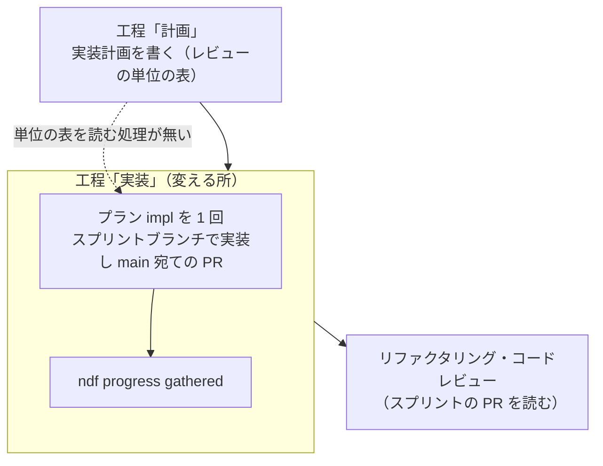
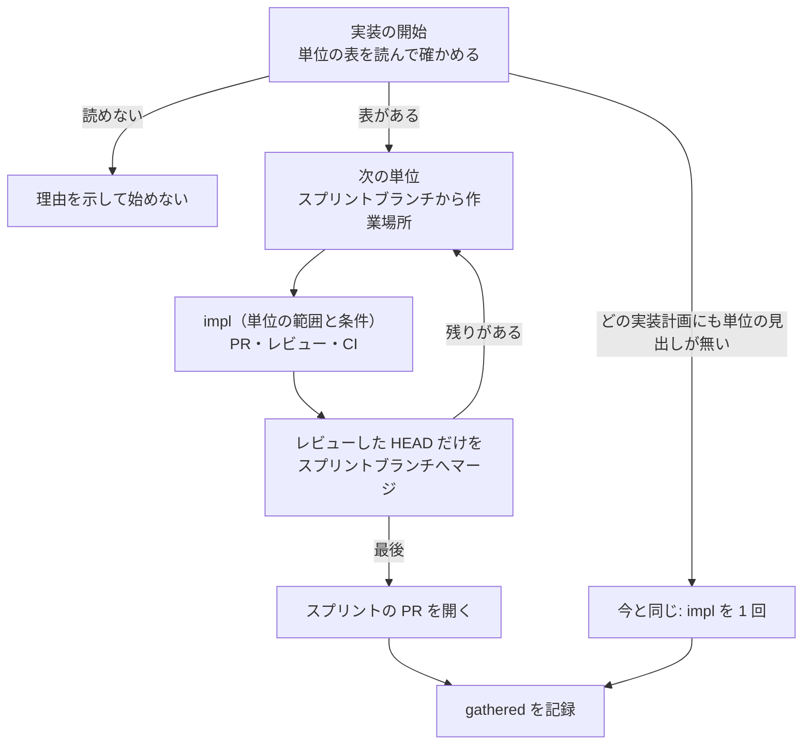
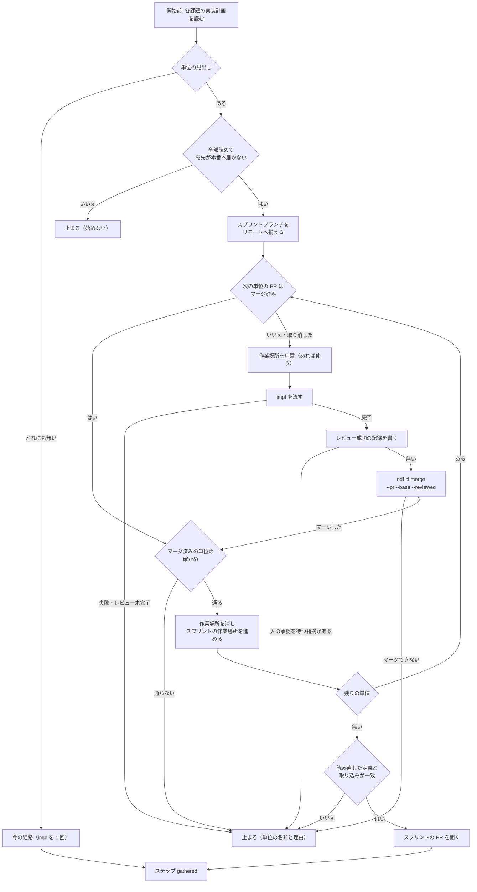

# 工程「実装」: 実装計画のレビューの単位ごとに PR とレビューを経てスプリントブランチへ集める（#4369）

`ndf progress next` で流す工程「実装」は実装計画の「レビューの単位」を読まず、分けるはずの変更がスプリントブランチの上で 1 本のまま実装される。工程「実装」が単位の表を読み、単位ごとに作業場所・実装のプラン（PR とレビューまで）・マージを順に流して、集めた時点（`gathered`。すべての単位をマージしたコミット）を記録する。この変更は、[PR の単位を機械が読むファイルにする課題](https://github.com/devbasex/ai-plugins/issues/3702)（#3702。設計は承認済みで未実装）より先に入れる。#3702 との先後、単位のファイルを持たない実装計画の扱い、[同じ内容の #3905](https://github.com/devbasex/ai-plugins/issues/3905) の扱いは、決定 1〜3 にある。

## 今の姿

何が起きたか・目的・受け入れ条件は要求仕様（[issue-4369-requirements.md](./issue-4369-requirements.md)、正は #4369 の本文）にある。この文書は「どう解くか」と「なぜその解き方か」だけを書く。

設計に要る今の構造（`plugins/ndf/` からの相対パス。2026-11-26、main `25c97daed` で確かめた）:

- 工程「実装」の定義（`contracts/workflow/stages/implement.json`）は、次の 2 ステップである。プラン（自動で順に実行する手順の定義。工程「計画」が書く実装計画とは別）`impl` を呼ぶステップと、`ndf progress gathered` のステップである。工程の定義には、進め方 fast で工程を課題ごとの子の行に分ける指定 `per_issue` がある。ただし今のコードはこの値を読み込むだけで、子の行を作る処理は無い（`plugins/ndf/src/ndf/progress/` を `per_issue` で引いた。2026-11-26）。そのため `impl` は、どの進め方でも、課題が複数でも、工程 1 回につき 1 回だけ呼ばれる
- `impl` の差し込み（テンプレートへ渡す値）は `progress/invoke.py` が組む。ブランチは作業場所が今いるブランチ、マージ先はブランチ戦略の設定のベースブランチになる
- `impl` のテンプレート（`contracts/templates/impl.json`）が行うのは、worker の実装・受け入れ条件の確かめ・PR・レビュー・CI・未解決の指摘の確かめまでである。マージはしない
- worker へ渡る入力は `issue`・`branch`・`acceptance` で、担当のタスクを絞る手段が無い
- 今の経路では `impl` がスプリントの PR（ベースブランチ宛て）を作る。後の工程「リファクタリング」「コードレビュー」はその PR を読む
- supervisor の手順（`skills/development-workflow/references/agent-layers.md` の「実装のフェーズの単位」）は、単位ごとに `impl` を組む。マージは `ndf ci merge --reviewed` で行う。この設計は同じ手順をコードにする

## 文脈と制約

- 実装計画の書式は変えない（要求の対象範囲）。単位の表の列は「単位・含むタスク・満たす受け入れ条件・見込みの差分の行数」で、「実行順」の列は任意である
- 2026-11-01 以降の実装計画のうち単位の見出しがある 22 本・129 行で、条件のセルが下の「単位の表の読み方」の形に合うかを試した。合わないのは 1 本の 2 行だけである。この 2 行は `5a`・`5b` という、受け入れ条件の番号として数えられない書き方である。試した手段は git の履歴を読む使い捨てのスクリプトである（2026-11-26）。番号が課題の本文の受け入れ条件の番号にあるかと、含むタスクがタスクの見出しにあるかは試していない
- この変更が保証する再実行は、工程が失敗か待ちを返した後の打ち直しである。実行中にプロセスを中断した場合の復旧と、レビューの後に PR が外から変えられた場合の復旧は [#4218](https://github.com/devbasex/ai-plugins/issues/4218) が扱う。外から変えられた PR をマージしない確かめ（I2）は、この変更に含める
- #3702 の実装は同じ `progress/`・`contracts/` を触る。ファイルの配置と名前は #3702 の詳細設計に合わせる

## 解き方の全体像

- 工程「実装」は、課題のどれかの実装計画に単位の見出しがあれば、単位を 1 つずつ順に流す。どれにも無ければ今の経路のまま、課題が複数でも `impl` を 1 回だけ呼ぶ
- 単位 1 つは、専用のブランチと作業場所で今の `impl` のプランを流す。PR はスプリントブランチへ出す。マージは、取り込むコミット（レビューした HEAD）と宛先（スプリントブランチ）を要求そのもので指定する（決定 11）
- 済んだ単位は、GitHub のマージ済みの PR、レビューが成功した記録、取り込みがスプリントブランチに残っていることの 3 つで見分ける（決定 6）。止まった工程を打ち直すと、残りの単位から続く
- すべてマージしたらスプリントの PR を開き、`gathered` を記録する。後の工程は今と同じ入力で流れる

## ドメインモデル

### コンテキスト

| コンテキスト | 何の語が 1 つの意味に決まるか |
| --- | --- |
| スプリントの進行 | レビューの単位・単位の PR・スプリントブランチ・集めた時点（どれも用語集にある語で、意味を変えない） |

### 集約

| 集約 | オーナー（書き換えてよいもの） | 根 | エンティティ | 値オブジェクト |
| --- | --- | --- | --- | --- |
| 単位の並び | 実装計画の文書（工程「計画」が書く。工程「実装」は読むだけ） | 実装計画 | レビューの単位 | 単位の名前・満たす受け入れ条件・実行順 |
| 単位の実行 | 工程「実装」 | 単位の PR | — | 単位のブランチ・レビューした HEAD |

### 不変条件

| # | 集約 | 条件 | 破れたときの扱い |
| --- | --- | --- | --- |
| I1 | 単位の並び | 単位の見出しがある実装計画は、すべての行を読めるときだけ流す。課題を 1 本にまとめて流さない | 実装を始めずに止まる |
| I2 | 単位の実行 | 自動でマージするのは、レビューが完了した PR（番号で指す）だけである。レビューの対象の PR 番号と HEAD が、単位の PR の番号と作業場所の HEAD に一致すること。head が単位のブランチで、宛先が開始時に確かめたスプリントブランチであること。マージの要求は、取り込むコミットと宛先ブランチを直接指定し、PR の宛先の設定に結果が左右されないこと。人の承認を待つ指摘の記録（決定 8）が空であること | マージせずに止まる |
| I3 | 単位の実行 | 次の単位の作業場所は、前の単位をすべてマージした後のスプリントブランチから切る | 後の単位を始めずに止まる |
| I4 | 単位の実行 | スプリントブランチは、ベースブランチでも本番ブランチでもない（工程「実装」が承認なしに本番へ届く先へマージしない） | 実装を始めずに止まる |
| I5 | 単位の実行 | 単位を完了とするのは、マージ済みの単位の確かめ（決定 6）に通ったときだけである。取り込みが取り消された単位は完了でない。`gathered` は、すべての単位が完了したときだけ書く | 次の単位を始めず、`gathered` を書かずに止まる |

### ドメインイベント

要求のドメインイベント E1〜E5 をそのまま使う。

| # | イベント | 発生元 | 受け手 |
| --- | --- | --- | --- |
| E1 | 実装計画の単位を読んだ | 単位の表の読み手 | 単位を流す処理 |
| E2 | 単位のブランチと作業場所を用意した | 単位を流す処理 | `impl` のプラン |
| E3 | 単位の PR のレビューが収束した | `impl` のプラン | 単位を流す処理 |
| E4 | 単位の PR をマージした | `ndf ci merge`、または利用者の GitHub でのマージ | 次の単位 |
| E5 | 集めた時点を記録した | `ndf progress gathered` | 工程「コードレビュー」 |

## 構成要素

| 要素 | 責務 |
| --- | --- |
| 単位の表の読み手（`src/ndf/core/plan/review_units_decide.py`。新設） | 実装計画の本文と、課題ごとの受け入れ条件の番号の集合から、単位の並び（名前・代表の課題・タスク・条件・順）か、読めない理由を返す。タスク分解のタスクが単位に過不足なく割り当てられているかも確かめる。ファイルも git も読まない |
| 実装計画のパス（`src/ndf/core/issue_docs.py`） | ファイル名 `issue-<番号の並び>-plan.md` から番号の並びを読む（設計書と同じ形） |
| 単位を流す処理（`src/ndf/progress/units_invoke.py`。新設） | 開始前の確かめ、単位ごとの作業場所・指示のファイル・保存先・`impl`・レビュー成功の記録・マージ・取り消しの検出・後片付け、スプリントの PR |
| 工程から作業を呼ぶ層（`src/ndf/progress/invoke.py`） | `per_unit` の工程で単位の見出しがあれば、開始前の確かめと実行を上の処理へ渡す。無ければ今のまま。試行の始まりに値を消す処理（`clear_values`）は、単位とスプリントの PR の保存先の差し込みの値と課題のコピーも消し、ほかの記録は残す（「単位ごとの保存先」） |
| 工程の定義の読み手（`src/ndf/progress/stages.py`・`definition.py`） | 工程の型に `per_unit`（既定は偽）を足し、定義とスナップショットから読む |
| 工程の定義とスキーマ（`contracts/workflow/stages/implement.json`・`contracts/workflow/ndf.schema.json`・`contracts/schemas/internal/stage-snapshot.schema.json`） | `per_unit` を足す。ステップの並びは変えない |
| `impl` のテンプレートと差し込みの定義（`contracts/templates/impl.json`・`parts/steps.json`・`params.json`） | 任意の差し込み `unit`（単位のブランチ名）と `unit_file`（単位の範囲の指示のファイル）を足す。どちらも既定は空で、ステップは増やさない。`unit` があれば、`done-check`・`pr`・`conflict-check`・`ci` のステップとレビューの 2 つのステップ（`review`・`review-delta`）が決定 8・11 のとおりに振る舞う。`unit` は、課題全体を補った単位を含むすべての単位に渡す。`unit_file` は範囲の指示だけに使い、補った単位では空である |
| 既定のレビューの起動（`src/ndf/core/route/__init__.py`） | 単位の PR の番号が環境変数 `NDF_UNIT_PR` にあれば、ブランチから番号を引かずにその番号を使う |
| レビューの結果の出力（`src/ndf/domains/crossreview/cli.py`） | `ndf cross-review run` に `--target-out` と `--waiting-out` を足す（「入出力のコントラクト」） |
| 人の承認を待つ指摘の記録（`src/ndf/domains/crossreview/drive.py`・`fixer.py`・`journal.py`） | 相手役の指摘と修正の結果を取り込む箇所で、修正の結果の `approval` を読み、`--waiting-out` のファイルへ書き足す（決定 8） |
| worker の作業の定義と読み手（`contracts/worker/kinds.json`・`src/ndf/contracts/worker_kinds.py`） | 作業の定義に、空でよい入力の欄 `optional_inputs` を足し、`impl`・`fix`・`ci-fix`・`fix-push`・`fix-base` に `unit_file` を置く。値があるときだけ起動指示の入力に載せ、欠けの検査（`kind_gaps`）は求めない。起動指示を書く `progress/gate/entry.py` は読み手の返す値をそのまま載せるので変えない |
| レビューの指示（`src/ndf/domains/crossreview/criteria_decide.py`） | `NDF_UNIT_PR` があれば、相手役と修正担当の指示に例外と人の承認の扱い（決定 8）を足す。`NDF_UNIT_FILE` があれば、単位の範囲のセクションも足す |
| 受け入れ条件の確かめ（`src/ndf/domains/loop/acceptance.py`） | 条件を持たない単位のための `--no-criteria` を足す |
| マージ（`src/ndf/ci_cli.py`・`src/ndf/adapters/github.py`） | `ndf ci merge` に、対象の PR の番号と宛先を指定する `--pr`・`--base` を足す。この指定では、PR のマージではなく、レビューした HEAD を宛先ブランチへ取り込む要求（GitHub の REST の `POST /repos/{repo}/merges`）を打つ |
| レビュー成功の記録（`src/ndf/adapters/github.py`） | レビューした HEAD への commit status の書き込みを足す。読み取りは今の `statuses` を使う |
| 単位の PR で待つチェックの宣言（`contracts/schemas/project-workflow.schema.json`・`src/ndf/progress/invoke.py`） | 設定の `workflow.unit_required_checks` を読む（決定 13） |
| コマンドの一覧（`docs/contracts/commands.md`） | 上の新しい引数を載せる（`ndf check --write-spec` で生成し直す。手で直さない） |
| supervisor の手順（`agent-layers.md`） | `ndf progress next` の自動の経路も単位を読むことと、単位の表の読み方を書く |

詳細設計書は別ファイル（`issue-4369-design-detail.md`）にする。新設する関数が 2 つ以上あり、既存の関数のシグネチャ（`GitHub.merge` など）も変わるためである。後の工程「詳細設計」で書く。

## 入出力のコントラクト

コマンドの引数の追加は 4 つ、設定のキーの追加は 1 つ（決定 13）である。工程の入力と出力（`gathered`）は変えない。

| 対象 | 変える前 | 変えた後 |
| --- | --- | --- |
| `ndf loop acceptance check --no-criteria` | 無い | 渡した `--issue` の条件を 1 件も照らさず `ok`。`--criteria` と一緒には受けない |
| `ndf ci merge --pr <番号> --base <ブランチ>` | `--branch` を head に持つ開いた PR の先頭を、PR の宛先へマージする | 2 つは `--reviewed` と組で渡す。指定した番号の PR を確かめ、`--reviewed` のコミットを `--base` のブランチへ merge commit で取り込む。開いていない、head が `--branch` でない、宛先が `--base` でない、HEAD が違う、本文に決めていない残リスクがあるときは、要求を送らずに `refused`。衝突は `base_conflict`、GitHub が断れば `refused`。マージキューへは入れない。`--method` とは一緒に受けない。省けば今のまま |
| `ndf cross-review run --target-out <ファイル>` | 無い（`--reviewed-out` は HEAD だけを書く） | レビューが完了した証拠を書く。始めにファイルを消し、レビューを完了したときだけ `{"pr": <番号>, "head": <SHA>}` を書く。`head` は `--reviewed-out` と同じ値。完了とは、直していない指摘が残らないか、残るのが `--waiting-out` に書いた指摘だけの状態である。このときは成功で返す |
| `ndf cross-review run --waiting-out <ファイル>` | 無い | 人の承認を待つ指摘を書き足す。始めにも終わりにもファイルを消さない。書く時点と条件は決定 8 |
| 工程「実装」のステップ `implement` の結果 | `impl` の結果 | 単位の経路では、`ok` は全単位のマージとスプリントの PR の後に返し、`items` に単位ごとの名前・PR の番号・状態・マージした人と時刻を持つ。`stopped` は止まった単位の名前・課題・理由を持つ。`run_id` は持たない（自動の打ち直しが「同じ回の結果」と読んで打ち切らないため） |

単位の表の読み方（決定 7）:

| 項目 | 読み方 |
| --- | --- |
| 見出し | 本文のコードブロックの外にある、`レビューの単位` を含む `##` 以下の見出し。この下の最初の表を読む |
| 列 | 「単位」「含むタスク」「満たす受け入れ条件」は必須。「実行順」は任意で、値は 1 以上の整数 |
| 含むタスクのセル | 括弧の注記を除き、`・` `、` `,` で区切る。要素は `Task <番号>`、`T<番号>`、番号だけ、または範囲（`Task 1〜4`・`T1〜T4`）。番号だけの要素と範囲の終わりは、接頭辞を省ける。セルの最初の要素は接頭辞（`Task` か `T`）が要る。`Task 1・2` は Task 1 と Task 2 である。各番号は、同じ実装計画の「タスク分解」の `###` の見出し（`### Task <番号>`）にあること |
| タスクの割り当て | 「タスク分解」の `###` の見出しのタスクは、受け入れ条件を持たない準備のタスクも含め、どれも 1 つの単位にだけ割り当てる。未割当と、2 つ以上の単位への重複は読めない |
| 条件のセル | 括弧の注記を除き、`・` `、` `,` で区切る。要素の形は下の表 |
| 読めない | 表か必須の列が無い、行が 0、名前が空か重なる、含むタスクが空か上の形でないか見出しに無い、どの単位にも無いタスクがある、2 つ以上の単位にあるタスクがある、条件のセルが下の形でない、条件の課題がスプリントの外、番号（範囲は展開した各番号）がその課題の受け入れ条件の番号に無い、実行順が整数でない。理由には当たったタスクの番号を並べる |

条件の番号の集合は、`ndf loop acceptance check` が数える番号（課題の本文の受け入れ条件を上から 1 始まり）と同じ関数で読む。

条件のセルの要素の形:

| 要素 | 意味 |
| --- | --- |
| `<課題>:<番号>` | その課題のその番号の条件 |
| `<課題>:<始め>〜<終わり>` | その課題の始めから終わりまでの条件 |
| 番号か範囲だけ（`3`・`1〜7`） | 直前の要素の課題の条件。セルの最初の要素なら、実装計画の課題が 1 つのときだけ書ける |
| `無し` | 条件なし。ほかの要素と一緒には書けない |

始めが終わりより大きい範囲は読めない。例:

| セル | 実装計画の課題 | 読んだ結果 |
| --- | --- | --- |
| `4369:1〜3` | 問わない | 4369 の 1・2・3 |
| `4369:1・2〜3` | 問わない | 4369 の 1・2・3 |
| `1〜3` | `4369-3905`（2 つ） | 読めない（どの課題か決まらない） |

単位の代表の課題と、`acceptance` の組み方（決定 9）:

| 単位 | 代表の課題 | `impl` に渡す `acceptance` |
| --- | --- | --- |
| 条件がある | 単位を持つ実装計画のファイル名の番号のうち最も小さいもの | 条件がある課題だけを番号の順に `--issue` で並べ、展開した条件を 1 件ずつ `--criteria` で渡す |
| 条件が「無し」 | 同上 | `--issue <代表の課題> --no-criteria` |
| 課題全体を 1 単位として補ったもの | その課題 | `--issue <代表の課題>`（その課題の全条件を照らす） |

例: `issue-4369-3905-plan.md` の単位が `4369:1・2` と `3905:1` を満たすとき、代表の課題は 3905 で、渡すのは `--issue 3905 --criteria 3905:1 --issue 4369 --criteria 4369:1 --criteria 4369:2` である。

代表の課題は、`impl` の `issue`（PR の題と本文はこの課題から作る）、`--no-criteria` に渡す課題、単位のブランチ名の `<課題>` の 3 つに同じ値を使う。条件の書き方を直してもブランチ名が変わらないように、条件の課題ではなく実装計画のファイル名から決める。

## 処理の流れ

- **順序**: 単位の並びは、かたまりを番号の小さい順に置いて作る。かたまりは、単位の見出しがある実装計画 1 つ（番号はファイル名の最も小さいもの）と、補った単位 1 つ（番号はその課題）の 2 種類である。実装計画の中の順は次のとおりである
  - 「実行順」の列があるときは、その値の順（同じ値は表の順）。準備の単位を前へ動かさない
  - 列が無いときは表の順。ただし準備のリファクタリングをするときは、最初のタスクを含む単位を先頭にする
  - 「するとき」とは、実装計画の「リファクタリングの時機」の表で、時機が「実装の前」で始まる行の対象が「しない」で始まらないときである。表か行が無ければ「しない」と読む
  - 「最初のタスク」とは、「タスク分解」の最初の `###` の見出しのタスクである。この番号を含むタスクに持つ単位が先頭になる
- **単位の無い課題**: どの実装計画にも単位の見出しが無いスプリントは、今の経路で `impl` を 1 回だけ呼ぶ。単位の経路の実装計画が 1 つでもあるときは、残りの課題（実装計画を省いた課題と、見出しの無い実装計画の課題）を、課題 1 つを 1 単位として並びに入れる。入れる位置は上の「順序」の課題番号の順である。例えば実装計画 `issue-20-40-plan.md`（単位 A・B）と、実装計画の無い課題 10・30 があれば、10、A、B、30 の順になる。別の課題を前提とする順を指定したい場合は、その課題も単位の表を持つ実装計画に含める。補った単位にも `unit`（ブランチ名）を渡し、PR の特定とレビューとマージの扱いはほかの単位と同じにする。`unit_file` だけを空にし、課題の全体を実装して、その課題の全条件を照らす
- **単位ごとの保存先**: `impl` のプランの保存先は、工程の保存先の下の `units/<単位のブランチ名>/` とする。変更要求で工程のステップの保存先が新しくなっても、同じ場所を使う。ほかの単位とは共有しない。スプリントの PR の保存先は同じ階層の `sprint-pr/` とする
- **試行の始まりに消すもの**: 打ち直しで工程の新しい試行を始めるとき、`clear_values` は次の表のとおりに扱う

| 扱い | 単位の保存先の中身 |
| --- | --- |
| 消す（読み直して作り直す） | 差し込みの値（`values.json`）、課題の題と本文のコピー |
| 残す | プランの回の記録と結果（再開点）、打ち直しの数、`reviewed-head`、未解決のフラグ、差分のレビューの起点、PR の番号（`unit-pr`）、`review-target`、人の承認を待つ指摘の記録（`approval-waiting`） |

単位の指示のファイルは、単位を流すたびに書き直す。
- **打ち直し**: 単位ごとに、次の表で扱いを決める

| 打ち直しの時点の単位 | 扱い |
| --- | --- |
| マージ済みで、取り込みが残り、マージ済みの単位の確かめ（決定 6）に通る | 飛ばす |
| マージ済みで、取り込みが残り、確かめに通らない | 止まる（決定 6） |
| マージ済みだが、取り込みが取り消された | 未実装の単位として、次の番号のブランチで最初から流す（決定 6） |
| `impl` が途中で止まった | 今のプランの打ち直しと同じく、止まったステップから続ける |
| `impl` が終わり、作業場所の HEAD が `reviewed-head` と同じ | `impl` を呼ばず、マージだけを打つ（`approval-waiting` が空でなければ、打たずに止まる） |
| `impl` が終わり、作業場所の HEAD が `reviewed-head` より先へ進んだ | その単位の保存先を使い、`impl` を `push-reviewed` のステップから新しい回で流す。push の後、`reviewed-head` からの差分のレビュー（`review-delta`）と CI を通してからマージする |
| `impl` が終わり、`reviewed-head` が無いか、作業場所の HEAD の祖先でない | 止まる。2 つのコミットを結果に出す |

- **自動でマージできない宛先**: スプリントブランチにマージキューや「PR を必須にする」保護があると、GitHub は取り込みの要求を断る。工程はマージキューへ PR を入れず（決定 11）、`refused` で止まって利用者にマージを頼む
  - 頼む前に、打ち直しのたびに、PR が開いていて宛先がスプリントブランチであること、HEAD がレビューした HEAD で、レビュー成功の記録があることを確かめる
  - 案内には、PR の URL とコマンド `gh pr merge <番号> --match-head-commit <レビューした HEAD>` を載せる。マージキューがある宛先では、このコマンドは PR をキューへ入れる。HEAD が違えば GitHub が断る
  - CI の一時的な失敗で PR がキューから外れた場合は、工程を打ち直す。工程が上の確かめをもう一度通してから、同じコマンドを案内する
  - 修正が要る場合は、利用者が単位の作業場所に修正をコミットし、工程を打ち直す。工程は HEAD が `reviewed-head` より進んだことを見て、差分のレビューから再開する。利用者が保存した状態を手で消すことはない
  - マージされた後に打ち直すと、マージ済みの単位の確かめ（決定 6）に通れば次の単位へ進む
- **承認待ち**: 単位のプランが承認ゲート（人の承認待ち）を返せば、工程もそのまま返す。人の回答は最初の未マージの単位へ渡す

## 決定の記録

### 決定 1: 実装が 1 本にまとまる事象を早く止めるため、#3702 の実装を待たずに、単位を順に流す部分を先に入れる

- **質問**: #3702 の実装でこの課題を満たして確かめだけにするか、先に別の変更として入れるか（要求の未決 1）
- **選んだ案**: 先に入れる。単位を読む処理と流す処理は分ける。流す処理のファイル（`progress/units_invoke.py`）・差し込み（`unit_file`）・工程のメタデータ（`per_unit`）の名前は、#3702 の詳細設計に合わせる。#3702 の実装は読み手を単位のファイルへ差し替え、流す処理に並列と承認した入力の照合を足す
- 採らなかった案: #3702 の実装で満たす（#3702 は 9 タスク・見込み約 3,550 行である。設計のフェーズの工程の並びと承認ゲートの移動も含む。それが入るまで同じ事象が起きる。#3702 は単位のファイルだけを読むので、表を読んで流す（受け入れ条件 1）には別の実装が要る）
- 採らなかった案: #3702 の単位のファイルの形をこの課題で先に作る（実装計画の書式を変えることになり、対象範囲の外）
- **代償**: 表の読み手は #3702 の実装で置き換わる。流す処理は #3702 で並列を足すときに書き直す部分がある
- 根拠: Value 5 / Value 11（MVV バージョン 11）

### 決定 2: 分けた変更が気づかれずに 1 本にならないよう、表だけを持つ実装計画は表のとおりに流し、課題 1 つの 1 単位にしない

- **質問**: #3702 の設計は単位のファイルを持たない旧い形の実装計画を課題 1 つの 1 単位にする。受け入れ条件 1 とどちらに合わせるか（要求の未決 2）
- **選んだ案**: 受け入れ条件 1 に合わせる。この課題の後は表を読んで流す。#3702 の実装は、読み手を単位のファイルへ差し替える。その後も、単位の見出しがあるのに単位のファイルが無い実装計画は、1 単位にまとめずに止める。#3702 の設計の「旧い形は課題 1 つを 1 単位」は、#3702 の実装でこの形に改める
- 採らなかった案: #3702 の設計に合わせて 1 単位にする（表で分けた実装計画が 1 本で実装され、この課題の事象がそのまま残る）
- 採らなかった案: #3702 の後も表の読み手を残して 2 通りを読む（同じ事実の読み手が 2 つになる）
- **代償**: #3702 の実装が入った時点で終わっていないスプリントは、単位のファイルを書き足すまで工程「実装」が止まる
- 根拠: Value 3 / Value 8 / Value 11（MVV バージョン 11）

### 決定 3: 同じ仕組みを 2 回作らないため、#3905 をこの課題へ統合する

- **質問**: 自動の経路で単位を実行しマージしてから `gathered` を記録する #3905 を統合するか（要求の未決 3）
- **選んだ案**: 統合する。#3905 の受け入れ条件 3 件は、この課題の受け入れ条件 1〜5 に含まれる。3 件は、単位ごとの実行とマージの後の記録、未マージなら記録せずに止まる、欄が無ければ今のとおり、である。「設計の結果」の表で #3905 の扱いを「マージする」（受け入れ内容を統合先 #4369 の実装へ含める）とし、設計の承認で確定する
- 採らなかった案: 別の課題として残す（この課題の後には、#3905 で足すものが無くなる）
- **代償**: #3905 は自分の受け入れ条件を単独では確かめず、#4369 の確かめで閉じる
- 根拠: Value 11（MVV バージョン 11）

### 決定 4: 単位の無いスプリントの振る舞いを変えないため、工程の定義のステップは変えず、プランを呼ぶ層で単位の経路へ分ける

- **質問**: 単位の繰り返しをどこに置くか
- **選んだ案**: 工程「実装」の定義に `per_unit` を足し、プランを呼ぶ層（`invoke.py`）が単位の見出しの有無で分ける。単位 1 つの実行は、今のプランの呼び出し（差し込みの組み立て・打ち直しの開始点・承認の回答）を単位の入力で呼ぶ。単位の表の開始前の確かめも、今の差し込みの確かめと同じ時点で行う。そのため、読めない表は工程を始める前に止まる。古いステートマシンが保存しているモードの定義のスナップショットに `per_unit` が無ければ、そのステートマシンは今の経路のままである
- 採らなかった案: ステップを `ndf progress units run` の script に置き換える（単位の無いスプリントでもプランの打ち直しと差し込みの事前確認を作り直すことになる）
- 採らなかった案: 単位の数だけ工程の行やステップを足す（行はモードの定義が決め、単位の数は計画の後にしか分からない）
- **代償**: 工程の定義を読むだけでは、単位の繰り返しがあることが `per_unit` の 1 語でしか分からない。途中の単位の進みは結果の `items` とプランの記録で見る
- 根拠: Value 3 / Value 9（MVV バージョン 11）

### 決定 5: 順序の食い違いと取り込みの衝突を生まないため、単位は並列にせず 1 つずつ流す

- **質問**: 同じ実行順の単位や、準備の単位の後の残りの単位を並列に流すか
- **選んだ案**: 1 つずつ流し、前の単位のマージの後に次の作業場所を切る
- 採らなかった案: 並列に流す（今の実装計画の表は触るファイルを持たない。そのため、重ならないことを機械で確かめられない。並列は触るファイルと承認を持つ #3702 が足す）
- **代償**: 単位が多いスプリントは、supervisor が並列に回すより遅い
- 根拠: Value 3 / Value 9（MVV バージョン 11）

### 決定 6: 未レビューや取り消し済みの変更を完了と読まないため、レビュー成功の記録と取り込みの残りを GitHub と git で確かめる

- **質問**: どの単位が済んだかを何で持つか
- **選んだ案**: 利用者が PR の本文を書き換えても変わらない 3 つの事実で決める。流し方の進みを手元のファイルには持たない
  - **単位のブランチ名**: `<スプリントブランチ>-u<代表の課題>-<単位の名前の短いハッシュ>`。この単位の取り込みが過去に取り消されていれば、後ろに `-r<取り消された回数>` を付ける
  - **レビュー成功の記録**: レビューした HEAD に付ける commit status（context は `ndf/unit-review`）。説明に、PR の番号、宛先ブランチ名の短いハッシュ値、単位の定義（含むタスクの番号と展開した条件）から作る短いハッシュ値（定義の指紋）を書く。commit status は push の権限がある者しか書けず、後から書き換えられない
  - **書く条件**: `impl` が最後まで通り（レビューの完了と CI を含む）、`review-target` の番号と HEAD が `unit-pr` と `reviewed-head` に一致したときだけ書く。人の承認を待つ指摘がある場合も、この条件を満たせば書いてから止まる
- **マージ済みの単位の確かめ**: 次の 4 つがそろえば、単位を完了とする。打ち直し、工程のマージの後、利用者が GitHub でマージした後の、どの経路でも同じ確かめを使う
  1. 単位のブランチを head、スプリントブランチを base とする PR がマージ済みである
  2. その PR の head に、同じ PR の番号と宛先を持つレビュー成功の記録がある
  3. 記録の定義の指紋が、今の実装計画の定義と同じである
  4. その PR の取り込みコミット（PR をスプリントブランチへ入れたコミット）がスプリントブランチの祖先で、打ち消されていない
- **人の承認の記録**: 人の承認を待つ指摘がある単位を、工程はマージしない。利用者が GitHub でマージした記録（PR の番号・宛先・head・マージした人と時刻）が、人の承認の記録になる。工程はこれを 2 のレビュー成功の記録と照らし、同じ PR・宛先・HEAD のときだけ完了とする。マージした人と時刻は工程の結果に残す
- **取り消しの扱い**: 単位の変更を取り消すときは、利用者がスプリントブランチで取り込みコミットを `git revert` する（merge commit は `-m 1`）。工程は次のように読む
  - 取り込みコミットより後に、本文に `This reverts commit <取り込みコミットの SHA>` を持つコミットがあれば、打ち消されている。その打ち消しがさらに打ち消されていれば、取り込みは残っている
  - 履歴の書き換えで取り込みコミットがスプリントブランチから消えた場合も、取り消しと読む
  - 取り消した単位は未実装として扱い、次の番号のブランチをスプリントブランチから切って、実装とレビューを最初から通す。単位の名前は変えなくてよい。単位の指示のファイルには、取り消されたコミットと取り消したコミットを書く
- **最後の照合**: すべての単位をマージした後にも、取り込んだ実装計画を読み直して同じ確かめをする。読み直しで増えていた単位や、途中で取り消された単位があれば、未実装なので止まり、打ち直しで流す
- **確かめに通らないときの直し方**: 記録の無いマージや定義の違うマージは、利用者が取り消して打ち直す。実装の途中で単位を分け直すときは、マージ済みの単位の行は元に戻し、足す変更を新しい名前の単位に分ける
- 採らなかった案: PR の本文に目印の行を書いて照らす（本文を編集できる者が、レビューしていないマージを完了に見せられる）
- 採らなかった案: レビュー成功の記録を手元のファイルにだけ持つ（別のマシンの打ち直しで、済んだ単位を確かめられない）
- 採らなかった案: 取り消した単位は名前を変えて区別させる（名前を変えるまで、変更の欠けたスプリントブランチを完了と読む）
- 採らなかった案: ブランチ名に表の行の番号を使う（行を足すと番号がずれ、別の単位を済みと読む）
- 採らなかった案: 指紋をブランチ名に入れる（定義を直すとマージ済みの単位が新しい単位になり、同じタスクをもう一度実装する）
- **代償**: 打ち直しの間に単位の名前を変えると、その単位は新しい単位として流れる。タスクの番号を変えずに本文だけを直しても検出しない。`git revert` の本文の行を消した取り消しや、手で打ち消したコミットは検出しない。commit status の書き込みが単位ごとに 1 回、読み取りが確かめるマージ済みの PR ごとに 1 回増える。トークンには commit status を書く権限が要る
- 根拠: Value 3 / Value 8 / Value 13（MVV バージョン 11）

### 決定 7: 分けたはずの単位を落とさないため、表は決めた形だけを読み、読めなければ始めずに止まる

- **質問**: 実装計画を書く側の表記の揺れ（注記・範囲・番号の省略・「無し」）をどこまで受けるか
- **選んだ案**: 「入出力のコントラクト」の読み方の表の形を受ける。範囲には課題を付けられる。複数の課題の実装計画で、最初の要素に課題が無いセルは受けない。表のセルの分け方は、受け入れ条件の確認の表を読む既存の部品を使う
- 採らなかった案: `<課題>:<番号>` だけを受ける（今ある実装計画の多くが範囲や番号の省略を使い、止まる）
- 採らなかった案: 読めない行を飛ばして残りを流す（落ちた単位に気づけないまま `gathered` が書かれる）
- **代償**: `5a` のような番号で条件を指す実装計画は、番号を直すまで止まる
- 根拠: Value 3 / Value 13（MVV バージョン 11）

### 決定 8: 単位の外の変更が単位の PR に入らないよう、単位の指示のファイルを実装・修正・レビューのすべてに渡す

- **質問**: 単位の範囲を、実装する worker と、後からコミットする修正担当へどう伝えるか
- **選んだ案**: 単位を流す処理が指示のファイルを単位の保存先に書き、`unit_file` で `impl` のプランに渡す。中身は、単位の名前・含むタスク・満たす条件・実装計画のパス・単位の外の扱いと、下の例外である。コミットする経路には次のように届ける

| コミットする経路 | 届け方 |
| --- | --- |
| 実装（`impl`）、手元のテストの修正（`fix`）、CI の修正（`ci-fix`）、push の拒否の修正（`fix-push`）、衝突の解消（`fix-base`） | worker の起動指示の入力 `unit_file` |
| レビューの修正担当（単位のレビューと差分のレビュー） | 環境変数 `NDF_UNIT_FILE`。相手役の指示にも同じ範囲を載せ、後の単位が担う条件を未達の指摘にしない（下の例外を除く） |

- **単位の外の変更が要るとき**: 今の単位のテスト・CI・レビューを通すのに要る最小の変更は入れてよく、コミットメッセージに理由を書く。後の単位のタスクは実装しない。後のタスクを実装しないと通らない場合は、直さずに失敗の理由を返し、単位がそこで止まる。レビューの指摘が後の単位の範囲なら、修正担当は見送り、どの単位が担うかを理由に書く（下の例外を除く）
- **例外（担当の単位にかかわらず、今の PR で扱う指摘）**: 範囲を理由に保留できるのは、受け入れ条件の未達と、今の差分に無い作業だけである。今の差分に含まれる、秘密・認証認可・利用者のデータ・戻せない操作の指摘は、相手役が必ず指摘し、修正担当は後の単位を理由に見送らない。後の単位の範囲を直すことになっても、今の PR で直す
- **人の承認が要るとき**: 例外の指摘に人の承認を待つものがあれば、その単位を自動でマージしない。記録するのは、上の 4 分類（秘密・認証認可・利用者のデータ・戻せない操作）の指摘で、直さずに残ったものである。次のどちらかに当たれば記録する

| 判定する者 | 記録する指摘 | 書く時点 |
| --- | --- | --- |
| 修正担当 | 直すかどうかに人の承認が要ると判断し、見送りの区分 `needs_user` と `"approval": true` を付けた指摘 | 修正の結果を取り込んだとき |
| 相手役 | NDF の共通原則の「必ず人の承認が要る操作」の表の C1〜C4（上の 4 分類に当たる行）と判定した指摘。ほかの行（C5 以降と、プロジェクトの MVV の表の P<番号>）の番号だけでは記録しない。それが 4 分類に当たる場合は、修正担当の判断で記録する | 相手役の指摘を取り込んだとき。同じ起動で直ったと決まった指摘は、レビューを終えるときに消す |

- **記録の置き場**: 記録は、単位の保存先の `approval-waiting` に、PR の番号とともに置く。初回のレビューと差分のレビューは同じファイルを `--waiting-out` で受ける。指摘は取り込んだ時点で書くので、レビューが途中で失敗しても残る。後のレビューは、前の起動が書いた指摘を消さない。レビューが完了した証拠（`review-target`）とは別のファイルである
- **止まった後の進め方**: 記録があるだけでは、利用者にマージを頼まない。工程は状態を 2 つに分け、どちらも記録の指摘を並べて `incomplete` で止まる

| 状態 | 判定 | 利用者に案内すること |
| --- | --- | --- |
| レビュー未完了 | `impl` が最後まで通っていないか、`review-target` が `unit-pr` と `reviewed-head` に一致しない | 止まった理由を直して打ち直す。マージは案内せず、レビューが終わっていないことを書く |
| 人の承認待ち | `impl` が最後まで通り、`review-target` が一致し、レビュー成功の記録を書いた | 下の順に進める |

- 人の承認待ちでは、利用者は次の順に進める
  1. 指摘を確かめる
  2. 直す場合は、単位の作業場所にコミットして打ち直す。差分のレビューと CI を通り、新しい HEAD にレビュー成功の記録が付いて、工程はもう一度止まる
  3. GitHub で単位の PR をマージする。これが指摘への人の承認になる。案内するコマンドは `gh pr merge <番号> --match-head-commit <レビューした HEAD>` で、HEAD が違えば GitHub が断る
  4. 打ち直す。マージ済みの単位の確かめ（決定 6）に通れば、次の単位へ進む。2 を経ずに push したコミットをマージすると、確かめに通らず止まる
- 例外の根拠: Value 7（秘密・利用者のデータ・戻せない操作に関わる指摘は直される）
- 採らなかった案: 初回の `impl` にだけ渡す（テストや CI が落ちたときに、修正担当が後の単位のタスクまで実装できる）
- 採らなかった案: 受け入れ条件の指定だけで絞る（1 つの条件が複数の単位にまたがる表があり、条件を持たない準備の単位もある）
- 採らなかった案: 課題の本文のコピーへ範囲の指示を足す（同じファイルが PR の本文になり、課題の本文と食い違う）
- **代償**: 設定でレビューや worker の起動を差し替えたリポジトリは、`unit_file`・`NDF_UNIT_FILE`・`NDF_UNIT_PR` を読む側も合わせ、人の承認を待つ指摘を `--waiting-out` へ書く必要がある。範囲を守るのは指示で、差分を機械では確かめない
- 根拠: Value 3 / Value 9（MVV バージョン 11）

### 決定 9: 条件を持たない準備の単位を流せるよう、照らさないことを引数で明示する

- **質問**: 「満たす受け入れ条件」が「無し」の単位の確かめをどうするか
- **選んだ案**: `ndf loop acceptance check` に `--no-criteria` を足し、`--issue <代表の課題> --no-criteria` を渡す。代表の課題の決め方は「入出力のコントラクト」にある
- 採らなかった案: `--issue` だけを渡す（課題のすべての条件を照らし、準備の単位が必ず止まる）
- 採らなかった案: 条件の無い単位を読めない表にする（準備のリファクタリングの単位を持つ実装計画が実際にある）
- **代償**: 条件の漏れはこの単位では見つからない。工程「完了判定」がすべての条件を照らす
- 根拠: Value 11 / Value 13（MVV バージョン 11）

### 決定 10: 後の工程を今の入力のまま流すため、すべてのマージの後に工程「実装」がスプリントの PR を開く

- **質問**: 単位の経路ではスプリントの PR を誰も作らない。リファクタリングとコードレビューはそれを読む
- **選んだ案**: 最後のマージの後に、今のテンプレート `pr` を流し、スプリントブランチからベースブランチ宛ての PR を開く。開いた PR があれば作らない。マージはしない
- **課題の参照**: テンプレートの `refs` にはスプリントのすべての課題を渡し、本文に `Refs #<番号>` を載せる（今の工程から組む PR と同じ）。既存の PR の本文に欠けがあれば、テンプレートの今の振る舞いのまま、欠けた `Refs` を並べて `incomplete` で止まり、`gathered` を書かない。利用者が本文に足して打ち直す。PR の本文を自動では書き換えない
- 採らなかった案: 後の工程の側で PR が無ければ作る（作る場所が 2 つ以上になる）
- **代償**: 工程「実装」の仕事が 1 つ増える
- 根拠: Value 3 / Value 11（MVV バージョン 11）

### 決定 11: レビューの後に PR の宛先が変わっても本番へ届かないよう、マージは取り込むコミットと宛先ブランチを要求で直接指定する

- **質問**: PR のマージの要求は宛先を条件にできず、PR を確かめてから要求を送るまでの間に宛先が変わりうる。単位のマージと、レビュー・CI の対象をどう縛るか
- **選んだ案**: PR のマージもマージキューへの投入も使わない。レビューした HEAD をスプリントブランチへ取り込む要求（`POST /repos/{repo}/merges` に宛先ブランチとコミットの SHA を渡す）を打つ。要求が宛先を持つので、PR の宛先がいつ変わっても、ほかのブランチには取り込まれない。リポジトリの権限やブランチ保護の設定を前提にしない
- 単位の PR は 1 つに決め、同じ番号を後のすべての段階に渡す。番号を取り直す照会は足さない

| 段階 | 単位の経路での扱い |
| --- | --- |
| 流し終えたかの確かめ（`done-check`） | head と宛先の両方でマージ済みの PR を選ぶ |
| PR を決める（`pr` のステップ） | 開いた PR は head と宛先の両方で選ぶ。新しく作った場合は、作成の出力の番号を使う。番号は今と同じくステップの結果の `items[].number` で返し、同じステップが単位の保存先の `unit-pr` にも書く |
| 衝突の確かめ（`conflict-check`）と CI の完了の確認（`ci`） | ブランチ名から PR を引き直さず、`unit-pr` の番号を使う。`ci` が番号を引いていた照会は無くなる |
| 初回のレビューと差分のレビュー | `unit-pr` の番号を `NDF_UNIT_PR` で渡す。後ろに `--target-out <保存先>/review-target` と `--waiting-out <保存先>/approval-waiting` を足す |
| マージ | `review-target` の番号が `unit-pr` と、HEAD が `reviewed-head` と一致するときだけ、`ndf ci merge --branch <単位のブランチ> --pr <番号> --base <スプリントブランチ> --reviewed <レビューした HEAD>` を打つ |

番号・head・宛先・HEAD のどれかが違うか、`review-target` が無ければマージしない。

- **マージキュー**: 投入の要求は宛先を指定できず、PR の今の宛先のキューに入る。宛先を保証できないので、工程は投入しない。GitHub が取り込みの要求を断る宛先では、利用者にマージを頼む（「処理の流れ」の「自動でマージできない宛先」）
- 採らなかった案: PR のマージの前に PR を読んで宛先を確かめるだけにする（読んでから要求を送るまでの間に宛先が変わると、本番へ届くブランチへ取り込む）
- 採らなかった案: 宛先を保護する設定を確かめてから PR のマージを打つ（GitHub に PR の宛先の変更を禁じる設定は無い。ほかのすべてのブランチに承認の必須を求めると、承認 0 件で本番へマージするリポジトリでは単位が 1 つも流れない）
- 採らなかった案: レビューや CI がブランチから番号を引き直す今の形のままにする（同じ head の PR が複数あると、別の PR のレビューや CI の結果で進むか止まる）
- **レビューを差し替えたリポジトリ**: 設定のレビューの起動は、`NDF_UNIT_PR` の PR をレビューし、`--target-out` を書く必要がある。書かない起動では単位は自動でマージされず、止まる
- **代償**: 単位の取り込みは、リポジトリのマージの方式の指定に関わらず merge commit になる。スプリントブランチに直線の履歴の必須、PR の必須、マージキューがあるリポジトリでは、単位ごとに利用者のマージが要る。確かめの後に宛先が変わった場合は、取り込みはスプリントブランチに入るが PR がマージ済みにならず、マージ済みの単位の確かめで止まる
- 根拠: Value 3 / Value 13（MVV バージョン 11）

### 決定 12: 単位の数で流れを変えないため、単位が 1 つでも単位の PR とスプリントの PR の 2 段にする

- **質問**: 単位が 1 つのときは、分ける効果が無いのに PR の作成とマージが 1 回ずつ増える。今の経路（スプリントブランチで実装してベースブランチ宛ての PR をレビューする）を使えるか
- **選んだ案**: 使わず、2 段にする。理由は次の 3 つである
  - 受け入れ条件 1・4 は、表があれば単位の数に関わらず、単位のブランチ・スプリントブランチ宛ての PR・単位の条件の `--criteria`・レビューした HEAD だけのマージを求める
  - 今の経路は単位の範囲の指示も単位の条件も渡さず、レビューの後の取り込みを縛る段階が無い
  - 最後の読み直しで単位が増える場合と、取り消した単位を流し直す場合がある。1 単位だけ別の経路にすると、途中で経路が切り替わる
- 採らなかった案: 全体で 1 単位なら今の経路を使う（要求の受け入れ条件を変える必要があり、経路の切り替わりの扱いが増える）。分けるつもりが無い課題は、実装計画に単位の見出しを置かなければ今の経路になるが、実装計画の書き方は変えない
- **代償**: 1 単位のスプリントでは、PR の作成とマージの要求が 1 回ずつ増える。両方の PR で CI が走る設定では、CI も 1 回増える
- 根拠: Value 3（MVV バージョン 11）

### 決定 13: スプリントブランチ宛てで起動しない CI があっても流せるよう、単位の PR で待つチェックを宣言で選べるようにする

- **質問**: 必須のチェックの宣言（`ci.required_checks`）は、ベースブランチ宛ての PR を前提にする。単位の PR にも同じものを待つか
- **選んだ案**: 設定に `workflow.unit_required_checks`（チェックの名前の並び）を足す

| 値 | 単位の PR の CI の完了の確認 |
| --- | --- |
| 書かない | `ci.required_checks` を待つ |
| 名前の並び | その名前を待つ |
| 空の並び | 待たない |

- スプリントの PR で待つチェックは、今のとおり `ci.required_checks` である
- **実装前の確かめ**: 開始前の確かめは、単位の PR の宛先（スプリントブランチ名）、待つチェックの名前、読んだキーを結果に出す。利用者は、そのブランチ宛ての PR で各チェックが起動する設定かを CI の定義で確かめられる。起動しないチェックを待って止まった場合の理由にも、このキーを書く
- 採らなかった案: `ci.required_checks` をそのまま使う（ベースブランチ宛てでだけ CI が起動するリポジトリは、最初の単位から進めない）
- 採らなかった案: `ci` の下にキーを足す（`ci` はプロジェクトの解析が測って書く値で、利用者が選ぶ値は `workflow` に置く）
- 採らなかった案: CI の定義を読んで起動を機械で判定する（起動の条件の書き方は CI の提供元ごとに違う）
- **代償**: 空の並びや少ない並びを宣言すると、その分の検査はスプリントの PR まで行われない
- 根拠: Value 4（MVV バージョン 11）

## 影響と危険

- **働く範囲**: 利用先のリポジトリでも働く。実装計画に単位の見出しがあるときだけ振る舞いが変わる
- **プロジェクトごとに違うもの**: ベースブランチ・リモート・レビューの起動・テストと CI は、今の設定を単位の経路でも使う。足す設定は `workflow.unit_required_checks` だけで、書かなければ今の必須のチェックを使う（決定 13）
- **当たるモード**: 工程「実装」を持つすべてのモードと進め方。見出しが無ければ今のまま。単位の経路では、工程 1 回がスプリントのすべての課題の単位を流す。fast の課題ごとの子の行（`per_issue`）は今のコードに無く、この変更でも足さない。子の行を実装する変更は、複数の課題の実装計画の単位をどの行が流すかを決める必要がある
- **PR の数**: 単位が 1 つの表でも、単位の PR とスプリントの PR の 2 本になる（理由は決定 12）
- **処理の回数と待ち時間**: 単位が N 個のスプリントでは、次の表のとおり増える。単位は 1 つずつ流すので、時間はほぼ足し算になる

| 処理 | 今（工程 1 回） | 単位の経路 |
| --- | --- | --- |
| worker の実装、単位のレビュー、CI の完了の確認、作業場所の用意 | 各 1 回 | 各 N 回（修正による追加は、今と同じく落ちた分だけ） |
| マージ | 無し | N 回 |
| スプリントの PR を開く処理 | 無し（`impl` の PR がそれに当たる） | 1 回 |
| GitHub への照会と書き込みの追加 | 無し | 開始時と最後にマージ済みの PR をまとめて 1 回ずつ読む。単位ごとにレビュー成功の記録の書き込み 1 回（人の承認で止まった単位は、直して打ち直すたびに 1 回）。マージ済みの PR の確かめ 1 回ごとに、commit status の読み取り 1 回。`ci` のステップが PR の番号を引く照会は、単位ごとに 1 回減る |

- **PR で走る CI**: CI の完了の確認（呼び出しの回数）とは別に、PR で実際に走る CI の回数はリポジトリの設定で決まる。多くの設定では、単位の PR N 本とスプリントの PR 1 本で走る
- **同じファイルを触る変更**: #3702 の実装が `progress/`・`contracts/` を触る。後に入る側が取り込む
- **壊れうる箇所**: 待つと宣言したチェックがスプリントブランチ宛ての PR で起動しない設定では、単位がマージできずに止まる（理由に宣言のキーを出す。決定 13）。スプリントブランチがマージキューや PR の必須で守られた設定では、単位ごとに利用者のマージを待つ
- **後片付け**: 単位の作業場所とブランチは、マージを確かめた後に消す。消せなければ警告して続ける

### 代表のリポジトリでの振る舞い

| 代表のリポジトリ | 設定の要点 | 直した後に起きること | この種類で扱えなくなること |
| --- | --- | --- | --- |
| Web サービス | ベースブランチとスプリントの起点はブランチ戦略の設定。CI の必須のチェックと、ベースブランチのマージキュー | 単位の変更がスプリントブランチへ入り、ベースブランチへは今の承認を経て入る | 無し |
| モバイルアプリ | ストアへのリリースは工程「デプロイ」が持つ | 同上。リリースの形は変わらない | 無し |
| 業務文書だけ | 実装計画に単位の表が無いことが多い | 見出しが無ければ今のまま。あれば単位ごとに PR が出る | 無し |

### ai-plugins だけの事情

- 無し（このリポジトリの値を既定や振る舞いに入れない）

## テスト設計

| 受け入れ条件・不変条件 | どの振る舞いで縛るか | どう壊したら落ちるべきか |
| --- | --- | --- |
| 条件 1 | 単位が 2 つ以上の表で、単位ごとのプランが順に呼ばれ、ブランチ・宛先・`acceptance`・`unit_file`・保存先が単位の値になる | 順を入れ替える、`acceptance` を課題全体にする、保存先を共有する、宛先をベースブランチにすると落ちる |
| 順序 | 実行順の列があるとき・無いとき、準備のリファクタリングをする・しないの順。列があれば準備の単位も列の値に従う。実装計画の単位と補った単位が混ざるときは、課題番号の順（課題 10、`20-40` の単位、課題 30） | 列の値より準備を優先する、補った単位を先頭か末尾へ固めると落ちる |
| 条件 2 | どの実装計画にも見出しが無い複数課題のスプリントで、今と同じプランの呼び出しが 1 回になる。見出しのある計画と混ざると、残りの課題が 1 単位ずつ並ぶ | 課題ごとに `impl` を呼ぶ、単位の経路へ入るようにすると落ちる |
| 条件 3・I5 | 全単位のマージの後にステップが `ok` を返し、`gathered` が書かれる。開いた単位の PR が残れば書かれない | 途中の単位の後に `ok` を返すと落ちる |
| 条件 4・I2・I3 | 取り込みの要求は、宛先ブランチとレビューした HEAD の SHA を持つ。番号・head・宛先のどれかが違う PR は要求を送らない。確かめの後に PR の宛先が変わっても、要求の宛先は変わらない。次の作業場所はその取り込みを含むコミットから切られる | PR のマージやキューへの投入を呼ぶ、`--pr`・`--base`・`--reviewed` の照合を外す、マージの前に次を切ると落ちる |
| 決定 11 | 同じ head の開いた PR が複数あっても、衝突の確かめ・CI・レビュー・マージは宛先がスプリントブランチの同じ番号を使う。`review-target` の番号か HEAD が違う・無いときはマージしない。課題全体を補った単位（`unit_file` が空）でも `unit-pr` と `review-target` ができてマージする。単位でない経路の `impl` のステップと呼び出しの回数は今と同じ | 番号をブランチから引き直す、照合を外す、`unit_file` の有無で分ける、ステップを増やすと落ちる |
| 条件 5 | 単位のプランの失敗とマージの拒否で、後の単位を呼ばず、結果に単位の名前と理由がある | 失敗の後も次を呼ぶと落ちる |
| 条件 6 | 打ち直しで、マージ済みの単位はプランもマージも呼ばれない。プランが終わった未マージの単位はマージだけになる | 先頭から流し直すと落ちる |
| 打ち直し（HEAD の違い） | 作業場所が進んだ単位は `push-reviewed` から流し直し、`reviewed-head` が祖先でない・無いときは止まる | 前の回の結果をそのまま返す、そのままマージすると落ちる |
| 決定 6 | マージ済みの単位にタスクか条件を足すと、打ち直しと最後の読み直しで止まる。記録の無い head のマージと、PR の番号か宛先が違う記録では止まる。PR の本文の内容は判定を変えない。`git revert` した単位と履歴から消えた単位は次の番号のブランチで流し直し、打ち消しを打ち消せば完了に戻る | 名前だけで完了とみなす、本文を根拠にする、取り込みの残りを見ないと落ちる |
| 自動でマージできない宛先 | GitHub が取り込みの要求を断ると `refused` で止まり、キューへ入れない。打ち直しは PR の番号・宛先・HEAD・記録を確かめてから `--match-head-commit` 付きのコマンドを案内し、どれかが違えば案内しない | 工程がキューへ入れる、確かめずに案内すると落ちる |
| 条件 7・I1 | 読めない表の各形（行 0、列が無い、含むタスクが見出しに無い、未割当のタスク、重複した割り当て、条件の形、課題の無い範囲、番号の無い条件、スプリントの外の課題）で、工程が始まらず理由が返る。課題付きの範囲は展開される。`implementation-plan` の手順書の例と同じ行（`Task 1・2`。空欄の単位の名前だけ埋める）は読める | 読めない行を飛ばす、未割当のタスクを通す、接頭辞の省略を断ると落ちる |
| I4 | スプリントブランチがベースブランチか本番ブランチのとき、始めずに止まる | 確かめを外すと落ちる |
| 決定 8 | `unit_file` があるとき、5 つの作業の起動指示とレビューの指示に単位の範囲が入る。無いときは範囲を足さず、欠けの検査に掛からない | 修正の経路に渡さない、必須の入力にすると落ちる |
| 決定 8 の例外 | 相手役と修正担当の指示に例外が入る。修正担当の `approval` と、相手役の C1〜C4 の指摘が記録され、C5 以降の番号だけでは記録しない。差分のレビューが結果を出す前に失敗しても記録が残り、その状態ではマージを案内しない。レビューが完了して記録が残る状態でだけ案内し、打ち直しでも工程はマージしない。直して打ち直した後の HEAD を人がマージすると次へ進み、レビューしていない HEAD のマージでは止まる | 範囲を理由に保留できる指示にする、レビューの始めに記録を消す、レビュー未完了でマージを案内する、記録があってもマージすると落ちる |
| 決定 9 | `--no-criteria` は、確認の記録が無い受け入れ条件があっても `ok`。`--criteria` と同時は断る。複数課題の単位の引数が CLI に受かる | 全条件を照らす、条件の無い課題を `--issue` に並べると落ちる |
| 決定 10 | 最後のマージの後にスプリントの PR が 1 本だけ開かれ、`refs` が全課題になる。既存の PR に `Refs` が欠ければ止まる | PR を開かない、打ち直しで 2 本目を作ると落ちる |
| 決定 13 | `workflow.unit_required_checks` を書かない・名前の並び・空の並びのそれぞれで、単位の PR が待つチェックが変わる。スプリントの PR の側は `ci.required_checks` のまま。開始前の確かめの結果に宛先・名前・キーが出る | 宣言を読まない、空の並びを未指定と読むと落ちる |

手動確認（要求の検証手段）はリリース後テストで行う。単位が 2 つ以上ある実際の課題を `ndf progress next` で流し、単位の PR がマージされた後に `gathered` が書かれることを確かめる。

## 設計の結果

| 課題 | 扱い | 統合先 | 触るファイル |
| --- | --- | --- | --- |
| #4369 | 実装する | — | `plugins/ndf/src/ndf/core/plan/review_units_decide.py`（新設）、`plugins/ndf/src/ndf/core/issue_docs.py`、`plugins/ndf/src/ndf/progress/units_invoke.py`（新設）、`plugins/ndf/src/ndf/progress/invoke.py`、`plugins/ndf/src/ndf/progress/stages.py`、`plugins/ndf/src/ndf/progress/definition.py`、`plugins/ndf/contracts/workflow/stages/implement.json`、`plugins/ndf/contracts/workflow/ndf.schema.json`、`plugins/ndf/contracts/schemas/internal/stage-snapshot.schema.json`、`plugins/ndf/contracts/templates/impl.json`、`plugins/ndf/contracts/templates/parts/steps.json`、`plugins/ndf/contracts/schemas/project-workflow.schema.json`、`plugins/ndf/contracts/templates/params.json`、`plugins/ndf/contracts/schemas/io/`（生成し直す）、`plugins/ndf/contracts/worker/kinds.json`、`plugins/ndf/src/ndf/contracts/worker_kinds.py`、`plugins/ndf/src/ndf/domains/crossreview/criteria_decide.py`、`plugins/ndf/src/ndf/domains/crossreview/cli.py`、`plugins/ndf/src/ndf/domains/crossreview/drive.py`、`plugins/ndf/src/ndf/domains/crossreview/fixer.py`、`plugins/ndf/src/ndf/domains/crossreview/journal.py`、`plugins/ndf/src/ndf/core/route/__init__.py`、`plugins/ndf/src/ndf/ci_cli.py`、`plugins/ndf/src/ndf/adapters/github.py`、`plugins/ndf/src/ndf/domains/loop/acceptance.py`、`plugins/ndf/docs/contracts/commands.md`、`plugins/ndf/skills/development-workflow/references/agent-layers.md`、`plugins/ndf/tests/core/plan/test_review_units.py`（新設）、`plugins/ndf/tests/progress/test_units_invoke.py`（新設）、`plugins/ndf/tests/progress/test_invoke.py`、`plugins/ndf/tests/domains/loop/test_loop_acceptance.py`、マージ・worker の入力・レビューの指示の既存のテスト |
| #3905 | マージする | #4369 | — |

## 未確認のまま残ること

| 項目 | 内容 |
| --- | --- |
| 実際のスプリントでの通し | 単位の PR の CI・レビュー・マージが続けて通ることは、リリース後テストで分かる |
| 工程 1 回の長さ | 単位を 1 つずつ流すので、単位が多いスプリントで工程「実装」が何時間になるかは、リリース後の実測で分かる |
| 取り込みの要求の後の PR の状態 | `POST /repos/{repo}/merges` でレビューした HEAD を取り込むと、GitHub がその PR をマージ済みにし、取り込みコミットを PR から読めること。実装の最初に実際のリポジトリで確かめ、違えば決定 6・11 を直してから進む |
| GitHub の画面の取り消しボタン | ボタンが作るコミットの本文に `This reverts commit <SHA>` が入ること。確かめるまで、手順の案内は `git revert` とする |
| タスクの重複の割り当て | 今ある実装計画に、1 つのタスクを 2 つ以上の単位に書いたものがあるかは調べていない。あればその計画は直すまで止まる |

## 外部の調査

省く: 既存の形の延長である。今の supervisor の手順（単位ごとのプランとレビューした HEAD でのマージ）を、同じ部品で自動の経路から呼ぶ（大きさと分け方の外部の調査は #3702 の設計書にある）
