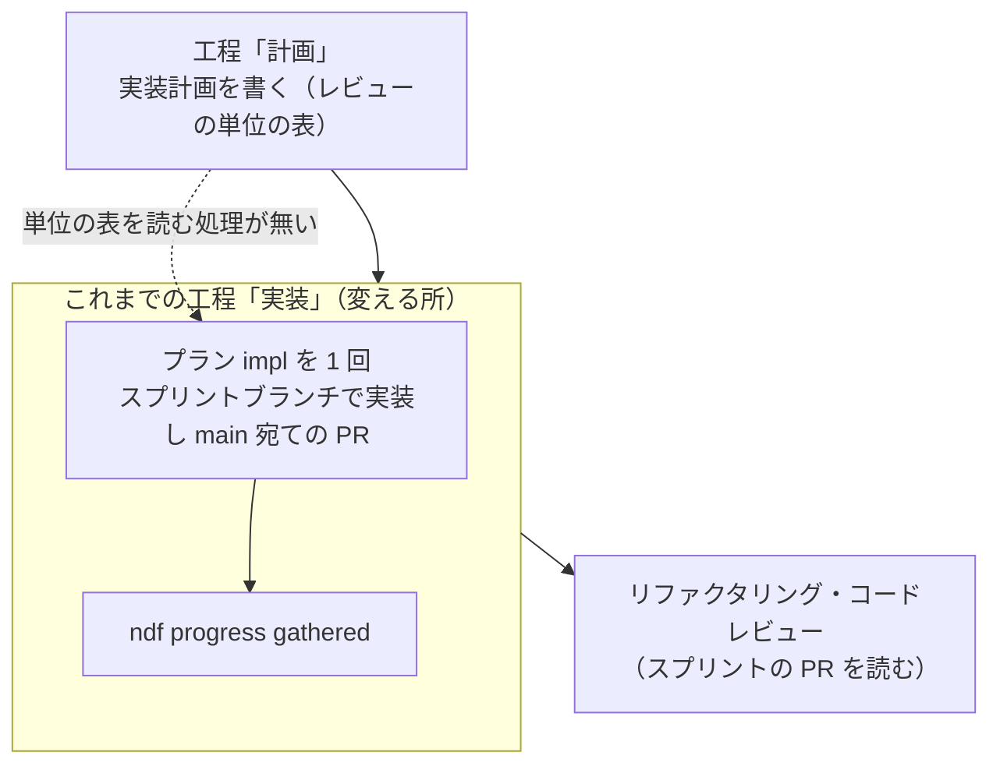
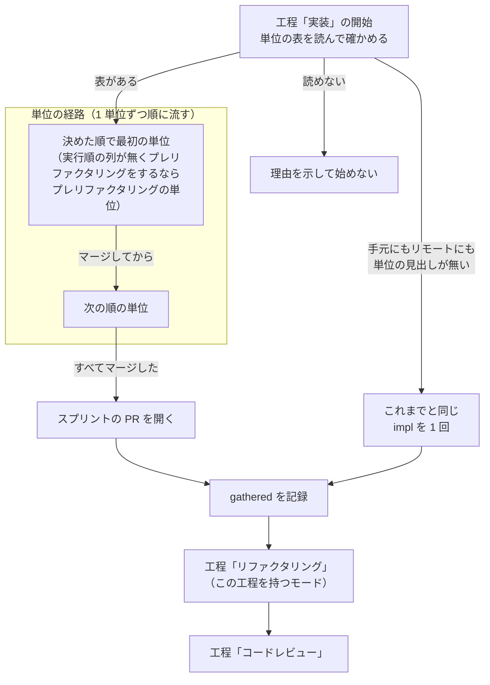
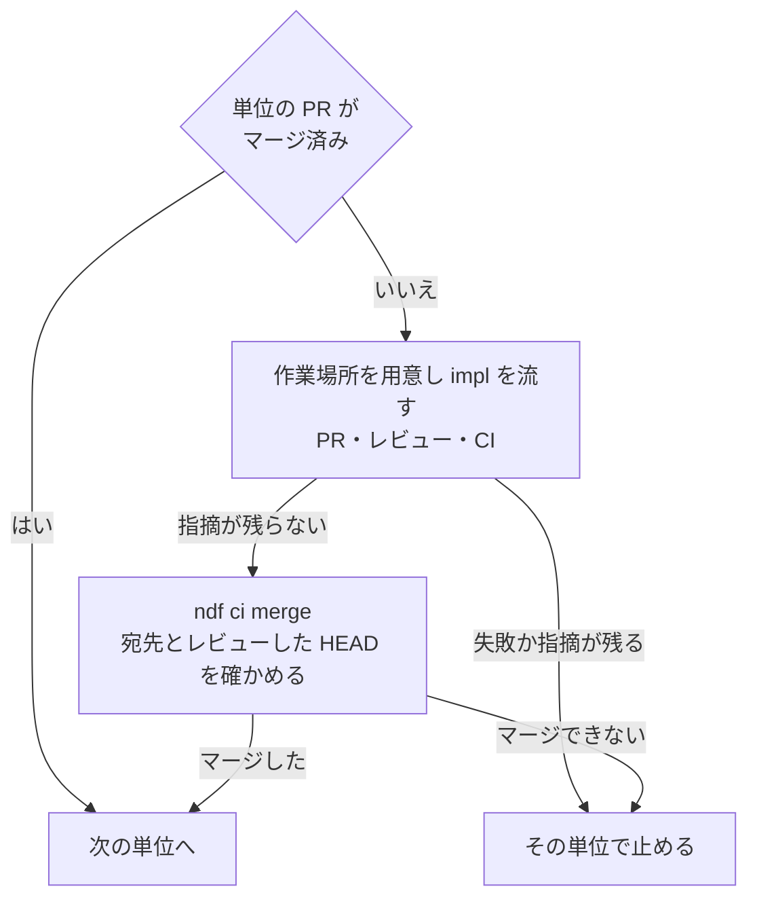
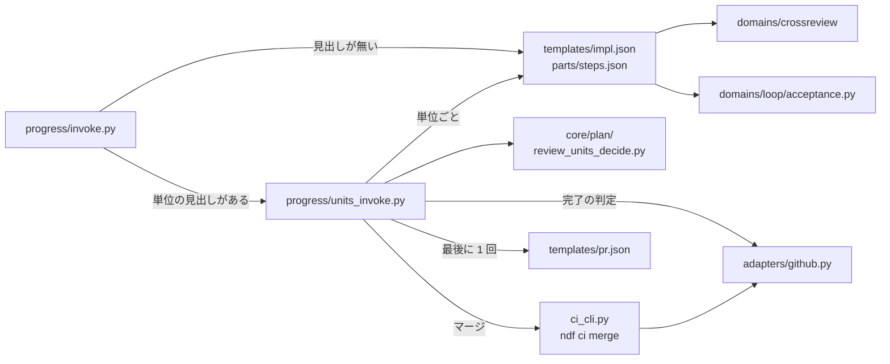
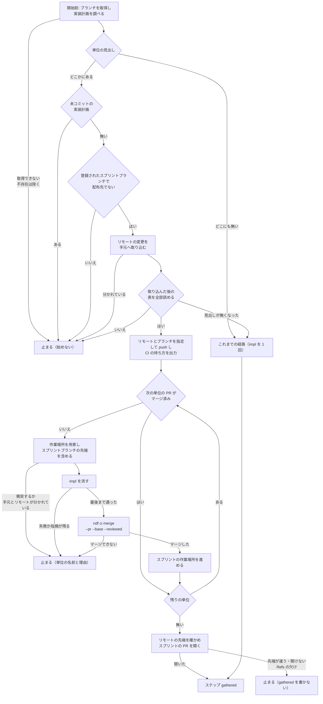

# 工程「実装」: 実装計画のレビューの単位ごとに PR とレビューを経てスプリントブランチへ集める（#4369）

これまで `ndf progress next` で流す工程「実装」は、実装計画の「レビューの単位」を読まなかった。そのため、分けるはずの変更をスプリントブランチの上で 1 本のまま実装していた。この設計では、工程「実装」が単位の表を読み、単位ごとに作業場所・PR・レビュー・マージを順に流し、すべてマージしてから集めた時点（`gathered`）を記録する。マージは今の supervisor の手順と同じコマンドを使う。専用のマージ・自動の後片付け・指摘の持ち越しは作らない（決定の記録は [issue-4369-design-decisions.md](./issue-4369-design-decisions.md)）。

## 今の姿

何が起きたか・目的・受け入れ条件は要求仕様（[issue-4369-requirements.md](./issue-4369-requirements.md)、正は #4369 の本文）にある。この文書は「どう解くか」と「なぜその解き方か」だけを書く。

これまでの流れと、変える所は次のとおりである。



設計に要る、これまでの構造は次のとおりである（パスは `plugins/ndf/` からの相対。2026-11-26、main `25c97daed` で確かめた）。

- 工程「実装」の定義（`contracts/workflow/stages/implement.json`）のステップは 2 つである。プラン `impl` を呼ぶステップと、`ndf progress gathered` のステップである。
  - ここでいうプランは、自動で順に実行する手順の定義で、工程「計画」が書く実装計画とは別である
- 定義の指定 `per_issue`（進め方 fast で工程を課題ごとに分ける指定）は読み込まれるだけで、分ける処理は無い。`impl` は工程 1 回につき 1 回だけ呼ばれる
- `impl` へ渡す値は `src/ndf/progress/invoke.py` が組む。ブランチは作業場所が今いるブランチ、マージ先はベースブランチである
- `impl` のテンプレート（`contracts/templates/impl.json`）は、実装から CI までを下の「`impl` のプランのステップ」の順で行う。マージはしない。worker に担当のタスクを絞って渡す手段は無い
- これまでの経路では `impl` がスプリントの PR（ベースブランチ宛て）を作る。後の工程「リファクタリング」「コードレビュー」はその PR を読む
- supervisor の手順は単位ごとに `impl` を組み、`ndf ci merge --reviewed` でマージする
  - 手順は `skills/development-workflow/references/agent-layers.md` の「実装のフェーズの単位」にある
- `ndf ci merge`（`src/ndf/ci_cli.py`）は、ブランチの開いた PR をマージする。PR の宛先は確かめない
- cross-review（AI による相互レビュー）は、次の指摘が残っても `ok` で終わる
  - 判定は `src/ndf/domains/crossreview/finish_decide.py` にある
  - 直していないレッドラインの指摘（必ず人の承認が要る操作に当たる指摘）
  - 利用者の判断を待つ見送り

### `impl` のプランのステップ

打ち直しと「指摘が残る単位を止める」の話は、次のステップの名前を使う。並びはこの変更で変えない。表の `unresolved` などは、`impl` の保存先に置くファイルである。

| 順 | ステップ | すること |
| --- | --- | --- |
| 1 | `done-check` | 作業場所の HEAD が、マージ済みの PR の head の SHA と一致すれば、何もせずに終える。単位の経路では、このステップを外す（下の箇条書き） |
| 2 | `work`・`acceptance`・`test` | worker が実装し、受け入れ条件の確認の記録を調べ、手元のテストを打つ |
| 3 | `push`・`pr`・`conflict-check`・`base-fetch` | push して PR を作り、マージ先との衝突を調べ、マージ先を取得する |
| 4 | `review` | マージ先を起点に PR の変更の全体を cross-review し、`reviewed-head` を書く。指摘が残れば `unresolved` を置いて先へ進む |
| 5 | `push-reviewed`・`review-head` | レビューの修正のコミットを push する。HEAD が `reviewed-head` と違うか、`delta-recheck` があれば、`review-delta` へ進む |
| 6 | `ci`・`head-reviewed` | CI の完了を確かめる。CI の修正などで HEAD が `reviewed-head` と違えば `review-delta` へ進む |
| — | `review-delta` | 差分だけをレビューし、`reviewed-head` を書き直して `push-reviewed` へ戻る。指摘が残れば `unresolved-delta` を置いて、同じく戻る |
| 7 | `resolved` | `unresolved` と `unresolved-delta` がどちらも無ければ通る。どちらかがあれば `incomplete` で止まる |

- **単位の経路の `done-check`**: 単位を流す処理は、開始時の一覧でマージ済みの単位を飛ばしてから `impl` を呼ぶ（決定 6）。同じ照会を単位ごとに繰り返さないよう、`done-check` を外して流す。一覧を読んだ後に工程の外でマージされた単位もありうる。マージされた head より先のコミットが無ければ、PR の作成かマージで止まる。コミットがあれば、新しい PR を作ってレビューする。打ち直せば、開始時の一覧でマージ済みと分かって飛ばす。単位の経路でない `impl` の `done-check` は変えない
- **`reviewed-head` に書く HEAD**: `review` も `review-delta` も、相手役（レビューする AI）の全員が読めた最後のラウンドの HEAD を書く。レビューが終わった時点の作業場所の HEAD ではない。最後のラウンドの後に増えた修正のコミットは誰も読んでいないので、HEAD の不一致として次の `review-delta` で確かめる
- **`unresolved` を消すとき**: `review` は始めに `unresolved` を消し、今回のレビューが `incomplete` で終われば置き直す。同じ保存先でレビューをやり直して指摘が解消すれば、`resolved` は通る
- **差分のレビューの起点**: 最初の `review-delta` は、その時点の `reviewed-head` を `delta-base` に保存して起点にする。指摘が残った後の再試行は、同じ起点と同じ cross-review の状態ディレクトリを使う
- **差分のレビューが通ったとき**: `unresolved-delta` を消し、その後で `delta-base` を消す
- **初回のレビューをやり直すとき**: `unresolved-delta` が残っていれば、`review` は `delta-recheck` を置く。HEAD が `reviewed-head` と同じでも、差分の指摘を `review-delta` で確かめ直すためである。`review-delta` は始めに `delta-recheck` を消す
- **差分のレビューは `review` の代わりではない**: `review-delta` は `unresolved` を消さない。後の差分のレビューが通っても、`unresolved` が残っていれば `resolved` が止める

## 文脈と制約

- 実装計画の書式は変えない（要求の対象範囲）。単位の表の列は「単位・含むタスク・満たす受け入れ条件・見込みの差分の行数」で、「実行順」の列は任意である
- 2026-11-26 の設計承認ゲートで、利用者が範囲を縮めた。専用のマージ・単位の後片付け・指摘の持ち越しの 3 つは作らず、安全さは今の supervisor の手順と同じにする
- この変更が扱う再実行は、工程が失敗か待ちを返した後の打ち直しである。実行中の中断と、レビューの後に PR が外から変えられた場合の復旧は [#4218](https://github.com/devbasex/ai-plugins/issues/4218) が扱う
- 2026-11-01 以降の実装計画のうち単位の見出しがある 22 本・129 行で、条件のセルが下の「単位の表の読み方」の形に合うかを試した。合わないのは 1 本の 2 行（`5a`・`5b` という番号）だけである。番号が課題の本文にあるかと、含むタスクがタスクの見出しにあるかは試していない
- [PR の単位を機械が読むファイルにする課題](https://github.com/devbasex/ai-plugins/issues/3702)（#3702。設計は承認済みで未実装）は同じ `progress/`・`contracts/` を触る。ファイルの配置と名前は #3702 の詳細設計に合わせる

## 解き方の全体像

この設計で実装を終えた後の流れは次のとおりである。1 つ目の図は工程「実装」から後の工程までの全体、2 つ目の図は単位 1 つの流れである。



単位 1 つは、順番やプレリファクタリングの有無に関わらず、次の流れで扱う。



- **プレリファクタリング**: これから変更を積む箇所を、実装の前に整えるリファクタリングである。するかどうかは、実装計画の「リファクタリングの時機」の表の「実装の前」の行が決める
- **プレリファクタリングの単位**: プレリファクタリングのタスク（「タスク分解」の最初のタスク）を含む単位である。「実行順」の列が無ければ、実装計画の単位の中で最初に流してマージする。列があれば列の値の順に流すので、先頭とは限らない（下の「順序」）
- **工程「リファクタリング」**: すべての単位をマージして `gathered` を記録した後に、これまでどおりスプリントの変更の全体へ掛ける。この変更では変えない
- 単位 1 つは、専用のブランチと作業場所でこれまでの `impl` のプランを流す。PR はスプリントブランチへ出す
- マージは `ndf ci merge --reviewed` に、宛先を確かめる引数 `--base` と、PR を番号で指定する引数 `--pr` を足して使う（決定 11）
- 人の判断を待つ指摘か未解決の指摘が残る単位はマージせず、後の単位を始めずに止まる（決定 14）
- 打ち直しでは、スプリントブランチ宛ての単位の PR がマージ済みの単位を飛ばす。工程の外でマージされた PR も同じである（決定 6）

## ドメインモデル

### コンテキスト

| コンテキスト | 何の語が 1 つの意味に決まるか |
| --- | --- |
| スプリントの進行 | レビューの単位・単位の PR・スプリントブランチ・集めた時点（どれも用語集にある語で、意味を変えない） |

### 集約

| 集約 | オーナー（書き換えてよいもの） | 根 | エンティティ | 値オブジェクト |
| --- | --- | --- | --- | --- |
| 単位の並び | 実装計画の文書（工程「計画」が書く。工程「実装」は読むだけ） | 実装計画 | レビューの単位 | 単位の名前・満たす受け入れ条件・実行順 |
| 単位の実行 | 工程「実装」 | 単位の PR | — | 単位のブランチ・レビューした HEAD |

### 不変条件

| # | 集約 | 条件 | 破れたときの扱い |
| --- | --- | --- | --- |
| I1 | 単位の並び | 単位の見出しがある実装計画は、すべての行を読めるときだけ流す。課題を 1 本にまとめて流さない | 実装を始めずに止まる |
| I2 | 単位の実行 | 工程がマージするのは、単位の `impl` が最後まで通った PR だけである。作業場所の HEAD と PR の HEAD がレビューした HEAD と同じで、PR の宛先がスプリントブランチであること | マージせずに止まる |
| I3 | 単位の実行 | 次の単位の作業場所は、前の単位をすべてマージした後のスプリントブランチから切る。既にある単位のブランチは、その先端を含んでから流す | 後の単位を始めずに止まる |
| I4 | 単位の実行 | 単位をマージする先は、スプリントに登録されたブランチで、プロジェクトの設定が配布先として宣言したブランチではない（承認なしに配布が始まる先へマージしない） | 実装を始めずに止まる |
| I5 | 単位の実行 | `gathered` を書くのは、読んだ並びのすべての単位が、マージ済みの PR を持つときだけである | 後の単位を始めず、`gathered` を書かずに止まる |

### ドメインイベント

要求のドメインイベント E1〜E5 をそのまま使う。

| # | イベント | 発生元 | 受け手 |
| --- | --- | --- | --- |
| E1 | 実装計画の単位を読んだ | 単位の表の読み手 | 単位を流す処理 |
| E2 | 単位のブランチと作業場所を用意した | 単位を流す処理 | `impl` のプラン |
| E3 | 単位の PR のレビューが収束した | `impl` のプラン | 単位を流す処理 |
| E4 | 単位の PR をマージした | 単位を流す処理 | 次の単位 |
| E5 | 集めた時点を記録した | `ndf progress gathered` | 工程「コードレビュー」 |

## 構成要素

### 要素と責務

| 要素 | 責務 |
| --- | --- |
| 単位の表の読み手（`src/ndf/core/plan/review_units_decide.py`。新設） | 実装計画の本文と、課題ごとの受け入れ条件の番号から、単位の並び（名前・代表の課題・タスク・条件・順）か、読めない理由を返す。タスク分解のタスクが単位に過不足なく割り当てられているかも確かめる。ファイルも git も読まない |
| 実装計画のパス（`src/ndf/core/issue_docs.py`） | ファイル名 `issue-<番号の並び>-plan.md` から番号の並びを読む（設計書と同じ形） |
| 単位を流す処理（`src/ndf/progress/units_invoke.py`。新設） | 開始前の確かめ、単位ごとの作業場所（`.worktrees/` の下）・指示のファイル・保存先・`impl`、マージ、打ち直し、スプリントの PR |
| 工程から作業を呼ぶ層（`src/ndf/progress/invoke.py`） | `per_unit` の工程で、手元かリモートの実装計画に単位の見出しがあれば単位を流す処理へ渡し、無ければこれまでのまま `impl` を呼ぶ。新しい試行の開始時に前の試行の値を消す処理（`clear_values`）は、単位の保存先も対象にする。単位の保存先で消すのは、差し込みの値（テンプレートに実行時に埋める値）のファイルだけである。GitHub の課題から保存した題・本文のファイルは工程の保存先に置くので、工程の保存先でこれまでのとおり消える。プランの実行の記録と、マージの方式の回答を待つ記録は残し、打ち直しの開始点を決めるのに使う |
| 工程の定義の読み手（`src/ndf/progress/stages.py`・`definition.py`） | 工程の型に `per_unit`（既定は偽）を足し、定義とスナップショット（スプリントを作ったときに保存する定義の写し）から読む |
| 工程の定義とスキーマ（`contracts/workflow/stages/implement.json`・`contracts/workflow/ndf.schema.json`・`contracts/schemas/internal/stage-snapshot.schema.json`） | `per_unit` と、工程「実装」の `optional_inputs` の `branch` を足す。`inputs`（必須の入力）には足さない。必須にすると、単位の見出しが無いスプリントまで、文脈に `branch` が無いと工程の開始前に止まるためである。ステップの並びは変えない |
| `impl` のテンプレートと差し込みの定義（`contracts/templates/impl.json`・`params.json`） | 任意の差し込み `unit_file`（単位の範囲の指示のファイル）を足す。既定は空で、ステップの並びは変えない。`done-check` は変えず、単位の経路では単位を流す処理が外す（決定 6）。`conflict-check`・`ci` は、下の「PR の番号」の番号を使う |
| 共有のステップ（`contracts/templates/parts/steps.json`） | `pr` の `probe`（開いた PR があるかの確かめ）は、head に加えて宛先を指定し、フォークの PR を除く（決定 6）。`pr` は、決まった PR の番号を保存先に書く。PR を作る経路は、作成の応答から番号を取り、ブランチ名で引き直さない（下の「PR の番号」） |
| レビューの既定の起動（`src/ndf/core/route/__init__.py`） | `impl` では、ブランチから PR を引き直さず、下の「PR の番号」の番号を `--pr` に渡す。単位の経路では `--repo` も渡す |
| スプリントの PR のテンプレート（`contracts/templates/pr.json`） | 開いた PR を探すときに、フォークの PR を除く |
| worker の作業の定義と読み手（`contracts/worker/kinds.json`・`src/ndf/contracts/worker_kinds.py`） | 作業の定義に、空でよい入力の欄 `optional_inputs` を足し、`impl`・`fix`・`ci-fix`・`fix-push`・`fix-base` に `unit_file` を置く（決定 8） |
| レビューの指示（`src/ndf/domains/crossreview/criteria_decide.py`） | 環境変数 `NDF_UNIT_FILE` があれば、相手役と修正担当の指示に単位の範囲と例外を足す（決定 8） |
| レビューの終わり方（`src/ndf/domains/crossreview/cli.py`・`finish_decide.py`・`journal.py`） | `ndf cross-review run` に `--repo`・`--stop-on-hold`・`--reviewed-pr-out` を足す。`--stop-on-hold` を渡した起動では、人の判断を待つ指摘が残れば `incomplete` で終える（決定 14） |
| 受け入れ条件の確かめ（`src/ndf/domains/loop/acceptance.py`） | 条件を持たない単位のための `--no-criteria` を足す（決定 9） |
| PR の読み取りとマージ（`src/ndf/adapters/github.py`） | head と宛先を絞ってマージ済みの PR を読む。`GitHub.merge` に期待する宛先を足し、マージの直前に読み直した PR の宛先が違えば要求を送らない（決定 6・11） |
| マージの宛先の確認（`src/ndf/ci_cli.py`） | `ndf ci merge` に `--base` と `--pr` を足す。`--pr` の PR の head・宛先・状態を確かめ、宛先を `GitHub.merge` へ渡す（決定 11） |
| 単位の PR で待つチェックの宣言（`contracts/schemas/project-workflow.schema.json`・`src/ndf/progress/invoke.py`） | 設定の `workflow.unit_required_checks` を読む（決定 13） |
| コマンドの一覧（`docs/contracts/commands.md`） | 新しい引数を載せる（`ndf check --write-spec` で生成し直す。手で直さない） |
| supervisor の手順（`agent-layers.md`） | `ndf progress next` の自動の経路も単位を読むことと、単位の表の読み方を書く |

### 呼び出しの向き

主な要素の呼び出しの向きは次のとおりである。矢印は、呼ぶ側から呼ばれる側へ向く。



### PR の番号

`impl` は、対象のリポジトリ・head・宛先の 3 つで PR を 1 本に決める。`pr` のステップは、PR を作った場合も既にある PR を見つけた場合も、その番号を `impl` の保存先の `pr-number` に書く。作った場合の番号は、作成の応答（`gh pr create` が出力する PR の URL）から取る。今のように作成の後で `gh pr view <ブランチ>` を打って引き直さない。この変更より前に始めた `impl` の保存先には番号が無いので、`pr` より後で止まった回は `pr` から流し直して番号を書く（詳細設計の「工程から作業を呼ぶ層」）。`impl` の `conflict-check`・`ci`・レビューの既定の起動（`review`・`review-delta`）は、この番号を使う。ブランチ名だけで引き直すと、同じブランチから別の宛先へ出した PR を検査することがある。マージも `ndf ci merge --pr` にこの番号を渡し、ブランチと宛先から選び直さない（下の「マージ」）。`impl` 以外のテンプレートの `conflict-check`・`ci` は変えない。

### レビューした PR の照合

単位の経路では、レビューが単位の PR を読んだことを、リポジトリと PR の番号の組で確かめる。HEAD の照合だけでは、同じ HEAD を持つ別の PR（別の宛先、別のリポジトリ）を読んだレビューを見分けられないためである。単位の経路の `review` と `review-delta` の起動は、既定の起動も設定で差し替えた起動も、次のように扱う。

1. 起動に `--repo <所有者>/<リポジトリ>`、`--pr <番号>`、`--reviewed-pr-out <ファイル>` の 3 つを渡す。既定の起動の `--repo` と `--pr` は「PR の番号」で渡すものと同じで、二重には足さない
2. 起動の前に、そのファイルを消す
3. レビューは、実際に読んだリポジトリと PR の番号を `<所有者>/<リポジトリ>#<番号>` の形でファイルへ書く
4. 起動の後に、中身を単位の PR の組と照合する。ファイルが無いか違えば、`reviewed-head` を消して止まる

`ndf cross-review run` は `GH_REPO` を読まず、保存済みの状態か作業場所のリモートから対象のリポジトリを決める。そのため `--repo` を足し、渡した値を優先して、相手役と修正担当の読み書きと記録のコメントに使う。単位の経路でない `impl` では、既定の起動に `--pr` だけを渡して照合はせず、設定で差し替えた起動には何も足さない。

ファイルと関数の粒度の詳細設計は [issue-4369-design-detail.md](./issue-4369-design-detail.md) にある。新設する関数が 2 つ以上あるので、別ファイルにした。

## 入出力のコントラクト

足すのは、コマンドの引数 6 つ、設定のキー 1 つ（決定 13）、工程「実装」の任意の入力（`optional_inputs`）の `branch` である。工程の出力（`gathered`）は変えない。

### 引数と工程の結果

| 対象 | 変える前 | 変えた後 |
| --- | --- | --- |
| `ndf ci merge --base <ブランチ>` | 無い | `--branch` を head、`<ブランチ>` を宛先とする、対象のリポジトリの開いた PR（フォークを除く）を選ぶ。直接のマージもマージキューへの投入も、直前に読み直した PR の宛先が `<ブランチ>` と違えば、要求を送らずに `refused` で止まる。省けばこれまでと同じ |
| `ndf ci merge --pr <番号>` | 無い | ブランチから PR を選ばず、この番号の PR を読む。head が `--branch`、宛先が `--base`、head のリポジトリが対象のリポジトリで、マージされずに閉じられていないことを確かめる。違えば要求を送らずに `refused` で止まる。マージの要求もキューへの投入も、この番号の PR へ送る。省けばブランチから選ぶ |
| `ndf cross-review run --repo <所有者>/<リポジトリ>` | 無い | 対象のリポジトリをこの値にする。保存済みの状態と作業場所のリモートより優先する。省けばこれまでと同じ |
| `ndf cross-review run --stop-on-hold` | 無い | 人の判断を待つ指摘がその回の結果に残れば `incomplete` で終え、指摘 1 件を 1 つの欠けにする。欠けは、済ませられなかった項目を並べる結果 JSON の `gaps` の 1 要素である。欠けの `kind` は `held_finding`、`name` は指摘の id、`reason` は指摘の本文である。省けばこれまでと同じ |
| `ndf cross-review run --reviewed-pr-out <ファイル>` | 無い | `--reviewed-out` を書くときに、読んだリポジトリと PR の番号を `<所有者>/<リポジトリ>#<番号>` の形でこのファイルへ書く。始めに消す。省けばこれまでと同じ |
| `ndf loop acceptance check --no-criteria` | 無い | 渡した `--issue` の条件の確認の記録を 1 件も調べず `ok`。`--criteria` と一緒には受けない |
| 工程「実装」のステップ `implement` の結果 | `impl` の結果 | 単位の経路では、全単位のマージとスプリントの PR の後に `ok` を返し、`items` に単位ごとの名前・PR の番号・状態を持つ。状態は、この試行でマージした単位（`merged`）と、開始時にマージ済みと分かって飛ばした単位（`already_merged`）を分ける。`already_merged` は、レビューの収束と、指摘の解消や承認を確かめていないことを表す（決定 6）。単位で止まった `stopped` は、止まった単位の名前・課題・理由・PR の番号を持つ。全単位のマージの後にスプリントの PR を開けなかった `stopped` は、止まった単位を持たない。持つのは、全単位の `items` と、停止の理由と欠け（`gaps`）である。理由は、先端の確かめかテンプレート `pr` が返したものになる。`ok` でも `stopped` でも、`metrics.unit_ci` に単位の PR の宛先（`base`）・待つチェックの名前（`required`）・その名前を読んだ設定のキー（`key`）を持つ（決定 13） |

### 単位の表の読み方（決定 7）

| 項目 | 読み方 |
| --- | --- |
| 見出し | 本文のコードブロックの外にある、`レビューの単位` を含む `##` 以下の見出し。そのような見出しは、実装計画 1 つに 1 つだけとする。そのセクション（次の同じか上のレベルの見出しの手前まで）の中の最初の表を読む。セクションに表が無ければ読めず、後ろのセクションの表は読まない |
| 列 | 「単位」「含むタスク」「満たす受け入れ条件」は必須。「実行順」は任意。列があれば、すべての行に 1 以上の整数を書く |
| 含むタスクのセル | 括弧の注記を除き、`・` `、` `,` で区切る。要素は `Task <番号>`、`T<番号>`、番号だけ、または範囲（`Task 1〜4`・`T1〜T4`）。番号だけの要素と範囲の終わりは接頭辞を省けるが、セルの最初の要素は接頭辞が要る。`Task 1・2` は Task 1 と Task 2 である。各番号は「タスク分解」の `###` の見出し（`### Task <番号>`）にあること |
| タスクの割り当て | 「タスク分解」のタスクは、プレリファクタリングのタスクも含め、どれも 1 つの単位にだけ割り当てる |
| 条件のセル | 括弧の注記を除き、`・` `、` `,` で区切る。要素の形は下の表 |
| 読めない | 次のどれか。単位の見出しが 2 つ以上ある。表か必須の列が無い。行が 0。名前が空か重なる。含むタスクが空か上の形でないか見出しに無い。どの単位にも無いタスクか、2 つ以上の単位にあるタスクがある。条件のセルが下の形でない。条件の課題がスプリントの外。番号がその課題の受け入れ条件に無い。「実行順」の列があるのに 1 以上の整数でない行がある |

条件のセルの要素の形:

| 要素 | 意味 |
| --- | --- |
| `<課題>:<番号>` | その課題のその番号の条件 |
| `<課題>:<始め>〜<終わり>` | その課題の始めから終わりまでの条件。始めが終わりより大きければ読めない |
| 番号か範囲だけ（`3`・`1〜7`） | 直前の要素の課題の条件。セルの最初の要素なら、実装計画の課題が 1 つのときだけ書ける |
| `無し` | 条件なし。ほかの要素と一緒には書けない |

条件の番号は、`ndf loop acceptance check` が数える番号（課題の本文の受け入れ条件を上から 1 始まり）と同じ関数で読む。

### 単位の代表の課題と `acceptance` の組み方（決定 9）

| 単位 | 代表の課題 | `impl` に渡す `acceptance` |
| --- | --- | --- |
| 条件がある | 単位を持つ実装計画のファイル名の番号のうち最も小さいもの | 条件がある課題だけを番号の順に `--issue` で並べ、展開した条件を 1 件ずつ `--criteria` で渡す |
| 条件が「無し」 | 同上 | `--issue <代表の課題> --no-criteria` |
| 課題全体を 1 単位として補ったもの | その課題 | `--issue <代表の課題>`（その課題の全条件を確かめる） |

代表の課題は、`impl` の `issue`（PR の題と本文はこの課題から作る）と、単位のブランチ名にも使う。

開始時に一括で読む課題の本文は、受け入れ条件の番号を数えるためだけに使う。worker と PR へは渡さない。渡すと、書き込み権限の無い人が worker への指示や PR の本文を書けるためである。

`impl` に渡す代表の課題の題と本文は、`_issue_values` で書き出す。今の関数は、スプリントの課題のうち番号が最も小さいものを選び、`issue_text` が作業場所からリポジトリを解決し直す。そのため、単位の代表の課題の番号と、開始前の確かめで選んだリポジトリを引数で受け取り、`issue_text` の読み取りと権限の確認にもそのリポジトリを使うように変える。単位の経路でない呼び出しが選ぶ課題は変えない。書き出し先には、単位の保存先ではなく工程の保存先を指定する。

- 保存した題と本文のコピーは、リポジトリと課題の番号の組に結び付ける。ファイル名は今のとおり課題の番号を含み、題のコピーにはリポジトリも書く。リポジトリが違うコピーは使わず、読み直す
- 読み直すときは、先に題のコピーを消してから本文を書き、題のコピーを最後に書く。今の関数は本文、題の順に書き、再利用の条件は両方のファイルがあることである。古い題のコピーを残すと、本文を書いた直後に中断した場合に、別のリポジトリの本文と組になる
- リポジトリと番号が同じ単位は、同じ試行の中で 1 回の読み取りと権限の確認の結果を使い回す。単位の保存先ごとに呼ぶと、同じ照会が単位の数だけ繰り返される
- 課題の作成者に書き込み権限が無ければ止まる。保存するファイルは今と同じ保護（ほかの利用者が書き換えられない）を受ける

`unit_file` は受け入れ条件を番号で書き、課題の本文の文を写さない。

## 処理の流れ



### 開始前の確かめ

単位があるかは、コミットされた内容から判定する。単位の表は、単位のブランチの基点になるコミットから読む。作業ツリーの未コミットの内容は、単位の作業場所に存在しないので、単位の範囲や順序の根拠にしない。手元のコミットだけで判定すると、別の作業場所で足した単位の表を見落として、変更が 1 本にまとまる。

ここでいうリモートは、プロジェクトの設定（`.ndf/worktree.json` の `remote`。無ければ既定）で選んだもので、取得と push の両方に使う。`per_unit` の工程では、次の順に行う。

1. 作業場所が今いるブランチを、リモートから取得する。取得に失敗したときの扱いは、下の「取得の失敗」のとおりである
2. 手元の HEAD と取得した先端の実装計画を `git show` で読み、単位の見出しを調べる。未コミットの実装計画（下の「未コミットの実装計画」）があれば、そのファイルの見出しも調べる。どこにも無ければ、作業場所を変えずにこれまでの経路へ進む
3. 未コミットの実装計画があれば、パスを示して止まる。理由には、コミットするか取り消してから打ち直すことを書く
4. 作業場所が今いるブランチが、スプリントブランチとして使えることを確かめる（I4）
5. 手元が遅れていれば `git merge --ff-only` で進める。分かれていて揃えられなければ止まる
6. 揃えた後の HEAD のコミットで単位の見出しを調べ直し、すべての単位の表を読む。どの実装計画にも見出しが無くなっていれば、これまでの経路へ進む。読めなければ止まる
7. `git push -- <リモート> HEAD:refs/heads/<スプリントブランチ>` を打つ。リモートにブランチが無ければ、この push で作る。実装計画のコミットを単位の作業場所に含めるためである。送り先と ref を明示するので、upstream の設定は要らず、使われもしない
8. 単位の PR の宛先、待つチェックの名前、その名前を読んだ設定のキーを、進捗の 1 行として標準エラーへ出し、結果の `metrics.unit_ci` に持つ（決定 13）

**取得の失敗**: ブランチが無いと確認できた場合だけ、手元の HEAD で単位の見出しの有無の判定を続ける。取得の失敗は、ブランチの不存在でも通信や認証の失敗でも同じ結果になる（`Git.fetch_branch`）。そこで失敗したときだけ `git ls-remote --exit-code --heads <リモート> refs/heads/<ブランチ>` を打つ。終了コードが 2（該当する ref が無い）なら不存在である。それ以外は、取得できない理由を示して止まる。通信や認証を直して打ち直せば先へ進む。

**未コミットの実装計画**: スプリントの課題の実装計画（`issues/issue-<番号の並び>-plan.md`）のうち、次のものをいう。変更・削除がコミットされていないものと、追跡されていないものである。単位の見出しがどこかにあるスプリントでは、これがあれば止まる。見出しがどこにも無いスプリントでは、これがあっても止めない。工程「計画」は実装計画をコミットして push するので、未コミットになるのは手で書き換えた場合である。

**ブランチの確かめ（手順 4）**: 上の手順 4 の確かめは、次の 2 つである。単位の PR の宛先は、作業場所が今いるブランチになる。作業場所がベースブランチや配布先のブランチに切り替わっていると、単位の PR がそのブランチ宛てになり、そのマージで承認の前に配布が始まる。これを防ぐための確かめである。

- 作業場所が今いるブランチが、スプリントに登録されたブランチ（文脈の `branch`。工程「作業場所の用意」が書く）と同じである。工程「実装」の `optional_inputs`（文脈にあるときだけ読む入力）に `branch` を足す。単位の経路で文脈に値が無ければ、ここで止まる
- そのブランチが、プロジェクトの設定（`.ndf/project.json` の `branch_strategy`）で配布先として宣言したブランチのどれでもない。宣言のキーは `branches.base`・`branches.production`・`channels[].ref`・`release.deliveries[].branch` である。QA やステージングを別のブランチで配布するプロジェクトも、この宣言で外れる

**同じリポジトリを使う**: 単位の経路は、PR の作成からレビュー・CI の確認・マージまで、選んだリモートの `<所有者>/<リポジトリ>` を使う。環境変数 `GH_REPO` を読むのは `gh` だけなので、`ndf` のコマンドには引数で渡す。

| 使う側 | 渡し方 |
| --- | --- |
| `impl` のプランと最後のテンプレート `pr` の中の `gh`（PR の作成と読み取り） | `GH_REPO` |
| レビューの起動（`review`・`review-delta`） | `--repo` |
| `impl` のステップ `ci`（`ndf ci watch`） | `--repo` |
| マージ（`ndf ci merge`） | `--repo` |
| 代表の課題の題と本文の読み取りと、作成者の権限の確認（`_issue_values`） | 関数の引数 |

### 順序

単位は、次の 2 種類のまとまりに分け、まとまりを課題番号の小さい順に並べる。

| まとまり | 並べるときに使う課題番号 |
| --- | --- |
| 単位の見出しがある実装計画 1 つ分の単位 | ファイル名の番号のうち最も小さいもの |
| 補った単位 1 つ（下の「単位の無い課題」） | その課題の番号 |

実装計画の中の順は次のとおりである。

- 「実行順」の列があるときは、その値の順（同じ値は表の順）。プレリファクタリングの単位を前へ動かさない
- 列が無いときは表の順。ただしプレリファクタリングをするときは、「タスク分解」の最初のタスクを含む単位を先頭にする
- プレリファクタリングをするかは、実装計画の「リファクタリングの時機」の表で決める
  - 時機が「実装の前」で始まる行を見る。その行の対象が「しない」で始まれば「しない」、それ以外は「する」である
  - 表か行が無ければ「しない」と読む

### 単位の無い課題

どの実装計画にも単位の見出しが無いスプリントは、これまでの経路で `impl` を 1 回だけ呼ぶ。単位の見出しがある実装計画が 1 つでもあるときは、残りの課題も、課題 1 つを 1 単位として並びに入れる。残りの課題とは、実装計画を省いた課題と、見出しの無い実装計画の課題である。例えば実装計画 `issue-20-40-plan.md`（単位 A・B）と、実装計画の無い課題 10・30 があれば、10、A、B、30 の順になる。

補った単位は `unit_file` を空にし、課題の全体を実装して、その課題の全条件を確かめる。

### 単位のブランチと保存先

- ブランチ名は `<スプリントブランチ>-u<代表の課題>-<単位の名前の短いハッシュ>` である
- `impl` を流すか、マージだけを打ち直す前に、スプリントブランチと単位のブランチを 1 回の `git fetch` で取得し直す。単位のブランチは `refs/heads/<スプリントブランチ>-u*` の形で指定するので、リモートに無くても取得は失敗しない。`--prune` を付け、リモートで消えたブランチの古い記録を残さない
- 単位のブランチの用意は、ブランチがある場所で分ける。別のマシンで push した実装を、作り直さないためである

| 単位のブランチがある場所 | 扱い |
| --- | --- |
| どこにも無い | 取得し直したスプリントブランチから切る |
| リモートだけ | リモートの先端から手元のブランチを作る。そのマシンに `impl` の実行の記録が無ければ、`impl` はその上で最初のステップから流す |
| 手元だけ | そのまま使う |
| 両方。手元がリモートと同じか進んでいる | 手元を使う |
| 両方。手元が遅れている | `git merge --ff-only` で手元を進める |
| 両方。分かれている | `impl` を呼ばず、単位の名前と理由を返して止まる |

- 作業場所があれば使い、無ければ上の表で用意した単位のブランチから作る
- 既にある作業場所に未コミットの変更か進行中のマージがあれば、取り込みも `impl` もせずに止まる。利用者の編集が単位の PR に混ざらないためである
- 既にある単位のブランチを使うときは、取得し直したスプリントブランチの先端を含むかを `impl` の前に確かめる（I3）。含まなければ `git merge --no-edit` で取り込み、衝突すれば、この処理が始めたマージだけを取り消して、単位の名前と理由を返して止まる。後から足したり順を入れ替えたりした単位があると、既にあるブランチは先行する単位の変更を持たないためである
- `impl` のプランの保存先は、工程の保存先の下の `units/<単位のブランチ名>/<回>/` とする。レビューをやり直すときは次の回の保存先を使う
- `unit_file` と環境変数 `NDF_UNIT_FILE` が指す指示のファイルは、単位を流すたびに書き直す

### スプリントの PR

すべての単位のマージを確かめた後に、テンプレート `pr` でスプリントの PR を開く（決定 10）。渡す値は次のとおりである。

- 環境変数 `GH_REPO`: 単位の PR と同じリポジトリ（選んだリモートの `<所有者>/<リポジトリ>`）。指定しないと、リモートが複数ある作業場所で別のリポジトリの PR を読むことがある
- リモート: 開始前の確かめで選んだもの
- 宛先: ブランチ戦略の設定が定める、スプリントの PR のマージ先

この経路では、テンプレートから `push` と `fix-push` のステップを外し（`route.without_steps`）、PR の検索と作成だけを行う。単位の変更はマージでリモートに入っているので、push するものは無い。残すと、ほかの作業場所がスプリントブランチを進めていた場合に push が拒否され、`fix-push` の worker が誰もレビューしないコミットを足せる。

PR を開く前に、スプリントブランチを取得し、リモートの先端がスプリントの作業場所の HEAD と同じことを確かめる。違えば、取り込みもコミットも push もせずに `stopped` を返す。

停止の理由には、次の 3 つを書く。

- 両方の SHA
- 片方にだけあるコミットの範囲。リモートにだけあるものは `<作業場所の HEAD>..<リモートの先端>`、手元にだけあるものは `<リモートの先端>..<作業場所の HEAD>` で示す
- その変更をスプリントの PR に含めてよいと確認してから、`ndf progress next` を打ち直すこと

これらのコミットは単位のレビューを経ていないためである。確認するのは利用者である。conductor はこの停止を自分の判断で打ち直さず、理由を利用者へ示して確認を待つ。打ち直すと、開始前の確かめが手元を進める（分かれていれば止まる）。

PR の作成に失敗するか、既にある PR の本文に課題の `Refs` が足りなければ、工程のステップ `implement` は `stopped` を返し、`gathered` を書かない。`Refs` が足りない場合は、PR の本文へ足してから打ち直す。打ち直しでは、全単位がマージ済みなので単位を飛ばし、スプリントの PR の処理だけをやり直す。

### 打ち直し

打ち直しとは、工程が失敗か待ちを返した後に、利用者か conductor（スプリントの工程を進める AI）が `ndf progress next` をもう一度打つことである。

単位ごとに、次の表で扱いを決める。上の行を先に当てる。

| 打ち直しの時点の単位 | 扱い |
| --- | --- |
| 対象のリポジトリの単位のブランチを head、スプリントブランチを宛先とする PR がマージ済み | 飛ばす。結果の状態は `already_merged` にする（決定 6） |
| `impl` の実行の記録が無い | 最初から流す |
| `impl` は最後まで通り、マージが `ci_pending`（マージキューの待ちを含む）か `infra_wait` で止まり、作業場所の HEAD が `reviewed-head` と同じ | `impl` を流さず、`ndf ci merge` だけを打ち直す。同じ HEAD をレビューし直さない |
| `impl` がレビューで止まった（ステップ `review`・`review-delta`・`resolved`）か、最後まで通ったが上の行に当たらずマージできなかった | 次の回の保存先で、`push` のステップから流す（HEAD が変わった単位は下の段落のとおり `test` から）。レビューは最初からになる（決定 14） |
| ほかの理由で `impl` が途中で止まった | これまでのプランの打ち直しと同じく、止まったステップから続ける |

打ち直しの時点で、前の試行が止まった時より単位の HEAD が変わっていることがある。利用者が手元で修正をコミットした場合と、スプリントブランチの先端やリモートの単位のブランチを取り込んだ場合である。これを見分けるため、単位を流す処理は、`impl` が返った時点の作業場所の HEAD を、その回の保存先の `stopped-head` に書く。

打ち直しでは、取り込んだ後の HEAD を、前の回の `stopped-head` と比べる。4 行目か最後の行で扱う単位は、次の 2 つがそろえば、`test`（手元のテスト）のステップから流し直す。

- HEAD が `stopped-head` と違うか、`stopped-head` が無い
- 前の回の `impl` が最後まで通った（マージできなかった場合を含む）か、`test` より後のステップで止まった

手元の修正や取り込みで起きる退行を単位の中で見つけ、取り込みを push しないまま CI を待たないためである。レビューの修正担当が足したコミットは `stopped-head` に含まれるので、それだけではテストを流し直さない。打ち直しの無い流れでも、そのコミットに手元のテストは掛からないためである。

- 手元のテストを外す設定では、`push` のステップから流す。その場合の検査は、単位の PR の CI である
- 手元のテストを外し、`workflow.unit_required_checks` も空の並びなら、単位の中ではテストしない。最初に検査するのはスプリントの PR の CI である（決定 13 の代償）
- `acceptance` は流し直さない。調べるのは課題の本文にある確認の記録で、取り込みでは変わらないためである

### マージ

単位の作業場所で、次のコマンドを打つ。`<HEAD>` は `impl` が保存先に書いた `reviewed-head` の値である。このファイルが無ければマージせずに止まる。

```sh
ndf ci merge --repo <所有者>/<リポジトリ> --pr <番号> --branch <単位のブランチ> --base <スプリントブランチ> --reviewed <HEAD>
```

`<番号>` は `impl` が保存先に書いた `pr-number` の値である。このファイルが無ければマージせずに止まる。レビューの後に単位の PR が閉じられ、同じブランチ・宛先・HEAD で別の PR が開かれた場合は、保存した番号の PR が閉じているので `refused` で止まる。新しい PR はレビューも CI の確認も経ていないためである。次の打ち直しは打ち直しの表の 4 行目に当たり、新しい PR をレビューし、CI を確かめる。

`--repo` には、開始前の確かめで選んだリモートのリポジトリ（`GH_REPO` に入れる値と同じ）を渡す。省くと `ndf ci merge` は作業場所からリポジトリを解決し直し、`GH_REPO` は読まない。PR の選択からマージまでを、レビューしたのと同じリポジトリにするためである。打ち直しでマージだけを打つ場合も、同じ引数を渡す。`pr-number` と `reviewed-head` は同じ回の保存先から読む。

マージした後はスプリントブランチを取得し、スプリントの作業場所を `git merge --ff-only` で進める。次の単位の作業場所はこのコミットから切る。

## 決定の記録

決定の記録（決定 1〜16）は [issue-4369-design-decisions.md](./issue-4369-design-decisions.md) にある。

## 影響と危険

- **働く範囲**: 利用先のリポジトリでも働く。実装計画に単位の見出しがあるときだけ振る舞いが変わる
- **プロジェクトごとに違うもの**: ベースブランチ・リモート・レビューの起動・テストと CI は、既存の設定を単位の経路でも使う。足す設定は `workflow.unit_required_checks` だけで、書かなければ既存の必須のチェックの設定を使う（決定 13）
- **影響するモード**: 工程「実装」を持つすべてのモードと進め方（`per_unit` を足した後に作ったスプリント。決定 4）。単位の見出しがあるのに、作業場所が登録されたスプリントブランチでないか、配布先のブランチなら、始めずに止まる（I4）。fast の課題をベースブランチ上で直接進めている場合がこれに当たる。理由には、どの条件に当たったかと、直し方（登録されたスプリントブランチへ切り替える。登録されたブランチが配布先なら、工程「作業場所の用意」からやり直す）を書く
- **PR の数**: 単位が 1 つの表でも、単位の PR とスプリントの PR の 2 本になる（決定 12）
- **同じファイルを触る変更**: #3702 の実装が `progress/`・`contracts/` を触る。後に入る側が取り込む
- **壊れうる箇所**:
  - 待つと宣言したチェックがスプリントブランチ宛ての PR で起動しない設定では、単位がマージできずに止まる（決定 13）
  - 設定で差し替えたレビューの起動が次のどちらかに当たると、単位はレビューのステップで止まる
    - `--stop-on-hold`・`--repo`・`--pr`・`--reviewed-pr-out` を受けない
    - 読んだリポジトリと PR の番号を書かない
  - 人の判断を待つ指摘が出た単位は、打ち直すまで止まる（決定 14）
  - スプリントブランチの保護やマージの制限で `ndf ci merge` が断られると、単位はそこで止まる
  - 前のスプリントと同じ名前のスプリントブランチで、同じ課題と同じ単位の名前を流し直すと、前のマージ済みの PR を見て飛ばす。単位の名前を変えれば流れる

### 利用者が受け入れた代償

2026-11-26 の設計承認ゲートで、次の代償を利用者が受け入れた。この設計の中では塞がない。理由は決定の記録にある。

| 代償 | 決定 |
| --- | --- |
| マージ先を確認してからマージするまでの間に、PR の宛先が書き換えられても気づけない | 11 |
| マージした単位の変更を後で打ち消しても気づかず、完了した単位として飛ばす | 6 |
| 単位の作業場所とブランチは自動では消さない | 15 |
| 打ち直したレビューが前回と同じ指摘を挙げなければ、直していなくてもマージされる | 14 |

### 処理の回数

単位が N 個のスプリントで増える処理は、次のとおりである。単位は 1 つずつ流すので、時間はほぼ足し算になる。

| 処理 | 回数 |
| --- | --- |
| worker の実装・初回のレビュー（`review`）・CI の完了の確認・作業場所の用意・マージ | それぞれ N 回 |
| 差分のレビュー（`review-delta`） | レビューか CI の修正でコミットが増えた単位で 1 回以上 |
| 打ち直し（`ndf progress next` をもう一度打つこと）の初回のレビュー | レビューで止まった単位で、もう 1 回。`impl` は最後まで通ったがマージできず、打ち直しの表の 4 行目に当たる単位（宛先の違い、PR の本文の残リスク、ブランチの保護による拒否など）でも、もう 1 回 |
| 手元の修正か取り込みで HEAD が変わった単位の打ち直し | 手元のテストがもう 1 回（テストを外す設定では 0 回） |
| マージキューの待ちの打ち直し | `ndf ci merge` だけ。レビューは起動しない |
| GitHub への照会（開始時） | 課題の本文の一括読み取り 1 回と、単位の PR の一覧 1 回 |
| GitHub への照会（`impl` の中） | 未マージの単位ごとに、`pr`・`conflict-check`・`ci`・レビューの読み取り。`done-check` は外すので、その PR の一覧の照会は無い |
| GitHub への照会（スプリントの PR） | テンプレート `pr` の検索 1 回と、PR が無ければ作成 1 回。その前の `git fetch` 1 回 |
| 受け入れ条件の確かめの課題の本文の読み取り（`acceptance`） | 条件がある単位と補った単位ごとに 1 回（複数の課題はまとめて 1 回）。条件が「無し」の単位は 0 回。同じ課題を k 個の単位が参照すれば、その課題は k 回読む。確認の記録は単位の実装の中で書き足されるので、開始時に読んだ本文は使い回せない |
| GitHub への照会（マージ） | 単位ごとに `ndf ci merge` の読み取り |
| 単位のブランチとスプリントブランチの取得（`git fetch`） | `impl` を流すかマージを打ち直す単位ごとに、その前に 1 回。マージの後に 1 回 |
| `ndf worktree create` の中の取得（`git fetch`） | 作業場所を作る単位ごとに 1 回。コマンドが内部で打つので、上の行の取得とは別に数える |
| 代表の課題の題と本文の読み取りと、作成者の権限の確認 | 試行ごとに、異なる代表の課題の数だけ（単位の数には比例しない） |
| PR で実際に走る CI | リポジトリの設定で決まる。多くの設定では単位の PR N 本とスプリントの PR 1 本 |

`per_unit` の工程では、単位の見出しが無いスプリントでも、開始前のブランチの取得（git の起動とリモートへの照会が各 1 回）が増える。取得に失敗したときだけ、`git ls-remote` が 1 回加わる。代わりの案と、この案を選ぶ理由は決定 16 にある。

### 代表のリポジトリでの振る舞い

| 代表のリポジトリ | 設定の要点 | 直した後に起きること | この種類で扱えなくなること |
| --- | --- | --- | --- |
| Web サービス | ベースブランチとスプリントの起点はブランチ戦略の設定。CI の必須のチェックと、ベースブランチのマージキュー | 単位の変更がスプリントブランチへ入り、ベースブランチへはこれまでの承認を経て入る | 無し |
| モバイルアプリ | ストアへのリリースは工程「デプロイ」が持つ | 同上。リリースの形は変わらない | 無し |
| 業務文書だけ | 実装計画に単位の表が無いことが多い | 見出しが無ければこれまでのまま。あれば単位ごとに PR が出る | 無し |

### ai-plugins だけの事情

- 無し（このリポジトリの値を既定や振る舞いに入れない）

## テスト設計

| 受け入れ条件・不変条件 | どの振る舞いで縛るか | どう壊したら落ちるべきか |
| --- | --- | --- |
| 条件 1 | 単位が 2 つ以上の表で、単位ごとのプランが順に呼ばれ、ブランチ・宛先・`acceptance`・`unit_file`・保存先が単位の値になる | 順を入れ替える、`acceptance` を課題全体にする、保存先を共有する、宛先をベースブランチにすると落ちる |
| 順序 | 実行順の列があるとき・無いとき、プレリファクタリングをする・しないの順。実装計画の単位と補った単位が混ざるときは課題番号の順 | 列の値よりプレリファクタリングの単位を優先する、補った単位を先頭か末尾へ固めると落ちる |
| 条件 2（取得できる） | どの実装計画にも見出しが無い複数課題のスプリントで、`impl` の呼び出しが 1 回になる。開始前のリモートへの照会はブランチの取得の 1 回だけで、単位の経路の通信は無い | 課題ごとに `impl` を呼ぶ、単位の経路へ入る、取得が成功しても `git ls-remote` を打つと落ちる |
| 条件 2（リモートにブランチが無い） | 同じスプリントで、ブランチをまだ push していない。開始前のリモートへの照会は、失敗する取得と、不存在を確かめる `git ls-remote` の各 1 回になる。`impl` の呼び出しは 1 回で、単位の経路の通信は無い | 不存在を確かめずに続ける、不存在で止まる、課題ごとに `impl` を呼ぶと落ちる |
| 条件 3・I5 | 全単位のマージの後にステップが `ok` を返し、`gathered` が書かれる。未マージの単位があれば書かれない | 途中の単位の後に `ok` を返すと落ちる |
| 条件 4・I2 | `ndf ci merge --base` は、PR の宛先が違えばマージの要求を送らない。CLI が PR を選んだ後の読み直しで宛先が変わった場合も、直接のマージとキューへの投入を送らない。フォークの PR は選ばない。HEAD がレビューした HEAD と違う場合と `reviewed-head` が無い場合もマージしない。単位の経路は、選んだリモートのリポジトリを `--repo`、保存した番号を `--pr` で渡す。保存した番号の PR が閉じられ、同じブランチ・宛先・HEAD の別の PR が開いていれば、どちらもマージしない。保存した番号の PR が開いていれば、ほかの PR の有無に関わらず、マージの要求はその番号の PR へ送る | 宛先の確認を CLI 側だけにする、`--reviewed` か `--repo` か `--pr` を渡さない、ブランチから PR を選び直すと落ちる |
| 条件 4・決定 14 | `--stop-on-hold` を渡したレビューは、直していないレッドラインの指摘と、区分が `needs_user`・無い・知らない値の見送りのそれぞれで `incomplete` になり、欠けに指摘が並ぶ。区分が `filed`・`not_applicable` の見送りだけなら `ok`。引数の無い結果はこれまでと同じ。単位の経路は初回と差分のレビューの両方に渡す | 一部の分類だけを止める、差分のレビューに渡さないと落ちる |
| 条件 4・I3 | 次の単位の作業場所は、前の単位のマージを含むコミットから切られる。既にある単位のブランチがスプリントブランチの先端を含まなければ、`impl` の前に取り込む。衝突すれば `impl` を呼ばずに止まる | マージの前に次を切る、取得せずに切る、古いブランチをそのまま使うと落ちる |
| 利用者の未コミットの変更 | 未コミットの変更か進行中のマージがある単位の作業場所では、取り込みも `impl` もせずに止まり、変更が残る | そのまま `impl` を流す、利用者のマージを取り消すと落ちる |
| この変更より前の実行の記録 | `pr-number` が無く `conflict-check` か `ci` で止まった `impl` の打ち直しは、`pr` から流れる | 止まったステップから続けると落ちる |
| レビューした PR の照合 | 単位の経路では、既定と差し替えたレビューの起動に `--repo`・`--pr`・`--reviewed-pr-out` が渡る。`ndf cross-review run` は、保存済みの状態や作業場所のリモートより `--repo` を優先する。書かれた組が無いか、リポジトリか番号が単位の PR と違えば、HEAD が同じでもマージしない。初回と差分のレビューの両方で照合する | HEAD だけか番号だけを照合する、差分のレビューを照合しないと落ちる |
| 条件 5 | 単位のプランの失敗とマージの拒否で、後の単位を呼ばず、結果に単位の名前と理由がある | 失敗の後も次を呼ぶと落ちる |
| 条件 5（スプリントの PR） | PR の作成の失敗と `Refs` の欠けで、ステップが `stopped` を返して `gathered` が書かれず、結果に停止の理由がある。打ち直しでは単位を呼ばず、PR の処理だけをやり直す | PR の失敗を無視して `ok` を返すと落ちる |
| PR の番号 | 同じ head から別の宛先へ出した開いた PR と、フォークの同じ名前のブランチの PR があっても、`conflict-check`・`ci`・レビュー・マージは単位の PR の番号を使う。スプリントの PR の確かめはフォークの PR を拾わない | どれかがブランチ名だけで PR を引き直すと落ちる。`pr` が PR を作った後にブランチ名で番号を引き直すと落ちる |
| 単位のブランチの用意 | リモートだけにある単位のブランチは、その先端から続ける。手元が遅れていれば進め、分かれていれば `impl` を呼ばずに止まる | スプリントブランチから切り直すと落ちる |
| 条件 6 | 打ち直しで、スプリントブランチ宛てのマージ済みの PR を持つ単位は、プランもマージも呼ばれない。残りの単位から続く。飛ばした単位の結果の状態は `already_merged` で、この試行でマージした単位の `merged` と分かれる。別の宛先へマージ済みの PR と、フォークの同じ名前のブランチの PR は完了と読まない。単位の `impl` は `done-check` を持たない | 先頭から流し直す、宛先かフォークを見ずにマージ済みと読むと落ちる |
| 打ち直し（マージだけ） | `impl` が最後まで通り、マージが `ci_pending` か `infra_wait` で止まり、作業場所の HEAD が `reviewed-head` と同じ単位は、`impl` を呼ばずにマージだけを打つ | マージキューの待ちでレビューを起動すると落ちる |
| 打ち直し（`test` から） | マージだけを打つ条件に当たらない単位で、前の回の `impl` が最後まで通ったか、`test` より後のステップで止まったものは、取り込んだ後の HEAD が `stopped-head` と違うか `stopped-head` が無ければ、`test` から流れる。レビューで止まった単位と、マージを拒まれた後に手元でコミットを足した単位も含む | `push` から流す、取り込みがあった場合だけ `test` から流す、止まったステップがある場合だけ `test` から流す、`stopped-head` が無い場合を HEAD が同じと扱うと落ちる |
| 打ち直し（手元のテストを外す設定） | 上の行で `test` から流れる単位は、`push` から流れる | 外した `test` のステップを流す、止まったステップから続けると落ちる |
| 打ち直し（`push` から） | HEAD が `stopped-head` と同じで、レビューで止まったか、`impl` が最後まで通ってマージできなかった単位（マージだけを打つ条件に当たらないもの）は、新しい保存先で `push` から流れる | 前の回の保存先を使い前の結果を返す、`test` から流し直すと落ちる |
| 打ち直し（止まったステップから） | レビュー以外の理由で `impl` が途中で止まった単位は、上の `test` からの条件に当たらなければ、止まったステップから続く | 最初か `push` から流し直すと落ちる |
| 代表の課題の題と本文（入出力のコントラクト） | 作成者に書き込み権限の無い代表の課題では、`impl` を呼ばずに止まる | 一括で読んだ本文を `body_file` に使うと落ちる |
| 代表の課題の読み取り回数（入出力のコントラクト） | 代表の課題が同じ単位が 2 つ以上あっても、課題の読み取りと作成者の権限の確認は 1 回の試行で 1 回である。書き出すのは単位の代表の課題で、選んだリポジトリから読む。別のリポジトリの同じ番号のコピーは使わない。本文を書いた直後に中断した後の打ち直しは、読み直す | 古い題のコピーを残して本文を書く、単位の保存先ごとに読み直す、スプリントの最小の番号を書き出す、番号だけでコピーを使い回すと落ちる |
| 条件 7・I1 | 読めない表の各形（行 0、列が無い、含むタスクが見出しに無い、未割当のタスク、重複した割り当て、条件の形、課題の無い範囲、番号の無い条件、スプリントの外の課題、実行順の空欄・0・負の数）で、工程が始まらず理由が返る。単位の見出しが 2 つある場合と、単位の見出しのセクションに表が無く、後ろの別のセクションに必須の列を持つ表がある場合も、理由が返る。`implementation-plan` の手順書の例の行は、単位の名前を埋めれば読める | 読めない行を飛ばす、2 つ目の単位の見出しを無視する、未割当のタスクを通す、後ろのセクションの表を読むと落ちる |
| I4 | 単位の見出しがあるとき、作業場所が登録されたスプリントブランチと違う場合と、ベースブランチ・本番ブランチ・`channels[].ref`・`release.deliveries[].branch` のどれかである場合は、始めずに止まる。見出しが無ければこれまでどおり流れる | 確かめを無くす、ベースブランチと本番ブランチしか拒まない（`channels[].ref` と `release.deliveries[].branch` を見ない）と落ちる |
| 開始前の確かめ | リモートにスプリントブランチが無ければ push で作る。手元とリモートが分かれていれば止まる。手元が遅れていてリモートの実装計画に単位が足されていれば、足された単位も流れる。手元に単位の見出しが無く、リモートに見出しと表がある場合も、単位の経路で流れる。upstream の無い新しいブランチを、選んだリモートの同じ名前の ref へ作れる。別のリモートが push 先に設定されていても、取得・push・単位の PR・レビュー・CI の確認は選んだリモートのリポジトリを使う | 取り込む前の表を使う、手元だけで見出しの有無を決める、揃えずに単位を切る、送り先を指定せずに push する、`GH_REPO` を渡さない、レビューか `ndf ci watch` に `--repo` を渡さない、強制 push すると落ちる |
| 取得の失敗 | ブランチがリモートに無ければ手元の HEAD で判定する。通信や認証の失敗では、`impl` を呼ばずに理由を返して止まる | 取得の失敗をすべて不存在と扱うと落ちる |
| 未コミットの実装計画 | 単位の見出しがあるスプリントで、実装計画が未コミット（変更・追跡なし）なら止まる。見出しがどこにも無ければ流れる。単位の表はコミットの内容を読む | 作業ツリーの表を使う、見出しの無いスプリントまで止めると落ちる |
| 任意の入力 `branch` | 文脈に `branch` が無くても、見出しの無いスプリントは流れる。単位の見出しがあれば止まる | `branch` を必須の入力にすると落ちる |
| 決定 4 | `per_unit` の無い定義を保存したスプリントは、単位の見出しがあっても `impl` を 1 回呼ぶ | 今の定義を読んで単位の経路へ入ると落ちる |
| 決定 8 | `unit_file` があるとき、5 つの作業の起動指示とレビューの指示に単位の範囲と例外が入る。無いときは範囲を足さず、入力の不足とも扱わない | 修正の経路に渡さない、必須の入力にする、秘密などの指摘を後の単位へ先送りできる指示にすると落ちる |
| 決定 9 | `--no-criteria` は、確認の記録が無い受け入れ条件があっても `ok`。`--criteria` と同時は断る | 全条件の確認の記録を調べると落ちる |
| 決定 10 | 最後のマージの後にスプリントの PR が 1 本だけ開かれ、`refs` が全課題になる。テンプレート `pr` には単位の PR と同じ `GH_REPO`、選んだリモート、ブランチ戦略の宛先が渡り、`push`・`fix-push` のステップが無い。リモートの先端が作業場所の HEAD と違えば、コミットも push もせずに止まり、理由に片方にだけあるコミットの範囲と、確認してから打ち直すことが出る | PR を開かない、打ち直しで 2 本目を作る、`GH_REPO` を渡さない、push のステップを残すと落ちる |
| 決定 13 | `workflow.unit_required_checks` を書かない・名前の並び・空の並びのそれぞれで、単位の PR が待つチェックが変わる。空の並びではステップ `ci` を持たないプランになる。組んだプランはプランの形の検査を通り、`ci` を指すルートが残らず、`ci.required_checks` が無い設定でも組める。結果の `metrics.unit_ci` に宛先・チェックの名前・キーが載る。起動しないチェックで CI の待ちが止まると、理由にキーが出る | 宣言を読まない、空の並びを未指定と読む、`ci` を指すルートを残す、出力を落とすと落ちる |

手動確認（要求の検証手段）はリリース後テストで行う。単位が 2 つ以上ある実際の課題を `ndf progress next` で流す。単位の PR がマージされた後に `gathered` が書かれることを確かめる。

## 設計の結果

| 課題 | 扱い | 統合先 | 触るファイル |
| --- | --- | --- | --- |
| #4369 | 実装する | — | `plugins/ndf/src/ndf/core/plan/review_units_decide.py`（新設）、`plugins/ndf/src/ndf/core/issue_docs.py`、`plugins/ndf/src/ndf/progress/units_invoke.py`（新設）、`plugins/ndf/src/ndf/progress/invoke.py`、`plugins/ndf/src/ndf/progress/stages.py`、`plugins/ndf/src/ndf/progress/definition.py`、`plugins/ndf/contracts/workflow/stages/implement.json`、`plugins/ndf/contracts/workflow/ndf.schema.json`、`plugins/ndf/contracts/schemas/internal/stage-snapshot.schema.json`、`plugins/ndf/contracts/templates/impl.json`、`plugins/ndf/contracts/templates/params.json`、`plugins/ndf/contracts/schemas/project-workflow.schema.json`、`plugins/ndf/contracts/schemas/io/`（生成し直す）、`plugins/ndf/contracts/worker/kinds.json`、`plugins/ndf/src/ndf/contracts/worker_kinds.py`、`plugins/ndf/src/ndf/domains/crossreview/criteria_decide.py`、`plugins/ndf/src/ndf/domains/crossreview/cli.py`、`plugins/ndf/src/ndf/domains/crossreview/finish_decide.py`、`plugins/ndf/src/ndf/domains/crossreview/journal.py`、`plugins/ndf/src/ndf/domains/loop/acceptance.py`、`plugins/ndf/src/ndf/ci_cli.py`、`plugins/ndf/src/ndf/adapters/github.py`、`plugins/ndf/contracts/templates/parts/steps.json`、`plugins/ndf/contracts/templates/pr.json`、`plugins/ndf/src/ndf/core/route/__init__.py`、`plugins/ndf/docs/contracts/commands.md`、`plugins/ndf/skills/development-workflow/references/agent-layers.md`、`plugins/ndf/tests/core/plan/test_review_units.py`（新設）、`plugins/ndf/tests/progress/test_units_invoke.py`（新設）、`plugins/ndf/tests/progress/test_invoke.py`、`plugins/ndf/tests/adapters/test_ci_cli.py`、`plugins/ndf/tests/adapters/test_github.py`、`plugins/ndf/tests/domains/loop/test_loop_acceptance.py`、`plugins/ndf/tests/domains/crossreview/test_crossreview_finish.py`、`plugins/ndf/tests/domains/crossreview/test_crossreview_criteria.py`、`plugins/ndf/tests/contracts/test_worker_kinds_shape.py`、`plugins/ndf/src/ndf/progress/plan_runs.py`（新設）、`plugins/ndf/src/ndf/progress/issue_copies.py`（新設）、`plugins/ndf/src/ndf/domains/crossreview/settings.py`、`plugins/ndf/src/ndf/domains/crossreview/drive.py`、`plugins/ndf/src/ndf/domains/crossreview/fixer.py`、`plugins/ndf/contracts/data/review-criteria.json`、`plugins/ndf/contracts/domains/env.json`、`plugins/ndf/docs/contracts/env.md`、`plugins/ndf/src/ndf/progress/refactor_values.py`、`plugins/ndf/tests/progress/test_invoke_issue_copies.py` |
| #3905 | マージする | #4369 | — |

## 未確認のまま残ること

| 項目 | 内容 |
| --- | --- |
| 実際のスプリントでの通し | 単位の PR の CI・レビュー・マージが続けて通ることは、リリース後テストで分かる |
| 工程 1 回の長さ | 単位が多いスプリントで工程「実装」が何時間になるかは、リリース後の実測で分かる |
| 指摘で止まる頻度 | 人の判断を待つ指摘が残って単位が止まる回数は、リリース後の実測で分かる |
| タスクの重複の割り当て | 今ある実装計画に、1 つのタスクを 2 つ以上の単位に書いたものがあるかは調べていない。あればその計画は直すまで止まる |

## 外部の調査

省く: 既存の形の延長である。これまでの supervisor の手順（単位ごとのプランと、レビューした HEAD でのマージ）を、同じ部品で自動の経路から呼ぶ。大きさと分け方の外部の調査は #3702 の設計書にある。
