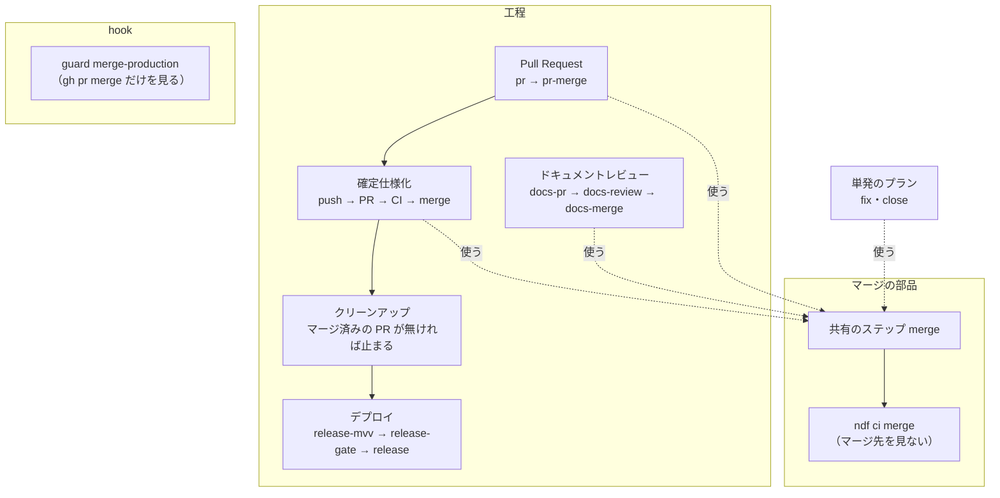
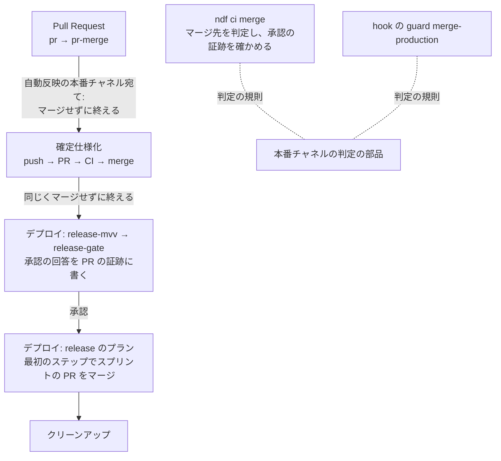
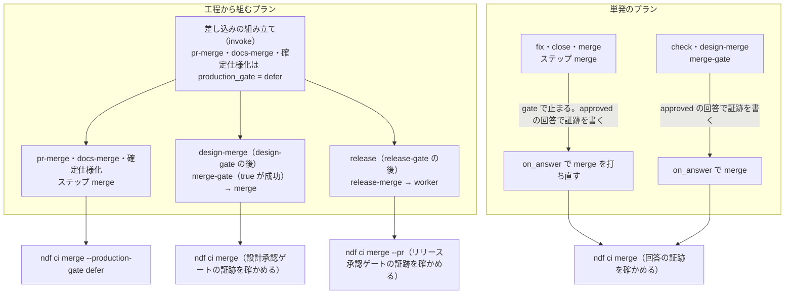
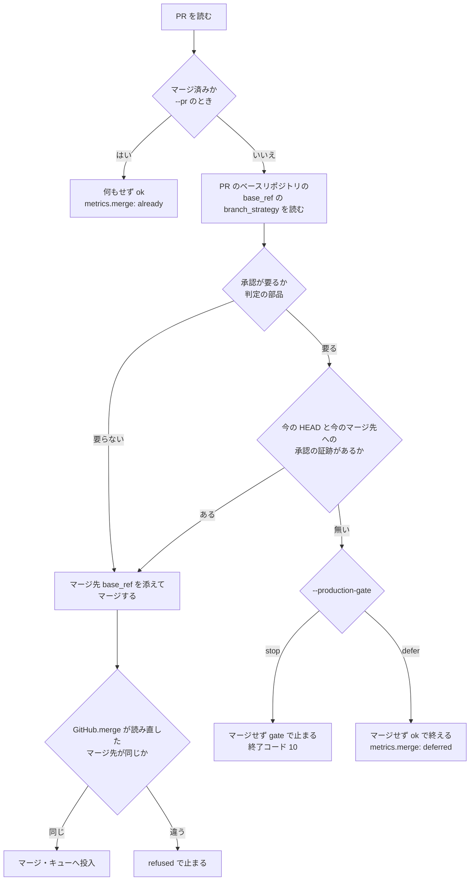

# 自動反映の本番チャネルへのマージ: 工程のどこから流しても、リリース承認ゲートの回答までマージしない（#4409）

工程を `ndf progress next` で自動で進めると、確定仕様化・工程「Pull Request」・工程「ドキュメントレビュー」のマージのステップが、人の承認の前にスプリントの PR を `main`（自動反映の本番チャネル）へマージする。マージ先を判定する規則をマージのコマンド `ndf ci merge` に入れる。承認が要るマージは、PR に残った承認の記録（承認した HEAD とマージ先を持つ）を `ndf ci merge` が確かめたときだけ行う。工程から流すプランでは、承認の無いマージをデプロイの工程のリリース承認ゲートへ回し、承認の後にデプロイの工程の中でマージする。あわせて、クリーンアップをデプロイの後へ移す。採らなかった案は「決定の記録」にあり、外部の調査は省いた（末尾の「外部の調査」）。

## 今の姿

何が起きたか・目的・受け入れ条件は要求仕様（[issue-4409-requirements.md](./issue-4409-requirements.md)、正は #4409 の本文）にある。この文書は「どう解くか」と「なぜその解き方か」だけを書く。

**根本原因は、マージ先が自動反映の本番チャネルかを決める規則の置き場所にある。** 規則は hook の中にしか無く、工程のプランが共通で使うマージのコマンドには無い。

| マージの打ち方 | 止まるか |
| --- | --- |
| AI が端末から打つ `gh pr merge` | hook の検査 `merge-production` が止める |
| プランのマージのステップが打つ `ndf ci merge` | 止まらない。マージ先を見ずにマージする |

設計に要る今の構造は次のとおりである。

| 箇所 | 今の振る舞い |
| --- | --- |
| 共有のステップ `merge`（`contracts/templates/parts/steps.json`） | `ndf ci merge --branch <ブランチ> --method <方式>` を打つ。テンプレート `merge`・`plan-to-spec`・`close`・`fix`・`check`・`design-merge` がこのステップを使う |
| `ndf ci merge`（`src/ndf/ci_cli.py` の `_merge`） | ブランチの開いた PR を、作業場所の HEAD を添えてマージする。見るのはレビューを経た HEAD と、本文に残った未決の行だけである。PR のマージ先（`Pull.base_ref`）は読めるが使っていない |
| 承認ゲートのステップ `merge-gate` | テンプレート `check`・`design-merge` だけが持つ。`on_answer` は `approved` → `merge`、`rejected` → 終わり。単発のプランでは差し込み `gate` の既定 `ndf answer ask` が終了コード 10 で止まり、回答を待つ |
| 工程から流すプランの `merge-gate` | 差し込み `gate` が `true`（`progress/invoke.py` の `STAGE_GATE`）になる。`true` は質問せずに終了コード 0 で成功するので、`merge-gate` は止まらず、通常の遷移で次のステップ `merge` へ進む。承認は工程の承認ゲート（設計承認ゲート）が持つ |
| hook の判定（`src/ndf/domains/hooks/strict.py` の `_deliveries`・`_automatic_production`） | 作業ディレクトリの `.ndf/project.json` の `branch_strategy.release.deliveries` に、`channel: production` で `kind` が `manual` でない行があれば止める。`release` が読めて `deliveries` のキーが無いときは、`release.cd`（本番ブランチへのマージで起動する CD の workflow の設定）があれば自動反映の行 1 つ、無ければ空の配列として扱う。設定を読めなければ止める。標準ライブラリだけで書く |
| 承認の証跡（`src/ndf/domains/release/trail.py`） | リリースの PR に、回答（承認・却下）・回答したときの HEAD の SHA・担い手（利用者 `user` / MVV 判定 `mvv`）をコメントで残す。信用する書き手が書き、作成の後に編集されていないコメントだけを数える。回答するときに HEAD が提示から動いていれば書かない |
| 工程の承認ゲートの回答（`src/ndf/progress/gate/answering.py`） | 回答と、回答した人が見た HEAD と承認資料の sha256 を、工程の状態の記録に残す。PR へは書かない |
| 工程の順（`contracts/workflow/modes/*.json`） | 5 つのモードのどれも、Pull Request → （確定仕様化）→ クリーンアップ → デプロイの順である |
| クリーンアップ（`contracts/templates/merged.json`） | ブランチのマージ済みの PR が無いと `precondition` で止まる |
| `production-merge.md` | 「マージのステップが終了コード 10 で止まり、`--gate-approved user` を付けて打ち直す」と書くが、今の `ndf ci merge` にこの形は無い。設計 PR のマージ先が自動反映の本番チャネルなら、設計承認ゲートの承認資料に「このマージで本番へ出る」ことを書くと定める |

## 文脈と制約

- 1 回のマージに承認を 2 回求めない。承認ゲートの数を増やさない（要求仕様の「境界」、`development-workflow` の「人手の承認を求める承認ゲート」）
- 次の 2 つの PR は、今と同じく止まらずにマージする（受け入れ条件 7・8）
  - マージ先が本番チャネルでない PR
  - 反映の設定に自動反映の行が無い本番チャネルへの PR
- 人が端末や GitHub の画面で行うマージは止めない
- マージ先が自動反映の本番チャネルかは、マージ先のリポジトリの `branch_strategy` だけから決める（要求仕様の前提 2）。設定が無い・読めないときは当たるとして扱う（受け入れ条件 9）
- 承認の記録は次のどちらかである（前提 1）
  - 利用者がリリース承認ゲートで承認した回答
  - `pace: fast` / `pace: auto` で、MVV 判定が承認ゲートを通した記録。レッドラインに当たる操作は MVV 判定で通さない
- 承認の記録は、承認した PR・承認したときの HEAD・マージ先に結び付いていなければ、マージに使わない。承認の後に HEAD やマージ先が変わったら、承認を取り直す
- 承認でマージが本番へ反映されるときは、承認資料にそのことを書く（`production-merge.md`）。承認する人が、設計や検査の判断だけを求められたと思ったまま本番への反映を決めないようにする
- hook の判定は標準ライブラリだけで書く（hook は環境が無いときシステムの `python3` で動く）
- 動いている状態機械は、作った時点の工程の定義の写し（`progress/run.py` の `View.snap`）で進む。写しには工程の順と各工程のステップの並びが入る。工程の順やステップを変えても、既に始めたスプリントには届かない
- プランのテンプレートの中身（`contracts/templates/*.json`）は写しに入らない。工程のステップ `ndf.plan` が流れる時点で、入っている版のテンプレートを読む（`progress/invoke.py` の `template`）

## 解き方の全体像

- `ndf ci merge` が PR のマージ先を、PR のベースリポジトリにあるマージ先のブランチの `branch_strategy` で判定する。判定の規則は hook と同じ部品を使う
- 承認が要るときは、PR に残った承認の証跡を `ndf ci merge` が読み、今の HEAD と今のマージ先への承認があるときだけマージする。呼び手が引数で「承認済み」と伝える形は採らない
- 承認の証跡は、人が承認の回答をした時点で、回答を記録する側が PR へ書く。工程の承認ゲート（設計承認ゲート・リリース承認ゲート）、MVV 判定の通過、単発のプランの承認待ちへの回答の 3 つである
- 承認の証跡が無いときの扱いは、プランの種類で分かれる
  - 工程から流す `pr-merge`・`docs-merge`・確定仕様化: マージせずにステップを終え、プランを先へ進める（デプロイの工程へ回す）
  - 単発のプラン（`fix`・`close` など）と、工程から流す `design-merge`: 承認待ち（終了コード 10）で止まる
- デプロイのテンプレート `release` は、最初のステップでスプリントの PR をマージしてから、今までの作業へ進む。テンプレートは流す時点で読むので、このリリースの前に始めたスプリントでも同じに動く
- 承認ゲートを既に持つテンプレート（`check`・`design-merge`）は、承認ゲートへの回答が証跡になるので、マージのステップでもう一度止まらない
- クリーンアップはデプロイの後に動く。スプリントの PR はクリーンアップより先にマージされている

## 構成要素

| 要素 | 責務 |
| --- | --- |
| 本番チャネルの判定の部品（新設 `src/ndf/core/production_merge.py`） | `branch_strategy` のセクション（読めなければ無し）とマージ先のブランチから、判定の値（「処理の流れ」の最後の表にある 5 つ）を返す。外部を呼ばない純粋な関数で、標準ライブラリだけで書く |
| `ndf ci merge`（変更） | PR のベースリポジトリから、マージ先のブランチの設定を読み、判定の部品で承認の要否を決める。承認が要れば承認の証跡を確かめる。証跡が無ければ、引数で選んだ形（止まる / 回す）で終える。`--branch` に加えて `--pr` で PR を指せる |
| 承認の証跡（`domains/release/trail.py`、変更） | 証跡の行に「マージ先」を足す。今の HEAD と今のマージ先への承認があるかを返す関数を足す（入力は読んだ PR） |
| 承認を記録するコマンド `ndf ci approve`（新設） | `--repo`・`--pr`・`--presented <見せた HEAD>`・`--answer`・`--by` を受け、証跡を PR へ書く。HEAD が見せた値から動いていれば書かずに `refused` で止まる（`trail.answer` と同じ） |
| PR の承認を問うコマンド `ndf ci ask`（新設） | `--branch` の PR と今の HEAD を承認資料に載せ、終了コード 10 で止まる。マージ先が自動反映の本番チャネルなら、承認資料に本番へ反映されることを書く。`routes` は `ndf ci approve`（PR と見せた HEAD を埋めたもの）と、今と同じプランへの回答の記録の 2 つを打つ形にする。差し込み `gate` の既定（`contracts/templates/params.json`）を `ndf answer ask` からこれに替える |
| 工程の承認ゲートの回答（`progress/gate/answering.py`、変更） | 質問が PR を持つ承認ゲート（設計承認ゲート・リリース承認ゲート）で承認の回答を受けたら、回答した人が見た HEAD で証跡を PR へ書く。担い手は利用者なら `user`、MVV 判定が通したなら `mvv` |
| MVV 判定の承認ゲート（`domains/records/mvv_gate.py`、変更） | `pace: fast` / `pace: auto` で承認ゲートを通すときに、担い手 `mvv` の証跡を書く。レッドラインに当たれば通さず、証跡も書かない |
| 承認資料（`progress/gate/asking.py` の `material` と、`merge`・`merge-gate` の承認資料、変更） | マージ先が自動反映の本番チャネルなら、「この承認で PR がマージされ、本番へ反映される」と書く |
| `GitHub.merge`（`adapters/github.py`、変更） | マージ先 `expect_base` を受け、読み直した PR のマージ先が違えばマージもキューへの投入もせずに断る。リポジトリのファイルを条件付きの要求（`If-None-Match`）で読む関数を足す |
| hook の guard `merge-production`（変更） | 届け先の行の判定を、判定の部品から呼ぶ。止める条件は変えない |
| 共有のステップ `merge`（変更） | `--production-gate {{production_gate}}` を足す。`on_answer` は `approved` → `merge`（同じステップを打ち直す）、`rejected` → 終わり |
| テンプレート `release`（変更） | 最初のステップ `release-merge` で、入力 `pr` のスプリントの PR をマージする。その後に今までの作業（worker）を流す |
| 差し込みの組み立て（`progress/invoke.py`、変更） | 工程から組むプランの `production_gate` を決める。`merge`（`pr-merge`・`docs-merge`）と `plan-to-spec` は `defer`、ほかは既定の `stop` |
| 工程の順（`contracts/workflow/modes/*.json`、変更） | 5 つのモードで、クリーンアップをデプロイの直後へ移す |

## 入出力のコントラクト

### `ndf ci merge`

| 項目 | 内容 |
| --- | --- |
| 名前 | `ndf ci merge (--branch <ブランチ> \| --pr <番号>) [--repo] [--method] [--reviewed] [--production-gate stop\|defer]` |
| 足す入力 | `--pr`: マージする PR の番号。作業場所が無くても打てる。`--production-gate`: 承認が要って承認の証跡が無いときの終え方。`stop`（既定）は承認待ちで止まる。`defer` はマージせずに終え、承認をデプロイの工程へ回す |
| 渡す HEAD | `--branch` のときは今と同じく作業場所の HEAD。`--pr` のときは、承認が要れば証跡の HEAD、要らなければ PR を読んだときの HEAD |
| 判定に読む設定 | PR のベースリポジトリ（`--repo`、省けば作業場所のリモート）の、マージ先のブランチ（`Pull.base_ref`）にある `.ndf/project.json` の `branch_strategy`。GitHub の API でファイルを読み、Git のリモートは使わない。読めなければ「決められない」として扱う |
| 承認の確かめ | 承認が要るときだけ、PR の証跡を読む。承認とみなすのは、信用する書き手の編集されていない証跡で、回答が承認、HEAD が PR の今の HEAD、マージ先が PR の今の `base_ref` のものだけ |
| 出力（マージした） | 今と同じ `ok`。承認を使ったときは `metrics.approved_by` に証跡の担い手（`user` / `mvv`）を載せる |
| 出力（マージ済みだった） | `--pr` で指した PR が既にマージ済みなら、衝突の確かめも判定もマージもせずに `ok`。`metrics.merge` は `already` |
| 出力（承認待ちで止まる） | `gate`（終了コード 10）。`metrics.gate` は `production-merge`、`items` に PR、`outputs.head` に見せた HEAD。`routes.approved`・`routes.rejected` は `ndf ci approve` に PR と見せた HEAD を埋めたもの（担い手 `--by` は打つ側が埋める） |
| 出力（デプロイの工程へ回す） | `ok`。`metrics.gate` は `production-merge`、`metrics.merge` は `deferred`、`items` に PR。マージはしていない |
| 失敗の形 | 今と同じ（`precondition`・`refused`・`ci_pending` など）。判定の後にマージ先が変わったときは `refused` |
| 互換性 | 引数を渡さない呼び出しは、マージ先が自動反映の本番チャネルで証跡が無いときだけ振る舞いが変わる（マージせずに止まる）。後方互換は求めない（MVV Value 4） |

### テンプレートの差し込みとステップ

承認した者を差し込みで渡す形（`approved_by`）は作らない。承認は PR の証跡で確かめるので、工程のどのプランも、承認ゲートの回答の有無でプランを組めなくなることは無い。

| 差し込み・ステップ | 工程から組むプラン | 単発のプラン（`ndf route render`） |
| --- | --- | --- |
| `production_gate` | `pr-merge`・`docs-merge`・確定仕様化は `defer`（承認はデプロイの工程のリリース承認ゲートで取るため）。`design-merge` と `release` は既定の `stop` | 既定 `stop` |
| ステップ `merge-gate` | 差し込み `gate` は `true`。成功して通常の遷移で `merge` へ進む。`merge` は設計承認ゲートの回答が書いた証跡を確かめてマージする | 差し込み `gate` の既定 `ndf ci ask` が終了コード 10 で止まる。回答 `approved` の `routes` が `ndf ci approve` で証跡を書き、`on_answer` で `merge` へ進む。`merge` は証跡を確かめるので、もう一度止まらない |
| ステップ `merge` | `--production-gate {{production_gate}}` を足す。マージした・回した（`deferred`）ときはどちらも `ok` で、今と同じ `next`（多くは終わり）へ進む。`on_answer` へは流れない | 同じ。証跡が無ければ終了コード 10 で止まり、回答 `approved` の後に `on_answer` で同じ `merge` を打ち直す。打ち直しは証跡を確かめてマージする |
| ステップ `release-merge`（テンプレート `release` の最初） | `ndf ci merge --pr {{pr}} --method {{merge_method}}`。マージ済みなら何もせずに終える。証跡が無い・HEAD かマージ先が承認の後に変わったときは、承認待ちで止まる | 使わない |

## 処理の流れ

工程から組むプランと単発のプランが、どのステップを通って `ndf ci merge` を打つかを次に示す。

`ndf ci merge` がマージするかを決める順序である。

判定の部品が返す値は次の 5 つである。`release.cd` は、本番ブランチへのマージで起動する CD の workflow の設定である。`deliveries` も `cd` も無いときは、hook は今と同じく通し、`ndf ci merge` は要求仕様の受け入れ条件 9 に従い承認を求める。hook の振る舞いを変えないために、部品はこの場合を別の値で返し、呼ぶ側が扱いを決める。

| マージ先 | 設定 | 部品が返す値 | hook | `ndf ci merge` |
| --- | --- | --- | --- | --- |
| 本番チャネル（`branches.production`）でない | 読めた | `not_production` | 使わない（hook はマージ先を見ない） | 承認は要らない |
| 本番チャネル | `release.deliveries` に `channel: production` で `kind` が `manual` でない行がある | `automatic` | 止める | 承認が要る |
| 本番チャネル | `release.deliveries` のキーが無く、`release.cd` がある | `automatic` | 止める | 承認が要る |
| 本番チャネル | `release.deliveries` が配列で、当たる行が無い（`kind: manual` だけ・空） | `manual` | 通す | 承認は要らない |
| 本番チャネル | `release` は読めるが、`release.deliveries` も `release.cd` も無い | `unset` | 通す（今の空の配列と同じ） | 承認が要る |
| 決められない | `branch_strategy` や `release` を読めない・`release.deliveries` が配列でない・ファイルを読んだリポジトリが PR のベースリポジトリと違う | `unknown` | 止める | 承認が要る |

## 決定の記録

### 決定 1: どの経路のマージも同じに止めるため、判定をマージのコマンド `ndf ci merge` に置く

- **質問**: マージ先の判定を、どの層に置くか
- **選んだ案**: プランのマージのステップが共通で打つ `ndf ci merge` が判定する。次のテンプレートが同じ判定を通る: `merge`・`plan-to-spec`・`close`・`fix`・`check`・`design-merge`・`release`（最初のステップ `release-merge`）
- 採らなかった案: テンプレート `plan-to-spec` と `close` だけに条件を足す（要求の起票者の推定 S2）。工程「Pull Request」の `pr-merge` と工程「ドキュメントレビュー」の `docs-merge` が塞がらない。マージのステップを使うテンプレートを足すたびに、条件を足し忘れる
- 採らなかった案: 工程の進行（`ndf progress`）の側でマージのステップを止める。単発のプラン `fix`・`close` は工程を通らないので塞がらない
- **代償**: `ndf ci merge` がマージ先の設定を読むため、マージのたびに設定を 1 回読む（読み方と回数は決定 3）
- 根拠: Value 7「不具合は、現象が出た場所ではなく根本原因の場所で直され、形を変えて戻ってこない」（MVV バージョン 11）

### 決定 2: hook とマージのコマンドで判定が食い違わないよう、届け先の行の判定を 1 つの部品に移す

- **質問**: hook の判定（`strict.py` の `_deliveries`・`_automatic_production`）とマージのコマンドの判定を、別々に持つか
- **選んだ案**: 標準ライブラリだけで書いた判定の部品（`src/ndf/core/production_merge.py`）を新設する。hook と `ndf ci merge` の両方がそこから呼ぶ。使い方は次のとおりである

  | 呼ぶ側 | 部品の使い方 |
  | --- | --- |
  | hook | マージ先のブランチを得られないので、「本番チャネルへ自動で届く行があるか」だけを使う。値 `unset` は今と同じく通す |
  | `ndf ci merge` | マージ先のブランチと合わせて使う。値 `unset` と `unknown` は承認が要るとして扱う |

- 採らなかった案: `ndf ci merge` に同じ規則を書き写す。同じ規則を 2 か所に持ち、片方だけが直る
- **代償**: hook のモジュールが新しい部品を import し、hook の import の表に部品を足す。部品は標準ライブラリだけで書く制約を負う
- 根拠: Value 11（MVV バージョン 11）

### 決定 3: 直す PR が自分の判定を外せず、別のリポジトリの設定で判定しないよう、PR のベースリポジトリのマージ先のブランチから読む

- **質問**: 判定に使う `branch_strategy` を、どこから、どう読むか
- **選んだ案**: PR を読んだリポジトリ（`--repo`、省けば作業場所のリモート）を PR のベースリポジトリとし、その `base_ref` にある `.ndf/project.json` を GitHub の API（リポジトリのファイルの読み取り）で読む。PR の応答のベースリポジトリが、読んだリポジトリと違えば `unknown` とする。Git のリモートからは読まない
- 読む回数: `ndf ci merge` 1 回につき HTTP の要求が 1 回である。Git のプロセスの起動とリモートからの取得は増えない。読んだ内容は応答の `ETag` と合わせて、リポジトリとマージ先のブランチの組ごとに状態のディレクトリへ残す。次の読み取りは `If-None-Match` を付けた条件付きの要求にし、変わっていなければ（304）残した内容を使う
- 更新を確かめる時点: 毎回の `ndf ci merge` で条件付きの要求を送る。残した内容を確かめずに使うことはしない。マージ先の設定はスプリントの途中でも変わり得るためである
- 採らなかった案: 作業場所の `.ndf/project.json` を読む。マージする PR 自身が設定を書き換えると、判定を外せる
- 採らなかった案: メインディレクトリの `.ndf/project.json` を読む。hook と同じ読み方である。ただし、メインディレクトリが別のブランチを取り出していると、マージ先と違う設定で判定する
- 採らなかった案: 作業場所のリモートからマージ先のブランチを取得し、`core/branch_strategy.py` の `load_at_ref` で読む。作業場所の既定のリモートが PR のベースリポジトリと同じとは限らず、別のリポジトリにある同じ名前のブランチの設定で判定し得る。マージのたびに Git の起動とリモートからの取得が 1 回ずつ増え、同じ PR が `pr-merge`・確定仕様化・`release-merge` を通ると 3 回ずつ増える
- **代償**: 判定のたびに GitHub の API を 1 回呼ぶ。変わっていない読み取りは 304 で返り、GitHub の主な要求数の上限に数えない（GitHub の「条件付きの要求」の説明）
- 根拠: Value 1「速さや費用のために、人の承認を省かない」（MVV バージョン 11）

### 決定 4: 承認ゲートを増やさずにデプロイまで進めるため、工程から流すプランでは承認の無いマージをデプロイの工程へ回す

- **質問**: 工程から流すプラン（`pr-merge`・`docs-merge`・確定仕様化）が、承認の無いマージに着いたときの扱い。そこで承認を待つか、先へ進めるか
- **選んだ案**: マージせずにステップを `ok` で終え（`--production-gate defer`）、プランと工程を先へ進める。承認はデプロイの工程のリリース承認ゲートが 1 回で取る。単発のプランは工程の外で流れる。そのため、そのプランの中で承認待ち（終了コード 10）で止まる。工程から組む `design-merge` は `defer` にしない。設計承認ゲートの回答が証跡になるので通常は止まらず、承認の後に HEAD が動いたときだけ止まる
- 採らなかった案: 工程から流すプランでも承認待ちで止まる。工程の進行がその場で回答を待ち、デプロイのリリース承認ゲートへ進めない。回答すればリリース承認ゲートとの 2 回の承認になり、受け入れ条件 6・10 に反する
- 採らなかった案: 工程「Pull Request」に承認ゲートを足す。承認ゲートの数を増やすので、要求仕様の「境界」で行わない
- **代償**: 工程「Pull Request」が `ok` で終わっても、スプリントの PR はまだマージされていない。マージ済みかは PR の状態と結果の `metrics.merge` で見分ける
- 根拠: Value 1「利用者が手を止めるのは、作るかを決めるときと、出してよいかを決めるときだけである」（MVV バージョン 11）

### 決定 5: 承認の後のマージを決まった手順で流し、このリリースの前に始めたスプリントにも届けるため、デプロイのテンプレート `release` の最初でマージする

- **質問**: リリース承認ゲートの承認の後、回した PR を誰がどこでマージするか
- **選んだ案**: テンプレート `release` の最初にステップ `release-merge`（`ndf ci merge --pr {{pr}}`）を置き、その後に今までの worker の作業を流す。`pr` はデプロイの工程の入力で、今の定義にも既にある。テンプレートは工程の定義の写しに入らず、流す時点で読むので、このリリースの前に始めたスプリントでも同じに動く
- `ndf ci merge --pr` は、最初に PR の状態を読み、マージ済みなら衝突の確かめもマージもせずに終える。マージ済みになるのは、本番チャネルでないマージ先で `pr-merge` がマージしたときである
- 衝突の確かめとマージ先の取り込みは置かない。承認の後にコミットを足すと HEAD が変わり、承認を取り直すことになるためである。衝突していれば GitHub がマージを断り、`refused` で止まる
- 作業場所は要らない。マージに添える HEAD は、証跡が承認した HEAD である
- 採らなかった案: デプロイの工程の `release-gate` と `release` の間に、新しいステップを置く。このリリースの前に始めたスプリントでは、工程の定義の写しに新しいステップが無いので流れない。入力に `branch` と `worktree` も要る
- 採らなかった案: 回したプランを、記録した回答の経路から続きで流す。回したプランが同じスプリントで 2〜3 本になり、どれを続けるかの記録が要る。回したプランを、実行の途中のまま残すことにもなる
- 採らなかった案: `release` の worker がマージする。判断の要らない手順を AI に任せると、実行ごとに結果がばらつく
- **代償**: テンプレート `release` の差し込みに `pr` と `merge_method` が増える
- 根拠: Value 3「判断の要らない手順（待ち・集計・検査・記録・整形・起動の組み立て）は仕組みが進める」（MVV バージョン 11）

### 決定 6: スプリントの PR がマージされた後に片付けるため、クリーンアップをデプロイの後へ移す

- **質問**: スプリントの PR がデプロイの工程までマージされないとき、その前にあるクリーンアップをどう扱うか
- **選んだ案**: 5 つのモードで、クリーンアップをデプロイの直後へ移す。クリーンアップの時点では、どのリポジトリでもスプリントの PR がマージされている
- 採らなかった案: クリーンアップを今の位置に残し、開いた PR に当たったら飛ばして、デプロイの工程が後で片付ける。片付けが 2 か所になり、どちらが何を消したかを記録で合わせる必要が出る
- **代償**: デプロイの間も作業場所とブランチが残る。リリース承認ゲートで却下されると、クリーンアップは開いた PR に当たって今と同じく `precondition` で止まる。工程の順の変更は、このリリースの後に始めたスプリントにだけ届く（このリリースの前に始めたスプリントの扱いは「影響と危険」）
- 根拠: Value 6「NDF が作業で生んだもの（ブランチ・作業ディレクトリ・状態の記録・一時ファイル）は役目を終えると自動で片付き」（MVV バージョン 11）

### 決定 7: 承認の記録の無い変更や承認の後に足した変更をマージしないため、`ndf ci merge` が PR の承認の証跡を確かめる

- **質問**: 承認ゲートの後のマージ（`check`・`design-merge`・デプロイ）で、`ndf ci merge` は何を見て承認済みと決めるか
- **選んだ案**: 人が承認の回答をした時点で、回答を記録する側が PR へ承認の証跡（`domains/release/trail.py` の形）を書く。証跡は回答・回答したときに見せた HEAD・マージ先・担い手を持つ。`ndf ci merge` は承認が要るときに PR の証跡を読み、次のすべてを満たすときだけマージする
  - 証跡が PR のベースリポジトリの、その PR にある（読む PR から決まる）
  - 信用する書き手が書き、作成の後に編集されていない
  - 回答が承認で、HEAD が PR の今の HEAD、マージ先が PR の今の `base_ref` と同じ

  証跡を書く場所は次の 3 つである

  | 承認の取り方 | 証跡を書く側 | 担い手 |
  | --- | --- | --- |
  | 工程の承認ゲート（設計承認ゲート `design-gate`・リリース承認ゲート `release-gate`） | `progress/gate/answering.py`。回答した人が見た HEAD で書く | 利用者 `user` |
  | `pace: fast` / `pace: auto` の MVV 判定が承認ゲートを通した | `domains/records/mvv_gate.py`。レッドラインに当たれば通さず、書かない | MVV 判定 `mvv` |
  | 単発のプランの承認待ち（`ndf ci merge` の `gate`・`ndf ci ask`） | `routes` の `ndf ci approve` | 回答した人（打つ側が `--by` で埋める） |

- 承認資料: 承認でマージが本番へ反映されるときは、どの承認資料にも「この承認で PR がマージされ、本番へ反映される」と書く。設計承認ゲート・単発の `check`・`design-merge` の承認資料も同じである（`production-merge.md`）
- 承認ゲートの無い工程（Pull Request・ドキュメントレビュー・確定仕様化）のプランは、証跡を求めずに組める。証跡が無ければマージを回すだけである（決定 4）
- 採らなかった案: `ndf ci merge` に `--gate-approved user|mvv` で承認した者を渡す。引数を渡すだけでマージでき、承認の記録の無い変更や、承認の後に足した変更もマージできる
- 採らなかった案: `ndf ci merge` が工程の状態機械を読んで承認を確かめる。CI の層が工程の層を読み、依存の向きが逆になる。単発のプランには状態機械が無い
- **代償**: 証跡の行に「マージ先」が増える。マージ先の行を持たない今までの証跡は、`ndf ci merge` の承認に数えない。承認ゲートの回答のたびに PR へコメントを 1 件書く
- 根拠: Value 1「速さや費用のために、人の承認を省かない」、Value 9「下の層は上の層を読まず、依存の輪が無い」（MVV バージョン 11）

### 決定 8: 判定の後にマージ先が変わった PR を本番へ入れないため、判定したマージ先をマージの要求まで渡す

- **質問**: `ndf ci merge` が判定した後に PR のマージ先が変えられたら、どうするか
- **選んだ案**: `ndf ci merge` が判定に使った `base_ref` を `GitHub.merge(expect_base=...)` へ渡す。`GitHub.merge` は PR を読み直し、マージ先が違えば、マージもマージキューへの投入もせずに `refused` で断る。打ち直すと、新しいマージ先で判定と証跡の確かめをやり直す
- 採らなかった案: 今の HEAD の照合だけを残す。HEAD を変えずにマージ先だけを本番チャネルへ変えると、承認を経ずに本番へ入る
- **代償**: 読み直しと GitHub へのマージの要求の間にマージ先が変わる余地は残る。GitHub のマージの API は HEAD しか照合できないためである。この間は 1 回の HTTP の要求の間だけである
- 根拠: Value 1（MVV バージョン 11）

## 影響と危険

- **働く範囲**: NDF を使うすべてのリポジトリで働く。`ndf ci merge`・テンプレート・工程の順は NDF の配る部品である
- **プロジェクトごとに違うもの**: マージ先の `branch_strategy`（`branches.production` と `release.deliveries`）を設定で受ける。新しい設定は足さない
- **当たるモード**: 5 つのモードすべて（工程の順が変わる）。マージを回すのは、マージ先が自動反映の本番チャネルのときだけである
- **ドキュメントレビューのマージ**: マージ先が自動反映の本番チャネルのリポジトリでは、文書の PR がデプロイの工程まで開いたままになる。実装のコミットも同じブランチと PR に積まれる。設計 PR は今と同じく設計承認ゲートの承認でマージする（`design-merge` は決定 7 で 1 回で通る）
- **マージキュー**: `release-merge` のマージは `pr-merge` と同じ部品で、マージキューの待ちの扱いも今と同じである。キューへ入れる前にもマージ先を照らす（決定 8）
- **このリリースの前に始めたスプリント**: 工程の順とステップは作った時点の写しで進むので、クリーンアップはデプロイより前に残る。テンプレートは流す時点で読むので、マージの判定とデプロイの最初のマージは新しい形で動く
  - Pull Request・確定仕様化のマージは回され、PR は開いたままになる
  - クリーンアップが開いた PR に当たって `precondition` で止まる。止まったら `ndf progress disable` でクリーンアップを外して進める
  - デプロイのリリース承認ゲートで承認すると、回答が証跡を書き、テンプレート `release` の最初の `release-merge` が同じ PR をマージする
  - 外したクリーンアップは、デプロイの後に `ndf progress enable` で戻し、`ndf progress retry` で流す
- **hook**: hook のモジュールの import が増える。判定の部品を hook の import の表（`contracts/hooks/imports.json` の `modules` と `stdlib_only`）へ足す。標準ライブラリだけで動くことは `tests/domains/hooks/test_imports.py` が見る
- **同じファイルを触る変更**: 次の不具合は工程の進行の側を直す（ https://github.com/devbasex/ai-plugins/issues/3957 ）。承認ゲートを持つ工程を `ndf progress finish` で終えると、回答を待たずに次へ進む不具合である。この設計は工程の順とデプロイの工程の定義を触るので、同じスプリントに入れば `contracts/workflow/` で重なる

### 代表のリポジトリでの振る舞い

| 代表のリポジトリ | 設定の要点 | 直した後に起きること | この種類で扱えなくなること |
| --- | --- | --- | --- |
| Web サービス（例: ベースブランチ `develop`・本番チャネル `main`、両方に自動反映の行） | 実装の PR は `develop` 宛て、リリースの PR は `develop` → `main` | `develop` 宛てのマージは本番チャネルでないので今と同じく流れる。`main` へのリリースの PR は今と同じリリースの手順で承認を取る | 無し |
| モバイルアプリ（例: `release_branch`・ベースブランチ `dev`・本番ブランチ `prod`） | スプリントは `dev` へ入り、`prod` へはリリースブランチで入る | `dev` 宛てのマージは今と同じく流れる | 無し |
| 業務文書だけ（`documentation` モード。反映の設定を持たないことがある） | 本番チャネルの行が無いか、`branch_strategy` を置かない | `branch_strategy` を読めればマージ先で判定する。読めなければ当たるとして扱い、マージをデプロイの工程（制作物承認）の後へ回す | 無し（マージの時点が承認の後へ移るだけで、マージはできる） |

### ai-plugins だけの事情

| 値 | 置く所 | 持つ Issue |
| --- | --- | --- |
| ベースブランチと本番チャネルがどちらも `main`、`release.deliveries` に `kind: auto` の行 | `.ndf/project.json` の `branch_strategy` | 自動反映の本番チャネルへのマージを承認まで止める不具合の直し（ https://github.com/devbasex/ai-plugins/issues/4409 、この設計。スプリントの PR のマージがデプロイの工程の承認の後へ移る） |

## テスト設計

| 受け入れ条件 | どの振る舞いで縛るか | どう壊したら落ちるべきか |
| --- | --- | --- |
| 1 | ベースブランチと本番チャネルが同じで自動反映の行がある設定で、確定仕様化のプランを工程から組んで流すと、push と CI の待ちまで進み、マージの呼び出しが 0 回で `ok` で終わる。PR は開いたまま | 工程から組んだプランの `production_gate` を `stop` にすると、プランが承認待ちで止まり落ちる。判定を外すとマージが呼ばれて落ちる |
| 2 | 同じ設定で、工程「Pull Request」の `pr-merge` のプランがマージせずに `ok` で終わり、結果の `metrics.merge` が `deferred`。プランは `merge` の `next` へ進み、`on_answer` の先へは流れない | 判定の部品がマージ先を見ずに「要らない」を返すように壊すと、マージが呼ばれて落ちる。`deferred` を `gate` にすると落ちる |
| 3 | 同じ設定で、工程「ドキュメントレビュー」の `docs-merge` のプランも 2 と同じに終わる | 2 と同じ |
| 4 | 単発のプラン `fix`・`close` を同じ設定で流すと、マージのステップが終了コード 10 で止まり、`routes.approved` が見せた HEAD を埋めた `ndf ci approve` である | `production_gate` の既定を `defer` にすると、承認待ちにならず落ちる |
| 5 | 4 で止まったプランへ回答して証跡を書くと、`on_answer` で `merge` を打ち直し、同じ PR がマージされる。デプロイの工程では、`release-gate` の承認の回答が証跡を書き、テンプレート `release` の `release-merge` が同じ PR をマージする | `merge` の `on_answer` から `approved` を消すと、承認の後にマージされず落ちる。回答が証跡を書かないと落ちる |
| 5（承認の記録が無い） | 工程（`release-merge`）と単発のプラン（`fix`）の両方で、証跡が無いまま `merge` を打つと、マージの呼び出しが 0 回で止まる | 証跡を読まずにマージするように壊すと落ちる |
| 5（承認の後に HEAD が変わった） | 工程と単発のプランの両方で、証跡の HEAD と PR の今の HEAD が違うと、マージせずに止まる。証跡のマージ先と今の `base_ref` が違うときも同じ | 証跡の HEAD やマージ先を照らさないように壊すと落ちる |
| 5（担い手が MVV 判定） | MVV 判定の承認ゲートは、レッドラインに当たると担い手 `mvv` の証跡を書かない | レッドラインでも証跡を書くと落ちる |
| 6 | 単発の `check`・`design-merge` を流すと、`merge-gate` の回答が証跡を書き、`merge` は 1 回だけ呼ばれ、もう一度承認待ちにならない。工程から組んだ `design-merge` は、`merge-gate`（`true`）が成功して `merge` へ進み、設計承認ゲートの回答の証跡でマージする | `merge-gate` の回答が証跡を書かないと、`merge` が 2 回目の承認待ちで落ちる。`true` の成功で `merge` へ進まないと落ちる |
| 6（承認資料） | マージ先が自動反映の本番チャネルのとき、設計承認ゲート・`ndf ci ask`・`ndf ci merge` の `gate` の承認資料に、本番へ反映される旨の行がある | 行を書かないと落ちる |
| 7 | マージ先が本番チャネルでない PR（ベースブランチ `develop`・本番チャネル `main` で `develop` 宛て）は、`--production-gate` の値によらずマージされる | 判定の部品が本番チャネルかを見ずに「要る」を返すと落ちる |
| 8 | マージ先が本番チャネルで、`release.deliveries` に自動反映の行が無い（`kind: manual` だけ・空）PR はマージされる | `kind: manual` の行を自動反映として数えると落ちる |
| 9 | マージ先のブランチの `branch_strategy` が無い・読めない・`release.deliveries` が配列でない・`release.deliveries` も `release.cd` も無いときは、証跡が無ければマージされない | 読めないときや両方が無いときに「要らない」を返すと落ちる |
| 10 | 5 つのモードで、クリーンアップがデプロイより後にある。1 と同じ設定でスプリントを工程「Pull Request」から進めると、デプロイの `release-gate` の回答待ちまで進み、その間にブランチを消すステップが流れない | クリーンアップをデプロイの前へ戻すと落ちる |
| 10（このリリースの前に始めたスプリント） | クリーンアップがデプロイより前にある古い写しから組んだ状態機械で、クリーンアップを外してデプロイへ進め、`release-gate` に承認を回答すると、テンプレート `release` の `release-merge` が同じ PR をマージする | マージをテンプレートでなく工程の定義のステップに置くと、古い写しでマージが流れず落ちる |
| 11 | 10 の回答待ちの時点で、工程の入力 `pr` が指す PR が開いている | `pr-merge` がマージすると落ちる |
| 12 | 再現手順の 3 つ（自動反映の設定・Pull Request まで進めて PR を開いたまま・`ndf progress next`）を打つテストで、スプリントの PR へのマージの呼び出しが 0 回である。今の `main` では確定仕様化のプランがマージを呼ぶので落ちる | 1 と同じ |
| 決定 2 | hook の guard `merge-production` が、判定の部品に移した後も今と同じ入力で止める・通す。`deliveries` も `cd` も無い設定（値 `unset`）は、hook は通し、`ndf ci merge` は承認を求める | 判定の部品の戻り値を差し替えて、hook の結果が変わることを確かめる。hook が部品を呼ばずに自前の判定を持つと、差し替えても結果が変わらず落ちる |
| 決定 3 | 作業場所の `.ndf/project.json` から自動反映の行を消しても、PR のベースリポジトリのマージ先のブランチに行があれば承認が要る。作業場所のリモートが別のリポジトリで、そこにある同じ名前のブランチに自動反映の行が無くても、PR のベースリポジトリの設定で承認が要る。2 回目の読み取りが `If-None-Match` を付け、304 なら残した内容を使う | 作業場所のファイルやリモートを読むように壊すと落ちる。条件付きの要求を付けないと落ちる |
| 決定 5 | `--pr` で指した PR がマージ済みなら、衝突の確かめもマージも呼ばずに `ok`（`metrics.merge: already`）で終わる | マージ済みの確かめを後ろへ回すと、衝突の確かめかマージが呼ばれて落ちる |
| 決定 8 | 判定の後に PR のマージ先が変わっていると、`GitHub.merge` がマージもキューへの投入もせずに `refused` を返す | `expect_base` を照らさないと、マージが呼ばれて落ちる |

テストは GitHub と Git を差し替えた偽物で書き、子のプロセスの起動と本物の時間の待ちは使わない。

## 設計の結果

| 課題 | 扱い | 統合先 | 触るファイル |
| --- | --- | --- | --- |
| #4409 | 実装する | — | `plugins/ndf/src/ndf/core/production_merge.py`（新設）、`plugins/ndf/src/ndf/ci_cli.py`、`plugins/ndf/src/ndf/adapters/github.py`、`plugins/ndf/src/ndf/domains/release/trail.py`、`plugins/ndf/src/ndf/progress/gate/answering.py`、`plugins/ndf/src/ndf/progress/gate/asking.py`、`plugins/ndf/src/ndf/domains/records/mvv_gate.py`、`plugins/ndf/src/ndf/domains/hooks/strict.py`、`plugins/ndf/contracts/hooks/imports.json`、`plugins/ndf/src/ndf/progress/invoke.py`、`plugins/ndf/contracts/templates/parts/steps.json`、`plugins/ndf/contracts/templates/params.json`、`plugins/ndf/contracts/templates/merge.json`、`plugins/ndf/contracts/templates/plan-to-spec.json`、`plugins/ndf/contracts/templates/close.json`、`plugins/ndf/contracts/templates/fix.json`、`plugins/ndf/contracts/templates/check.json`、`plugins/ndf/contracts/templates/design-merge.json`、`plugins/ndf/contracts/templates/release.json`、`plugins/ndf/contracts/workflow/modes/standard.json`、`plugins/ndf/contracts/workflow/modes/light.json`、`plugins/ndf/contracts/workflow/modes/operation.json`、`plugins/ndf/contracts/workflow/modes/documentation.json`、`plugins/ndf/contracts/workflow/modes/legacy-refactor.json`、`plugins/ndf/skills/development-workflow/SKILL.md`、`plugins/ndf/skills/development-workflow/references/production-merge.md`、`plugins/ndf/skills/development-workflow/references/workflow-modes.md`、`plugins/ndf/skills/development-workflow/references/agent-layers.md`、`plugins/ndf/tests/core/test_production_merge.py`（新設）、`plugins/ndf/tests/adapters/test_ci_cli.py`、`plugins/ndf/tests/domains/hooks/test_strict.py`、`plugins/ndf/tests/progress/test_invoke_template_values.py`、`plugins/ndf/tests/progress/test_sprint_templates.py`、`plugins/ndf/tests/progress/test_definition.py`、`plugins/ndf/tests/progress/test_production_merge_flow.py`（新設）、`plugins/ndf/tests/domains/release/test_trail.py`、`plugins/ndf/tests/adapters/test_github_merge.py` |

## 外部の調査

省く: プロジェクトの中の取り決めだけで形が決まる不具合の直しである。取り決めは、`production-merge.md` の表「マージ先ごとの判定」と、hook の検査 `merge-production` の規則である。既にある判定の規則を、既にあるマージのコマンドへ足し、工程の定義の中でステップの位置を変える。外部の標準・製品・ライブラリの判断は要らない
