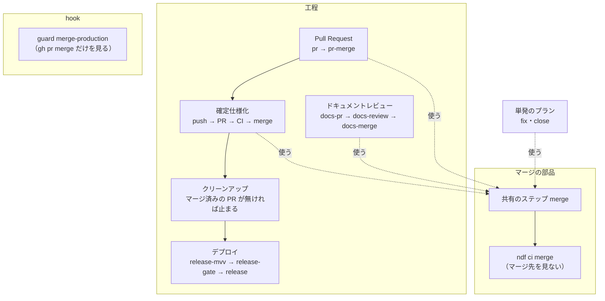
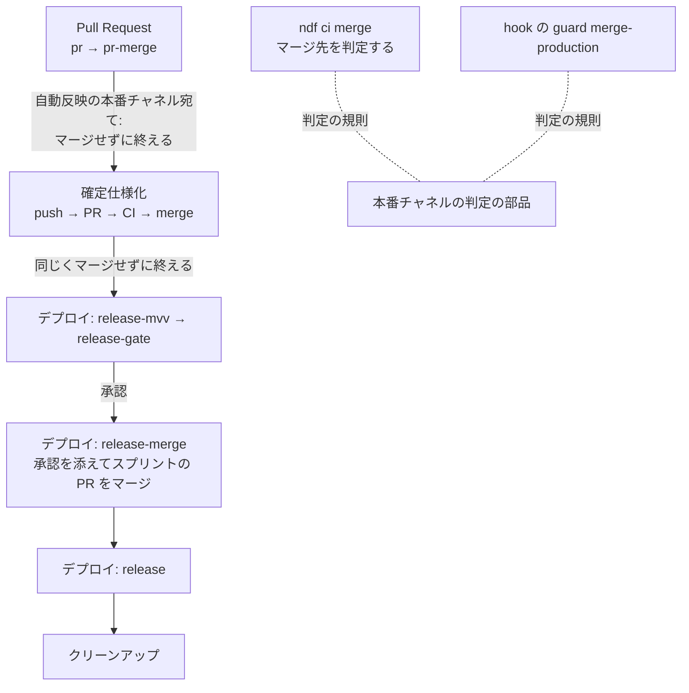
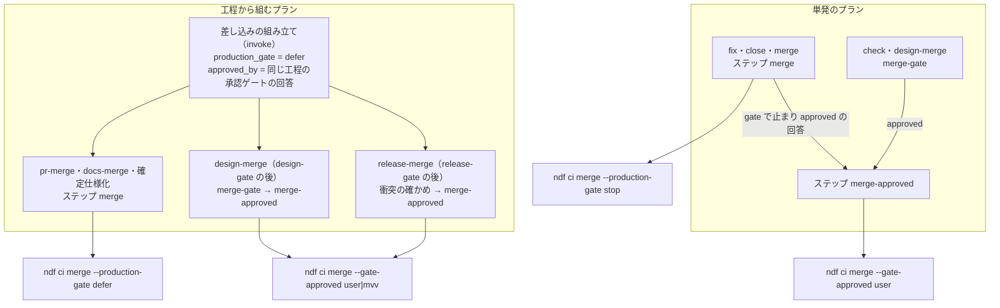
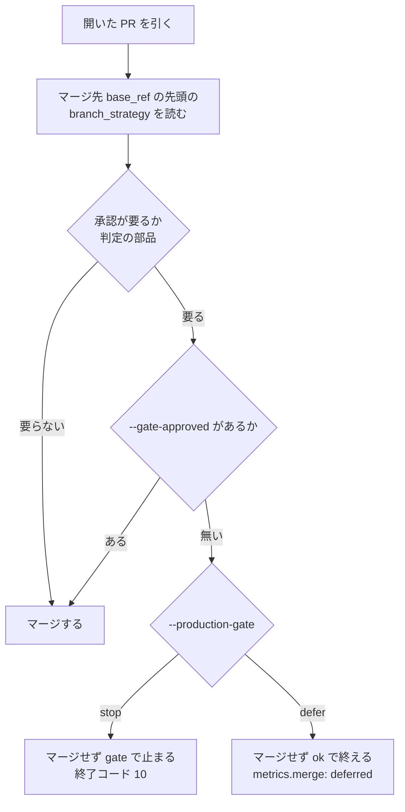

# 自動反映の本番チャネルへのマージ: 工程のどこから流しても、リリース承認ゲートの回答までマージしない（#4409）

工程を `ndf progress next` で自動で進めると、確定仕様化・工程「Pull Request」・工程「ドキュメントレビュー」のマージのステップが、人の承認の前にスプリントの PR を `main`（自動反映の本番チャネル）へマージする。マージ先を判定する規則をマージのコマンド `ndf ci merge` に入れ、工程から流すプランでは承認の無いマージをデプロイの工程のリリース承認ゲートへ回し、承認の後にデプロイの工程の中でマージする。あわせて、クリーンアップをデプロイの後へ移す。採らなかった案は「決定の記録」にあり、外部の調査は省いた（末尾の「外部の調査」）。

## 今の姿

何が起きたか・目的・受け入れ条件は要求仕様（[issue-4409-requirements.md](./issue-4409-requirements.md)、正は #4409 の本文）にある。この文書は「どう解くか」と「なぜその解き方か」だけを書く。

**根本原因は、マージ先が自動反映の本番チャネルかを決める規則の置き場所にある。** 規則は hook の中にしか無く、工程のプランが共通で使うマージのコマンドには無い。

| マージの打ち方 | 止まるか |
| --- | --- |
| AI が端末から打つ `gh pr merge` | hook の検査 `merge-production` が止める |
| プランのマージのステップが打つ `ndf ci merge` | 止まらない。マージ先を見ずにマージする |

設計に要る今の構造は次のとおりである。

| 箇所 | 今の振る舞い |
| --- | --- |
| 共有のステップ `merge`（`contracts/templates/parts/steps.json`） | `ndf ci merge --branch <ブランチ> --method <方式>` を打つ。テンプレート `merge`・`plan-to-spec`・`close`・`fix`・`check`・`design-merge` がこのステップを使う |
| `ndf ci merge`（`src/ndf/ci_cli.py` の `_merge`） | ブランチの開いた PR を、作業場所の HEAD を添えてマージする。見るのはレビューを経た HEAD と、本文に残った未決の行だけである。PR のマージ先（`Pull.base_ref`）は読めるが使っていない |
| 承認ゲートのステップ `merge-gate` | テンプレート `check`・`design-merge` だけが持つ。工程から流すプランでは差し込み `gate` が `true`（`progress/invoke.py` の `STAGE_GATE`）で、承認は工程の承認ゲート（設計承認ゲート）が持つ |
| hook の判定（`src/ndf/domains/hooks/strict.py` の `_deliveries`・`_automatic_production`） | 作業ディレクトリの `.ndf/project.json` の `branch_strategy.release.deliveries` に、`channel: production` で `kind` が `manual` でない行があれば止める。設定を読めなければ止める。標準ライブラリだけで書く |
| 工程の順（`contracts/workflow/modes/*.json`） | 5 つのモードのどれも、Pull Request → （確定仕様化）→ クリーンアップ → デプロイの順である |
| クリーンアップ（`contracts/templates/merged.json`） | ブランチのマージ済みの PR が無いと `precondition` で止まる |
| `production-merge.md` | 「マージのステップが終了コード 10 で止まり、`--gate-approved user` を付けて打ち直す」と書くが、今の `ndf ci merge` にこの形は無い |

## 文脈と制約

- 1 回のマージに承認を 2 回求めない。承認ゲートの数を増やさない（要求仕様の「境界」、`development-workflow` の「人手の承認を求める承認ゲート」）
- 次の 2 つの PR は、今と同じく止まらずにマージする（受け入れ条件 7・8）
  - マージ先が本番チャネルでない PR
  - 反映の設定に自動反映の行が無い本番チャネルへの PR
- 人が端末や GitHub の画面で行うマージは止めない
- マージ先が自動反映の本番チャネルかは、マージ先のリポジトリの `branch_strategy` だけから決める（要求仕様の前提 2）。設定が無い・読めないときは当たるとして扱う（受け入れ条件 9）
- 承認の記録は次のどちらかである（前提 1）
  - 利用者がリリース承認ゲートで承認した回答
  - `pace: fast` / `pace: auto` で、MVV 判定が承認ゲートを通した記録
- hook の判定は標準ライブラリだけで書く（hook は環境が無いときシステムの `python3` で動く）
- 動いている状態機械は、作った時点の工程の定義の写し（`progress/run.py` の `View.snap`）で進む。工程の順を変えても、既に始めたスプリントの順は変わらない

## 解き方の全体像

- `ndf ci merge` が PR のマージ先を、マージ先のブランチの先頭にある `branch_strategy` で判定する。当たれば、承認の記録を渡されたときだけマージする。判定の規則は hook と同じ部品を使う
- 承認の記録が無いときの扱いは、プランの種類で分かれる
  - 工程から流すプラン: マージせずにステップを終え、プランを先へ進める（デプロイの工程へ回す）
  - 単発のプラン（`fix`・`close` など）: 承認待ち（終了コード 10）で止まる。承認の回答の後に、同じプランの続きでマージする
- デプロイの工程は、リリース承認ゲートの後に新しいステップ `release-merge` を流す。このステップがスプリントの PR を承認を添えてマージし、その後で `release` を流す
- 承認ゲートを既に持つテンプレート（`check`・`design-merge`）は、承認ゲートの後のマージに承認を添えるので、もう一度止まらない
- クリーンアップはデプロイの後に動く。スプリントの PR はクリーンアップより先にマージされている

## 構成要素

| 要素 | 責務 |
| --- | --- |
| 本番チャネルの判定の部品（新設 `src/ndf/core/production_merge.py`） | `branch_strategy` のセクション（読めなければ無し）とマージ先のブランチから、承認が要るかを返す。外部を呼ばない純粋な関数で、標準ライブラリだけで書く |
| `ndf ci merge`（変更） | マージ先のブランチの先頭から設定を読み、判定の部品で承認の要否を決める。承認が要って承認の記録が無ければ、引数で選んだ形（止まる / 回す）で終える |
| hook の guard `merge-production`（変更） | 届け先の行の判定を、判定の部品から呼ぶ。止める条件は変えない |
| 共有のステップ `merge` と新設の `merge-approved`（変更） | `merge` は承認の無いマージの終え方を差し込み `production_gate` で受け、承認の回答で `merge-approved` へ進む。`merge-approved` は承認した者を差し込み `approved_by` で受けて `ndf ci merge --gate-approved` を打つ |
| テンプレート `check`・`design-merge`（変更） | 承認ゲート `merge-gate` の承認の後を `merge-approved` へつなぐ |
| テンプレート `release-merge`（新設） | 衝突の確かめ → `merge-approved` の短いプラン。デプロイの工程が使う |
| 差し込みの組み立て（`progress/invoke.py`、変更） | 工程から組むプランの `production_gate` を `defer` に、`approved_by` を同じ工程の承認ゲートの回答から決める |
| デプロイの工程（`contracts/workflow/stages/deploy.json`、変更） | `release-gate` と `release` の間に `release-merge` を置く。入力に `branch` と `worktree` を足す |
| 工程の順（`contracts/workflow/modes/*.json`、変更） | 5 つのモードで、クリーンアップをデプロイの直後へ移す |

## 入出力のコントラクト

### `ndf ci merge`

| 項目 | 内容 |
| --- | --- |
| 名前 | `ndf ci merge --branch <ブランチ> [--repo] [--method] [--reviewed] [--production-gate stop\|defer] [--gate-approved user\|mvv]` |
| 足す入力 | `--production-gate`: 承認が要って承認の記録が無いときの終え方。`stop`（既定）は承認待ちで止まる。`defer` はマージせずに終え、承認をデプロイの工程へ回す。`--gate-approved`: 承認の記録があることと、承認した者（利用者 `user` / MVV 判定 `mvv`） |
| 判定に読む設定 | PR のマージ先のブランチ（`Pull.base_ref`）の、リモートの先頭にある `.ndf/project.json` の `branch_strategy`。読めなければ当たるとして扱う |
| 出力（マージした） | 今と同じ `ok`。`--gate-approved` を渡したときは `metrics.gate_approved` に承認した者を載せる |
| 出力（承認待ちで止まる） | `gate`（終了コード 10）。`metrics.gate` は `production-merge`、`items` に PR、`routes.approved` は同じコマンドに `--gate-approved user` を付けたもの、`routes.rejected` は無し |
| 出力（デプロイの工程へ回す） | `ok`。`metrics.gate` は `production-merge`、`metrics.merge` は `deferred`、`items` に PR。マージはしていない |
| 失敗の形 | 今と同じ（`precondition`・`refused`・`ci_pending` など） |
| 互換性 | 引数を渡さない呼び出しは、マージ先が自動反映の本番チャネルのときだけ振る舞いが変わる（マージせずに止まる）。後方互換は求めない（MVV Value 4） |

### テンプレートの差し込みとステップ

| 差し込み・ステップ | 工程から組むプラン | 単発のプラン（`ndf route render`） |
| --- | --- | --- |
| `production_gate` | `defer`（承認はデプロイの工程のリリース承認ゲートで取るため） | 既定 `stop` |
| `approved_by` | 同じ工程の承認ゲートの回答の書き手（利用者なら `user`、MVV 判定なら `mvv`）。回答が無ければプランを組まずに `precondition` で止まる | 既定 `user`（`merge-gate` の既定 `ndf answer ask` に回答するのは利用者） |
| ステップ `merge` | `--production-gate {{production_gate}}` を足す。`on_answer` は `approved` → `merge-approved`、`rejected` → 終わり | 同じ |
| ステップ `merge-approved`（新設） | `ndf ci merge --branch --method --gate-approved {{approved_by}}`。済んだかの確かめ（probe）は `merge` と同じ | 同じ |

### デプロイの工程

| 項目 | 変える前 | 変えた後 |
| --- | --- | --- |
| ステップ | `release-mvv` → `release-gate` → `release` | `release-mvv` → `release-gate` → `release-merge` → `release` |
| 入力 | `pr`・`mode`・`pace`・`mvv_ref` | 左に `branch`・`worktree` を足す |
| `release-merge` の振る舞い | — | ブランチの PR がマージ済みなら何もせずに終える。開いていれば承認を添えてマージする |

## 処理の流れ

工程から組むプランと単発のプランが、どのステップを通って `ndf ci merge` を打つかを次に示す。

`ndf ci merge` がマージするかを決める順序である。

判定の部品が返す値は、要求仕様の表「マージ先ごとの判定」の 4 行と同じである。

| マージ先 | 設定 | 承認が要るか |
| --- | --- | --- |
| 本番チャネル（`branches.production`）でない | 読めた | 要らない |
| 本番チャネル | `release.deliveries` に `channel: production` で `kind` が `manual` でない行がある（キーが無く `release.cd` があるときも同じ） | 要る |
| 本番チャネル | `release.deliveries` に当たる行が無い | 要らない |
| 決められない | `branch_strategy` を読めない・`release.deliveries` が配列でない | 要る |

## 決定の記録

### 決定 1: どの経路のマージも同じに止めるため、判定をマージのコマンド `ndf ci merge` に置く

- **質問**: マージ先の判定を、どの層に置くか
- **選んだ案**: プランのマージのステップが共通で打つ `ndf ci merge` が判定する。次のテンプレートが同じ判定を通る: `merge`・`plan-to-spec`・`close`・`fix`・`check`・`design-merge`・`release-merge`（新設）
- 採らなかった案: テンプレート `plan-to-spec` と `close` だけに条件を足す（要求の起票者の推定 S2）。工程「Pull Request」の `pr-merge` と工程「ドキュメントレビュー」の `docs-merge` が塞がらない。マージのステップを使うテンプレートを足すたびに、条件を足し忘れる
- 採らなかった案: 工程の進行（`ndf progress`）の側でマージのステップを止める。単発のプラン `fix`・`close` は工程を通らないので塞がらない
- **代償**: `ndf ci merge` がマージ先の設定を読むため、マージのたびに設定を 1 回読む
- 根拠: Value 7「不具合は、現象が出た場所ではなく根本原因の場所で直され、形を変えて戻ってこない」（MVV バージョン 11）

### 決定 2: hook とマージのコマンドで判定が食い違わないよう、届け先の行の判定を 1 つの部品に移す

- **質問**: hook の判定（`strict.py` の `_deliveries`・`_automatic_production`）とマージのコマンドの判定を、別々に持つか
- **選んだ案**: 標準ライブラリだけで書いた判定の部品（`src/ndf/core/production_merge.py`）を新設する。hook と `ndf ci merge` の両方がそこから呼ぶ。使い方は次のとおりである

  | 呼ぶ側 | 部品の使い方 |
  | --- | --- |
  | hook | マージ先のブランチを得られないので、「本番チャネルへ自動で届く行があるか」だけを使う |
  | `ndf ci merge` | マージ先のブランチと合わせて使う |

- 採らなかった案: `ndf ci merge` に同じ規則を書き写す。同じ規則を 2 か所に持ち、片方だけが直る
- **代償**: hook のモジュールが新しい部品を import し、hook の import の表に部品を足す。部品は標準ライブラリだけで書く制約を負う
- 根拠: Value 11（MVV バージョン 11）

### 決定 3: 直す PR が自分の判定を外せないよう、設定をマージ先のブランチのリモートの先頭から読む

- **質問**: 判定に使う `branch_strategy` を、作業場所のファイル・メインディレクトリのファイル・マージ先のブランチのどれから読むか
- **選んだ案**: PR のマージ先のブランチ（`base_ref`）のリモートの先頭から読む（`core/branch_strategy.py` の `load_at_ref`）。読む前にそのブランチを取得し、取得できなければ当たるとして扱う
- 採らなかった案: 作業場所の `.ndf/project.json` を読む。マージする PR 自身が設定を書き換えると、判定を外せる
- 採らなかった案: メインディレクトリの `.ndf/project.json` を読む。hook と同じ読み方である。ただし、メインディレクトリが別のブランチを取り出していると、マージ先と違う設定で判定する
- **代償**: マージのたびにリモートからマージ先のブランチを取得する
- 根拠: Value 1「速さや費用のために、人の承認を省かない」（MVV バージョン 11）

### 決定 4: 承認ゲートを増やさずにデプロイまで進めるため、工程から流すプランでは承認の無いマージをデプロイの工程へ回す

- **質問**: 工程から流すプラン（`pr-merge`・`docs-merge`・確定仕様化）が、承認の無いマージに着いたときの扱い。そこで承認を待つか、先へ進めるか
- **選んだ案**: マージせずにステップを `ok` で終え（`--production-gate defer`）、プランと工程を先へ進める。承認はデプロイの工程のリリース承認ゲートが 1 回で取る。単発のプランは工程の外で流れる。そのため、そのプランの中で承認待ち（終了コード 10）で止まる
- 採らなかった案: 工程から流すプランでも承認待ちで止まる。工程の進行がその場で回答を待ち、デプロイのリリース承認ゲートへ進めない。回答すればリリース承認ゲートとの 2 回の承認になり、受け入れ条件 6・10 に反する
- 採らなかった案: 工程「Pull Request」に承認ゲートを足す。承認ゲートの数を増やすので、要求仕様の「境界」で行わない
- **代償**: 工程「Pull Request」が `ok` で終わっても、スプリントの PR はまだマージされていない。マージ済みかは PR の状態と結果の `metrics.merge` で見分ける
- 根拠: Value 1「利用者が手を止めるのは、作るかを決めるときと、出してよいかを決めるときだけである」（MVV バージョン 11）

### 決定 5: 承認の後のマージを決まった手順で流すため、デプロイの工程のリリース承認ゲートの後にマージのステップを置く

- **質問**: リリース承認ゲートの承認の後、回した PR を誰がどこでマージするか
- **選んだ案**: デプロイの工程の `release-gate` と `release` の間に、ステップ `release-merge` を置く。ステップは新設のテンプレート `release-merge` で流す。PR がマージ済みなら何もせずに終える。マージ済みになるのは、本番チャネルでないマージ先で `pr-merge` がマージしたときである
- 採らなかった案: 回したプランを、記録した回答の経路から続きで流す。回したプランが同じスプリントで 2〜3 本になり、どれを続けるかの記録が要る。回したプランを、実行の途中のまま残すことにもなる
- 採らなかった案: `release` の worker がマージする。判断の要らない手順を AI に任せると、実行ごとに結果がばらつく
- **代償**: デプロイの工程のステップが 1 つ増え、入力に `branch` と `worktree` が要る
- 根拠: Value 3「判断の要らない手順（待ち・集計・検査・記録・整形・起動の組み立て）は仕組みが進める」（MVV バージョン 11）

### 決定 6: スプリントの PR がマージされた後に片付けるため、クリーンアップをデプロイの後へ移す

- **質問**: スプリントの PR がデプロイの工程までマージされないとき、その前にあるクリーンアップをどう扱うか
- **選んだ案**: 5 つのモードで、クリーンアップをデプロイの直後へ移す。クリーンアップの時点では、どのリポジトリでもスプリントの PR がマージされている
- 採らなかった案: クリーンアップを今の位置に残し、開いた PR に当たったら飛ばして、デプロイの工程が後で片付ける。片付けが 2 か所になる。本番チャネルでないマージ先では、クリーンアップが先に作業場所を消し、`release-merge` が作業場所の無いまま流れる
- **代償**: デプロイの間も作業場所とブランチが残る。リリース承認ゲートで却下されると、クリーンアップは開いた PR に当たって今と同じく `precondition` で止まる
- 根拠: Value 6「NDF が作業で生んだもの（ブランチ・作業ディレクトリ・状態の記録・一時ファイル）は役目を終えると自動で片付き」（MVV バージョン 11）

### 決定 7: 1 回のマージに承認を 2 回求めないため、承認ゲートの後のマージに承認した者を添える

- **質問**: 承認ゲートを既に持つテンプレート（`check`・`design-merge`）とデプロイの工程のマージで、`ndf ci merge` に承認の記録をどう渡すか
- **選んだ案**: 承認の後に流すステップ `merge-approved` が `--gate-approved {{approved_by}}` を渡す。`approved_by` の決め方はプランの種類で分かれる

  | プラン | `approved_by` の決め方 |
  | --- | --- |
  | 工程から組むプラン | 同じ工程の承認ゲートの回答の書き手から決める。設計の工程なら `design-gate`、デプロイの工程なら `release-gate` である。回答が無ければプランを組まずに止まる |
  | 単発のプラン | `merge-gate`（`ndf answer ask`）に回答した利用者として、`user` を既定にする |

- 採らなかった案: `ndf ci merge` が工程の状態機械を読んで承認を確かめる。CI の層が工程の層を読み、依存の向きが逆になる。単発のプランには状態機械が無い
- **代償**: 工程の差し込みの組み立てが、同じ工程の承認ゲートの記録を読む
- 根拠: Value 9「下の層は上の層を読まず、依存の輪が無い」（MVV バージョン 11）

## 影響と危険

- **働く範囲**: NDF を使うすべてのリポジトリで働く。`ndf ci merge`・テンプレート・工程の順は NDF の配る部品である
- **プロジェクトごとに違うもの**: マージ先の `branch_strategy`（`branches.production` と `release.deliveries`）を設定で受ける。新しい設定は足さない
- **当たるモード**: 5 つのモードすべて（工程の順が変わる）。マージを回すのは、マージ先が自動反映の本番チャネルのときだけである
- **ドキュメントレビューのマージ**: マージ先が自動反映の本番チャネルのリポジトリでは、文書の PR がデプロイの工程まで開いたままになる。実装のコミットも同じブランチと PR に積まれる。設計 PR は今と同じく設計承認ゲートの承認でマージする（`design-merge` は決定 7 で 1 回で通る）
- **マージキュー**: `release-merge` のマージは `pr-merge` と同じ部品で、マージキューの待ちの扱いも今と同じである
- **動いているスプリント**: 状態機械は作った時点の工程の定義で進む。そのため、今動いているスプリントの順は変わらない
  - そのスプリントのマージのステップは、このリリースの後に流れるものから判定を通る
  - マージを回したのにクリーンアップがデプロイより前にある古いスプリントは、クリーンアップで `precondition` で止まる。止まったら工程の順を手で進める（`ndf progress disable` でクリーンアップを外す）
- **hook**: hook のモジュールの import が増える。判定の部品を hook の import の表（`contracts/hooks/imports.json` の `modules` と `stdlib_only`）へ足す。標準ライブラリだけで動くことは `tests/domains/hooks/test_imports.py` が見る
- **同じファイルを触る変更**: 次の不具合は工程の進行の側を直す（ https://github.com/devbasex/ai-plugins/issues/3957 ）。承認ゲートを持つ工程を `ndf progress finish` で終えると、回答を待たずに次へ進む不具合である。この設計は工程の順とデプロイの工程の定義を触るので、同じスプリントに入れば `contracts/workflow/` で重なる

### 代表のリポジトリでの振る舞い

| 代表のリポジトリ | 設定の要点 | 直した後に起きること | この種類で扱えなくなること |
| --- | --- | --- | --- |
| Web サービス（例: ベースブランチ `develop`・本番チャネル `main`、両方に自動反映の行） | 実装の PR は `develop` 宛て、リリースの PR は `develop` → `main` | `develop` 宛てのマージは本番チャネルでないので今と同じく流れる。`main` へのリリースの PR は今と同じリリースの手順で承認を取る | 無し |
| モバイルアプリ（例: `release_branch`・ベースブランチ `dev`・本番ブランチ `prod`） | スプリントは `dev` へ入り、`prod` へはリリースブランチで入る | `dev` 宛てのマージは今と同じく流れる | 無し |
| 業務文書だけ（`documentation` モード。反映の設定を持たないことがある） | 本番チャネルの行が無いか、`branch_strategy` を置かない | `branch_strategy` を読めればマージ先で判定する。読めなければ当たるとして扱い、マージをデプロイの工程（制作物承認）の後へ回す | 無し（マージの時点が承認の後へ移るだけで、マージはできる） |

### ai-plugins だけの事情

| 値 | 置く所 | 持つ Issue |
| --- | --- | --- |
| ベースブランチと本番チャネルがどちらも `main`、`release.deliveries` に `kind: auto` の行 | `.ndf/project.json` の `branch_strategy` | #4409（この設計で、スプリントの PR のマージがデプロイの工程の承認の後へ移る） |

## テスト設計

| 受け入れ条件 | どの振る舞いで縛るか | どう壊したら落ちるべきか |
| --- | --- | --- |
| 1 | ベースブランチと本番チャネルが同じで自動反映の行がある設定で、確定仕様化のプランを工程から組んで流すと、push と CI の待ちまで進み、マージの呼び出しが 0 回で `ok` で終わる。PR は開いたまま | 工程から組んだプランの `production_gate` を `stop` にすると、プランが承認待ちで止まり落ちる。判定を外すとマージが呼ばれて落ちる |
| 2 | 同じ設定で、工程「Pull Request」の `pr-merge` のプランがマージせずに終わり、結果の `metrics.merge` が `deferred` | 判定の部品がマージ先を見ずに「要らない」を返すように壊すと、マージが呼ばれて落ちる |
| 3 | 同じ設定で、工程「ドキュメントレビュー」の `docs-merge` のプランも 2 と同じに終わる | 2 と同じ |
| 4 | 単発のプラン `fix`・`close` を同じ設定で流すと、マージのステップが終了コード 10 で止まり、プランが承認の回答を待つ | `production_gate` の既定を `defer` にすると、承認待ちにならず落ちる |
| 5 | 4 で止まったプランへ `approved` を回答すると `merge-approved` が流れ、同じ PR が `--gate-approved user` でマージされる。デプロイの工程では `release-gate` の承認の後に `release-merge` が同じ PR をマージする | `merge` の `on_answer` から `approved` を消すと、承認の後にマージされず落ちる |
| 6 | `check`・`design-merge` を流すと、`merge-gate` の承認の後に 1 回だけマージされ、もう一度承認待ちにならない。工程から組んだ `design-merge` は `design-gate` の回答から `approved_by` が決まる | 承認の後のステップを `merge` に戻すと、2 回目の承認待ちで落ちる。`approved_by` の回答が無いのに組めると落ちる |
| 7 | マージ先が本番チャネルでない PR（ベースブランチ `develop`・本番チャネル `main` で `develop` 宛て）は、`--production-gate` の値によらずマージされる | 判定の部品が本番チャネルかを見ずに「要る」を返すと落ちる |
| 8 | マージ先が本番チャネルで、`release.deliveries` に自動反映の行が無い（`kind: manual` だけ・空）PR はマージされる | `kind: manual` の行を自動反映として数えると落ちる |
| 9 | マージ先のブランチの `branch_strategy` が無い・読めない・`release.deliveries` が配列でないときは、承認の記録が無ければマージされない | 読めないときに「要らない」を返すと落ちる |
| 10 | 5 つのモードで、クリーンアップがデプロイより後にある。1 と同じ設定でスプリントを工程「Pull Request」から進めると、デプロイの `release-gate` の回答待ちまで進み、その間にブランチを消すステップが流れない | クリーンアップをデプロイの前へ戻すと落ちる |
| 11 | 10 の回答待ちの時点で、工程の入力 `pr` が指す PR が開いている | `pr-merge` がマージすると落ちる |
| 12 | 再現手順の 3 つ（自動反映の設定・Pull Request まで進めて PR を開いたまま・`ndf progress next`）を打つテストで、スプリントの PR へのマージの呼び出しが 0 回である。今の `main` では確定仕様化のプランがマージを呼ぶので落ちる | 1 と同じ |
| 決定 2 | hook の guard `merge-production` が、判定の部品に移した後も今と同じ入力で止める・通す | hook が判定の部品を呼ばずに自前の判定を持つと、部品のテストを直しても hook の結果が変わらない |
| 決定 3 | 作業場所の `.ndf/project.json` から自動反映の行を消しても、マージ先のブランチの先頭に行があれば承認が要る | 作業場所のファイルを読むように壊すと落ちる |

## 設計の結果

| 課題 | 扱い | 統合先 | 触るファイル |
| --- | --- | --- | --- |
| #4409 | 実装する | — | `plugins/ndf/src/ndf/core/production_merge.py`（新設）、`plugins/ndf/src/ndf/ci_cli.py`、`plugins/ndf/src/ndf/domains/hooks/strict.py`、`plugins/ndf/contracts/hooks/imports.json`、`plugins/ndf/src/ndf/progress/invoke.py`、`plugins/ndf/contracts/templates/parts/steps.json`、`plugins/ndf/contracts/templates/params.json`、`plugins/ndf/contracts/templates/merge.json`、`plugins/ndf/contracts/templates/plan-to-spec.json`、`plugins/ndf/contracts/templates/close.json`、`plugins/ndf/contracts/templates/fix.json`、`plugins/ndf/contracts/templates/check.json`、`plugins/ndf/contracts/templates/design-merge.json`、`plugins/ndf/contracts/templates/release-merge.json`（新設）、`plugins/ndf/contracts/workflow/stages/deploy.json`、`plugins/ndf/contracts/workflow/modes/standard.json`、`plugins/ndf/contracts/workflow/modes/light.json`、`plugins/ndf/contracts/workflow/modes/operation.json`、`plugins/ndf/contracts/workflow/modes/documentation.json`、`plugins/ndf/contracts/workflow/modes/legacy-refactor.json`、`plugins/ndf/skills/development-workflow/SKILL.md`、`plugins/ndf/skills/development-workflow/references/production-merge.md`、`plugins/ndf/skills/development-workflow/references/workflow-modes.md`、`plugins/ndf/skills/development-workflow/references/agent-layers.md`、`plugins/ndf/tests/core/test_production_merge.py`（新設）、`plugins/ndf/tests/adapters/test_ci_cli.py`、`plugins/ndf/tests/domains/hooks/test_strict.py`、`plugins/ndf/tests/progress/test_invoke_template_values.py`、`plugins/ndf/tests/progress/test_sprint_templates.py`、`plugins/ndf/tests/progress/test_definition.py`、`plugins/ndf/tests/progress/test_production_merge_flow.py`（新設） |

## 外部の調査

省く: プロジェクトの中の取り決めだけで形が決まる不具合の直しである。取り決めは、`production-merge.md` の表「マージ先ごとの判定」と、hook の検査 `merge-production` の規則である。既にある判定の規則を、既にあるマージのコマンドへ足し、工程の定義の中でステップの位置を変える。外部の標準・製品・ライブラリの判断は要らない
