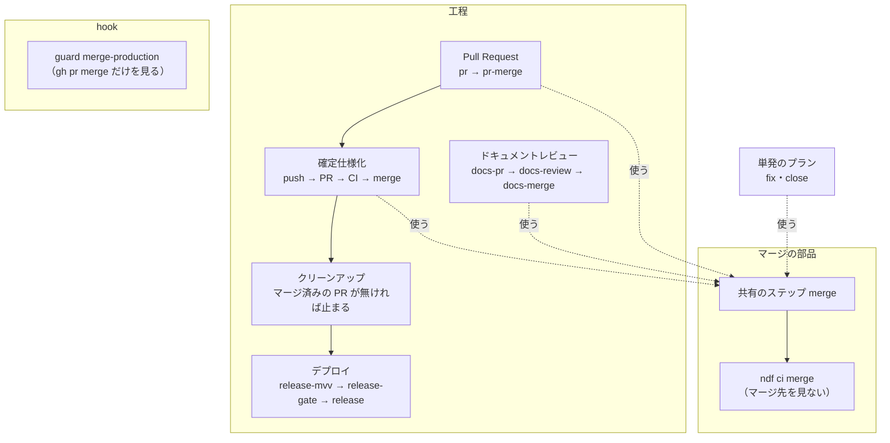
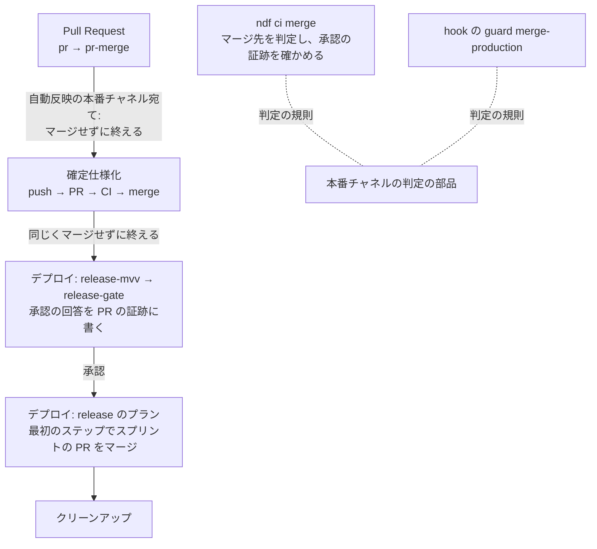
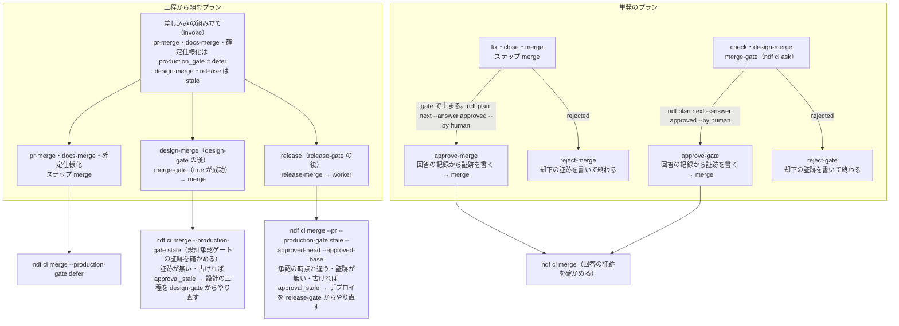
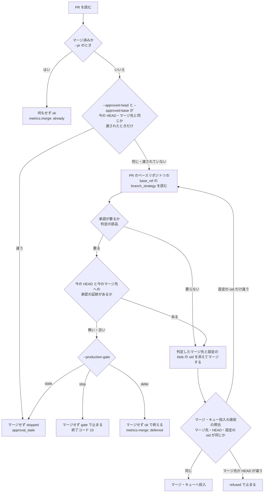

# 自動反映の本番チャネルへのマージ: 工程のどこから流しても、リリース承認ゲートの回答までマージしない（#4409）

工程を `ndf progress next` で自動で進めると、確定仕様化・工程「Pull Request」・工程「ドキュメントレビュー」のマージのステップが、人の承認の前にスプリントの PR を `main`（自動反映の本番チャネル）へマージする。マージ先を判定する規則をマージのコマンド `ndf ci merge` に入れる。承認が要るマージは、PR に残った承認の記録（承認した HEAD とマージ先を持つ）を `ndf ci merge` が確かめたときだけ行う。工程から流すプランでは、承認の無いマージをデプロイの工程のリリース承認ゲートへ回し、承認の後にデプロイの工程の中でマージする。あわせて、クリーンアップをデプロイの後へ移す。採らなかった案は「決定の記録」にあり、外部の調査は省いた（末尾の「外部の調査」）。

## 今の姿

何が起きたか・目的・受け入れ条件は要求仕様（[issue-4409-requirements.md](./issue-4409-requirements.md)、正は #4409 の本文）にある。この文書は「どう解くか」と「なぜその解き方か」だけを書く。

**根本原因は、マージ先が自動反映の本番チャネルかを決める規則の置き場所にある。** 規則は hook の中にしか無く、工程のプランが共通で使うマージのコマンドには無い。

| マージの打ち方 | 止まるか |
| --- | --- |
| AI が端末から打つ `gh pr merge` | hook の検査 `merge-production` が止める |
| プランのマージのステップが打つ `ndf ci merge` | 止まらない。マージ先を見ずにマージする |

設計に要る今の構造は次のとおりである。

| 箇所 | 今の振る舞い |
| --- | --- |
| 共有のステップ `merge`（`contracts/templates/parts/steps.json`） | `ndf ci merge --branch <ブランチ> --method <方式>` を打つ。テンプレート `merge`・`plan-to-spec`・`close`・`fix`・`check`・`design-merge` がこのステップを使う |
| `ndf ci merge`（`src/ndf/ci_cli.py` の `_merge`） | ブランチの開いた PR を、作業場所の HEAD を添えてマージする。見るのはレビューを経た HEAD と、本文に残った未決の行だけである。PR のマージ先（`Pull.base_ref`）は読めるが使っていない |
| 承認ゲートのステップ `merge-gate` | テンプレート `check`・`design-merge` だけが持つ。`on_answer` は `approved` → `merge`、`rejected` → 終わり。単発のプランでは差し込み `gate` の既定 `ndf answer ask` が終了コード 10 で止まり、回答を待つ |
| 工程から流すプランの `merge-gate` | 差し込み `gate` が `true`（`progress/invoke.py` の `STAGE_GATE`）になる。`true` は質問せずに終了コード 0 で成功するので、`merge-gate` は止まらず、通常の遷移で次のステップ `merge` へ進む。承認は工程の承認ゲート（設計承認ゲート）が持つ |
| hook の判定（`src/ndf/domains/hooks/strict.py` の `_deliveries`・`_automatic_production`） | 作業ディレクトリの `.ndf/project.json` の `branch_strategy.release.deliveries` に、`channel: production` で `kind` が `manual` でない行があれば止める。`release` が読めて `deliveries` のキーが無いときは、`release.cd`（本番ブランチへのマージで起動する CD の workflow の設定）があれば自動反映の行 1 つ、無ければ空の配列として扱う。設定を読めなければ止める。標準ライブラリだけで書く |
| 承認の証跡（`src/ndf/domains/release/trail.py`） | リリースの PR（版を上げる `release/v<版>` の PR。スプリントの PR とは別）に、回答（承認・却下）・回答したときの HEAD の SHA・担い手（利用者 `user` / MVV 判定 `mvv`）をコメントで残す。信用する書き手が書き、作成の後に編集されていないコメントだけを数える。回答するときに HEAD が提示から動いていれば書かない |
| 工程の承認ゲートの回答（`src/ndf/progress/gate/answering.py`） | 回答と、回答した人が見た HEAD と承認資料の sha256 を、工程の状態の記録に残す。PR へは書かない |
| 工程の順（`contracts/workflow/modes/*.json`） | 5 つのモードのどれも、Pull Request → （確定仕様化）→ クリーンアップ → デプロイの順である |
| クリーンアップ（`contracts/templates/merged.json`） | ブランチのマージ済みの PR が無いと `precondition` で止まる |
| `production-merge.md` | 「マージのステップが終了コード 10 で止まり、`--gate-approved user` を付けて打ち直す」と書くが、今の `ndf ci merge` にこの形は無い。設計 PR のマージ先が自動反映の本番チャネルなら、設計承認ゲートの承認資料に「このマージで本番へ出る」ことを書くと定める |

## 文脈と制約

- 1 回のマージに承認を 2 回求めない。承認ゲートの数を増やさない（要求仕様の「境界」、`development-workflow` の「人手の承認を求める承認ゲート」）
- 次の 2 つの PR は、今と同じく止まらずにマージする（受け入れ条件 7・8）
  - マージ先が本番チャネルでない PR
  - 反映の設定に自動反映の行が無い本番チャネルへの PR
- 人が端末や GitHub の画面で行うマージは止めない
- マージ先が自動反映の本番チャネルかは、マージ先のリポジトリの `branch_strategy` だけから決める（要求仕様の前提 2）。設定が無い・読めないときは当たるとして扱う（受け入れ条件 9）
- 承認の記録は次のどちらかである（前提 1）
  - 利用者がリリース承認ゲートで承認した回答
  - `pace: fast` / `pace: auto` で、MVV 判定が承認ゲートを通した記録。レッドラインに当たる操作は MVV 判定で通さない
- 承認の記録は、承認した PR・承認したときの HEAD・マージ先に結び付いていなければ、マージに使わない。承認の後に HEAD やマージ先が変わったら、承認を取り直す
- 承認でマージが本番へ反映されるときは、承認資料にそのことを書く（`production-merge.md`）。承認する人が、設計や検査の判断だけを求められたと思ったまま本番への反映を決めないようにする
- hook の判定は標準ライブラリだけで書く（hook は環境が無いときシステムの `python3` で動く）
- 動いている状態機械は、作った時点の工程の定義の写し（`progress/run.py` の `View.snap`）で進む。写しには工程の順と各工程のステップの並びが入る。工程の順やステップを変えても、写しを移行しなければ、既に始めたスプリントには届かない
- プランのテンプレートの中身（`contracts/templates/*.json`）は写しに入らない。工程のステップ `ndf.plan` が流れる時点で、入っている版のテンプレートを読む（`progress/invoke.py` の `template`）

## 解き方の全体像

- `ndf ci merge` が PR のマージ先を、PR のベースリポジトリにあるマージ先のブランチの `branch_strategy` で判定する。判定の規則は hook と同じ部品を使う
- 承認が要るときは、PR に残った承認の証跡を `ndf ci merge` が読み、今の HEAD と今のマージ先への承認があるときだけマージする。呼び手が引数で「承認済み」と伝える形は採らない
- 承認の証跡は、人が回答（承認・却下）をした時点で、回答を記録する側が PR へ書く。書くのは、工程の承認ゲート（設計承認ゲート・リリース承認ゲート）、MVV 判定の通過、単発のプランの承認待ちへの回答の 3 つの経路だけである。証跡は、リリースの PR の証跡とは別のマーカーで書く
- 承認の証跡が無いときの扱いは、プランの種類で分かれる
  - 工程から流す `pr-merge`・`docs-merge`・確定仕様化: マージせずにステップを終え、プランを先へ進める（マージをデプロイの工程へ先送りする）
  - 単発のプラン（`fix`・`close` など）: 承認待ち（終了コード 10）で止まる
  - 工程から流す `design-merge` とデプロイの最初のマージ: マージせずに `approval_stale` で止まり、承認ゲートを持つ工程（設計・デプロイ）を最初から流し直して質問し直す
- デプロイのテンプレート `release` は、最初のステップでスプリントの PR をマージしてから、今までの作業へ進む。テンプレートは流す時点で読むので、このリリースの前に始めたスプリントでも同じに動く
- 承認ゲートを既に持つテンプレート（`check`・`design-merge`）は、承認ゲートへの回答が証跡になるので、マージのステップでもう一度止まらない
- クリーンアップはデプロイの後に動く。スプリントの PR はクリーンアップより先にマージされている

## 構成要素

| 要素 | 責務 |
| --- | --- |
| 本番チャネルの判定の部品（新設 `src/ndf/core/production_merge.py`） | `branch_strategy` のセクション（読めなければ無し）とマージ先のブランチから、判定の値（「処理の流れ」の最後の表にある 5 つ）を返す。外部を呼ばない純粋な関数で、標準ライブラリだけで書く |
| `ndf ci merge`（変更） | PR のベースリポジトリから、マージ先のブランチの設定を読み、判定の部品で承認の要否を決める。承認が要れば承認の証跡を確かめる。証跡が無ければ、引数で選んだ形（プランの中で止まる / デプロイへ先送りする / 承認ゲートへ戻す）で終える。`--branch` に加えて `--pr` で PR を指せる。`--approved-head`・`--approved-base` を受けたら、判定の結果によらず、承認の時点の HEAD とマージ先を今の PR と照らす |
| 承認の対象（新設。`domains/release/trail.py` に置く） | 承認を結び付ける 4 つの値の組。ベースリポジトリ・PR の番号・マージ先・HEAD である。質問・回答の照合・証跡の書き込み・`ndf ci merge` の確かめが、同じ組を受け渡す。証跡の行と判定の出力 `mvv_gate` は、この 4 つに「本番へ反映されるか」（はい / いいえ）を足して持つ（決定 7） |
| マージの承認の証跡（`domains/release/trail.py`、変更） | リリースの PR の証跡（マーカー `ndf:release-approval`）とは別のマーカー `ndf:merge-approval` で書く。行は回答（承認・却下）・担い手・承認の対象・「本番へ反映されるか」・回答の記録の識別子である。読むのは `ndf ci merge` だけで、既存のリリースの証跡の判定（`trail.check`）と CD の workflow は読まない（決定 7） |
| 回答を証跡に書くコマンド `ndf ci answer`（新設） | 単発のプランの回答の記録（`--answer-record <ファイル>`）を読み、記録された回答（承認・却下）と承認の対象で証跡を PR へ書く。回答の記録が無い・回答した者が利用者でない・承認の対象が今の PR と違うときは、書かずに `refused` で止まる。担い手は `user` だけを書き、`mvv` は書かない |
| PR の承認を問うコマンド `ndf ci ask`（新設） | `--branch` の PR の承認の対象を承認資料に載せ、承認の対象をファイル（`--presented-out`）に残して終了コード 10 で止まる。ファイルと結果の `metrics.presented_id` には、提示ごとに新しく作る提示の識別子を入れる。判定が `automatic`・`unset`・`unknown` なら、承認資料に本番へ反映され得ることを書く。差し込み `gate` の既定（`contracts/templates/params.json`）を `ndf answer ask` からこれに替える |
| プランの実行（`core/plan/runner.py`、変更） | `ndf plan next --answer <回答> --by <回答した者>` を受けたら、続きを流す前に、待っていたステップの回答の記録を `{state_dir}/answers/<ステップ>.json` に書く（ステップ・回答・回答した者・時刻・回の id・提示の識別子）。提示の識別子は、待っていたステップの結果の `metrics.presented_id` から写す。`--by` は `ndf answer` と同じ形で、承認ゲートのステップへの回答では省けない。承認待ちの結果の `routes` には `ndf plan next <プラン> --answer <回答> --by human` を載せる。`ndf ci answer` はこのファイルを読む |
| 工程の承認ゲートの回答（`progress/gate/answering.py`、変更） | 質問が PR を持つ承認ゲート（設計承認ゲート・リリース承認ゲート）で回答（承認・却下）を受けたら、承認の対象で証跡を PR へ書いてから、回答を記録する（順序は決定 7）。担い手 `user` は、回答した者が利用者のとき（`human`、または中継を確かめられた `organizer`。決定 7）だけ書く。`service:mvv` の回答は MVV 判定の記録として扱い、ここでは証跡を書かない（書くのは `mvv_gate.py`）。`conductor` とほかの `service:<主体>` の回答は証跡を書かずに断る |
| 承認ゲートの質問（`progress/gate/asking.py` の `Target`、変更） | 見た対象に、ベースリポジトリ・PR の番号・マージ先を足す。今は HEAD と承認資料の sha256 だけである |
| MVV 判定の承認ゲート（`domains/records/mvv_gate.py`・`progress/run.py`、変更） | `pace: fast` / `pace: auto` で承認ゲートを通すときに、担い手 `mvv` の証跡を、今の判定の記録のコメントに入れて書く（投稿は増えない）。レッドラインに当たれば通さず、証跡も書かない。判定の出力 `mvv_gate` に承認の対象（ベースリポジトリ・PR の番号・マージ先・HEAD・本番へ反映されるか）を入れる。承認ゲートのステップ（`progress/run.py`）が回答した者 `service:mvv` で通すときは、この承認の対象を回答の事象の `seen` に残す。利用者の回答と同じ形なので、差し込みの組み立ては同じ所から読める |
| 承認資料（`progress/gate/asking.py` の `material` と、`merge`・`merge-gate` の承認資料、変更） | 判定が `automatic`・`unset`・`unknown` のときは、すべての承認資料に「この承認で PR がマージされ、本番へ反映され得る」と書く。証跡の「本番へ反映されるか」を「はい」とする条件（決定 7）と同じ条件で書く |
| `GitHub.merge`（`adapters/github.py`、変更） | 判定したマージ先と設定の版（`expect_base`・`expect_config`）を受け、マージとキューへの投入の直前に照らす（決定 8）。マージ先の設定のファイルを、その blob の oid と合わせて 1 回の GraphQL で読む関数を足す |
| hook の guard `merge-production`（変更） | 届け先の行の判定を、判定の部品から呼ぶ。止める条件は、`release.cd` のキーが無い設定だけが変わる（表「判定の部品が返す値」）。あわせて、マーカー `ndf:merge-approval` を含むコメントを AI が Bash（`gh pr comment`・`gh api` など）から書く操作を止める |
| 共有のステップ `merge`（変更） | `--production-gate {{production_gate}}` と `--presented-out {state_dir}/presented-merge.json` を足す。`on_answer` は `approved` → `approve-merge`、`rejected` → `reject-merge` |
| 共有のステップ `approve-merge`・`approve-gate`・`reject-merge`・`reject-gate`（新設） | 回答の後にだけ流れるステップ。どれも `ndf ci answer` で回答の証跡を書く。`approve-*` は `next` で `merge` へ進み、`reject-*` は終わる。`*-merge` は `merge` の回答、`*-gate` は `merge-gate` の回答を読む。通常の遷移ではどのステップからも到達しない |
| テンプレート `release`（変更） | 最初のステップ `release-merge` で、入力 `pr` のスプリントの PR を、リリース承認ゲートで承認した HEAD とマージ先を添えてマージする。その後に今までの作業（worker）を流す |
| 差し込みの組み立て（`progress/invoke.py`、変更） | 工程から組むプランの `production_gate` を決める。`merge`（`pr-merge`・`docs-merge`）と `plan-to-spec` は `defer`、`design-merge` と `release` は `stale`。`release` には、リリース承認ゲートの回答の事象の `seen`（利用者の回答でも、MVV 判定が通した回答 `service:mvv` でも同じ形）に残った承認の対象から `approved_head`・`approved_base` を入れる |
| 工程の順（`contracts/workflow/modes/*.json`、変更） | 5 つのモードで、クリーンアップをデプロイの直後へ移す |
| 工程の定義の写しの移行（`progress/run.py`、変更） | 状態機械を読むときに、写しの工程の順が古い形（クリーンアップ → デプロイ）で、デプロイがまだ始まっておらず、クリーンアップが終わっていなければ、写しの順を新しい形へ置き換え、事象 `definition_migrated` を 1 回記録する。クリーンアップが開いた PR で止まっていた状態機械も含む |

## 入出力のコントラクト

### `ndf ci merge`

| 項目 | 内容 |
| --- | --- |
| 名前 | `ndf ci merge (--branch <ブランチ> \| --pr <番号>) [--repo] [--method] [--reviewed] [--production-gate stop\|defer\|stale] [--approved-head <SHA> --approved-base <ブランチ>]` |
| 足す入力 | `--pr`: マージする PR の番号。作業場所が無くても打てる。`--production-gate`: 承認が要って有効な証跡が無いときの終え方（下の表）。`--approved-head`・`--approved-base`: 工程の承認ゲートで承認した HEAD とマージ先。2 つは組で渡す |
| 渡す HEAD | `--approved-head` があれば、その HEAD。無ければ、`--branch` のときは今と同じく作業場所の HEAD、`--pr` のときは、承認が要れば証跡の HEAD、要らなければ PR を読んだときの HEAD |
| 承認の時点との照合 | `--approved-head` と `--approved-base` を受けたら、マージ済みの確かめの後、判定の前に、今の PR の HEAD とマージ先を照らす。どちらかが違えば、判定で承認が要らなくても `stopped`（`approval_stale`）で止まる |
| 判定に読む設定 | PR のベースリポジトリ（`--repo`、省けば作業場所のリモート）の、マージ先のブランチ（`Pull.base_ref`）にある `.ndf/project.json` の `branch_strategy`。GitHub の GraphQL でファイルの中身と blob の oid を読み、Git のリモートは使わない。読めなければ「決められない」として扱う |
| 承認の確かめ | 承認が要るときだけ、PR の証跡を読む。規則は決定 7 の「証跡の判定」のとおり |
| 出力（マージした） | 今と同じ `ok`。承認を使ったときは `metrics.approved_by` に証跡の担い手（`user` / `mvv`）を載せる |
| 出力（マージ済みだった） | `--pr` で指した PR が既にマージ済みなら、マージの方式の問い合わせ・衝突の確かめ・判定・マージのどれもせずに `ok`。`metrics.merge` は `already` |
| 出力（承認が要って有効な証跡が無い） | `--production-gate` の値で決まる。証跡が無いときと、証跡が古いとき（承認の後に HEAD やマージ先が変わった、「本番へ反映される: いいえ」の証跡しか無い）を分けない。下の表のとおり |
| 失敗の形 | 今と同じ（`precondition`・`refused`・`ci_pending` など）。判定の後にマージ先が変わったとき、マージを GitHub 側で固定できない経路で照らせなかったときは `refused` |
| 互換性 | 引数を渡さない呼び出しは、マージ先が自動反映の本番チャネルで証跡が無いときだけ振る舞いが変わる（マージせずに止まる）。後方互換は求めない（MVV Value 4） |

`--production-gate` の値ごとの終え方は次のとおりである。`stale` で止まったときの再試行のコマンドは、工程の実行側が組み立てる。工程の実行側は、止まったプランの工程（`design-merge` なら設計、`release-merge` ならデプロイ）と状態機械の ID を持っている。今も工程が失敗したときに `failed_routes` で `ndf progress retry <ID> <工程>` を組み立てているので、`cause.kind` が `approval_stale` のときは、その結果の `routes` に次の 2 つを順に載せる。承認ゲートは同じ工程の中にあるので、その工程を最初から流し直せば質問し直せる。

1. `ndf progress retry <ID> <工程> --reason approval_stale`: 流し直しを記録する（`retry` は事象を記録するだけで、工程を流さない）
2. `ndf progress next <ID>`: 記録した工程を最初から流し、承認ゲートが今の承認の対象で質問し直す

| 値 | 使う所 | 終え方 |
| --- | --- | --- |
| `stop`（既定） | 単発のプラン | `gate`（終了コード 10）。`metrics.gate` は `production-merge`、`items` に PR。承認の対象を `--presented-out` のファイルに残す。`ndf ci ask` と同じく、提示ごとに新しく作る提示の識別子を、ファイルと結果の `metrics.presented_id` の両方へ出す。`routes` は持たない。プランの実行が `on_answer` から作る `ndf plan next <プラン> --answer <回答> --by human` が回答の経路になる |
| `defer` | 工程から組む `pr-merge`・`docs-merge`・確定仕様化 | `ok`。`metrics.gate` は `production-merge`、`metrics.merge` は `deferred`、`items` に PR。マージはしていない |
| `stale` | 工程から組む `design-merge`・`release-merge` | `stopped`（`approval_stale`）。`ndf ci merge` は状態機械の ID と工程の名前を知らないので、`routes` を持たない。`--approved-head`・`--approved-base` の照合で早く止まる場合も同じ形で返す。再試行のコマンドは、工程の実行側（`progress/run.py` の `failed_routes`）が組み立てる（下の段落） |

### テンプレートの差し込みとステップ

承認した者を差し込みで渡す形（`approved_by`）は作らない。承認は PR の証跡で確かめるので、工程のどのプランも、承認ゲートの回答の有無でプランを組めなくなることは無い。

| 差し込み・ステップ | 工程から組むプラン | 単発のプラン（`ndf route render`） |
| --- | --- | --- |
| `production_gate` | `pr-merge`・`docs-merge`・確定仕様化は `defer`（承認はデプロイの工程のリリース承認ゲートで取るため）。`design-merge` と `release` は `stale`（承認は工程の承認ゲートで取り直すため） | 既定 `stop` |
| `approved_head`・`approved_base` | `release` だけに入れる。リリース承認ゲートの回答の事象に残った承認の対象の HEAD とマージ先である | 使わない |
| ステップ `merge-gate` | 差し込み `gate` は `true`。成功して通常の遷移で `merge` へ進む。`merge` は設計承認ゲートの回答が書いた証跡を確かめてマージする | 差し込み `gate` の既定 `ndf ci ask` が終了コード 10 で止まる。プランの実行が `ndf plan next --answer <回答> --by <回答した者>` を受けると、回答の記録を書き、`on_answer` で `approve-gate`（承認）か `reject-gate`（却下）へ進む。どちらも証跡を書く。`approve-gate` の後の `merge` は証跡を確かめるので、もう一度止まらない |
| ステップ `merge` | `--production-gate {{production_gate}}` を足す。マージした・先送りした（`deferred`）ときはどちらも `ok` で、今と同じ `next`（多くは終わり）へ進む。`design-merge` で有効な証跡が無ければ `approval_stale` で止まり、設計の工程を最初から流し直す。どの場合も `on_answer` へは流れない | 同じ。証跡が無ければ終了コード 10 で止まる。回答 `approved` で `approve-merge` へ進み、証跡を書いてから `merge` を打ち直す。回答 `rejected` で `reject-merge` へ進み、却下の証跡を書いて終わる |
| ステップ `approve-*`・`reject-*` | 工程から組むプランでも定義はあるが、`merge` は `defer` か `stale` で `gate` を返さず、`merge-gate` は `true` で成功するので、到達しない | `on_answer` からだけ到達する。証跡を書けなければ `refused` で止まる |
| ステップ `release-merge`（テンプレート `release` の最初） | `ndf ci merge --pr {{pr}} --production-gate stale --approved-head {{approved_head}} --approved-base {{approved_base}}`。`--method` を渡さない。方式は `ndf ci merge` がマージ済みの確かめの後に、今と同じく `GitHub.merge` の中で選ぶ。マージ済みなら何もせずに終える。承認の時点と HEAD かマージ先が違うとき、証跡が無い・古いときは `approval_stale` で止まる | 使わない |

## 処理の流れ

工程から組むプランと単発のプランが、どのステップを通って `ndf ci merge` を打つかを次に示す。

`ndf ci merge` がマージするかを決める順序である。

判定の部品が返す値は次の 5 つである。`release.cd` は、本番ブランチへのマージで起動する CD の workflow の設定である。スキーマでは必須のキーで、値は `null`（CD を持たない）か `workflow` を持つオブジェクトである。配布しているブランチ戦略のプリセットは `cd: null` を書く。`deliveries` が無く `cd` が `null` のときは、hook は今と同じく通し、`ndf ci merge` は要求仕様の受け入れ条件 9 に従い承認を求める。hook の振る舞いを変えないために、部品はこの場合を別の値で返し、呼ぶ側が扱いを決める。

| マージ先 | 設定 | 部品が返す値 | hook | `ndf ci merge` |
| --- | --- | --- | --- | --- |
| 本番チャネル（`branches.production`）でない | 読めた | `not_production` | 使わない（hook はマージ先を見ない） | 承認は要らない |
| 本番チャネル | `release.deliveries` に `channel: production` で `kind` が `manual` でない行がある | `automatic` | 止める | 承認が要る |
| 本番チャネル | `release.deliveries` のキーが無く、`release.cd` がオブジェクト | `automatic` | 止める | 承認が要る |
| 本番チャネル | `release.deliveries` が配列で、当たる行が無い（`kind: manual` だけ・空） | `manual` | 通す | 承認は要らない |
| 本番チャネル | `release.deliveries` のキーが無く、`release.cd` が `null` | `unset` | 通す（今の空の配列と同じ） | 承認が要る |
| 決められない | `branch_strategy` や `release` を読めない・`release.deliveries` が配列でない・`release.deliveries` のキーが無く `release.cd` のキーも無いか `null` でもオブジェクトでもない・ファイルを読んだリポジトリが PR のベースリポジトリと違う | `unknown` | 止める | 承認が要る |

hook の振る舞いが変わるのは、`release.cd` のキーが無い設定だけである。今の hook は空の配列として通すが、スキーマに合わない設定なので `unknown` として止める。

## 決定の記録

### 決定 1: どの経路のマージも同じに止めるため、判定をマージのコマンド `ndf ci merge` に置く

- **質問**: マージ先の判定を、どの層に置くか
- **選んだ案**: プランのマージのステップが共通で打つ `ndf ci merge` が判定する。次のテンプレートが同じ判定を通る: `merge`・`plan-to-spec`・`close`・`fix`・`check`・`design-merge`・`release`（最初のステップ `release-merge`）
- 採らなかった案: テンプレート `plan-to-spec` と `close` だけに条件を足す（要求の起票者の推定 S2）。工程「Pull Request」の `pr-merge` と工程「ドキュメントレビュー」の `docs-merge` が塞がらない。マージのステップを使うテンプレートを足すたびに、条件を足し忘れる
- 採らなかった案: 工程の進行（`ndf progress`）の側でマージのステップを止める。単発のプラン `fix`・`close` は工程を通らないので塞がらない
- **代償**: `ndf ci merge` がマージ先の設定を読むため、マージのたびに設定を 1 回読む（読み方と回数は決定 3）
- 根拠: Value 7「不具合は、現象が出た場所ではなく根本原因の場所で直され、形を変えて戻ってこない」（MVV バージョン 11）

### 決定 2: hook とマージのコマンドで判定が食い違わないよう、届け先の行の判定を 1 つの部品に移す

- **質問**: hook の判定（`strict.py` の `_deliveries`・`_automatic_production`）とマージのコマンドの判定を、別々に持つか
- **選んだ案**: 標準ライブラリだけで書いた判定の部品（`src/ndf/core/production_merge.py`）を新設する。hook と `ndf ci merge` の両方がそこから呼ぶ。使い方は次のとおりである

  | 呼ぶ側 | 部品の使い方 |
  | --- | --- |
  | hook | マージ先のブランチを得られないので、「本番チャネルへ自動で届く行があるか」だけを使う。値 `unset` は今と同じく通す |
  | `ndf ci merge` | マージ先のブランチと合わせて使う。値 `unset` と `unknown` は承認が要るとして扱う |

- 採らなかった案: `ndf ci merge` に同じ規則を書き写す。同じ規則を 2 か所に持ち、片方だけが直る
- **代償**: hook のモジュールが新しい部品を import し、hook の import の表に部品を足す。部品は標準ライブラリだけで書く制約を負う
- 根拠: Value 11（MVV バージョン 11）

### 決定 3: 直す PR が自分の判定を外せず、別のリポジトリの設定や古い設定で判定しないよう、PR のベースリポジトリのマージ先のブランチから版と合わせて読む

- **質問**: 判定に使う `branch_strategy` を、どこから、どう読むか
- **選んだ案**: PR を読んだリポジトリ（`--repo`、省けば作業場所のリモート）を PR のベースリポジトリとする。その `base_ref` の `.ndf/project.json` を、GitHub の GraphQL（`object(expression: "<base_ref>:.ndf/project.json")`）で中身と blob の oid を合わせて読む。PR の応答のベースリポジトリが、読んだリポジトリと違えば `unknown` とする。Git のリモートからは読まない
- 判定の結果は、ベースリポジトリ・マージ先・設定の blob の oid の組に結び付ける。マージとキューへの投入の直前の照合（決定 8）は、マージ先のブランチの今の設定を、oid と本文の組で 1 回の要求で読む
- 照合で oid が違えば、`GitHub.merge` は照合の応答に入っていた本文で判定をやり直す。ブランチの名前で設定を読み直すことはしない。照合した版と違う版で判定しないためである
- やり直した判定で承認が要らないか、要って有効な証跡（決定 7 の「証跡の判定」）があれば、そのまま要求を送る。証跡が無ければ、要求を送らずに `--production-gate` の形で終える
- 読む回数: 判定のための設定の読み取りは、`ndf ci merge` 1 回につき GraphQL の要求 1 回増える。今の `GitHub.merge` が最初に行う PR の読み直しは、PUT の直前へ移して直前の照合にする（決定 8）ので、照合は要求を増やさない。最初の読み直しが担っていた先の確認（HEAD）とマージの方式の問い合わせは、`ndf ci merge` が既に読んだ PR で行う。Git のプロセスの起動とリモートからの取得は増えない。今の経路と比べた要求の数は次のとおりである

  | 経路 | 今と比べた要求の数 | 増える理由 |
  | --- | --- | --- |
  | 直接のマージ（`pr-merge`・確定仕様化・単発のプラン・`release-merge`） | 1 回につき +1 | マージ先の設定の読み取り |
  | マージせずに回す（`defer`）・止まる（`stop`・`stale`） | 1 回につき +1（マージの要求は 0） | マージ先の設定の読み取り |
  | キューへの投入 | 1 回につき +2 | 設定の読み取りと、投入の後の PR の読み直し（決定 8） |
  | 先にマージ済みの PR のデプロイ（本番チャネルでないマージ先で `pr-merge` がマージした） | デプロイ 1 回につき +1 | `release-merge` がマージ済みかを確かめる PR の読み取り。今のデプロイはこの PR を読まない |

  承認が要るマージと承認の回答では、上の表に加えて証跡のコメントを読み書きする。コメントの読み取りには、今の `GitHub.comments` のページの走査（`_pages`）をそのまま使う。1 ページ 100 件で、100 件より少ないページが来るまで次のページを読むので、PR のコメントが N 件なら floor(N / 100) + 1 回の要求になる。100 件・200 件ちょうどのときは、空のページを 1 回余分に読む。最後のページを見分ける別の方法は作らない。既存の一覧の読み方とそろえ、余分な 1 回はコメントが 100 の倍数のときだけに限られるためである。

  | 時点 | 今と比べた要求の数 | 内訳 |
  | --- | --- | --- |
  | 承認が要るマージの試行（直接・キュー・`defer`・`stop`・`stale`、キューの待ちの打ち直しを含む） | 上の表の数に、1 回につき + floor(N / 100) + 1 | 証跡のコメントの読み取り。承認が要らない判定では読まない |
  | 工程の承認ゲートへの回答（承認・却下） | 1 回につき + floor(N / 100) + 1 + 1 | 同じ質問の id の証跡が既にあるかの読み取りと、証跡の投稿 1 回。送り直しで証跡が既にあれば投稿しない |
  | MVV 判定の通過 | 0 | 今も判定の記録を PR へ 1 件投稿している（`mvv_gate.py` の `_recorded`）。証跡の行とマーカーを、この判定の記録のコメントに入れて 1 件で書く（決定 7） |
  | 単発のプランの `approve-*`・`reject-*` | 1 回につき + 1 + floor(N / 100) + 1 + 1 | 承認の対象を照らす PR の読み取り、同じ識別子の証跡の読み取り、投稿 1 回 |
- 採らなかった案: 作業場所の `.ndf/project.json` を読む。マージする PR 自身が設定を書き換えると、判定を外せる
- 採らなかった案: メインディレクトリの `.ndf/project.json` を読む。hook と同じ読み方である。ただし、メインディレクトリが別のブランチを取り出していると、マージ先と違う設定で判定する
- 採らなかった案: 作業場所のリモートからマージ先のブランチを取得し、`core/branch_strategy.py` の `load_at_ref` で読む。作業場所の既定のリモートが PR のベースリポジトリと同じとは限らず、別のリポジトリにある同じ名前のブランチの設定で判定し得る。マージのたびに Git の起動とリモートからの取得が 1 回ずつ増え、同じ PR が `pr-merge`・確定仕様化・`release-merge` を通ると 3 回ずつ増える
- 採らなかった案: 読んだ内容を `ETag` と合わせて残し、条件付きの要求で読み直す。読み直しの時点がマージの直前と離れ、その間に変わった設定を見落とす。直前の照合で blob の oid を読めば、同じ要求の数で変更を見つけられる
- **代償**: 判定のたびに GitHub の GraphQL を 1 回呼ぶ。先にマージ済みの PR のデプロイでは、PR の読み取りが 1 回増える（上の表）
- 根拠: Value 1「速さや費用のために、人の承認を省かない」（MVV バージョン 11）

### 決定 4: 承認ゲートを増やさずにデプロイまで進めるため、工程から流すプランでは承認の無いマージをデプロイの工程へ先送りする

- **質問**: 工程から流すプラン（`pr-merge`・`docs-merge`・確定仕様化）が、承認の無いマージに着いたときの扱い。そこで承認を待つか、先へ進めるか
- **選んだ案**: マージせずにステップを `ok` で終え（`--production-gate defer`）、プランと工程を先へ進める。承認はデプロイの工程のリリース承認ゲートが 1 回で取る。単発のプランは工程の外で流れる。そのため、そのプランの中で承認待ち（終了コード 10）で止まる。工程から組む `design-merge` は `defer` にしない。設計承認ゲートの回答が証跡になるので通常は止まらない。承認の後に HEAD やマージ先が動いて有効な証跡が無いときは、`--production-gate stale` で `approval_stale` として止まる。工程の実行側が結果の `routes` に載せる `ndf progress retry <ID> 設計 --reason approval_stale` と `ndf progress next <ID>` を順に打って設計の工程を最初から流し直し、設計承認ゲートが承認資料を作り直して質問し直す。回答はいつも設計承認ゲートの回答として記録し、プランの中の承認待ちを経ない
- 採らなかった案: 工程から流すプランでも承認待ちで止まる。工程の進行がその場で回答を待ち、デプロイのリリース承認ゲートへ進めない。回答すればリリース承認ゲートとの 2 回の承認になり、受け入れ条件 6・10 に反する
- 採らなかった案: 工程「Pull Request」に承認ゲートを足す。承認ゲートの数を増やすので、要求仕様の「境界」で行わない
- **代償**: 工程「Pull Request」が `ok` で終わっても、スプリントの PR はまだマージされていない。マージ済みかは PR の状態と結果の `metrics.merge` で見分ける
- 根拠: Value 1「利用者が手を止めるのは、作るかを決めるときと、出してよいかを決めるときだけである」（MVV バージョン 11）

### 決定 5: 承認の後のマージを決まった手順で流し、このリリースの前に始めたスプリントにも届けるため、デプロイのテンプレート `release` の最初でマージする

- **質問**: リリース承認ゲートの承認の後、先送りした PR を誰がどこでマージするか
- **選んだ案**: テンプレート `release` の最初にステップ `release-merge`（`ndf ci merge --pr {{pr}} --production-gate stale --approved-head {{approved_head}} --approved-base {{approved_base}}`）を置き、その後に今までの worker の作業を流す。マージの方式は差し込みで渡さない。`pr` はデプロイの工程の入力で、今の定義にも既にある。テンプレートは工程の定義の写しに入らず、流す時点で読むので、このリリースの前に始めたスプリントでも同じに動く
- `ndf ci merge --pr` は、最初に PR の状態を読み、マージ済みなら衝突の確かめもマージもせずに終える。マージ済みになるのは、本番チャネルでないマージ先で `pr-merge` がマージしたときである
- マージの方式は、マージ済みの確かめの後に、今と同じく `GitHub.merge` の中でマージ先の許す方式から選ぶ。プランを組む時点（`route.derived_merge_method`）では問い合わせない。マージ済みの PR では方式の問い合わせが 0 回になり、問い合わせの失敗でデプロイが止まらない
- `approved_head`・`approved_base` は、差し込みの組み立てが、リリース承認ゲートの回答の事象に残った承認の対象から入れる。`ndf ci merge` は、判定の前にこの 2 つを今の PR と照らす。そのため、承認の後にマージ先の設定が変わって承認が要らなくなっても、マージ先が本番チャネルでないブランチへ変わっても、承認した HEAD とマージ先でない PR はマージしない（受け入れ条件 5）
- 承認の時点と HEAD かマージ先が違うとき、証跡が無い・古いときは、どれも `approval_stale` で止まる。工程の実行側が `stopped` の結果の `routes` に載せる `ndf progress retry <ID> デプロイ --reason approval_stale` と `ndf progress next <ID>` を順に打ってデプロイの工程を最初から流し直し、リリース承認ゲートが今の承認の対象で質問し直す。プランの中で承認を待たせない。待たせると、リリース承認ゲートと 2 回の承認になる
- 衝突の確かめとマージ先の取り込みは置かない。承認の後にコミットを足すと HEAD が変わり、承認を取り直すことになるためである。衝突していれば GitHub がマージを断り、`refused` で止まる
- 作業場所は要らない。マージに添える HEAD は、リリース承認ゲートで承認した HEAD（`approved_head`）である
- 採らなかった案: デプロイの工程の `release-gate` と `release` の間に、新しいステップを置く。このリリースの前に始めたスプリントでは、工程の定義の写しに新しいステップが無いので流れない。入力に `branch` と `worktree` も要る
- 採らなかった案: 先送りしたプランを、記録した回答の経路から続きで流す。先送りしたプランが同じスプリントで 2〜3 本になり、どれを続けるかの記録が要る。先送りしたプランを、実行の途中のまま残すことにもなる
- 採らなかった案: `release` の worker がマージする。判断の要らない手順を AI に任せると、実行ごとに結果がばらつく
- **代償**: テンプレート `release` の差し込みに `pr`・`approved_head`・`approved_base` が増える
- 根拠: Value 3「判断の要らない手順（待ち・集計・検査・記録・整形・起動の組み立て）は仕組みが進める」（MVV バージョン 11）

### 決定 6: スプリントの PR がマージされた後に片付けるため、クリーンアップをデプロイの後へ移す

- **質問**: スプリントの PR がデプロイの工程までマージされないとき、その前にあるクリーンアップをどう扱うか
- **選んだ案**: 5 つのモードで、クリーンアップをデプロイの直後へ移す。クリーンアップの時点では、どのリポジトリでもスプリントの PR がマージされている
- 採らなかった案: クリーンアップを今の位置に残し、開いた PR に当たったら飛ばして、デプロイの工程が後で片付ける。片付けが 2 か所になり、どちらが何を消したかを記録で合わせる必要が出る
- **代償**: デプロイの間も作業場所とブランチが残る。リリース承認ゲートで却下されると、クリーンアップは開いた PR に当たって今と同じく `precondition` で止まる。このリリースの前に始めたスプリントには、工程の定義の写しを移行して届ける（「影響と危険」）
- 根拠: Value 6「NDF が作業で生んだもの（ブランチ・作業ディレクトリ・状態の記録・一時ファイル）は役目を終えると自動で片付き」（MVV バージョン 11）

### 決定 7: 承認の記録の無い変更や承認の後に足した変更をマージしないため、`ndf ci merge` が PR の承認の証跡を確かめる

- **質問**: 承認ゲートの後のマージ（`check`・`design-merge`・デプロイ）で、`ndf ci merge` は何を見て承認済みと決めるか
- **選んだ案**: 人の回答（承認・却下）を記録する経路が、PR へマージの承認の証跡を書く。`ndf ci merge` は承認が要るときに PR の証跡を読み、下の「証跡の判定」で承認と決まったときだけマージする

マージの承認の証跡は、リリースの PR の証跡とは別の種類として扱う。既存のマーカーを使うと、CD の workflow（`.github/workflows/release-cd.yml`）がコメントを承認の検査で処理し、本番ブランチ宛ての PR なら既存の `trail.check` が承認と判定してマージのジョブを起動するためである。

| 証跡の種類 | マーカー | 書く経路 | 読む側 | `approval.via`・`merge.actor` |
| --- | --- | --- | --- | --- |
| リリースの PR の証跡（今のまま） | `<!-- ndf:release-approval -->` | `ndf release-steps answer` | `trail.check`（`ndf release-steps approval-check`）と CD の workflow | 今と同じく、この種類の書き手を決める（`trail_writer`） |
| マージの承認の証跡（新設） | `<!-- ndf:merge-approval -->` | 下の表の 3 つの経路 | `ndf ci merge` だけ | 使わない。この設計は値の意味も読み手も変えない |

新しいマーカーの文字列は `ndf:release-approval` を含まない。そのため、CD の workflow の承認の検査のジョブ（コメントの本文に `ndf:release-approval` を含むときだけ起動する）は、マージの承認の証跡では起動しない。証跡のコメント 1 件で増える CI の実行は次のとおりである。

| 数えるもの | 証跡のコメント 1 件で増える数 | 理由 |
| --- | --- | --- |
| `release-cd.yml` の workflow の実行 | 1 件（利用者の token で投稿したとき。`GITHUB_TOKEN` の投稿は workflow を起動しない） | workflow の起動条件 `issue_comment` はコメントの作成ごとに発火する。マーカーで絞るのはジョブの条件で、workflow の起動は絞れない。今もどのコメントでも同じく 1 件ずつ起動している |
| runner を使うジョブ | 0 件 | 承認の検査のジョブ `approval-check` は条件で飛ばされ、それに続く `merge` も起動しない |

既存の `trail.check` は新しいマーカーを数えず、`ndf ci merge` は既存のマーカーを数えない。

承認の対象（ベースリポジトリ・PR の番号・マージ先・HEAD）は、質問から証跡の確かめまで同じ組を引き継ぐ。どこかで今の PR と違えば、証跡を書かずに質問し直す。

証跡の行には、承認の対象の 4 つの値に加えて、承認資料に示した「このマージで本番へ反映されるか」（はい / いいえ）も入れる。承認資料を作るときの判定の値が `automatic`・`unset`・`unknown` なら「はい」、ほかは「いいえ」である。承認の後にマージ先の設定が変わって判定が「要る」になったとき、「いいえ」の証跡は使わない。利用者は本番への反映を知らされずに承認したためである。

| 段階 | 工程の承認ゲート | 単発のプラン |
| --- | --- | --- |
| 質問 | `asking.py` の `Target` に承認の対象を入れる | `ndf ci ask` か `ndf ci merge` の `gate` が、承認の対象を `--presented-out` のファイルに残す |
| 回答の照合 | `answering.py` が、記録した `Target` と今の PR を比べる。違えば今と同じく質問し直す | `ndf ci answer` が、残したファイルと今の PR を比べる。違えば `refused` |
| 証跡の書き込み | 照合した承認の対象と、回答の記録の識別子（質問の id）で書く | 同じ。識別子はプランの回の id とステップ |
| 確かめ | `ndf ci merge` が、今の PR の承認の対象で証跡を判定する | 同じ |

証跡の判定は、既存の `approval_decide.judge` と同じく最新の回答で決める。

1. 数える証跡は、マーカー `ndf:merge-approval` を持ち、編集されていないコメントで、書き手が `ndf ci merge` を打つ token の利用者と同じ login のものだけである。書き込み権限を持つだけの別の人のコメントは数えない
2. 担い手 `mvv` の証跡は、`mvv_gate.py` が書いたものだけである。`ndf ci answer` は `mvv` を書かない
3. 承認の対象（ベースリポジトリ・PR の番号・マージ先・HEAD）が今の PR と同じで、「本番へ反映されるか」が「はい」の証跡だけを残す。この判定を使うのは承認が要るときだけなので、「いいえ」の証跡が残らなければ承認は無い
4. 残した中で最新の 1 件の回答で決める。承認の後に同じ対象へ却下があれば、却下になる

証跡を書く経路は次の 3 つだけである。どの経路も、人の回答（または MVV 判定の通過）の記録が先にあることを確かめてから書く。承認だけでなく却下も、同じ経路が同じ承認の対象に結び付けて書く。却下を書かないと、先に書いた承認の証跡が残り、規則 4 で取り消せないためである。

| 回答の取り方 | 証跡を書く側 | 先にある記録 | 担い手 |
| --- | --- | --- | --- |
| 工程の承認ゲート（設計承認ゲート `design-gate`・リリース承認ゲート `release-gate`） | `progress/gate/answering.py` | `ndf answer` が受けた回答。回答した者（`--by`）が `human` のときと、中継を確かめられた `organizer` のとき（下の箇条）だけ書く | 利用者 `user` |
| `pace: fast` / `pace: auto` の MVV 判定が承認ゲートを通した | `domains/records/mvv_gate.py`。今も PR へ投稿している判定の記録のコメントに、証跡の行とマーカーを入れて 1 件で書く。レッドラインに当たれば通さず、証跡の行を入れない | MVV 判定の結果。承認ゲートのステップは、同じ承認の対象を回答した者 `service:mvv` の回答の事象に残す | MVV 判定 `mvv` |
| 単発のプランの承認待ち | ステップ `approve-*`（承認）・`reject-*`（却下）が打つ `ndf ci answer` | プランの実行が書いた回答の記録（`{state_dir}/answers/<ステップ>.json`）。回答した者が `human` で、記録の提示の識別子が `--presented-out` のファイルの識別子と同じときだけ書く | 利用者 `user` |

承認を確定するのは人だけ（Value 15）なので、証跡は「人が回答した」記録に結び付いたときだけ書く。止める場合と止めない場合は次のとおりである。

- プランの実行は、`--by` の無い `ndf plan next --answer` を承認ゲートのステップへの回答として受けない
- 単発のプランでは、回答の記録の提示の識別子と、`--presented-out` のファイルの識別子が違えば、`ndf ci answer` は `refused` で止まる。流し直しで提示のファイルが新しい HEAD の内容に置き換わっても、前の提示への回答を新しい提示の承認として書かない
- `organizer` の回答は、利用者へ問うリクエストを経たときだけ受ける。工程の承認ゲートは、その質問に結び付いたリクエスト（`request_id(q)`）に利用者の回答が記録され、その回答の語が同じときだけ証跡を書く。単発のプランはリクエストを出さないので、`organizer` の回答では書かない
- 回答した者を `conductor`・`service:<主体>`（MVV 判定の `service:mvv` を除く）とした回答では、PR を持つ工程の承認ゲート（設計承認ゲート・リリース承認ゲート）は回答を断り、単発のプランの `approve-*`・`reject-*` は `ndf ci answer` が `refused` で止まる。どちらも証跡を書かない。AI が自分の判断で承認の回答を打っても、担い手 `user` の証跡にならない
- `ndf ci answer` を端末から直接打っても、回答の記録が無ければ書かない
- 証跡のマーカーを含むコメントを AI が Bash（`gh pr comment`・`gh api` など）で書く操作は、hook の guard `merge-production` が止める。証跡は上の 3 つの経路からしか書けない
- 以上で、うっかり打った場合と、承認の権限を持たない人が打った場合を止める。承認の権限を持つ利用者のアカウントで、AI が回答した者を `human` と偽る・回答の記録ごと偽る・hook の外から書く場合は、脅威に入れない（承認の仕組みの脅威の整理。 https://github.com/devbasex/ai-plugins/issues/2773 ）。今の工程の承認ゲート（`ndf answer --by human`）とリリースの PR の証跡も、同じ前提で人の回答を受けている

工程の承認ゲートでは、回答の記録と証跡の書き込みを次の順で行う。どこで失敗しても、同じ回答を送り直せば続きから回復する。

1. 承認の対象を今の PR と照らす。違えば質問し直す
2. 証跡を書く。同じ質問の id の証跡が既にあれば書かない（送り直しで重ならない）
3. 回答の事象を記録する
4. 同じ回答のキーが既に記録されているとき（今の `_same` の早期の戻り）も、2 の証跡があるかを確かめ、無ければ書いてから戻る

証跡を書いてから回答を記録するので、記録の無い回答の証跡は残り得る。その証跡は回答と同じ承認の対象にだけ効き、利用者が承認したものである。質問し直した後に残る古い証跡は、承認の対象が今の PR と合わないので、証跡の判定で数えない。

文書だけの変更で承認の HEAD を繰り上げる今の契約（`answering.py` の `recheck` が `approved_head` を残す）は、承認でマージが本番へ反映される PR には使わない。証跡は承認した HEAD にしか効かないので、繰り上げると `release-merge` が古い証跡で止まる。これらの PR で HEAD が動いたら、文書だけの変更でも質問し直す。

- 承認資料: 判定が `automatic`・`unset`・`unknown` のとき（証跡の「本番へ反映されるか」を「はい」とする条件と同じ）は、どの承認資料にも「この承認で PR がマージされ、本番へ反映され得る」と書く。設計承認ゲート・単発の `check`・`design-merge` の承認資料も同じである（`production-merge.md`）
- 承認ゲートの無い工程（Pull Request・ドキュメントレビュー・確定仕様化）のプランは、証跡を求めずに組める。証跡が無ければマージせずに、デプロイの工程へ先送りするだけである（決定 4）
- 採らなかった案: `ndf ci merge` に `--gate-approved user|mvv` で承認した者を渡す。引数を渡すだけでマージでき、承認の記録の無い変更や、承認の後に足した変更もマージできる
- 採らなかった案: `ndf ci answer` が `--answer` と `--by` を受けて書く。回答の記録を経ずに、端末から打つだけで証跡を書ける
- 採らなかった案: `ndf ci ask` の結果の `routes` に `ndf ci answer` を載せる。プランの中の承認待ちで表示されるのは、プランの実行が `on_answer` から作る `ndf plan next --answer` であり、ステップの `routes` は表示されない
- 採らなかった案: `ndf ci merge` が工程の状態機械を読んで承認を確かめる。CI の層が工程の層を読み、依存の向きが逆になる。単発のプランには状態機械が無い
- 「いいえ」の証跡しか無いときは、証跡が古いときと同じに扱う。工程の `release-merge` と `design-merge` は `approval_stale` で止まり、リリース承認ゲート・設計承認ゲートから質問し直す（決定 4・決定 5）。単発のプランでは、`merge` が承認待ちで止まり、本番へ反映される旨を書いた承認資料で質問し直す
- 採らなかった案: 既存のリリースの PR の証跡のマーカーと行の形を広げて使う。CD の workflow が新しいコメントをリリースの承認として数え、設定された承認とマージの経路と別に本番へのマージを進め得る。証跡の投稿 1 件ごとに承認の検査の CI が 1 回起動する
- MVV 判定の通過では、証跡を別のコメントにせず、今の判定の記録のコメント（`mvv_gate.py` の `_recorded`。人が後から判定を確かめるための記録）に証跡の行とマーカーを入れる。別のコメントにすると、承認ゲートを通るたびに投稿が 1 回増え、利用者の token で投稿する場合は `release-cd.yml` の workflow の実行も 1 件増える。判定の記録は通過のときにだけ証跡を兼ね、省かない判定のときはマーカーを入れない。証跡の判定はマーカーと行だけを読むので、判定の記録の本文が同じコメントにあっても読み方は変わらない
- 採らなかった案: MVV 判定の通過の証跡を、判定の記録と別のコメントで書く。書き手と形は単純になるが、通過のたびに投稿と workflow の実行が 1 件ずつ増える。同じ時点で同じ書き手が書くので、分ける利点が無い
- **代償**: マーカーが 1 つ増え、行に「マージ先」「本番へ反映されるか」「回答の記録の識別子」を持つ。承認ゲートの回答（承認・却下）のたびに PR へコメントを 1 件書く。`ndf plan next --answer` に `--by` が増える
- 根拠: Value 1「速さや費用のために、人の承認を省かない」 / Value 9「下の層は上の層を読まず、依存の輪が無い」 / Value 15「承認を確定するのは人だけ」（MVV バージョン 11）

### 決定 8: 判定の後にマージ先や設定が変わった PR を本番へ入れないため、マージとキューへの投入の直前に照らす

- **質問**: `ndf ci merge` が判定した後に PR のマージ先やマージ先の設定が変わったら、どうするか
- **選んだ案**: `ndf ci merge` が判定したマージ先・設定の blob の oid・HEAD を `GitHub.merge` へ渡す。`GitHub.merge` は、GitHub へ状態を変える要求を送る直前に 1 回の GraphQL で PR のマージ先・HEAD・ベースリポジトリと、マージ先の設定の oid を読み、照らす。照らす位置は経路ごとに次のとおりである

  | 経路 | 照らす位置 | 違ったとき |
  | --- | --- | --- |
  | 直接のマージ | マージの方式の問い合わせ（今は最大 2 回の要求）の後、`PUT /pulls/<番号>/merge` の直前。今の最初の PR の読み直しをここへ移す | マージ先か HEAD が違えば `refused`。設定の oid だけが違えば、照合の応答の本文で判定をやり直す（決定 3） |
  | キューへの投入 | 直接のマージを断られた後、キューの状態の問い合わせの後、`enqueuePullRequest` の直前。キューの状態の問い合わせに `baseRefName`・HEAD・設定の oid と本文を足し、照合と同じ要求にする | 同じ |
  | キューへ入れた後 | 投入の応答の後に PR を読み直す | マージ先が変わっていれば、キューから外して（`dequeue`）`refused` |
  | キューの待ちの間 | 待ち（`ci_pending`）で終えたステップが、今の再試行の方針で打ち直されるたび。`ndf ci merge` が最初から判定する | 判定が「要る」に変わり有効な証跡が無ければ、キューから外して `--production-gate` の形で終える |

- キューへ入れた PR は、GitHub のマージキューがマージする。NDF はその時点で判定と承認を確かめられない。キューへ入れる条件と、確かめられない間の扱いは次のとおりである
  - 判定が「要る」で入れる PR は、「本番へ反映される: はい」の有効な証跡があるときだけ入れる。待ちの間に設定が変わっても、利用者は本番への反映を承認している
  - 判定が「要らない」（`not_production`・`manual`）で入れる PR は、待ちの間に設定が自動反映へ変わると、確かめの間に GitHub がマージし得る。打ち直しのたびに判定し直してキューから外すので、この余地は打ち直しの間隔の間だけである。マージ先の設定を自動反映へ変える変更は、それ自体がマージ先のブランチへの PR で、同じキューを通る。その PR が先にマージされ、同じキューで待っている別の PR がその間に入る組み合わせに限られる
  - キューがマージする時点の確かめを強制するには、マージキューの必須のチェックで証跡を確かめる仕組みが要る。リポジトリごとの CI の設定に関わり、この不具合の直しの範囲を超えるので、この設計では足さない
- 直接のマージの要求（`PUT`）は HEAD しか GitHub 側で固定できない。直前の照合と要求の間の 1 回の往復の間にマージ先が変わる余地は残る。マージ先を変えるには PR への書き込み権限が要り、その権限があれば NDF を通さずにマージもできるので、この余地で防ぐ相手はうっかりだけである。うっかりで 1 回の往復の間に変わることは、まず起きない
- 採らなかった案: 今の HEAD の照合だけを残す。HEAD を変えずにマージ先だけを本番チャネルへ変えると、承認を経ずに本番へ入る
- 採らなかった案: 判定の前の読み取りだけで照らす。今の `_merge_with` は、PR を読み直した後にマージの方式を問い合わせ、キューの経路ではさらにキューの状態を読む。その間の変更を見落とす
- **代償**: 直前の照合そのものは要求を増やさない（今の最初の PR の読み直しを、PUT の直前の照合へ移す）。直接のマージの経路で増えるのは、決定 3 の設定の読み取りの 1 回だけである。キューの経路では、キューの状態の問い合わせに項目が増え、投入の後の読み直しで要求がさらに 1 回増える（決定 3 の表）
- 根拠: Value 1（MVV バージョン 11）

## 影響と危険

- **働く範囲**: NDF を使うすべてのリポジトリで働く。`ndf ci merge`・テンプレート・工程の順は NDF の配る部品である
- **プロジェクトごとに違うもの**: マージ先の `branch_strategy`（`branches.production` と `release.deliveries`）を設定で受ける。新しい設定は足さない
- **当たるモード**: 5 つのモードすべて（工程の順が変わる）。マージを先送りするのは、マージ先が自動反映の本番チャネルのときだけである
- **ドキュメントレビューのマージ**: マージ先が自動反映の本番チャネルのリポジトリでは、文書の PR がデプロイの工程まで開いたままになる。この文書の PR は、デプロイの工程の入力 `pr`（スプリントの PR）と同じ PR である。そのため、`release-merge` を足したり証跡の対象を増やしたりしなくても、デプロイの工程が文書の変更ごとマージする。同じ PR になる根拠は次の 2 つである
  - 文書の PR を出す `docs-pr` と、スプリントの PR を出す工程「Pull Request」の `pr` は、どちらも同じテンプレート `pr` を流す。その確かめ（`contracts/templates/parts/steps.json` のステップ `pr` の `probe`）は、同じブランチから出た開いた PR があれば、新しく出さずにその番号を返す
  - `docs-merge` が `defer` で PR を開いたまま残すので、工程「Pull Request」の `pr` は同じブランチの文書の PR を見つけて使い回す。実装のコミットも同じブランチに積まれ、同じ PR に入る
  - 要求仕様の #4462 と #4470 が別の PR になったのは、設計 PR #4462 が設計承認ゲートの後にマージされて閉じ、その後に同じブランチから #4470 を出したためである。設計 PR は今と同じく設計承認ゲートの承認でマージする（`design-merge` は決定 7 で 1 回で通る）ので、この形は変わらない。設計 PR のマージの後に出る PR は、文書・実装ともに 1 本である
- **マージキュー**: `release-merge` のマージは `pr-merge` と同じ部品で、マージキューの待ちの扱いも今と同じである。キューへ入れる前にもマージ先を照らす（決定 8）
- **このリリースの前に始めたスプリント**: 利用者が手で工程を組み替えなくても、`ndf progress next` でリリース承認ゲートまで進み、承認の後に片付く（Value 3）。工程の順とステップは作った時点の写しで進むので、写しのクリーンアップはデプロイより前にある。これを、工程の定義の写しの移行（`progress/run.py`）が直す
  - 状態機械を読むときに、写しの工程の順がクリーンアップ → デプロイで、デプロイがまだ始まっておらず、クリーンアップが終わっていなければ、写しの順をデプロイ → クリーンアップへ置き換える。置き換えは事象 `definition_migrated` に記録し、1 つの状態機械で 1 回だけ行う
  - 旧版のクリーンアップが開いた PR に当たって `precondition` で止まっていた状態機械も置き換える。止まったクリーンアップの結果は、デプロイの後に流し直すまで使わない。次の `ndf progress next` でデプロイから進む
  - クリーンアップが終わった、またはデプロイが始まった状態機械は置き換えない。クリーンアップが終わったのは PR がマージ済みだったためで、デプロイが始まったものは既に先へ進んでいる
  - テンプレートは流す時点で読むので、マージの判定とデプロイの最初のマージは新しい形で動く。Pull Request・確定仕様化のマージは回され、PR は開いたままになる。デプロイのリリース承認ゲートで承認すると、回答が証跡を書き、テンプレート `release` の最初の `release-merge` が同じ PR をマージする。その後に移したクリーンアップが流れる
- **このリリースの前にリリース承認ゲートへ回答済みで、PR が開いたままのスプリント**: 工程には回答が残っているが、PR に証跡は無い。旧版の回答の記録はマージ先を持たないので、承認の対象を 4 つそろえて証跡を作り直せる条件は無い。証跡は復元しない
  - 差し込みの組み立ては `approved_base` に空の値を入れる。`ndf ci merge` は空の値を今のマージ先と違うとして扱うので、`release-merge` は `approval_stale` で止まり、決定 5 のとおりデプロイの工程を最初から流し直す
  - リリース承認ゲートが今の承認の対象で質問し直し、利用者がもう一度承認すると証跡が書かれてマージする
  - 移行のときだけ、同じ PR に承認を 2 回求める。旧版の回答に無いマージ先を推して証跡を書くと、利用者が見ていない承認の対象で本番へ入り得るためである
- **hook**: hook のモジュールの import が増える。判定の部品を hook の import の表（`contracts/hooks/imports.json` の `modules` と `stdlib_only`）へ足す。標準ライブラリだけで動くことは `tests/domains/hooks/test_imports.py` が見る
- **同じファイルを触る変更**: 次の不具合は工程の進行の側を直す（ https://github.com/devbasex/ai-plugins/issues/3957 ）。承認ゲートを持つ工程を `ndf progress finish` で終えると、回答を待たずに次へ進む不具合である。この設計は工程の順とデプロイの工程の定義を触るので、同じスプリントに入れば `contracts/workflow/` で重なる

### 代表のリポジトリでの振る舞い

| 代表のリポジトリ | 設定の要点 | 直した後に起きること | この種類で扱えなくなること |
| --- | --- | --- | --- |
| Web サービス（例: ベースブランチ `develop`・本番チャネル `main`、両方に自動反映の行） | 実装の PR は `develop` 宛て、リリースの PR は `develop` → `main` | `develop` 宛てのマージは本番チャネルでないので今と同じく流れる。`main` へのリリースの PR は今と同じリリースの手順で承認を取る | 無し |
| モバイルアプリ（例: `release_branch`・ベースブランチ `dev`・本番ブランチ `prod`） | スプリントは `dev` へ入り、`prod` へはリリースブランチで入る | `dev` 宛てのマージは今と同じく流れる | 無し |
| 業務文書だけ（`documentation` モード。反映の設定を持たないことがある） | 本番チャネルの行が無いか、`branch_strategy` を置かない | `branch_strategy` を読めればマージ先で判定する。読めなければ当たるとして扱い、マージをデプロイの工程の承認ゲート（`documentation` モードでは制作物を承認するゲート）の後へ先送りする | 無し（マージの時点が承認の後へ移るだけで、マージはできる） |

### ai-plugins だけの事情

| 値 | 置く所 | 持つ Issue |
| --- | --- | --- |
| ベースブランチと本番チャネルがどちらも `main`、`release.deliveries` に `kind: auto` の行 | `.ndf/project.json` の `branch_strategy` | 自動反映の本番チャネルへのマージを承認まで止める不具合の直し（ https://github.com/devbasex/ai-plugins/issues/4409 、この設計。スプリントの PR のマージがデプロイの工程の承認の後へ移る） |

## テスト設計

| 受け入れ条件 | どの振る舞いで縛るか | どう壊したら落ちるべきか |
| --- | --- | --- |
| 1 | ベースブランチと本番チャネルが同じで自動反映の行がある設定で、確定仕様化のプランを工程から組んで流すと、push と CI の待ちまで進み、マージの呼び出しが 0 回で `ok` で終わる。PR は開いたまま | 工程から組んだプランの `production_gate` を `stop` にすると、プランが承認待ちで止まり落ちる。判定を外すとマージが呼ばれて落ちる |
| 2 | 同じ設定で、工程「Pull Request」の `pr-merge` のプランがマージせずに `ok` で終わり、結果の `metrics.merge` が `deferred`。プランは `merge` の `next` へ進み、`on_answer` の先へは流れない | 判定の部品がマージ先を見ずに「要らない」を返すように壊すと、マージが呼ばれて落ちる。`deferred` を `gate` にすると落ちる |
| 3 | 同じ設定で、工程「ドキュメントレビュー」の `docs-merge` のプランも 2 と同じに終わる | 2 と同じ |
| 4 | 単発のプラン `fix`・`close` を同じ設定で流すと、マージのステップが終了コード 10 で止まり、プランの結果の `routes` が `ndf plan next <プラン> --answer <回答> --by human` で、承認の対象のファイルが残る。返された `routes` の承認のコマンドをそのまま打つと、回答が受け付けられ、`approve-merge` へ進む | `production_gate` の既定を `defer` にすると、承認待ちにならず落ちる。`routes` から `--by` を落とすと、返された経路の回答が断られて落ちる |
| 5 | `fix`・`close` のそれぞれで、4 で止まった結果の `routes` に載った承認のコマンド（`ndf plan next <プラン> --answer approved --by human`）をそのまま打つ。回答の記録に `metrics.presented_id` と同じ提示の識別子が入り、`approve-merge` の `ndf ci answer` が `--presented-out` のファイルと照らして証跡を書き、続く `merge` が同じ PR をマージする。`approve-merge` への遷移で終えず、証跡の作成とマージの呼び出しまで確かめる。デプロイの工程では、`release-gate` の承認の回答が証跡を書き、テンプレート `release` の `release-merge` が同じ PR をマージする | `merge` の `on_answer` から `approved` を消すと、承認の後にマージされず落ちる。回答が証跡を書かないと落ちる。`ndf ci merge` の `stop` が `metrics.presented_id` かファイルの識別子のどちらかを出さないと、`approve-merge` が `refused` で止まり落ちる |
| 5（承認の記録が無い） | 工程（`release-merge`）と単発のプラン（`fix`）の両方で、証跡が無いまま `merge` を打つと、マージの呼び出しが 0 回で止まる | 証跡を読まずにマージするように壊すと落ちる |
| 5（承認の後に HEAD が変わった） | 工程と単発のプランの両方で、証跡の HEAD と PR の今の HEAD が違うと、マージせずに止まる。証跡のマージ先と今の `base_ref` が違うときも同じ。文書だけのコミットを足した場合も止まり、リリース承認ゲートが質問し直す（`approved_head` へ繰り上げない） | 証跡の HEAD やマージ先を照らさないように壊すと落ちる。文書だけの変更で繰り上げると落ちる |
| 5（承認の後に HEAD が変わり、承認が要らなくなった） | リリース承認ゲートで承認した後に、PR へコミットを足し、マージ先の設定を手動の反映へ変える（判定が `manual`）。`release-merge` は `--approved-head` と今の HEAD の違いで `approval_stale` で止まり、マージしない。マージ先を本番チャネルでないブランチへ変えた場合も同じ | 照合を判定の後ろへ回す、または承認が要るときだけ照らすと、マージされて落ちる |
| 5（後からの却下） | 実際の回答の経路で、承認の後に同じ承認の対象へ却下を回答する。工程では、設計承認ゲートに承認を答えた後、HEAD を変えずに設計の工程を `ndf progress retry` で流し直し、設計承認ゲートに却下を答える。却下の証跡が書かれ、続けて `design-merge` を流してもマージしない。単発のプランでは、`check` の `merge-gate` に `--answer approved --by human` で答えて証跡が書かれ、`merge` が `ci_pending` で止まった後、同じプランを `merge-gate` から流し直し、`--answer rejected --by human` で答える。`reject-gate` が却下の証跡を書き、その後に同じ PR で `merge` を打ってもマージしない | 却下で証跡を書かずに終わると、先の承認の証跡が残ってマージされ落ちる。承認の証跡を 1 件でも探す形にすると落ちる |
| 5（書き手） | 書き込み権限だけを持つ別の login が書いた承認の証跡は数えない。マーカー `ndf:release-approval` の証跡は数えない | `GitHub.trusts` の書き込み権限だけで数えると落ちる。既存のマーカーも数えると落ちる |
| 5（回答の記録を経ない呼び出し） | 回答の記録のファイルが無いまま `ndf ci answer` を打つと、証跡を書かずに `refused` になる。回答した者が `conductor` の記録、`--by` の無い記録でも `refused`。担い手 `mvv` の証跡は書けない。工程の承認ゲートに `--by conductor` で承認を答えても証跡を書かない | 回答の記録を読まずに書くと落ちる。回答した者を見ずに書くと落ちる |
| 5（Bash からの証跡の投稿） | hook の guard `merge-production` が、本文に `ndf:merge-approval` を含む `gh pr comment`・`gh api` の Bash を止める | マーカーを見ずに通すと落ちる |
| 決定 7（CD の workflow との境界） | マージの承認の証跡のコメントの本文は `ndf:release-approval` を含まず、`trail.check` はそのコメントを数えない | マーカーを既存のものと同じにすると落ちる |
| 決定 4・決定 5（承認の取り直し） | 設計承認の後とリリース承認の後のそれぞれで HEAD を進め、工程を `ndf progress next` で流す。`design-merge`・`release-merge` が `approval_stale` で止まり、工程の結果の `routes` に、止まった状態機械の ID と工程（設計・デプロイ）を入れた `ndf progress retry <ID> <工程> --reason approval_stale` と `ndf progress next <ID>` が載る。`--approved-head` の照合で早く止まる場合も同じである。返された 2 つのコマンドを順に打つと、同じ工程の承認ゲートが新しい HEAD の承認の対象で回答を待つ | `routes` を `ndf ci merge` の結果から写す形にすると、ID と工程が入らず落ちる。`progress next` を載せないと、承認ゲートまで進まず落ちる |
| 5（担い手が MVV 判定） | MVV 判定の承認ゲートは、レッドラインに当たると担い手 `mvv` の証跡を書かない。`pace: fast` で MVV 判定がリリース承認ゲートを通すと、回答した者 `service:mvv` の回答の事象に承認の対象が残り、`release` の差し込みに `approved_head`・`approved_base` が入り、`release-merge` がマージする | レッドラインでも証跡を書くと落ちる。MVV 判定の通過で `seen` に承認の対象を残さないと、`release-merge` が `approval_stale` で止まり落ちる |
| 5（organizer の中継） | 工程の承認ゲートへ `--by organizer` で承認を答えたとき、その質問のリクエストに利用者の同じ回答が記録されていれば証跡を書き、記録が無い・語が違えば書かない。単発のプランの `--by organizer` の回答では `ndf ci answer` が `refused` | リクエストを見ずに `organizer` を受けると落ちる |
| 5（提示と回答の結び付き） | 単発のプランで承認待ちに止まった後、プランを流し直して提示のファイルが新しい HEAD の内容（新しい提示の識別子）に置き換わる。前の承認待ちの回答の記録で `ndf ci answer` を打つと、識別子が違うので `refused` になり、証跡を書かない | 提示の識別子を照らさず今の PR とだけ比べると、書けてしまい落ちる |
| 5（質問の後にマージ先が変わった） | 工程の承認ゲートと `ndf ci answer` の両方で、質問の後に PR のマージ先が変わっていると証跡を書かず、質問し直す | `Target` にマージ先を持たないと落ちる |
| 5（証跡の書き込みの失敗） | 工程の承認ゲートで証跡の投稿が失敗すると、回答は記録されない。同じ回答を送り直すと証跡が 1 件だけ書かれ、回答が記録される。回答の記録の後に証跡が無い状態で同じ回答を送っても、証跡が書かれる | 回答を先に記録すると、送り直しが早期に戻って証跡が書かれず落ちる |
| 6 | 単発の `check`・`design-merge` を流すと、`merge-gate` の回答の後に `approve-gate` が証跡を書き、`merge` は 1 回だけ呼ばれ、もう一度承認待ちにならない。工程から組んだ `design-merge` は、`merge-gate`（`true`）が成功して `merge` へ進み、設計承認ゲートの回答の証跡でマージする。設計承認の後に HEAD が動いていれば、`design-merge` は `approval_stale` で止まり、`routes` が設計の工程の `ndf progress retry` で、承認待ち（終了コード 10）にならない。どのテンプレートでも、`merge` の `ok`（`deferred` を含む）は `approve-merge` へ流れない | `approve-gate` が証跡を書かないと、`merge` が 2 回目の承認待ちで落ちる。`true` の成功で `merge` へ進まないと落ちる。工程の `design-merge` の `production_gate` を `stop` にすると落ちる |
| 6（承認資料） | 判定が `automatic`・`unset`・`unknown` のそれぞれで、設計承認ゲート・`ndf ci ask`・`ndf ci merge` の `gate` の承認資料に、本番へ反映され得る旨の行がある。`not_production`・`manual` では行が無い | 行を書かないと落ちる。`automatic` のときだけ書くと、`unset`・`unknown` で落ちる |
| 7 | マージ先が本番チャネルでない PR（ベースブランチ `develop`・本番チャネル `main` で `develop` 宛て）は、`--production-gate` の値によらずマージされる | 判定の部品が本番チャネルかを見ずに「要る」を返すと落ちる |
| 8 | マージ先が本番チャネルで、`release.deliveries` に自動反映の行が無い（`kind: manual` だけ・空）PR はマージされる | `kind: manual` の行を自動反映として数えると落ちる |
| 9 | マージ先のブランチの `branch_strategy` が無い・読めない・`release.deliveries` が配列でない・`release.deliveries` が無く `release.cd` が `null` のときは、証跡が無ければマージされない | 読めないときや `cd: null` のときに「要らない」を返すと落ちる |
| 10 | 5 つのモードで、クリーンアップがデプロイより後にある。1 と同じ設定でスプリントを工程「Pull Request」から進めると、デプロイの `release-gate` の回答待ちまで進み、その間にブランチを消すステップが流れない | クリーンアップをデプロイの前へ戻すと落ちる |
| 10（このリリースの前に始めたスプリント） | クリーンアップがデプロイより前にある古い写しから組んだ状態機械で、手で工程を外さずに `ndf progress next` を打つ。写しの順が移行され（事象 `definition_migrated` が 1 件）、`release-gate` の回答待ちまで進む。旧版のクリーンアップが開いた PR で `precondition` で止まっていた状態機械でも、`ndf progress next` で同じく移行されてデプロイへ進む。承認を回答すると、テンプレート `release` の `release-merge` が同じ PR をマージし、その後にクリーンアップが流れる。クリーンアップが終わった写しと、デプロイが始まった写しは移行しない | 移行を外すと、クリーンアップが開いた PR で止まり落ちる。マージをテンプレートでなく工程の定義のステップに置くと、古い写しでマージが流れず落ちる |
| 10（旧版で回答済み） | 旧版の形の回答の事象（`Target` にマージ先が無い）があり PR に証跡が無い状態で `release-merge` を流すと、`approval_stale` で止まる。`ndf progress retry` の後にリリース承認ゲートが質問し直す | 旧版の回答から証跡を作るとマージされて落ちる |
| 11 | 10 の回答待ちの時点で、工程の入力 `pr` が指す PR が開いている | `pr-merge` がマージすると落ちる |
| 12 | 再現手順の 3 つ（自動反映の設定・Pull Request まで進めて PR を開いたまま・`ndf progress next`）を打つテストで、スプリントの PR へのマージの呼び出しが 0 回である。今の `main` では確定仕様化のプランがマージを呼ぶので落ちる | 1 と同じ |
| 決定 2 | hook の guard `merge-production` が、判定の部品に移した後も今と同じ入力で止める・通す。配布のプリセットの形（`deliveries` が無く `cd: null`、値 `unset`）は、hook は通し、`ndf ci merge` は承認を求める。`cd` のキーが無い設定は、どちらも止める | 判定の部品の戻り値を差し替えて、hook の結果が変わることを確かめる。hook が部品を呼ばずに自前の判定を持つと、差し替えても結果が変わらず落ちる |
| 決定 3 | 作業場所の `.ndf/project.json` から自動反映の行を消しても、PR のベースリポジトリのマージ先のブランチに行があれば承認が要る。作業場所のリモートが別のリポジトリで、そこにある同じ名前のブランチに自動反映の行が無くても、PR のベースリポジトリの設定で承認が要る。判定の後にマージ先のブランチで自動反映の行が足された（設定の oid が変わった）ときは、判定をやり直して止まる | 作業場所のファイルやリモートを読むように壊すと落ちる。直前の照合で oid を比べないと落ちる |
| 決定 5 | `--pr` で指した PR がマージ済みなら、マージの方式の問い合わせ・衝突の確かめ・マージのどれも呼ばずに `ok`（`metrics.merge: already`）で終わる。`release` のプランを組むときに方式を問い合わせない | マージ済みの確かめを後ろへ回すと、問い合わせかマージが呼ばれて落ちる。テンプレートに `merge_method` を足すと落ちる |
| 決定 8 | 判定の後、マージの方式の問い合わせの間と、キューの状態の問い合わせの間のそれぞれで PR のマージ先が変わると、`GitHub.merge` がマージもキューへの投入もせずに `refused` を返す。キューへ入れた後に変わっていればキューから外す。照合の応答の設定の oid が違うときは、同じ応答の本文で判定し、設定を読む要求を追加しない。キューの待ちの打ち直しで判定が「要る」に変わると、キューから外す | 照合を PR の最初の読み直しの位置に置くと、問い合わせの間の変更で落ちる。oid の違いでブランチの名前から設定を読み直すと、要求の数で落ちる |
| 決定 3（要求の数） | 偽物の GitHub で要求を数え、決定 3 の 2 つの表の数に固定する。承認が要らない直接のマージは今より 1 回、キューへの投入は 2 回多い。承認が要るマージは、コメントが 99 件以下ならさらに 1 回、100〜199 件ならさらに 2 回多い（100 件ちょうどのときは空のページを 1 回読む。決定 3 の floor(N / 100) + 1 回）。工程の承認ゲートへの回答は 2 回（読み取りと投稿）、送り直しで証跡が既にあれば 1 回。MVV 判定の通過は、判定の記録の投稿 1 回のままで増えない。先にマージ済みの PR の `release-merge` は、PR の読み取りの 1 回だけで、ほかの要求を送らない | 照合を PR の最初の読み直しと別に足すと、直接のマージが 2 回多くなり落ちる。マージ済みの PR で設定を読むと落ちる |
| 決定 7（本番へ反映されるか） | 「本番へ反映される: いいえ」で承認した後に、マージ先の設定が自動反映に変わると、同じ承認の対象の証跡があってもマージせず、本番へ反映される旨の承認資料で質問し直す | 証跡の「本番へ反映されるか」を照らさないと落ちる |

テストは GitHub と Git を差し替えた偽物で書き、子のプロセスの起動と本物の時間の待ちは使わない。

## 設計の結果

ファイルと関数の粒度の設計は、詳細設計書 [issue-4409-design-detail.md](./issue-4409-design-detail.md) にある（新設する関数が 2 つ以上あり、既存の関数のシグネチャも変えるため、別ファイルにした）。

| 課題 | 扱い | 統合先 | 触るファイル |
| --- | --- | --- | --- |
| #4409 | 実装する | — | `plugins/ndf/src/ndf/core/production_merge.py`（新設）、`plugins/ndf/src/ndf/ci_cli.py`、`plugins/ndf/src/ndf/adapters/github.py`、`plugins/ndf/src/ndf/domains/release/trail.py`、`plugins/ndf/src/ndf/progress/gate/answering.py`、`plugins/ndf/src/ndf/progress/gate/asking.py`、`plugins/ndf/src/ndf/progress/gate/entry.py`、`plugins/ndf/src/ndf/core/plan/runner.py`、`plugins/ndf/src/ndf/core/plan/cli.py`、`plugins/ndf/src/ndf/domains/records/mvv_gate.py`、`plugins/ndf/src/ndf/domains/hooks/strict.py`、`plugins/ndf/contracts/hooks/imports.json`、`plugins/ndf/contracts/causes/approval_stale.json`（新設）、`plugins/ndf/contracts/workflow/context.schema.json`、`plugins/ndf/src/ndf/progress/invoke.py`、`plugins/ndf/src/ndf/progress/run.py`、`plugins/ndf/contracts/templates/parts/steps.json`、`plugins/ndf/contracts/templates/params.json`、`plugins/ndf/contracts/templates/merge.json`、`plugins/ndf/contracts/templates/plan-to-spec.json`、`plugins/ndf/contracts/templates/close.json`、`plugins/ndf/contracts/templates/fix.json`、`plugins/ndf/contracts/templates/check.json`、`plugins/ndf/contracts/templates/design-merge.json`、`plugins/ndf/contracts/templates/release.json`、`plugins/ndf/contracts/workflow/modes/standard.json`、`plugins/ndf/contracts/workflow/modes/light.json`、`plugins/ndf/contracts/workflow/modes/operation.json`、`plugins/ndf/contracts/workflow/modes/documentation.json`、`plugins/ndf/contracts/workflow/modes/legacy-refactor.json`、`plugins/ndf/skills/development-workflow/SKILL.md`、`plugins/ndf/skills/development-workflow/references/production-merge.md`、`plugins/ndf/skills/development-workflow/references/workflow-modes.md`、`plugins/ndf/skills/development-workflow/references/agent-layers.md`、`plugins/ndf/tests/core/test_production_merge.py`（新設）、`plugins/ndf/tests/adapters/test_ci_cli.py`、`plugins/ndf/tests/domains/hooks/test_strict.py`、`plugins/ndf/tests/progress/test_invoke_template_values.py`、`plugins/ndf/tests/progress/test_sprint_templates.py`、`plugins/ndf/tests/progress/test_definition.py`、`plugins/ndf/tests/progress/test_production_merge_flow.py`（新設）、`plugins/ndf/tests/progress/test_definition_migration.py`（新設）、`plugins/ndf/tests/domains/release/test_trail.py`、`plugins/ndf/tests/adapters/test_github_merge.py`、`plugins/ndf/tests/progress/test_gate_answering.py`、`plugins/ndf/tests/core/plan/test_runner.py` |

## 外部の調査

省く: プロジェクトの中の取り決めだけで形が決まる不具合の直しである。取り決めは、`production-merge.md` の表「マージ先ごとの判定」と、hook の検査 `merge-production` の規則である。既にある判定の規則を、既にあるマージのコマンドへ足し、工程の定義の中でステップの位置を変える。外部の標準・製品・ライブラリの判断は要らない
