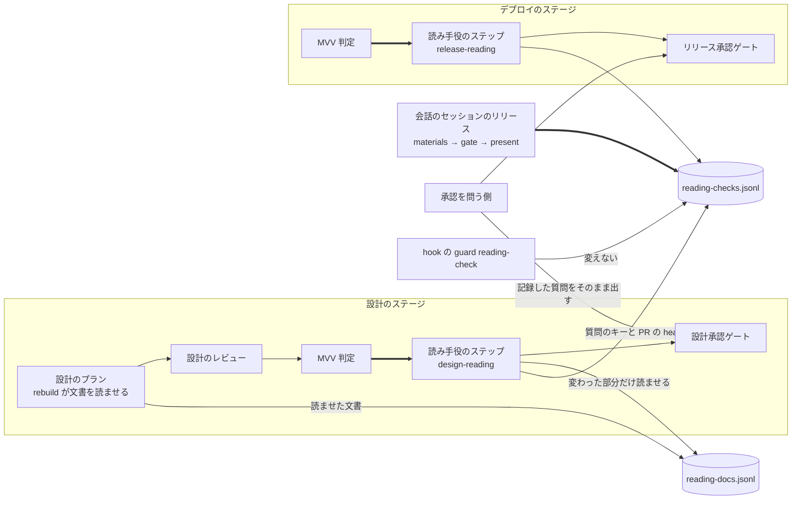
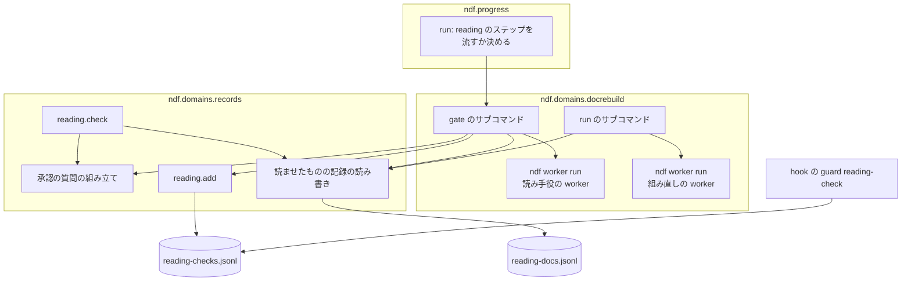
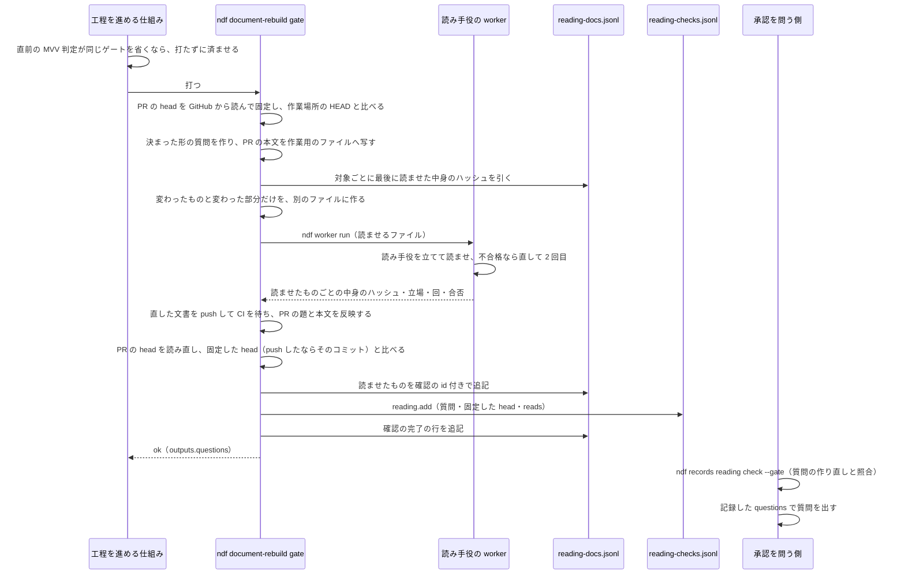

# document-rebuild: 承認資料と質問の文を、承認ゲートの前の工程で読み手役に確かめさせる（#4446）

承認を問う直前に読み手役を起動するため、通じない文が承認の直前に見つかり、承認と変更要求の往復が増えている。設計のステージとデプロイのステージで、承認ゲートの 1 つ前に読み手役のステップを置く。このステップが、決まった形の質問の文・承認資料・前に読ませた後で変わった文書の部分を読ませ、質問を止める hook が見る記録へ残す。承認を問う側は、記録した質問をそのまま出すだけにする。採らなかった案は「決定の記録」に、外部の調査を省いた理由は末尾にある。

## 今の姿

何が起きたか・目的・受け入れ条件は要求仕様（[issue-4446-requirements.md](./issue-4446-requirements.md)、正は #4446 の本文）にある。この文書は「どう解くか」と「なぜその解き方か」だけを書く。

### 工程・ステップ・プラン・supervisor の関係

この設計は、読み手役を起動する場所を、人と対話するセッションから工程のステップへ移す。そのため、工程の進み方を先に示す。

スプリントは、工程（設計のステージ・デプロイのステージなど）を順に流して進む。工程ごとに、工程の定義（`plugins/ndf/contracts/workflow/stages/*.json`）がステップの並びを決め、工程を進める仕組み（`ndf.progress`）が上から順に流す。ステップには次の種類がある。

| ステップの種類 | 何をするか | 例 |
| --- | --- | --- |
| コマンドを打つ（`ndf.script`） | `ndf` のコマンドを 1 つ打ち、結果 JSON を読む | MVV 判定（`ndf records mvv gate`） |
| プランを流す（`ndf.plan`） | 決まったコマンドの並び（プラン）を `ndf plan` が順に打つ | 設計のプラン（設計 → 組み直し → PR → CI） |
| 承認ゲート | 人の回答を待つ | 設計承認ゲート・リリース承認ゲート |

supervisor は、Skill の手順書に沿って作業を進める AI である。プランのテンプレートが無いなど `ndf plan` で流せないときだけ、conductor（人と対話するセッション）が起動する（`plugins/ndf/skills/development-workflow/references/agent-layers.md`）。この文書で「プランだけで流れる」と書くのは、supervisor を起動せず、工程の定義とプランのコマンドだけで工程が進む場合である。このときは、AI の手順書を読む担当がいない。

### 変更の位置

変更の位置を太線で示す。今は、承認を問う側（conductor・オーガナイザー）が問う直前に読み手役を起動している。

### 設計に要る今の構造

- **記録の照合は、質問の文の SHA-256 と PR の head で行う。** `ndf records reading add` が書く行は、2 つを持つ（`plugins/ndf/src/ndf/domains/records/reading.py` ）。質問の文から作ったキー（`reading_decide.question_key`）と、承認する PR の番号・ブランチ・head である。hook の guard `reading-check` は、2 つのときに質問を止める（`plugins/ndf/src/ndf/domains/hooks/guards/reading_check.py` ）。同じ質問のキーの行が無いときと、PR の head が記録と違うときである。PR の本文は照合しないので、本文だけを直しても hook は止めない
- **記録の行の形はスキーマで決まっている。** 行は `repo`・`question_key`・`prs`・`reads` を持つ（`plugins/ndf/contracts/schemas/internal/reading-check.schema.json` ）。`reads` の要素は `name`（文書のパスか `question`・`material`）・`reader`・`round`（1 か 2）・`result`（`passed` か `remained`）の 4 つだけを持ち、`name: question` の要素を 1 つ以上含む。`result: remained` は `round: 2` に限る。PR の無い承認では `prs` を空にし、hook は質問のキーだけで照合する
- **質問の文は、承認を問う側が問う時点で書く。** 承認ゲートの質問を決まった形で作る部品は無い（`ndf.progress.gate.asking.question` は質問の id と選択肢だけを持ち、文を持たない）。そのため、記録を前もって作れない。読み手役の確認が問う直前に寄った根本原因はここにある
- **MVV 判定で承認ゲートを省くかは、ゲートの直前のステップの出力で決まる。** MVV 判定のステップ（`ndf records mvv gate`）は、どの進め方（`pace`）でも流れ、出力 `mvv_gate` を書く（`plugins/ndf/skills/development-workflow/references/pace.md` の「MVV 判定」）。承認を省けるかの判定に進むのは、進め方が `fast` か `auto` のときだけである。そのうえで、機械の検査を通ったときだけ LLM を呼び、変更が MVV に従うかと、必ず人の承認が要る操作に当たるかを判定する（`plugins/ndf/src/ndf/domains/records/mvv_gate.py`）。`normal` では判定せず、省かないと出力する。出力 `mvv_gate` は `gate`（`design` か `release`）・`skip`（省くなら `true`）・`why`・`head` を持つ。承認ゲートのステップは、直前のステップの済んだ結果の `mvv_gate` が同じゲートで `skip` が `true` のときだけ、人に問わずに通す（`ndf.progress.model.mvv_skip`）。直前のステップは `ndf.progress.run` が工程の定義の並びから決める
- **省いた後や回答の後に head が動けば、承認ゲートは人の回答待ちへ戻る。** 回答を読む前に、`ndf.progress.gate.answering.recheck` が、回答した者（MVV 判定を含む）が見た head と今の head を比べる。違えば承認ゲートを待ちへ戻し、新しい id の質問にする。リリース承認ゲートで、加わった変更が文書だけなら、待ちへ戻さずに進める
- **承認ゲートで止まると、待ちの知らせにゲートの種類と PR が載る。** 結果 JSON の `metrics.gate` は、ゲートの種類（`kind`）・PR の番号と URL・今の head と、その head に固定した回答のコマンドを持つ（`ndf.progress.gate.asking.describe`・`routes`）。工程を進める仕組みは、ゲートに届いた時点で承認資料のファイル（`gate-materials/<質問の id>.md`）も作る。中身は PR の URL・head・出すバージョン・前のステップの結果に残った未確認の点・回答の選択肢を決まった形で並べたもので、文を書く担当はいない
- **会話のセッションのリリースでは、承認資料が対象のコミットを 1 行で持つ。** `ndf release-steps present` は、資料の行 `提示したコミット: <SHA>` が PR の今の head と違えば提示しない（`plugins/ndf/src/ndf/domains/release/trail.py` の `present`）
- **文書の組み直しで読ませた結果は、記録に入らない。** `ndf document-rebuild run` が起動する組み直しの worker は、読み手役を文書 1 件につき最大 2 回立ててよい（#4337 の決定 5）。結果は工程の結果ファイルの `metrics.readers` にだけ残る（`plugins/ndf/src/ndf/domains/docrebuild/drive.py`）。この時点では PR がまだ無く、後の設計のレビューで文書が変わる
- **読み手役を立てられないときは、`not_run` で ok として進む。** 組み直しの worker は理由を残して自分で読み直す。確認は、承認の直前に読ませる手順へ回る（`plugins/ndf/contracts/worker/document-rebuild.md` の「誰が確かめるか」）

## 文脈と制約

- 質問を止める hook の判定の条件（質問のキーと PR の head の照合）は変えない（要求の「含まない」）。記録の行の形も変えない
- 読み手役の確認の中身は、`document-rebuild` の「読み手役に読ませる」のまま使う。中身は、読み手の立場・渡すもの・合格の条件・立場ごとに 2 回まで・一部だけ読ませるときの決まりである
- 承認ゲートの数と置く場所は変えない。足すのは承認ゲートの前のステップで、承認を求めない
- worker は原則として別のサブエージェントを起動しない。例外は `ndf worker run` で起動した組み直しの worker だけである（`agent-layers.md`）。読み手役を立てる新しい担当も、この例外の中に置く
- 承認ゲートの外で判断を求める質問は、今のまま質問を出す AI が読ませる（要求の「含まない」）。これは `AskUserQuestion` の `metadata.source` が `ndf-ask:` で始まる質問で、費用がかかる操作・取り消せない操作・人にしかできない操作などの判断を求める（区分の一覧は `plugins/ndf/skills/development-workflow/references/asking.md` ）
- 設計 PR の head は、設計のレビューの直し・ベースブランチの取り込みで動く。最後に読ませた後に head が動けば、hook は質問を止める

## 解き方の全体像

設計どおりに実装を終えると、読み手役を起動するのは文書と承認資料を作る工程だけになる。

- 承認ゲートの質問の文は、ゲートの種類と PR から決まった形で作る。承認を問う側は文を書かず、ステップが記録した質問を 1 字も変えずに出す。同じ質問は、ゲートの種類と PR の番号から誰でも作り直せる。作り直しと記録の照合は、1 回の PR の取得で行う
- 設計のステージでは、MVV 判定と設計承認ゲートの間に読み手役のステップを置く。PR の本文と質問の文は、承認する人の立場で読ませる。文書は、前に読ませた後に変わった部分だけを読ませる。組み直しで読ませた結果は、設計 PR のブランチで引く。記録は、読ませた時点で固定した PR の head で作る
- 読み手役の指摘で文書を直して push したときは、新しい head で CI が通ってから記録し、承認ゲートへ進む
- デプロイのステージでは、MVV 判定とリリース承認ゲートの間に同じステップを置く。承認資料はスプリントの PR の本文である。会話のセッションがリリースの承認資料を組む手順では、`ndf release-steps materials` が組んだファイルを、資料を PR へ置く（`present`）前に同じサブコマンドで読ませる
- 読ませたもの（文書・承認資料・質問の文）は、中身のハッシュごとに追記で記録する。読み手役のステップはこの記録と比べて、変わったものと変わった部分だけを読ませる
- MVV 判定が承認ゲートを省くときは、工程を進める仕組みが読み手役のステップを流さない。省いた後に head が動いて人の回答待ちへ戻るときは、読み手役のステップを打ってから待ちに入る
- 読み手役を立てられなければステップは止まり、「読ませていない」で先へ進まない

## 構成要素

| 要素 | 責務 |
| --- | --- |
| `ndf document-rebuild gate`（新設のサブコマンド） | 承認ゲートの 1 つ前に打つ。PR の head を固定し、決まった形の質問を作り、読ませるものを決め、読み手役の worker を `ndf worker run` で起動する。worker が直した承認資料・PR の題・文書を PR へ反映し、push したときは CI を待つ。結果を 2 つの記録へ書き、最後に確認の完了を記録する |
| 読み手役の worker の起動指示（`contracts/worker/document-rebuild-gate.md`。新設） | 承認資料・質問の文・文書の変わった部分を読み手役に読ませる。不合格なら、承認資料のファイル・PR の題の案・文書を直して 2 回目を読ませる。直してよいのは、gate のサブコマンドが起動の前に決めたファイルだけである。直した後に、事実が変わっていないことを差分で確かめる。読み手役の起動の許可は組み直しの worker と同じ例外に置く |
| 承認の質問の組み立て（`ndf.domains.records.reading` に足す） | ゲートの種類（`design`・`release`）・PR の番号・PR の題から、`AskUserQuestion` に渡す `questions` を決まった形で作る。PR の無いリリース承認の形も持つ。リリースの質問の操作は、リリースの形の表の列 `approve` から入れる |
| リリースの形の表（`contracts/domains/release-forms.json`。変更） | 列 `approve`（承認の質問で問う操作）を足す |
| `ndf records reading check`（変更） | 引数 `--gate <種類>` と PR の番号を受けたときは、PR を 1 回だけ取得し、その題で質問を作り直してファイルへ書き、同じ取得の head と本文で照合する。今の照合に、承認資料の照合を足す。完了した確認の記録の承認資料の SHA-256 と、今の PR の本文か渡された承認資料のファイルの SHA-256 が違えば、足りないもの `material_changed` を返す |
| 読ませたものの記録（`reading-docs.jsonl`。新設） | 読み手役に読ませたもの（文書・承認資料・質問の文）ごとに、確認の id・中身のハッシュ・立場・回・合否を追記で持つ。確認を終えたら、完了の行を 1 行足す。保存先は `reading-checks.jsonl` と同じ |
| 承認資料の写し（`reading-materials/<ゲート>-<PR の番号>.md`。新設） | 最後に完了した確認で読ませた承認資料の中身を、PR ごとに 1 版だけ残す。次に承認資料が変わったときに、差分を作る元と、前に残った文を引き継ぐ元にする |
| `ndf document-rebuild run`（変更） | 読み手役が読んだ文書を、作業場所のブランチを付けて読ませたものの記録へ書く。`not_run` を ok にせず止める |
| 工程の定義（`stages/design.json`・`stages/deploy.json`。変更） | `design-mvv` と `design-gate` の間に `design-reading`、`release-mvv` と `release-gate` の間に `release-reading` を足す。ステップの種類は新しい `reading` で、どのゲートの前かを `gate` に持つ |
| 工程を進める仕組み（`ndf.progress.run`・`ndf.progress.gate.answering`。変更） | 種類 `reading` のステップの前の MVV 判定が、同じゲートを省くと書いていれば、そのステップを打たずに済ませる。承認ゲートが MVV 判定を探すときは、種類 `reading` のステップを飛ばして直前の MVV 判定のステップを見る。`recheck` が承認ゲートを待ちへ戻すときは、同じ工程の種類 `reading` のステップを打ち直してから待ちに入る。回答のコマンドが固定する対象（`Target`）に PR の本文のハッシュを足す |
| 手順書（変更） | 承認を問う側の手順から読み手役の起動を外し、記録した質問を出すことと、記録が合わないときにステップを打ち直すことに置き換える |
| hook の止める理由の文（変更） | 「読み手役に読ませて記録する」の案内を、「読み手役のステップを打ち直す」の案内に変える。判定の条件は変えない |

## 入出力のコントラクト

### `ndf document-rebuild gate`

| 引数 | 意味 |
| --- | --- |
| `--gate design` か `--gate release` | 承認ゲートの種類 |
| `--pr <番号>` | 承認する PR。省いたときの決め方は下の表にある |
| `--material <ファイル>` | リリースの承認資料のファイル。会話のセッションが `ndf release-steps materials` の後に打つときだけ渡す。`--gate design` では受けない |
| `--state-dir <ディレクトリ>` | 起動指示・承認資料の作業用の写し・worker の結果ファイルの保存先 |
| `--out <ファイル>` | 結果 JSON を書くファイル |

承認する PR と承認資料は、どこから打つかで決まる。

| どこから打つか | 承認する PR | 承認資料（読み手役に読ませ、承認する人に示すもの） |
| --- | --- | --- |
| 設計のステージのステップ `design-reading` | 作業場所のブランチの PR（`--pr` があればそれ）。`ndf records mvv gate` と同じ決め方 | 設計 PR の本文 |
| デプロイのステージのステップ `release-reading`（`--material` なし） | 工程の入力の `pr`（スプリントの PR。`--pr` があればそれ） | その PR の本文 |
| 会話のセッションのリリース（`--material` あり） | `--pr` のリリースの PR。PR を伴わない承認（ストアへの提出の承認など）では省く | `--material` のファイル（`ndf release-steps materials` の出力） |

工程を進める仕組みがゲートで作る承認資料のファイル（`gate-materials/<質問の id>.md`）は読ませない。決まった形で項目を並べるだけで文を書く担当がおらず、ゲートに届くまで作られないためである。

PR の要否は、引数と工程の入力だけで決まり、リポジトリごとの設定は読まない。`--material` が無いのに PR が決まらないときは、読ませる承認資料が無いので `stopped`（`precondition`）で終える。`--material` があって PR が無いときは、PR の無い質問の形で記録し、`reading-checks.jsonl` の行の `prs` を空にする。

| 結果 | いつ | 出力 |
| --- | --- | --- |
| `ok` | 読ませて記録した。または、読ませるものが無く、固定した head で記録し直した | 下の表 |
| `stopped`（`precondition`） | PR が無く `--material` も無い・GitHub を読めない・読み手役を立てられなかった・読ませている間に PR の head が動いた・作業場所の HEAD が PR の head と違う・`--material` の対象のコミットが PR の head と違う・読ませている間に PR の本文か題がほかの人に変えられた・直した文書を push できなかった | `cause.detail` に理由。記録を書かない。工程は承認ゲートへ進まない |
| `stopped`（`incomplete`） | worker の結果に、読ませたものごとの記録が欠けている。最後に読ませた後に worker が中身を変えた。決めたファイルの外を変えた。承認資料の対象のコミットの行を変えた | `gaps` に欠けた対象 |
| `stopped`（`check_failed`） | 直した文書を push した後の head で、CI が通らなかった | `cause.detail` に落ちたチェック。記録を書かない |

`ok` のときの出力は次のとおりである。

| 出力 | 中身 |
| --- | --- |
| `outputs.questions` | 記録した `questions` を書いたファイルのパス |
| `outputs.head` | 読ませた PR の head（PR が無ければ `null`） |
| `outputs.material` | 読ませた承認資料の最終版のパスと、2 つのハッシュ。`sha256` は「読み手役が残した文」のセクションを除いた本文のハッシュで、読ませた版と結び付ける。`file_sha256` はファイル全体のハッシュで、承認する人に示す版が変わったかを決める。会話のセッションは、このファイルを `present` に渡す |
| `metrics.readers` | 読ませたものごとの立場・回・合否 |
| `items`（結果 JSON の最上位） | 2 回目にも残った「判断や作業を誤らせる文」。1 件ずつ `id: reader-<番号>`・`doc`（`question`・`material`・文書のパス）・`text`（引用と理由）を持つ。今の `document-rebuild` の結果と同じ形 |

**2 回目にも「判断や作業を誤らせる文」が残ったときも、`ok` で終えて承認ゲートへ進める。** 不合格を承認する人に見せて判断を任せる、今の `document-rebuild` の決まりのとおりである。扱いは次のとおり。

- 残った文は、gate のサブコマンドが承認資料の末尾の決まった見出し「読み手役が残した文」のセクションに、対象（質問の文・承認資料・文書のパス）と引用を 1 行ずつ機械で書く。読み手役の指摘で文書を直して push したときの、直したコミットの行もこのセクションに書く（「処理の流れ」の手順 5）。worker はこのセクションを書かない。承認する人はそこで読む。質問の文そのものに残ったときも、ここに書く
- このセクションは読ませた本文ではない。承認資料のハッシュは 2 つを使い分ける
  - 読ませた版と結び付けるハッシュ: 見出しから末尾までを除いた本文の SHA-256。gate のサブコマンドと `check` は同じ計算を使う。そのため、セクションを足しても、読ませた版と提示する最終版は同じハッシュで結び付く
  - 示す版が変わったかを決めるハッシュ: セクションを含めたファイル全体（PR の本文では本文全体）の SHA-256。`present` の打ち直しと、承認の回答に固定する値（決定 2）に使う
- `reading-checks.jsonl` の `reads` には、その対象を `round: 2`・`result: remained` で書く。引用と `items` は記録へ入れない（スキーマが許さない）
- hook は今のとおり、質問のキーと PR の head だけを照合して質問を通す。`remained` は止める理由にしない

**前の確認で残った文は、解消を確かめるまで引き継ぐ。** 前に残った文は、前の承認資料のセクションから読む（設計とデプロイのステージでは PR の本文、会話のセッションでは承認資料の写し）。gate のサブコマンドは、前に残った文を 1 件ずつ次のとおりに扱い、残すものを新しいセクションへ書き直す。

| 前に残った文の状態 | 扱い |
| --- | --- |
| 引用した文が、対象の今の中身に無い | 解消とみなして外す |
| 今回読ませた差分の部分に含まれ、読み手役が今回は挙げなかった | 解消とみなして外す |
| 今回読ませた部分の外にある（対象が変わっていない、または差分の外） | 残す。その対象の `reads` は `round: 2`・`result: remained` のままにする |
| 今回も挙がった | 残す（今回の結果のとおり） |

### 承認の質問の決まった形

| ゲート | 質問の文 | 選択肢 |
| --- | --- | --- |
| `design` | `設計 Pull Request #<番号>（<題>）をマージしてよいですか` | `承認する`・`変更を求める` |
| `release`（PR あり） | `リリースの Pull Request #<番号>（<題>）を承認し、<承認する操作>してよいですか` | `承認する`・`変更を求める` |
| `release`（PR なし） | `承認資料のとおり、<承認する操作>してよいですか` | `承認する`・`変更を求める` |

選択肢の説明の文も決まった形で持つ。

**リリースの質問は、承認すると実行される操作をリリースの形から書く。** 「本番へ出す」とまとめて書くと、ストアへの提出を承認する人は、審査への提出と利用者への公開のどちらを許すのかを質問から判断できない。そこで、リリースの形の表（`plugins/ndf/contracts/domains/release-forms.json`）に列 `approve`（承認の質問で問う操作）を足し、`<承認する操作>` にその値を入れる。形は、プロジェクトの宣言（`.ndf/project.json` の `branch_strategy.release.form`）から読む。`gate` と `check` は同じ宣言と同じ表から質問を作るので、質問のキーは一致する。

| リリースの形 | `approve` の値（質問の文の例） |
| --- | --- |
| `mobile` | `アプリをストアの審査に提出`（承認資料のとおり、アプリをストアの審査に提出してよいですか） |
| `service` | `本番ブランチへマージして環境へ反映` |
| `package-plugin` | `タグと GitHub Release を作って公開` |
| `procedure` | `設定の手順で配布` |
| `document` | `置き先のシステムへ提出` |

形の宣言が無いか、表の行が扱わない形（`supported` が偽）なら、`gate` と `check` は質問を作らずに `stopped`（`precondition`）で終える。`release-steps` もこの形では止まるので、質問を出す場面は無い。

**`metadata.source` は質問のキーに入らないので、問う側が付ける。** Claude Code では、設計承認の質問に `ndf-gate:1`、リリース承認の質問に `ndf-gate:2` を付ける。hook はこの値で承認の質問を識別し、記録の PR の head を照合する。付けないと、hook は区分の無い質問として照合せずに通す。`ndf-ask:` は承認ゲートの外の判断の質問を識別する印で、ここでは使わない。

**同じ質問は、ゲートの種類と PR の番号からいつでも作り直せる。** `ndf records reading check --gate <design|release> [--pr <番号>] [--material <ファイル>] --questions-out <ファイル>` は、PR を 1 回だけ取得する。その題で同じ形の質問を作ってファイルへ書き、同じ取得の head と本文で記録を照合する。ステップの `outputs.questions` はレーンの作業場所の中のファイルなので、別のセッションのオーガナイザーや再開した後のセッションは、待ちの知らせ（`metrics.gate` の `kind` と `pr`）からこのコマンドを打つ。今の `check` と比べて、GitHub の取得の回数は増えない。PR の題が読ませた後に変わっていれば、作り直した質問のキーが記録と合わず、`no_record` を返す。

## 処理の流れ

設計のステージの流れを示す。デプロイのステージは文書を読ませない。会話のセッションのリリースは、承認資料が `--material` のファイルで、PR の本文を書き換えない。

1. **head を固定する。** 打った時点の PR を GitHub から 1 回取得し、head・題・本文を控える。以後この head の SHA を基準にする。設計のステージでは、作業場所の HEAD がこの SHA と同じで、変更の無い状態であることを確かめる。違えば `stopped`（`precondition`）で終える。読ませる文書は、作業場所のファイルではなく、この SHA の中身（`git show <SHA>:<パス>`）から作る
2. **承認資料を作業用のファイルにする。** worker はこのファイルを直す。用意の仕方は経路で違う
   - PR の本文を承認資料とするとき: 控えた本文を `--state-dir` の下のファイルへ写す
   - `--material` があり、PR もあるとき: そのファイルをそのまま使う。ファイルの行 `提示したコミット: <SHA>` が固定した head と同じかを確かめる。違えば、`materials` を組んだ後に PR が動いたので、`stopped`（`precondition`）で終える。組み直してから打ち直す
   - `--material` があり、PR が無いとき: そのファイルをそのまま使う。比べる head が無いので、対象のコミットの行は確かめない。承認資料の照合は、手順 7 で記録する中身のハッシュで行う。承認を問う側は `check` を `--pr` を省いて打つ（「承認を問う側の手順」）
3. **読ませるものを決める。** 下の「読ませるものの決め方」の表のとおり。worker が直してよいファイルも、ここで決める。承認資料の作業用のファイル・PR の題の案のファイル・今回読ませる設計 PR の文書だけである
4. **worker に読ませる。** worker は、読ませるたびに、読ませた対象の全体の中身のハッシュを結果に書く。文書は `git hash-object` の blob の SHA、承認資料は「読み手役が残した文」のセクションを除いた本文の SHA-256、質問の文は質問のキーである。一部だけを読ませたときも、切り出した元の全体のハッシュを書く。質問の文が不合格で、原因が PR の題にあれば、worker は新しい題の案をファイルに書く。決まった形の文そのものが原因なら、ステップの中では直さず、残った文として扱う（決定 1）。読み手役の指摘で直したときは、今の `approval-request.md` の手順 3 のとおり、事実（数・日付・条件・決定）が変わっていないことを差分で 1 回確かめ、確かめた差分を結果に書く
5. **直したものを反映する。** gate のサブコマンドが、worker の後に次を行う
   - 対象ごとに、今の中身のハッシュが最後に読ませたときのハッシュと同じかを確かめる。違えば `stopped`（`incomplete`）で終える。手順 3 で決めたファイルの外が変わっているとき、承認資料の行 `提示したコミット:` が変わっているときも同じである
   - 直した文書があれば、作業場所でコミットして push する（強制はしない）。push したコミットを新しい基準の head にする。続けて、設計のプランの CI のステップと同じ `ndf ci watch` で、新しい head の CI を待つ。通らなければ `stopped`（`check_failed`）で終える。設計のレビューはやり直さない。直したコミットと事実を確かめた差分を、承認資料の「読み手役が残した文」のセクションの先頭に、機械で 1 行書く。このセクションの中なのでハッシュには入らない。承認する人は、レビューの後に足された変更をそこで知る
   - PR の題と本文は、ほかの人の変更を上書きしないように書き換える。GitHub の PR の更新には、前の版を条件にした書き換えが無い。そのため、書き換えの前と後の 2 か所で確かめる
     - 書き換えの前: PR を取得し直し、題と本文が手順 1 で控えたものと同じかを確かめる。違えば、ほかの人が読ませている間に変えたので、書き換えずに `stopped`（`precondition`）で終える
     - 書き換えの後: 本文の編集の履歴（GraphQL の `userContentEdits`）と題の変更の履歴（タイムラインの `RenamedTitleEvent`）を読む。取得し直した時点から自分の書き換えまでの間に、ほかの人の編集があれば、その人の版へ戻して `stopped`（`precondition`）で終える
     - どちらで止まっても、ほかの人の変更は PR に残り、worker の版は `--state-dir` に残る。打ち直すと、ほかの人の版から読ませ直す
   - 新しい題の案があれば PR の題を変え、質問を作り直す。作り直した質問のキーは、2 回目に読ませた質問のキーと同じでなければならない
   - 残った文のセクションを書き直し（「前に残った文の状態」の表）、PR の本文を承認資料とするときは、作業用のファイルの最終版で PR の本文を書き換える。読み直した本文のハッシュがファイルと同じかを確かめる
6. **head が動いていないかを確かめる。** PR の head を GitHub から読み直し、基準の head と違えば記録を書かずに `stopped`（`precondition`）で終える。読み手役が動いている間に別のコミットが足されたときに、読んでいない文書を確認済みにしないためである。打ち直せば、足された部分だけを読ませる
7. **記録する。** 次の順に書く。途中で失敗したら `stopped` で終え、打ち直す
   1. 読ませたものを、この実行の確認の id を付けて `reading-docs.jsonl` に追記する
   2. 承認資料の最終版を写しのファイルへ書く。一時ファイルへ書いてから置き換え、PR ごとに 1 つだけにする。PR の無い承認では書かない
   3. `reading.add` で、基準の head と、下の「`reads` の作り方」で作った `reads` を `reading-checks.jsonl` に書く。`reading.add` が返した、追記した行を控える
   4. 確認の完了の行を `reading-docs.jsonl` に追記する。完了の行は、確認の id・質問のキー・基準の head・承認資料のハッシュ・承認資料のファイル全体のハッシュと、手順 3 で追記した行の指紋（行の JSON を、キーの順を固定して作った SHA-256）を持つ

### 確認の id と完了の行

2 つの記録の書き込みは 1 回の操作にできないため、確認ごとに id を振り、最後に完了の行を書く。完了の行の無い確認の行は、途中で止まった確認として、比較にも過去の結果としての `reads` にも `check` にも使わない。

**`check` は、hook が使う記録の行と、その行を書いた確認の完了の行を、行の指紋で結び付けて照合する。** 次の順に調べる。

1. 記録の行（`reading-checks.jsonl`）から、hook と同じ選び方（`reading_decide.used_row`。同じ質問のキーの最後の行）で 1 行を選び、今の照合（`no_record`・`no_pr`・`head_moved`）を行う
2. 選んだ行の指紋を作り、同じ指紋を持つ完了の行を探す。無ければ `no_record` を返す
3. 見つけた完了の行の承認資料のハッシュが、今の PR の本文（会話のセッションでは渡されたファイル）のハッシュと違えば `material_changed` を返す

同じ質問と同じ head で確認し直し、`reading.add` の直後に完了の行の書き込みに失敗したとする。このとき、最後の記録の行は途中で止まった確認のもので、その指紋を持つ完了の行は無い。そのため `check` は `no_record` を返し、前に完了した確認の完了の行と組み合わせて通すことは無い。Claude Code の hook はこの結び付きを見ないので、承認を問う側は、どのランタイムでも質問の前に `check` を打つ（今の `approval-request.md` の手順 6 と同じ）。

**承認資料の写しは、差分の元にする前に確かめる。** 写しの本文のハッシュ（「読み手役が残した文」のセクションを除く）が、同じ PR の最後の完了の行の承認資料のハッシュと同じときだけ、差分の元にする。違えば（写しを書いた後に記録の書き込みで止まった確認があるなど）、承認資料の全体を読ませる。

### 読ませるものの決め方

対象ごとに、前に読ませた記録（`reading-docs.jsonl` の、完了した確認の行）と今の中身を比べる。行を引くキーは対象で違う。組み直しのサブコマンド（`run`）は設計のプランの中で動き、まだ PR もゲートも無いので、文書の行は作業場所のブランチで引く。設計 PR はそのブランチから作るので、gate のサブコマンドは PR の head のブランチで同じ行を引ける。

| 対象 | 行を引くキー | 今の中身のハッシュ | 記録が無い（初回） | 記録と違う | 記録と同じ |
| --- | --- | --- | --- | --- | --- |
| 質問の文 | リポジトリ・ゲート・PR の番号（無ければ空） | 質問のキー | 全体を読ませる | 全体を読ませる（1 文で短いため） | 読ませない |
| 承認資料 | リポジトリ・ゲート・PR の番号（無ければ空） | セクションを除いた本文の SHA-256 | 全体を読ませる | 前の写しからの差分の部分とその前後の段落を読ませる。写しが無ければ全体 | 読ませない |
| 設計 PR の文書（要求仕様のコピー・設計書・詳細設計書） | リポジトリ・ブランチ・パス | 固定した head の blob の SHA | 全体を読ませる | 前の blob からの差分の部分とその前後の段落を読ませる。前の blob が手元の git に無ければ全体 | 読ませない |
| 実装計画 | — | — | 読ませない（今の「対象」の行のとおり、書いた担当が自分で読み直す） | — | — |

組み直しのサブコマンドは、確認の id と完了の行を、gate のサブコマンドと同じ形で書く（記録の行を書かないので、質問のキー・head・行の指紋は空）。立場はどれも、質問の文と承認資料が承認する人、文書がエンジニアである。質問の文と承認資料をどちらも読ませるときは、今の手順のとおり 1 つの読み手役に 1 回で読ませる。

どれも読ませないときは、読み手役を起動せず、固定した head で記録だけを作り直す（受け入れ条件 6 の「変わっていないときは読ませ直さない」）。

### `reads` の作り方

`reading-checks.jsonl` の行の `reads` には、承認する時点の中身を読ませた結果を、今回読ませたものと前に読ませたものから集めて入れる。組み直しで読ませた文書の結果も、ここで hook が見る記録に入る（受け入れ条件 1）。

対象と立場ごとに、次の順で 1 つの結果を選ぶ。

1. 候補を集める。今回の実行で読ませて、手順 5 と 6 で確かめた結果は、まだ完了の行が無くても候補に含める。過去の結果は、上の表のキーで引いた行のうち、完了の行のある確認のものだけを候補にする。そのうえで、中身のハッシュが今の中身と同じものに絞る
2. その中で最も新しい確認（確認の id）を選ぶ。回は確認ごとに 1 から数え直すので、確認をまたいで回の大きさで選ばない
3. その確認の中の最後の回の結果を使う
4. 前に残った文を引き継いだ対象（「前に残った文の状態」の表）は、`round: 2`・`result: remained` にする

| 対象 | `reads` の要素 |
| --- | --- |
| 質問の文 | `name: question`。どのときも必ず入る（同じ中身の行が無ければ、手順 3 で読ませている） |
| 承認資料 | `name: material` |
| 設計 PR の文書 | `name: <文書のパス>`（組み直しの行を含む） |

`reading-docs.jsonl` の行は `reads` へそのまま写さない。上の手順で選んだ行を、`name`・`reader`・`round`・`result` の 4 つに変える。

### 承認を問う側の手順

1. `ndf records reading check --gate <種類> --pr <番号> --questions-out <ファイル>` を打つ。会話のセッションのリリースでは、`present` に渡す承認資料のファイルを `--material` で渡す。PR の無い承認では `--pr` を省き、`ndf records reading check --gate release --material <ファイル> --questions-out <ファイル>` と打つ。同じセッションでも別のセッションでも、このコマンドで質問を得て照合する
2. `no_record`・`head_moved`・`material_changed` が返ったら、読み手役を自分で起動せず、`ndf document-rebuild gate` を打ち直す。打ち直した後は、前の質問と承認資料を使わず、次を行ってから手順 1 に戻る
   - 工程の承認ゲートで待っているとき: 工程を進める仕組みから待ちの知らせを読み直す。打ち直しで head が動いていれば、待ちの知らせの head と回答のコマンドは新しい head のものになる。前に読んだ回答のコマンドは使わない（古い head に固定されていて、回答が断られる）
   - 会話のセッションのリリースで、既に `present` で提示していたとき: 前に `present` に渡したファイル全体のハッシュと、`outputs.material` のファイル全体のハッシュを比べる。違うか head が変わっていれば、`outputs.material` のファイルで `present` を打ち直す。どちらも同じなら打ち直さない。ここでは「読み手役が残した文」のセクションを含めたファイル全体で比べる。セクションだけが変わったときも、承認する人が見る資料は変わっているためである
3. 質問を出す。Claude Code では、記録した `questions` を 1 字も変えずに、上の `metadata.source` を付けて `AskUserQuestion` へ渡す。Codex などほかのランタイムでは、今の `approval-request.md` の手順 7 と `asking.md` の「ランタイムごとの扱い」のとおり、記録した質問の文と選択肢を変えずに、区分の名前（`ndf-gate:1` か `ndf-gate:2`）を先頭に書いて出す

## 決定の記録

根拠に挙げる Value は、このリポジトリのプロジェクト MVV の番号である。対象は承認済みのバージョン 11 で、本文は `.ndf/mvv.md` 、承認の記録は `.ndf/mvv.json` にある。各決定の「根拠」の行は NDF が機械で照合する形で書き、当てた Value の名前と要点は次の「根拠の要点」の行に書く。

### 決定 1: 記録を承認の前に作れるよう、承認の質問の文を工程が決まった形で作る

- **質問**: hook は質問の文のキーで記録を探す。そのため、問う側が問う時点で文を書くと前もって記録できない。質問の文を誰がいつ決めるか
- **選んだ案**: ゲートの種類・PR の番号・PR の題から、質問の文と選択肢を決まった形で作る部品を `ndf.domains.records.reading` に足す。読み手役のステップが作って記録し、ファイルのパスを `outputs.questions` に返す。承認を問う側はそのファイルの `questions` を 1 字も変えずに出す。承認資料は「入出力のコントラクト」の表のとおり、工程から打つときは PR の本文、会話のセッションのリリースでは `ndf release-steps materials` が組んだファイルとする。問う側は自分の文を足さない
- **質問の文が不合格のとき**: 質問の中で変えられるのは PR の題だけである。題が原因なら、worker が題の案を書き、gate のサブコマンドが PR の題を変えて質問を作り直し、2 回目に読ませる。決まった形の文が原因なら、ステップの中では直さない。2 回目にも残った文として承認資料に書き、記録は `remained` にする。利用者には同じ形の質問が届き、承認資料で残った文を読める。決まった形の文は、NDF のコードの変更として直す
- 採らなかった案: 問う側が文を書き、工程は文書だけを読ませる（質問の文と問う側が書く資料が読まれないまま残り、受け入れ条件 2 を満たさない）
- 採らなかった案: hook が質問の文を見ずに PR の head だけで照合する（hook の判定の条件を変えることになり、要求の「含まない」に反する）
- **代償**: 質問の文が決まった形になり、ゲートごとに言い回しを変えられない。問う側が書き足したい事情は、承認資料のファイルか PR の本文へ書く。その後に読み手役のステップを打ち直す必要がある
- 根拠: Value 3・Value 1（MVV バージョン 11）
- 根拠の要点: Value 3「同じ手順は毎回同じ結果になる」は、判断の要らない手順（記録・整形など）を仕組みが進め、結果を実行ごとにばらつかせないことを求める。Value 1「人の判断を、読み切れる量の大事な所だけにする」は、承認の場に一度で読み切れる材料が届くことを求める

### 決定 2: 承認する時点の内容で記録するため、読み手役のステップを MVV 判定と承認ゲートの間に置く

- **質問**: 承認資料と質問の文をどの時点で読ませるか。要求は工程「ドキュメント再構成」を挙げるが、その時点では PR と本文が無く、後の設計のレビューで文書が変わる
- **選んだ案**: 工程の定義の設計のステージに `design-reading` を足す（`design-mvv` と `design-gate` の間）。デプロイのステージには `release-reading` を足す（`release-mvv` と `release-gate` の間）。どちらも `ndf document-rebuild gate` を打つ。会話のセッションがリリースの承認資料を組む手順（`release-steps.md`）では、`materials` の後・`present` の前に同じサブコマンドを `--material` 付きで打ち、`outputs.material` のファイルを `present` に渡す
- **MVV 判定がゲートを省くとき**: 工程を進める仕組みが、読み手役のステップを打たずに済ませる。条件は 2 つで、どちらも満たすときだけ省く。1 つは、同じ工程の中で直前に済んだ MVV 判定のステップ（`ndf records mvv gate`）の出力 `mvv_gate` で、`gate` がこのステップの `gate` と同じかつ `skip` が `true` であることである。もう 1 つは、後ろの承認ゲートのステップに待ちの記録が無いことである。今の承認ゲートも同じ 2 つで省くか決める（`ndf.progress.run` の、待ちの記録が無いときだけ `model.mvv_skip` を使う条件）ので、片方だけが省かれることは無い。前の工程の判定や別のゲートの判定は使わない。打たずに済ませたステップは出力を持たず、質問のファイルも作らない。承認ゲートは MVV 判定の回答（回答した者 `service:mvv`）で通るので、質問は出ない。今の承認ゲートは直前のステップの出力を見るので、種類 `reading` のステップを飛ばして直前の MVV 判定のステップを見るように変える
- **省いた後に人の回答待ちへ戻るとき**: MVV 判定の後に PR の head が動くと、`recheck` が承認ゲートを人の回答待ちへ戻す。このとき読み手役のステップは出力なしで済んでおり、新しい head の質問のファイルも記録も無い。そこで `recheck` は、承認ゲートを待ちへ戻すときに、同じ工程の種類 `reading` のステップを未了に戻す。直前の MVV 判定の出力には `skip: true` が残るが、`recheck` が承認ゲートの待ちの記録（今もステートマシンの事象に書く）を書くので、上の 2 つ目の条件が外れる。そのため、未了に戻した読み手役のステップは省かれずに打たれる。省く判定を無効にした状態を別に記録する置き場は足さない。工程を進める仕組みは、そのステップを新しい head で打ってから待ちに入る。人が回答した後に head が動いて待ちへ戻るときも同じで、前の記録は古い head のものなので打ち直す。リリース承認ゲートで、加わった変更が文書だけで待ちへ戻さないときは、打ち直さない
- **承認の回答に固定する承認資料**: 今の回答のコマンドは、承認資料として `gate-materials/<質問の id>.md` の SHA-256 を固定する（`ndf.progress.gate.asking.Target`）。この設計ではそのファイルを読ませないので、読み手役が確かめた PR の本文を固定する値に足す。`Target` に PR の本文全体の SHA-256 を足し、待ちの知らせの回答のコマンドに `--body-sha256` として載せる。`recheck` は回答を適用する前に、今の PR の本文のハッシュと比べる。違えば、今と同じく承認ゲートを待ちへ戻し、上のとおり読み手役のステップを打ち直す。質問を出した後に PR の本文だけが変わっても、承認する人が見ていない本文に承認が適用されることは無い
- **MVV 判定の無い経路**: 会話のセッションのリリースは、工程の MVV 判定を通らない。そこでは、MVV 判定で人に問わないと決まったとき（`answer --by mvv` で書くとき）に gate のサブコマンドを打たず、人に問うときだけ打つ
- 採らなかった案: 読み手役の確認をすべて組み直しのステップ（`rebuild`）に寄せる（PR の本文がまだ無い。レビューの直しで head が動き、承認の直前に hook が止めて読ませ直しが起きる）
- 採らなかった案: 設計のプランの CI の後にステップを足す（設計のプランの後に、設計のレビューのステージが文書を直す。そのため、承認する時点の内容と食い違う）
- 採らなかった案: MVV 判定の前に置く（MVV 判定が承認ゲートを省くときも読み手役を起動し、費用が無駄になる）
- 採らなかった案: gate のサブコマンドが自分で MVV 判定の結果を探す（工程の入力にはステップの出力が入らず、サブコマンドから直前の判定を確かに引けない。古い判定や別のゲートの判定を拾うと、人が承認する経路で質問のファイルが作られない）
- **代償**: 設計のステージとデプロイのステージにステップが 1 つずつ増える。工程を進める仕組みに、ステップの種類 `reading` の扱いが増える。読み手役は工程「ドキュメント再構成」の外で起動する。そのため、要求の原文の「document-rebuild の工程に移動」とは置く場所が違う。サブコマンドは `ndf document-rebuild` の下に置き、手順は `document-rebuild` の手順書が持つ
- 根拠: Value 1・Value 2（MVV バージョン 11）
- 根拠の要点: Value 1「人の判断を、読み切れる量の大事な所だけにする」は、承認の場に決められた書式で一度で読み切れる材料が届くことを求める。Value 2「安く使える」は、役に立たない読み直しに費用を使わないことを求める

### 決定 3: 読み手役の起動を 1 か所に保つため、`ndf document-rebuild` にサブコマンド `gate` を足し、組み直しの worker と同じ例外で立てる

- **質問**: 承認資料と質問の文を読ませる読み手役を、どの担当が起動するか
- **選んだ案**: `ndf document-rebuild gate` が、`ndf worker run` で読み手役の worker を 1 つ起動する。起動指示は新しい `contracts/worker/document-rebuild-gate.md` から作る。そこに、読み手役を立ててよい許可を組み直しの worker と同じ形で書く（対象 1 件につき最大 2 回）。`agent-layers.md` の例外の文に、この worker を足す。記録の書き込み・push・PR の題と本文の書き換えは、worker でなくサブコマンドが行う
- 採らなかった案: `ndf records reading` の下にサブコマンドを足す（`records` は記録の読み書きを置く場所で、worker の起動と合否の取りまとめを持たない。組み直しの起動と結果の検査の部品（`drive.py`）が `docrebuild` にある）
- 採らなかった案: 工程の担当の supervisor が `ndf:worker` を起動する（工程がプランだけで流れるときは supervisor が動かず、読み手役が起動されない。今の問う側が読ませる形と同じく、起動する担当が経路ごとに分かれる）
- **代償**: 読み手役を立てる worker の例外が 2 つの起動指示に広がる。例外の範囲は `ndf worker run` で起動した、この 2 つの起動指示の worker に限る
- 根拠: Value 11・Value 9（MVV バージョン 11）
- 根拠の要点: Value 11「重複と冗長が無い」は、同じ規則・処理を 1 か所にまとめ、ほかはそこを参照することを求める。Value 9「責務の分かれた設計で作られる」は、1 つのモジュールが 1 つの責務を持つことを求める

### 決定 4: 変わった部分だけを読ませるため、読ませたものを中身のハッシュごとに追記で記録する

- **質問**: 読み手役のステップは、前に読ませた後に文書・承認資料・質問の文が変わったかを、何と比べて決めるか。PR の本文だけを直しても PR の head は動かないので、head では比べられない
- **選んだ案**: `reading-checks.jsonl` と同じ保存先に `reading-docs.jsonl` を足す。読み手役が読んだものごとに 1 行を追記し、確認を終えたら完了の行を 1 行足す（「確認の id と完了の行」）。読んだものの行は、確認の id・リポジトリ・ブランチ・ゲートの種類と PR の番号（`run` では空）・対象（`question`・`material`・文書のパス）・中身のハッシュ（「処理の流れ」の手順 4 の 3 種類）・立場・回・合否を持つ。`ndf document-rebuild run` と `gate` の両方が書く。行を引くキーと比べ方は「読ませるものの決め方」の表のとおりで、文書はブランチ、質問の文と承認資料はゲートと PR で引く。承認資料は行だけでは差分を作れないので、中身を写しのファイルに残す。`ndf records reading check` は、完了の行の承認資料のハッシュと今の PR の本文（会話のセッションでは渡されたファイル）のハッシュを比べ、違えば `material_changed` を返す。hook の判定の条件は変えないので、本文の変更は手順の `check` で見つける
- **保管**: `reading-docs.jsonl` は、表 `ndf-files.json` に `reading-checks.jsonl` と同じ `ends: kept` で載せる。行は短く、量は読ませた回数に比例する。承認資料の写しは `reading-materials/<ゲート>-<PR の番号>.md` に置き、確認を終えるたびに置き換える。PR ごとに最後の 1 版だけが残り、直しや再試行で生まれた古い版は残らない。進行中の承認と次の差分の作成に要るのは、この最後の版だけである。PR が閉じた後は要らないので、表では `ends: cleanup` とし、クリーンアップの工程が、閉じた PR の写しを消す。PR の無い承認では写しを残さない。承認が終わったことを判定する記録が NDF に無く、消す時点を決められないためである。打ち直すと、承認資料の全体を読ませる
- 採らなかった案: 承認資料の写しを SHA-256 の名前で版ごとに残す（直しや再試行のたびに版が増え、参照されなくなった写しが利用者のストレージに残り続ける）
- 採らなかった案: 組み直しの結果ファイル（プランの状態の保存先の `rebuild.json`）を読む（設計のステージの別のステップからは保存先が決まらない。変更要求で流し直すと上書きされる）
- 採らなかった案: `reading-checks.jsonl` の行に文書の blob や承認資料のハッシュを足す（その行は質問のキーを必須に持ち、組み直しの時点では質問が決まっていない。行の形を変えると hook の読み方にも及ぶ）
- 採らなかった案: hook が PR の本文のハッシュも照合する（hook の判定の条件を変えることになり、要求の「含まない」に反する）
- **代償**: 記録のファイルと写しの置き場が 1 つずつ増える。記録の行は消さずに残る。Claude Code でも、PR の本文だけを直した後は `check` を打たないと見つからない（承認の手順は `check` をどのランタイムでも打つと決めている）
- 根拠: Value 8・Value 2・Value 6（MVV バージョン 11）
- 根拠の要点: Value 8「正しいデータ構造で作られる」は、履歴を残す事実を追記だけで持ち、今の値を最新の記録から引くことを求める。Value 2「安く使える」は、変わった部分だけを読ませ、読み直しに token を払わないことを求める。Value 6「使うほど散らからない」は、NDF が作業で生んだものを役目を終えたら自動で片付けることを求める

### 決定 5: 「読ませていない」で先へ進む経路を無くすため、読み手役を立てられなければ工程を止める

- **質問**: 読み手役を立てられないとき（worker に読み手役を起動する Tool が無いなど）、組み直しと読み手役のステップをどう終え、誰がどう再開するか
- **選んだ案**: `ndf document-rebuild run` と `gate` は、worker の記録に `not_run` があれば `stopped`（`precondition`）で終える。工程は承認ゲートへ進まない。`contracts/worker/document-rebuild.md` と `document-rebuild` の手順書から「自分で読み直して進む」扱いを外す。止まった後の動きは経路ごとに次のとおりである
  - **工程から打ったとき**: 工程を進める仕組みがそのステップで工程を止め、レーンの conductor へ理由を返す。conductor は理由を利用者（並列の計画ではオーガナイザー）へ報告する。読み手役を立てられる環境（worker に Agent の Tool を許す設定など）に直した後、conductor が工程を再開すると、止まったステップから打ち直す
  - **supervisor が手順書に沿って組み直すとき**: supervisor が起動した worker は読み手役を立てられない（例外は `ndf worker run` で起動した worker だけ）。そこで supervisor は `判断が要る` で、supervisor を起動した conductor へ返す。conductor は `ndf document-rebuild run` を打つ。このコマンドは `ndf worker run` で組み直しの worker を起動するので、例外の中で読み手役を立てられる。これも `stopped`（`precondition`）で終えたら、conductor は理由を利用者へ報告して工程を止め、上と同じく環境を直してから打ち直す
- 採らなかった案: 自分で読み直して `ok` で進み、警告を出す（要求の受け入れ条件 5 に反する。承認の直前に問う側が読ませる経路が残る）
- **代償**: 読み手役を立てられない環境では、設計のステージとデプロイのステージが止まる。打ち直しの費用がかかる
- 根拠: Value 13（MVV バージョン 11）
- 根拠の要点: Value 13「確かめたことだけが済んだとされる」は、確かめていないものを済んだと記録しないことを求める

### 決定 6: 承認を問う側に読み手役を起動させないため、オーガナイザーもレーンが記録した質問をそのまま出す

- **質問**: オーガナイザーが複数のレーンの承認をまとめて問うとき、自分で書く質問の文をどこで読ませるか（要求の「未決」）。また、レーンの作業場所の中にある質問のファイルを、オーガナイザーがどう得るか
- **選んだ案**: オーガナイザーは質問の文を書かない。レーンの待ちの知らせ（`metrics.gate` の `kind` と `pr`）から `ndf records reading check --gate` を打ち、1 回の PR の取得で質問を作り直して照合してから、ゲートごとに 1 回ずつ出す。出し方は「承認を問う側の手順」の 3 のとおりで、Claude Code では `AskUserQuestion`、Codex などでは記録した文と選択肢をそのまま区分の名前付きで出す。まとめて示すのは、質問の前の一覧（順・PR の URL・題・承認資料の場所）だけにする。一覧は PR と承認資料から機械でコピーできる項目だけで、オーガナイザーの文を足さない
- 採らなかった案: オーガナイザーがまとめた質問の文を書き、問う前に読ませる（受け入れ条件 3 の「問う直前に読み手役を起動しない」に反する）
- 採らなかった案: 複数のレーンの `questions` を 1 回の `AskUserQuestion` に並べる（質問のキーは `questions` の並び全体から作る。そのため、どのレーンの記録とも合わず hook が止める）
- 採らなかった案: 待ちの知らせや引き継ぎの文書に質問の文を写す（同じ事実を 2 か所に持つ。ゲートの種類と PR から作り直せるので要らない）
- **代償**: まとめた承認でも、利用者はゲートごとに 1 回ずつ回答する。まとめの一覧で示せるのは機械でコピーできる項目だけになる。質問の作り直しは `check` が既に行う PR の取得の中で済むので、GitHub の取得は今より増えない
- 採らなかった案: 質問を作り直すサブコマンドを `check` と別に置く（作り直しと照合で同じ PR を 2 回取得し、ゲート 1 件につき GitHub の取得が 1 回増える）
- 根拠: Value 1・Value 5（MVV バージョン 11）
- 根拠の要点: Value 1「人の判断を、読み切れる量の大事な所だけにする」は、承認の場に読み切れる材料だけを届けることを求める。Value 5「速く届く」は、承認の直前の読み直しの往復でレーンを待たせないことを求める

## 影響と危険

- **働く範囲**: 利用先のリポジトリでも働く。設計のステージとデプロイのステージを流すすべてのリポジトリで、承認ゲートの前に読み手役のステップが走る
- **プロジェクトごとに違うもの**: リリースの質問で問う操作だけである。宣言 `branch_strategy.release.form` の値で、リリースの形の表の行を引いて決める（「承認の質問の決まった形」）。読み手の立場は文書の種類で決まり、設定を足さない。PR の要否は引数と工程の入力で決まる。組み直しのコマンドの設定（`workflow.launch.rebuild`）は `gate` に使わない
- **当たるモード**: `standard`・`legacy-refactor`・`documentation`（設計承認ゲートを持つモード）と、リリース承認ゲートを通るすべてのモード
- **リリースをまたぐスプリント**: 承認を問う側は、手順を版で選ばず、待っている承認ゲートの状態で選ぶ。同じ工程の中に、そのゲートの前の読み手役のステップの済んだ結果があれば、記録した質問を出す。無ければ（新しい版を入れる前に工程の定義を読み込んだスプリントや、既に承認ゲートで待っているスプリント）、問う側が `ndf document-rebuild gate --gate <種類> --pr <番号>` を 1 回打ち、「承認を問う側の手順」の 1 から問う。どちらでも読み手役を起動するのは gate のサブコマンドだけで、問う側が読み手役を直接起動する手順は残さない
- **同じファイルを触る別の変更**: #4337 の実装（`docrebuild/drive.py`・`contracts/worker/document-rebuild.md`）と重なる。#4337 がマージされた後の形の上に足す
- **壊れうる箇所**: 決まった形の質問を問う側が書き換えると、hook が止める（今と同じ止まり方）。PR の題を承認の前に変えると質問の文が変わり、記録と合わなくなる。PR の本文を読ませた後に直すと、`check` が `material_changed` を返す。どれも、読み手役のステップを打ち直せば直る

### 代表のリポジトリでの振る舞い

| 代表のリポジトリ | 設定の要点 | 直した後に起きること | この種類で扱えなくなること |
| --- | --- | --- | --- |
| Web サービス | 設計のステージとデプロイのステージを流し、リリースは本番ブランチへの PR | 設計承認ゲートとリリース承認ゲートの前に読み手役のステップが走り、問う側は記録した質問を出す | 無し |
| モバイルアプリ | リリースはストアへの提出を届け先に持つ | リリースの承認資料（`materials` の出力）と質問の文が、提出の承認の前に読まれる。PR を伴わない提出の承認は、PR の無い質問の形で記録する。質問は「アプリをストアの審査に提出してよいか」を問い、公開の承認とは取り違えない | 無し |
| 業務文書だけ | `documentation` で設計承認ゲート（企画承認）と提出の承認を持つ | 企画承認の前に PR の本文と質問の文が読まれ、原稿は組み直しで読ませた後に変わった部分だけが読まれる | 無し |

### このリポジトリだけの事情

- 無し（読み手役のステップは利用先のリポジトリと同じ形で働き、ai-plugins の運用の値を使わない）

## テスト設計

読み手役の worker・GitHub・git はテストで差し替え、子のプロセスを起動せず、時間を待たない。

| 受け入れ条件 | どの振る舞いで縛るか | どう壊したら落ちるべきか |
| --- | --- | --- |
| 1 | `ndf document-rebuild run` が、読み手役の読んだ文書を `reading-docs.jsonl` へ確認の id・ブランチ・パス・blob・立場・回・合否で追記し、完了の行を書く。続く `gate` が、PR の head のブランチで同じ行を引き、書く `reading-checks.jsonl` の行の `reads` に、今の blob を読ませた文書の結果を `name`・`reader`・`round`・`result` の形で入れる | 追記を外すと落ちる。blob を作業場所の HEAD の SHA に替えると落ちる。文書の行をそのまま写すとスキーマの検証で落ちる。`gate` が PR の番号で文書の行を引くように壊すと、組み直しの結果が入らずに落ちる |
| 1 | 同じ中身を読ませた確認が 2 つあるとき、`reads` は新しい確認の最後の回の結果を使う（前の確認の 2 回目の `remained` より、新しい確認の 1 回目の `passed` を採る）。完了の行の無い確認の行は使わない | 確認をまたいで回の大きさで選ぶと落ちる。途中で止まった確認の行を使うと落ちる |
| 2 | `ndf document-rebuild gate --gate design` が、PR の本文と決まった形の質問を読ませ、質問のキーと固定した head で `reading-checks.jsonl` へ記録する | 質問のキーを問う側の文から作るように壊すと、記録したキーと `outputs.questions` のキーが食い違って落ちる |
| 2 | worker が PR の本文を直したとき、最終版で PR の本文を書き換え、その SHA-256 を記録する。質問の不合格が PR の題にあるとき、題を変えて作り直した質問のキーで記録する | 本文を書き換えずに記録すると落ちる。題を変える前の質問で記録すると落ちる |
| 2 | 読ませている間に PR の head が動くと、記録を書かずに `stopped`（`precondition`）で終える | 終わった時点の head で記録すると落ちる |
| 2 | 最後に読ませた後に worker が文書を変えると `stopped`（`incomplete`）で終える | 変えた後の blob に前の結果を付けて記録すると落ちる |
| 2 | 2 回目にも残った文は、結果の最上位の `items` に入り、承認資料の「読み手役が残した文」のセクションに機械で書かれ、`reads` は `round: 2`・`result: remained` になる。承認資料のハッシュはセクションを除いて計算し、`check` は `material_changed` を返さない | 引用を記録へ入れると落ちる。`remained` を `stopped` にすると落ちる。セクションを含めてハッシュを計算すると落ちる |
| 2 | 前の確認で残った文は、今回読ませた部分の外にあれば引き継がれ、引用した文が無くなったときと、今回読ませた差分の中で挙がらなかったときだけ外れる | 別の段落だけを直したときに前の残った文が消えると落ちる |
| 2 | 読ませている間に PR の本文か題がほかの人に変えられると、書き換えずに `stopped`（`precondition`）で終える | ほかの人の変更を上書きすると落ちる |
| 2 | 直した文書を push した後、新しい head の CI が通らなければ `stopped`（`check_failed`）で終え、記録を書かない。worker が決めたファイルの外を変えると `stopped`（`incomplete`）で終える | CI を待たずに記録すると落ちる。決めたファイルの外の変更を push すると落ちる |
| 2 | 記録の行の書き込みに失敗して完了の行が無いとき、`check` は承認資料の行だけで通さず `no_record` を返す | 完了の行の無い承認資料の行と、前の質問の記録を組み合わせて通すと落ちる |
| 2 | 完了した確認の後に、同じ質問と同じ head で確認し直し、`reading.add` の直後に完了の行の書き込みが失敗すると、`check` は `no_record` を返す | 最後の記録の行と前の確認の完了の行を、指紋で結び付けずに組み合わせて通すと落ちる |
| 2 | 写しを置き換えた後に記録の書き込みで止まると、打ち直したとき、写しのハッシュが最後の完了の行と合わないので承認資料の全体を読ませる | 合わない写しを差分の元にすると落ちる |
| 2 | 初めての確認では、今回読ませた質問の文の結果が `reads` に入る（まだ完了の行が無くても候補に含める） | 今回の結果も完了の行で絞り、`name: question` が欠けると落ちる |
| 2 | PR の本文を書き換えた後の編集の履歴に、取得し直した時点から自分の書き換えまでのほかの人の編集があると、その人の版へ戻して `stopped`（`precondition`）で終える | ほかの人の編集を上書きしたまま進むと落ちる |
| 3 | 工程の定義の設計のステージで、`design-reading` が `design-mvv` と `design-gate` の間にある。問う側の手順書に読み手役の起動が無い | ステップの順を入れ替えると落ちる（工程の定義の検査） |
| 3 | 直前の MVV 判定が同じゲートで `skip: true` なら、工程を進める仕組みが読み手役のステップを打たず、承認ゲートは MVV 判定の回答で通る。`skip: false`・別のゲート・判定が無いときは打つ | 読み手役のステップを挟んだことで承認ゲートが MVV 判定を見失うと落ちる。`skip: true` でも打つと落ちる |
| 3 | MVV 判定で省いた後に head が動き、`recheck` が承認ゲートを待ちへ戻すと、読み手役のステップを新しい head で打ってから待ちに入る。MVV 判定の出力に `skip: true` が残っていても、承認ゲートの待ちの記録があれば読み手役のステップを省かない | 読み手役のステップを打ち直さずに待ちに入ると落ちる。残った `skip: true` で読み手役のステップを省くと落ちる |
| 3 | 回答のコマンドは PR の本文のハッシュを固定し、質問の後に本文だけが変わると、`recheck` が承認ゲートを待ちへ戻す | 本文の変わった PR に回答を適用すると落ちる |
| 4 | `release-reading`（`--material` なし）が、工程の入力の `pr` の本文と質問の文を読ませて記録する。デプロイのステージの定義で `release-reading` が `release-gate` の前にある | 本文でなくゲートの承認資料のファイルを読むと落ちる |
| 4 | `--gate release --material <ファイル>` が、そのファイルと質問の文を読ませ、PR の本文を読まない。`--pr` が無ければ PR の無い質問の形で `prs` を空にして記録する。PR があるとき、ファイルの行 `提示したコミット:` が固定した head と違えば読ませる前に止まり、worker がその行を変えると `stopped`（`incomplete`）で終える。PR が無いときは対象のコミットの行を確かめず、写しも残さない | ファイルを読まずに PR の本文を読むと落ちる。PR が無いのに止めると落ちる。対象のコミットの行が変わった資料を `outputs.material` に返すと落ちる |
| 4 | リリースの質問の文は、宣言のリリースの形の行の `approve` を操作として入れる（`mobile` なら「アプリをストアの審査に提出してよいですか」）。`gate` と `check` が同じ宣言から同じキーの質問を作る | 形にかかわらず決まった操作の文にすると落ちる。`check` だけが表を読まずに作ると、キーが食い違って落ちる |
| 4 | `outputs.material` の `file_sha256` は「読み手役が残した文」のセクションを含めて計算し、`sha256` は含めずに計算する | セクションだけが変わったときに `file_sha256` が変わらないと落ちる |
| 5 | worker の記録に `not_run` があると、`run` と `gate` が `stopped`（`precondition`）で終える | `not_run` を ok で通すと落ちる |
| 6 | 対象ごとに記録と比べる。文書の blob が同じなら読ませず、違えば差分の部分だけを読ませる。承認資料だけが変わったら、承認資料の差分だけを読ませ、質問の文は読ませない。前の blob や写しが無ければ全体を読ませる | 同じ中身でも worker を起動すると落ちる（起動の回数を数える）。差分でなく全体を渡すと落ちる。質問の文も渡すと落ちる |
| 6 | 読ませた後に PR の本文だけを直すと、`ndf records reading check` が `material_changed` を返す | 本文の変更を見逃すと落ちる |
| 7 | hook の guard `reading-check` の判定は今のまま。記録の無い質問と head の動いた質問を止める | 今の hook のテストがそのまま通る。止める理由の文の案内だけが変わる |
| 8 | 承認を問う側が `ndf records reading check` で `no_record`・`head_moved`・`material_changed` を受けたとき、手順書はステップの打ち直しと、待ちの知らせの読み直し・`present` の打ち直しを示す。`ndf records reading check --gate` が、PR を 1 回だけ取得し、ステップが記録した質問と同じキーの質問を作る | 手順書の参照切れは `ndf check` が見る（文言は照合しない）。作り直した質問のキーが記録と違うと落ちる。PR の取得を 2 回にすると落ちる（取得の回数を数える） |
| 非機能 | 同じ文書・同じ立場の読み手役の起動は、変わらない限り工程の中の最大 2 回で、承認の直前に足されない | 読み手役のステップを 2 回続けて打ち、2 回目で worker が起動されないことを確かめる。起動すると落ちる |

## 設計の結果

| 課題 | 扱い | 統合先 | 触るファイル |
| --- | --- | --- | --- |
| #4446 | 実装する | — | `plugins/ndf/src/ndf/domains/docrebuild/gate.py`（新設）、`plugins/ndf/src/ndf/domains/docrebuild/cli.py`、`plugins/ndf/src/ndf/domains/docrebuild/drive.py`、`plugins/ndf/src/ndf/domains/records/reading.py`、`plugins/ndf/src/ndf/domains/records/cli.py`、`plugins/ndf/src/ndf/domains/hooks/guards/reading_check.py`、`plugins/ndf/src/ndf/progress/run.py`、`plugins/ndf/src/ndf/progress/model.py`、`plugins/ndf/src/ndf/progress/gate/answering.py`、`plugins/ndf/src/ndf/progress/gate/asking.py`、`plugins/ndf/contracts/worker/document-rebuild.md`、`plugins/ndf/contracts/worker/document-rebuild-gate.md`（新設）、`plugins/ndf/contracts/workflow/ndf.schema.json`、`plugins/ndf/contracts/workflow/stages/design.json`、`plugins/ndf/contracts/workflow/stages/deploy.json`、`plugins/ndf/contracts/domains/ndf-files.json`、`plugins/ndf/contracts/domains/release-forms.json`、`plugins/ndf/src/ndf/domains/release/forms_decide.py`、`plugins/ndf/contracts/schemas/internal/reading-docs.schema.json`（新設）、`plugins/ndf/contracts/schemas/io/document-rebuild.args.schema.json`、`plugins/ndf/contracts/schemas/io/document-rebuild.result.schema.json`、`plugins/ndf/docs/contracts/commands.md`、`plugins/ndf/skills/document-rebuild/SKILL.md`、`plugins/ndf/skills/development-workflow/references/approval-request.md`、`plugins/ndf/skills/development-workflow/references/agent-layers.md`、`plugins/ndf/skills/development-workflow/references/asking.md`、`plugins/ndf/skills/development-workflow/references/parallel.md`、`plugins/ndf/skills/release/references/release-steps.md`、`plugins/ndf/tests/domains/docrebuild/test_docrebuild_gate.py`（新設）、`plugins/ndf/tests/domains/docrebuild/test_docrebuild_run.py`、`plugins/ndf/tests/domains/records/test_reading.py`、`plugins/ndf/tests/domains/hooks/test_reading_check.py`、`plugins/ndf/tests/progress/test_run.py`、`plugins/ndf/tests/progress/test_model.py`、`plugins/ndf/tests/progress/gate/test_gate_answer.py` |

## 未確認のまま残ること

| 項目 | 内容 |
| --- | --- |
| リリース後の確認 | 設計承認ゲートで問う直前に読み手役が起動されないことは、リリースの後に設計のプランを 1 回流して実行の記録で確かめる。リリース承認ゲートは次のリリースの後に確かめる（要求の「リリース後の確認の計画」） |

## 外部の調査

省く: 外部の判断が要らない変更である。読み手役の確認を行う担当と時点を、NDF の工程の中で移すだけである。形はプロジェクトの中の取り決め（工程の定義・記録の形・hook の照合）だけで決まる
