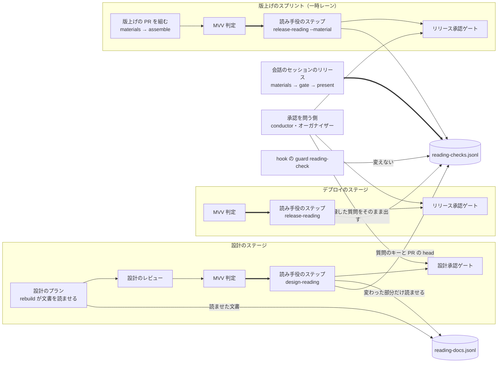
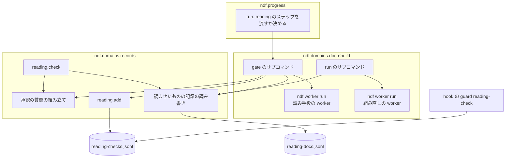
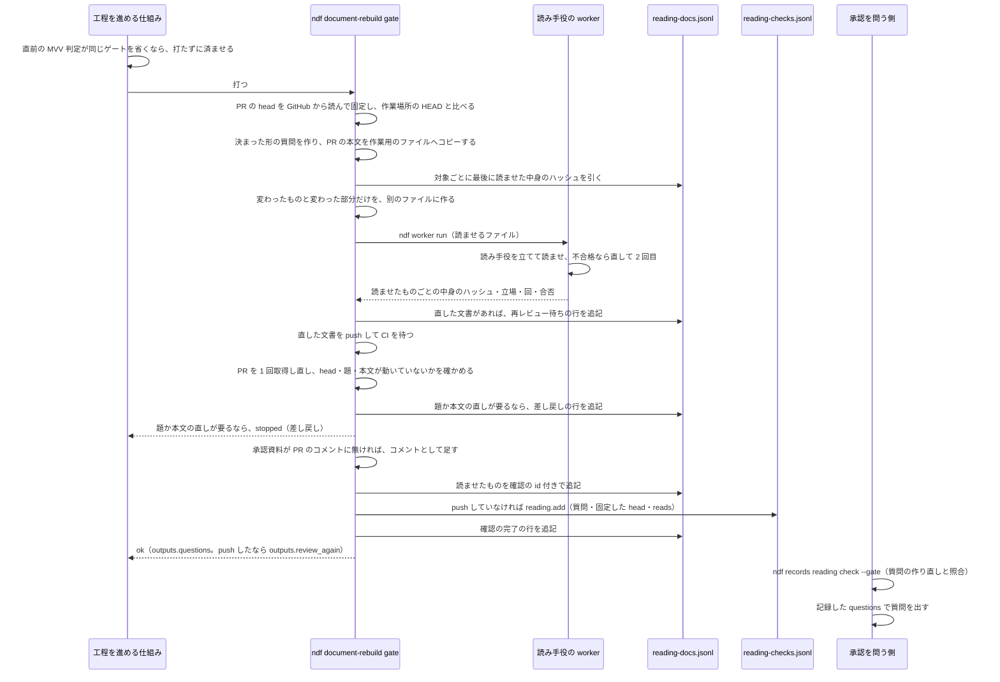

# document-rebuild: 承認資料と質問の文を、承認ゲートの前の工程で読み手役に確かめさせる（#4446）

承認を問う直前に読み手役を起動するため、通じない文が承認の直前に見つかり、承認と変更要求の往復が増えている。設計のステージとデプロイのステージで、承認ゲートの 1 つ前に読み手役のステップを置く。このステップが、決まった形の質問の文・承認資料・前に読ませた後で変わった文書の部分を読ませ、質問を止める hook が見る記録へ残す。承認資料の判断の材料も、同じステップの worker が書いてから読ませる。確かめた承認資料は PR のコメントとして足し、NDF は PR の題と本文（説明文）を書き換えない。題か本文を直さないと通じないときは、工程を差し戻して直させ、前の文脈を持たない新しい読み手役に読ませ直す（決定 10）。資料を書く・読ませる・直す・記録する手順は、Skill `document-rebuild` のセクション「承認の前の確認」に置く。並列の計画でオーガナイザーが問う承認（版上げの PR・まとめたリリース・レーンの外の PR）も、一時レーンで流すスプリントの同じステップが資料と質問を作る。承認を問う側は、オーガナイザーを含めて、記録した質問をそのまま出すだけにする。採らなかった案は「決定の記録」に、外部の調査を省いた理由は末尾にある。

## 今の姿

何が起きたか・目的・受け入れ条件は要求仕様（[issue-4446-requirements.md](./issue-4446-requirements.md)、正は #4446 の本文）にある。この文書は「どう解くか」と「なぜその解き方か」だけを書く。

### 工程・ステップ・プラン・supervisor の関係

この設計は、読み手役を起動する場所を、人と対話するセッションから工程のステップへ移す。そのため、工程の進み方を先に示す。

スプリントは、工程（設計のステージ・デプロイのステージなど）を順に流して進む。工程ごとに、工程の定義（`plugins/ndf/contracts/workflow/stages/*.json`）がステップの並びを決め、工程を進める仕組み（`ndf.progress`）が上から順に流す。ステップには次の種類がある。

| ステップの種類 | 何をするか | 例 |
| --- | --- | --- |
| コマンドを打つ（`ndf.script`） | `ndf` のコマンドを 1 つ打ち、結果 JSON を読む | MVV 判定（`ndf records mvv gate`） |
| プランを流す（`ndf.plan`） | 決まったコマンドの並び（プラン）を `ndf plan` が順に打つ | 設計のプラン（設計 → 組み直し → PR → CI） |
| 承認ゲート | 人の回答を待つ | 設計承認ゲート・リリース承認ゲート |

supervisor は、Skill の手順書に沿って作業を進める AI である。conductor は、人と対話するセッションである。conductor が supervisor を起動するのは、`ndf plan` で流せないとき（プランのテンプレートが無いときなど）だけである（`plugins/ndf/skills/development-workflow/references/agent-layers.md`）。この文書で「プランだけで流れる」と書くのは、supervisor を起動せず、工程の定義とプランのコマンドだけで工程が進む場合である。このときは、AI の手順書を読む担当がいない。

### 変更の位置

変更の位置を太線で示す。今は、承認を問う側（conductor・オーガナイザー）が問う直前に読み手役を起動している。

### 設計に要る今の構造

- **記録の照合は、質問の文の SHA-256 と PR の head で行う。** `ndf records reading add` が書く行は、2 つを持つ（`plugins/ndf/src/ndf/domains/records/reading.py` ）。質問の文から作ったキー（`reading_decide.question_key`）と、承認する PR の番号・ブランチ・head である。hook の guard `reading-check`（`plugins/ndf/src/ndf/domains/hooks/guards/reading_check.py` ）は、2 つのときに質問を止める。同じ質問のキーの行が無いときと、PR の head が記録と違うときである。PR の本文は照合しないので、本文だけを直しても hook は止めない
- **記録の行の形はスキーマで決まっている。** 行は `repo`・`question_key`・`prs`・`reads` を持つ（`plugins/ndf/contracts/schemas/internal/reading-check.schema.json` ）。`reads` の要素は `name`（文書のパスか `question`・`material`）・`reader`・`round`（1 か 2）・`result`（`passed` か `remained`）の 4 つだけを持つ。`reads` は `name: question` の要素を 1 つ以上含む。`result: remained` は `round: 2` に限る。PR の無い承認では `prs` を空にし、hook は質問のキーだけで照合する
- **質問の文は、承認を問う側が問う時点で書く。** 承認ゲートの質問を決まった形で作る部品は無い（`ndf.progress.gate.asking.question` は質問の id と選択肢だけを持ち、文を持たない）。そのため、記録を前もって作れない。読み手役の確認が問う直前に寄った根本原因はここにある
- **MVV 判定で承認ゲートを省くかは、ゲートの直前のステップの出力で決まる。** MVV 判定のステップ（`ndf records mvv gate`）は、どの進め方（`pace`）でも流れる。出力は `mvv_gate` に書く（`plugins/ndf/skills/development-workflow/references/pace.md` の「MVV 判定」）。承認を省けるかの判定に進むのは、進め方が `fast` か `auto` のときだけである。そのうえで、機械の検査を通ったときだけ LLM を呼ぶ（`plugins/ndf/src/ndf/domains/records/mvv_gate.py`）。LLM は、変更が MVV に従うかと、必ず人の承認が要る操作に当たるかを判定する。`normal` では判定せず、省かないと出力する。出力 `mvv_gate` は `gate`（`design` か `release`）・`skip`（省くなら `true`）・`why`・`head` を持つ。承認ゲートのステップは、直前のステップの済んだ結果の `mvv_gate` が同じゲートで `skip` が `true` のときだけ、人に問わずに通す（`ndf.progress.model.mvv_skip`）。直前のステップは `ndf.progress.run` が工程の定義の並びから決める
- **省いた後や回答の後に head が動けば、承認ゲートは人の回答待ちへ戻る。** 回答を読む前に、`ndf.progress.gate.answering.recheck` が、回答した者（MVV 判定を含む）が見た head と今の head を比べる。違えば承認ゲートを待ちへ戻し、新しい id の質問にする。リリース承認ゲートで、加わった変更が文書だけなら、待ちへ戻さずに進める
- **承認ゲートで止まると、待ちの知らせにゲートの種類と PR が載る。** 結果 JSON の `metrics.gate` は、ゲートの種類（`kind`）・PR の番号と URL・今の head を持つ。あわせて、その head に固定した回答のコマンドを持つ（`ndf.progress.gate.asking.describe`・`routes`）。工程を進める仕組みは、ゲートに届いた時点で承認資料のファイル（`gate-materials/<質問の id>.md`）も作る。中身は PR の URL・head・出すバージョン・前のステップの結果に残った未確認の点・回答の選択肢を決まった形で並べたもので、文を書く担当はいない
- **会話のセッションのリリースでは、承認資料が対象のコミットを 1 行で持つ。** `ndf release-steps present`（`plugins/ndf/src/ndf/domains/release/trail.py` の `present`）は、資料の行 `提示したコミット: <SHA>` が PR の今の head と違えば提示しない
- **承認資料は、承認を問う側が組む。** 承認資料に載せる項目は、対象を開くものと判断に使うものである。項目は `plugins/ndf/skills/development-workflow/references/approval-request.md` の「承認資料は 2 層に分ける」と「承認ゲートごとの違い」が決める。設計承認ゲートでは、問う側が設計文書から項目を拾い、PR の本文と設計文書を突き合わせる。リリースでは、`ndf release-steps materials` が機械で作れる部分を組む。判断の要る部分（取り消しの手段とその限界など）は、会話のセッションが書き足す（`release` の Skill の「公開前の提示と承認」）
- **並列の計画では、オーガナイザーが版上げの PR の承認資料を自分で組んで問う。** レーンのスプリントがリリース承認ゲートに着くと、`ndf progress` が計画へリリースのリクエスト（`lane-release`）を書く。オーガナイザーはそれらを 1 本のリリースにまとめる。続けて、`release` の Skill の手順で版上げの PR を作り、承認資料を組んで問う（`plugins/ndf/skills/development-workflow/references/parallel.md` の「まとめたリリース」の手順 1）。レーンの外で作った PR の承認も、オーガナイザーが資料を書いて問うている（2026-11-24 の片付けの PR #4478）。どちらも、読み手役はオーガナイザーが起動している
- **文書の組み直しで読ませた結果は、記録に入らない。** `ndf document-rebuild run` が起動する組み直しの worker は、読み手役を文書 1 件につき最大 2 回立ててよい（#4337 の決定 5）。結果は工程の結果ファイルの `metrics.readers` にだけ残る（`plugins/ndf/src/ndf/domains/docrebuild/drive.py`）。この時点では PR がまだ無く、後の設計のレビューで文書が変わる
- **読み手役を立てられないときは、`not_run` で ok として進む。** 組み直しの worker は理由を残して自分で読み直す。確認は、承認の直前に読ませる手順へ回る（`plugins/ndf/contracts/worker/document-rebuild.md` の「誰が確かめるか」）

## 文脈と制約

- 質問を止める hook の判定の条件（質問のキーと PR の head の照合）は変えない（要求の「含まない」）。記録の行の形も変えない
- 読み手役の確認の中身は、`document-rebuild` の「読み手役に読ませる」のまま使う。中身は、読み手の立場・渡すもの・合格の条件・立場ごとに 2 回まで・一部だけ読ませるときの決まりである
- 承認ゲートの数と置く場所は変えない。足すのは承認ゲートの前のステップで、承認を求めない
- worker は原則として別のサブエージェントを起動しない。例外は `ndf worker run` で起動した組み直しの worker だけである（`agent-layers.md`）。読み手役を立てる新しい担当も、この例外の中に置く
- 承認ゲートの外で判断を求める質問は、今のまま質問を出す AI が読ませる（要求の「含まない」）。これは、`AskUserQuestion` の `metadata.source` が `ndf-ask:` で始まる質問である。この質問は、費用がかかる操作・取り消せない操作・人にしかできない操作などの判断を求める（区分の一覧は `plugins/ndf/skills/development-workflow/references/asking.md` ）
- 設計 PR の head は、設計のレビューの直し・ベースブランチの取り込みで動く。最後に読ませた後に head が動けば、hook は質問を止める

## 解き方の全体像

設計どおりに実装を終えると、読み手役を起動するのは文書と承認資料を作る工程だけになる。

- 承認ゲートの質問の文は、ゲートの種類と PR から決まった形で作る。承認を問う側は文を書かず、ステップが記録した質問を 1 字も変えずに出す。同じ質問は、ゲートの種類と PR の番号から誰でも作り直せる。作り直しと記録の照合は、1 回の PR の取得で行う。ゲート全体では、新設のステップが PR を 2 回取得する（「GitHub の呼び出しの回数」）
- 設計のステージでは、MVV 判定と設計承認ゲートの間に読み手役のステップを置く。PR の本文と質問の文は、承認する人の立場で読ませる。文書は、前に読ませた後に変わった部分だけを読ませる。組み直しで読ませた結果は、設計 PR のブランチで引く。記録は、読ませた時点で固定した PR の head で作る
- 読み手役の指摘で設計 PR の文書を直して push したときは、承認の記録を作らずに設計のレビューへ戻す。push したコミットがレビューを通るまで、承認へは進まない。直しで設計の条件や決定が変わっていないことを、直した worker 自身ではなく設計のレビューが確かめるためである。レビューの後に MVV 判定と読み手役のステップをもう一度通り、承認ゲートへ進む
- デプロイのステージでは、MVV 判定とリリース承認ゲートの間に同じステップを置く。承認資料はスプリントの PR の本文である。会話のセッションがリリースの承認資料を組む手順では、`ndf release-steps materials` が組んだファイルを読ませる。読ませるのは資料を PR へ置く（`present`）前で、`ndf document-rebuild gate` に `--material <ファイル>` を付けて打つ
- 読ませたもの（文書・承認資料・質問の文）は、中身のハッシュごとに追記で記録する。読み手役のステップはこの記録と比べて、変わったものと変わった部分だけを読ませる
- MVV 判定が承認ゲートを省くときは、工程を進める仕組みが読み手役のステップを流さない。省いた後に head が動いて人の回答待ちへ戻るときは、読み手役のステップを打ってから待ちに入る
- 読み手役を立てられなければステップは止まり、「読ませていない」で先へ進まない
- 承認資料の判断の材料も、読み手役のステップの worker が書く。worker は、gate のサブコマンドが渡す、機械で作れる項目に加えて、`approval-request.md` の項目に沿って判断の材料を書き足し、そのまま読み手役に読ませ、直す。この手順は `document-rebuild` の Skill の新しいセクション「承認の前の確認」が持つ（決定 7・8）
- NDF の工程は、承認の前の確認の中で PR の題と本文を書き換えない。読み手役が合格した承認資料は、PR のコメントとして足す。題か本文を直さないと通じないときは、gate のサブコマンドが `stopped` で工程を差し戻す。直す担当が PR の題と本文を直してから工程を再開すると、読み手役のステップが打ち直され、前の文脈を持たない新しい読み手役が変わった部分を読む（決定 10）
- オーガナイザーが問う承認の資料と質問の文は、一時レーンで流すスプリントが作る。まとめたリリースは、版上げのスプリント（新しいモード `release-bump`）が版上げの PR を作ってから、同じ読み手役のステップを `--material` の経路で打つ。レーンの外で PR が要る作業は、一時レーンの普通のスプリントで流す。オーガナイザーは、どの承認でも、ステップが記録した質問をそのまま出す（決定 9）

## 構成要素

| 要素 | 責務 |
| --- | --- |
| `ndf document-rebuild gate`（新設のサブコマンド） | 承認ゲートの 1 つ前に打つ。PR の head を固定し、決まった形の質問を作り、承認資料の素材のファイル（下の「承認資料を書く」）を作り、読ませるものを決め、承認資料を書いて読み手役に読ませる worker を `ndf worker run` で起動する。worker が直した文書を push したときは CI を待つ。PR の題と本文は書き換えない。題か本文の直しが要るときは、記録を書かずに差し戻す。合格した承認資料は PR のコメントとして足す。結果を 2 つの記録へ書き、最後に確認の完了を記録する |
| 読み手役の worker の起動指示（`contracts/worker/document-rebuild-gate.md`。新設） | 読む Skill は `document-rebuild` の「承認の前の確認」である。先に承認資料の判断の材料を書き、承認資料・質問の文・文書の変わった部分を読み手役に読ませる。不合格なら、承認資料のファイル・PR の題の案・文書を直して 2 回目を読ませる。PR の題の案と、PR の本文から写した行の直しは、PR へ反映されない。gate のサブコマンドが差し戻すための直しの案になる（決定 10）。文書を直したときは、gate のサブコマンドが設計のレビューへ戻す（「設計のレビューへ戻す」）。直してよいのは、gate のサブコマンドが起動の前に決めたファイルだけである。直した後に、事実が変わっていないことを差分で確かめる。読み手役の起動の許可は組み直しの worker と同じ例外に置く |
| `document-rebuild` の Skill（`skills/document-rebuild/SKILL.md`。変更） | セクション「承認の前の確認」を足す。承認資料を書く・読み手役に読ませる・直す・記録する、の手順の正本である。資料に載せる項目は `approval-request.md` を参照し、コピーしない。description のトリガーに承認資料の語を足す（決定 7） |
| 承認の質問の組み立て（`ndf.domains.records.reading` に足す） | ゲートの種類（`design`・`release`）・PR の番号・PR の題から、`AskUserQuestion` に渡す `questions` を決まった形で作る。リリースの質問の操作は、リリースの形の表の列 `approve` から入れる |
| リリースの形の表（`contracts/domains/release-forms.json`。変更） | 列 `approve`（承認の質問で問う操作）を足す |
| `ndf records reading check`（変更） | 引数 `--gate <種類>` と PR の番号を受けたときは、PR を 1 回だけ取得し、その題で質問を作り直してファイルへ書き、同じ取得の head と本文で照合する。今の照合に、承認資料の照合を足す。PR の本文を承認資料の元にする経路では、同じ取得で PR のコメントも読む。完了した確認の記録のファイル全体のハッシュと同じハッシュのコメントが無いとき、または今の PR の本文のハッシュが記録した本文のハッシュと違うときは、足りないもの `material_changed` を返す。`--material` の経路では、渡された承認資料のファイルから計算した 2 つのハッシュ（読ませた版のハッシュとファイル全体のハッシュ）のどちらかが記録と違えば、`material_changed` を返す |
| 読ませたものの記録（`reading-docs.jsonl`。新設） | 読み手役に読ませたもの（文書・承認資料・質問の文）ごとに、確認の id・中身のハッシュ・立場・回・合否を追記で持つ。確認を終えたら、完了の行を 1 行足す。差し戻したときは、差し戻しの行を足す（「差し戻し」）。保存先は `reading-checks.jsonl` と同じ |
| 承認資料のコピー（`reading-materials/<ゲート>-<PR の番号>.md`。新設） | 最後に完了した確認で読ませた承認資料の中身を、PR ごとに 1 版だけ残す。次に承認資料が変わったときに、差分を作る元にする。前に残った文はコピーから引かず、`reading-docs.jsonl` の `remained` の行から引く |
| `ndf document-rebuild run`（変更） | 読み手役が読んだ文書を、作業場所のブランチを付けて読ませたものの記録へ書く。`not_run` を ok にせず止める |
| 工程の定義（`stages/design.json`・`stages/deploy.json`。変更） | `design-mvv` と `design-gate` の間に `design-reading`、`release-mvv` と `release-gate` の間に `release-reading` を足す。ステップの種類は新しい `reading` で、どのゲートの前かを `gate` に持つ |
| 工程を進める仕組み（`ndf.progress.run`・`ndf.progress.gate.answering`。変更） | 種類 `reading` のステップの前の MVV 判定が、同じゲートを省くと書いていれば、そのステップを打たずに済ませる。承認ゲートが MVV 判定を探すときは、種類 `reading` のステップを飛ばして直前の MVV 判定のステップを見る。`recheck` が承認ゲートを待ちへ戻すときは、同じ工程の種類 `reading` のステップを打ち直してから待ちに入る。種類 `reading` のステップの結果に `outputs.review_again` があれば、同じ工程の設計のレビュー・MVV 判定・読み手役のステップを未了に戻し、設計のレビューから流し直す。戻したことと `review_again` のコミットを工程の記録に残す。そのコミットを含む head で設計のレビューが済んだ後に読み手役のステップを打つときは `--reviewed <コミット>` を渡す。同じ承認ゲートの前で既に 1 回設計のレビューへ戻したとき（工程の記録に残した `review_again` が 1 件以上あるとき）は、`--no-doc-fix` も渡す（「往復の上限」）。サブコマンド `ndf progress reread` を足し、人の回答を待っている承認ゲートを、読み手役のステップを打ち直したうえで新しい質問と対象で出し直す（「待ちの出し直し」）。回答のコマンドが固定する対象（`Target`）に、PR の本文のハッシュと質問のキーを足す |
| 手順書（変更） | 承認を問う側の手順から読み手役の起動を外し、記録した質問を出すことと、記録が合わないときにステップを打ち直すことに置き換える |
| 会話のセッションのリリースの証跡（`ndf.domains.release.trail`・`approval_decide`。変更） | 提示と回答の証跡に資料のハッシュを加え、同じ head でも資料が違う提示への回答を数えない（「会話のセッションのリリースの証跡」） |
| hook の止める理由の文（変更） | 「読み手役に読ませて記録する」の案内を、「読み手役のステップを打ち直す」の案内に変える。判定の条件は変えない |
| 版上げのモードと工程（`contracts/workflow/modes/release-bump.json`・`stages/release-bump.json`・`contracts/templates/release-bump.json`。新設） | まとめたリリースの版上げの PR を作り、資料と質問を作って承認を受け、出した結果を計画へ書く（下の「版上げのスプリント」） |
| 計画の行の入力（`contracts/workflow/parallel-plan.schema.json`・`ndf.progress.lane.launch`・`ndf.progress.command`。変更） | 行の入力に `{"kind": "release", "requests": [<リクエスト>...]}` を足す。耐久ワークフローは、この行を `ndf progress new <名前> --mode release-bump --release-requests <リクエスト>...` で起動する |
| リリースのリクエスト（`ndf.progress.gate.asking`。変更） | 版上げのスプリントのリリース承認ゲートでは、`lane-release` ではなく `bump-release` のリクエストを書く。版上げのスプリントが自分のリクエストをまとめ直さないためである |

## 入出力のコントラクト

### `ndf document-rebuild gate`

#### 引数

| 引数 | 意味 |
| --- | --- |
| `--gate design` か `--gate release` | 承認ゲートの種類 |
| `--pr <番号>` | 承認する PR。省いたときの決め方は下の表にある |
| `--material <ファイル>` | リリースの承認資料のファイル。会話のセッションが `ndf release-steps materials` の後に打つときだけ渡す。`--gate design` では受けない |
| `--reviewed <コミット>` | 設計のレビューを済ませた再レビュー待ちのコミット。工程を進める仕組みが渡す（「設計のレビューへ戻す」の「解消」） |
| `--no-doc-fix` | worker に文書を直させず、残った文として承認資料に書かせる。同じ承認ゲートの前で既に 1 回設計のレビューへ戻したときに、工程を進める仕組みが渡す（「往復の上限」） |
| `--state-dir <ディレクトリ>` | 起動指示・承認資料の作業用のコピー・worker の結果ファイルの保存先 |
| `--out <ファイル>` | 結果 JSON を書くファイル |

#### 承認する PR と承認資料

承認する PR と承認資料は、どこから打つかで決まる。

| どこから打つか | 承認する PR | 承認資料（読み手役に読ませ、承認する人に示すもの） |
| --- | --- | --- |
| 設計のステージのステップ `design-reading` | 作業場所のブランチの PR（`--pr` があればそれ）。`ndf records mvv gate` と同じ決め方 | 設計 PR の本文を写し、worker が判断の材料を書き足したファイル。PR のコメントで示す |
| デプロイのステージのステップ `release-reading`（`--material` なし） | 工程の入力の `pr`（スプリントの PR。`--pr` があればそれ） | その PR の本文を写し、worker が判断の材料を書き足したファイル。PR のコメントで示す |
| 会話のセッションのリリース（`--material` あり） | `--pr` のリリースの PR（必須） | `--material` のファイル（`ndf release-steps materials` の出力） |

この文書で「PR の本文の経路」と書くのは、表の上の 2 行である。どちらの経路でも、PR の本文は書き換えない（決定 10）。

工程を進める仕組みがゲートで作る承認資料のファイル（`gate-materials/<質問の id>.md`）は読ませない。決まった形で項目を並べるだけで文を書く担当がおらず、ゲートに届くまで作られないためである。

どの経路でも、承認する PR が要る。PR が決まらないときは `stopped`（`precondition`）で終える。

**PR を伴わない承認は、この設計では扱わない。** 会話のセッションのリリースで資料を提示する `ndf release-steps present` と、回答を記録する `answer` は、どちらもリリースの PR を必須とする（`--pr`）。PR が無いと、最終版の資料を提示する先も、回答を資料に結び付けて提出の前に照合する記録も無い。ストアへの提出のようにリリースの PR の外で届ける形も、承認はリリースの PR で受け、提出は承認の後に届け先の手動の行（`release.deliveries`）で行う。そのため、承認の質問はどれも PR の番号を持ち、`reading-checks.jsonl` の行の `prs` は空にならない。

#### 結果

| 結果 | いつ | 出力 |
| --- | --- | --- |
| `ok` | 読ませて記録した。または、読ませるものが無く、固定した head で記録し直した | 下の表 |
| `ok`（設計のレビューへ戻す） | 読み手役の指摘で設計 PR の文書を直し、push した head の CI が通った。または、解消していない再レビュー待ちの行（「設計のレビューへ戻す」）があり、そのコミットを含む PR の head で CI が通った | `outputs.review_again` に、直したコミットと文書のパス。`reading-checks.jsonl` に書かない。工程は承認ゲートへ進まず、設計のレビューへ戻る |
| `stopped`（`precondition`） | 承認する PR が決まらない・GitHub を読めない・読み手役を立てられなかった・読ませている間に PR の head が動いた・作業場所の HEAD が PR の head と違う・`--material` の対象のコミットが PR の head と違う・読ませている間に PR の本文か題がほかの人に変えられた・直した文書を push できなかった | `cause.detail` に理由。記録を書かない。工程は承認ゲートへ進まない |
| `stopped`（`precondition`。差し戻し） | worker が PR の題の案を書いた。または、承認資料の最終版で PR の本文から写した行を消すか変えた（「差し戻し」） | `cause.detail` に、直す対象（題・本文）・読み手役の指摘・直しの案のパス。`reading-checks.jsonl` に書かない。`reading-docs.jsonl` には差し戻しの行だけを書く。工程は承認ゲートへ進まない |
| `stopped`（`incomplete`） | worker の結果に、読ませたものごとの記録が欠けている。最後に読ませた後に worker が中身を変えた。決めたファイルの外を変えた。承認資料の対象のコミットの行を変えた | `gaps` に欠けた対象 |
| `stopped`（`check_failed`） | 直した文書を push した後の head で、CI が通らなかった | `cause.detail` に落ちたチェック。記録を書かない |

`ok` のときの出力は次のとおりである。

| 出力 | 中身 |
| --- | --- |
| `outputs.questions` | 記録した `questions` を書いたファイルのパス |
| `outputs.head` | 読ませた PR の head |
| `outputs.material` | 読ませた承認資料の最終版のパスと、2 つのハッシュ。`sha256` は「読み手役が残した文」のセクション（機械の印に挟まれた範囲）を除いた本文のハッシュで、読ませた版と結び付ける。`file_sha256` はファイル全体のハッシュで、承認する人に示す版が変わったかを決める。PR の本文の経路では、gate のサブコマンドがこのファイルを PR のコメントとして足してある。会話のセッションは、このファイルを `present` に渡す |
| `outputs.check` | この実行の確認の id と、`reading.add` が追記した行の指紋（手順 9）。設計のレビューへ戻すときは確認の id だけ。工程の出力から、記録のどの行を作ったかを引ける |
| `metrics.readers` | 読ませたものごとの立場・回・合否 |
| `items`（結果 JSON の最上位） | 2 回目にも残った「判断や作業を誤らせる文」。1 件ずつ `id: reader-<番号>`・`doc`（`question`・`material`・文書のパス）・`text`（引用と理由）を持つ。今の `document-rebuild` の結果と同じ形 |

#### 2 回目にも残った文

**2 回目にも「判断や作業を誤らせる文」が残ったときも、`ok` で終えて承認ゲートへ進める。** 不合格を承認する人に見せて判断を任せる、今の `document-rebuild` の決まりのとおりである。扱いは次のとおり。

- 残った文は、`reading-docs.jsonl` の行に保存する。`result: remained` の行は、対象と中身のハッシュに加えて、引用と理由（`quotes`）を持つ。`reading-checks.jsonl` の行には入れない（スキーマが許さない）。この行が、残った文の唯一の保存先である
- gate のサブコマンドは、承認資料の末尾の決まった見出し「読み手役が残した文」のセクションを、保存した残った文から機械で作る。対象（質問の文・承認資料・文書のパス）と引用を 1 行ずつ並べる。同じ残った文からは、いつも同じセクションができる。worker はこのセクションを書かない。承認する人はそこで読む。質問の文そのものに残ったときも、ここに書く
- セクションの前後には、機械の印（HTML のコメント `<!-- ndf:reader-remained:begin -->` と `<!-- ndf:reader-remained:end -->`）を置く。ただし、印は PR やコメントを編集できる人なら誰でも置けるので、印だけでは NDF が書いた範囲と判断しない。読ませた版から除くのは、承認資料の末尾にある 1 組の印に挟まれた範囲が、基準の確認の残った文から作ったセクションと 1 字も違わないときだけである。違えば何も除かない
- 基準の確認は、ハッシュを計算する場面ごとに次のとおり決める。gate と `check` は、同じ場面で同じ確認を引く
  - gate が読ませる前（手順 2）: 同じ PR とゲートの、最後に完了した確認
  - gate が記録する時（手順 9）: 今回の確認。手順 9 の 1 で、引き継いだものを含めて今回の確認の `remained` の行を書き終えてから計算する（「前の確認で残った文」）
  - `check`: 行の指紋で結び付けた完了の行の確認。完了した後なので、gate が手順 9 で使ったのと同じ確認になり、同じ値になる
- 印の内側が基準と違うとき（印の内側に文が足された・指摘が消された・印が 2 組ある など）、gate は手順 2 で、作業用のファイルから印の HTML のコメントの行だけを消す。PR の本文の経路で本文に印があるときも、同じく印の行だけを消す。PR の本文は書き換えないので、本文の印はそのまま残る。印の内側の文は、普通の本文として残り、読み手役に読ませる。そのうえで手順 5 で、末尾に今回のセクションを 1 組の印で足す。最終版の印は末尾の 1 組だけになるので、手順 9 と `check` はどちらもこの 1 組を除いて同じ値を計算する
- このセクションは読ませた本文ではない。承認資料のハッシュは 2 つを使い分ける
  - 読ませた版と結び付けるハッシュ: 上の条件で除いた本文の SHA-256。gate のサブコマンドと `check` は同じ計算を使う。そのため、セクションを足しても、読ませた版と提示する最終版は同じハッシュで結び付く
  - 示す版が変わったかを決めるハッシュ: セクションを含めたファイル全体の SHA-256。PR の本文の経路では、PR に足したコメントの本文全体と同じ値になる。`check` の照合、`present` の打ち直しと、承認の回答に固定する値（決定 2）に使う。セクションの未解決の指摘が消されたり書き換えられたりすると、このハッシュが変わる
- `reading-checks.jsonl` の `reads` には、その対象を `round: 2`・`result: remained` で書く
- hook は今のとおり、質問のキーと PR の head だけを照合して質問を通す。`remained` は止める理由にしない

#### 前の確認で残った文

**前の確認で残った文は、解消を確かめるまで引き継ぐ。** 前に残った文は、承認資料のセクションからは読まず、`reading-docs.jsonl` の、同じ PR とゲートで最後に完了した確認の `remained` の行から引く。今の本文のセクションもコピーのセクションも、ほかの人の編集や途中で止まった確認の影響を受けるためである。対象の中身のハッシュが変わっていなければ、読み手役に読ませ直さなくても引用はそのまま残る。設計のレビューへ戻った後（「設計のレビューへ戻す」）も同じで、文書の blob が変わらなければ残った文はそのまま引き継がれる。gate のサブコマンドは、前に残った文を 1 件ずつ次のとおりに扱い、残すものを新しいセクションへ書き直す。残したものは、今回読ませたかどうかによらず、手順 9 の 1 で今回の確認の `remained` の行として、対象の今の中身のハッシュと引用で書き直す。別の段落だけを直して対象のハッシュが変わっても、次の確認は今回の確認の行から引くので、引き継いだ文は消えない。

| 前に残った文の状態 | 扱い |
| --- | --- |
| 引用した文が、対象の今の中身に無い | 解消とみなして外す |
| 今回読ませた差分の部分に含まれ、読み手役が今回は挙げなかった | 解消とみなして外す |
| 今回読ませた部分の外にある（対象が変わっていない、または差分の外） | 残す。その対象の `reads` は `round: 2`・`result: remained` のままにする |
| 今回も挙がった | 残す（今回の結果のとおり） |

### 承認の質問の決まった形

| ゲート | 質問の文 | 選択肢 |
| --- | --- | --- |
| `design` | `設計 Pull Request #<番号>（<題>）をマージしてよいですか` | `承認する`・`変更を求める` |
| `release` | `リリースの Pull Request #<番号>（<題>）を承認し、<承認する操作>してよいですか` | `承認する`・`変更を求める` |

選択肢の説明の文も決まった形で持つ。

**リリースの質問は、承認すると実行される操作をリリースの形から書く。** 「本番へ出す」とまとめて書くと、ストアへの提出を承認する人は、審査への提出と利用者への公開のどちらを許すのかを質問から判断できない。そこで、リリースの形の表（`plugins/ndf/contracts/domains/release-forms.json`）に列 `approve`（承認の質問で問う操作）を足す。`<承認する操作>` には、その列の値を入れる。形は、プロジェクトの宣言（`.ndf/project.json` の `branch_strategy.release.form`）から読む。`gate` と `check` は同じ宣言と同じ表から質問を作るので、質問のキーは一致する。

| リリースの形 | `approve` の値（質問の文の例） |
| --- | --- |
| `mobile` | `アプリをストアの審査に提出`（リリースの Pull Request #<番号>（<題>）を承認し、アプリをストアの審査に提出してよいですか） |
| `service` | `本番ブランチへマージして環境へ反映` |
| `package-plugin` | `タグと GitHub Release を作って公開` |
| `procedure` | `設定の手順で配布` |
| `document` | `置き先のシステムへ提出` |

形の宣言が無いか、表の行が扱わない形（`supported` が偽）なら、`gate` と `check` は質問を作らずに `stopped`（`precondition`）で終える。`release-steps` もこの形では止まるので、質問を出す場面は無い。

**`outputs.questions` のファイルは `questions` だけを持ち、`metadata` を持たない。** `metadata.source` は質問のキーの計算に入らないので、問う側が出すときに足してもキーは変わらない。Claude Code では、設計承認の質問に `ndf-gate:1`、リリース承認の質問に `ndf-gate:2` を付ける。hook はこの値で承認の質問を識別し、記録の PR の head を照合する。付けないと、hook は区分の無い質問として照合せずに通す。`ndf-ask:` は承認ゲートの外の判断の質問を識別する印で、ここでは使わない。

**同じ質問は、ゲートの種類と PR の番号からいつでも作り直せる。** `ndf records reading check --gate <design|release> --pr <番号> [--material <ファイル>] --questions-out <ファイル>` は、PR を 1 回だけ取得する。その題で同じ形の質問を作ってファイルへ書き、同じ取得の head と本文で記録を照合する。ステップの `outputs.questions` は、レーンの作業場所の中のファイルである。そのため、別のセッションのオーガナイザーや再開した後のセッションは、待ちの知らせ（`metrics.gate` の `kind` と `pr`）からこのコマンドを打つ。今の `check` と比べて、`check` の中の GitHub の取得の回数は増えない。ゲート全体の回数は「GitHub の呼び出しの回数」にある。PR の題が読ませた後に変わっていれば、作り直した質問のキーが記録と合わず、`no_record` を返す。

### 承認資料を書く

**承認資料の判断の材料は、読み手役のステップの worker が書く。** 承認を問う側は資料を組まない。gate のサブコマンドは、機械で作れる項目を素材のファイル（`--state-dir` の下の `approval-facts.json`）にして worker に渡す。中身は、PR の URL・題・ベースと head・変更量（コミット数・ファイル数・行数）・直前の MVV 判定の出力 `mvv_gate`（無ければ「MVV なし」）である。worker は、`document-rebuild` の Skill の「承認の前の確認」に沿って、作業用の承認資料のファイルに判断の材料を書く。載せる項目と出所は `approval-request.md` の「承認資料は 2 層に分ける」「承認ゲートごとの違い」のとおりで、この設計では変えない。

| 経路 | 書く場所 | worker が書くもの |
| --- | --- | --- |
| 設計のステージの `design-reading` | 設計 PR の本文の作業用のコピー（「処理の流れ」の手順 2） | 判断に使うもの（目的・用語・適用範囲・目指す姿・目指す姿の根拠・起票者の推定・決めたこと・作るもの・満たすこと・未確認）。本文の決めたことのセクションと設計文書の「決定の記録」の突き合わせも、ここで行う |
| デプロイのステージの `release-reading`（`--material` なし） | スプリントの PR の本文の作業用のコピー | リリースする中身・取り消しの手段とその限界・開発版のデプロイで確かめたこと |
| `--material` あり（会話のセッションのリリースと、版上げのスプリント） | `--material` のファイル（`ndf release-steps materials` の出力） | 上の行と同じ。`materials` が組んだ機械の部分は書き換えず、判断の要る部分を書き足す。行 `提示したコミット:` を変えると、「処理の流れ」の手順 5 が `stopped`（`incomplete`）で止める |

書いた資料は、そのまま同じ worker の中で読み手役に読ませる（手順 4）。書いた後の確かめと記録は、「処理の流れ」の手順 5〜9 をそのまま通る。

**どの経路でも、gate のサブコマンドは PR の題と本文を書き換えない（決定 10）。** PR の本文の経路では、worker は作業用のコピーに判断の材料を書き足す。書き足した行と、書き足した行の直しは、PR の本文の直しに当たらない。合格した最終版は、「処理の流れ」の手順 8 で PR のコメントとして足す。PR の本文から写した行を worker が消すか変えたときは、PR の本文そのものが通じないので、手順 8 で差し戻す（「差し戻し」）。`--material` の経路では、今までどおり PR の本文も題も扱わない（決定 9）。

### 版上げのスプリント

**まとめたリリースの版上げの PR は、一時レーンで流す版上げのスプリントが作り、資料と質問もその中で作る。** 一時レーンは、持ち主のいない共有の作業だけを行い、終えると止まるレーンで、オーガナイザーが `ndf lanes lane add` で足す（`docs/ndf-parallel-model.md`）。オーガナイザーは、届いた `lane-release` のリクエストを 1 本にまとめると決めたら、`ndf lanes lane add` で一時レーンを足す。その行の入力は `{"kind": "release", "requests": [<リクエスト>...]}` にする。耐久ワークフローがその行を `ndf progress new <名前> --mode release-bump --release-requests <リクエスト>...` で起動する。モード `release-bump` は工程「版上げ」（`stages/release-bump.json`）を 1 つだけ持ち、課題を持たない。

| ステップ | 種類 | すること |
| --- | --- | --- |
| `bump-assemble` | プランを流す（テンプレート `release-bump`） | 行の入力のリクエストの中身（レーン・PR・課題）から、リリースの方式に合わせて範囲の引数（`--units` か `--pr`）を作る。`ndf release-steps materials` で資料の機械の部分を組み、workflow の `assemble` で版上げの PR を作る。出力は `pr`（版上げの PR）と `material`（`materials` のファイル） |
| `release-mvv` | コマンドを打つ | 今のデプロイのステージと同じ |
| `release-reading` | `reading`（`gate: release`） | `ndf document-rebuild gate --gate release --pr <pr> --material <material>`。worker が判断の要る部分を書き、読み手役に読ませ、直し、記録する |
| `bump-present` | コマンドを打つ | `ndf release-steps present --pr <pr> --material <outputs.material のパス>` |
| `release-gate` | 承認ゲート | 計画へ `bump-release` のリクエストを書く。中身は、レーン・版上げの PR・`outputs.material` のパス・スプリントのステートマシンの ID・まとめたリクエストである |
| `release` | プランを流す（今の `release`） | 承認の後に、今の release の worker が証跡を書いて出す |
| `bump-record` | コマンドを打つ | `ndf lanes release <計画> <まとめたリクエスト>... --result <released か rejected> --version <バージョン> --release <リリース記録の PR>` と、リクエストごとの `ndf lanes answered <sprint_state> --answer <released か rejected>` を打つ。今オーガナイザーが打っている 2 つである |

承認ゲートで変更を求められたら、`release` を流さずに `bump-record` で `--result rejected` を書いて終える。直しは各レーンのスプリントで行い、次のまとめたリリースで出し直す。今の「承認されなければ `--result rejected`」と同じである。

**まとめたリリースに入るレーンのスプリントは、リリース承認ゲートの前の `release-reading` を打たずに済ませる。** オーガナイザーが問うのは版上げの PR の質問だけで、レーンの PR の質問は出ないためである。レーンの PR は、版上げの承認資料の「含む PR」の一覧に並ぶので、別に読ませなくても承認する人に示される。工程を進める仕組みは、種類 `reading` で `gate: release` のステップを、次の表の順 1 から順に判定して扱う。版上げのスプリントも一時レーンの行で動くので、モードを先に見る。スプリントが計画のレーンの行にあるかは、`ndf.progress.gate.asking.release_request_of` が計画とレーンを返すかで決める。

| 順 | スプリント | `release-reading` |
| --- | --- | --- |
| 1 | モードが `release-bump`（版上げのスプリント） | 打つ |
| 2 | 計画のレーンの行にある（一時レーンの普通のスプリントを含む） | 打たずに済ませる |
| 3 | 計画の外にある | 打つ |

設計承認ゲートの前の `design-reading` は、レーンでも打つ（設計の承認はレーンごとに問う）。

**レーンの外で PR を作らない。** オーガナイザーは、片付けや計画の直しのように PR が要る作業を、自分のセッションで行わない。`ndf lanes lane add` で一時レーンを足し、`{"kind": "sprint", "issues": [...]}` の行で流す。そのスプリントのリリース承認は、ほかのレーンと同じく `lane-release` としてまとめたリリースに入る。

### 会話のセッションのリリースの証跡（`ndf release-steps present`・`answer`。変更）

**同じ head に別の資料を提示し直したときは、前の資料への回答でリリースを進めない。** 今の `present` は、同じ head に回答があれば提示し直さない。`answer` も head だけを照合する。そのため、リリース担当者が同じコミットの承認資料を差し替えると、承認者が前の資料に出した回答でリリースが進む。そこで、提示と回答の証跡に、資料のファイル全体の SHA-256（`outputs.material` の `file_sha256` と同じ計算）を加える。

| 対象 | 今 | 変えた後 |
| --- | --- | --- |
| 提示のコメント（`render_request`） | 行 `提示したコミット: <SHA>` と資料 | 行 `提示した資料: <SHA-256>` を足す |
| 回答の証跡（`render_trail`） | 行 `回答:`・`承認したコミット:`・`担い手:` | 担い手が利用者（`--by user`）のときだけ、行 `回答した資料: <SHA-256>` を足す。担い手が MVV 判定（`--by mvv`）のときは足さない |
| 判定（`approval_decide.judge`） | 今の head への最新の回答で判定する | 担い手で分ける。利用者の回答は、今の head への最新の提示を探し、その資料のハッシュと同じ値を持つ、その提示より後の回答だけを数える。MVV 判定の回答は、人に資料を示さずに通す経路なので、今までどおり head だけで数える。ただし、同じ head に MVV 判定の回答より後の提示があれば、人に問うと決め直したので、その提示への利用者の回答で判定する |
| `present` | 今の head に回答があれば提示しない | 今の head への最新の提示と、渡された資料のハッシュが同じで、それへの回答があるときだけ提示しない。資料が違えば、回答があっても提示し直す |
| `answer` | 引数 `--presented <head>` を照合する | `--by user` では引数 `--material-sha256` を必須にし、今の head への最新の提示の資料のハッシュと照合する。違えば書かずに `TrailError`（提示し直した資料に回答を取り直す）。`--by mvv` では `--material-sha256` を受けず、提示が無くても今の head で書く |

マージの前の状態の検査（`post_status`）も同じ `judge` を使うので、資料を差し替えた後は、新しい資料への回答が届くまで承認済みにならない。この変更の前の形式で書かれた利用者の証跡（資料のハッシュの行が無いもの）は数えないので、この変更を入れた時点で回答待ちのリリースは、提示し直して回答を取り直す。

## 処理の流れ

設計のステージの流れを示す。デプロイのステージは文書を読ませない。会話のセッションのリリースは、承認資料が `--material` のファイルで、PR にコメントを足さない（資料は `present` が示す）。どの経路でも、PR の題と本文は書き換えない。

1. **head を固定する。** 先に、同じブランチの解消していない再レビュー待ちの行を引く。`--reviewed` で渡されたコミットがその行のコミットと同じなら、解消の行を追記して進む。それ以外で行が残っていれば、読み手役を起動せずに「設計のレビューへ戻す」の経路で終える。行が無いか解消したら、打った時点の PR を GitHub から 1 回取得し、head・題・本文を控える。以後この head の SHA を基準にする。設計のステージでは、作業場所の HEAD がこの SHA と同じで、変更の無い状態であることを確かめる。違えば `stopped`（`precondition`）で終える。読ませる文書は、作業場所のファイルではなく、この SHA の中身（`git show <SHA>:<パス>`）から作る
2. **承認資料を作業用のファイルにする。** worker はこのファイルを直す。用意の仕方は経路で違う
   - PR の本文の経路: 控えた本文を `--state-dir` の下のファイルへコピーする。ただし、同じ PR とゲートの最後に完了した確認が記録した PR の本文のハッシュが今の本文と同じで、コピーが差分の元に使える（「確認の id と完了の行」）ときは、コピーから「読み手役が残した文」のセクションを除いたものを作業用のファイルにする。前の確認で worker が書き足した判断の材料を引き継ぎ、変わっていない資料を読ませ直さないためである
   - どちらの経路でも、末尾の印の内側が、最後に完了した確認の残った文から作ったセクションと違えば、印の HTML のコメントの行だけを消す。内側の文は普通の本文として読み手役に読ませる（「入出力のコントラクト」の、残った文のセクションの印の扱い）
   - `--material` があるとき: そのファイルをそのまま使う。ファイルの行 `提示したコミット: <SHA>` が固定した head と同じかを確かめる。違えば、`materials` を組んだ後に PR が動いたので、`stopped`（`precondition`）で終える。組み直してから打ち直す
3. **読ませるものを決める。** 下の「読ませるものの決め方」の表のとおり。worker が直してよいファイルも、ここで決める。承認資料の作業用のファイル・PR の題の案のファイル・今回読ませる設計 PR の文書だけである。PR の題の案のファイルは、差し戻すときに直す担当へ渡す直しの案で、PR へは反映しない。同じ PR とゲートに差し戻しの行が既にあるときは、題の案のファイルを決めず、worker に PR の本文から写した行を直させない（「差し戻し」の「往復の上限」）
4. **worker に書かせて読ませる。** worker は、先に素材のファイルを使って承認資料の判断の材料を書く（「承認資料を書く」）。読ませるのは、書いた後の資料である。worker は、読ませるたびに、読ませた対象の全体の中身のハッシュを結果に書く。文書は `git hash-object` の blob の SHA、承認資料は「読み手役が残した文」のセクションを除いた本文の SHA-256、質問の文は質問のキーである。一部だけを読ませたときも、切り出した元の全体のハッシュを書く。質問の文が不合格で、原因が PR の題にあれば、worker は新しい題の案をファイルに書く。題の案は質問の作り直しに使わず、手順 8 の差し戻しの材料にする。決まった形の文そのものが原因なら、ステップの中では直さず、残った文として扱う（決定 1）。読み手役の指摘で直したときは、今の `approval-request.md` の手順 3 のとおり、事実（数・日付・条件・決定）が変わっていないことを差分で 1 回確かめ、確かめた差分を結果に書く
5. **直したものを確かめる。** 対象ごとに、今の中身のハッシュが最後に読ませたときのハッシュと同じかを確かめる。違えば `stopped`（`incomplete`）で終える。手順 3 で決めたファイルの外が変わっているとき、承認資料の行 `提示したコミット:` が変わっているときも同じである。続けて、残った文のセクションを書き直す（「前に残った文の状態」の表）。PR の本文の経路では、最終版を、控えた PR の本文から印の行を除いたものと行ごとに比べる。本文の行が消えたか変わっていれば（差分に `-` の行があれば）、本文の直しとして控え、手順 8 で差し戻す。行を足しただけなら、本文の直しに当たらない。新しい題の案があるときも、手順 8 で差し戻すと控える
6. **直した文書を push する。** 直した文書が無ければ、この手順を飛ばす。読み手役の直しは内容を保つよう指示しているが、事実が変わっていないことを確かめるのは直した worker 自身だけである。レビュー済みの設計の条件や決定が変わった可能性を機械では排除できないので、直した文書は設計のレビューに確かめさせる
   1. push の前に、`reading-docs.jsonl` に再レビュー待ちの行（ブランチ・これから push するコミット）を追記する。この行が残っている限り、そのコミットはレビューを通っていないとみなす（「再レビュー待ちの行」）
   2. 作業場所でコミットして push する（強制はしない）。push したコミットを新しい基準の head にする
   3. 設計のプランの CI のステップと同じ `ndf ci watch` で、新しい head の CI を待つ。通らなければ `stopped`（`check_failed`）で終える。CI の監視が中断したときも `stopped` で終える。どちらでも再レビュー待ちの行は残るので、打ち直したときに、このコミットをレビューせずに承認へ進むことは無い
7. **PR を取得し直して確かめる。** PR を 1 回だけ取得し直し、次の 2 つを確かめる
   - head が基準の head（手順 6 で push したなら、そのコミット）と同じか: 違えば、記録を書かずに `stopped`（`precondition`）で終える。読み手役が動いている間に別のコミットが足されたときに、読んでいない文書を確認済みにしないためである。打ち直せば、足された部分だけを読ませる
   - ほかの人が題や本文を変えていないか: 題と本文が手順 1 で控えたものと違えば、記録を書かずに `stopped`（`precondition`）で終える
   - 同じ取得で PR のコメントも読む（`gh pr view` の `--json` に `comments` を足す。1 回の GraphQL の問い合わせで、コメントは 100 件まで返る）。手順 8 で、同じ承認資料のコメントが既にあるかを見るためである
8. **差し戻すか、承認資料をコメントで足す。** PR の題と本文は書き換えない（決定 10）
   - 題の案があるか、手順 5 で本文の直しを控えたとき: 差し戻す。`reading-docs.jsonl` に差し戻しの行（確認の id・リポジトリ・ゲート・PR の番号・直す対象）を追記し、`stopped`（`precondition`。差し戻し）で終える。`cause.detail` には、直す対象・読み手役の指摘・直しの案のパス（題の案のファイルと、本文の直しを含む作業用のファイル）を書く。手順 9 の記録は書かない。手順 6 で文書を push したときも同じで、再レビュー待ちの行は残る。直した後の流れは「差し戻し」にある
   - 差し戻さず、手順 6 で push していないとき（PR の本文の経路）: 手順 7 で読んだコメントに、最終版のファイル全体と同じ SHA-256 の本文を持つものが無ければ、最終版を PR のコメントとして 1 件足す（`gh pr comment`）。コメントの追記は、ほかの人の編集を消さない。同じコメントが既にあれば足さない。打ち直しで同じ資料のコメントが重ならないためである
   - 手順 6 で push したときは、コメントを足さない。設計のレビューの後に読み手役のステップが `ok` で終えるときに足す
   - `--material` の経路では、コメントを足さない。資料は会話のセッションか版上げのスプリントが `present` で示す
   - 手順 7 か 8 で止まっても、worker の版は `--state-dir` に残る。打ち直すと、今の PR の版から読ませ直す
9. **記録する。** 次の順に書く。途中で失敗したら `stopped` で終え、打ち直す
   1. 読ませたものを、この実行の確認の id を付けて `reading-docs.jsonl` に追記する。残った文の行は引用と理由を持つ。前の確認から引き継いだ残った文も、今回読ませなかった対象を含めて、対象の今の中身のハッシュで `remained` の行として書く
   2. 承認資料の最終版をコピーのファイルへ書く。一時ファイルへ書いてから置き換え、PR ごとに 1 つだけにする
   3. 手順 6 で push したときは、`reading-checks.jsonl` に書かない。確認の完了の行（質問のキー・head・行の指紋は空）を書き、`outputs.review_again`（push したコミットと文書のパス）を返して終える。工程はこの後、設計のレビューへ戻る（「設計のレビューへ戻す」）
   4. push していなければ、`reading.add` で、基準の head と、下の「`reads` の作り方」で作った `reads` を `reading-checks.jsonl` に書く。`reading.add` が返した、追記した行を控える
   5. 確認の完了の行を `reading-docs.jsonl` に追記する。完了の行は、確認の id・質問のキー・基準の head・承認資料のハッシュ・承認資料のファイル全体のハッシュを持つ。PR の本文の経路では、手順 1 で控えた PR の本文の SHA-256 も持つ。あわせて、4 で追記した行の指紋（行の JSON を、キーの順を固定して作った SHA-256）を持つ

### 設計のレビューへ戻す

**読み手役の直しで文書を push したときは、そのコミットが設計のレビューを通るまで承認へ進まない。** 承認資料の直しは、レビュー済みの設計ではないので、レビューへ戻す理由にしない。PR の題と本文の直しは、レビューへ戻さずに差し戻す（「差し戻し」）。

- **戻し方**: 工程を進める仕組みは、`review_again` を受けると、同じ工程の設計のレビュー・MVV 判定・読み手役のステップを未了に戻し、設計のレビューから流し直す。戻したことと `review_again` のコミットを、工程の記録に残す
- **再レビュー待ちの行**: gate のサブコマンドは手順 1 で、同じブランチに解消していない再レビュー待ちの行があるかを引く。あれば、読み手役を起動しない。まず、行のコミットが PR に届いたかを、PR の head がそのコミットを含むか（`git merge-base --is-ancestor <コミット> <head>`）で確かめる
  - 含むとき: PR の head の CI を `ndf ci watch` で待つ。通れば、その行のコミットで `review_again` を返す。落ちれば `stopped`（`check_failed`）で終え、行は残す。CI の失敗や監視の中断の後に打ち直したときも、この経路を通る
  - 含まず、作業場所のブランチにそのコミットがあるとき（push に失敗した）: push をやり直す（強制はしない）。届けば、上の「含むとき」へ進む。届かなければ `stopped`（`precondition`）で終え、行は残す
  - 含まず、作業場所のブランチにもそのコミットが無いとき（利用者がブランチを戻した など）: そのコミットは PR に届かないので、レビューする対象が無い。取り消しの行を追記して行を解消し、手順 1 の残りへ進む
- **解消**: 工程を進める仕組みは、`review_again` のコミットを含む head で設計のレビューのステップが済んだ後に読み手役のステップを打つとき、引数 `--reviewed <コミット>` を渡す。gate のサブコマンドは手順 1 で、渡されたコミットが再レビュー待ちの行のコミットと同じなら、解消の行を追記してから先へ進む
- **戻った後に読ませるもの**: 手順 9 で、文書・承認資料・質問の文の結果と残った文を、完了の行付きで書いてある。承認資料の最終版はコピーに残り、PR の本文が変わらなければ、戻った後の手順 2 でそのコピーから作業用のファイルを作る。そのため戻った後の読み手役のステップは、「読ませるものの決め方」のとおり、レビューで変わった部分だけを読ませる。レビューで PR の本文も題も変わらなければ、承認資料と質問の文は読ませ直さない。文書の blob が変わらなければ、残った文はそのまま引き継がれる。手順 6 の CI で止まって手順 9 まで届かなかったときは完了の行が無いので、戻った後は全体を読ませる
- **往復の上限**: 1 つの承認ゲートの前で、文書を直してレビューへ戻すのは 1 回までとする。2 回目の読み手役のステップでは worker に文書を直させず、残った文として承認資料に書く。レビューと読み手役の直しが往復し続けないためである

### 差し戻し

**PR の題か本文を直さないと通じないときは、gate のサブコマンドは PR を書き換えず、承認を求めずに工程を差し戻す（決定 10）。** 新しい承認ゲートは足さない。

- **いつ差し戻すか**: worker が PR の題の案を書いたとき、または PR の本文の経路で、承認資料の最終版が PR の本文から写した行を消すか変えたとき（「処理の流れ」の手順 5 と 8）。どちらも、承認する人が PR を開くと、通じない題か本文を読むことになる。worker が書き足した判断の材料の直しは、コメントで示すので差し戻さない
- **返す結果**: `stopped`（`precondition`。差し戻し）。`cause.detail` に、直す対象・読み手役の指摘・直しの案のパスを書く。工程を進める仕組みは、ほかの `stopped` と同じく、そのステップ（`design-reading` か `release-reading`）で工程を止め、レーンの conductor へ理由を返す（決定 5 の「工程から打ったとき」）
- **直す担当**: 1 つに限らない。レーンの conductor 自身が直してもよく、別の担当（設計 PR を出したステップを打ち直すなど）に直させてもよい。決まりは、NDF の工程が承認の前の確認の中で PR を自動で書き換えないことだけである。直す担当は、直しの案を参考に PR の題と本文を直す。直しの案をそのまま使うかは、直す担当が決める
- **再開**: 直した後に工程を再開すると、止まった読み手役のステップから打ち直す（決定 5 と同じ）。差し戻した確認は記録を書いていないので、打ち直した gate のサブコマンドは、最後に完了した確認と今の PR を比べる。題が変われば質問の文の全体を、本文が変われば承認資料の変わった部分を読ませる（「読ませるものの決め方」）
- **新しい読み手役**: 打ち直した gate のサブコマンドは、新しい worker を `ndf worker run` で起動する。その worker が立てる読み手役は、差し戻した確認の文脈を持たない。回は確認ごとに 1 から数えるので、対象ごとに最大 2 回の決まりは、打ち直した確認でもそのまま当たる
- **文書の push と重なったとき**: 手順 6 で文書を push した後に差し戻したときは、再レビュー待ちの行が残る。再開した後の gate のサブコマンドは、手順 1 で「設計のレビューへ戻す」の経路を通り、設計のレビューの後に読み手役のステップを打つ
- **往復の上限**: 1 つの承認ゲートの前で、差し戻すのは 1 回までとする。同じ PR とゲートに差し戻しの行が既にあれば、gate のサブコマンドは worker に題の案を書かせず、PR の本文から写した行も直させない。そのときに題か本文に残った指摘は、残った文として承認資料のセクションに書き、`ok` で承認ゲートへ進める。差し戻しと直しが往復し続けないためである

### GitHub の呼び出しの回数

PR を承認資料とするゲート 1 件あたりの、PR の取得と更新の回数を今と比べる。今の回数は、問う側が `check` を打ち、読み手役に渡す PR の本文を取得し、指摘で PR を直す手順（`approval-request.md`）で数えた。

| 場面 | 今 | 変えた後 | 差 |
| --- | --- | --- | --- |
| 読み手役が合格する | `check` の取得 1・本文の取得 1 | `gate` の開始の取得 1・終わりの取得し直し 1（コメントを含む）・コメントの追記 1・`check` の取得 1（コメントを含む） | 取得が 1 回増え、コメントの追記が 1 回増える |
| 題か本文を直す | 上に加えて、更新 1 と `check` の打ち直しの取得 1 | 差し戻す `gate` の開始の取得 1・終わりの取得し直し 1。直す担当の更新は NDF の外の回数である。打ち直した `gate` は上の行と同じ | 差し戻す 1 回の `gate` の取得 2 回が増える |
| 回答を適用する前の `recheck` | head を読む取得 1 | 同じ取得 1 で、本文のハッシュと題も読む | 増えない |
| ステップを打っても読ませるものが無い（打ち直しで中身が変わっていない） | — | 開始の取得 1・終わりの取得し直し 1。同じ承認資料のコメントがあれば追記しない | — |

増える 1 回の取得は、読み手役が読んでいる間に head・題・本文が変わっていないかを確かめるためのもので、省くと読んでいない版を確認済みにする。コメントは同じ取得で読むので、取得の回数を増やさない。コメントの追記は、承認する人に読ませた版を示すために要る。同じ承認資料のコメントが既にあるときは追記しない。

### 確認の id と完了の行

2 つの記録の書き込みは 1 回の操作にできないため、確認ごとに id を振り、最後に完了の行を書く。完了の行の無い確認の行は、途中で止まった確認として、比較にも過去の結果としての `reads` にも `check` にも使わない。

**`check` は、hook が使う記録の行と、その行を書いた確認の完了の行を、行の指紋で結び付けて照合する。** 次の順に調べる。

1. 記録の行（`reading-checks.jsonl`）から、hook と同じ選び方（`reading_decide.used_row`。同じ質問のキーの最後の行）で 1 行を選ぶ。その行で、今の照合（`no_record`・`no_pr`・`head_moved`）を行う
2. 選んだ行の指紋を作り、同じ指紋を持つ完了の行を探す。無ければ `no_record` を返す
3. 見つけた完了の行の承認資料のハッシュを、今の承認資料と比べる。違えば `material_changed` を返す。比べる相手は経路で違う
   - PR の本文の経路: 同じ取得で読んだ PR のコメントに、完了の行のファイル全体のハッシュと同じ SHA-256 の本文を持つものがあるか。あわせて、今の PR の本文の SHA-256 が完了の行の PR の本文のハッシュと同じか。どちらかが外れれば `material_changed` を返す。承認する人が読むのは、コメントの承認資料と、PR を開いて読む本文の 2 つだからである。コメントを後から編集したときや、「読み手役が残した文」のセクションの指摘を消したときは、同じハッシュのコメントが無くなるので見つかる
   - `--material` の経路: 渡されたファイルから計算した 2 つのハッシュ（読ませた版のハッシュとファイル全体のハッシュ）。ファイル全体のハッシュも比べるので、セクションの指摘を消したときや、印の外に判断材料を足したときも見つかる

同じ質問と同じ head で確認し直し、`reading.add` の直後に完了の行の書き込みに失敗したとする。このとき、最後の記録の行は途中で止まった確認のもので、その指紋を持つ完了の行は無い。そのため `check` は `no_record` を返し、前に完了した確認の完了の行と組み合わせて通すことは無い。Claude Code の hook はこの結び付きを見ないので、承認を問う側は、どのランタイムでも質問の前に `check` を打つ（今の `approval-request.md` の手順 6 と同じ）。

**承認資料のコピーは、差分の元にする前に確かめる。** コピーから計算した 2 つのハッシュ（読ませた版のハッシュとファイル全体のハッシュ）が、同じ PR の最後の完了の行の 2 つのハッシュとどちらも同じときだけ、差分の元にする。読ませた版のハッシュだけで比べると、コピーを置き換えた後に記録の書き込みで止まったとき、本文が同じでセクションだけが違う未完了のコピーが通ってしまう。どちらかが違えば、承認資料の全体を読ませる。残った文はコピーから読まないので（「前の確認で残った文」）、コピーが使えなくても残った文は失われない。

### 読ませるものの決め方

対象ごとに、前に読ませた記録（`reading-docs.jsonl` の、完了した確認の行）と今の中身を比べる。行を引くキーは対象で違う。組み直しのサブコマンド（`run`）は設計のプランの中で動き、まだ PR もゲートも無いので、文書の行は作業場所のブランチで引く。設計 PR はそのブランチから作るので、gate のサブコマンドは PR の head のブランチで同じ行を引ける。

| 対象 | 行を引くキー | 今の中身のハッシュ | 記録が無い（初回） | 記録と違う | 記録と同じ |
| --- | --- | --- | --- | --- | --- |
| 質問の文 | リポジトリ・ゲート・PR の番号（無ければ空） | 質問のキー | 全体を読ませる | 全体を読ませる（1 文で短いため） | 読ませない |
| 承認資料 | リポジトリ・ゲート・PR の番号（無ければ空） | セクションを除いた本文の SHA-256 | 全体を読ませる | 前のコピーからの差分の部分とその前後の段落を読ませる。コピーが無ければ全体 | 読ませない |
| 設計 PR の文書（要求仕様のコピー・設計書・詳細設計書） | リポジトリ・ブランチ・パス | 固定した head の blob の SHA | 全体を読ませる | 前の blob からの差分の部分とその前後の段落を読ませる。前の blob が手元の git に無ければ全体 | 読ませない |
| 実装計画 | — | — | 読ませない（今の「対象」の行のとおり、書いた担当が自分で読み直す） | — | — |

組み直しのサブコマンドは、確認の id と完了の行を、gate のサブコマンドと同じ形で書く（記録の行を書かないので、質問のキー・head・行の指紋は空）。立場はどれも、質問の文と承認資料が承認する人、文書がエンジニアである。質問の文と承認資料をどちらも読ませるときは、今の手順のとおり 1 つの読み手役に 1 回で読ませる。

どれも読ませないときは、読み手役を起動せず、固定した head で記録だけを作り直す（受け入れ条件 6 の「変わっていないときは読ませ直さない」）。

### `reads` の作り方

`reading-checks.jsonl` の行の `reads` には、承認する時点の中身を読ませた結果を、今回読ませたものと前に読ませたものから集めて入れる。組み直しで読ませた文書の結果も、ここで hook が見る記録に入る（受け入れ条件 1）。

対象と立場ごとに、次の順で 1 つの結果を選ぶ。

1. 候補を集める。今回の実行で読ませて、手順 5 と 7 で確かめた結果は、まだ完了の行が無くても候補に含める。過去の結果は、上の表のキーで引いた行のうち、完了の行のある確認のものだけを候補にする。そのうえで、中身のハッシュが今の中身と同じものに絞る
2. その中で最も新しい確認（確認の id）を選ぶ。回は確認ごとに 1 から数え直すので、確認をまたいで回（`round`）の値の大小で選ばない
3. その確認の中の最後の回の結果を使う
4. 前に残った文を引き継いだ対象（「前に残った文の状態」の表）は、`round: 2`・`result: remained` にする

| 対象 | `reads` の要素 |
| --- | --- |
| 質問の文 | `name: question`。どのときも必ず入る（同じ中身の行が無ければ、手順 3 で読ませている） |
| 承認資料 | `name: material` |
| 設計 PR の文書 | `name: <文書のパス>`（組み直しの行を含む） |

`reading-docs.jsonl` の行は `reads` へそのままコピーしない。上の手順で選んだ行を、`name`・`reader`・`round`・`result` の 4 つに変える。

### 承認を問う側の手順

1. `ndf records reading check --gate <種類> --pr <番号> --questions-out <ファイル>` を打つ。会話のセッションのリリースでは、`present` に渡す承認資料のファイルを `--material` で渡す。同じセッションでも別のセッションでも、このコマンドで質問を得て照合する
2. `no_record`・`head_moved`・`material_changed` が返ったら、読み手役を自分で起動せず、確認をやり直す。やり直し方は、承認がどこで待っているかで分かれる。やり直した後は、前の質問・承認資料・回答のコマンドを使わない
   - 工程の承認ゲートで待っているとき: `ndf progress reread <ステートマシンの ID>`（新設。下の「待ちの出し直し」）を打つ。`ndf document-rebuild gate` は直接打たない。このコマンドが読み手役のステップを打ち直し、承認ゲートの待ちを新しい質問の id と今の対象で出し直す。結果の待ちの知らせ（`metrics.gate`）から、新しい head と回答のコマンドを読み、手順 1 に戻る。前に読んだ回答のコマンドは古い head・本文・質問に固定されていて、回答が断られる
   - 会話のセッションのリリースのとき: `ndf document-rebuild gate --material <ファイル>` を打ち直す。続けて `outputs.material` のファイルで `present` を打ち直し、手順 1 に戻る。`present` は、提示済みの資料と head が同じなら提示し直さず、どちらかが違えば提示し直す（下の「会話のセッションのリリースの証跡」）。問う側がハッシュを比べて打つかを決める必要は無い
3. 質問を出す。Claude Code では、記録した `questions` を 1 字も変えずに `AskUserQuestion` へ渡す。`metadata.source` には、「承認の質問の決まった形」の区分の値（設計承認は `ndf-gate:1`、リリース承認は `ndf-gate:2`）を足す（キーは変わらない）。Codex などほかのランタイムでは、記録した質問の文と選択肢を変えずに、区分の名前（`ndf-gate:1` か `ndf-gate:2`）を先頭に書いて出す。出し方は、今の `approval-request.md` の手順 7 と `asking.md` の「ランタイムごとの扱い」のとおりである

オーガナイザーも同じ手順で問う。オーガナイザーの手順書（`parallel.md`）は次のとおり変わる。

| 所 | 今 | 変えた後 |
| --- | --- | --- |
| 「質問に回答する」の 1 | リクエストの `questions` を区分ごとに問い、レーン名・課題・PR の URL を添える | 承認ゲートの質問は、上の手順 1 の `check --gate` で質問を作り直して照合し、記録した `questions` を変えずに出す。添えるのは、PR と承認資料からコピーした一覧（順・PR の URL・題・承認資料の場所）だけで、オーガナイザーの文を足さない。合わなければ手順 2 のとおり `ndf progress reread <sprint_id>` を打つ。`reread` はスプリントのステートマシンが持つ作業場所で読み手役のステップを打つので、オーガナイザーは読み手役を起動しない |
| 知らせの表 | — | 知らせの種類が `request_opened` で、リクエストの種類が `bump-release` のときの行を 1 行足す。「質問に回答する」と同じく問い、`check` にはリクエストの中身の承認資料のパスを `--material` で渡す。回答は `ndf answer <版上げのスプリントの ID> --gate <質問の id> ... --by organizer` で書く |
| 「まとめたリリース」の 1 | 届いたリクエストを 1 本にまとめ、`release` の Skill の手順で承認資料を組んで問う | 一時レーンを足し、版上げのスプリントの行を置く（「版上げのスプリント」）。資料を組まない |
| 「まとめたリリース」の 2・3 | オーガナイザーが `ndf lanes release` と `ndf lanes answered` を打つ | 版上げのスプリントの `bump-record` が打つ |
| 「レーンをまたぐ変更」の表 | — | 行「レーンの外で PR が要る作業 → 一時レーンを足し、`{"kind": "sprint"}` の行で流す」を足す |

どの行にも、オーガナイザーが承認資料や質問の文を書く手順と、読み手役を起動する手順は残らない（受け入れ条件 10）。

### 待ちの出し直し（`ndf progress reread`）

承認ゲートで人の回答を待っている間に確認をやり直すと、待ちの知らせが持つ head・本文のハッシュ・質問のキーと、回答のコマンドが古いまま残る。`gate` を直接打っても工程の待ちは書き換わらないので、承認する人に渡す回答のコマンドは古い対象を指し、回答は断られる。そこで、待ちの出し直しを工程を進める仕組みの操作にする。

`ndf progress reread <ステートマシンの ID>` は、承認ゲートが人の回答を待っているときだけ受け、次を行う。

1. `recheck` が待ちへ戻すときと同じ 1 回のトランザクションで、承認ゲートの待ちの記録を新しい質問の id で書き、同じ工程の種類 `reading` のステップを未了に戻す。書く前に読んだ事象の版（`rev`）で書くので、その間に回答が書かれていれば何も書かずに終える
2. 工程を進める仕組みが、未了に戻した読み手役のステップ（`ndf document-rebuild gate`）を打つ。`stopped` なら、そのステップの止まりとして返す。`ok` で `outputs.review_again` があれば、待ちの知らせを返さない。ほかの `review_again` と同じく、設計のレビュー・MVV 判定・読み手役のステップを未了に戻し、設計のレビューから流し直す（「設計のレビューへ戻す」）。承認ゲートの待ちの記録は残るので、MVV 判定はゲートを省かない。読み手役のステップが記録を作り直して承認ゲートに届いたときに、新しい待ちの知らせを返す
3. `outputs.review_again` が無ければ、承認ゲートの待ちに入る。待ちの知らせ（`metrics.gate`）と回答のコマンドは、今の PR から作った対象（head・本文のハッシュ・質問のキー）で返す

工程の定義に読み手役のステップが無いとき（新しい版を入れる前に定義を読み込んだスプリント）は、手順 1 で未了に戻すステップが無い。手順 2 で `ndf document-rebuild gate --gate <種類> --pr <番号>` を直接打つ。読み手役の記録は gate のサブコマンドが `reading-checks.jsonl` と `reading-docs.jsonl` に書くので、工程の側にステップの出力は残らない。`outputs.review_again` が返ったら、同じ工程の設計のレビューと MVV 判定のステップを未了に戻し、設計のレビューから流し直す。承認ゲートの待ちの記録は残るので MVV 判定はゲートを省かず、承認ゲートに再び届いたら、同じく手順 2 で gate を直接打ってから待ちに入る。どちらでも、読み手役を起動するのは gate のサブコマンドだけである。承認ゲートが待っていないときは、`stopped`（`precondition`）で終える。

## 決定の記録

根拠に挙げる Value は、このリポジトリのプロジェクト MVV の番号である。対象は承認済みのバージョン 11 で、本文は `.ndf/mvv.md` 、承認の記録は `.ndf/mvv.json` にある。各決定の「根拠」の行は NDF が機械で照合する形で書き、当てた Value の名前と要点は次の「根拠の要点」の行に書く。

### 決定 1: 記録を承認の前に作れるよう、承認の質問の文を工程が決まった形で作る

- **質問**: hook は質問の文のキーで記録を探す。そのため、問う側が問う時点で文を書くと前もって記録できない。質問の文を誰がいつ決めるか
- **選んだ案**: ゲートの種類・PR の番号・PR の題から、質問の文と選択肢を決まった形で作る部品を `ndf.domains.records.reading` に足す。読み手役のステップが作って記録し、ファイルのパスを `outputs.questions` に返す。承認を問う側はそのファイルの `questions` を 1 字も変えずに出す。承認資料は「入出力のコントラクト」の表のとおり、工程から打つときは PR の本文、会話のセッションのリリースでは `ndf release-steps materials` が組んだファイルとする。問う側は自分の文を足さない
- **質問の文が不合格のとき**: 質問の中で変えられるのは PR の題だけである。題が原因なら、worker が題の案を書き、gate のサブコマンドは PR の題を変えずに工程を差し戻す。直す担当が題を直した後、打ち直した読み手役のステップが新しい題で質問を作り、新しい読み手役に読ませる（決定 10）。決まった形の文が原因なら、ステップの中では直さない。2 回目にも残った文として承認資料に書き、記録は `remained` にする。利用者には同じ形の質問が届き、承認資料で残った文を読める。決まった形の文は、NDF のコードの変更として直す
- 採らなかった案: 問う側が文を書き、工程は文書だけを読ませる（質問の文と問う側が書く資料が読まれないまま残り、受け入れ条件 2 を満たさない）
- 採らなかった案: hook が質問の文を見ずに PR の head だけで照合する（hook の判定の条件を変えることになり、要求の「含まない」に反する）
- **代償**: 質問の文が決まった形になり、ゲートごとに言い回しを変えられない。問う側が書き足したい事情は、承認資料のファイルか PR の本文へ書く。その後に読み手役のステップを打ち直す必要がある
- 根拠: Value 3・Value 1（MVV バージョン 11）
- 根拠の要点: Value 3「同じ手順は毎回同じ結果になる」は、判断の要らない手順（記録・整形など）を仕組みが進め、結果を実行ごとにばらつかせないことを求める。Value 1「人の判断を、読み切れる量の大事な所だけにする」は、承認の場に一度で読み切れる材料が届くことを求める

### 決定 2: 承認する時点の内容で記録するため、読み手役のステップを MVV 判定と承認ゲートの間に置く

- **質問**: 承認資料と質問の文をどの時点で読ませるか。要求は工程「ドキュメント再構成」を挙げるが、その時点では PR と本文が無く、後の設計のレビューで文書が変わる
- **選んだ案**: 工程の定義の設計のステージに `design-reading` を足す（`design-mvv` と `design-gate` の間）。デプロイのステージには `release-reading` を足す（`release-mvv` と `release-gate` の間）。どちらも `ndf document-rebuild gate` を打つ。会話のセッションがリリースの承認資料を組む手順（`release-steps.md`）では、`materials` の後・`present` の前に同じサブコマンドを `--material` 付きで打つ。`present` には `outputs.material` のファイルを渡す
- **MVV 判定がゲートを省くとき**: 工程を進める仕組みが、読み手役のステップを打たずに済ませる。条件は 2 つで、どちらも満たすときだけ省く。1 つは、同じ工程の中で直前に済んだ MVV 判定のステップ（`ndf records mvv gate`）の出力 `mvv_gate` である。その `gate` がこのステップの `gate` と同じで、`skip` が `true` であることを条件にする。もう 1 つは、後ろの承認ゲートのステップに待ちの記録が無いことである。今の承認ゲートも同じ 2 つで省くか決める（`ndf.progress.run` の、待ちの記録が無いときだけ `model.mvv_skip` を使う条件）ので、片方だけが省かれることは無い。前の工程の判定や別のゲートの判定は使わない。打たずに済ませたステップは出力を持たず、質問のファイルも作らない。承認ゲートは MVV 判定の回答（回答した者 `service:mvv`）で通るので、質問は出ない。今の承認ゲートは直前のステップの出力を見るので、種類 `reading` のステップを飛ばして直前の MVV 判定のステップを見るように変える
- **省いた後に人の回答待ちへ戻るとき**: MVV 判定の後に PR の head が動くと、`recheck` が承認ゲートを人の回答待ちへ戻す。このとき読み手役のステップは出力なしで済んでおり、新しい head の質問のファイルも記録も無い。そこで `recheck` は、承認ゲートを待ちへ戻すときに、同じ工程の種類 `reading` のステップを未了に戻す。直前の MVV 判定の出力には `skip: true` が残るが、`recheck` が承認ゲートの待ちの記録（今もステートマシンの事象に書く）を書くので、上の 2 つ目の条件が外れる。そのため、未了に戻した読み手役のステップは省かれずに打たれる。省く判定を無効にした状態を別に記録する保存先は足さない。工程を進める仕組みは、そのステップを新しい head で打ってから待ちに入る。人が回答した後に head が動いて待ちへ戻るときも同じで、前の記録は古い head のものなので打ち直す。リリース承認ゲートで、加わった変更が文書だけで待ちへ戻さないときは、打ち直さない
- **承認の回答に固定する承認資料と質問**: 今の回答のコマンドは、承認資料として `gate-materials/<質問の id>.md` の SHA-256 を固定する（`ndf.progress.gate.asking.Target`）。この設計ではそのファイルを読ませないので、読み手役が確かめた PR の本文と、承認する人に出した質問を固定する値に足す。`Target` に PR の本文全体の SHA-256 と質問のキー（PR の題を含む質問の文から作る `reading_decide.question_key`）を足す。2 つの値は、待ちの知らせの回答のコマンドに `--body-sha256` と `--question-key` として載せる。`recheck` は回答を適用する前に、今の PR の本文のハッシュと比べ、今の PR の題で作り直した質問のキーと比べる。PR の取得は、今の head を読む取得と同じ 1 回で済ませる。どちらかが違えば、今と同じく承認ゲートを待ちへ戻し、上のとおり読み手役のステップを打ち直す。質問を出した後に PR の本文や題だけが変わっても、承認する人が見ていない本文や、旧い題の質問への回答が、変わった後の PR に適用されることは無い
- **MVV 判定の無い経路**: 会話のセッションのリリースは、工程の MVV 判定を通らない。そこでは、MVV 判定で人に問わないと決まったとき（`answer --by mvv` で書くとき）に gate のサブコマンドを打たず、人に問うときだけ打つ
- 採らなかった案: 読み手役の確認をすべて組み直しのステップ（`rebuild`）に寄せる（PR の本文がまだ無い。レビューの直しで head が動き、承認の直前に hook が止めて読ませ直しが起きる）
- 採らなかった案: 設計のプランの CI の後にステップを足す（設計のプランの後に、設計のレビューのステージが文書を直す。そのため、承認する時点の内容と食い違う）
- 採らなかった案: MVV 判定の前に置く（MVV 判定が承認ゲートを省くときも読み手役を起動し、費用が無駄になる）
- 採らなかった案: gate のサブコマンドが自分で MVV 判定の結果を探す（工程の入力にはステップの出力が入らず、サブコマンドから直前の判定を確かに引けない。古い判定や別のゲートの判定を拾うと、人が承認する経路で質問のファイルが作られない）
- **代償**: 設計のステージとデプロイのステージにステップが 1 つずつ増える。読み手役の指摘で設計 PR の文書を直したときは、設計のレビューと MVV 判定をもう 1 回流す（1 つの承認ゲートの前で 1 回まで）。工程を進める仕組みに、ステップの種類 `reading` の扱いが増える。読み手役は工程「ドキュメント再構成」の外で起動する。そのため、要求の原文の「document-rebuild の工程に移動」とは置く場所が違う。サブコマンドは `ndf document-rebuild` の下に置き、手順は `document-rebuild` の手順書が持つ
- 根拠: Value 1・Value 2（MVV バージョン 11）
- 根拠の要点: Value 1「人の判断を、読み切れる量の大事な所だけにする」は、承認の場に決められた書式で一度で読み切れる材料が届くことを求める。Value 2「安く使える」は、役に立たない読み直しに費用を使わないことを求める

### 決定 3: 読み手役の起動を 1 か所に保つため、`ndf document-rebuild` にサブコマンド `gate` を足し、組み直しの worker と同じ例外で立てる

- **質問**: 承認資料と質問の文を読ませる読み手役を、どの担当が起動するか
- **選んだ案**: `ndf document-rebuild gate` が、`ndf worker run` で読み手役の worker を 1 つ起動する。起動指示は新しい `contracts/worker/document-rebuild-gate.md` から作る。そこに、読み手役を立ててよい許可を組み直しの worker と同じ形で書く（対象 1 件につき最大 2 回）。`agent-layers.md` の例外の文に、この worker を足す。記録の書き込み・push・差し戻し・PR へのコメントの追記は、worker でなくサブコマンドが行う。PR の題と本文は、サブコマンドも worker も書き換えない（決定 10）
- 採らなかった案: `ndf records reading` の下にサブコマンドを足す（`records` は記録の読み書きを置く場所で、worker の起動と合否の取りまとめを持たない。組み直しの起動と結果の検査の部品（`drive.py`）が `docrebuild` にある）
- 採らなかった案: 工程の担当の supervisor が `ndf:worker` を起動する（工程がプランだけで流れるときは supervisor が動かず、読み手役が起動されない。今の問う側が読ませる形と同じく、起動する担当が経路ごとに分かれる）
- **代償**: 読み手役を立てる worker の例外が 2 つの起動指示に広がる。例外の範囲は `ndf worker run` で起動した、この 2 つの起動指示の worker に限る
- 根拠: Value 11・Value 9（MVV バージョン 11）
- 根拠の要点: Value 11「重複と冗長が無い」は、同じ規則・処理を 1 か所にまとめ、ほかはそこを参照することを求める。Value 9「責務の分かれた設計で作られる」は、1 つのモジュールが 1 つの責務を持つことを求める

### 決定 4: 変わった部分だけを読ませるため、読ませたものを中身のハッシュごとに追記で記録する

- **質問**: 読み手役のステップは、前に読ませた後に文書・承認資料・質問の文が変わったかを、何と比べて決めるか。PR の本文だけを直しても PR の head は動かないので、head では比べられない
- **選んだ案**: `reading-checks.jsonl` と同じ保存先に `reading-docs.jsonl` を足す。読み手役が読んだものごとに 1 行を追記し、確認を終えたら完了の行を 1 行足す（「確認の id と完了の行」）。読んだものの行は、確認の id・リポジトリ・ブランチ・ゲートの種類と PR の番号（`run` では空）・対象（`question`・`material`・文書のパス）・中身のハッシュ（「処理の流れ」の手順 4 の 3 種類）・立場・回・合否を持つ。合否が `remained` の行は、残った文の引用と理由（`quotes`）も持ち、承認資料のセクションはこの行から作る。`ndf document-rebuild run` と `gate` の両方が書く。行を引くキーと比べ方は「読ませるものの決め方」の表のとおりで、文書はブランチ、質問の文と承認資料はゲートと PR で引く。承認資料は行だけでは差分を作れないので、中身をコピーのファイルに残す。`ndf records reading check` は、完了の行の承認資料のハッシュと、今の承認資料（PR の本文の経路では PR のコメントと本文、会話のセッションでは渡されたファイル）のハッシュを比べる。違えば `material_changed` を返す（決定 10）。hook の判定の条件は変えないので、本文とコメントの変更は手順の `check` で見つける
- **保管**: `reading-docs.jsonl` は、表 `ndf-files.json` に `reading-checks.jsonl` と同じ `ends: kept` で載せる。行は短く、量は読ませた回数に比例する。承認資料のコピーは `reading-materials/<ゲート>-<PR の番号>.md` に置き、確認を終えるたびに置き換える。PR ごとに最後の 1 版だけが残り、直しや再試行で生まれた古い版は残らない。進行中の承認と次の差分の作成に要るのは、この最後の版だけである。PR が閉じた後は要らないので、表では `ends: cleanup` とし、クリーンアップの工程が、閉じた PR のコピーを消す。
- 採らなかった案: 承認資料のコピーを SHA-256 の名前で版ごとに残す（直しや再試行のたびに版が増え、参照されなくなったコピーが利用者のストレージに残り続ける）
- 採らなかった案: 組み直しの結果ファイル（プランの状態の保存先の `rebuild.json`）を読む（設計のステージの別のステップからは保存先が決まらない。変更要求で流し直すと上書きされる）
- 採らなかった案: `reading-checks.jsonl` の行に文書の blob や承認資料のハッシュを足す（その行は質問のキーを必須に持ち、組み直しの時点では質問が決まっていない。行の形を変えると hook の読み方にも及ぶ）
- 採らなかった案: hook が PR の本文のハッシュも照合する（hook の判定の条件を変えることになり、要求の「含まない」に反する）
- **代償**: 記録のファイルとコピーの保存先が 1 つずつ増える。記録の行は消さずに残る。Claude Code でも、PR の本文だけを直した後は `check` を打たないと見つからない（承認の手順は `check` をどのランタイムでも打つと決めている）
- 根拠: Value 8・Value 2・Value 6（MVV バージョン 11）
- 根拠の要点: Value 8「正しいデータ構造で作られる」は、履歴を残す事実を追記だけで持ち、今の値を最新の記録から引くことを求める。Value 2「安く使える」は、変わった部分だけを読ませ、読み直しに token を払わないことを求める。Value 6「使うほど散らからない」は、NDF が作業で生んだものを役目を終えたら自動で片付けることを求める

### 決定 5: 「読ませていない」で先へ進む経路を無くすため、読み手役を立てられなければ工程を止める

- **質問**: 読み手役を立てられないとき（worker に読み手役を起動する Tool が無いなど）、組み直しと読み手役のステップをどう終え、誰がどう再開するか
- **選んだ案**: `ndf document-rebuild run` と `gate` は、worker の記録に `not_run` があれば `stopped`（`precondition`）で終える。工程は承認ゲートへ進まない。`contracts/worker/document-rebuild.md` と `document-rebuild` の手順書から「自分で読み直して進む」扱いを外す。止まった後の動きは経路ごとに次のとおりである
  - **工程から打ったとき**: 工程を進める仕組みがそのステップで工程を止め、レーンの conductor へ理由を返す。conductor は理由を利用者（並列の計画ではオーガナイザー）へ報告する。読み手役を立てられる環境（worker に Agent の Tool を許す設定など）に直した後、conductor が工程を再開すると、止まったステップから打ち直す
  - **supervisor が手順書に沿って組み直すとき**: supervisor が起動した worker は読み手役を立てられない（例外は `ndf worker run` で起動した worker だけ）。そこで supervisor は `判断が要る` で、supervisor を起動した conductor へ返す。conductor は `ndf document-rebuild run` を打つ。このコマンドは `ndf worker run` で組み直しの worker を起動するので、例外の中で読み手役を立てられる。これも `stopped`（`precondition`）で終えたら、conductor は理由を利用者へ報告して工程を止め、上と同じく環境を直してから打ち直す
- 採らなかった案: 自分で読み直して `ok` で進み、警告を出す（要求の受け入れ条件 5 に反する。承認の直前に問う側が読ませる経路が残る）
- **代償**: 読み手役を立てられない環境では、設計のステージとデプロイのステージが止まる。打ち直しの費用がかかる
- 根拠: Value 13（MVV バージョン 11）
- 根拠の要点: Value 13「確かめたことだけが済んだとされる」は、確かめていないものを済んだと記録しないことを求める

### 決定 6: 承認を問う側に読み手役を起動させないため、オーガナイザーもレーンが記録した質問をそのまま出す

- **質問**: オーガナイザーが複数のレーンの承認をまとめて問うとき、自分で書く質問の文をどこで読ませるか（要求の「未決」）。また、レーンの作業場所の中にある質問のファイルを、オーガナイザーがどう得るか
- **選んだ案**: オーガナイザーは質問の文を書かない。レーンの待ちの知らせ（`metrics.gate` の `kind` と `pr`）から `ndf records reading check --gate` を打つ。このコマンドが 1 回の PR の取得で質問を作り直して照合し、オーガナイザーはその質問をゲートごとに 1 回ずつ出す。出し方は「承認を問う側の手順」の 3 のとおりで、Claude Code では `AskUserQuestion`、Codex などでは記録した文と選択肢をそのまま区分の名前付きで出す。まとめて示すのは、質問の前の一覧（順・PR の URL・題・承認資料の場所）だけにする。一覧は PR と承認資料から機械でコピーできる項目だけで、オーガナイザーの文を足さない
- 採らなかった案: オーガナイザーがまとめた質問の文を書き、問う前に読ませる（受け入れ条件 3 の「問う直前に読み手役を起動しない」に反する）
- 採らなかった案: 複数のレーンの `questions` を 1 回の `AskUserQuestion` に並べる（質問のキーは `questions` の並び全体から作る。そのため、どのレーンの記録とも合わず hook が止める）
- 採らなかった案: 待ちの知らせや引き継ぎの文書に質問の文をコピーする（同じ事実を 2 か所に持つ。ゲートの種類と PR から作り直せるので要らない）
- **代償**: まとめた承認でも、利用者はゲートごとに 1 回ずつ回答する。まとめの一覧で示せるのは機械でコピーできる項目だけになる。質問の作り直しは `check` が既に行う PR の取得の中で済むので、`check` の取得は今より増えない。ゲート全体では `gate` の取得が加わる（「GitHub の呼び出しの回数」）
- 採らなかった案: 質問を作り直すサブコマンドを `check` と別に置く（作り直しと照合で同じ PR を 2 回取得し、ゲート 1 件につき GitHub の取得が 1 回増える）
- **決定 9 との関係**: 版上げのスプリントの `bump-release` も、この決定のとおりに出す。オーガナイザーが自分で書く文は、まとめたリリースでも無い
- 根拠: Value 1・Value 5（MVV バージョン 11）
- 根拠の要点: Value 1「人の判断を、読み切れる量の大事な所だけにする」は、承認の場に読み切れる材料だけを届けることを求める。Value 5「速く届く」は、承認の直前の読み直しの往復でレーンを待たせないことを求める

### 決定 7: 承認の前の確認を 1 つの Skill にするため、既存の `document-rebuild` の Skill にセクションを足す

- **質問**: 承認資料と質問の文を書く・読み手役に読ませる・直す・記録する、を 1 つの Skill にする（受け入れ条件 9）。新しい Skill を作るか、既存の Skill へ足すか
- **選んだ案**: `document-rebuild` の Skill（`skills/document-rebuild/SKILL.md`）にセクション「承認の前の確認」を足す。gate のサブコマンドと起動指示 `document-rebuild-gate.md` は、読む Skill としてこのセクションを名指す。工程のステップ `design-reading`・`release-reading` は、このサブコマンドを打つことで Skill を呼ぶ。資料に載せる項目は、今の正本の `approval-request.md` を参照してコピーしない。リリースの資料の機械の部分は、今の `ndf release-steps materials` が組む。Skill はその上に判断の要る部分を書く。配る Skill の数（`manifests`）は変わらない
- 採らなかった案: 新しい Skill（例: `approval-materials`）を作る（読み手役の立場・合格の条件・2 回までの決まりの正本は `document-rebuild` の「読み手役に読ませる」にあり、新しい Skill はそれをコピーするか参照し合う。gate のサブコマンドは決定 3 で `ndf document-rebuild` の下に置いたので、コマンドと手順書を置く場所が分かれる。`manifests` の行と frontmatter の検査の対象も 1 つ増える）
- 採らなかった案: `release` の Skill へ足す（`release` はリリース承認ゲートだけを持つ。設計承認ゲートの資料を書く手順を置くと、責務が混ざる。前例の `form-*` は、リリースの形ごとの手順であり、承認の前の確認とは別の軸である）
- 採らなかった案: `development-workflow` の `approval-request.md` に手順を足す（`approval-request.md` は、承認を問う側が読む参照である。工程の worker が書く手順をそこに置くと、問う側が資料を書く形に戻る）
- **代償**: `document-rebuild` の Skill が、文書の組み直しと承認の前の確認の 2 つの用途を持つ。2 つは、読み手役に読ませる手順を共有する
- 根拠: Value 11・Value 9（MVV バージョン 11）
- 根拠の要点: Value 11「重複と冗長が無い」は、同じ規則を 1 か所にまとめ、ほかはそこを参照することを求める。Value 9「責務の分かれた設計で作られる」は、部品を分けて切り出すのは、その理由が示されたときだけであることを求める

### 決定 8: 承認を問う側に資料を書かせないため、読み手役のステップの worker が承認資料を書いてから読ませる

- **質問**: 承認資料の判断の材料を、誰がいつ書くか。今は承認を問う側が組む（「今の姿」）
- **選んだ案**: gate のサブコマンドが、機械で作れる項目を素材のファイルにして worker に渡す。worker は、Skill の「承認の前の確認」に沿って作業用の資料のファイルに判断の材料を書き、同じ起動の中で読み手役に読ませ、直す（「承認資料を書く」）。書いた資料は、「処理の流れ」の手順 5〜9 の確かめと記録をそのまま通る。PR の本文の経路では、合格した資料を「処理の流れ」の手順 8 で PR のコメントとして足し、PR の本文は書き換えない（決定 10）
- 採らなかった案: 資料を書く worker と読ませる worker を別のステップにする（起動が 1 回増え、書いた資料の受け渡しとハッシュの確かめが 1 段増える。読み手役は worker が別に立てるので、書いた担当が読んでも経緯を知らない読み手にはなる）
- 採らなかった案: 資料をすべて機械で組む（取り消しの手段とその限界、目指す姿の根拠の拾い方のように、判断の要る項目が残る）
- 採らなかった案: 問う側が今のまま組み、ステップは読ませるだけにする（受け入れ条件 9・10 に反する。オーガナイザーが資料を書く形が残る）
- **代償**: 問う側は、ステップが書いた資料に手を入れられない。書き足したい事情は PR の本文へ書き、読み手役のステップを打ち直す（決定 1 の代償と同じ）。worker の起動 1 回あたりの token が、資料を書く分だけ増える。読み手役を起動する回数は増えない
- 根拠: Value 3・Value 1（MVV バージョン 11）
- 根拠の要点: Value 3「同じ手順は毎回同じ結果になる」は、機械で作れる項目を仕組みが組み、AI の力を判断と中身に使うことを求める。Value 1「人の判断を、読み切れる量の大事な所だけにする」は、承認の場に決められた書式でそろった材料が届くことを求める

### 決定 9: オーガナイザーが問う承認の資料と質問を、一時レーンで流すスプリントの工程で作る

- **質問**: オーガナイザーが問う承認（版上げの PR・レーンの外の PR・複数のレーンをまとめたリリース）の資料と質問の文を、どのスプリントのどのステップが作るか（受け入れ条件 10）
- **選んだ案**: 次の 3 つにする（「版上げのスプリント」）
  - まとめたリリースと版上げの PR: オーガナイザーは `release` の Skill を自分で流さない。一時レーンを足し、版上げのスプリントの行を置く。版上げのスプリントは新しいモード `release-bump` で、版上げの PR を作ってから `release-reading` を `--material` の経路で打ち、資料と質問を作る
  - レーンの外の PR: オーガナイザーはレーンの外で PR を作らない。要る作業は一時レーンの普通のスプリントで流し、そのリリース承認はまとめたリリースに入る
  - まとめたリリースに入るレーンのスプリントは、リリース承認ゲートの前の `release-reading` を打たずに済ませる。オーガナイザーが問うのは版上げの PR の質問だけだからである
- **PR の書き換え**: 版上げのスプリントの経路は、PR の本文も題も書き換えない。資料は `present` のコメントで示し、版上げの PR の題は `assemble` が決める。版上げの PR の題が原因で質問の文が不合格になったときは、題を直さない。その指摘は、gate のサブコマンドが承認資料の「読み手役が残した文」のセクションに書く。この経路は、もとから設計のレビューで残った「PR の題と本文の書き換えが他者の編集を上書きしうる」問題（MVV のレッドライン C3）に当たらない。ほかの経路の書き換えも、決定 10 で無くした
- 採らなかった案: オーガナイザーのセッションから gate のサブコマンドを打つ（資料の作業がオーガナイザーの文脈に残り、利用者の「オーガナイザーがやる仕事ではない」に反する。作業場所の HEAD の確かめにも、オーガナイザーの作業場所は使えない）
- 採らなかった案: 最後にリリース承認ゲートに着いたレーンのスプリントが版上げを担う（どのレーンが最後かは着いた順で決まり、実行ごとに担当が変わる。そのレーンの次の行が版上げを待つ）
- 採らなかった案: レーンごとの `release-reading` を残し、オーガナイザーがレーンの質問を順に出す（並行した PR を 1 回の承認に載せる決まり（`approval-request.md` の「対象が複数あるとき」）に反する。使われない記録に読み手役の費用を払う）
- **代償**: まとめたリリースのたびに一時レーンが 1 本起動し、マシン全体で同時に動かせるレーンとラッパーの枠を 1 つ使う。モード・工程・計画の行の入力の種類・リクエストの種類が 1 つずつ増える
- 根拠: Value 9・Value 5・Value 2（MVV バージョン 11）
- 根拠の要点: Value 9「責務の分かれた設計で作られる」は、1 つのモジュール（ここではオーガナイザーの役割）が 1 つの責務を持つことを求める。Value 5「速く届く」は、承認の直前の作業でオーガナイザーを塞がず、待つ間も別の作業を進めることを求める。Value 2「安く使える」は、役に立たない読み直しに費用を使わないことを求める

### 決定 10: ほかの人の編集を上書きしないため、承認の前の確認は PR の題と本文を書き換えず、合格した資料をコメントで足し、直しが要るときは差し戻す

- **質問**: 設計承認を受けた版の「処理の流れ」の手順 8 は、PR の題と本文を書き換えていた。GitHub の PR の更新には前の版を条件にした書き換えが無いので、取得し直してから書き換えるまでのほかの人の編集を消しうる（共通原則のレッドライン C3「利用者のデータを変える・移す」）。設計承認はこれを残したまま受け、工程「計画」で直し方を決めて利用者に問うた（区分 `ndf-ask:redline:C3`）。読み手役が直した承認資料と題を、どう承認する人に示すか
- **選んだ案**: 利用者の決定（2026-11-25）のとおりにする。原文は「通過時（指摘がないとき）はコメントとして追加で良い。タイトルや本文を書き換えないと意味が通じない場合は差し戻して修正し、新しい読み手役に再度読ませる」である
  - 合格したとき: gate のサブコマンドは PR の題と本文を書き換えず、確かめた承認資料を PR のコメントとして足す（「処理の流れ」の手順 8）
  - 題か本文を直さないと通じないとき: gate のサブコマンドは PR を書き換えず、承認を求めずに `stopped`（`precondition`。差し戻し）で工程を差し戻す。直す担当は 1 つに限らず、レーンの conductor 自身でもよい。直した後に工程を再開すると、新しい worker の読み手役が変わった部分を読む（「差し戻し」）
  - `check` は、PR のコメントの承認資料と PR の本文を、記録したハッシュと比べる（「確認の id と完了の行」）
  - この回答を設計の変更の承認として扱い、設計承認を取り直さない
- 採らなかった案: 計画の案 A のまま（直した承認資料をコメントで足すのは選んだ案と同じである。ただし、題の案もコメントに書くだけで、PR の題と本文は直さずに残す。題が通じないまま質問が出て、PR を開いた人は通じない本文を読む。照合もコピーとだけ行うので、コメントを後から編集しても気づけない）
- 採らなかった案: 計画の案 B（今の設計のまま、取得し直した直後に書き換え、書き換えの後に照合する。取得し直しから書き換えまでの間の編集を消す可能性が残り、C3 が残る）
- 採らなかった案: 計画の案 C（直した版を `--state-dir` に残して止め、どの指摘でも人が PR へ反映する。資料に書き足した判断の材料の直しでも止まり、承認の前の往復を減らす目的に反する。選んだ案は、題と本文の直しのときだけ止める）
- **代償**: 題か本文の直しが要るときは、工程が止まり、直す担当の作業と読み手役のステップの打ち直しが 1 回入る。承認する人が読む承認資料は、PR の本文ではなくコメントになる。PR の本文と承認資料のコメントの 2 つを照合するので、`check` の取得にコメントが加わる（取得の回数は増えない）。`check` の後から回答までのコメントの編集は、`recheck` が見ない（「未確認のまま残ること」）
- 根拠: Value 1・Value 13（MVV バージョン 11）
- 根拠の要点: Value 1「人の判断を、読み切れる量の大事な所だけにする」は、承認の場に一度で読み切れる材料が届くことと、AI が決められないことを理由と根拠を添えて人へ戻すことを求める。Value 13「確かめたことだけが済んだとされる」は、確かめていない版を済んだと記録しないことを求める。直した題と本文を新しい読み手役が読むまで、承認へ進まない

## 子の表の変更

**変える表:** 作り直しの子の表 `plugins/ndf/src/ndf/checks/children.json`（JSON）。子（NDF のコードの担当範囲。M1・M7 などの記号を持つ）ごとに、サブパッケージ `packages`・先に要る子 `needs`・流す順番 `order`・レーン `lane`・閉じたか `closed` を持ち、共有の表の書き手を `tables` に持つ。

**変える理由:** 子 M1 の `ndf.domains.docrebuild`（`ndf document-rebuild gate` を置く）は、子 M7 の `ndf.domains.records.reading` を import する。このモジュールは、読み手役に読ませたものの記録と、承認の質問の決まった形を扱う。`reading.py` は、リリースの質問の文を作るために、子 M2 の `ndf.domains.release.forms_decide`（リリースの形の表の列 `approve`）を import する。規則 `child-deps` の検査 IG1 は、ある子のモジュールが別の子のモジュールを import するなら、その子が `needs` の推移の閉包に入っていることを求める。今の表では M1 の `needs` に M7 が無く、M7 の `needs` に M2 が無いので、IG1 が `docrebuild/drive.py` と `records/reading.py` の import を不合格にする。依存の向き（`docrebuild` → `records.reading` → `release.forms_decide`）は「解き方の全体像」のとおりで、逆の向きの import は無い。

| 子 | 項目 | 変更の前 | 変更の後 |
| --- | --- | --- | --- |
| M1 | `needs` | `P1b`・`M2`・`C3`・`C3+`・`C4`・`C5` | `P1b`・`M2`・`C3`・`C3+`・`C4`・`C5`・`M7` |
| M1 | `order` | 7 | 8 |
| M7 | `needs` | `P1b`・`P2`・`AD2`・`M3a` | `P1b`・`P2`・`AD2`・`M3a`・`M2` |

**順番の決め方:** 検査 IG2 は、閉じていない子の順番が、閉じていない先に要る子の順番より大きいことを求める。

- M7 の順番は 7 のまま変えない。M7 は P2（順番 6）を先に要るので、7 より小さくできない。新たに先に要る M2 の順番は 5 なので、M7 は 7 のままで IG2 を満たす
- M1 は M7（順番 7）を先に要るようになるので、順番を 8 に上げる
- M1 を先に要る子で閉じていないのは P4（順番 9）だけである。M1 を 8 にしても 9 より小さいので、P4 の順番は変えずに済む。S1a（順番 8）も M1 を先に要るが、閉じた子なので IG2 の対象にならない
- M1 のレーン `lr-fix-a` の順番 8 で閉じていない子は M1 だけになり、同じレーンと順番に並べてよい数の上限（`child_deps.max_per_slot`）に当たらない
- `tables`（共有の表の書き手）は変えない。今回変えるのは import の依存だけで、表の書き手は変わらない

## 影響と危険

- **働く範囲**: 利用先のリポジトリでも働く。設計のステージとデプロイのステージを流すすべてのリポジトリで、承認ゲートの前に読み手役のステップが走る。並列の計画では、まとめたリリースのたびに版上げのスプリントの一時レーンが走る
- **プロジェクトごとに違うもの**: リリースの質問で問う操作だけである。宣言 `branch_strategy.release.form` の値で、リリースの形の表の行を引いて決める（「承認の質問の決まった形」）。読み手の立場は文書の種類で決まり、設定を足さない。PR の要否は引数と工程の入力で決まる。組み直しのコマンドの設定（`workflow.launch.rebuild`）は `gate` に使わない
- **当たるモード**: `standard`・`legacy-refactor`・`documentation`（設計承認ゲートを持つモード）と、リリース承認ゲートを通るすべてのモード。新しいモード `release-bump`（版上げのスプリント）は並列の計画のまとめたリリースだけで使う
- **リリースをまたぐスプリント**: 承認を問う側は、手順を版で選ばず、待っている承認ゲートの状態で選ぶ。同じ工程の中に、そのゲートの前の読み手役のステップの済んだ結果があれば、記録した質問を出す。無いのは、新しい版を入れる前に工程の定義を読み込んだスプリントや、既に承認ゲートで待っているスプリントである。このときは、問う側が `ndf progress reread <ステートマシンの ID>` を 1 回打つ。出し直した待ちの知らせから、「承認を問う側の手順」の 1 で問う。工程の定義に読み手役のステップが無ければ、このコマンドが `ndf document-rebuild gate` を打つ（「待ちの出し直し」）。どちらでも読み手役を起動するのは gate のサブコマンドだけで、問う側が読み手役を直接起動する手順は残さない
- **同じファイルを触る別の変更**: #4337 の実装（`docrebuild/drive.py`・`contracts/worker/document-rebuild.md`）と重なる。#4337 がマージされた後の形の上に足す
- **壊れうる箇所**: 決まった形の質問を問う側が書き換えると、hook が止める（今と同じ止まり方）。PR の題を承認の前に変えると質問の文が変わり、記録と合わなくなる。PR の本文か承認資料のコメントを読ませた後に直すと、`check` が `material_changed` を返す。どれも、読み手役のステップを打ち直せば直る

### 代表のリポジトリでの振る舞い

| 代表のリポジトリ | 設定の要点 | 直した後に起きること | この種類で扱えなくなること |
| --- | --- | --- | --- |
| Web サービス | 設計のステージとデプロイのステージを流し、リリースは本番ブランチへの PR | 設計承認ゲートとリリース承認ゲートの前に読み手役のステップが走り、問う側は記録した質問を出す | 無し |
| モバイルアプリ | リリースはストアへの提出を届け先に持つ | リリースの承認資料（`materials` の出力）と質問の文が、提出の承認の前に読まれる。承認はリリースの PR で受け、提出は承認の後に手動で行う。質問は「アプリをストアの審査に提出してよいか」を問い、公開の承認とは取り違えない | 無し |
| 業務文書だけ | `documentation` で設計承認ゲート（企画承認）と提出の承認を持つ | 企画承認の前に PR の本文と質問の文が読まれ、原稿は組み直しで読ませた後に変わった部分だけが読まれる | 無し |

### このリポジトリだけの事情

- 無し（読み手役のステップは利用先のリポジトリと同じ形で働き、ai-plugins の運用の値を使わない）

## テスト設計

読み手役の worker・GitHub・git はテストで差し替え、子のプロセスを起動せず、時間を待たない。

| 受け入れ条件 | どの振る舞いで縛るか | どう壊したら落ちるべきか |
| --- | --- | --- |
| 1 | `ndf document-rebuild run` が、読み手役の読んだ文書を `reading-docs.jsonl` へ確認の id・ブランチ・パス・blob・立場・回・合否で追記し、完了の行を書く。続く `gate` が、PR の head のブランチで同じ行を引き、書く `reading-checks.jsonl` の行の `reads` に、今の blob を読ませた文書の結果を `name`・`reader`・`round`・`result` の形で入れる | 追記を外すと落ちる。blob を作業場所の HEAD の SHA に替えると落ちる。文書の行をそのままコピーするとスキーマの検証で落ちる。`gate` が PR の番号で文書の行を引くように壊すと、組み直しの結果が入らずに落ちる |
| 1 | 同じ中身を読ませた確認が 2 つあるとき、`reads` は新しい確認の最後の回の結果を使う（前の確認の 2 回目の `remained` より、新しい確認の 1 回目の `passed` を採る）。完了の行の無い確認の行は使わない | 確認をまたいで回の大きさで選ぶと落ちる。途中で止まった確認の行を使うと落ちる |
| 2 | `ndf document-rebuild gate --gate design` が、PR の本文と決まった形の質問を読ませ、質問のキーと固定した head で `reading-checks.jsonl` へ記録する | 質問のキーを問う側の文から作るように壊すと、記録したキーと `outputs.questions` のキーが食い違って落ちる |
| 2 | worker が判断の材料を書き足しただけのとき、PR の本文も題も更新せず、最終版を PR のコメントとして 1 件足し、そのファイル全体の SHA-256 と PR の本文の SHA-256 を完了の行に記録する。同じ SHA-256 のコメントが既にあれば足さない | PR の更新を打つと落ちる（更新の回数を数える）。コメントを足さずに記録すると落ちる。打ち直しで同じコメントを 2 件足すと落ちる |
| 2 | worker が題の案を書いたとき、または最終版で PR の本文から写した行を消すか変えたとき、PR を更新せず、`reading-checks.jsonl` と完了の行を書かずに、差し戻しの行を書いて `stopped`（`precondition`。差し戻し）で終える。`cause.detail` に直しの案のパスがある | 題か本文を書き換えると落ちる。差し戻しの確認を記録して承認ゲートへ進むと落ちる。行を足しただけの資料で差し戻すと落ちる |
| 2 | 差し戻した後に題と本文を直して打ち直すと、新しい worker を起動し、変わった題の質問の全体と承認資料の変わった部分を読ませる。同じ PR とゲートの 2 回目には差し戻さず、題か本文に残った指摘を残った文にして `ok` で終える | 打ち直しで worker を起動せずに記録すると落ちる（起動の回数を数える）。2 回目にも差し戻すと落ちる |
| 2 | 読ませている間に PR の head が動くと、記録を書かずに `stopped`（`precondition`）で終える | 終わった時点の head で記録すると落ちる |
| 2 | 最後に読ませた後に worker が文書を変えると `stopped`（`incomplete`）で終える | 変えた後の blob に前の結果を付けて記録すると落ちる |
| 2 | 2 回目にも残った文は、結果の最上位の `items` に入り、承認資料の「読み手役が残した文」のセクションに機械で書かれ、`reads` は `round: 2`・`result: remained` になる。承認資料の読ませた版のハッシュは印に挟まれた範囲を除いて計算し、`check` は `material_changed` を返さない。記録した後にセクションの指摘を消すか、印の外（同じ名前の見出しの後ろを含む）に文を足すと、`check` は `material_changed` を返す | 引用を記録へ入れると落ちる。`remained` を `stopped` にすると落ちる。読ませた版のハッシュにセクションを含めると落ちる。`check` が読ませた版のハッシュだけを比べると、指摘を消した本文を通して落ちる。見出しから末尾までを除くと、見出しの後ろに足した文を見逃して落ちる |
| 2 | 前の確認で残った文は、今回読ませた部分の外にあれば引き継がれ、引用した文が無くなったときと、今回読ませた差分の中で挙がらなかったときだけ外れる。残った文は `reading-docs.jsonl` の `remained` の行から引き、PR の本文やコピーのセクションから引かない | 別の段落だけを直したときに前の残った文が消えると落ちる。PR の本文のセクションから指摘を消すと、次の確認で残った文が消えて落ちる |
| 2 | PR の本文の末尾の印の内側が、最後に完了した確認の残った文から作ったセクションと違う（印の内側に文を足した・印を 2 組置いた）とき、`gate` は印の内側を含めた全体を読ませ、`check` は読ませた版のハッシュの計算で何も除かない | 印があるだけで内側を除き、足した文を読ませずに記録すると落ちる |
| 2 | コピーの読ませた版のハッシュは最後の完了の行と同じで、ファイル全体のハッシュだけが違う（セクションを書いた後に止まった）とき、コピーを差分の元にせず全体を読ませる | 読ませた版のハッシュだけでコピーを採ると落ちる |
| 2 | 読ませている間に PR の本文か題がほかの人に変えられると、記録を書かずに `stopped`（`precondition`）で終える | 変わった後の本文や題で記録すると落ちる |
| 2 | 読み手役の指摘で設計 PR の文書を直して push し、CI が通ると、`reading-checks.jsonl` に書かずに `outputs.review_again` を返す。工程を進める仕組みは設計のレビューから流し直し、その後の読み手役のステップはレビューが変えた部分だけを読ませる。同じ承認ゲートの前で 2 回目には文書を直させない。承認資料と題だけを直したときはレビューへ戻さない | 文書を直したまま記録して承認ゲートへ進むと落ちる。2 回目にもレビューへ戻すと落ちる。題だけの直しでレビューへ戻すと落ちる |
| 2 | 直した文書を push した後、新しい head の CI が通らなければ `stopped`（`check_failed`）で終え、記録を書かない。worker が決めたファイルの外を変えると `stopped`（`incomplete`）で終える | CI を待たずに記録すると落ちる。決めたファイルの外の変更を push すると落ちる |
| 2 | 記録の行の書き込みに失敗して完了の行が無いとき、`check` は承認資料の行だけで通さず `no_record` を返す | 完了の行の無い承認資料の行と、前の質問の記録を組み合わせて通すと落ちる |
| 2 | 完了した確認の後に、同じ質問と同じ head で確認し直し、`reading.add` の直後に完了の行の書き込みが失敗すると、`check` は `no_record` を返す | 最後の記録の行と前の確認の完了の行を、指紋で結び付けずに組み合わせて通すと落ちる |
| 2 | コピーを置き換えた後に記録の書き込みで止まると、打ち直したとき、コピーのハッシュが最後の完了の行と合わないので承認資料の全体を読ませる | 合わないコピーを差分の元にすると落ちる |
| 2 | 初めての確認では、今回読ませた質問の文の結果が `reads` に入る（まだ完了の行が無くても候補に含める） | 今回の結果も完了の行で絞り、`name: question` が欠けると落ちる |
| 2 | 読み手役が合格したとき、`gate` は PR の取得 2 回（2 回目はコメントを含む）とコメントの追記 1 回で終え、PR を更新しない | PR を更新すると落ちる。取得し直しを 2 回以上にすると落ちる（取得の回数を数える） |
| 2 | 記録した後に承認資料のコメントを編集するか消すと、`check` は `material_changed` を返す。PR の本文だけを直したときも同じ | 本文だけを比べ、コメントの編集を見逃すと落ちる |
| 2 | 読み手役の直しで文書を push する前に再レビュー待ちの行を書き、CI が落ちて止まった後に打ち直す。CI がまだ落ちていれば、読み手役を起動せず、`review_again` も返さずに `stopped`（`check_failed`）で終える。CI が通った後に打ち直すと、読み手役を起動せずに `review_again` を返す。工程が `--reviewed <コミット>` を渡したときだけ解消し、読ませる手順へ進む | push の後に CI で止まり、打ち直しで文書の変更が無いからと記録して承認へ進むと落ちる。CI が落ちたままのコミットで `review_again` を返すと落ちる |
| 2 | 再レビュー待ちの行のコミットが PR の head に含まれないとき、作業場所のブランチにあれば push をやり直し、無ければ取り消しの行を書いて解消する | 届いていないコミットで `review_again` を繰り返すと落ちる |
| 2 | 印の内側に文が足された PR で確かめ直すと、gate は古い印の行だけを消して内側の文を読ませ、末尾に 1 組の印で今回のセクションを足す。記録した `sha256` と、完了の後に `check` が計算する値が同じになる。残った文があるときも同じ | 古い印を残して印が 2 組になり、`check` が `material_changed` を返すと落ちる。gate が前回の確認の残った文を基準にして計算すると落ちる |
| 2 | 前の確認の残った文がある承認資料で、別の段落だけを直して確認を終えると、引き継いだ文が今回の確認の `remained` の行に、新しい中身のハッシュで書かれる。次の確認でもその文が承認資料に残る | 引き継いだ文を今回の行に書かず、次の確認で文が消えると落ちる |
| 2 | 文書と承認資料を同時に直してレビューへ戻り、レビューで PR の本文も題も変わらなければ、戻った後の読み手役のステップは承認資料と質問の文を読ませ直さない。文書の blob が変わらなければ、残った文の引用は承認資料のセクションに残る | 戻った後に承認資料と質問の文を読ませ直すと落ちる（起動の回数を数える）。残った文が消えると落ちる |
| 3 | 工程の定義の設計のステージで、`design-reading` が `design-mvv` と `design-gate` の間にある。問う側の手順書に読み手役の起動が無い | ステップの順を入れ替えると落ちる（工程の定義の検査） |
| 3 | 直前の MVV 判定が同じゲートで `skip: true` なら、工程を進める仕組みが読み手役のステップを打たず、承認ゲートは MVV 判定の回答で通る。`skip: false`・別のゲート・判定が無いときは打つ | 読み手役のステップを挟んだことで承認ゲートが MVV 判定を見失うと落ちる。`skip: true` でも打つと落ちる |
| 3 | MVV 判定で省いた後に head が動き、`recheck` が承認ゲートを待ちへ戻すと、読み手役のステップを新しい head で打ってから待ちに入る。MVV 判定の出力に `skip: true` が残っていても、承認ゲートの待ちの記録があれば読み手役のステップを省かない | 読み手役のステップを打ち直さずに待ちに入ると落ちる。残った `skip: true` で読み手役のステップを省くと落ちる |
| 3 | 回答のコマンドは PR の本文のハッシュと質問のキーを固定し、質問の後に本文だけ、または題だけが変わると、`recheck` が承認ゲートを待ちへ戻す | 本文の変わった PR に回答を適用すると落ちる。題の変わった PR に、旧い題の質問への回答を適用すると落ちる |
| 4 | `release-reading`（`--material` なし）が、工程の入力の `pr` の本文と質問の文を読ませて記録する。デプロイのステージの定義で `release-reading` が `release-gate` の前にある | 本文でなくゲートの承認資料のファイルを読むと落ちる |
| 4 | `--gate release --material <ファイル>` が、そのファイルと質問の文を読ませ、PR の本文を読まない。ファイルの行 `提示したコミット:` が固定した head と違えば読ませる前に止まり、worker がその行を変えると `stopped`（`incomplete`）で終える。`--pr` が無ければ `stopped`（`precondition`）で終える | ファイルを読まずに PR の本文を読むと落ちる。PR が無いのに記録すると落ちる。対象のコミットの行が変わった資料を `outputs.material` に返すと落ちる |
| 4 | リリースの質問の文は、宣言のリリースの形の行の `approve` を操作として入れる（`mobile` なら「アプリをストアの審査に提出してよいですか」）。`gate` と `check` が同じ宣言から同じキーの質問を作る | 形にかかわらず決まった操作の文にすると落ちる。`check` だけが表を読まずに作ると、キーが食い違って落ちる |
| 4 | 会話のセッションのリリースで、MVV 判定が人に問わないと決めたとき、`present` を打たずに `answer --by mvv` で書いた証跡を、`judge` が今の head への承認として数える。同じ head に後から提示があれば、MVV 判定の証跡でなく、その提示への利用者の回答で判定する | 提示の無い MVV 判定の証跡を `answer` か `judge` が断ると落ちる。後から提示した資料への回答を待たずに MVV 判定の証跡で通すと落ちる |
| 4 | 会話のセッションのリリースで、同じ head に資料を差し替えて `present` を打つと、回答があっても提示し直す。前の資料への回答では `judge` が承認済みにせず、`answer` は前の資料のハッシュを渡されると書かずに止まる | 同じ head の前の回答でリリースが進むと落ちる。`present` が提示し直さないと落ちる |
| 4 | `outputs.material` の `file_sha256` は「読み手役が残した文」のセクションを含めて計算し、`sha256` は含めずに計算する | セクションだけが変わったときに `file_sha256` が変わらないと落ちる |
| 5 | worker の記録に `not_run` があると、`run` と `gate` が `stopped`（`precondition`）で終える | `not_run` を ok で通すと落ちる |
| 6 | 対象ごとに記録と比べる。文書の blob が同じなら読ませず、違えば差分の部分だけを読ませる。承認資料だけが変わったら、承認資料の差分だけを読ませ、質問の文は読ませない。前の blob やコピーが無ければ全体を読ませる | 同じ中身でも worker を起動すると落ちる（起動の回数を数える）。差分でなく全体を渡すと落ちる。質問の文も渡すと落ちる |
| 6 | 読ませた後に PR の本文だけを直すと、`ndf records reading check` が `material_changed` を返す | 本文の変更を見逃すと落ちる |
| 7 | hook の guard `reading-check` の判定は今のまま。記録の無い質問と head の動いた質問を止める | 今の hook のテストがそのまま通る。止める理由の文の案内だけが変わる |
| 8 | `ndf progress reread` で打ち直した読み手役のステップが `review_again` を返すと、待ちの知らせを返さずに設計のレビューから流し直す。読み手役のステップが記録を作って承認ゲートに届いてから、新しい待ちの知らせを返す | `review_again` の後に承認待ちを出すと落ちる |
| 8 | 承認ゲートが人の回答を待っているときに `ndf progress reread` を打つと、読み手役のステップを打ち直し、新しい質問の id・今の head・本文のハッシュ・質問のキーで待ちの知らせと回答のコマンドを返す。待っていなければ `stopped`（`precondition`）。出し直しの前に回答が書かれていれば何も書かない | 待ちを書き換えずに古い回答のコマンドを返すと落ちる。読み手役のステップを打たずに待ちを出し直すと落ちる。書かれた回答を捨てて待ちを出し直すと落ちる |
| 8 | 承認を問う側が `ndf records reading check` で `no_record`・`head_moved`・`material_changed` を受けたとき、手順書は、工程の承認ゲートの待ちでは `ndf progress reread` を、会話のセッションのリリースでは `gate` と `present` の打ち直しを示す。`ndf records reading check --gate` が、PR を 1 回だけ取得し、ステップが記録した質問と同じキーの質問を作る | 手順書の参照切れは `ndf check` が見る（文言は照合しない）。作り直した質問のキーが記録と違うと落ちる。PR の取得を 2 回にすると落ちる（取得の回数を数える） |
| 9 | `gate` が素材のファイル（PR の URL・題・ベースと head・変更量・`mvv_gate`）を作って worker に渡し、worker が書いた最終版で記録する。結果の `outputs` に `questions`・`material`・`check`（確認の id と行の指紋）が残る | 素材のファイルを渡さないと落ちる。`outputs.check` の指紋が `reading-checks.jsonl` の追記した行と違うと落ちる |
| 9 | `--material` の経路では、worker が資料を書いた後も PR の本文と題を更新せず、コメントも足さない。worker が行 `提示したコミット:` を変えると `stopped`（`incomplete`）で終える | PR の更新かコメントの追記を打つと落ちる（回数を数える）。行を変えた資料を記録すると落ちる |
| 10 | 行の入力 `{"kind": "release", "requests": [...]}` を、耐久ワークフローが `ndf progress new <名前> --mode release-bump --release-requests ...` で起動する。工程「版上げ」の並びが `bump-assemble`・`release-mvv`・`release-reading`・`bump-present`・`release-gate`・`release`・`bump-record` である | 並びを入れ替えると落ちる（工程の定義の検査） |
| 10 | 版上げのスプリントのリリース承認ゲートは `bump-release` を書き、`lane-release` を書かない。`bump-record` がまとめたリクエストを `ndf lanes release` の 1 回のトランザクションで閉じ、リクエストごとに `answered` を書く。変更を求められたら `--result rejected` で閉じる | `lane-release` を書くと、自分をまとめ直して落ちる。リクエストを閉じ残すと落ちる |
| 10 | 計画のレーンの行のスプリントでは、`gate: release` の `release-reading` を打たずに済ませ、`design-reading` は打つ。版上げのスプリントと計画の外のスプリントでは `release-reading` を打つ | レーンの行でも読み手役を起動すると落ちる（起動の回数を数える）。版上げのスプリントで省くと落ちる |
| 10 | オーガナイザーの手順書に、資料や質問の文を書く手順・読み手役を起動する手順が無い | 文言を照合するテストは書かない。参照切れは `ndf check` が見る。中身は設計のレビューと読み手役で確かめる |
| 非機能 | 同じ文書・同じ立場の読み手役の起動は、変わらない限り工程の中の最大 2 回で、承認の直前に足されない | 読み手役のステップを 2 回続けて打ち、2 回目で worker が起動されないことを確かめる。起動すると落ちる |

## 設計の結果

詳細設計は [issue-4446-design-detail.md](./issue-4446-design-detail.md) にある（新設する関数が 2 つ以上あり、既存の関数のシグネチャも変えるため、別ファイルにした）。

| 課題 | 扱い | 統合先 | 触るファイル |
| --- | --- | --- | --- |
| #4446 | 実装する | — | `plugins/ndf/src/ndf/checks/children.json`（「子の表の変更」のとおり）、`plugins/ndf/src/ndf/domains/docrebuild/gate.py`（新設）、`plugins/ndf/src/ndf/domains/docrebuild/cli.py`、`plugins/ndf/src/ndf/domains/docrebuild/drive.py`、`plugins/ndf/src/ndf/domains/records/reading.py`、`plugins/ndf/src/ndf/domains/records/cli.py`、`plugins/ndf/src/ndf/domains/hooks/guards/reading_check.py`、`plugins/ndf/src/ndf/progress/run.py`、`plugins/ndf/src/ndf/progress/model.py`、`plugins/ndf/src/ndf/progress/gate/answering.py`、`plugins/ndf/src/ndf/progress/gate/asking.py`、`plugins/ndf/contracts/worker/document-rebuild.md`、`plugins/ndf/contracts/worker/document-rebuild-gate.md`（新設）、`plugins/ndf/contracts/workflow/ndf.schema.json`、`plugins/ndf/contracts/workflow/stages/design.json`、`plugins/ndf/contracts/workflow/stages/deploy.json`、`plugins/ndf/contracts/domains/ndf-files.json`、`plugins/ndf/contracts/domains/release-forms.json`、`plugins/ndf/src/ndf/domains/release/forms_decide.py`、`plugins/ndf/src/ndf/domains/release/trail.py`、`plugins/ndf/src/ndf/domains/release/approval_decide.py`、`plugins/ndf/src/ndf/domains/release/cli.py`、`plugins/ndf/contracts/schemas/internal/reading-docs.schema.json`（新設）、`plugins/ndf/contracts/schemas/io/document-rebuild.args.schema.json`、`plugins/ndf/contracts/schemas/io/document-rebuild.result.schema.json`、`plugins/ndf/docs/contracts/commands.md`、`plugins/ndf/skills/document-rebuild/SKILL.md`、`plugins/ndf/skills/development-workflow/references/approval-request.md`、`plugins/ndf/skills/development-workflow/references/agent-layers.md`、`plugins/ndf/skills/development-workflow/references/asking.md`、`plugins/ndf/skills/development-workflow/references/parallel.md`、`plugins/ndf/skills/release/references/release-steps.md`、`plugins/ndf/tests/domains/docrebuild/test_docrebuild_gate.py`（新設）、`plugins/ndf/tests/domains/docrebuild/test_docrebuild_run.py`、`plugins/ndf/tests/domains/records/test_reading.py`、`plugins/ndf/tests/domains/hooks/test_reading_check.py`、`plugins/ndf/tests/progress/test_run.py`、`plugins/ndf/tests/progress/test_model.py`、`plugins/ndf/tests/progress/gate/test_gate_answer.py`、`plugins/ndf/tests/domains/release/test_release_approval.py`、`plugins/ndf/contracts/workflow/modes/release-bump.json`（新設）、`plugins/ndf/contracts/workflow/stages/release-bump.json`（新設）、`plugins/ndf/contracts/templates/release-bump.json`（新設）、`plugins/ndf/contracts/workflow/parallel-plan.schema.json`、`plugins/ndf/src/ndf/progress/lane/launch.py`、`plugins/ndf/src/ndf/progress/lane/types.py`、`plugins/ndf/src/ndf/progress/command.py`、`plugins/ndf/skills/issue-plan-strategy/references/parallel-plan.md`、`plugins/ndf/skills/release/SKILL.md`、`plugins/ndf/tests/progress/test_lane_launch.py`、`plugins/ndf/tests/progress/gate/test_gate_release.py`、`plugins/ndf/tests/progress/test_definition.py`、`plugins/ndf/src/ndf/progress/stages.py`、`plugins/ndf/src/ndf/progress/gate/release.py`、`plugins/ndf/src/ndf/progress/gate/entry.py` |

## 未確認のまま残ること

| 項目 | 内容 |
| --- | --- |
| リリース後の確認 | 設計承認ゲートで問う直前に読み手役が起動されないことは、リリースの後に設計のプランを 1 回流して実行の記録で確かめる。リリース承認ゲートは次のリリースの後に確かめる（要求の「リリース後の確認の計画」） |
| 決めた: PR の題と本文の書き戻し | 「処理の流れ」の手順 8 は、もとは PR の題と本文を書き換え、取得し直してから更新するまでのほかの人の編集を上書きしえた（設計のレビューが残した指摘。共通原則のレッドライン C3「利用者のデータを変える・移す」）。設計承認はこれを残したまま受けた（2026-11-25、PR #4477 のコメント）。利用者が 2026-11-25 に決めた（決定 10）。NDF の工程は、承認の前の確認の中で PR の題と本文を書き換えない。合格した承認資料はコメントで足し、題か本文の直しが要るときは差し戻す。上書きする操作が無くなったので、C3 の指摘は残らない。残る弱点は 1 つで、`check` の後から回答までにコメントが編集されても、回答を適用する前の `recheck` は見ない（`recheck` が比べるのは head・本文のハッシュ・質問のキーである） |
| 計画で決める: 実装の細部 | 読み手役が設計書の 2 回目に残した 7 件を、工程「計画」で決める。(1) 手順 2 で `--material` のファイルを直接直すか作業用のコピーを直すか。(2) 残った文のセクションを、手順 5 で決めた文から作るか保存した行から作るか。(3) 前に残った文の扱いの表の「今の中身に無い」の判定・同じ指摘とみなす基準・全体を読ませたときの扱い。(4) 手順 5 で作り直した質問のキーが合わないときの終え方。(5) 手順 8 で書き換えの後の照合が合わないときの終え方と、ほかの人の編集の見分け方（決定 10 で手順 8 が PR を書き換えなくなり、この点は無くなった）。(6) 文書の読み手の立場を固定するか文書の種類で決めるか。(7) 古い工程の定義で gate を打ち直すときに `--reviewed` と `--no-doc-fix` を渡すか |

## 外部の調査

省く: 外部の判断が要らない変更である。読み手役の確認を行う担当と時点を、NDF の工程の中で移すだけである。形はプロジェクトの中の取り決め（工程の定義・記録の形・hook の照合）だけで決まる
