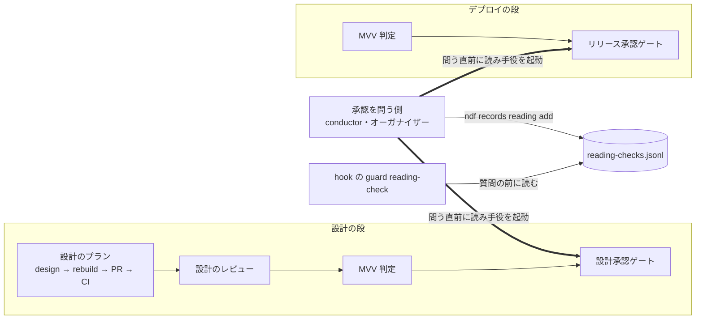
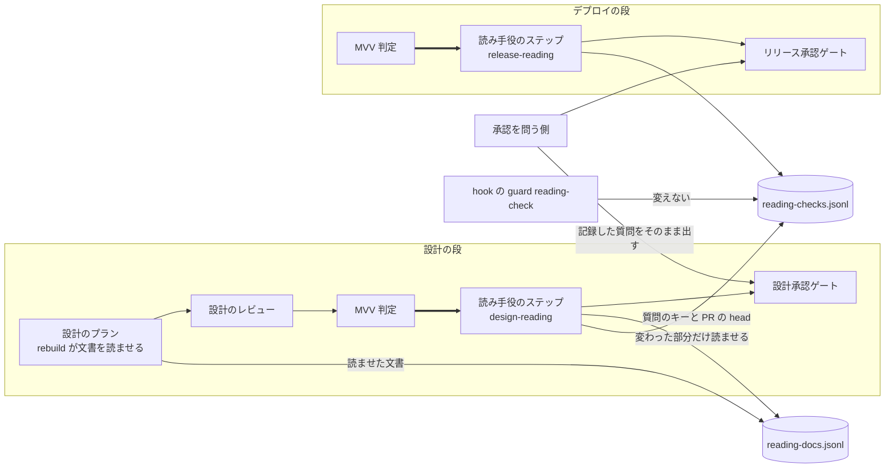
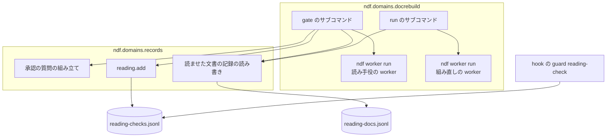
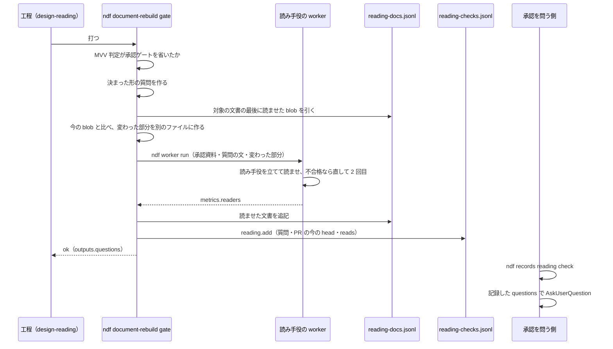

# document-rebuild: 承認資料と質問の文を、承認ゲートの前の工程で読み手役に確かめさせる（#4446）

承認を問う直前に読み手役を起動するため、通じない文が承認の直前に見つかり、承認と変更要求の往復が増えている。設計の段とデプロイの段で、承認ゲートの 1 つ前に読み手役のステップを置く。このステップが、決まった形の質問の文・承認資料・前に読ませた後で変わった文書の部分を読ませ、質問を止める hook が見る記録へ残す。承認を問う側は、記録した質問をそのまま出すだけにする。採らなかった案は「決定の記録」に、外部の調査を省いた理由は末尾にある。

## 今の姿

何が起きたか・目的・受け入れ条件は要求仕様（[issue-4446-requirements.md](./issue-4446-requirements.md)、正は #4446 の本文）にある。この文書は「どう解くか」と「なぜその解き方か」だけを書く。

変更の位置を太線で示す。今は、承認を問う側（conductor・オーガナイザー）が問う直前に読み手役を起動している。

設計に要る今の構造は次の 4 つである。

- **記録の照合は、質問の文の SHA-256 と PR の head で行う。** `ndf records reading add` が書く行は、質問の文から作ったキー（`reading_decide.question_key`）と、承認する PR の番号・ブランチ・head を持つ（`plugins/ndf/src/ndf/domains/records/reading.py`）。hook の guard `reading-check` は、同じ質問のキーの行が無いか、PR の head が記録と違えば質問を止める（`plugins/ndf/src/ndf/domains/hooks/guards/reading_check.py`）
- **質問の文は、承認を問う側が問う時点で書く。** 承認ゲートの質問を決まった形で作る部品は無い（`ndf.progress.gate.asking.question` は質問の id と選択肢だけを持ち、文を持たない）。そのため、記録を前もって作れない。読み手役の確認が問う直前に寄った根本原因はここにある
- **文書の組み直しで読ませた結果は、記録に入らない。** `ndf document-rebuild run` が起動する組み直しの worker は、読み手役を文書 1 件につき最大 2 回立ててよい（#4337 の決定 5）。結果は工程の結果ファイルの `metrics.readers` にだけ残る（`plugins/ndf/src/ndf/domains/docrebuild/drive.py`）。この時点では PR がまだ無く、後の設計のレビューで文書が変わる
- **読み手役を立てられないときは、`not_run` で ok として進む。** 組み直しの worker は理由を残して自分で読み直し、承認の直前に読ませる手順へ回る（`plugins/ndf/contracts/worker/document-rebuild.md` の「誰が確かめるか」）

## 文脈と制約

- 質問を止める hook の判定の条件（質問のキーと PR の head の照合）は変えない（要求の「含まない」）。記録の行の形も変えない
- 読み手役の確認の中身（読み手の立場・渡すもの・合格の条件・立場ごとに 2 回まで・一部だけ読ませるときの決まり）は、`document-rebuild` の「読み手役に読ませる」のまま使う
- 承認ゲートの数と置く場所は変えない。足すのは承認ゲートの前のステップで、承認を求めない
- worker は原則として別のサブエージェントを起動しない。例外は `ndf worker run` で起動した組み直しの worker だけである（`agent-layers.md`）。読み手役を立てる新しい担い手も、この例外の中に置く
- 承認ゲートの外の質問（`ndf-ask:`）は、今のまま質問を出す AI が読ませる（要求の「含まない」）
- 設計 PR の head は、設計のレビューの直し・ベースブランチの取り込みで動く。最後に読ませた後に head が動けば、hook は質問を止める

## 解き方の全体像

設計どおりに実装を終えると、読み手役を起動するのは文書と承認資料を作る工程だけになる。

- 承認ゲートの質問の文は、ゲートの種類と PR から決まった形で作る。承認を問う側は文を書かず、ステップが記録した質問を 1 字も変えずに出す
- 設計の段では、MVV 判定と設計承認ゲートの間に読み手役のステップを置く。PR の本文と質問の文を承認する人の立場で読ませ、文書は前に読ませた後に変わった部分だけを読ませて、PR の今の head で記録する
- デプロイの段では、MVV 判定とリリース承認ゲートの間に同じステップを置く。会話のセッションがリリースの承認資料を組む手順でも、資料を PR へ置く前に同じサブコマンドを打つ
- 文書の組み直しで読ませた文書は、文書の中身（git の blob の SHA）ごとに追記で記録する。読み手役のステップはこの記録と比べて、変わった部分を決める
- 読み手役を立てられなければステップは止まり、「読ませていない」で先へ進まない

## 構成要素

| 要素 | 責務 |
| --- | --- |
| `ndf document-rebuild gate`（新設のサブコマンド） | 承認ゲートの 1 つ前に打つ。決まった形の質問を作り、読ませるものを決め、読み手役の worker を `ndf worker run` で起動し、結果を 2 つの記録へ書く。MVV 判定が承認ゲートを省いたときは読ませずに ok で終える |
| 読み手役の worker の起動指示（`contracts/worker/document-rebuild-gate.md`。新設） | 承認資料・質問の文・文書の変わった部分を読み手役に読ませ、不合格なら承認資料（PR の本文かリリースの承認資料のファイル）を直す。読み手役の起動の許可は組み直しの worker と同じ例外に置く |
| 承認の質問の組み立て（`ndf.domains.records.reading` に足す） | ゲートの種類（`design`・`release`）・PR の番号・PR の題から、`AskUserQuestion` に渡す `questions` を決まった形で作る |
| 読ませた文書の記録（`reading-docs.jsonl`。新設） | 読み手役に読ませた文書ごとに、パス・blob の SHA・立場・回・合否を追記で持つ。保存先は `reading-checks.jsonl` と同じ |
| `ndf document-rebuild run`（変更） | 読み手役が読んだ文書を、読ませた文書の記録へ書く。`not_run` を ok にせず止める |
| 工程の定義（`stages/design.json`・`stages/deploy.json`。変更） | `design-mvv` と `design-gate` の間に `design-reading`、`release-mvv` と `release-gate` の間に `release-reading` を足す |
| 手順書（変更） | 承認を問う側の手順から読み手役の起動を外し、記録した質問を出すことと、記録が合わないときにステップを打ち直すことに置き換える |
| hook の止める理由の文（変更） | 「読み手役に読ませて記録する」の案内を、「読み手役のステップを打ち直す」の案内に変える。判定の条件は変えない |

## 入出力のコントラクト

### `ndf document-rebuild gate`

| 引数 | 意味 |
| --- | --- |
| `--gate design` か `--gate release` | 承認ゲートの種類 |
| `--pr <番号>` | 承認する PR。工程の定義から打つときは省き、設計の段は作業場所のブランチの PR、デプロイの段は文脈の `pr` を使う（`ndf records mvv gate` と同じ決め方） |
| `--material <ファイル>` | リリースの承認資料のファイル。会話のセッションが `ndf release-steps materials` の後に打つときだけ渡す。`--gate design` では受けない（承認資料は PR の本文） |
| `--state-dir <ディレクトリ>` | 起動指示と worker の結果ファイルの保存先 |
| `--out <ファイル>` | 結果 JSON を書くファイル |

| 結果 | いつ | 出力 |
| --- | --- | --- |
| `ok` | 読ませて記録した。または、読ませるものが無く今の head で記録し直した。または、MVV 判定が承認ゲートを省いた | `outputs.questions`（記録した `questions` を書いたファイルのパス）・`outputs.head`・`metrics.readers`（読ませたものごとの立場・回・合否） |
| `stopped`（`precondition`） | PR が無い・GitHub を読めない・読み手役を立てられなかった | `cause.detail` に理由。工程は承認ゲートへ進まない |
| `stopped`（`incomplete`） | worker の結果に、読ませたものごとの記録が欠けている | `gaps` に欠けた対象 |

2 回目にも「判断や作業を誤らせる文」が残ったときは `ok` で終え、残った文を `items` に並べる。承認資料には worker が残った文を書く（今の `document-rebuild` の決まり）。

### 承認の質問の決まった形

| ゲート | 質問の文 | 選択肢 |
| --- | --- | --- |
| `design` | `設計 Pull Request #<番号>（<題>）をマージしてよいですか` | `承認する`・`変更を求める` |
| `release` | `リリースの Pull Request #<番号>（<題>）を本番へ出してよいですか` | `承認する`・`変更を求める` |

選択肢の説明の文も決まった形で持つ。`metadata.source`（`ndf-gate:1`・`ndf-gate:2`）は質問のキーに入らないので、問う側が付ける。

## 処理の流れ

設計の段の流れを示す。デプロイの段は、文書を読ませず、承認資料が `--material` のファイルになる点だけが違う。

読ませるものの決め方は次のとおりである。

| もの | 読ませる条件 | 範囲 |
| --- | --- | --- |
| 質問の文・承認資料 | 同じ質問のキーと同じ承認資料の内容の記録が無い | 全体（立場は承認する人） |
| 設計 PR の文書（要求仕様のコピー・設計書・詳細設計書） | 読ませた文書の記録に、今の blob と同じ行が無い | 最後に読ませた blob からの差分の部分とその前後の段落。読ませた行が無ければ全体 |
| 実装計画 | 読ませない（今の「対象」の行のとおり、書いた担当が自分で読み直す） | — |

どれも読ませる条件に当たらないときは、読み手役を起動せず、今の head で記録だけを作り直す（受け入れ条件 6 の「変わっていないときは読ませ直さない」）。

`reading-checks.jsonl` へ書く行の `reads` には、このステップで読ませたものに加えて、設計 PR の文書ごとに、今の blob を読ませた `reading-docs.jsonl` の行（組み直しで読ませた行を含む）を写す。組み直しで読ませた結果も、hook が見る記録に残すためである（受け入れ条件 1）。

この図は読み手役のステップの流れだけを描く。組み直しのサブコマンド（`run`）・工程の定義・手順書・hook の止める理由の文は含めない。`run` が読ませた文書の記録を書くことは、「構成要素」の図にある。

## 決定の記録

### 決定 1: 記録を承認の前に作れるよう、承認の質問の文を工程が決まった形で作る

- **質問**: hook は質問の文のキーで記録を探すので、問う側が問う時点で文を書くと前もって記録できない。質問の文を誰がいつ決めるか
- **選んだ案**: ゲートの種類・PR の番号・PR の題から、質問の文と選択肢を決まった形で作る部品を `ndf.domains.records.reading` に足す。読み手役のステップが作って記録し、ファイルのパスを `outputs.questions` に返す。承認を問う側はそのファイルの `questions` を 1 字も変えずに出す。承認資料は、設計の段では PR の本文、デプロイの段では `ndf release-steps materials` が組んだファイルとし、問う側は自分の文を足さない
- 採らなかった案: 問う側が文を書き、工程は文書だけを読ませる（質問の文と問う側が書く資料が読まれないまま残り、受け入れ条件 2 を満たさない）
- 採らなかった案: hook が質問の文を見ずに PR の head だけで照合する（hook の判定の条件を変えることになり、要求の「含まない」に反する）
- **代償**: 質問の文が決まった形になり、ゲートごとに言い回しを変えられない。問う側が書き足したい事情は、承認資料のファイルか PR の本文へ書いてから読み手役のステップを打ち直す必要がある
- 根拠: Value 3「判断の要らない手順（待ち・集計・検査・記録・整形・起動の組み立て）は仕組みが進めるので、結果が実行ごとにばらつかない」・Value 1（MVV バージョン 11）

### 決定 2: 承認する時点の内容で記録するため、読み手役のステップを MVV 判定と承認ゲートの間に置く

- **質問**: 承認資料と質問の文をどの時点で読ませるか。要求は工程「ドキュメント再構成」を挙げるが、その時点では PR と本文が無く、後の設計のレビューで文書が変わる
- **選んだ案**: 工程の定義の設計の段に `design-reading`（`design-mvv` と `design-gate` の間）、デプロイの段に `release-reading`（`release-mvv` と `release-gate` の間）を足す。どちらも `ndf document-rebuild gate` を打つ。MVV 判定が承認ゲートを省いたとき（`mvv_gate` の出力が省くと言うとき）は読ませずに ok で終える。会話のセッションがリリースの承認資料を組む手順（`release-steps.md`）では、`materials` の後・`present` の前に同じサブコマンドを打つ
- 採らなかった案: 読み手役の確認をすべて組み直しのステップ（`rebuild`）に寄せる（PR の本文がまだ無い。レビューの直しで head が動き、承認の直前に hook が止めて読ませ直しが起きる）
- 採らなかった案: 設計のプランの CI の後にステップを足す（設計のプランの後に設計のレビューの段が文書を直すので、承認する時点の内容と食い違う）
- 採らなかった案: MVV 判定の前に置く（MVV 判定が承認ゲートを省くときも読み手役を起動し、費用が無駄になる）
- **代償**: 設計の段とデプロイの段にステップが 1 つずつ増える。工程「ドキュメント再構成」の外で読み手役を起動するので、要求の原文の「document-rebuild の工程に移動」とは置き場所が違う。サブコマンドは `ndf document-rebuild` の下に置き、手順は `document-rebuild` の手順書が持つ
- 根拠: Value 1「そこには、作る要否が決められた書式でそろい、一度で読み切れる量の材料が届く」・Value 2（MVV バージョン 11）

### 決定 3: 読み手役の起動を 1 か所に保つため、`ndf document-rebuild` にサブコマンド `gate` を足し、組み直しの worker と同じ例外で立てる

- **質問**: 承認資料と質問の文を読ませる読み手役を、どの担い手が起動するか
- **選んだ案**: `ndf document-rebuild gate` が、`ndf worker run` で読み手役の worker を 1 つ起動する。起動指示は新しい `contracts/worker/document-rebuild-gate.md` から作り、読み手役を立ててよい許可を、組み直しの worker と同じ形（対象 1 件につき最大 2 回）で書く。`agent-layers.md` の例外の文に、この worker を足す。記録の書き込みは worker でなくサブコマンドが行う
- 採らなかった案: `ndf records reading` の下にサブコマンドを足す（`records` は記録の読み書きの置き場で、worker の起動と合否の取りまとめを持たない。組み直しの起動と結果の検査の部品（`drive.py`）が `docrebuild` にある）
- 採らなかった案: 工程の担当の supervisor が `ndf:worker` を起動する（supervisor が流れない工程（プランだけで流れるとき）では起動されない。今の問う側が読ませる形と同じく、起動する担い手が経路ごとに分かれる）
- **代償**: 読み手役を立てる worker の例外が 2 つの起動指示に広がる。例外の範囲は `ndf worker run` で起動した、この 2 つの起動指示の worker に限る
- 根拠: Value 11「同じ規則・定数・処理は 1 か所にまとまり、ほかはそこを参照する」・Value 9（MVV バージョン 11）

### 決定 4: 変わった部分だけを読ませるため、読ませた文書を blob の SHA ごとに追記で記録する

- **質問**: 読み手役のステップは、組み直しで読ませた後に文書が変わったかを、何と比べて決めるか
- **選んだ案**: `reading-checks.jsonl` と同じ保存先に `reading-docs.jsonl` を足し、読み手役が読んだ文書ごとに、リポジトリ・パス・blob の SHA・立場・回・合否を 1 行ずつ追記する。`ndf document-rebuild run` と `gate` の両方が書く。`gate` は、今の blob と同じ行があれば読ませず、無ければ最後の行の blob との差分を読ませる。行が無ければ全体を読ませる。`gate` が `reading-checks.jsonl` へ書く行の `reads` には、今の blob を読ませた行を写す
- 採らなかった案: 組み直しの結果ファイル（プランの状態の保存先の `rebuild.json`）を読む（設計の段の別のステップからは保存先が決まらず、変更要求で流し直すと上書きされる）
- 採らなかった案: `reading-checks.jsonl` の行に文書の blob を足す（その行は質問のキーを必須に持ち、組み直しの時点では質問が決まっていない。行の形を変えると hook の読み方にも及ぶ）
- **代償**: 記録のファイルが 1 つ増える。行は追記だけで増え続けるので、`reading-checks.jsonl` と同じ片付けの対象に入れる
- 根拠: Value 8「履歴を残す事実は追記だけで持ち、今の値は最新の記録から引く」・Value 2（MVV バージョン 11）

### 決定 5: 「読ませていない」で先へ進む経路を無くすため、読み手役を立てられなければ工程を止める

- **質問**: 読み手役を立てられないとき（Tool が無いなど）、組み直しと読み手役のステップをどう終えるか
- **選んだ案**: `ndf document-rebuild run` と `gate` は、worker の記録に `not_run` があれば `stopped`（`precondition`）で終える。工程は承認ゲートへ進まず、打ち直しを待つ。`contracts/worker/document-rebuild.md` と `document-rebuild` の手順書から「自分で読み直して進む」扱いを外す。supervisor が手順書に沿って組み直すときに立てられなければ、`判断が要る` で返し、呼んだ側が `ndf document-rebuild run` を打つ
- 採らなかった案: 自分で読み直して `ok` で進み、警告を出す（要求の受け入れ条件 5 に反する。承認の直前に問う側が読ませる経路が残る）
- **代償**: 読み手役を立てられない環境では、設計の段とデプロイの段が止まる。打ち直しの費用がかかる
- 根拠: Value 13「確かめたことだけが済んだとされる」（MVV バージョン 11）

### 決定 6: 承認を問う側に読み手役を起動させないため、オーガナイザーもレーンが記録した質問をそのまま出す

- **質問**: オーガナイザーが複数のレーンの承認をまとめて問うとき、自分で書く質問の文をどこで読ませるか（要求の「未決」）
- **選んだ案**: オーガナイザーは質問の文を書かない。レーンの読み手役のステップが記録した `questions` を、ゲートごとに 1 回の `AskUserQuestion` で 1 字も変えずに出す。まとめて示すのは、質問の前の一覧（順・PR の URL・題・承認資料の場所）だけにする。一覧は PR と承認資料から機械で写せる項目だけで、オーガナイザーの文を足さない
- 採らなかった案: オーガナイザーがまとめた質問の文を書き、問う前に読ませる（受け入れ条件 3 の「問う直前に読み手役を起動しない」に反する）
- 採らなかった案: 複数のレーンの `questions` を 1 回の `AskUserQuestion` に並べる（質問のキーは `questions` の並び全体から作るので、どのレーンの記録とも合わず hook が止める）
- **代償**: まとめた承認でも、利用者はゲートごとに 1 回ずつ回答する。まとめの一覧で示せるのは機械で写せる項目だけになる
- 根拠: Value 1「人の判断を、読み切れる量の大事な所だけにする」・Value 5（MVV バージョン 11）

## 影響と危険

- **働く範囲**: 利用先のリポジトリでも働く。設計の段とデプロイの段を流すすべてのリポジトリで、承認ゲートの前に読み手役のステップが走る
- **プロジェクトごとに違うもの**: 無し。読み手の立場は文書の種類で決まり、設定を足さない。組み直しのコマンドの設定（`workflow.launch.rebuild`）は `gate` に使わない
- **当たるモード**: `standard`・`legacy-refactor`・`documentation`（設計承認ゲートを持つモード）と、リリース承認ゲートを通るすべてのモード
- **書きかけの文書**: 実装の前に設計承認ゲートへ届く設計 PR は、今の手順（問う側が読ませる）のまま問う。新しいステップはリリースした後に流れ始めたスプリントから効く
- **同じファイルを触る別の変更**: #4337 の実装（`docrebuild/drive.py`・`contracts/worker/document-rebuild.md`）と重なる。#4337 がマージされた後の形の上に足す
- **壊れうる箇所**: 決まった形の質問を問う側が書き換えると、hook が止める（今と同じ止まり方）。PR の題を承認の前に変えると質問の文が変わり、記録と合わなくなる。どちらも、読み手役のステップを打ち直せば直る

### 代表のリポジトリでの振る舞い

| 代表のリポジトリ | 設定の要点 | 直した後に起きること | この種類で扱えなくなること |
| --- | --- | --- | --- |
| Web サービス | 設計の段とデプロイの段を流し、リリースは本番ブランチへの PR | 設計承認ゲートとリリース承認ゲートの前に読み手役のステップが走り、問う側は記録した質問を出す | 無し |
| モバイルアプリ | リリースはストアへの提出を届け先に持つ | リリースの承認資料（`materials` の出力）と質問の文が、提出の承認の前に読まれる | 無し |
| 業務文書だけ | `documentation` で設計承認ゲート（企画承認）と提出の承認を持つ | 企画承認の前に PR の本文と質問の文が読まれ、原稿は組み直しで読ませた後に変わった部分だけが読まれる | 無し |

### このリポジトリだけの事情

- 無し（読み手役のステップは利用先のリポジトリと同じ形で働き、ai-plugins の運用の値を使わない）

## テスト設計

| 受け入れ条件 | どの振る舞いで縛るか | どう壊したら落ちるべきか |
| --- | --- | --- |
| 1 | `ndf document-rebuild run` が、読み手役の読んだ文書を `reading-docs.jsonl` へパス・blob・立場・回・合否で追記する。続く `gate` が書く `reading-checks.jsonl` の行の `reads` に、今の blob を読ませた文書の行が入る | 追記を外すと落ちる。blob を作業場所の HEAD の SHA に替えると落ちる。`gate` が文書の行を写さないと落ちる |
| 2 | `ndf document-rebuild gate --gate design` が、PR の本文と決まった形の質問を読ませ、質問のキーと PR の今の head で `reading-checks.jsonl` へ記録する | 質問のキーを問う側の文から作るように壊すと、記録したキーと `outputs.questions` のキーが食い違って落ちる |
| 3 | 工程の定義の設計の段で、`design-reading` が `design-mvv` と `design-gate` の間にある。問う側の手順書に読み手役の起動が無い | ステップの順を入れ替えると落ちる（工程の定義の検査） |
| 4 | `--gate release --material <ファイル>` が、承認資料のファイルと質問の文を読ませて記録する。デプロイの段の定義で `release-reading` が `release-gate` の前にある | `--material` を読まずに PR の本文を読むと落ちる |
| 5 | worker の記録に `not_run` があると、`run` と `gate` が `stopped`（`precondition`）で終える | `not_run` を ok で通すと落ちる |
| 6 | 文書の blob が記録と同じなら読み手役を起動せずに今の head で記録し直す。違えば差分の部分だけのファイルを作って読ませる | 同じ blob でも worker を起動すると落ちる（起動の回数を数える）。差分でなく全体を渡すと落ちる |
| 7 | hook の guard `reading-check` の判定は今のまま。記録の無い質問と head の動いた質問を止める | 今の hook のテストがそのまま通る。止める理由の文の案内だけが変わる |
| 8 | 承認を問う側が `ndf records reading check` で `no_record`・`head_moved` を受けたとき、手順書は読み手役のステップの打ち直しを示す | 手順書の参照切れは `ndf check` が見る（文言は照合しない） |
| 非機能 | 同じ文書・同じ立場の読み手役の起動は、変わらない限り工程の中の最大 2 回で、承認の直前に足されない | 読み手役のステップを 2 回続けて打ち、2 回目で worker が起動されないことを確かめる。起動すると落ちる |

## 設計の結果

| 課題 | 扱い | 統合先 | 触るファイル |
| --- | --- | --- | --- |
| #4446 | 実装する | — | `plugins/ndf/src/ndf/domains/docrebuild/gate.py`（新設）、`plugins/ndf/src/ndf/domains/docrebuild/cli.py`、`plugins/ndf/src/ndf/domains/docrebuild/drive.py`、`plugins/ndf/src/ndf/domains/records/reading.py`、`plugins/ndf/src/ndf/domains/hooks/guards/reading_check.py`、`plugins/ndf/contracts/worker/document-rebuild.md`、`plugins/ndf/contracts/worker/document-rebuild-gate.md`（新設）、`plugins/ndf/contracts/workflow/stages/design.json`、`plugins/ndf/contracts/workflow/stages/deploy.json`、`plugins/ndf/contracts/domains/ndf-files.json`、`plugins/ndf/contracts/schemas/internal/reading-docs.schema.json`（新設）、`plugins/ndf/contracts/schemas/io/document-rebuild.args.schema.json`、`plugins/ndf/contracts/schemas/io/document-rebuild.result.schema.json`、`plugins/ndf/docs/contracts/commands.md`、`plugins/ndf/skills/document-rebuild/SKILL.md`、`plugins/ndf/skills/development-workflow/references/approval-request.md`、`plugins/ndf/skills/development-workflow/references/agent-layers.md`、`plugins/ndf/skills/development-workflow/references/asking.md`、`plugins/ndf/skills/development-workflow/references/parallel.md`、`plugins/ndf/skills/release/references/release-steps.md`、`plugins/ndf/tests/domains/docrebuild/test_docrebuild_gate.py`（新設）、`plugins/ndf/tests/domains/docrebuild/test_docrebuild_run.py`、`plugins/ndf/tests/domains/records/test_reading.py`、`plugins/ndf/tests/domains/hooks/test_reading_check.py` |

## 未確認のまま残ること

| 項目 | 内容 |
| --- | --- |
| リリース後の確認 | 設計承認ゲートで問う直前に読み手役が起動されないことは、リリースの後に設計のプランを 1 回流して実行の記録で確かめる。リリース承認ゲートは次のリリースの後に確かめる（要求の「リリース後の確認の計画」） |

## 外部の調査

省く: 外部の判断が要らない変更である。読み手役の確認を行う担い手と時点を、NDF の工程の中で移すだけで、形はプロジェクトの中の取り決め（工程の定義・記録の形・hook の照合）だけで決まる
