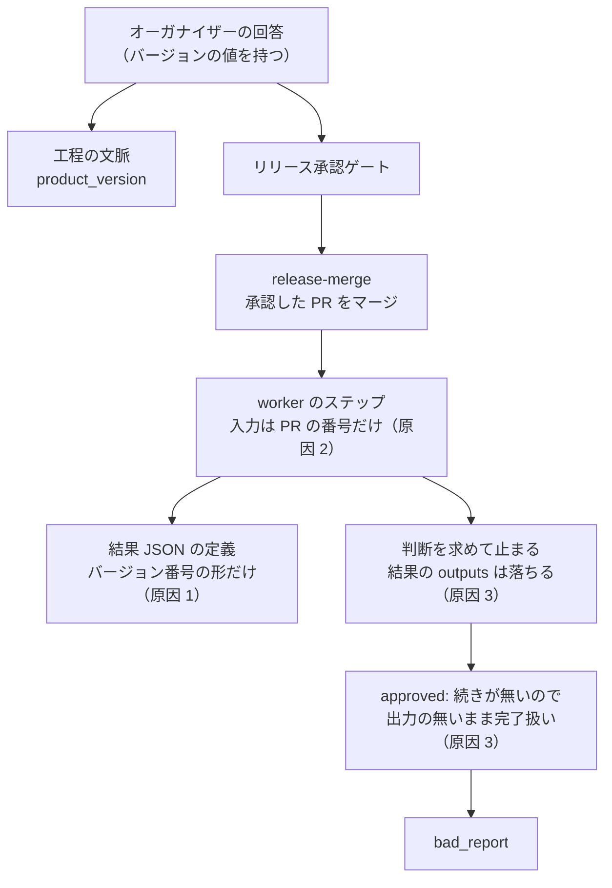
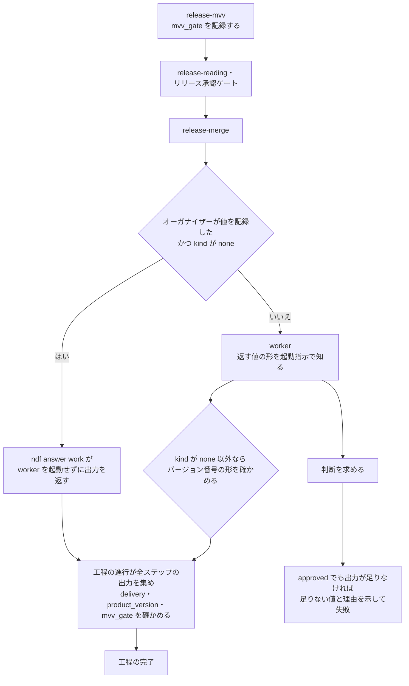
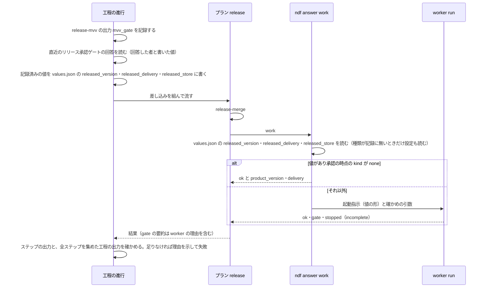

# デプロイの工程: バージョン番号を持たないリポジトリでも終わるようにする（#4513）

バージョン番号を持たないリポジトリでは、デプロイの工程が出力をそろえられず、`bad_report` を繰り返して終わらない。バージョン番号の形の確かめを、リポジトリの設定を読める層へ移し、オーガナイザーがまとめて出した後は、worker を起動せずに記録済みの値で工程を終える。出力がそろわないまま承認の回答を受けたときは、足りない値と worker が判断を求めた理由を示して失敗で止める。調べたコードの事実は「今の姿」に、採らなかった案は「決定の記録」にある。

## 今の姿

何が起きたか・目的・受け入れ条件は要求仕様（[issue-4513-requirements.md](./issue-4513-requirements.md)、正は #4513 の本文）にある。この文書は「どう解くか」と「なぜその解き方か」だけを書く。この文書で使う言葉は、末尾の「この文書で使う言葉」にある。



根本原因は次の 3 つである。どれか 1 つを直しても、工程は止まったままになる。

| # | 原因 | 場所 |
| --- | --- | --- |
| 1 | 結果 JSON の `outputs.product_version` が、リポジトリの設定に関係なくバージョン番号の形を求める。工程の文脈の定義は空でない文字列を受け付ける | `contracts/schemas/result.schema.json` |
| 2 | オーガナイザーが記録した値は工程の文脈に入るが、worker には PR の番号しか渡らない。worker は何を返すべきか、もう出たのかを知らない | `contracts/worker/kinds.json`・`contracts/templates/release.json` |
| 3 | worker が判断を求めた後の `approved` は、続きのステップが無いとプランの完了になる。判断を求めた結果には、worker が結果ファイルに書いた `outputs` が引き継がれないので、完了しても出力が無い（受け入れ条件 9 は今のコードでは成り立たない）。出力が規約に合わないときの誤りには、足りない値の名前も worker の理由も出ない。プランの結果の要約からも worker の理由が落ちる | `core/worker_outcome.py`・`progress/invoke.py`・`progress/run.py`・`core/plan/transition_decide.py` |

同じ形の確かめは、リリース後テストの記録のスキーマ（`release-verification.schema.json` の `version`）にもある。`ndf records close-check` は、このスキーマに合わない記録を読まない。そのため、バージョン番号を持たないリポジトリは課題を閉じる判定でも止まる。

## 文脈と制約

- バージョン番号を持たないリポジトリは、`branch_strategy.release.version_store.kind: none` のリポジトリである（要求の前提 1）
- デプロイの工程は、出力の `delivery`・`product_version`・`mvv_gate` の 3 つがそろわないと完了にならない（工程の定義の `outputs`。`check_stage_output` で確かめた）。`product_version` だけを返しても終わらない
- 工程の定義は、ステートマシンを作成した時点の内容がスプリントに保存される。定義に入力を足しても、進行中のスプリントには効かない
- 結果 JSON のスキーマはリポジトリの設定を読めない
- バージョン番号を持つリポジトリの確かめは緩めない（受け入れ条件 8）

## 解き方の全体像



- デプロイの工程が完了に要る 3 つの出力のうち、`mvv_gate` は承認の前のステップ `release-mvv` が記録する。`delivery` と `product_version` は `release` ステップ（`ndf answer work` か worker）が返す。工程の進行は全ステップの出力を集めてから 3 つがそろうかを確かめる（この集め方と確かめは今のまま変えない）
- 結果 JSON は `product_version` に空白だけでない文字列を受け付ける。リポジトリの設定を読むのは `ndf answer work` である。バージョン番号を持つリポジトリなら、形を確かめる引数を付けて `ndf worker run` を起動し、`ndf worker run` がその形を確かめる
- `kind: none` でオーガナイザーが出した後は、スクリプトが記録済みの値を返し、出すための worker は起動しない。完了の根拠は今と同じく、オーガナイザーの記録とリリース承認ゲートの承認である（決定 2）
- 出力がそろわないまま `approved` と回答されたときの失敗の理由は、どの工程でも、工程の進行（`progress/run.py`・`progress/invoke.py`）が組み立てる

## 構成要素

| 要素 | 責務（変えること） |
| --- | --- |
| 結果 JSON の定義（`result.schema.json`） | `product_version` は空白だけでない文字列を受け付ける。バージョン番号の形は `$defs` の別の定義として 1 か所に置く |
| 文脈の定義（`context.schema.json`） | 配布識別子の定義 `$defs/distribution_id`（改行を含まない、空白だけでない 1 行）を置き、`product_version` はそこを参照する |
| まとめたリリースの回答の入口（`progress/plan/__init__.py` の `record_release`・`progress/plan/external.py` の `read_answer`） | `ndf lanes release --version` の値と、外のオーガナイザー（Factory のランナーなど）が書く回答のファイル `answers/<id>.json` の `version` を、同じ関数で文脈の配布識別子の定義に照らす |
| リリース後テストの記録の定義（`release-verification.schema.json`） | `version` は文脈の配布識別子の定義を参照する（制約を写さない）。検証器（`contracts/__init__.py`）は、ほかのファイルへの参照を解けるようにする |
| 実行の保存先の値のファイル（`values.json`。形の定義は `src/ndf/contracts/worker_kinds.py`） | 差し込みの値とは別に、任意のキー `released_version`・`released_delivery`・`released_store` で記録済みの値（配布識別子、承認と一緒に記録した届け先、承認の時点のバージョンの保存先の種類）を持つ |
| 工程の進行（`progress/invoke.py`・`progress/run.py`） | 直近のリリース承認ゲートの回答がオーガナイザーの承認なら、その回答が書いた `product_version`・`delivery`・`release_store` を `values.json` に書く（選び方は「記録済みの値の読み方」）。出力の足りない承認の失敗の理由を組み立てる |
| 工程の定義の読み手（`progress/definition.py`） | ステップの出力の規約が `outputs` に必須とするキーの名前を返す |
| オーガナイザーの承認の記録（`progress/plan/cli.py`・`progress/plan/__init__.py`・`progress/gate/release.py`・`core/production_merge.py`） | オーガナイザーがまとめたリリースの回答を記録するとき、配布したリポジトリの設定から、バージョンの保存先の種類（`none`・`versioned`・設定を読めなければ `unknown`）を決めて回答に残す。種類が `none` なら、本番の届け先も 1 行に決めて残す（「`delivery` は、その配布の記録から読み」の段落）。レーンは、回答をリリース承認ゲートの回答として書くとき、残った届け先を `delivery` に、種類を同じ事象の `release_store` に書く |
| worker の起動（`progress/gate/entry.py`） | 記録済みの値があれば、承認の時点の種類（`release_store`）で決める。`none` なら worker を起動せずに記録済みの値で終え、`unknown` なら worker を起動せずに止める。種類が記録に無い（この変更の前に承認された）か記録済みの値が無いときだけ、作業の時点のバージョンの保存先の種類を読む。worker を起動するときは、返す値の形を起動指示と確かめの引数に入れる |
| worker の結果の確かめ（`core/worker.py`・`core/worker_outcome.py`） | 必須の `outputs` を、結果 JSON の定義に加えて文脈の定義でも確かめる。指定されたときだけ、`product_version` がバージョン番号の形かも確かめ、違えば欠けにする。判断を求めた結果（`gate`）にも、確かめを通った必須の `outputs` を引き継ぎ、足りない必須の名前を `metrics.missing_outputs` に載せる |
| プランの遷移（`core/plan/steps.py`・`transition_decide.py`・`runner.py`） | 承認ゲートで終わる結果の要約に止まったステップの要約を含め、そのステップの `metrics.missing_outputs` を結果に引き継ぐ |
| プランの出力の記録（`core/plan/records.py`・`runner.py`） | 実行の保存先の `outputs.json` を、ステップごとの出力の並びにし、プランの結果の出力はそこから組む（「プランの出力の記録」） |
| 手順書と定義の説明（`kinds.json`・`context.schema.json`・`release` と `release-steps.md`・`release-verification`・`progress-tracking`・`development-workflow` の `parallel.md`） | バージョン番号を持たないリポジトリの `product_version` は、出したものを指す値であると書く |

## 入出力のコントラクト

| 名前 | 変わる点 | 失敗の形 | 互換性 |
| --- | --- | --- | --- |
| 文脈の `product_version`（`context.schema.json`） | 出したものを指す値（配布識別子）の共通の定義にする。改行を含まず、空白だけでない 1 行の文字列を受け付ける | 改行を含む値と空白だけの値は形の誤り | 今受け付ける 1 行の値はそのまま通る |
| 結果 JSON の `outputs.product_version` | バージョン番号の形でない文字列も受け付ける | 空文字列と空白だけの文字列は形の誤り。改行を含む値は、`ndf worker run` が文脈の定義で確かめて欠けにする | 今受け付ける値はそのまま通る |
| `ndf lanes release --version` | 記録する前に、値を文脈の配布識別子の定義で確かめる | 改行を含む値と空白だけの値は、記録せずに断る | 1 行の値はそのまま記録する |
| 外のオーガナイザーの回答のファイル（`answers/<id>.json` の `version`） | 読む時点で、`ndf lanes release --version` と同じ関数で確かめる | `released` の回答の改行を含む値と空白だけの値は、回答のファイルの誤りとして断る。承認ゲートの待ちは残り、外のオーガナイザーが回答のファイルを書き直せば取り込まれる | 1 行の値はそのまま取り込む |
| `ndf answer work` | `values.json` の任意のキー `released_version`・`released_delivery`・`released_store` を読む。引数は増やさない。`released_version` が無いか空なら今と同じ。`released_store` が `none` で `released_delivery` が無いときと、`released_store` が `unknown` のときは、worker を起動せずに止める | 承認の時点の種類が記録に無く、作業の時点でバージョンの保存先を読めないときは、バージョン番号を持つ扱いにする。承認の時点の種類が記録にあれば、作業の時点の設定は読まない | キーを持たない `values.json`（単発のプラン・直す前の NDF が書いたもの）は今と同じ |
| `ndf worker run` | バージョン番号の形を確かめる任意の引数を足す。結果ファイルが `gate` のときも、必須の `outputs` のうち確かめを通った値を結果の `outputs` に載せ、残りの名前を `metrics.missing_outputs` に載せる | `ok` の結果で `product_version` の形が違えば、結果は `status: stopped`、停止理由は `incomplete` とし、欠けた値に `product_version` を示す。`gate` の結果の無い値と違う形の値は載せず、`gate` のままにする。形は、結果 JSON の定義と文脈の定義（`context.schema.json`）の両方で確かめる | バージョン番号の形の引数が無ければ形は確かめない |
| プランの結果の `outputs` | 判断を求めた（`gate`）ステップについては、今回の結果の値だけを使う。同じステップが前の回に残した値は使わず、ほかのステップが同じキーに残した値は残る | — | `ok` と `stopped` の値の重ね方（後に書いた値が勝つ）は変わらない |
| 工程の失敗の理由（`bad_report`） | 承認の回答の後の誤りは、足りない値の名前（決め方は決定 4）・worker が判断を求めた理由の要約・次の操作を含む | 終了の仕方と停止理由の種類は変わらない | 文だけが変わる |
| リリース後テストの記録の `version` | バージョン番号の形でない文字列も受け付ける。形は文脈の配布識別子の定義を参照する | 空白だけと改行を含む値は形の誤り | 今受け付ける 1 行の値はそのまま通る |

**値の渡し方**: 工程の進行は、記録済みの値をプランの argv や差し込みに載せない。実行の保存先の `values.json` に `released_version`（と、記録した届け先 `released_delivery`）として書く。`ndf answer work` は起動指示の材料と同じこのファイルから読む。argv に載せないのは、出したものを指す値の形を問わないためである。プランの実行（`core/plan/steps.py`）は、ステップを打つ直前に argv の各要素の `{repo}`・`{state_dir}` などを `assemble_decide.fill` で置き換える。値を argv に載せると、`{repo}` を含む識別子がリポジトリのパスに変わる。ハイフンで始まる値を `argparse` がオプションと読む心配も、ファイルで渡せば無くなる。

記録済みの値で終えるとき、`ndf answer work` が返す出力は次の 2 つである。3 つ目の `mvv_gate` は返さない（`release-mvv` が記録済み）。

| キー | 値 |
| --- | --- |
| `product_version` | オーガナイザーが `--version` で渡した値のまま |
| `delivery` | オーガナイザーの承認と一緒に記録した届け先の 1 行（下の規則） |

**`delivery` は、その配布の記録から読み、デプロイの工程の時点の設定からは選ばない。** 設定は後から直せるので、今の設定は、過去にどこへ配布したかを確かめた根拠にならないためである（Value 13）。たとえば、配布の時点で本番の届け先が A と B の 2 つあり、止まった後に設定から B を外して retry すると、今の設定から選ぶ形では、同じ配布識別子に A だけが実績として残ってしまう。

そこで、届け先は、オーガナイザーがまとめたリリースの回答を記録するとき（`ndf lanes release`。`progress/plan/cli.py`）に 1 度だけ決め、回答に残す。この時点の設定は、オーガナイザーが配布に使った設定である。レーンは、回答をリリース承認ゲートの回答として書くとき（`gate/release.py` の `take_reply`）に、回答に残った届け先を `product_version` と同じ出力の事象に `delivery` として書き、回答を取り込む時点の設定では決め直さない。取り込むまでに設定が変わると、配布していない届け先を記録してしまうためである。決め方は次のとおりである。

1. `ndf lanes release` を打った作業ディレクトリ（配布したリポジトリ）の根の `.ndf/project.json` を `branch_strategy.load` で読む。Git の保存先の位置から設定の場所を逆算しない。`git clone --separate-git-dir` で Git のデータを別の場所に置くと、保存先の親が作業ディレクトリにならないためである。バージョンの保存先の種類が `none` のときだけ届け先を決める（`none` 以外は worker が `delivery` を返す）
2. 配列 `branch_strategy.release.deliveries` から本番に届く要素を選ぶ。本番に届く要素は、`channel` が `production` か、省略か `null` の要素である。この条件は `core/production_merge.py` の `on_channel` だけに置き、`ndf ci merge` と hook の判定、承認資料の届け先（`forms_decide.reaches`）も同じ関数を使う。配列の順番は使わない
3. 本番に届く要素が 1 つで、文脈の `delivery` の形に合うときだけ記録する。確かめるときは、文脈のスキーマ（`context.schema.json`）の全体へ `{"delivery": 要素}` を渡す。`$defs/delivery` だけを指定しない（理由は詳細設計の「オーガナイザーの承認と一緒に届け先を記録する」）。設定の形は `target`・`trigger` に空文字列を許すが、文脈の形は 1 文字以上を求める
4. 0 か 2 つ以上か、形に合わないか、設定を読めないときは、`delivery` を記録しない。回答そのものは断らない
5. 回答には、届け先を記録したかに関わらず、記録する時点のバージョンの保存先の種類を `store` として残す。`none`・`versioned`（`none` 以外）・`unknown`（設定を読めない）のどれかである。レーンは、この値を承認の回答と同じ事象の `release_store` に書く
6. 外のオーガナイザー（Factory のランナーなど）は、回答のファイル `answers/<id>.json` に同じ `store` と `delivery` を書ける。書かなければ、種類は記録に無いもの（この変更の前に承認された記録と同じ扱い）になり、届け先も記録されない

**worker を起動するかは、承認の時点の種類で決め、デプロイの工程の時点の設定で決め直さない。** `none` の配布はオーガナイザーが済ませているので、デプロイの工程の時点で設定を読めないからといってバージョン番号を持つ扱いに落とすと、worker が起動して同じものをもう一度出す（決定 2）。`ndf answer work` は、この記録を `values.json` 経由で受け取る（「記録済みの値の読み方」）。

| 承認の時点の種類（`release_store`） | 承認と一緒に記録した `delivery` | `ndf answer work` の結果 |
| --- | --- | --- |
| `none` | ある | `ok`。記録した行をそのまま `outputs.delivery` にする |
| `none` | 無い | `stopped`（`precondition`）。この配布の届け先が記録から確かめられないことと、次の操作を示す |
| `unknown` | 無い | `stopped`（`precondition`）。承認の時点で設定を読めず、届け先が記録に無いことと、次の操作を示す |
| `versioned` | 無い | worker を起動し、バージョン番号の形を確かめる（今と同じ） |
| 記録に無い（この変更の前に承認された） | 無い | デプロイの工程の時点の種類が `none` なら `stopped`（`precondition`）、それ以外か読めなければ worker を起動する（今と同じ） |

記録が無いときは、設定を直して retry しても完了しない。記録は承認の回答と一緒に書いた事象にあり、retry では変わらないためである。次の操作は、利用者が実際の届け先を確かめ、`ndf progress finish` で `delivery` と `product_version` を渡して工程を手で終えることである。

止めるときに worker を起動しないのは、オーガナイザーがすでに出した後なので、起動すると同じものをもう一度出すことになるためである（決定 2）。固定の値で `delivery` を埋めることもしない。埋めると、配布実績に実際とは違う配布方法が残る。

**回答を書く時点の設定を記録に使う理由**: 回答を書く時点の設定も、配布そのものを観測した結果ではない。ただし、オーガナイザーが配布を済ませて回答を記録した時点の値で、回答と同じトランザクションで 1 度だけ書く。そのため、後の設定の修正では変わらない。オーガナイザーが出した配布物の中身と届け先を本番リリース記録で確かめる仕組みは、#4586（ https://github.com/devbasex/ai-plugins/issues/4586 ）で設計する。

### プランの出力の記録

プランは、ステップが返した出力を、どのステップが返したかと併せて書いた順に残し、結果の `outputs` はそこから毎回組み直す。残すのはステップとキーの組ごとの最新の値だけである。

形は次のとおりである（ステップ 2 つが出力を返した例。ステップ名と値は作り物である）。

```json
{"entries": [{"step": "first", "outputs": {"pr": 1}}, {"step": "second", "outputs": {"product_version": "main abc1234"}}]}
```

| 場面 | `outputs.json` の扱い |
| --- | --- |
| `ok` か `stopped` のステップが出力を返した | 同じステップの前の要素から今回のキーを外し（空になった要素は消す）、今回の出力を末尾に足す |
| `gate` を返した（出力が無い場合を含む） | そのステップの要素をすべて外し、今回の出力があれば末尾に足す |
| 結果の `outputs` を組む | 要素を先頭から順に重ねる（同じキーは後の要素が勝つ） |
| `entries` を持たない、直す前の形（キーと値だけのオブジェクト） | ステップの分からない要素 1 つとして先頭に置き、外さない。直す前の NDF は worker の `gate` の結果から出力を落とすので、ここに `work` の判断の求めの値は混じらない |

**判断を求めたステップの必須の出力は、合成する前の、そのステップ自身の値で確かめる。** `ndf worker run` は `gate` の結果に、必須の出力のうち足りない名前を `metrics.missing_outputs` として載せる。承認の回答を受けたら、プランを完了にするか続けるかを決める前に、この一覧を見る。空でなければ、承認の後に続くステップがあっても、続けずに失敗にする。ほかのステップが同じキーを返していても、後のステップが同じキーを返しても、欠けは隠れない。

## 処理の流れ



### 記録済みの値の読み方

回答には 2 種類ある。リリース承認ゲート（ステップ `release-gate`）への回答と、worker が判断を求めたこと（ステップ `release`）への回答である。記録済みの値は前者だけから読む。後者の回答は、新しくても読み飛ばす。

1. デプロイの工程の事象 `answered` のうち、リリース承認ゲートへの回答の最後の 1 件を選ぶ。リリース承認ゲートへの回答は、`kind` が `listen`（承認ゲートへの回答）で、`gate` がゲートの名前 `release` である。この `release` はステップ `release` の名前と同じ文字列だが、ゲートの名前であり、ステップ `release-gate` で出す承認ゲートを指す。worker の判断の求めへの回答は `kind` が `plan` で `gate` を持たないので、選ばれない
2. その回答の `answer` が `approved` で、回答した者（`by`）が `organizer` であることを確かめる
3. 回答の事象の番号（`seq`）の次（`seq + 1`）にある事象を見る。それが同じ工程の出力の事象（種類が `stages.OUTPUTS_EVENT`）なら、その `payload.outputs` の `product_version` と `delivery`、`payload.release_store` を読む。`delivery` は、回答を書いたときに届け先が 1 行に決まった場合だけある。`release_store` は、この変更の後に書いた回答にだけある。次の事象がそれ以外なら、値は無い。`answered` の事象そのものは値を持たない。書く側（`gate/answering.py`）は、回答が値を運ぶとき、回答の事象と出力の事象をこの順に続けて 1 つのトランザクションで追記するので、番号は必ず隣り合う
4. 2 か 3 が成り立たないか、`product_version` が空白だけなら、記録済みの値は無いものとする（worker を起動する）。`product_version` があり `delivery` が無い場合は、記録済みの値はあるものとする。ただし、届け先は記録されていないものとする（`ndf answer work` が止まるか worker を起動するかは、上の「承認の時点の種類」の表で決まる）

工程の進行は、プランを流す直前に毎回この手順で値を読む。`values.json` の `released_version`・`released_delivery`・`released_store` は、読んだ今の値に合わせる（値が無ければキーを消す）。値を読んで書くのは、`release` の作業のように `product_version` を出力に持つ作業を流すプランだけである。プランがそうした作業を流すかは、プランを組むときの作業の一覧で分かる。そのため、この手順は、作業の一覧でそうと分かった後に初めて打つ。ほかのプランでは、リリース承認ゲートの回答を探さない。探すときも、工程の最新の承認を探す今の走査（`approved_seen`）が止まった所から続け、既に見た事象を見直さない（詳細設計の「工程の進行: 記録済みの値の読み方」）。値が `values.json` に残っている値と同じなら書き直さない。同じ試行の中（承認の回答の後・自動の打ち直し）では前の `values.json` を使い回すが、このキーだけは残った値を使わない。工程の retry の後の試行の始めは、`values.json` ごと消えてから書き直される。

## 決定の記録

### 決定 1: バージョン番号を持つリポジトリの確かめを残すため、形の確かめを結果の定義から worker の結果の確かめへ移す

- **質問**: バージョン番号の有無による値の確かめを、どこで行うか
- **選んだ案**: 結果 JSON の定義は空白だけでない文字列を受け付ける。`ndf answer work` がバージョンの保存先の種類（承認の時点の記録。記録に無いときだけ作業の時点の設定）を読み、`none` 以外なら `ndf worker run` へ形の確かめを指示する。この確かめは、決定 2 に従って worker を起動する場合にだけ当てはまる。承認の時点の種類が `unknown` の配布のように、決定 2 で worker を起動しない場合は、確かめの指示も出さない。形の正規表現は今のものを結果のスキーマの `$defs` に残す。保存先の設定を読めないときは確かめる。起動指示にも返す値の形を 1 行で書く
- 採らなかった案: 結果の定義を緩めるだけにする（バージョン番号を持つリポジトリで `ndf v11.0.0` のような値が文脈に入る）
- 採らなかった案: `ndf contracts emit` が、実行された場所の設定を読む（結果を書くコマンドは、結果の形だけを見る部品である。実行する場所もリポジトリとは限らない）
- 採らなかった案: 工程の出力の確かめで見る（`ndf progress finish` で手で終える経路まで厳しくなる。要求の対象範囲の外を変える）
- **代償**: worker は結果を書く時点では形の誤りを知らされない。起動指示の 1 行で知らせ、誤れば欠けとして工程が止まる
- 根拠: Value 4 / Value 11（MVV バージョン 11）

### 決定 2: 出したものをもう一度出さないため、まとめたリリースの後は worker を起動せずにスクリプトが出力を返す

- **質問**: オーガナイザーが出した後のデプロイの工程で、worker に何をさせるか
- **選んだ案**: オーガナイザーが配布識別子を記録した承認では、`ndf answer work` が worker を起動するかを、承認の時点に記録したバージョンの保存先の種類（`release_store`）で決める。デプロイの工程の時点の設定で決め直さないのは、設定を読めないことを理由にバージョン番号を持つ扱いに落とすと、オーガナイザーが済ませた配布を worker がもう一度出すためである。対象は、直近のリリース承認ゲートの回答がオーガナイザーの承認で、空白だけでない `product_version` を書いている場合である。種類と届け先の記録の組ごとに、worker を起動するかと何を返すかは、「入出力のコントラクト」の `delivery` の表のとおりとする。完了の根拠は今と同じく、オーガナイザーの記録（`ndf lanes release --result released`）とリリース承認ゲートの承認である。`release-merge` は残す（マージ済みなら何もしない）
- 採らなかった案: 記録済みの値を worker の入力に足し、手順書で「もう出さずに返す」と指示する（判断の要らない手順でも、LLM に任せると同じ入力で判断を求めて止まることがある。受け入れ条件 1・2 を毎回は満たせない）
- 採らなかった案: `delivery` を、デプロイの工程の時点の設定から選ぶ（止まった後に設定を直して retry すると、過去の配布先を確かめないまま、直した設定の届け先が実績として残る。Value 13 に反する）
- 採らなかった案: デプロイのプランごと飛ばす（承認した PR がマージされていない場合を拾えない）
- 採らなかった案: バージョン番号を持つリポジトリでも worker を起動しない（そのリポジトリの手順を変えることになる。要求の対象範囲の外である）
- 採らなかった案: worker を省く前に、本番リリース記録（本番へ出した値と含めた PR を、機械が読む形で書いた PR のコメント）で、承認した PR の変更が、オーガナイザーが出した配布物に含まれると確かめる。手動の配布で記録を置くコマンドと、確かめで止まったレーンを承認を取り直さずに指し直すコマンドも足す。この課題では採らず、#4586（ https://github.com/devbasex/ai-plugins/issues/4586 ）で設計し直す。理由は次の 3 つである
  - この課題は急ぎの不具合で、壊れているのは出力を返せず `bad_report` を繰り返すことだけである
  - 配布の確かめは今の振る舞いを変える追加で、受け入れ条件 1〜9 はこれが無くても満たせる
  - 設計のレビューで、確かめの照会・記録の訂正・書き手の権限・復旧の経路に未解決の指摘が集まった
- **代償**: オーガナイザーが出した後は、レーンのデプロイの工程で worker が行っていた作業（承認したコミットと PR の HEAD が一致するかを確かめて本番へ出し、出した先とバージョンを返すこと）を行わなくなる。動作の確かめはリリース後テストで行う。`release-merge` がこの工程で初めてマージした変更は、先に出した配布物に入っていなくても完了になる（今と同じ振る舞い）
- **Value 13（確かめたことだけが済んだとされる）の扱い**: デプロイの工程が完了の根拠にするのは、オーガナイザーの記録とリリース承認ゲートの承認である。実際に使って確かめることは、後の工程「リリース後テスト」と課題を閉じる判定（`close-check`）が持つ。この 2 つは、デプロイの工程が完了したことを、確かめが済んだ根拠としては扱わない
- 根拠: Value 3 / Value 2 / Value 13（MVV バージョン 11）

### 決定 3: 進行中のスプリントにも効き、値が書き換わらないように、記録済みの値は実行の保存先の `values.json` で渡す

- **質問**: 記録済みの値を、何を通して `ndf answer work` へ渡すか
- **選んだ案**: 工程の進行が、リリース承認ゲートの回答から読んだ値を `values.json` の `released_version` に書く。承認した HEAD とマージ先（`approved_head`・`approved_base`）と同じく、承認の記録を出所にする。値は、その回答と一緒に文脈へ書いた `product_version` と `delivery` で、回答した者がオーガナイザーのときだけ入れる（「記録済みの値の読み方」）
- 採らなかった案: 工程の定義の `optional_inputs` に `product_version` を足す（定義はスプリントに保存される。止まっているスプリントには効かない）
- 採らなかった案: テンプレートの差し込みにして `ndf answer work` の引数で渡す（プランの実行が argv の中の `{repo}` などを置き換え、記録した値と違う値になる。置き換えを避ける書き方を足すと、全プランの argv の扱いが変わる）
- 採らなかった案: 文脈に `product_version` があれば記録済みとみなす（やり直す前のデプロイが書いた値でも、人が承認した回に worker を飛ばしてしまう）
- **代償**: 工程の進行が、承認の回答の中身を 1 つ多く読む
- 根拠: Value 3（MVV バージョン 11）

### 決定 4: 利用者が次の操作を判断できるように、出力の足りない承認の理由を全工程で共通の層が組み立てる

- **質問**: 受け入れ条件 6・7 を、デプロイの工程だけで直すか、共通の層で直すか
- **選んだ案**: 承認の回答を渡した後の出力が規約に合わないときは、工程の進行の共通の層が理由を組み立てる。理由には次の 2 つを入れる。1 つは、足りない値の名前である。出力の確かめは下の表の 3 段で行い、失敗した段の必須キーから数える。もう 1 つは、回答を待っていた結果の要約である。判断を求めたステップ自身の欠け（`metrics.missing_outputs`）があれば、合成した出力を確かめる前に失敗にする。この確かめは、承認の後に続くステップがあるプランにも当てる。続けた後のステップが同じキーを返して欠けを埋めないように、続ける前に失敗にする。この要約に worker の理由が残るように、プランが承認ゲートで終わるときは、結果の要約に止まったステップの要約を含める。工程は失敗のままで、自動の打ち直しはしない

  | 失敗した段 | 足りない値の名前 |
  | --- | --- |
  | 判断を求めたステップ自身の確かめ | そのステップの `metrics.missing_outputs` |
  | ステップの出力の確かめ（`release` ステップは規約 `release-result`） | その規約が必須とするキーのうち、そのステップの結果に無いもの。`release-result` なら `product_version` だけで、先のステップが返す `mvv_gate` は数えない |
  | 全ステップを集めた工程の出力の確かめ | 工程の `outputs` のキーのうち、どのステップの出力にも無いもの。先のステップが返した値は数えない |

- 採らなかった案: デプロイの工程の名前で分けて理由を組む（同じ欠けは、出力を求めるどの工程にもある）
- 採らなかった案: 出力の足りない `approved` を受け付けず、回答の時点で断る（承認ゲートの待ちが残る。conductor は同じ質問に回答し続ける）
- 採らなかった案: worker が判断を求めた後の `approved` で worker をもう一度起動する（同じ判断の求めが conductor の操作なしに出し直される。受け入れ条件 7 に反する）
- **あわせて直すこと**: 値がそろった判断の求めに `approved` と回答して完了できるように、`ndf worker run` は `gate` の結果にも確かめを通った `outputs` を引き継ぐ。今は落とすので、値を書いた worker の判断の求めも `bad_report` になる。バージョン番号の形の確かめは `gate` の値にも当たり、違う形の値は引き継がない
- **あわせて直すこと（前の回の値を使わない）**: 引き継いだ値は、承認される判断の求めを出した回のものに限る。今のプランは出力を `outputs.json` に回をまたいで重ねて残す。そのままだと、値の付いた判断の求めを却下して retry した後、次の判断の求めに値が無くても、`approved` で前の回の値が使われて完了する。そこで、記録の形を「プランの出力の記録」のとおりに変える
- **代償**: 承認ゲートで終わるプランの要約が長くなる。ほかの工程の失敗の文も変わる
- 根拠: Value 7 / Value 1（MVV バージョン 11）

### 決定 5: 課題を閉じる判定が止まらないように、リリース後テストの記録の `version` の形を緩める

- **質問**: デプロイより後で、バージョン番号の形を求める読み手をどう扱うか
- **選んだ案**: 配布識別子（`product_version` とリリース後テストの記録の `version`）は、改行を含まず、空白だけでない 1 行の文字列にする。1 行の制約は、デプロイより後の記録だけでなく、値が入る入口にも置く。共通の定義は文脈の配布識別子 `$defs/distribution_id`（`context.schema.json`）である。文脈の `product_version` とリリース後テストの記録の `version` は、どちらもこれを参照する。この定義で確かめる入口は、次の 2 つである。1 つは、オーガナイザーの回答の入口（`ndf lanes release --version` と、外のオーガナイザーの回答のファイル `answers/<id>.json`）である。もう 1 つは、worker の結果を受理する入口（`ndf worker run` の文脈の定義での確かめ）である。そのため、下流のリリース後テストで記録できない値は、デプロイ済みとして保存されない。`verification-record` はリリース記録の `version` と一致する記録だけを書くので、一致の確かめは残る
- **1 行に限る理由**: 記録のコメント（`record_decide.render_verification`）は、`version` を JSON のコードブロックより前の表示の行にそのまま埋める。読む側（`payload_of`）は、マーカーの後で行頭から始まる最初の ```` ```json ```` のブロックを記録として読む。改行を許すと、識別子の中の行が記録のブロックより先に読まれ、別の内容を課題を閉じる判定に使いうる。1 行なら、表示の行は必ず「対象のバージョン: 」で始まり、行頭のブロックを作れない。JSON の中の値は `json.dumps` が改行をエスケープする。スキーマでは `$defs/distribution_id` の 1 か所だけに、`allOf` で `{"pattern": "\\S"}` と `{"not": {"pattern": "[\\r\\n]"}}` を並べて書く。`^…$` の 1 つの正規表現にしないのは、`$` が Python の正規表現で末尾の改行の前にも当たり、末尾の改行を断れないためである。2 つのスキーマに同じ正規表現を書くと、片方だけを直したときに、デプロイ済みの識別子でリリース後テストを記録できなくなる（Value 11）
- 採らなかった案: 1 行の制約をリリース後テストの記録の定義だけに置く（オーガナイザーの記録と worker の結果は改行を含む値を受け付けるので、下流で記録できない値がデプロイ済みとして保存され、リリース後テストと課題を閉じる判定が止まる）
- 採らなかった案: `close-check` が設定を読んで形を分ける（`close-check` の判定は `issues` だけを使う。`version` の形は判定に効かない）
- 採らなかった案: プランが前のリリースの結果を参照する仕組みの `version`（`core/refs`）も緩める（NDF のテンプレートはこの参照を使わない。値の形を問わず読む参照は、`key: product_version` を指定した `plan_result` が既にある）
- **代償**: バージョン番号を持つリポジトリでも、`v` の前置きのある記録がスキーマを通る。`verification-record` はリリース記録との不一致で止めるが、手で書いたコメントはスキーマでは落ちない。改行を含む識別子は、オーガナイザーが記録する時点で断られる。オーガナイザーは 1 行の識別子で記録し直す
- 根拠: Value 4 / Value 11 / Value 15（MVV バージョン 11）

### 決定 6: 打ち直しで記録が増え続けないように、出力はステップとキーの組ごとの最新の値だけを残す

- **質問**: ステップごとの出力を、どこまで残すか
- **選んだ案**: ステップとキーの組ごとに最新の値を持ち、書いた順は要素の並びで表す（「プランの出力の記録」）。記録の大きさは、ステップの数とキーの数で上限が決まる
- 採らなかった案: 返った出力をすべて末尾に足す。後から参照しない古い値が打ち直しのたびに増え、書き直しと組み直しが重くなる
- 採らなかった案: キーごとに最後の値と書き手だけを持つ。後のステップの値を外すと、先のステップが返した値まで失われる
- 根拠: Value 2 / Value 8（MVV バージョン 11）。PRD3

## 影響と危険

- **働く範囲**: NDF を使うすべてのリポジトリ。worker を飛ばすのは `version_store.kind: none` のリポジトリのまとめたリリースだけである
- **プロジェクトごとに違うもの**: バージョン番号の有無は設定の `release.version_store.kind` で受ける。出したものを指す値は、オーガナイザーの `--version` か worker の返り値で受ける。`kind` が `none` なら、空白だけでなければ形は問わない。`none` 以外と、設定を読めないときは、バージョン番号の形を求める
- **当たるモード**: デプロイの工程を持つモード。出力の足りない承認の理由の文は、すべての工程に当たる
- **配布物に含まれない変更**: まとめたリリースの後、`release-merge` がこの工程で初めてマージした変更も、今と同じく完了になる。本番リリース記録で確かめる仕組みは #4586 で扱い、それまではリリース後テストが拾う
- **手動の配布**: 機械が読む本番リリース記録を置く手段が無いので、手動で配布したスプリントは、リリース後テストの記録と課題を閉じる判定で記録を見つけられず止まる（今と同じ）。#4586 で扱う。受け入れ条件 4 は、同じ識別子の本番リリース記録を読める場合に限った条件で、この経路は含まない
- **届け先が 1 つに決まらない設定**: `none` のリポジトリで、オーガナイザーの承認を記録した時点で、設定を読めないか、本番に届く届け先が設定に無いか 2 つ以上あるか、その行が文脈の形に合わないと、届け先は記録されない。まとめたリリースの後のデプロイの工程は理由を示して止まる。設定を直して retry しても終わらない。利用者が実際の届け先を確かめ、`ndf progress finish` で工程を手で終える
- **壊れうる箇所**: 結果 JSON の定義を緩める。そのため、`product_version` を書く経路が worker の確かめを通らないと、形が守られない。NDF の中で書くほかの経路（バージョンアップの組み立てと `release-steps`）は、バージョンの保存先から値を作る

### 代表のリポジトリでの振る舞い

| 代表のリポジトリ | 設定の要点 | 直した後に起きること | この種類で扱えなくなること |
| --- | --- | --- | --- |
| Web サービス | `version_store.kind` は `none` かタグ・ファイル | `none` はデプロイの工程が出したものを指す値で終わる。ほかは今と同じくバージョン番号の形を確かめる | 無し |
| モバイルアプリ | `version_store.kind: pubspec` などでバージョン番号を持つ | 確かめは今と同じ。出力の足りない承認の理由だけが詳しくなる | 無し |
| 業務文書だけ | `version_store.kind: none` | デプロイの工程が、提出先を指す値などで終わる | 無し |

### ai-plugins だけの事情

- 無し（ai-plugins はバージョンの保存先が `plugin` で、確かめは今と同じである）

## テスト設計

| 受け入れ条件 | どの振る舞いで縛るか | どう壊したら落ちるべきか |
| --- | --- | --- |
| 1 | `none` の設定で、オーガナイザーが `main abc1234` を記録した後のデプロイの工程が完了し、文脈の `product_version` が同じ値で、`delivery` と、`release-mvv` が記録した `mvv_gate` も文脈にある | `values.json` に記録済みの値を書かないと落ちる。`release-mvv` の出力を集めないと落ちる |
| 2 | 同じ流れで worker が 1 回も起動されない | worker を起動してから値を返すように壊すと落ちる |
| 3 | `none` の設定で worker が短いハッシュを返すと、工程が完了しその値が `product_version` になる | 結果の定義の形を戻すと落ちる |
| 4 | 条件 4 は、同じ識別子の本番リリース記録を読める場合に、値の形が理由で止まらないことを求める（記録を作れない手動の配布は #4586。「影響と危険」の手動の配布）。このテストは、記録が置かれた状態から始め、記録を作る経路は確かめない。バージョン番号の形でない `product_version` で、リリース後テストと体裁レビューの入力が組め、`release_record` の条件が真になる。あわせて、リリース後テストの記録から課題を閉じる判定までを、実際のコマンドの入口を通して確かめる。本番リリース記録はこのテストでは書かず、偽の GitHub に置く。本番リリース記録の書き込み（`ndf release-steps record`）は、バージョン番号をリリースブランチの名前から読むので `main abc1234` の記録を作れず、その書き込みはこの課題で変えないためである。まず、配布識別子 `main abc1234` を持つ本番リリース記録（`record_decide.render_record` の本文）を、信頼する書き手のコメントとして対象 PR に置く。次に、同じ識別子のリリース後テストの結果を `ndf release-steps verification-record` でその PR に記録する。最後に、記録が PR から読めて課題を閉じる判定に使えることを確かめる。`close-check` は PR を読まず、`--verification` で渡されたファイルだけを読むので、投稿前の入力ファイルを渡すと、投稿したコメントを読めない実装でも通ってしまう。そのため、偽の GitHub の対象 PR に投稿されたコメントの本文から、リリース後テストの記録の JSON を `record_decide.verifications` で取り出してファイルに保存する。そのファイルを、記録に載る課題番号と `--verification <ファイル> --require` とともに `ndf records close-check` へ渡し、閉じてよいという判定（`closable` が真）になることを確かめる。GitHub は `tests/domains/release/_fakes.py` の偽物で差し替え、API は呼ばない | 記録の定義の `version` の形を戻すと落ちる。`verification-record` が本番リリース記録を配布識別子で照合しないと落ちる。投稿したコメントの本文に、読み取れる記録の JSON が載らないと落ちる |
| 5 | 空文字列と空白だけの `product_version` の結果が形の誤りになる | 定義を任意の文字列にすると落ちる |
| 6 | 出力の無い判断の求めに `approved` と回答すると、失敗の理由に `product_version` と worker の要約が含まれる | プランの要約からステップの要約を落とすと落ちる |
| 7 | 失敗の後、`ndf progress next` を打っても worker が起動されず、同じ失敗を返す | `bad_report` で自動の打ち直しを入れると落ちる |
| 8 | `none` 以外の設定で worker が `ndf v11.0.0` を返すと、工程は完了にならない。設定を読めないときも同じ | 確かめの引数を渡さないと落ちる |
| 9 | worker の結果ファイル（`gate` で `delivery`・`product_version` を持つ）を `ndf worker run` に通した後の `approved` で、工程が完了する | `gate` の結果で `outputs` を落とすと落ちる |
| 8・9 | `none` 以外の設定で、`gate` の結果ファイルの `product_version` が `ndf v11.0.0` なら、`approved` の後も工程は完了にならない | `gate` の値をバージョン番号の形の確かめなしに引き継ぐと落ちる |
| 決定 4 | `delivery`・`product_version` の付いた判断の求めを却下して retry し、次の回の判断の求めに `product_version` が無い場合と形が違う場合（`none` 以外の設定で `ndf v11.0.0`）は、`approved` の後も工程が失敗する | 前の回の値を `outputs.json` に残したままにすると落ちる |
| 1 | オーガナイザーが `--candidate` のようにハイフンで始まる値や、`rev {repo} {state_dir}` のように波括弧を含む値を記録しても、工程が完了して `product_version` が同じ文字列である。ステップを打つ直前の argv には値が載らない | 値を argv に載せて渡すと落ちる |
| 決定 6 | 先のステップと判断を求めるステップが同じキーを返すプランで、後者を値なしの判断の求めで打ち直すと、結果の `outputs` には先のステップの値が残る。直す前の形の `outputs.json` の値も残る | キーごとに最後の書き手だけを覚えて外すと落ちる |
| 決定 4 | 上と同じプランで、値なしの判断の求めに `approved` と回答すると、先のステップが同じキーを返していても、足りない名前を示して失敗する | 合成した出力だけを確かめると落ちる |
| 決定 6 | 同じステップが同じキーを 3 回返しても、`outputs.json` の要素は増えない | 返った出力をすべて足すと落ちる |
| 決定 4 | プラン `release` で `work` が必須の出力の無い判断を求めると、`release-merge` を打った後でも、`approved` の後に失敗する | `release-merge` の結果や前の回の値で必須の出力を埋めると落ちる |
| 決定 2 | オーガナイザーの承認を記録するとき、配列の先頭が `channel: base` の要素で、次が `production` の要素なら、記録する `delivery` は後者になる。`branch: main` を書いた有効な本番の要素も、そのまま記録される。本番に届く要素が 0 か 2 つ以上か、その要素の `target` が空文字列なら、`delivery` は記録されず、承認の回答は書かれる。そのときデプロイの工程は `stopped`（`precondition`）で止まり、worker は起動されない | 配列の 1 番目を記録すると落ちる。固定の値で `delivery` を埋めると落ちる。文脈の形で確かめずに記録すると落ちる。`$defs/delivery` だけで確かめると、`branch` の参照が解けずに落ちる |
| 決定 2 | 承認を記録した時点で本番の届け先が 2 つあり、止まった後に設定から 1 つを外して retry しても、デプロイの工程は `stopped` のままで、`delivery` は文脈に書かれない | デプロイの工程の時点の設定から届け先を選ぶと落ちる |
| 決定 4 | `gate` の結果ファイルの `delivery` が文脈の必須キー（`versioned` など）を欠くと、`ndf worker run` の結果は `gate` のままで、`delivery` を `outputs` に載せず、`metrics.missing_outputs` に `delivery` を載せる。工程の進行は承認の回答を待つ | 結果 JSON の定義だけで確かめると落ちる（工程の進行が承認を聞く前に `bad_report` にする） |
| 決定 4 | 判断を求めるステップの後にもステップがあるプランで、値なしの判断の求めに `approved` と回答すると、後のステップを打たずに失敗する。後のステップが同じキーを返すプランでも同じである | 続きのある承認を欠けの確かめなしにプランへ渡すと落ちる |
| 決定 5 | 改行を含む配布識別子は、`ndf lanes release --version` で記録されずに断られ、`ndf worker run` の `ok` の結果では `product_version` の欠けになる | 入口で文脈の定義を当てないと落ちる |
| 決定 5 | 改行を含む `version`（末尾の改行だけのものを含む）はリリース後テストの記録の形の誤りになる。1 行の `main abc1234` の記録を `render_verification` で描き、`verifications` で読み直すと、`version` と `issues` が元と同じである | スキーマを `^…$` の 1 つの正規表現にすると落ちる（末尾の改行が通る）。読み取りが別のブロックを拾うと落ちる |
| 決定 3 | 利用者か MVV 判定が承認した回では、文脈に前の `product_version` が残っていても worker が起動される | 文脈の値の有無だけで判定すると落ちる |
| 決定 2 | 承認の時点の種類が `none` で届け先が記録された後、デプロイの工程の時点で設定を読めなくても（`_strategy_at` が `None`）、worker は起動されず工程が完了する。承認の時点で設定を読めなかった（`unknown`）なら、worker は起動されず `stopped`（`precondition`）になる | 作業の時点の設定でバージョン番号を持つ扱いに落とすと落ちる |
| 決定 5 | 外のオーガナイザーの回答のファイルが改行を含む `version` で `released` を返すと、回答のファイルの誤りとして断られ、承認ゲートの回答は書かれず待ちが残る。1 行の `version` に書き直すと取り込まれる | 外の回答を確かめずに承認の取り込みへ渡すと落ちる |
| 決定 5 | リリース後テストの記録の定義は、文脈の配布識別子の定義を参照して改行を含む `version` を断る（定義のファイルをまたぐ参照が解ける） | 参照を解かない検証器のままにすると落ちる |
| 決定 3 | 配布識別子を使うプランで、工程の最新の承認とリリース承認ゲートへの回答を探しても、たどる事象の数は工程の事象の数を超えない | `released_answer` が履歴を新しい順にもう一度たどると落ちる |
| 決定 3 | 前の回の `values.json` が実行の保存先に残っていても、retry で記録済みの値が入る。履歴は、直す前の NDF でオーガナイザーが承認し、worker の判断の求めに conductor が `approved` と回答し、`bad_report` で失敗した順にする | 残った値をそのまま使うと落ちる。最後の `answered`（判断の求めへの回答）を読むと落ちる |

## 設計の結果

詳細設計は別ファイル [issue-4513-design-detail.md](./issue-4513-design-detail.md) にする（新設する関数が 2 つ以上あり、シグネチャを変える関数があるため）。

| 課題 | 扱い | 統合先 | 触るファイル |
| --- | --- | --- | --- |
| #4513 | 実装する | — | `plugins/ndf/contracts/schemas/result.schema.json`、`plugins/ndf/contracts/schemas/release-verification.schema.json`、`plugins/ndf/contracts/worker/kinds.json`、`plugins/ndf/contracts/workflow/context.schema.json`、`plugins/ndf/src/ndf/contracts/worker_kinds.py`、`plugins/ndf/src/ndf/progress/invoke.py`、`plugins/ndf/src/ndf/progress/run.py`、`plugins/ndf/src/ndf/progress/definition.py`、`plugins/ndf/src/ndf/progress/plan/__init__.py`、`plugins/ndf/src/ndf/progress/plan/external.py`、`plugins/ndf/src/ndf/progress/gate/answering.py`、`plugins/ndf/src/ndf/contracts/__init__.py`、`plugins/ndf/src/ndf/progress/gate/entry.py`、`plugins/ndf/src/ndf/progress/gate/release.py`、`plugins/ndf/src/ndf/core/worker.py`、`plugins/ndf/src/ndf/core/worker_outcome.py`、`plugins/ndf/src/ndf/core/plan/transition_decide.py`、`plugins/ndf/src/ndf/core/plan/runner.py`、`plugins/ndf/src/ndf/core/plan/records.py`、`plugins/ndf/src/ndf/core/plan/steps.py`、`plugins/ndf/src/ndf/core/route/__init__.py`、`plugins/ndf/src/ndf/domains/release/forms_decide.py`、`plugins/ndf/skills/release/SKILL.md`、`plugins/ndf/skills/release/references/release-steps.md`、`plugins/ndf/skills/development-workflow/references/parallel.md`、`plugins/ndf/skills/release-verification/SKILL.md`、`plugins/ndf/skills/progress-tracking/SKILL.md`、`plugins/ndf/tests/progress/test_run.py`、`plugins/ndf/tests/progress/test_invoke.py`、`plugins/ndf/tests/progress/gate/test_gate_work.py`、`plugins/ndf/tests/progress/gate/test_gate_release.py`、`plugins/ndf/tests/core/test_worker_outcome.py`、`plugins/ndf/tests/core/plan/test_transition.py`、`plugins/ndf/tests/core/plan/test_runner.py`、`plugins/ndf/tests/contracts/test_result.py`、`plugins/ndf/tests/contracts/test_worker_kinds_shape.py`、`plugins/ndf/tests/progress/test_invoke_values.py`、`plugins/ndf/tests/progress/test_definition.py`、`plugins/ndf/tests/progress/test_plan.py`、`plugins/ndf/tests/progress/test_plan_external.py`、`plugins/ndf/tests/core/plan/test_steps.py`、`plugins/ndf/tests/route/test_templates.py`、`plugins/ndf/tests/domains/release/test_release_forms.py`、`plugins/ndf/tests/domains/release/test_release_record.py` |

## 未確認のまま残ること

| 項目 | 内容 |
| --- | --- |
| 問題が起きたリポジトリで、手作業なしにデプロイの工程が終わるか | そのリポジトリの設定と進行中のスプリントはここから読めない。リリース後テストで利用者が確かめる |

## 外部の調査

承認の後の再開と、ステップの結果の引き継ぎを、類似の AI 開発ツールと CI がどう扱うかを調べた。

| 種類 | 調べるか | 理由 |
| --- | --- | --- |
| 標準・仕様 | 調べない | 承認の後の再開に、従うべき公開の仕様を設計の前提に置いていない |
| 主要な製品 | 調べる | 承認の後の再開と出力の引き継ぎの形を比べる |
| ライブラリとサービス | 調べない | NDF の中の記録と遷移の直しで、依存を足さない |

### 主要な製品

| # | 製品 | どう解いているか | 設計への反映 | 出典 |
| --- | --- | --- | --- | --- |
| PRD1 | LangGraph の interrupt | 状態を保存して止まり、再開の値を渡すと、止まったノードを先頭から実行し直す | 状態を保存して回答を待つ形は今の NDF と同じ。先頭からの実行し直しは採らない。worker をもう一度起動すると、配布が二重になり、同じ判断の求めが出直す（受け入れ条件 7） | https://docs.langchain.com/oss/python/langgraph/interrupts.md （2026-11-26） |
| PRD2 | OpenAI Agents SDK の human-in-the-loop | 承認待ちの実行を `RunState` として保存し、承認か却下の後に再開する。呼び出しごとの承認は、その呼び出しの ID に限る | 承認が効く範囲を、その回の判断の求めに限る形を取り込む（前の回の値を使わない。決定 4）。Tool の呼び出し単位の再開は、NDF の worker の起動には当たらない | https://openai.github.io/openai-agents-python/human_in_the_loop/ （2026-11-26） |
| PRD3 | GitHub Actions の job の出力と再実行 | 出力は job ごとの名前で参照する。失敗した job だけを再実行すると、再実行しない job は前の回の出力を保つ | 出力をステップごとに持ち、打ち直さないステップの値を残す形を取り込む（決定 6） | https://docs.github.com/en/actions/how-tos/write-workflows/choose-what-workflows-do/pass-job-outputs 、 https://docs.github.com/en/actions/how-tos/manage-workflow-runs/re-run-workflows-and-jobs （2026-11-26） |

調べた量: 候補 3 件・取得の試み 6 回。

## この文書で使う言葉

NDF の開発の流れは、大きい順に次の入れ子になっている。**スプリント**（課題をまとめて要求から本番まで進める 1 回分）は**工程**（デプロイなど）を順に通る。工程は**ステップ**を順に流す。ステップの 1 つが**プラン**（コマンドを順に流す定義）を呼ぶ。デプロイの工程は `release-mvv`・`release-reading`・`release-gate`・`release` の 4 ステップである。`release-reading` は承認資料を読み手の立場で確かめる。`release` がプラン `release` を呼び、プランは `release-merge`（承認した PR のマージ）と `work`（出す作業）を流す。

**ステップは 2 つの階層にある。** 工程が流すもの（`release-mvv`〜`release`）を工程のステップ、プランが流すもの（`release-merge`・`work`）をプランのステップと呼ぶ。worker が判断を求めるのはプランのステップ `work` である。この文書で「判断を求めたステップ」はプランのステップを指し、「ステップの出力の確かめ」の規約（`release-result` など）は工程のステップに当たる。「プランの出力の記録」の「ステップ」はプランのステップである。

| 言葉 | 意味 |
| --- | --- |
| conductor | スプリントを進める AI の会話。承認や判断の求めを受けて回答する |
| 並列の計画・レーン・オーガナイザー | 並列の計画は複数のスプリントを同時に進める仕組みで、流れの 1 本がレーン、全体をまとめる conductor がオーガナイザーである。オーガナイザーが複数のレーンの変更を一度に出すことを「まとめたリリース」と呼ぶ |
| ステートマシン・事象・文脈 | ステートマシンはスプリントの進み具合の保存先。起きたこと（回答・出力）を事象として追記する。文脈は工程どうしで渡す値の集まり |
| 工程の進行 | ステートマシンを読んでステップを順に呼ぶコード（`progress/run.py`・`progress/invoke.py`） |
| MVV 判定 | 承認ゲートの前に、プロジェクトの判断基準（MVV）に照らして人の承認を省けるかを AI が判定する処理。結果が出力 `mvv_gate` で、ステップ `release-mvv` が記録する |
| 試行・回 | 試行は、工程の retry から次の retry までの 1 回分である。試行の始めに `values.json` は消える。回は、プランを 1 度流すことである。retry をすると新しい試行が始まり、その最初の回になる。承認の回答の後と自動の打ち直しでは、同じ試行のまま次の回になる |
| 根拠の Value | 決定の根拠に挙げた番号は、プロジェクトの判断基準（MVV）の Value の番号である。この文書で使うものは、1「人の判断を、読み切れる量の大事な所だけにする」、2「安く使える」、3「同じ手順は毎回同じ結果になる」、4「どのプロジェクトでもそのまま使える」、7「不具合が根本原因から直される」、8「正しいデータ構造で作られる」、11「重複と冗長が無い」、13「確かめたことだけが済んだとされる」、15「人も AI も同じ入口から使える」 |
| 差し込み | プランのテンプレートの `{{名前}}` を、実行時に置き換える値。実行の保存先の `values.json` に残る |
| `ndf answer work` | プランが出す作業で呼ぶコマンド（`progress/gate/entry.py`）。起動指示を書いてから `ndf worker run` に置き換わる |
| `ndf worker run` | worker（作業を 1 つ受け持つ AI）を起動し、worker が書いた結果ファイルを確かめて結果 JSON を返すコマンド（`core/worker.py`） |
