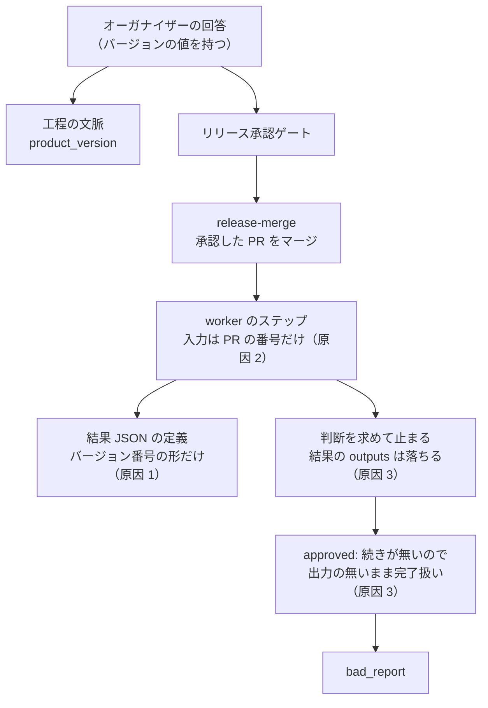
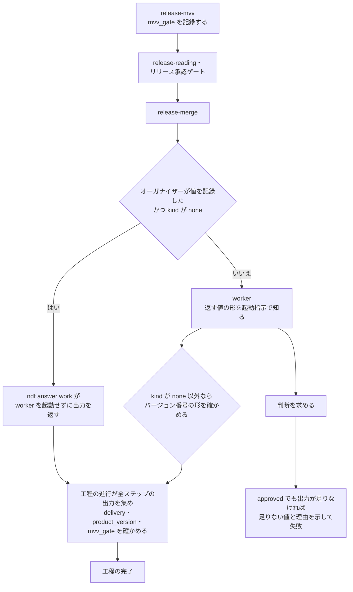
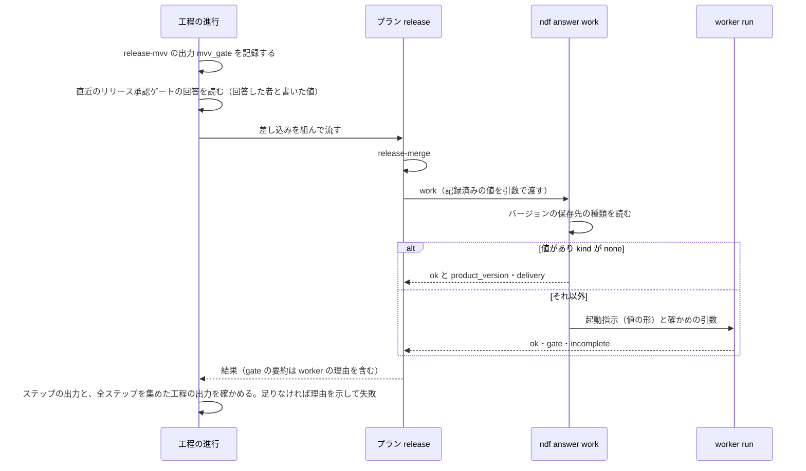

# デプロイの工程: バージョン番号を持たないリポジトリでも終わるようにする（#4513）

バージョン番号を持たないリポジトリでは、デプロイの工程が出力をそろえられず、`bad_report` を繰り返して終わらない。バージョン番号の形の確かめを、リポジトリの設定を読める層へ移し、オーガナイザーがまとめて出した後は worker を起動せずに記録済みの値で工程を終える。出力がそろわないまま承認の回答を受けたときは、足りない値と worker が判断を求めた理由を示して失敗で止める。調べたコードの事実は「今の姿」に、採らなかった案は「決定の記録」にある。

## この文書で使う言葉

NDF の開発の流れは、大きい順に次の入れ子になっている。**スプリント**（課題をまとめて要求から本番まで進める 1 回分）は**工程**（デプロイなど）を順に通る。工程は**ステップ**を順に流す。ステップの 1 つが**プラン**（コマンドを順に流す定義）を呼ぶ。デプロイの工程は `release-mvv`・`release-reading`・`release-gate`・`release` の 4 ステップで、`release-reading` は承認資料を読み手の立場で確かめる。`release` がプラン `release` を呼び、プランは `release-merge`（承認した PR のマージ）と `work`（出す作業）を流す。

| 言葉 | 意味 |
| --- | --- |
| conductor | スプリントを進める AI の会話。承認や判断の求めを受けて回答する |
| 並列の計画・レーン・オーガナイザー | 並列の計画は複数のスプリントを同時に進める仕組みで、流れの 1 本がレーン、全体をまとめる conductor がオーガナイザーである。オーガナイザーが複数のレーンの変更を一度に出すことを「まとめたリリース」と呼ぶ |
| ステートマシン・事象・文脈 | ステートマシンはスプリントの進み具合の保存先。起きたこと（回答・出力）を事象として追記する。文脈は工程どうしで渡す値の集まり |
| 工程の進行 | ステートマシンを読んでステップを順に呼ぶコード（`progress/run.py`・`progress/invoke.py`） |
| MVV 判定 | 承認ゲートの前に、プロジェクトの判断基準（MVV）に照らして人の承認を省けるかを AI が判定する処理。結果が出力 `mvv_gate` で、ステップ `release-mvv` が記録する |
| 差し込み | プランのテンプレートの `{{名前}}` を、実行時に置き換える値。実行の保存先の `values.json` に残る |
| `ndf answer work` | プランが出す作業で呼ぶコマンド（`progress/gate/entry.py`）。起動指示を書いてから `ndf worker run` に置き換わる |
| `ndf worker run` | worker（作業を 1 つ受け持つ AI）を起動し、worker が書いた結果ファイルを確かめて結果 JSON を返すコマンド（`core/worker.py`） |

## 今の姿

何が起きたか・目的・受け入れ条件は要求仕様（[issue-4513-requirements.md](./issue-4513-requirements.md)、正は #4513 の本文）にある。この文書は「どう解くか」と「なぜその解き方か」だけを書く。



根本原因は次の 3 つである。どれか 1 つを直しても、工程は止まったままになる。

| # | 原因 | 場所 |
| --- | --- | --- |
| 1 | 結果 JSON の `outputs.product_version` が、リポジトリの設定に関係なくバージョン番号の形を求める。工程の文脈の定義は空でない文字列を受け付ける | `contracts/schemas/result.schema.json` |
| 2 | オーガナイザーが記録した値は工程の文脈に入るが、worker には PR の番号しか渡らない。worker は何を返すべきか、もう出たのかを知らない | `contracts/worker/kinds.json`・`contracts/templates/release.json` |
| 3 | worker が判断を求めた後の `approved` は、続きのステップが無いとプランの完了になる。判断を求めた結果には、worker が結果ファイルに書いた `outputs` が引き継がれないので、完了しても出力が無い（受け入れ条件 9 は今のコードでは成り立たない）。出力が規約に合わないときの誤りには、足りない値の名前も worker の理由も出ない。プランの結果の要約からも worker の理由が落ちる | `core/worker_outcome.py`・`progress/invoke.py`・`progress/run.py`・`core/plan/transition_decide.py` |

同じ形の確かめは、リリース後テストの記録のスキーマ（`release-verification.schema.json` の `version`）にもある。`ndf records close-check` は、このスキーマに合わない記録を読まない。そのため、バージョン番号を持たないリポジトリは課題を閉じる判定でも止まる。

## 文脈と制約

- バージョン番号を持たないリポジトリは、`branch_strategy.release.version_store.kind: none` のリポジトリである（要求の前提 1）
- デプロイの工程は、出力の `delivery`・`product_version`・`mvv_gate` の 3 つがそろわないと完了にならない（工程の定義の `outputs`。`check_stage_output` で確かめた）。`product_version` だけを返しても終わらない
- 工程の定義は、ステートマシンを作成した時点の内容がスプリントに保存される。定義に入力を足しても、進行中のスプリントには効かない
- 結果 JSON のスキーマはリポジトリの設定を読めない
- バージョン番号を持つリポジトリの確かめは緩めない（受け入れ条件 8）

## 解き方の全体像



- デプロイの工程が完了に要る 3 つの出力のうち、`mvv_gate` は承認の前のステップ `release-mvv` が記録する。`delivery` と `product_version` は `release` ステップ（`ndf answer work` か worker）が返す。工程の進行は全ステップの出力を集めてから 3 つがそろうかを確かめる（この集め方と確かめは今のまま変えない）
- 結果 JSON は `product_version` に空白だけでない文字列を受け付ける。バージョン番号の形は、`ndf worker run` がリポジトリの設定を見て確かめる
- `kind: none` でオーガナイザーが出した後は、スクリプトが記録済みの値を返す。出すための worker は起動しない
- 出力の足りない承認は、どの工程でも同じ層が理由を組み立てる

## 構成要素

| 要素 | 責務（変えること） |
| --- | --- |
| 結果 JSON の定義（`result.schema.json`） | `product_version` は空白だけでない文字列を受け付ける。バージョン番号の形は `$defs` の別の定義として 1 か所に置く |
| リリース後テストの記録の定義（`release-verification.schema.json`） | `version` は空白だけでない文字列を受け付ける |
| デプロイのプランのテンプレート（`release.json`・`params.json`） | worker のステップへ、記録済みの値を渡す差し込みを足す |
| 工程の進行（`progress/invoke.py`・`progress/run.py`） | 直近のリリース承認ゲートの回答がオーガナイザーの承認なら、その回答が書いた `product_version` を差し込みに入れる（選び方は「記録済みの値の読み方」）。出力の足りない承認の失敗の理由を組み立てる |
| 工程の定義の読み手（`progress/definition.py`） | ステップの出力の規約が `outputs` に必須とするキーの名前を返す |
| worker の起動（`progress/gate/entry.py`） | バージョンの保存先の種類を読む。記録済みの値で終えるか worker を起動するかを決め、返す値の形を起動指示と確かめの引数に入れる |
| worker の結果の確かめ（`core/worker.py`・`core/worker_outcome.py`） | 指定されたときだけ、`product_version` がバージョン番号の形かを確かめ、違えば欠けにする。判断を求めた結果（`gate`）にも、確かめを通った必須の `outputs` を引き継ぐ |
| プランの遷移（`core/plan/transition_decide.py`・`runner.py`） | 承認ゲートで終わる結果の要約に、止まったステップの要約を含める |
| 手順書と定義の説明（`kinds.json`・`context.schema.json`・`release`・`release-verification`・`progress-tracking`） | バージョン番号を持たないリポジトリの `product_version` は、出したものを指す値であると書く |

## 入出力のコントラクト

| 名前 | 変わる点 | 失敗の形 | 互換性 |
| --- | --- | --- | --- |
| 結果 JSON の `outputs.product_version` | バージョン番号の形でない文字列も受け付ける | 空文字列と空白だけの文字列は形の誤り | 今受け付ける値はそのまま通る |
| `ndf answer work` | 任意の引数 `--released-version <値>` を足す。省くか空なら今と同じ | バージョンの保存先を読めないときは、バージョン番号を持つ扱いにする | 引数を渡さない呼び出しは変わらない |
| `ndf worker run` | バージョン番号の形を確かめる任意の引数を足す。結果ファイルが `gate` のときも、必須の `outputs` のうち確かめを通った値を結果の `outputs` に載せる | `ok` の結果の違う形は、名前が `product_version` の欠け（`incomplete`）。`gate` の結果の無い値と違う形の値は載せず、`gate` のままにする | バージョン番号の形の引数が無ければ形は確かめない |
| 工程の失敗の理由（`bad_report`） | 承認の回答の後の誤りは、足りない値の名前（決め方は決定 4）・worker が判断を求めた理由の要約・次の操作を含む | 終了の仕方と停止理由の種類は変わらない | 文だけが変わる |
| リリース後テストの記録の `version` | バージョン番号の形でない文字列も受け付ける | 空白だけは形の誤り | 今受け付ける値はそのまま通る |

記録済みの値で終えるとき、`ndf answer work` が返す出力は次の 2 つである。3 つ目の `mvv_gate` は返さない（`release-mvv` が記録済み）。

| キー | 値 |
| --- | --- |
| `product_version` | オーガナイザーが `--version` で渡した値のまま |
| `delivery` | 下の規則で決める JSON オブジェクト 1 つ |

`delivery` は、設定の配列 `branch_strategy.release.deliveries` から本番に届く要素を選んで決める。本番に届く要素は、`channel` が `production` か、省略か `null` の要素である（承認資料の `forms_decide.deliveries_of` が本番チャネルを選ぶ条件と同じ）。配列の順番は使わない。

| 本番に届く要素の数 | `outputs.delivery` |
| --- | --- |
| 1 つ | その要素をそのまま返す |
| 0（配列が無い・空を含む）か 2 つ以上 | 次のオブジェクトを返す。4 つの値はすべて固定で、設定やリリースの記録から読まない |

```json
{"target": "まとめたリリース", "kind": "manual", "trigger": "オーガナイザーのリリース", "versioned": false}
```

要素が 2 つ以上のとき、どれに出したかはリリースの記録から分からないので、1 つを選んで記録しない。

## 処理の流れ



### 記録済みの値の読み方

回答には 2 種類ある。リリース承認ゲート（ステップ `release-gate`）への回答と、worker が判断を求めたこと（ステップ `release`）への回答である。記録済みの値は前者だけから読む。後者の回答は、新しくても読み飛ばす。

1. デプロイの工程の事象 `answered` のうち、`kind` が `listen` で `gate` が `release` の最後の 1 件を選ぶ
2. その回答の `answer` が `approved` で、回答した者（`by`）が `organizer` であることを確かめる
3. 同じトランザクションで直後に書かれた出力の事象（事象の番号が回答の次で、同じ工程のもの）の `product_version` を読む。`answered` の事象そのものは値を持たない
4. 2 か 3 が成り立たないか、値が空白だけなら、記録済みの値は無いものとする（worker を起動する）

打ち直し（retry）でも、実行の保存先の `values.json` に残った値は使わず、この手順で読み直してこの差し込み 1 つを上書きする。直す前の NDF で止まったスプリントも、NDF を更新して retry すれば記録済みの値で終わる。

## 決定の記録

### 決定 1: バージョン番号を持つリポジトリの確かめを残すため、形の確かめを結果の定義から worker の結果の確かめへ移す

- **質問**: バージョン番号の有無による値の確かめを、どこで行うか
- **選んだ案**: 結果 JSON の定義は空白だけでない文字列を受け付ける。`ndf answer work` がバージョンの保存先の種類を読み、`none` 以外なら `ndf worker run` へ形の確かめを指示する。形の正規表現は今のものを結果のスキーマの `$defs` に残す。保存先の設定を読めないときは確かめる。起動指示にも返す値の形を 1 行で書く
- 採らなかった案: 結果の定義を緩めるだけにする（バージョン番号を持つリポジトリで `ndf v11.0.0` のような値が文脈に入る）
- 採らなかった案: `ndf contracts emit` が、実行された場所の設定を読む（結果を書くコマンドは、結果の形だけを見る部品である。実行する場所もリポジトリとは限らない）
- 採らなかった案: 工程の出力の確かめで見る（`ndf progress finish` で手で終える経路まで厳しくなる。要求の対象範囲の外を変える）
- **代償**: worker は結果を書く時点では形の誤りを知らされない。起動指示の 1 行で知らせ、誤れば欠けとして工程が止まる
- 根拠: Value 4 / Value 11（MVV バージョン 11）

### 決定 2: 出したものをもう一度出さないため、まとめたリリースの後は worker を起動せずにスクリプトが出力を返す

- **質問**: オーガナイザーが出した後のデプロイの工程で、worker に何をさせるか
- **選んだ案**: 次の 2 つがそろえば、`ndf answer work` が worker を起動せずに ok の結果を返す。条件は、バージョンの保存先が `none` であることと、直近のリリース承認ゲートの回答がオーガナイザーの承認で、空白だけでない `product_version` を書いていることである。`release-merge` は残す（マージ済みなら何もしない）
- 採らなかった案: 記録済みの値を worker の入力に足し、手順書で「もう出さずに返す」と指示する（判断の要らない手順でも、LLM に任せると同じ入力で判断を求めて止まることがある。受け入れ条件 1・2 を毎回は満たせない）
- 採らなかった案: デプロイのプランごと飛ばす（承認した PR がマージされていない場合を拾えない）
- 採らなかった案: バージョン番号を持つリポジトリでも worker を起動しない（そのリポジトリの手順を変えることになる。要求の対象範囲の外である）
- **代償**: オーガナイザーが出した後に、レーンごとの確かめや後処理を worker がすることは無くなる。確かめはリリース後テストで行う
- 根拠: Value 3 / Value 2（MVV バージョン 11）

### 決定 3: 進行中のスプリントにも効かせるため、記録済みの値は工程の入力でなくプランの差し込みで渡す

- **質問**: 記録済みの値を、何を通して `ndf answer work` へ渡すか
- **選んだ案**: 工程の進行が、リリース承認ゲートの回答から差し込みの値を入れる。承認した HEAD とマージ先（`approved_head`・`approved_base`）と同じく、承認の記録を出所にする。値は、その回答と一緒に文脈へ書いた `product_version` で、回答した者がオーガナイザーのときだけ入れる（「記録済みの値の読み方」）
- 採らなかった案: 工程の定義の `optional_inputs` に `product_version` を足す（定義はスプリントに保存される。止まっているスプリントには効かない）
- 採らなかった案: 文脈に `product_version` があれば記録済みとみなす（やり直す前のデプロイが書いた値でも、人が承認した回に worker を飛ばしてしまう）
- **代償**: 工程の進行が、承認の回答の中身を 1 つ多く読む
- 根拠: Value 3（MVV バージョン 11）

### 決定 4: 利用者が次の操作を判断できるように、出力の足りない承認の理由を全工程で共通の層が組み立てる

- **質問**: 受け入れ条件 6・7 を、デプロイの工程だけで直すか、共通の層で直すか
- **選んだ案**: 承認の回答を渡した後の出力が規約に合わないときは、工程の進行の共通の層が理由を組み立てる。理由には次の 2 つを入れる。1 つは、足りない値の名前である。出力の確かめは 2 段あるので、失敗した段の必須キーから数える（下の表）。もう 1 つは、回答を待っていた結果の要約である。この要約に worker の理由が残るように、プランが承認ゲートで終わるときは、結果の要約に止まったステップの要約を含める。工程は失敗のままで、自動の打ち直しはしない

  | 失敗した段 | 足りない値の名前 |
  | --- | --- |
  | ステップの出力の確かめ（`release` ステップは規約 `release-result`） | その規約が必須とするキーのうち、そのステップの結果に無いもの。`release-result` なら `product_version` だけで、先のステップが返す `mvv_gate` は数えない |
  | 全ステップを集めた工程の出力の確かめ | 工程の `outputs` のキーのうち、どのステップの出力にも無いもの。先のステップが返した値は数えない |

- 採らなかった案: デプロイの工程の名前で分けて理由を組む（同じ欠けは、出力を求めるどの工程にもある）
- 採らなかった案: 出力の足りない `approved` を受け付けず、回答の時点で断る（承認ゲートの待ちが残る。conductor は同じ質問に回答し続ける）
- 採らなかった案: worker が判断を求めた後の `approved` で worker をもう一度起動する（同じ判断の求めが conductor の操作なしに出し直される。受け入れ条件 7 に反する）
- **あわせて直すこと**: 値がそろった判断の求めに `approved` と回答して完了できるように、`ndf worker run` は `gate` の結果にも確かめを通った `outputs` を引き継ぐ。今は落とすので、値を書いた worker の判断の求めも `bad_report` になる。バージョン番号の形の確かめは `gate` の値にも当たり、違う形の値は引き継がない
- **代償**: 承認ゲートで終わるプランの要約が長くなる。ほかの工程の失敗の文も変わる
- 根拠: Value 7 / Value 1（MVV バージョン 11）

### 決定 5: 課題を閉じる判定が止まらないように、リリース後テストの記録の `version` の形を緩める

- **質問**: デプロイより後で、バージョン番号の形を求める読み手をどう扱うか
- **選んだ案**: リリース後テストの記録の `version` は空白だけでない文字列にする。`verification-record` はリリース記録の `version` と一致する記録だけを書くので、一致の確かめは残る
- 採らなかった案: `close-check` が設定を読んで形を分ける（`close-check` の判定は `issues` だけを使う。`version` の形は判定に効かない）
- 採らなかった案: プランが前のリリースの結果を参照する仕組みの `version`（`core/refs`）も緩める（NDF のテンプレートはこの参照を使わない。値の形を問わず読む参照は、`key: product_version` を指定した `plan_result` が既にある）
- **代償**: バージョン番号を持つリポジトリでも、`v` の前置きのある記録がスキーマを通る。`verification-record` はリリース記録との不一致で止めるが、手で書いたコメントはスキーマでは落ちない
- 根拠: Value 4（MVV バージョン 11）

## 影響と危険

- **働く範囲**: NDF を使うすべてのリポジトリ。worker を飛ばすのは `version_store.kind: none` のリポジトリのまとめたリリースだけである
- **プロジェクトごとに違うもの**: バージョン番号の有無は設定の `release.version_store.kind` で受ける。出したものを指す値は、オーガナイザーの `--version` か worker の返り値で受ける。`kind` が `none` なら、空白だけでなければ形は問わない。`none` 以外と、設定を読めないときは、バージョン番号の形を求める
- **当たるモード**: デプロイの工程を持つモード。出力の足りない承認の理由の文は、すべての工程に当たる
- **壊れうる箇所**: オーガナイザーが出していないのに `released` と記録すると、工程はその値で完了する。違いはリリース後テストが拾う。承認した PR が未マージなら、`release-merge` が今と同じくマージする
- **壊れうる箇所**: 結果 JSON の定義を緩める。そのため、`product_version` を書く経路が worker の確かめを通らないと、形が守られない。NDF の中で書くほかの経路（バージョンアップの組み立てと `release-steps`）は、バージョンの保存先から値を作る

### 代表のリポジトリでの振る舞い

| 代表のリポジトリ | 設定の要点 | 直した後に起きること | この種類で扱えなくなること |
| --- | --- | --- | --- |
| Web サービス | `version_store.kind` は `none` かタグ・ファイル | `none` はデプロイの工程が出したものを指す値で終わる。ほかは今と同じくバージョン番号の形を確かめる | 無し |
| モバイルアプリ | `version_store.kind: pubspec` などでバージョン番号を持つ | 確かめは今と同じ。出力の足りない承認の理由だけが詳しくなる | 無し |
| 業務文書だけ | `version_store.kind: none` | デプロイの工程が、提出先を指す値などで終わる | 無し |

### ai-plugins だけの事情

- 無し（ai-plugins はバージョンの保存先が `plugin` で、確かめは今と同じである）

## テスト設計

| 受け入れ条件 | どの振る舞いで縛るか | どう壊したら落ちるべきか |
| --- | --- | --- |
| 1 | `none` の設定で、オーガナイザーが `main abc1234` を記録した後のデプロイの工程が完了し、文脈の `product_version` が同じ値で、`delivery` と、`release-mvv` が記録した `mvv_gate` も文脈にある | 差し込みに記録済みの値を入れないと落ちる。`release-mvv` の出力を集めないと落ちる |
| 2 | 同じ流れで worker が 1 回も起動されない | worker を起動してから値を返すように壊すと落ちる |
| 3 | `none` の設定で worker が短いハッシュを返すと、工程が完了しその値が `product_version` になる | 結果の定義の形を戻すと落ちる |
| 4 | バージョン番号の形でない `product_version` で、リリース後テストと体裁レビューの入力が組め、`close-check` が記録を読み、`release_record` の条件が真になる | 記録の定義の `version` の形を戻すと落ちる |
| 5 | 空文字列と空白だけの `product_version` の結果が形の誤りになる | 定義を任意の文字列にすると落ちる |
| 6 | 出力の無い判断の求めに `approved` と回答すると、失敗の理由に `product_version` と worker の要約が含まれる | プランの要約からステップの要約を落とすと落ちる |
| 7 | 失敗の後、`ndf progress next` を打っても worker が起動されず、同じ失敗を返す | `bad_report` で自動の打ち直しを入れると落ちる |
| 8 | `none` 以外の設定で worker が `ndf v11.0.0` を返すと、工程は完了にならない。設定を読めないときも同じ | 確かめの引数を渡さないと落ちる |
| 9 | worker の結果ファイル（`gate` で `delivery`・`product_version` を持つ）を `ndf worker run` に通した後の `approved` で、工程が完了する | `gate` の結果で `outputs` を落とすと落ちる |
| 8・9 | `none` 以外の設定で、`gate` の結果ファイルの `product_version` が `ndf v11.0.0` なら、`approved` の後も工程は完了にならない | `gate` の値をバージョン番号の形の確かめなしに引き継ぐと落ちる |
| 決定 2 | 配列の先頭が `channel: base` の要素で、次が `production` の要素なら、`delivery` は後者になる。本番に届く要素が 0 か 2 つ以上なら、固定のオブジェクトになる | 配列の 1 番目を返すと落ちる |
| 決定 3 | 利用者か MVV 判定が承認した回では、文脈に前の `product_version` が残っていても worker が起動される | 文脈の値の有無だけで判定すると落ちる |
| 決定 3 | 直す前の差し込みの値が実行の保存先に残っていても、retry で記録済みの値が入る。履歴は、直す前の NDF でオーガナイザーが承認し、worker の判断の求めに conductor が `approved` と回答し、`bad_report` で失敗した順にする | 残った値をそのまま使うと落ちる。最後の `answered`（判断の求めへの回答）を読むと落ちる |

## 設計の結果

詳細設計は別ファイルにする（新設する関数が 2 つ以上あり、シグネチャを変える関数があるため）。

| 課題 | 扱い | 統合先 | 触るファイル |
| --- | --- | --- | --- |
| #4513 | 実装する | — | `plugins/ndf/contracts/schemas/result.schema.json`、`plugins/ndf/contracts/schemas/release-verification.schema.json`、`plugins/ndf/contracts/templates/release.json`、`plugins/ndf/contracts/templates/params.json`、`plugins/ndf/contracts/worker/kinds.json`、`plugins/ndf/contracts/workflow/context.schema.json`、`plugins/ndf/src/ndf/progress/invoke.py`、`plugins/ndf/src/ndf/progress/run.py`、`plugins/ndf/src/ndf/progress/definition.py`、`plugins/ndf/src/ndf/progress/gate/entry.py`、`plugins/ndf/src/ndf/core/worker.py`、`plugins/ndf/src/ndf/core/worker_outcome.py`、`plugins/ndf/src/ndf/core/plan/transition_decide.py`、`plugins/ndf/src/ndf/core/plan/runner.py`、`plugins/ndf/skills/release/SKILL.md`、`plugins/ndf/skills/release-verification/SKILL.md`、`plugins/ndf/skills/progress-tracking/SKILL.md`、`plugins/ndf/tests/progress/test_run.py`、`plugins/ndf/tests/progress/test_invoke.py`、`plugins/ndf/tests/progress/gate/test_gate_work.py`、`plugins/ndf/tests/progress/gate/test_gate_release.py`、`plugins/ndf/tests/progress/test_sprint_templates.py`、`plugins/ndf/tests/core/test_worker_outcome.py`、`plugins/ndf/tests/core/plan/test_transition.py`、`plugins/ndf/tests/contracts/test_result.py` |

## 未確認のまま残ること

| 項目 | 内容 |
| --- | --- |
| 問題が起きたリポジトリで、手作業なしにデプロイの工程が終わるか | そのリポジトリの設定と進行中のスプリントはここから読めない。リリース後テストで利用者が確かめる |

## 外部の調査

省く: NDF の中の取り決め（結果 JSON の形・工程の進行・プランの遷移）だけで形が決まり、外部の標準・製品・ライブラリの判断が要らない
