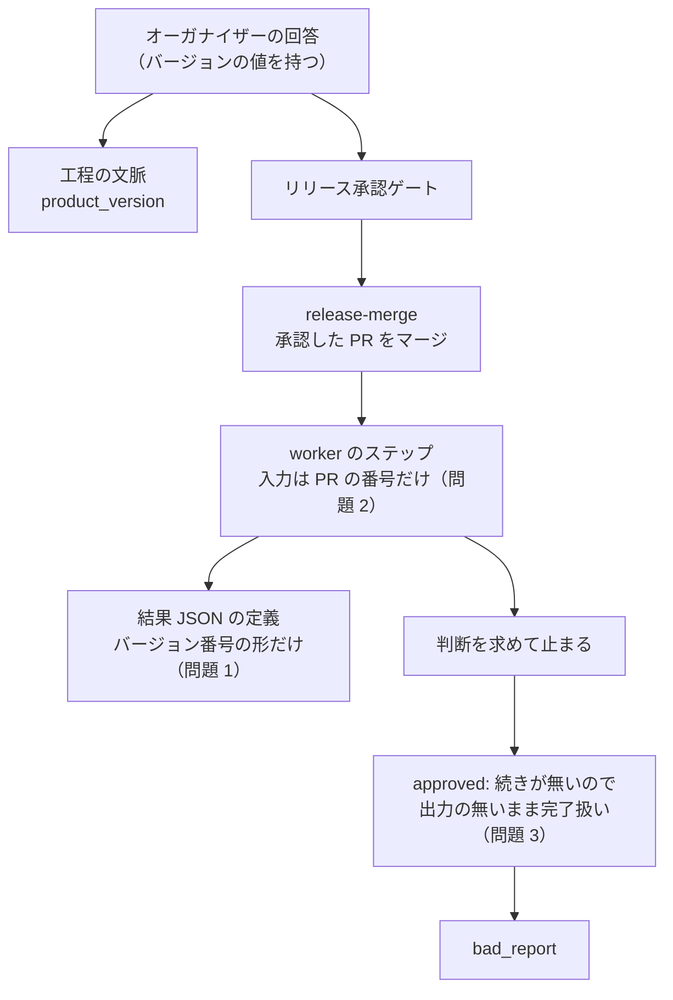
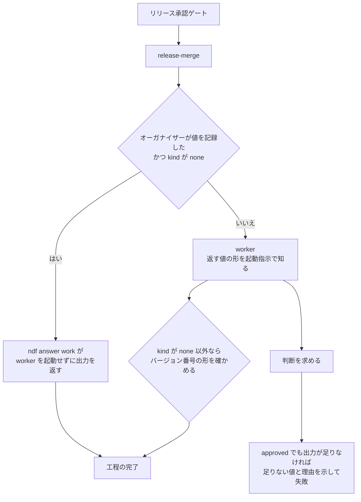
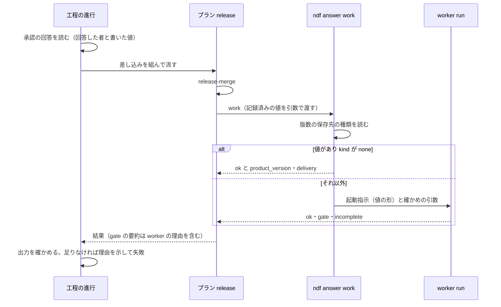

# デプロイの工程: バージョン番号を持たないリポジトリでも終わるようにする（#4513）

バージョン番号を持たないリポジトリでは、デプロイの工程が出力をそろえられず、`bad_report` を繰り返して終わらない。バージョン番号の形の確かめを、リポジトリの設定を読める層へ移し、オーガナイザーがまとめて出した後は worker を起動せずに記録済みの値で工程を終える。出力がそろわないまま承認の回答を受けたときは、足りない値と worker が判断を求めた理由を示して失敗で止める。調べたコードの事実は「今の姿」に、採らなかった案は「決定の記録」にある。

## 今の姿

何が起きたか・目的・受け入れ条件は要求仕様（[issue-4513-requirements.md](./issue-4513-requirements.md)、正は #4513 の本文）にある。この文書は「どう解くか」と「なぜその解き方か」だけを書く。

根本原因は次の 3 つである。どれか 1 つを直しても、工程は止まったままになる。

| # | 原因 | 場所 |
| --- | --- | --- |
| 1 | 結果 JSON の `outputs.product_version` が、リポジトリの設定に関係なくバージョン番号の形を求める。工程の文脈の定義は空でない文字列を受け付ける | `contracts/schemas/result.schema.json` |
| 2 | オーガナイザーが記録した値は工程の文脈に入るが、worker には PR の番号しか渡らない。worker は何を返すべきか、もう出たのかを知らない | `contracts/worker/kinds.json`・`contracts/templates/release.json` |
| 3 | worker が判断を求めた後の `approved` は、続きのステップが無いとプランの完了になる。出力の規約の誤りは、足りない値の名前も worker の理由も持たない。プランの結果の要約からも worker の理由が落ちる | `progress/invoke.py`・`progress/run.py`・`core/plan/transition_decide.py` |

同じ形の確かめは、リリース後テストの記録のスキーマ（`release-verification.schema.json` の `version`）にもある。`ndf records close-check` はこのスキーマに合わない記録を読まないので、バージョン番号を持たないリポジトリは課題を閉じる判定でも止まる。

## 文脈と制約

- バージョン番号を持たないリポジトリは、`branch_strategy.release.version_store.kind: none` のリポジトリである（要求の前提 1）
- デプロイの工程の出力は、`delivery`・`product_version`・`mvv_gate` の 3 つがそろわないと完了にならない（工程の定義の `outputs`。`check_stage_output` で確かめた）。`product_version` だけを返しても終わらない
- 工程の定義は、ステートマシンの作成の時点の内容がスプリントに保存される。定義に入力を足しても、進行中のスプリントには効かない
- 結果 JSON のスキーマはリポジトリの設定を読めない
- バージョン番号を持つリポジトリの確かめは緩めない（受け入れ条件 8）

## 解き方の全体像

- 結果 JSON は `product_version` に空白だけでない文字列を受け付け、バージョン番号の形は `ndf worker run` がリポジトリの設定を見て確かめる
- `kind: none` でオーガナイザーが出した後は、スクリプトが記録済みの値を返す。出すための worker は起動しない
- 出力の足りない承認は、どの工程でも同じ層が理由を組み立てる

## 構成要素

| 要素 | 責務（変えること） |
| --- | --- |
| 結果 JSON の定義（`result.schema.json`） | `product_version` は空白だけでない文字列を受け付ける。バージョン番号の形は `$defs` の別の定義として 1 か所に置く |
| リリース後テストの記録の定義（`release-verification.schema.json`） | `version` は空白だけでない文字列を受け付ける |
| デプロイのプランのテンプレート（`release.json`・`params.json`） | worker のステップへ、記録済みの値を渡す差し込みを足す |
| 工程の進行（`progress/invoke.py`・`progress/run.py`） | 今の承認がオーガナイザーの回答なら、その回答が書いた `product_version` を差し込みに入れる。出力の足りない承認の失敗の理由を組み立てる |
| 工程の定義の読み手（`progress/definition.py`） | 出力の規約が `outputs` に求めるキーの名前を返す |
| worker の起動（`progress/gate/entry.py`） | 版数の保存先の種類を読む。記録済みの値で終えるか worker を起動するかを決め、返す値の形を起動指示と確かめの引数に入れる |
| worker の結果の確かめ（`core/worker.py`・`core/worker_outcome.py`） | 指定されたときだけ、`product_version` がバージョン番号の形かを確かめ、違えば欠けにする |
| プランの遷移（`core/plan/transition_decide.py`・`runner.py`） | 承認ゲートで終わる結果の要約に、止まったステップの要約を含める |
| 手順書と定義の説明（`kinds.json`・`context.schema.json`・`release`・`release-verification`・`progress-tracking`） | バージョン番号を持たないリポジトリの `product_version` は、出したものを指す値であると書く |

## 入出力のコントラクト

| 名前 | 変わる点 | 失敗の形 | 互換性 |
| --- | --- | --- | --- |
| 結果 JSON の `outputs.product_version` | バージョン番号の形でない文字列も受け付ける | 空文字列と空白だけの文字列は形の誤り | 今受け付ける値はそのまま通る |
| `ndf answer work` | 任意の引数 `--released-version <値>` を足す。省くか空なら今と同じ | 版数の保存先を読めないときは、バージョン番号を持つ扱いにする | 引数を渡さない呼び出しは変わらない |
| `ndf worker run` | バージョン番号の形を確かめる任意の引数を足す | 違う形は、名前が `product_version` の欠け（`incomplete`） | 引数が無ければ確かめない |
| 工程の失敗の理由（`bad_report`） | 承認の回答の後の誤りは、足りない値の名前・worker が判断を求めた理由の要約・次の操作を含む | 終了の仕方と停止理由の種類は変わらない | 文だけが変わる |
| リリース後テストの記録の `version` | バージョン番号の形でない文字列も受け付ける | 空白だけは形の誤り | 今受け付ける値はそのまま通る |

記録済みの値で終えるときの出力は次の 2 つである。

| キー | 値 |
| --- | --- |
| `product_version` | オーガナイザーが `--version` で渡した値のまま |
| `delivery` | 設定の `release.deliveries` の 1 行目。行が無ければ、手で届けた行（`target` はまとめたリリース、`kind: manual`、`trigger` はオーガナイザーのリリース、`versioned: false`） |

## 処理の流れ

打ち直し（retry）では、実行の保存先に残った差し込みの値でなく、今の承認の回答から記録済みの値を入れ直す。直す前の NDF で止まったスプリントも、NDF を更新して retry すれば記録済みの値で終わる。

## 決定の記録

### 決定 1: バージョン番号を持つリポジトリの確かめを残すため、形の確かめを結果の定義から worker の結果の確かめへ移す

- **質問**: バージョン番号の有無による値の確かめを、どこで行うか
- **選んだ案**: 結果 JSON の定義は空白だけでない文字列を受け付ける。`ndf answer work` が版数の保存先の種類を読み、`none` 以外なら `ndf worker run` へ形の確かめを指示する。形の正規表現は今のものを結果のスキーマの `$defs` に残す。保存先の設定を読めないときは確かめる。起動指示にも返す値の形を 1 行で書く
- 採らなかった案: 結果の定義を緩めるだけにする（バージョン番号を持つリポジトリで `ndf v11.0.0` のような値が文脈に入る）
- 採らなかった案: `ndf contracts emit` が打った場所の設定を読む（結果を書くコマンドは結果の形だけを見る部品で、打つ場所もリポジトリとは限らない）
- 採らなかった案: 工程の出力の確かめで見る（`ndf progress finish` で手で終える経路まで厳しくなり、要求の対象範囲の外を変える）
- **代償**: worker は結果を書く時点では形の誤りを知らされない。起動指示の 1 行で知らせ、誤れば欠けとして工程が止まる
- 根拠: Value 4 / Value 11（MVV バージョン 11）

### 決定 2: 出したものをもう一度出さないため、まとめたリリースの後は worker を起動せずにスクリプトが出力を返す

- **質問**: オーガナイザーが出した後のデプロイの工程で、worker に何をさせるか
- **選んだ案**: 版数の保存先が `none` で、今の承認の回答がオーガナイザーのもので `product_version` を書いていれば、`ndf answer work` が worker を起動せずに ok の結果を返す。`release-merge` は残す（マージ済みなら何もしない）
- 採らなかった案: 記録済みの値を worker の入力に足し、手順書で「もう出さずに返す」と指示する（判断の要らない手順を LLM に任せると、同じ入力でも判断を求めて止まることがある。受け入れ条件 1・2 を毎回は満たせない）
- 採らなかった案: デプロイのプランごと飛ばす（承認した PR がマージされていない場合を拾えない）
- 採らなかった案: バージョン番号を持つリポジトリでも worker を起動しない（そのリポジトリの手順を変えることになり、要求の対象範囲の外である）
- **代償**: オーガナイザーが出した後に、レーンごとの確かめや後処理を worker がすることは無くなる。確かめはリリース後テストが持つ
- 根拠: Value 3 / Value 2（MVV バージョン 11）

### 決定 3: 進行中のスプリントにも効かせるため、記録済みの値は工程の入力でなくプランの差し込みで渡す

- **質問**: 記録済みの値を、何を通して `ndf answer work` へ渡すか
- **選んだ案**: 工程の進行が、承認した HEAD とマージ先（`approved_head`・`approved_base`）と同じく、今の承認の回答から差し込みの値を入れる。値は、その回答と一緒に文脈へ書いた `product_version` で、回答した者がオーガナイザーのときだけ入れる
- 採らなかった案: 工程の定義の `optional_inputs` に `product_version` を足す（定義はスプリントに保存されるので、止まっているスプリントに効かない）
- 採らなかった案: 文脈に `product_version` があれば記録済みとみなす（やり直す前のデプロイが書いた値でも、人が承認した回に worker を飛ばす）
- **代償**: 工程の進行が、承認の回答の中身を 1 つ多く読む
- 根拠: Value 3（MVV バージョン 11）

### 決定 4: 利用者が次の操作を判断できるように、出力の足りない承認の理由を全工程で共通の層が組み立てる

- **質問**: 受け入れ条件 6・7 を、デプロイの工程だけで直すか、共通の層で直すか
- **選んだ案**: 工程の進行の共通の層で、承認の回答を渡した後の出力が規約に合わないとき、出力の規約が求めるキーのうち無いものの名前と、待っていた結果の要約を理由に入れる。待っていた結果の要約に worker の理由が残るように、プランが承認ゲートで終わる結果の要約へ、止まったステップの要約を含める。工程は失敗のままで、自動の打ち直しはしない
- 採らなかった案: デプロイの工程の名前で分けて理由を組む（同じ欠けは、出力を求めるどの工程にもある）
- 採らなかった案: 出力の足りない `approved` を受け付けず、回答の時点で断る（承認ゲートの待ちが残り、conductor は同じ質問に回答し続ける）
- 採らなかった案: worker が判断を求めた後の `approved` で worker をもう一度起動する（同じ判断の求めが conductor の操作なしに出し直され、受け入れ条件 7 に反する）
- **代償**: 承認ゲートで終わるプランの要約が長くなる。ほかの工程の失敗の文も変わる
- 根拠: Value 7 / Value 1（MVV バージョン 11）

### 決定 5: 課題を閉じる判定が止まらないように、リリース後テストの記録の `version` の形を緩める

- **質問**: デプロイより後で、バージョン番号の形を求める読み手をどう扱うか
- **選んだ案**: リリース後テストの記録の `version` は空白だけでない文字列にする。`verification-record` はリリース記録の `version` と一致する記録だけを書くので、一致の確かめは残る
- 採らなかった案: `close-check` が設定を読んで形を分ける（`close-check` の判定は `issues` だけを使い、`version` の形は判定に効かない）
- 採らなかった案: プランの参照の `version`（`core/refs`）も緩める（NDF のテンプレートはこの参照を使わない。値の形を問わず読む参照 `plan_result` が `key: product_version` で既にある）
- **代償**: バージョン番号を持つリポジトリでも、`v` の前置きのある記録がスキーマを通る。`verification-record` はリリース記録との不一致で止めるが、手で書いたコメントはスキーマでは落ちない
- 根拠: Value 4（MVV バージョン 11）

## 影響と危険

- **働く範囲**: NDF を使うすべてのリポジトリ。worker を飛ばすのは `version_store.kind: none` のリポジトリのまとめたリリースだけである
- **プロジェクトごとに違うもの**: 版数の有無は設定の `release.version_store.kind` で受ける。出したものを指す値は、オーガナイザーの `--version` か worker の返り値で受け、形は問わない
- **当たるモード**: デプロイの工程を持つモード。出力の足りない承認の理由の文は、すべての工程に当たる
- **壊れうる箇所**: オーガナイザーが出していないのに `released` と記録すると、工程はその値で完了する。違いはリリース後テストが拾う。承認した PR が未マージなら、`release-merge` が今と同じくマージする
- **壊れうる箇所**: 結果 JSON の定義を緩めるので、`product_version` を書く経路が worker の確かめを通らないと形が守られない。NDF の中で書くほかの経路（版上げの組み立てと `release-steps`）は、版数の保存先から値を作る

### 代表のリポジトリでの振る舞い

| 代表のリポジトリ | 設定の要点 | 直した後に起きること | この種類で扱えなくなること |
| --- | --- | --- | --- |
| Web サービス | `version_store.kind` は `none` かタグ・ファイル | `none` はデプロイの工程が出したものを指す値で終わる。ほかは今と同じくバージョン番号の形を確かめる | 無し |
| モバイルアプリ | `version_store.kind: pubspec` などでバージョン番号を持つ | 確かめは今と同じ。出力の足りない承認の理由だけが詳しくなる | 無し |
| 業務文書だけ | `version_store.kind: none` | デプロイの工程が、提出先を指す値などで終わる | 無し |

### ai-plugins だけの事情

- 無し（ai-plugins は版数の保存先が `plugin` で、確かめは今と同じである）

## テスト設計

| 受け入れ条件 | どの振る舞いで縛るか | どう壊したら落ちるべきか |
| --- | --- | --- |
| 1 | `none` の設定で、オーガナイザーが `main abc1234` を記録した後のデプロイの工程が完了し、文脈の `product_version` が同じ値である | 差し込みに記録済みの値を入れないと落ちる |
| 2 | 同じ流れで worker が 1 回も起動されない | worker を起動してから値を返すように壊すと落ちる |
| 3 | `none` の設定で worker が短いハッシュを返すと、工程が完了しその値が `product_version` になる | 結果の定義の形を戻すと落ちる |
| 4 | バージョン番号の形でない `product_version` で、リリース後テストと体裁レビューの入力が組め、`close-check` が記録を読み、`release_record` の条件が真になる | 記録の定義の `version` の形を戻すと落ちる |
| 5 | 空文字列と空白だけの `product_version` の結果が形の誤りになる | 定義を任意の文字列にすると落ちる |
| 6 | 出力の無い判断の求めに `approved` と回答すると、失敗の理由に `product_version` と worker の要約が含まれる | プランの要約からステップの要約を落とすと落ちる |
| 7 | 失敗の後、`ndf progress next` を打っても worker が起動されず、同じ失敗を返す | `bad_report` で自動の打ち直しを入れると落ちる |
| 8 | `none` 以外の設定で worker が `ndf v11.0.0` を返すと、工程は完了にならない。設定を読めないときも同じ | 確かめの引数を渡さないと落ちる |
| 9 | 出力がそろった承認ゲートの結果への `approved` で、工程が完了する | 承認の回答の後の結果を常に失敗にすると落ちる |
| 決定 3 | 利用者か MVV 判定が承認した回では、文脈に前の `product_version` が残っていても worker が起動される | 文脈の値の有無だけで判定すると落ちる |
| 決定 3 | 直す前の差し込みの値が実行の保存先に残っていても、retry で記録済みの値が入る | 残った値をそのまま使うと落ちる |

## 設計の結果

詳細設計は別ファイルにする（新設する関数が 2 つ以上あり、シグネチャを変える関数があるため）。

| 課題 | 扱い | 統合先 | 触るファイル |
| --- | --- | --- | --- |
| #4513 | 実装する | — | `plugins/ndf/contracts/schemas/result.schema.json`、`plugins/ndf/contracts/schemas/release-verification.schema.json`、`plugins/ndf/contracts/templates/release.json`、`plugins/ndf/contracts/templates/params.json`、`plugins/ndf/contracts/worker/kinds.json`、`plugins/ndf/contracts/workflow/context.schema.json`、`plugins/ndf/src/ndf/progress/invoke.py`、`plugins/ndf/src/ndf/progress/run.py`、`plugins/ndf/src/ndf/progress/definition.py`、`plugins/ndf/src/ndf/progress/gate/entry.py`、`plugins/ndf/src/ndf/core/worker.py`、`plugins/ndf/src/ndf/core/worker_outcome.py`、`plugins/ndf/src/ndf/core/plan/transition_decide.py`、`plugins/ndf/src/ndf/core/plan/runner.py`、`plugins/ndf/skills/release/SKILL.md`、`plugins/ndf/skills/release-verification/SKILL.md`、`plugins/ndf/skills/progress-tracking/SKILL.md`、`plugins/ndf/tests/progress/test_run.py`、`plugins/ndf/tests/progress/test_invoke.py`、`plugins/ndf/tests/progress/gate/test_gate_work.py`、`plugins/ndf/tests/progress/gate/test_gate_release.py`、`plugins/ndf/tests/progress/test_sprint_templates.py`、`plugins/ndf/tests/core/test_worker_outcome.py`、`plugins/ndf/tests/core/plan/test_transition.py`、`plugins/ndf/tests/contracts/test_result.py` |

## 未確認のまま残ること

| 項目 | 内容 |
| --- | --- |
| 問題が起きたリポジトリで、手作業なしにデプロイの工程が終わるか | そのリポジトリの設定と進行中のスプリントはここから読めない。リリース後テストで利用者が確かめる |

## 外部の調査

省く: NDF の中の取り決め（結果 JSON の形・工程の進行・プランの遷移）だけで形が決まり、外部の標準・製品・ライブラリの判断が要らない
