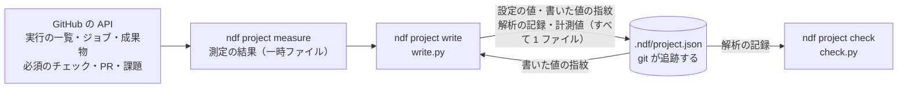
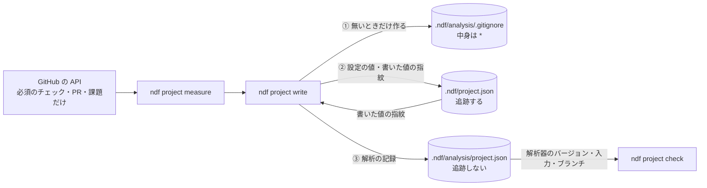
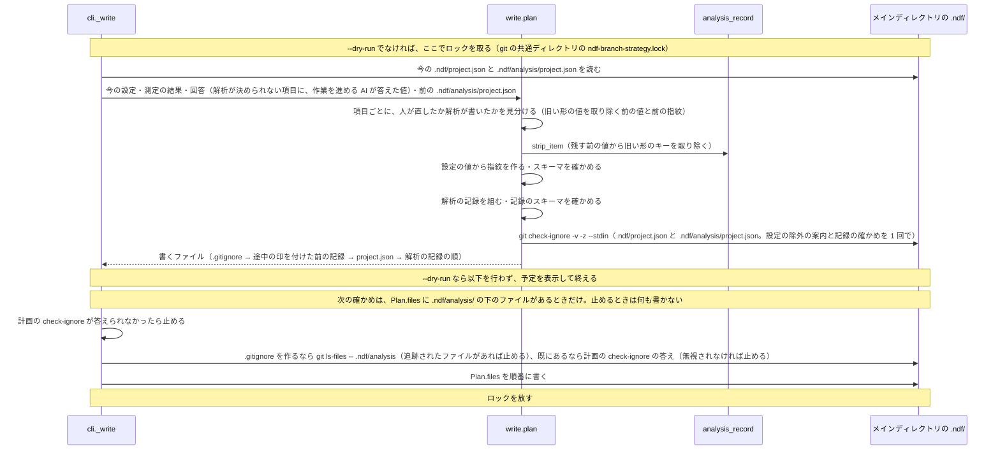

# プロジェクトの設定: 解析をやり直しても、設定の値が変わらなければ追跡するファイルに差分が出ない（#4516）

解析の書き出し（`ndf project write`）は、実行のたびに変わる値を追跡する設定 `.ndf/project.json` へ書く。そのため、設定が変わらなくても差分が出て `git pull` を止める。どの仕組みも読まない値（ファイル数・CI の実行時間とジョブ数・ワークフローの一覧・テストの所要時間・解析した時刻）は、測るのも保存するのもやめる。読む仕組みのある解析の記録だけを、中に置いた `.gitignore` でディレクトリ全体を git から外した `.ndf/analysis/project.json` へ移し、`.ndf/project.json` には設定の値と、どの値を解析が書いたかの指紋だけを残す。消す値と処理・置き場の採否は「決定の記録」に、関数の粒度は [issue-4516-design-detail.md](./issue-4516-design-detail.md) に、調べた製品は末尾の「外部の調査」にある。

## 今の姿

何が起きたか・目的・受け入れ条件は要求仕様（[issue-4516-requirements.md](./issue-4516-requirements.md)、正は #4516 の本文）にある。この文書は「どう解くか」と「なぜその解き方か」だけを書く。



`.ndf/project.json` のうち、設定の値でないもの・どの仕組みも読まない値は次のとおりである（このリポジトリの `main` の `.ndf/project.json` で確かめた）。読み手の有無は、`plugins/ndf/src`・`plugins/ndf/skills`・`plugins/ndf/hooks`・`scripts`・`experimental` を、キーの名前（`wall_seconds`・`test_duration`・`"analysis"`・`languages`・`"workflows"`・`provider`・`required_checks`）で `grep` して確かめた（テストを除く）。

| 値 | キー | 書き手 | 読み手 |
| --- | --- | --- | --- |
| 解析器のバージョン | `analysis.analyzer` | `write.plan` | `check._stale_reasons`（今の `check.ANALYZER` より古ければ「古い」） |
| 解析した時刻 | `analysis.at` | `write.plan` | 無い（`write._same_but_time` が比べる前に除くだけ） |
| 入力のファイルのハッシュ | `analysis.inputs` | `write.plan` | `check._stale_reasons`（今の HEAD と比べる） |
| ブランチの構成 | `analysis.branches` | `write.plan` | `check._stale_reasons`（今のリモートと比べる） |
| 書いた値の指紋 | `analysis.written` | `write.merge_project`・`write._declare_ci_tests` | `write.written_digests`（人が直した値か解析が書いた値かの見分け） |
| 言語ごとのファイル数 | `languages[].files` | `measure_repo.measure_languages` | 無い |
| ワークフローの一覧・ジョブ数・直近の実行時間 | `ci.workflows[].path`・`jobs`・`wall_seconds` | `measure_ci._measure_runs`。実行時間は `write._carry_walls` が前の値を引き継ぐ | 無い（`checks/model.py` の `workflows` は人が書く `toolchain.workflows` で、別の値） |
| CI の種類 | `ci.provider` | `measure_ci._measure_runs` | 無い |
| 必須のチェックの名前 | `ci.required_checks` | `measure_ci._required_checks` | `progress/refactor_values.py`・`progress/invoke.py`（リファクタリングの最終ゲート）・`merged` の手順 |
| テストの所要時間（非推奨） | `test_duration` | 今の書き出しは書かない。測定（`measure_ci._test_duration`・`ndf_record`・JUnit と step の読み取り）は今も走る | 無い |

- 入力のファイルは、解析が読むファイル（CI のワークフローの定義・`pyproject.toml` などの依存とテストの設定・指示書）で、一覧は `check.is_input` が決める。そのハッシュは HEAD のコミットの blob の ID である
- 書いた値の指紋は、項目の値全体から作る。そのため、ファイル数や実行時間が変わると `languages`・`ci` の指紋も変わり、計測値の揺れが指紋の差分としても出る
- `measure_repo.measure_languages` は、言語の並びをファイル数の多い順に並べる。ファイル数を書かなくても、数の順位が入れ替わると並びが変わって差分が出る
- 解析は、ワークフローの実行時間とジョブ数とテストの所要時間のために、GitHub の API で次を呼ぶ: 直近 50 件の成功の実行の一覧（1 回）・ワークフローごとに最大 5 件の実行のジョブ（ワークフローの本数 × 最大 5 回）・テストの結果の成果物の一覧と ZIP の取得（最大 50 MB）。このリポジトリのワークフローは 15 本ある
- NDF が書くファイルの一覧（`plugins/ndf/contracts/domains/ndf-files.json`。保存先のディレクトリの定義は `locations.json` が持つ）の行 `project-measured` は、計測値をリポジトリの外の状態の保存先（`~/.local/state/ndf/measured/<リポジトリ>/project.json`）に置くと定めるが、書くコードは無い。この場所 `measured` を使う行はほかに無い

## 文脈と制約

- 書き出しは、clone した元のディレクトリ（worktree でない側。以下メインディレクトリ）の `.ndf/` に書く。worktree から打っても同じ位置になる（`check.repo_dirs` が返すメインディレクトリ）
- `.ndf/project.json` は利用者の設定のファイルで、それを変える Pull Request は取り込む前に人が確かめる（NDF の共通原則の C7）。書き出しそのものは「コミットしない限り取り消せる」ので承認を求めない、と `project-analysis.md` が定めている
- このリポジトリの方針（MVV）の Value 4「普及のフェーズに入るまで、後方互換は求めない」に従い、旧い形を読む仕組みを持たない。次の書き出しが新しい形へ移す
- 利用者の指示「使われない情報を取得・保存する必要はないです」（2026-11-25、設計承認ゲート）に従い、読み手の無い値は測らず、保存しない。読み手の有無は上の表で決める
- `ndf project branch-strategy` は `.ndf/project.json` のセクション `branch_strategy` だけを書く。解析の書き出しはこのセクションを変えない
- スキーマは `plugins/ndf/contracts/schemas/ndf-settings/project.schema.json` が正である。`plugins/ndf/skills/development-workflow/schemas/project.schema.json` はバイト単位で同一のコピーで、`scripts/check-ndf-contracts.py` が一致を確かめる
- 設定の説明の文書（`plugins/ndf/docs/contracts/ndf-settings.md`）とファイルの説明の文書（`files.md`）は、ファイルの一覧・保存先のディレクトリの定義・スキーマから生成する（`ndf.checks.spec_render`）。手で書かない

## 解き方の全体像



- 解析は、ファイル数・ワークフローの一覧・実行時間・ジョブ数・テストの所要時間を測らない。GitHub の API は、必須のチェック・閉じた PR・課題の 3 か所だけを呼ぶ
- `.ndf/project.json` には、設定の値と書いた値の指紋（`analysis.written`）だけが残る。`ci` は `required_checks` だけを持ち、`languages` は名前の順に並ぶ
- 解析の記録は、読む仕組みのある値（形のバージョン・解析器のバージョン・入力のファイルのハッシュ・ブランチの構成・記録に対応する設定の指紋・書き出しの途中の印）だけを `.ndf/analysis/project.json` に書く。解析した時刻は書かない。書き出しは、`.ndf/analysis/.gitignore` が無いときだけ中身 `*` で作り、ディレクトリ全体を git から外す（pytest・ruff のキャッシュと同じ形）。記録を書く前に、記録のパスが実際に git に無視されることを `git check-ignore` で確かめ、無視されなければ止まる。どの除外の設定で無視されるかは問わない
- 書き出しは、設定を書く前に前の記録へ途中の印を付け、最後に印の無い記録を書く。途中の印を付けた後に止まれば、次の判定は必ず「古い」になる。印を付ける前に止まれば、設定と記録は前のまま揃っている
- 複数の worktree から同時に書き出しても、設定と記録が別々の解析の組み合わせにならないように、書き出しは既存の設定と記録を読む前に、メインディレクトリ単位のロックを取り、最後の記録を書き終えるまで持つ。ロックは `ndf project branch-strategy` が `.ndf/project.json` を書くときのロックと同じものを使う
- `ndf project check` は `.ndf/analysis/project.json` の解析の記録で判定する。無い・読めないときは「古い」と判定し、開発の作業の始めの手順に解析をやり直させる。記録に対応する設定の指紋が今の `.ndf/project.json` と合わないとき（設定だけを `git restore` で戻したときなど）も「古い」と判定する
- 既存の `.ndf/project.json` に残る旧い形のキーも「古い」と判定し、次の書き出しが取り除く。項目ごとに人が直したか解析が書いたかは、値を取り除く前の値のハッシュを前の指紋と比べて見分ける

## ドメインモデル

### コンテキスト

| コンテキスト | この範囲で意味が 1 つに決まる語 |
| --- | --- |
| プロジェクトの設定（`ndf-project-settings`） | 設定・解析・解析の記録・書いた値の指紋・測った値 |

### 集約

| 集約 | 書き換えてよい主体 | 集約ルート | エンティティ | 値オブジェクト |
| --- | --- | --- | --- | --- |
| 設定 | 人と解析の書き出し（人が直した値は解析が書き換えない） | `.ndf/project.json` | 項目（`languages`・`test`・`ci` など） | 書いた値の指紋（`analysis.written`） |
| 解析の記録 | 解析の書き出しだけ（人は書かない） | `.ndf/analysis/project.json` | 無し | 入力のファイルのハッシュ・ブランチの構成・対応する設定の指紋・途中の印 |

### 不変条件

| # | 集約 | 条件 | 破れたときの扱い |
| --- | --- | --- | --- |
| I1 | 設定 | 書き出しの後、`.ndf/project.json` に `analysis` の `written` 以外のキー・`languages[].files`・`ci.workflows`・`ci.provider`・`test_duration` が無い | 書き出しがスキーマの検査（`additionalProperties`）で止まる |
| I2 | 設定 | 解析は読み手の無い値を測らない。`ndf project measure` の結果に、ファイル数・ワークフローの一覧・実行時間・ジョブ数・テストの所要時間が無く、GitHub の API は `rules/branches`・`pulls`・`issues` だけを呼ぶ | テストが落ちる |
| I3 | 設定 | 解析が書いたかの見分けは、旧い形の値を取り除く前の値と前の指紋で行う（移行の 1 回目に、解析が書いた値を人が直した値と取り違えない） | テストが落ちる |
| I4 | 解析の記録 | 書き出しが `.ndf/analysis/` の下へ書くとき、記録のパスは git に無視され、追跡されていない（`git check-ignore` が記録のパスを否定でない除外の行に当たったと答える。`.gitignore` を作る回は、追跡されたファイルが無いことを確かめて `*` を書くことで満たす）。無視の出所は問わない（`.ndf/analysis/.gitignore`・ルートの `.gitignore`・`.git/info/exclude`・利用者の `core.excludesFile` のどれでもよい）。`.gitignore` を作るときは、`.ndf/analysis/` の下に追跡されたファイルが無い（`git ls-files` が終了コード 0 で出力が空）。書き出しは、どのファイルを書くよりも前にこれらを確かめる。既存の `.gitignore` の中身だけでは信じない（空のファイル・独自のパターンでほかの除外も無いとき・追跡済みの記録では、外れない）。git が確かめられない（`git ls-files` の終了コードが 0 でない・`git check-ignore` の終了コードが 0 でも 1 でもない）ときも止まる | 書き出しが既存のファイルを変えずに止まる（終了コード 1） |
| I5 | 解析の記録 | 解析の記録が無い・読めない（不正な UTF-8 を含む）・形が違うとき、判定は「古い」である（「壊れている」にしない） | テストが落ちる |
| I6 | 設定 | `.ndf/project.json` に旧い形のキーが残っているとき、判定は「古い」で、書き出しはそのキーを取り除いてから形を確かめる（旧い形を「壊れている」にしない） | テストが落ちる |
| I7 | 解析の記録 | 書き出しが設定か記録を書き換えるときは、先に前の記録へ途中の印（`pending: true`）を付け、最後に印の無い記録を書く。印の付いた記録を、判定は「古い」とする | テストが落ちる |
| I8 | 解析の記録 | 記録は読み手のあるキー（`version`・`analyzer`・`inputs`・`branches`・`written_digest`・`pending`）だけを持つ | 書き出しが記録のスキーマの検査で止まる |
| I9 | 解析の記録 | 記録の `written_digest` が、今の `.ndf/project.json` の書いた値の指紋（`analysis.written`）から作った値と違うとき、判定は「古い」である | テストが落ちる |
| I10 | 解析の記録 | 書き出しは、既存の設定と記録を読む前にメインディレクトリ単位のロックを取り、最後の記録を書き終えるまで放さない。別の書き出しは、その間の設定と記録を読まず、書かない | テストが落ちる |

### ドメインイベント

番号は要求仕様のドメインイベントを引き継ぐ。

| # | イベント | 発生元 | 受け手 |
| --- | --- | --- | --- |
| E1 | 設定が古くなっていないかを確かめた | `check.judge` | 開発の作業の始めの手順。NDF の開発の手順（`development-workflow` の Skill の手順 0）が `ndf project check` を打ち、終了コード 3 なら同じ手順が `ndf project measure` と `ndf project write` を打って解析をやり直す |
| E2 | リポジトリと CI を測った | `ndf project measure` | `ndf project write` |
| E3 | `.ndf/analysis/` を git から外す `.gitignore` を置き、記録のパスが無視されることを確かめた | `write.plan` → `cli._write` | git |
| E4 | 前の記録に途中の印を付け、設定を書き出した | `write.plan` → `cli._write` | 次の E1（途中の印）・次の E4（書いた値の指紋） |
| E5 | 解析の記録を書き出した（途中の印を消した） | `write.plan` → `cli._write` | 次の E1 |

## 構成要素

| 要素 | 責務 |
| --- | --- |
| `analysis_record.py`（新設） | 解析の記録の形を持つ。旧い形のキーを設定から取り除く・記録を読む |
| `measure_ci.py`（変更） | `ci` を必須のチェックだけにする。実行の一覧・ジョブ・成果物の取得と、テストの所要時間の測定を消す |
| `measure_repo.py`（変更） | 言語の行からファイル数を外し、並びを名前の順にする |
| `write.py`（変更） | 設定の値を決め、解析の記録を組み、`.gitignore`・途中の印を付けた前の記録・`.ndf/project.json`・解析の記録を書く計画を作る。実行時間の引き継ぎを消す |
| `check.py`（変更） | 設定が古くなっていないかを、`.ndf/project.json` でなく `.ndf/analysis/project.json` の解析の記録から判定する。作業場所を解決する `repo_dirs` が、メインディレクトリと一緒に git の共通ディレクトリも返す |
| `items.py`（変更） | 書いた値の指紋を作る `value_digest` を `write.py` から移し、`write` と `analysis_record` が共用する |
| `strategy_write.py`（変更） | 解決済みの git の共通ディレクトリからロックのパスを作る `lock_file` を足す |
| `cli.py`（変更） | 測定の結果からテストの所要時間を外す。書き出しの入力に前の解析の記録を足す。既存の設定と記録を読む前にロックを取り、最後の記録を書くまで持つ。記録を書く前に、記録のパスが git に無視されることを確かめる。`.ndf/analysis/` の下のファイルは差分でなく要約で表示する |
| ロックの待ちの上限（変更） | `plugins/ndf/contracts/limits/branch-strategy.write-lock.json` の `read_by` に `ndf.domains.project.cli` を足し、summary を「`.ndf/project.json` を書くロックの待ちの上限。ブランチ戦略の書き込みと解析の書き出しが共有する」へ直す。上限の 30 秒は変えない |
| 設定のスキーマ（変更） | `analysis` を `written` だけにし、`languages[].files`・`ci.workflows`・`ci.provider`・`test_duration` と、それだけが使う定義（`TestDuration` など）を外す |
| 解析の記録のスキーマ（新設） | `plugins/ndf/contracts/schemas/internal/project-analysis.schema.json` |
| ファイルの一覧と保存先のディレクトリの定義（変更） | 保存先の表（`locations.json`）の項目 `measured` を消し、項目 `analysis`（リポジトリの `.ndf/analysis`・追跡しない）を足す。ファイルの表（`ndf-files.json`）の行 `project-measured` を消し、行 `project-analysis`（記録）と `project-analysis-ignore`（`.gitignore`）を足す。表の summary の「実行で変わる計測値は…状態の保存先へ書く」を、「読み手の無い計測値は保存しない。解析の記録は追跡しない保存先へ書く」へ直す |
| 確定仕様（変更） | 消した振る舞いだけを書いた `docs/specifications/project-decl-ci-representative-run.md` を消し、`docs/specifications/README.md` の行も消す |

## データ構造

解析の記録のファイル（`.ndf/analysis/project.json`。コードとスキーマの名前は `analysis_record`・`project-analysis`）の形:

```json
{
  "version": 1,
  "analyzer": 4,
  "inputs": {".github/workflows/pytest.yml": "2187b0d3…", "pyproject.toml": "3634277f…"},
  "branches": {"head": "main", "present": ["develop", "main"]},
  "written_digest": "9f2c41aa…"
}
```

残すキーと読み手:

| キー | 型 | 必須 | 中身 | 読み手 |
| --- | --- | --- | --- | --- |
| `version` | 整数（1） | 必須 | 形のバージョン | `analysis_record.load`（記録のスキーマの検査。形が違えば「古い」） |
| `analyzer` | 整数 | 必須 | 解析器のバージョン（`check.ANALYZER`。測る項目を変えるので 3 から 4 へ上げる） | `check._stale_reasons` |
| `inputs` | パス → blob の ID の表 | 必須 | 入力のファイルのハッシュ（`check.inputs`） | `check._stale_reasons` |
| `branches` | `{head, present}` | 必須 | ブランチの構成（`check.branch_state`） | `check._stale_reasons` |
| `written_digest` | 文字列（SHA-256 の 16 進） | 必須 | 記録に対応する設定の指紋。書き出しの後の `.ndf/project.json` の `analysis.written` を、キーを並べた JSON（`json.dumps(…, sort_keys=True, separators=(",", ":"), ensure_ascii=False)`）にして取ったハッシュ。書いた値の指紋と同じ関数（`items.value_digest`）で取る。`analysis.written` が無ければ `{}` から取る（I9） | `check.judge`（今の設定から作った値と違えば「古い」） |
| `pending` | 真偽値（`true` だけ） | 任意 | 書き出しの途中の印（I7） | `check.judge`（在れば「古い」） |

記録に対応する設定の指紋を、設定のファイル全体でなく `analysis.written` から作るのは、人が値を直したときや `ndf project branch-strategy` がセクション `branch_strategy` を書いたときに「古い」と判定しないためである。そうした変更は解析の書いた値を変えないので、解析をやり直しても結果は同じである。設定だけを `git restore` で以前の状態へ戻すと、解析が書いた値と一緒に `analysis.written` も戻るので、記録の指紋と合わなくなり「古い」と判定される。

書かないキー（読み手が無い）: 解析した時刻（`at`）・ファイル数・実行時間・ジョブ数・テストの所要時間。

`.ndf/project.json` の変わる箇所:

| キー | 今 | 変えた後 |
| --- | --- | --- |
| `analysis` | `{analyzer, at, inputs, branches, written?}` | `{written?}` |
| `languages[]` | `{name, frameworks, files, version?}`、ファイル数の多い順 | `{name, frameworks, version?}`、名前の順 |
| `ci` | `{provider, workflows: [{path, jobs, wall_seconds?}], required_checks?}` | `{required_checks?}` |
| `test_duration` | 非推奨（書かれない。残っていれば読める） | スキーマから消す。残っていれば次の書き出しが取り除く |

`?` は省略できるキーである。今のスキーマでも `analysis.written`（既定は `{}`）と `ci.required_checks`（既定は `[]`）は省略でき、変えた後も省略できるままにする。必須にしない理由は、旧い形のキーを取り除くと、この 2 つを省いた今の有効な設定が `analysis: {}`・`ci: {}` になるためである。必須にすると、`check.load` が取り除いた後の形を確かめた時点で「壊れている」（終了コード 2）と判定し、移行（I6）ができない。

- 書き出しは `analysis` を必ず `{"written": …}` の形で書く（指紋が 1 つも無ければ `{"written": {}}`）
- `ci` が人の値（前の指紋が無いか、前の指紋と一致しない）で `required_checks` を持たなければ、取り除いた後の `{}` を人の値として残す。今の実装も、指紋が無いか一致しない `ci` を人の値として残している

書き出しは、`.ndf/analysis/` の下へ何かを書くときだけ、どのファイルを書くよりも前に、記録が git に無視されることを確かめる。`.ndf/analysis/` の下へ書くときとは、`write.plan` が返す書くファイルに、`.gitignore`・途中の印・記録のどれか 1 つでも入っているときである（`.gitignore` だけの場合も含む）。止めるときは、どのファイルも書かないので、作業ツリーは書き出しの前のままである。

`.ndf/analysis/.gitignore` は、無いときだけ作る。既にあれば変えない。中身は `# NDF の解析が書く記録。コミットしない` と `*` の 2 行である。既にあるファイルは、あることだけでは記録が無視されるとはみなさない。git の起動を増やさないため、設定が除外されているかを調べる `write.plan` の `git check-ignore -v -z --stdin`（前からある 1 回）に記録のパスも渡し、その答えを使う。出力は NUL 区切りの (出所, 行, パターン, パス) の組で読む。出所のパス（`core.excludesFile` など）にコロンがあっても、パターンの先頭の `!` を読み違えないためである。確かめる手順は次のとおりで、手順 1 は `--dry-run` では行わない。

0. まず、計画の `git check-ignore -v -z --stdin` が答えたかを見る。終了コードが 0 でも 1 でもない（git が記録のパスを扱えない。`.ndf/analysis` が別の場所へのシンボリックリンクのときなど）なら、`.gitignore` を作る回も作らない回も、何も書かずに止める
1. `.gitignore` が無いときは、作る前に、メインディレクトリで `git ls-files -- .ndf/analysis` を 1 回打つ。`.gitignore` を作るのは、終了コードが 0 で、かつ標準出力が空のときだけである。このときは手順 2 の判定（記録が除外の行に当たったか）を使わない。同じディレクトリの `.gitignore` は、ルートの `.gitignore`・`.git/info/exclude`・利用者の `core.excludesFile` より優先される（[gitignore](https://git-scm.com/docs/gitignore)）ので、追跡していない記録は作った `*` で必ず無視されるためである
   - 終了コード 0 で出力が空でない（追跡されているファイルが 1 つでもある）ときは、`.gitignore` を作らずに止める。利用者が追跡していた `.ndf/analysis/.gitignore` を作業ツリーで消した状態を、NDF が作り直して打ち消さないためである（作り直すと、生成した `.gitignore` が追跡されたファイルの差分に入る）。追跡済みの記録もここで見つかる
   - 終了コードが 0 でない（索引を読めないなど）ときは、出力が空でも追跡の有無は分からないので、`.gitignore` を作らずに止める
2. `.gitignore` が既にあるときは、`write.plan` の `git check-ignore -v -z --stdin`（標準入力は `.ndf/project.json` と `.ndf/analysis/project.json`）の答えを使う。記録のパスが否定でない除外の行に当たって出力されていれば「無視され、かつ追跡されていない」、出力されないか、否定の行（`!` で始まるパターン）に当たって出力されていれば「無視されない（追跡済みを含む）」を表す（[git check-ignore](https://git-scm.com/docs/git-check-ignore)。`--no-index` を付けないので、追跡済みのパスは出力されない）。続けるのは無視されるときだけである
   - この答えは、`.ndf/analysis/.gitignore`・ルートの `.gitignore`・`.git/info/exclude`・利用者の `core.excludesFile` を合わせた結果である。条件にするのは、この合わせた結果（記録が実際に無視されること）である。どの除外の設定で無視されているかは問わない。記録がコミットされる差分に入らないことが目的で、それは無視の出所によらず満たされるためである
   - そのため、既存の `.ndf/analysis/.gitignore` が空でも、`.git/info/exclude` や `core.excludesFile` が記録のパスを無視していれば、書き出しは続ける
3. 手順 0〜2 のどれかで止めるときは、終了コード 1 で止まり、`.gitignore`・設定・記録のどれも書かない。理由は次のどれかを出す
   - 「`.ndf/analysis/` の下のファイルが git に追跡されている: <パス>」（手順 1 で出力が空でない）
   - 「`.ndf/analysis/project.json` が git に無視されない。`.ndf/analysis/.gitignore` の中身か、記録が追跡されていないかを確かめる」（手順 2 で記録のパスが出力されないか、否定の行に当たって出力される）
   - 「git が `.ndf/analysis/` の追跡と無視を確かめられない: <git の標準エラー出力>」（手順 0 で計画の `git check-ignore` の終了コードが 0 でも 1 でもない、または手順 1 で終了コードが 0 でない）

git の起動は、記録を更新する書き出しでは前と同じ 1 回（`write.plan` の `git check-ignore`）、`.gitignore` を作る書き出しでは `git ls-files` を足した 2 回である。書くものが無い書き出し（`write.plan` が書くファイルを 1 つも返さない）では、手順 1・2 のどちらでも止めない。この場合、記録が追跡されていても終了コード 0 で終わり、今と同じく「書くものが無い（設定は解析と同じ）」と出す。記録を書かないので、追跡されている記録に新しい中身が入ることは無い。追跡されていることは、次に `.ndf/analysis/` の下へ書く書き出しで見つかり、そこで終了コード 1 になる。

`--dry-run` は今と同じくファイルを書かずに予定を表示する。記録の無い clone では、`.gitignore` と記録を「書く予定」として示すだけにする。

確認のために、`.ndf/analysis/` の下へ書く書き出し 1 回につき git の起動が 1 回増える。`.gitignore` を作る回（記録の無い clone の最初の書き出しなど）は 2 回増える。費用を増やす理由は、記録を誤ってコミットされる差分に混ぜないこと（I4）を、利用者ごとに違う除外の設定も含めて、git 自身の判定で保証するためである。代わりの案と比べた結果は次のとおりである。

| 案 | git の起動 | 採らなかった理由・選んだ理由 |
| --- | --- | --- |
| 書き出しのたびに確かめる | 書き出し 1 回につき 1 回 | 採らない。同じ入力で打ち直して書くものが無い回にも起動が増えるが、その回は記録を書かないので確かめる意味が無い |
| `.ndf/analysis/` の下へ書くときだけ確かめる | `.ndf/analysis/` の下へ書く書き出し 1 回につき 1 回（`.gitignore` を作る回は 2 回） | 選ぶ。書くものが無い回の確認を省いても、その回は記録を書かないので、記録が差分に混ざることは無い。記録を書く回は解析をやり直した後で、測定に GitHub の API の呼び出しが 3 回あるので、1 回の起動は比べて小さい |
| `.gitignore` の中身を読み、`*` の行があれば無視されるとみなす | 0 回 | 採らない。ルートの `.gitignore` の否定のパターン・利用者の全体の除外設定（`core.excludesFile`）・追跡済みの記録を見られず、I4 を保証できない |
| gitignore の規則を Python のライブラリで再現する | 0 回 | 採らない。上と同じく、git の索引（追跡済みかどうか）と利用者ごとの設定を見られない。git の判定と食い違う所を持ち続けることになる |

## 処理の流れ



書き出しは、既存の設定と記録を読む前にロックを取り、最後の記録を書き終えてから放す（I10）。ロックが無いと、2 つの worktree（A と B）から同時に書き出したとき、次の順で設定と記録が別々の解析の組み合わせになる。

1. A が設定を書く
2. B が設定と記録を書き切る
3. A が最後の記録を書く

このとき設定は B の解析、記録は A の解析のものになる。ロックを取れば、B は A が記録を書き終えるまで設定と記録を読まないので、B の書き出しは A の結果の上に作られ、この組み合わせは起きない。

記録に対応する設定の指紋（I9）だけでも、A と B が書いた値が違えば「古い」と判定できる。それでもロックを取る理由は次の 2 つである。

- ロックが無いと、組み合わせが食い違うたびに解析が 1 回余分に走る。食い違いを起こさない方が費用が小さい
- 書き出しは `.ndf/project.json` 全体を読んでから書き直す。同じ時に `ndf project branch-strategy` がセクション `branch_strategy` を書くと、後から書いた側が先の変更を消す。これは指紋では見つからない

- ロックのファイルは、`ndf project branch-strategy` が `.ndf/project.json` を書くときと同じ `<git の共通ディレクトリ>/ndf-branch-strategy.lock`（`strategy_write.lock_file` で、解決済みの共通ディレクトリから作る）である。どちらも `.ndf/project.json` 全体を読んで書き直すので、同じロックで互いを待たせ、片方の書き込みがもう片方の変更を消さないようにする。git の共通ディレクトリはメインディレクトリと worktree で同じなので、ロックはメインディレクトリ単位になる
- 待ちの上限は、ブランチ戦略の書き込みと同じ `branch-strategy.write-lock`（30 秒）を使う。上限までに取れなければ、何も読まず書かずに終了コード 1 で止まり、「別の実行が設定を書いています。終わってから打ち直してください」と出す。開発の作業の始めの手順は、ほかの終了コード 1 と同じく「解析: できなかった」と出して先へ進む。次の作業の始めの `ndf project check` が、待たせた側の書き出しの結果で判定し直す
- `--dry-run` は何も書かないのでロックを取らない。作業場所の解決（`check.repo_dirs`）は、worktree から打ってもメインディレクトリの設定と記録で予定を作るために、`--dry-run` でも行う
- ロックのパスは、書き出しが最初に作業場所を解決したときの git の共通ディレクトリから作り、同じ解決結果で設定と記録を読む。今の書き出しも、メインディレクトリを求めるために共通ディレクトリを 1 回取っている（`check.repo_dirs`）。その値をロックにも使うので、ロックのために git の起動は増えない

書く順は `.ndf/analysis/.gitignore` → 記録のパスが無視されることの確認 → 途中の印（`pending: true`）を付けた前の記録 → `.ndf/project.json` → `.ndf/analysis/project.json`（印の無い新しい記録）である。

- `.gitignore` と確認を最初に置くのは、git に無視されない場所へ記録を書き、誤ってコミットされるのを防ぐためである（I4）
- 途中の印を設定より先に書くのは、設定か記録を書く途中で止まったとき、次の判定に必ず「古い」と言わせるためである（I7）。印が無いと、前の記録の入力が今と同じ場合に判定が「新しい」を返し、反映できなかった回答の変更が再試行されない
- 前の記録が無ければ印は書かない（記録が無いことで次の判定は「古い」になる）。設定も記録も変わらない書き出しでは、印も書かない
- 印を書いた書き出しは、必ず最後に印の無い記録を書く。記録の中身が前と同じでも書く。たとえば、同じ測定の結果で回答だけを変えると、設定だけが変わって印が付く。このとき最後の記録を省くと、成功しても印が残り、作業を始めるたびに「古い」と判定されて解析を繰り返す
- 前の記録に印が残っている（前の書き出しが途中で止まった）ときも、最後に印の無い記録を書く。同じ内容での打ち直しでも、成功すれば印が消える
- 記録が解析した時刻を持たないので、同じ入力で打ち直した書き出しは記録も変わらず、書くファイルが無くなる（今の `_same_but_time` の「時刻だけの違いを無視する」決まりは要らなくなり、消す）

途中で止まったときの状態と次の判定は次のとおりである。印を書く前に止まれば、設定と記録は前のまま揃っている。印を書いた後に止まれば、次の判定が「古い」になり、解析のやり直しで揃う。

| 止まった所 | 残る状態 | 次の `ndf project check` |
| --- | --- | --- |
| ロックを取る所（上限の 30 秒まで別の書き出しが持っていた） | この書き出しは何も変えていない。設定と記録は、ロックを持っていた書き出しの結果 | ロックを持っていた書き出しの結果で判定する。書き出しは終了コード 1 で、開発の作業の始めの手順は「解析: できなかった」と出して先へ進む。ロックを持っていた側の結果が「新しい」と判定されれば、この回の回答の変更は、次に入力が変わるか `ndf project check --force` で解析をやり直すまで反映されない（途中の印を書く所で止まったときと同じ） |
| `.gitignore` の後・無視の確認で | `.gitignore` だけが新しいか、どれも前のまま | 前の判定のまま。書き出しは終了コード 1 で、利用者が除外の設定を直す |
| 途中の印を書く所 | 設定も記録も前のまま揃っている | 前の判定のまま。書き出しは終了コード 1 で止まり、開発の作業の始めの手順は「解析: できなかった」と出して先へ進む（今と同じ。`project-analysis.md` の「3 手」の節が、measure・回答・write の手順と終了コードごとの扱いを定める）。前の判定が「新しい」なら、この回の回答の変更は、次に入力が変わるか `ndf project check --force` で解析をやり直すまで反映されない。印を書けないのは `.ndf/analysis/` に書けないときで、そのときは記録の書き込みも失敗するため、再試行の仕組みを足しても直らない |
| 途中の印の後・`.ndf/project.json` の後 | 記録に途中の印が残る | 「古い」（理由「前の書き出しが終わっていない」） |
| 前の記録が無く、`.ndf/project.json` の後 | 記録が無い | 「古い」（理由「解析の記録が無い」） |

## 決定の記録

### 決定 1: 追跡するファイルを書き換えずに解析の記録を git から外すため、`.ndf/analysis/` の中に `*` の `.gitignore` を置く

- **質問**: 解析の記録をどこに置き、どう git から外すか
- **選んだ案**: メインディレクトリの `.ndf/analysis/project.json` に置き、同じディレクトリに中身 `*` の `.gitignore` を書き出しが作る。保存先の表に項目 `analysis`（リポジトリの `.ndf/analysis`・追跡しない）を足す。中身が解析の記録だけになったので、ディレクトリの名前を計測値の意味の `measured` でなく `analysis` にする
- 採らなかった案: ファイルの一覧の今の行のとおり、リポジトリの外の状態の保存先（`~/.local/state/ndf/measured/<リポジトリ>/`）に置く（利用者の指示は「.gitignore される別ファイル」で、リポジトリの外は指示と食い違う。clone を消しても記録だけが残り、片付けの対象が増える）
- 採らなかった案: `.ndf/project.local.json` に置き、`.ndf/.gitignore` へ行を足す（理由は下の 2 つ）
  - 追跡する `.ndf/.gitignore` に差分が 1 回出て、利用者の設定の書き換え（C7）になる
  - 名前の `.local` は、`worktree.local.json` で「各自の機械の値で共有設定を上書きする個人設定」の意味で使っている。上書きしないファイルに付けると、1 語が 2 つの意味になる
- 採らなかった案: ルートの `.gitignore` に行を足す（`project-analysis.md` の「`.ndf/` の追跡」は、NDF がルートの `.gitignore` を書き換えないと定めている）
- **代償**: `.ndf/` の下にディレクトリが 1 つ増える。`git status --ignored` には `.ndf/analysis/` が出る
- 作り方: 標準に倣う（pytest・ruff のキャッシュと同じく、ディレクトリの中に `*` の `.gitignore` を置く）
- 比べた候補: STD1 / PRD1 / PRD2
- 根拠: Value 6「NDF が作業で生んだもの（ブランチ・作業ディレクトリ・状態の記録・一時ファイル）は役目を終えると自動で片付き、利用者のストレージとリポジトリの構造は常に整理された状態に保たれる」・Value 12「広く利用され、メンテナンスが活発で実績のある、著名かつ最新のものがあればそれが使われ」（MVV バージョン 11）。STD1・PRD1・PRD2

### 決定 2: 新しく clone した場所でも人が直した値と解析が書いた値を見分けるため、書いた値の指紋は `.ndf/project.json` に残す

- **質問**: 書いた値の指紋（`analysis.written`）も、解析の記録と一緒に別のファイルへ移すか
- **選んだ案**: 移さない。`.ndf/project.json` の `analysis` を `{written}` だけにする。読み手の無い値を設定から外すので、指紋は設定の値が変わったときだけ変わり、push しても問題が無い
- 採らなかった案: 指紋も移し、記録が無ければすべての値を人が直した値とみなす（新しく clone した場所では、解析が書いた値がすべて人の値になり、その後も解析が値を直せない。測った値がその場所で古いまま固まる）
- 採らなかった案: 指紋も移し、記録が無ければすべての値を解析が書いた値とみなす（人が直した値を解析が書き換える。`project-analysis.md` の「手で書いた値は変えない」を破る）
- **代償**: `.ndf/project.json` に人が書かないキー（`analysis.written`）が 1 つ残る。設定の値を変えた Pull Request では、その項目の指紋の 1 行も変わる
- 根拠: Value 3「同じ操作を打ち直しても、結果は 1 回打ったときと変わらない」（MVV バージョン 11）。指紋を設定と一緒に追跡すれば、どこで clone して書き出しても、人が直した値と解析が書いた値の見分けが同じになる

### 決定 3: 使われない情報を取得・保存しないため、読み手の無い値は測らず、どこにも書かない

- **質問**: 実行ごとに変わる計測値（ファイル数・実行時間・ジョブ数）・テストの所要時間・解析の記録のうち読み手の無い値を、別のファイルへ移すか、測るのも書くのもやめるか
- **選んだ案**: 読み手の有無で決める（「今の姿」の表）。読み手の無い値は、測るのも書くのもやめ、取得のためだけにある処理を消す。値ごとの扱いは次のとおりである
  - 言語ごとのファイル数（`languages[].files`）: 書かない。数は言語を見つけるために数え続ける（拡張子から言語を決める処理と同じ走査で、追加の費用は無い）が、結果に入れない。言語の並びはファイル数の順でなく名前の順にする（数の順位が入れ替わるだけで差分が出るのを防ぐ）
  - ワークフローの一覧・ジョブ数・直近の実行時間（`ci.workflows`）と CI の種類（`ci.provider`）: 測らず、`ci` から外す。`ci` は読み手のある `required_checks` だけにする。ワークフローの定義から数えたジョブ数も、読み手が無いので書かない（変更要求の前の版のこの設計は、定義の数だけを残すとしていた）
  - テストの所要時間（`test_duration`）: 測らない。スキーマから消し、残っていれば書き出しが取り除く
  - 解析の記録のうち解析した時刻（`at`）: 書かない。解析器のバージョン・入力のファイルのハッシュ・ブランチの構成は、判定が読むので残す
- 消す呼び出しと処理（`measure_ci.py` と `write.py`）:

  | 呼び出し・処理 | 使っていた値 | 扱い |
  | --- | --- | --- |
  | `actions/runs?status=success&per_page=50`（1 回） | ワークフローの一覧と、実行時間・ジョブ数・テストの所要時間を測る実行の選び方 | 消す |
  | `actions/runs/<id>/jobs`（ワークフローごとに最大 5 回） | CI の実行時間を測る実行の選び方・ジョブ数・テストの step の所要時間 | 消す |
  | `actions/runs/<id>/artifacts` と `actions/artifacts/<id>/zip`（最大 50 MB） | JUnit からのテストの所要時間 | 消す |
  | NDF の実行の記録の読み取り（`ndf_record`・`allocation.history_path`） | テストの所要時間 | 消す（`allocation.history_path` は cross-refactoring の作業の時間の配分の表が使い続けるので残す） |
  | ワークフローのファイルの `jobs:` の数え上げ（`workflow_jobs`・`job_ids`・`_strip_comment`） | ワークフローの一覧と定義のジョブ数 | 消す |
  | 前の実行時間の引き継ぎ（`write._carry_walls`） | 実行時間 | 消す |
  | `rules/branches/<既定ブランチ>`（1 回） | 必須のチェック | 残す |
  | `pulls?state=closed&per_page=100`（1 回） | 課題の保存先の質問（マージ先と本文のホスト名） | 残す（`ci` と共有していない） |
  | `issues?state=all&per_page=100`（1 回） | 課題の保存先の質問（GitHub Issues の数） | 残す（`ci` と共有していない） |

- 採らなかった案: 計測値を `.ndf/analysis/` のような追跡しないファイルへ移して残す（利用者の指摘「使われない情報を取得・保存する必要はないです」に反する。読み手が無いので、移しても役に立たず、測る時間と API の利用枠だけを使う）
- 採らなかった案: ワークフローの一覧と定義のジョブ数を、構成を表す設定の値として `.ndf/project.json` に残す（読み手が無い。ワークフローの一覧は `.github/workflows/` を読めば分かり、写しを持つと食い違う）
- 採らなかった案: 解析した時刻を記録に残す（読み手が無い。残すと、同じ入力で打ち直すたびに記録が書き換わる）
- **代償**: 将来、CI の実行時間やテストの所要時間を使う仕組みを作るときは、その仕組みと一緒に測る処理を作り直す。今の測り方（CI の実行時間を測る実行の選び方）は、消す確定仕様 `project-decl-ci-representative-run.md` の git の履歴に残る
- 根拠: Value 2「利用者が払う費用（LLM の token・API の利用料・CI の時間・マシンの資源）が小さい」・Value 9「まだ要らない仕組みは先回りして作らず、後から足せる土台に留める」・Value 11「重複と冗長が無い」（MVV バージョン 11）

### 決定 4: 移行のための別のコマンドを持たないため、次の書き出しが旧い形の値を取り除いて移す

- **質問**: 既存の `.ndf/project.json` に残る旧い形の値を、どう新しい形へ移すか
- **選んだ案**: 次の `ndf project write` が移す。旧い形のキーは、`analysis` の `written` 以外のすべて・`languages[].files`・`ci.workflows`・`ci.provider`・`test_duration` である
  - `ndf project check` は、旧い形のキーを見つけたら「古い」と判定し、開発の作業の始めの手順に解析をやり直させる（I6）
  - 書き出しは、項目ごとに、旧い形のキーを取り除く前の値のハッシュを前の指紋と比べる（I3）。一致すれば解析が書いた値として新しい値へ置き換え、違えば人が直した値として旧い形のキーだけを取り除いて残す
  - 前の `analysis` の値は捨て、新しい解析の値で解析の記録を作る
- NDF 自身のリポジトリ（このリポジトリ）では、実装の Pull Request の中で、追跡している `.ndf/project.json` もスキーマの変更と同じコミットで移す
  - 理由: `ndf check` の設定の形の検査（`spec-decl`）は、`check.load` を通らず、`checks/spec_docs.py` の `_real_errors` が実ファイルをスキーマで直接確かめる。このリポジトリの追跡している `.ndf/project.json` には旧い形のキーが残っているので、スキーマだけを先に厳しくすると、実装の Pull Request の CI が落ちる
  - 移し方: 追跡している `.ndf/project.json` から、`analysis_record.strip_legacy` で旧い形のキーを取り除く。あわせて `analysis.written` のうち、取り除く前の値の指紋と一致していた項目の指紋を、取り除いた後の値の指紋（`items.value_digest`）に書き直す。一致していなかった項目の指紋は変えない。これは書き出しの移行（I3）と同じ結果になる。指紋を書き直さずにキーだけを取り除くと、次の書き出しで解析が書いた項目が人の値に見えてしまう
  - 追跡している `.ndf/project.json` の移行に `ndf project write` は使わない。書き出しは worktree から打ってもメインディレクトリへ書くため、実装の Pull Request に入らない。移し方は実装の作業ディレクトリで、上の 2 つの関数を呼ぶ 1 回きりの手順として行い、スクリプトとしては残さない
  - 確かめ方: 受け入れ条件 14 を、新しくチェックアウトした場所（Pull Request の CI）の `ndf check` で確かめる。手元のメインディレクトリには利用者の未コミットの差分があり、その差分は確かめの対象にしない
  - このリポジトリの開発者への影響: この Pull Request が `main` に入ると、このリポジトリのメインディレクトリの未コミットの差分（ファイル数と `analysis` の書き直し）と、取り込む `.ndf/project.json` の変更がぶつかり、`git pull` が止まる。未コミットの差分は計測値の書き直しだけなので、開発者はそれを捨ててから取り込む（要求仕様の「含まない」の 3 つ目のとおり、片付けは開発者が行う）。NDF を使うほかのリポジトリには、この影響は無い
- 採らなかった案: 移行のコマンド（`ndf settings migrate` の改名の表の行）を足す（改名の表はキーの名前と値を改める表で、ファイルをまたいで値を移す形を持たない。解析の記録は次の解析で作り直せるので、旧い値を移す意味も無い）
- 採らなかった案: 旧い形の `analysis` も読む互換を持つ（Value 4 が互換の仕組みを求めない）
- 採らなかった案: スキーマに旧い形のキーを期限付きで残し、設定の移行をリリースの後に回す（スキーマとコードの変更と、追跡している設定の移行を同じコミットにすれば、受け入れる範囲や期限を決めなくて済む。期限を決めると、その期限に消す作業がもう 1 回要る）
- **代償**: 移行の 1 回目は判定が必ず「古い」になり、解析が 1 回走る。旧い形のキーを取り除く処理（`analysis_record.strip_legacy`）を残し続ける。消す時期は決めていない
- 根拠: Value 4「普及のフェーズに入るまで、後方互換は求めない。旧い設定の形を残す互換の仕組みを持たず、移行のコマンドできれいな最終形へ移す」（MVV バージョン 11）。この設計では、次の `ndf project write` が移行のコマンドの役を兼ねる。別のコマンドを足さないのは、解析の記録が次の解析で作り直せるためである

### 決定 5: 利用者に直させないため、解析の記録が無い・壊れているときは「古い」と判定する

- **質問**: 解析の記録が無い・読めない・形が違うとき、`ndf project check` は何を返すか
- **選んだ案**: 「古い」（終了コード 3）を返し、理由に「解析の記録が無い」か「解析の記録が読めない（<誤り>）」を出す。開発の作業の始めの手順が解析をやり直し、書き出しが記録を作り直す
- 採らなかった案: 読めない記録を「壊れている」（終了コード 2）にする（作業の始めの手順が先へ進まず、利用者に直させる。記録は人が書かないファイルで、作り直せば直る）
- **代償**: 新しく clone した場所と、記録を消した場所では、最初の作業で解析が 1 回走る。作業ごとに新しく clone する使い方では、これが clone ごとに起きる
- **費用の比べ**: 比べる相手は、今の「追跡している設定が新しい」場合である。今は、設定の中の入力のファイルのハッシュとブランチの構成が今のリポジトリと一致すれば、新しく clone した場所でも `ndf project check` だけで済む。変えた後は、clone ごとに `ndf project measure` と `ndf project write` が各 1 回走る。ただし決定 3 で測るものを減らすので、1 回の解析で呼ぶ GitHub の API は 3 回（必須のチェック・閉じた PR・課題）だけになる。今の解析は、このリポジトリ（ワークフロー 15 本）で、実行の一覧 1 回・ジョブ最大 75 回・成果物の一覧と取得を加えて呼んでいた。そのため、解析の回数は clone ごとに 1 回増えるが、解析 1 回の費用は今より小さい
- 費用を減らす代わりの案と、採らなかった理由:

| 案 | 増える費用 | 採らなかった理由 |
| --- | --- | --- |
| 入力のファイルのハッシュとブランチの構成を、今のとおり追跡する設定に残す | 増えない | ワークフローや指示書を変えるたびに設定の値が同じでも差分が出る。受け入れ条件 1 を満たさない |
| 入力のハッシュを 1 つにまとめた値だけを追跡する設定に残す | 増えない | 入力のファイルが変わるたびに 1 行の差分が出る。受け入れ条件 1 の「入力のファイルのハッシュが変わっても差分が出ない」を満たさない |
| 記録が無いときは解析せず、今の入力で記録だけを作って「新しい」とみなす（軽い判定） | 増えない | 追跡している設定が、どの入力から作られたかを確かめる材料が無い。設定が古い clone でも「新しい」と判定し、古い設定のまま作業が進む |
| 記録をリポジトリの外の状態の保存先にも置き、同じリポジトリの別の clone から引き継ぐ | 同じ機械の 2 回目以降の clone では増えない | 引き継ぐ記録が、その clone の設定に対して新しいかを確かめる材料は、結局その clone の入力である。記録の置き場が 2 か所になり、clone を消しても外の記録が残る（決定 1 の採らなかった案と同じ問題） |

- 選んだ案では、作業用に分けたディレクトリ（worktree）はメインディレクトリの記録を読むので、worktree を作るたびには解析は走らない。増えるのは clone ごとの 1 回だけである
- 根拠: Value 1「ワークフロー上の課題（再起動・告知・確認）で、利用者に操作を求めない」・Value 2「利用者が払う費用（LLM の token・API の利用料・CI の時間・マシンの資源）が小さい」（MVV バージョン 11）。Value 2 の「費用が増える仕組みを足すときは、その理由と代わりの案が示される」に従い、理由と代わりの案を上に示した

## 影響と危険

- **働く範囲**: NDF を使うすべてのリポジトリで働く。開発の作業の始めの手順で `ndf project check`・`ndf project measure`・`ndf project write` を通るとき
- **プロジェクトごとに違うもの**: 無い。置き場は保存先の表が持ち、設定も引数も足さない
- **当たるモード**: 作業の始めの手順を通るすべてのモード（`standard`・`light`・`operation`・`documentation`・`legacy-refactor`）
- **壊れうる箇所**: 移行の 1 回目に、利用者の `.ndf/project.json` に数十行の差分が出る。利用者がコミットして片付ける。この手順は、この実装で `project-analysis.md` に書き足す
- **前のバージョンの NDF との混在**: 前のバージョンのスキーマは `analysis.analyzer` などと `languages[].files` を必須にしている。そのため、前のバージョンの NDF は新しい形の `.ndf/project.json` を「壊れている」と判定する。NDF を新しいバージョンへ上げれば直る（要求仕様の「今の利用者への影響と互換」）
- **測定の結果の形**: `ndf project measure` の結果の `items` から `test_duration` が消え、`ci` の値が `{required_checks}` だけになる。結果を読むのは `ndf project write` だけである（`grep -rn "test_duration\|\"workflows\"" plugins/ndf/src` で確かめた）
- **同じファイルを触る別の変更**: 設計の時点で無い。開いた Pull Request 100 件の変更ファイルに、`write.py`・`check.py`・`cli.py`・設定のスキーマ・ファイルの表・保存先の表を触るものは無かった（`gh pr list --state open --json files`、2026-11-25）。実装の計画で確かめ直す
- **新しく clone した場所**: 最初の作業で解析が 1 回走る（決定 5 の代償と費用の比べ）。worktree はメインディレクトリの記録を読むので走らない
- **書き出しの結果の表示**: 今の `cli._print_write` は、書くファイルすべての unified diff を出す。記録をそのまま差分で出すと、記録の無い clone や壊れた記録の作り直しのたびに、入力のファイルの数だけパスとハッシュの行が出て、作業を進める AI のトークンを使う。そこで `.ndf/project.json` は今と同じく差分で出し、`.ndf/analysis/` の下のファイルは「書いた: `.ndf/analysis/project.json`（解析の記録。入力 N 件）」のような 1 行の要約だけにする（受け入れ条件 16）

### 代表のリポジトリでの振る舞い

| 代表のリポジトリ | 設定の要点 | 直した後に起きること | この種類で扱えなくなること |
| --- | --- | --- | --- |
| Web サービス | `languages`・`test`・`ci`・`services` を解析が書く | 解析の記録が `.ndf/analysis/` へ移り、計測値は書かれなくなる。`.ndf/project.json` は設定の値だけになる | 無し |
| モバイルアプリ | 同上（CI のワークフローが多く、実行時間が長い） | 同上。解析が CI の実行とジョブを取りに行かなくなり、解析が短くなる | 無し |
| 業務文書だけ | `languages` が少ない・CI が無いこともある | 同上。`ci` は必須のチェックが無ければ空の並びになる | 無し |

### このリポジトリだけの事情

| 値 | 今の状態と片付き方 | 持つ Issue |
| --- | --- | --- |
| メインディレクトリの `.ndf/project.json` にある利用者の未コミットの差分（ファイル数と `analysis` の書き直し） | 実装をリリースした後、書き出しをやり直すと旧い形の値が消え、解析の記録が移る。差分は値の削除と `analysis` の縮小だけになり、利用者がコミットする | #4516 |
| `ci` が人の値として扱われている（`analysis.written` に `ci` が無い） | `ci` の値は今後も解析が書き換えない。移行では `workflows`・`provider` だけを取り除き、`required_checks` は人の値のまま残す | 無し（今の振る舞いのまま） |

## 用語

| 用語 | 意味 | 用語集への反映 |
| --- | --- | --- |
| 解析の記録 | 解析が書く、解析をどの入力で行ったかの値（解析器のバージョン・入力のファイルのハッシュ・ブランチの構成）と、その解析が書いた設定の指紋。設定が古くなっていないかの判定が読む。git で追跡しないファイルに置く | 追加 |
| 書いた値の指紋 | 解析が書いた設定の値の SHA-256。今の値の指紋と一致すれば解析が書いた値、違えば人が直した値として扱う。設定の値が変わったときだけ変わるため、設定と一緒に追跡する | 追加 |

## テスト設計

番号は要求仕様の受け入れ条件と、上の不変条件である。

| 受け入れ条件・不変条件 | どの振る舞いで縛るか | どう壊したら落ちるべきか |
| --- | --- | --- |
| 1 | 同じ測定の結果で、入力のファイルのハッシュだけを変えて 2 回書き出すと、2 回目に `write.plan` が返す書き込み対象に `.ndf/project.json` が含まれない | 入力のハッシュを設定に残すと落ちる |
| 1 | 言語のファイル数の順位だけが入れ替わった木を 2 回測って書き出しても、`languages` の並びが変わらない | 並びをファイル数の順に戻すと落ちる |
| 2・3・I1 | 書き出した `.ndf/project.json` の `analysis` が `written` だけで、`languages[].files`・`ci.workflows`・`ci.provider`・`test_duration` が無く、`ci` が `required_checks` だけを持つ | 項目のどれかを取り除き忘れると落ちる |
| 4・I2 | `ndf project measure` の `gh` の呼び出しを差し替えて記録すると、呼ばれるパスは `rules/branches/...`・`pulls?...`・`issues?...` だけで、`actions/` で始まるパスが無い。結果の `items` に `test_duration` が無く、`languages` の行に `files` が無い | 実行の一覧・ジョブ・成果物の取得を残す・テストの所要時間を測ると落ちる |
| 5・6・7・I4・I8 | 書き出しの後、`.ndf/analysis/project.json` に `git check-ignore` が真。記録のキーは `version`・`analyzer`・`inputs`・`branches`・`written_digest`（と途中の印）だけで `at` が無い。追跡するファイルの変更は `.ndf/project.json` だけ。ルートの `.gitignore` に `!.ndf/analysis/` を書いても外れたまま | `.ndf/analysis/.gitignore` を置かない・`.ndf/.gitignore` へ書く・記録に時刻を書くと落ちる |
| 5・I4 | テストのリポジトリでは、利用者の全体の設定を読ませず（環境変数 `GIT_CONFIG_GLOBAL` を空のファイルに、`GIT_CONFIG_NOSYSTEM=1`）、`.git/info/exclude` を空にする。その上で、`.ndf/analysis/` の下へ書く書き出しで、既存の `.ndf/analysis/.gitignore` が空・`*` を含まない独自のパターン・記録が `git add -f` で追跡済み、のどれでも、書き出しは終了コード 1 で止まり、`.gitignore`・設定・記録の中身が前のまま。既存の `.ndf/analysis/.gitignore` が空でも、`.git/info/exclude` に `.ndf/analysis/` を書いてあれば、書き出しは終了コード 0 で設定と記録を書く | `.gitignore` があることだけで無視が効くとみなす・`.ndf/analysis/.gitignore` の中身だけで判定すると落ちる |
| 5・I4 | git の呼び出しを差し替え、`git ls-files` が終了コード 128 で標準出力が空のとき、書き出しは `.gitignore` を作らず、git の標準エラー出力を理由に含めて終了コード 1 で止まる。`git check-ignore` が終了コード 128 のときも、`.gitignore` の有無によらず、`.gitignore`・設定・記録を書かずに終了コード 1 で止まる | 標準出力が空なことだけで `.gitignore` を作る・終了コード 1 以外の失敗を「無視される」とみなすと落ちる |
| 5・I4 | 追跡していた `.ndf/analysis/.gitignore` を作業ツリーで消した状態で書き出すと、`.gitignore` を作らずに終了コード 1 で止まる。記録と設定が前と同じで `.gitignore` だけが消えている（書くファイルが `.gitignore` だけ）とき、記録が追跡されていなければ計画の `git check-ignore` と `git ls-files` を 1 回ずつ呼び、`.gitignore` を作って終了コード 0 で終わる。記録が追跡済みなら同じ 2 回を呼び、`.gitignore` を作らずに終了コード 1 で止まる | `.gitignore` の存在だけを見て作り直す・`.gitignore` だけの計画で確かめないと落ちる |
| 5・I4 | 記録を作った後に `git add -f` で追跡し、同じ測定の結果と回答で打ち直す（書くものが無い）と、`git ls-files` を呼ばず、計画の `git check-ignore` の答えでも止めずに、終了コード 0 で「書くものが無い」と出る（作業場所の解決・ロック・計画の `git check-ignore` は計画を作るまでに通るので、この回も打つ）。記録の無い clone で `--dry-run` を打つと、`.ndf/analysis/` の下に何も作られず、表示に `.gitignore` と記録が「書く予定」として出る | 書くものが無い回に確かめて止める・`--dry-run` で `.gitignore` を書くと落ちる |
| 8 | 記録の入力のファイルのハッシュと今の HEAD が同じなら「新しい」、入力のファイルかブランチの構成を変えるか、記録の解析器のバージョンを下げると「古い」 | 判定が `.ndf/project.json` の `analysis` を読むままだと落ちる |
| 8・I9 | 書き出しを 2 回（解析が書く値が違う測定の結果で）打ち、2 回目の後で `.ndf/project.json` だけを 1 回目の後の中身に戻すと、記録の入力とブランチの構成が今と同じでも「古い」（理由「設定が解析の記録と対応しない」）。人が解析の書いていない項目を直したときと、`branch_strategy` を書き足したときは「新しい」のまま | 記録が設定の指紋を持たない・設定のファイル全体のハッシュで比べると落ちる |
| 17・I10 | テストの中でロック（`strategy_write.lock_file` のファイル）を持ったまま、待ちの上限を 0 秒に差し替えて書き出すと、終了コード 1 で止まり、設定と記録が前のまま。書き出しがロックを取る前に設定と記録を読まない（読み込みの関数を差し替え、呼ばれた時点でロックが取られていることを確かめる）。書き出し 1 回で `check.repo_dirs` は 1 回だけ呼ばれる（呼び出しを差し替えて数える） | ロックを取らない・ロックを取る前に設定と記録を読む・ロックのために共通ディレクトリを求め直すと落ちる |
| 9・I5 | 記録が無い・JSON でない・不正な UTF-8 を含む・スキーマに合わない（`at` などの知らないキーを持つ場合を含む）とき「古い」（終了コード 3）で、理由に解析の記録が無い・読めないと出る | 「壊れている」（終了コード 2）を返す・`UnicodeDecodeError` を捕まえないと落ちる |
| 10 | 記録の無い状態で、前の指紋が一致する項目は新しい値になり、一致しない項目は残る | 記録が無いと指紋を読まない・すべてを置き換えると落ちる |
| 11・I6 | 旧い形（`analysis` の全体・`files`・`ci.workflows`・`ci.provider`・`test_duration` を持つ）の設定で、判定が「古い」（終了コード 3）を返す。`analysis.written` と `ci.required_checks` を両方省いた旧い形の設定でも同じ | 旧い形を「壊れている」にする・`written` か `required_checks` を必須にすると落ちる |
| 12・13・I3 | 11 の設定から書き出すと旧いキーが消え、旧い指紋が一致した項目は新しい値で置き換わり、一致しない項目は旧い形のキーだけを取り除いて残る。`analysis.written` と `ci.required_checks` を両方省いた旧い形の設定から書き出すと、`analysis` は `{"written": …}` になり、`ci` は人の値として `{}` が残り、書き出しは終了コード 0 | 取り除いた後の値でハッシュを比べる（解析が書いた値が人の値になる）・`written` か `required_checks` を必須にすると落ちる |
| 14 | 実装の Pull Request の CI（新しくチェックアウトした場所）で、`ndf check`（追跡している `.ndf/project.json` の形・生成した説明の文書の食い違い・スキーマのコピーの一致・確定仕様の索引のリンク）と `python3 scripts/check-skill-frontmatter.py` が通る | 追跡している設定を移さない・生成物を作り直さない・コピーを直さない・消した確定仕様への行を索引に残すと落ちる |
| 15・I7 | 前の記録の入力が今と同じ状態で、`.ndf/project.json` の書き込みか新しい記録の書き込みを失敗させると、書き出しは終了コード 1 で、次の判定が「古い」（理由「前の書き出しが終わっていない」） | 途中の印を書かない・印を判定で見ないと落ちる |
| 15・I7 | 同じ測定の結果で回答だけを変えて書き出す（設定だけが変わる）か、印の残った記録の状態で同じ内容で打ち直すと、成功の後、記録に印が無く、次の判定が「新しい」 | 記録の中身が前と同じとき最後の記録を省くと落ちる |
| 16 | 記録の無い状態で書き出すと、表示に `.ndf/project.json` の差分と、記録の 1 行の要約が出て、記録の入力のパスとハッシュの行は出ない | 記録を差分で出すと落ちる |

詳細設計は [issue-4516-design-detail.md](./issue-4516-design-detail.md) にある（新設する関数 5・置き場を移す関数 1・シグネチャを変える関数と型 5 のため別ファイルにした）。

## 設計の結果

| 課題 | 扱い | 統合先 | 触るファイル |
| --- | --- | --- | --- |
| #4516 | 実装する | — | `.ndf/project.json`、`plugins/ndf/src/ndf/domains/project/analysis_record.py`、`plugins/ndf/src/ndf/domains/project/measure_ci.py`、`plugins/ndf/src/ndf/domains/project/measure_repo.py`、`plugins/ndf/src/ndf/domains/project/write.py`、`plugins/ndf/src/ndf/domains/project/check.py`、`plugins/ndf/src/ndf/domains/project/cli.py`、`plugins/ndf/src/ndf/domains/project/items.py`、`plugins/ndf/src/ndf/domains/project/strategy_write.py`、`plugins/ndf/src/ndf/domains/project/strategy_cli.py`、`plugins/ndf/contracts/schemas/ndf-settings/project.schema.json`、`plugins/ndf/skills/development-workflow/schemas/project.schema.json`、`plugins/ndf/contracts/schemas/internal/project-analysis.schema.json`、`plugins/ndf/contracts/domains/ndf-files.json`、`plugins/ndf/contracts/domains/locations.json`、`plugins/ndf/contracts/limits/branch-strategy.write-lock.json`、`plugins/ndf/docs/contracts/ndf-settings.md`、`plugins/ndf/docs/contracts/files.md`、`plugins/ndf/skills/development-workflow/references/project-analysis.md`、`docs/specifications/project-decl-ci-representative-run.md`、`docs/specifications/README.md`、`plugins/ndf/tests/domains/project/test_project_cli.py`、`plugins/ndf/tests/domains/project/test_project_measure.py`、`plugins/ndf/tests/domains/project/test_analysis_record.py` |

## 人へ残す判断

| 判断 | 当たるレッドライン | なぜ当たるか |
| --- | --- | --- |
| 既存の `.ndf/project.json` から解析の記録・ファイル数・ワークフローの一覧・CI の種類・テストの所要時間を取り除く移行を、開発の作業の始めの書き出しが自動で行う。書き換えはメインディレクトリの未コミットの差分として残り、コミットと取り込みは利用者が行う。取り込む Pull Request で人が見る | C7 | 利用者の設定（`.ndf/`）を書き換える。解析による新しい作成ではなく、既存の項目を取り除く変更である |
| 実装の Pull Request の中で、このリポジトリの追跡している `.ndf/project.json` を新しい形へ移す（決定 4） | C7 | 利用者の設定（`.ndf/`）を書き換える。実装の中でコミットし、リリース承認ゲートで人が見る |

## 外部の調査

| 種類 | 調べるか | 理由 |
| --- | --- | --- |
| 標準・仕様 | 調べる | 追跡しないファイルの外し方（`.gitignore` の優先順位と、共有するパターンと個人のパターンの使い分け）に git の仕様がある |
| 主要な製品 | 調べる | 実行で変わるファイルをリポジトリの中に書くツールが、どう追跡から外しているかを比べる |
| ライブラリとサービス | 調べない | JSON を読み書きするだけで、既存の `ndf.domains.records.jsonfile`・`ndf.contracts` で足りる。測る処理は消す側で、新しく作らない |

### 標準・仕様

| # | 標準・仕様 | 何を定めているか | 設計への反映 | 出典 |
| --- | --- | --- | --- | --- |
| STD1 | gitignore | 下の階層の `.gitignore` のパターンが、上の階層のものに優先する（"patterns in the higher level files being overridden by those in lower level files down to the directory containing the file"）。共有するパターンは `.gitignore` に置き、clone で配る | 解析の記録のディレクトリに置いた `.gitignore` は、ルートの `.gitignore` の外さない行より優先する（受け入れ条件 7）。手元で `!.ndf/measured/` を根に書いても、下の階層の `*` で外れたままなことを確かめた（ディレクトリの名前に依らない） | https://git-scm.com/docs/gitignore （2026-11-25）・`git check-ignore -v`（git 2.53.0、2026-11-25） |

### 主要な製品

| # | 製品 | どう解いているか | 設計への反映 | 出典 |
| --- | --- | --- | --- | --- |
| PRD1 | pytest（キャッシュ `.pytest_cache/`） | キャッシュのディレクトリを作るとき、中に `# Created by pytest automatically.` と `*` の `.gitignore` と `CACHEDIR.TAG` を置き、利用者の `.gitignore` を書き換えない | 決定 1 の形（ディレクトリの中に `*` の `.gitignore` を置く） | `.venv/lib/python3.14/site-packages/_pytest/cacheprovider.py` の 49 行目（pytest 9.2.0、2026-11-25） |
| PRD2 | ruff（キャッシュ `.ruff_cache/`） | 同じく、中に `# Automatically created by ruff.` と `*` の `.gitignore` を置く | 決定 1 の形 | `/work/ai-plugins/.ruff_cache/.gitignore`（2026-11-25） |

調べた量: 候補 3 件・取得の試み 4 回。
