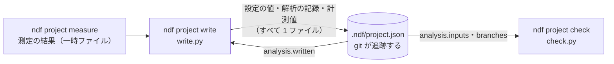
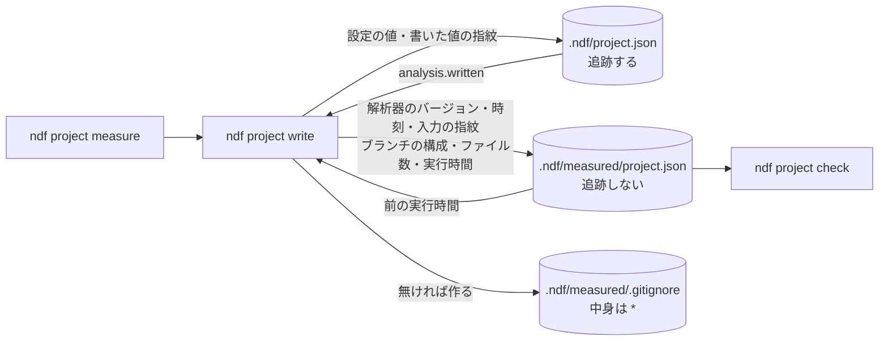
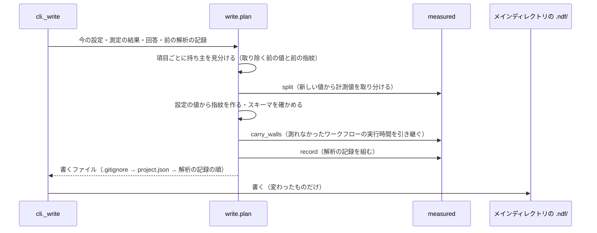

# プロジェクトの設定: 解析を打ち直しても、設定の値が変わらなければ追跡するファイルに差分が出ない（#4516）

解析の書き出し（`ndf project write`）は、実行のたびに変わる値を追跡する設定 `.ndf/project.json` へ書くため、設定が変わらなくても差分が出て `git pull` を止める。その値を、git から自分を外すディレクトリ `.ndf/measured/` の別のファイルへ移す。`.ndf/project.json` には、設定の値と、どの値を解析が書いたかの指紋だけを残す。置き場と移すキーの採否は「決定の記録」に、関数の粒度は [issue-4516-design-detail.md](./issue-4516-design-detail.md) に、調べた製品は末尾の「外部の調査」にある。

## 今の姿

何が起きたか・目的・受け入れ条件は要求仕様（[issue-4516-requirements.md](./issue-4516-requirements.md)、正は #4516 の本文）にある。この文書は「どう解くか」と「なぜその解き方か」だけを書く。



`.ndf/project.json` の中で、実行や時刻で変わる値は次の 5 つである（このリポジトリの `main` の `.ndf/project.json` で確かめた）。

| 値 | キー | 書き手 | 読み手 |
| --- | --- | --- | --- |
| 解析器のバージョン・解析した時刻・入力のファイルの指紋・ブランチの構成 | `analysis.analyzer`・`analysis.at`・`analysis.inputs`・`analysis.branches` | `write.plan` | `check.judge`（新しさの判定） |
| 書いた値の指紋 | `analysis.written` | `write.merge_project`・`write._declare_ci_tests` | `write.written_digests`（人の値か解析の値かの見分け） |
| 言語ごとのファイル数 | `languages[].files` | `measure_repo.measure_languages` | 無い |
| ワークフローごとの直近の実行時間 | `ci.workflows[].wall_seconds` | `measure_ci`・`write._carry_walls`（前の値の引き継ぎ） | 無い（引き継ぎのほか） |
| テストの所要（非推奨） | `test_duration` | 今の書き出しは書かない（スキーマで `deprecated`。`ITEM_KEYS` から外れる） | 無い |

読み手の有無は `grep -rn "wall_seconds\|test_duration\|\"analysis\"\|languages" plugins/ndf/src scripts experimental` で確かめた（テストを除く）。

- 書いた値の指紋は項目の値全体から作る。そのため、ファイル数や実行時間が変わると `languages`・`ci` の指紋も変わり、計測値の揺れが指紋の差分としても出る
- NDF のファイルの表（`plugins/ndf/contracts/domains/ndf-files.json`）の行 `project-measured` は、計測値を状態の保存先（`~/.local/state/ndf/measured/<リポジトリ>/project.json`）に置くと定めるが、書く実装は無い
- 書き出しは、測った値に変わりが無ければ `.ndf/project.json` を書かない（`_same_but_time`。時刻だけの違いを無視する）。しかし入力のファイルが 1 つでも変わると、指紋の表が変わって書く

## 文脈と制約

- 書き出しはメインディレクトリの `.ndf/` に書く。worktree から打っても同じ位置になる（`check.repo_dirs` が返すメインディレクトリ）
- `.ndf/project.json` の書き換えは利用者の設定の書き換え（共通原則 C7）に当たり、変更は承認ゲートで人が見る。書き出しは「コミットしない限り取り消せる」ので承認を求めない、と `project-analysis.md` が定めている
- 普及のフェーズまで後方互換を求めない（MVV の Value 4）。旧い形を読む仕組みを持たず、次の書き出しが新しい形へ移す
- `ndf project branch-strategy` は `.ndf/project.json` のセクション `branch_strategy` だけを書く。解析の書き出しはこのセクションを書かない（変えない）
- スキーマは `plugins/ndf/contracts/schemas/ndf-settings/project.schema.json` が正で、`plugins/ndf/skills/development-workflow/schemas/project.schema.json` は 1 バイトも違わない写し（`scripts/check-ndf-contracts.py` の `SCHEMA_COPIES` が確かめる）
- 設定の契約文書（`plugins/ndf/docs/contracts/ndf-settings.md`）とファイルの契約文書（`files.md`）は、表とスキーマから生成する（`ndf.checks.spec_render`）。手で書かない

## 解き方の全体像



- `.ndf/project.json` には、設定の値と書いた値の指紋（`analysis.written`）だけが残る。指紋は計測値を除いた値から作るので、設定の値が変わったときだけ変わる
- 解析の記録（解析器のバージョン・時刻・入力の指紋・ブランチの構成・言語ごとのファイル数・ワークフローごとの実行時間）は `.ndf/measured/project.json` に書く。同じディレクトリに中身 `*` の `.gitignore` を置き、ディレクトリごと git から外す（pytest・ruff のキャッシュと同じ形）
- `ndf project check` は `.ndf/measured/project.json` で新しさを判定する。無い・読めないときは「古い」として解析を打ち直させる
- 既存の `.ndf/project.json` に残る解析の記録・計測値・テストの所要（旧い形のキー）は、判定が「古い」と読み、次の書き出しが取り除く。持ち主の見分けは取り除く前の値で行う

## ドメインモデル

### コンテキスト

| コンテキスト | 何の語が 1 つの意味に決まるか |
| --- | --- |
| プロジェクトの設定（`ndf-project-settings`） | 設定・解析・解析の記録・書いた値の指紋・測った値 |

### 集約

| 集約 | オーナー（書き換えてよいもの） | 根 | エンティティ | 値オブジェクト |
| --- | --- | --- | --- | --- |
| 設定 | 人と解析の書き出し（人の値は解析が書き換えない） | `.ndf/project.json` | 項目（`languages`・`test`・`ci` など） | 書いた値の指紋（`analysis.written`） |
| 解析の記録 | 解析の書き出しだけ（人は書かない） | `.ndf/measured/project.json` | 無し | 入力の指紋・ブランチの構成・ファイル数の表・実行時間の表 |

### 不変条件

| # | 集約 | 条件 | 破れたときの扱い |
| --- | --- | --- | --- |
| I1 | 設定 | 書き出しの後、`.ndf/project.json` に解析器のバージョン・時刻・入力の指紋・ブランチの構成・ファイル数・実行時間・テストの所要のキーが無い | 書き出しがスキーマの検査（`additionalProperties`）で止まる |
| I2 | 設定 | 書いた値の指紋は、計測値を取り除いた値から作る。設定の値が同じなら指紋も同じ | テストが落ちる |
| I3 | 設定 | 解析が書いたかの見分けは、計測値を取り除く前の値と前の指紋で行う（移行の 1 回目に、解析の値を人の値と取り違えない） | テストが落ちる |
| I4 | 解析の記録 | 解析の記録のディレクトリには、中身 `*` の `.gitignore` がある。書き出しは記録より先に登録を置く | 書き出しが止まる（終了コード 1） |
| I5 | 解析の記録 | 解析の記録が無い・読めない・形が違うとき、新しさの判定は「古い」である（「壊れている」にしない） | テストが落ちる |
| I6 | 設定 | `.ndf/project.json` に旧い形のキーが残っているとき、判定は「古い」で、書き出しはそのキーを取り除いてから形を確かめる（旧い形を「壊れている」にしない） | テストが落ちる |

### ドメインイベント

| # | イベント | 発生元 | 受け手 |
| --- | --- | --- | --- |
| E1 | 設定が新しいかを判定した | `check.judge` | 手順 0（`development-workflow`） |
| E2 | リポジトリと CI を測った | `ndf project measure` | `ndf project write` |
| E3 | 設定と解析の記録を書き出した | `write.plan` → `cli._write` | 次の E1・次の E3（指紋と前の実行時間） |
| E4 | 解析の記録を git から外す登録を置いた | `write.plan` | git |

## 構成要素

| 要素 | 責務 |
| --- | --- |
| `measured.py`（新設） | 解析の記録の形を持つ。設定の値から計測値を取り分ける・前の実行時間を引き継ぐ・記録を読む・記録と登録のファイルを組む |
| `write.py`（変更） | 設定の値を決め、`.ndf/project.json`・解析の記録・登録の 3 つのファイルを書く計画を作る |
| `check.py`（変更） | 新しさの判定で、解析の記録を `.ndf/project.json` でなく解析の記録のファイルから読む |
| 設定のスキーマ（変更） | `analysis` を `written` だけにし、`languages[].files`・`ci.workflows[].wall_seconds`・`test_duration` を外す |
| 解析の記録のスキーマ（新設） | `plugins/ndf/contracts/schemas/internal/project-measured.schema.json` |
| 保存先の表・ファイルの表（変更） | 場所 `measured` をリポジトリの `.ndf/measured` へ、行 `project-measured` のキーを新しい形へ |

## データ構造

解析の記録（`.ndf/measured/project.json`）の形:

```json
{
  "version": 1,
  "analyzer": 3,
  "at": "2026-11-25T11:02:57+00:00",
  "inputs": {".github/workflows/pytest.yml": "2187b0d3…", "pyproject.toml": "3634277f…"},
  "branches": {"head": "main", "present": ["develop", "main"]},
  "file_counts": {"python": 1064, "shell": 21, "javascript": 8},
  "wall_seconds": {".github/workflows/pytest.yml": 922.0, ".github/workflows/lint.yml": 19.0}
}
```

| キー | 型 | 必須 | 中身 |
| --- | --- | --- | --- |
| `version` | 整数（1） | 必須 | 形のバージョン |
| `analyzer` | 整数 | 必須 | 解析器のバージョン（`check.ANALYZER`） |
| `at` | 文字列（ISO 8601） | 必須 | 解析した時刻（UTC） |
| `inputs` | パス → blob の表 | 必須 | 入力のファイルの指紋（`check.inputs`） |
| `branches` | `{head, present}` | 必須 | ブランチの構成（`check.branch_state`） |
| `file_counts` | 言語の名前 → 整数 | 任意 | 言語ごとのファイル数。`languages` が不明なら無い |
| `wall_seconds` | ワークフローのパス → 数 | 任意 | ワークフローごとの直近の実行時間。測れなかったワークフローは前の値を引き継ぐ |

`.ndf/project.json` の変わる箇所:

| キー | 今 | 変えた後 |
| --- | --- | --- |
| `analysis` | `{analyzer, at, inputs, branches, written}` | `{written}` |
| `languages[]` | `{name, frameworks, files?, version?}` | `{name, frameworks, version?}` |
| `ci.workflows[]` | `{path, jobs, wall_seconds?}` | `{path, jobs}` |
| `test_duration` | 非推奨（書かれない。残っていれば読める） | スキーマから消す。残っていれば次の書き出しが取り除く |

`.ndf/measured/.gitignore` の中身は `# NDF の解析が書く記録。コミットしない\n*\n` の 2 行で、書き出しが無いときだけ作る（在れば変えない）。

## 処理の流れ



書く順は登録 → `.ndf/project.json` → 解析の記録である。解析の記録を最後に書くのは、記録が「この入力で解析を終えた」ことを表し、新しさの判定がそれを読むためである。途中で止まったときの状態と次の判定は次のとおりで、どれも解析の打ち直しで揃う。

| 止まった所 | 残る状態 | 次の `ndf project check` |
| --- | --- | --- |
| 登録の後 | 登録だけが新しい | 「古い」（記録が無いか、記録の入力の指紋が今と違う） |
| `.ndf/project.json` の後 | 設定は新しく、記録は無いか前の解析のもの | 「古い」（記録が無い、または記録の入力の指紋が今と違う）。前の記録と今の入力が同じときだけ「新しい」と読むが、そのとき設定は既に新しい |

登録を先に書くのは、追跡しないファイルが登録なしに残る時間を作らないためである（I4）。

## 決定の記録

### 決定 1: 追跡するファイルを書き換えずに解析の記録を git から外すため、`.ndf/measured/` に自分を外す `.gitignore` を置く

- **質問**: 解析の記録をどこに置き、どう git から外すか
- **選んだ案**: メインディレクトリの `.ndf/measured/project.json` に置き、同じディレクトリに中身 `*` の `.gitignore` を書き出しが作る。保存先の表の場所 `measured` を「リポジトリの `.ndf/measured`・追跡しない」へ直す
- 採らなかった案: ファイルの表の今の行のとおり状態の保存先（`~/.local/state/ndf/measured/<リポジトリ>/`）に置く（利用者の指示は「.gitignore される別ファイル」で、リポジトリの外は指示と食い違う。clone を消すと記録だけが残り、片付けの対象も増える）
- 採らなかった案: `.ndf/project.local.json` に置き、`.ndf/.gitignore` へ行を足す（追跡する `.ndf/.gitignore` に差分が 1 回出て、利用者の設定の書き換え（C7）になる。`.local` は「各自の機械の値で共有設定を上書きする個人設定」（`worktree.local.json`）の意味で使っており、上書きしないファイルに付けると 1 語 2 意味になる）
- 採らなかった案: 根の `.gitignore` に行を足す（利用者のファイルを NDF が書き換えないと `project-analysis.md` の「`.ndf/` の追跡」が定めている）
- **代償**: `.ndf/` の下にディレクトリが 1 つ増える。`git status --ignored` には `.ndf/measured/` が出る
- 作り方: 標準に倣う
- 比べた候補: STD1 / PRD1 / PRD2
- 根拠: Value 6「NDF が作業で生んだもの（…状態の記録…）は…リポジトリの構造は常に整理された状態に保たれる」・Value 12（MVV バージョン 11）。STD1・PRD1・PRD2

### 決定 2: 新しく clone した場所でも人の値と解析の値を見分けるため、書いた値の指紋は `.ndf/project.json` に残す

- **質問**: 書いた値の指紋（`analysis.written`）も解析の記録へ移すか
- **選んだ案**: 移さない。`.ndf/project.json` の `analysis` を `{written}` だけにする。指紋は計測値を取り除いた値から作るので、設定の値が変わったときだけ変わり、push しても問題が無い
- 採らなかった案: 指紋も解析の記録へ移し、記録が無ければすべての値を人の値とみなす（新しく clone した場所では、解析の値がすべて人の値になり、その後も解析が値を直せない。`languages` のような測った値がその場所で古いまま固まる）
- 採らなかった案: 指紋も移し、記録が無ければすべての値を解析の値とみなす（人が書いた値を解析が書き換える。`project-analysis.md` の「手で書いた値は変えない」を破る）
- **代償**: `.ndf/project.json` に人が書かないキー（`analysis.written`）が 1 つ残る。設定の値を変えた Pull Request では、その項目の指紋の 1 行も変わる
- 根拠: Value 3「同じ操作を打ち直しても、結果は 1 回打ったときと変わらない」・Value 4（MVV バージョン 11）

### 決定 3: 設定として共有する意味の無い値だけを移すため、移すキーを実行と時刻で変わる値に限る

- **質問**: どのキーを `.ndf/project.json` から外すか
- **選んだ案**: 解析器のバージョン・時刻・入力の指紋・ブランチの構成・言語ごとのファイル数・ワークフローごとの実行時間を解析の記録へ移す。テストの所要（`test_duration`）は読み手も書き手も無い非推奨のキーなので、移さずにスキーマから消し、残っていれば取り除く。ワークフローのジョブ数（`ci.workflows[].jobs`）は、ワークフローの定義と代表の run から決まり実行ごとに揺れないので残す
- 採らなかった案: 入力の指紋とブランチの構成を `.ndf/project.json` に残す（ワークフローや指示書を変えるたびに、設定の値が同じでも差分が出る。受け入れ条件 1 を満たさない）
- 採らなかった案: 読み手の無いファイル数と実行時間を書くのをやめる（利用者の指示は「別ファイルに配置する」で、消すことではない。消すかは読み手の要否と一緒に別に決める）
- **代償**: ジョブ数は、マトリクスの数が run ごとに変わるワークフローでは揺れうる。このリポジトリの 11 本のワークフローでは揺れていない（`main` の `.ndf/project.json` の差分に `jobs` の行が無い）
- 根拠: Value 1「人の判断を、読み切れる量の大事な所だけにする」・Value 8「同じ事実を 2 か所に持たない」（MVV バージョン 11）

### 決定 4: 移行のために別のコマンドを持たないため、次の書き出しが旧い形の値を取り除いて移す

- **質問**: 既存の `.ndf/project.json` に残る解析の記録と計測値を、どう新しい形へ移すか
- **選んだ案**: 次の `ndf project write` が移す。`ndf project check` は旧い形のキーを見つけたら「古い」と読み、手順 0 に解析を打たせる（I6）。旧い形のキーは `analysis` の `written` 以外・`languages[].files`・`ci.workflows[].wall_seconds`・`test_duration` である。書き出しは項目ごとの持ち主を取り除く前の値と前の指紋で見分け（I3）、解析の値なら新しい値へ置き換え、人の値なら計測値のキーだけを取り除いて残す。前の `analysis` の時刻・入力の指紋は捨て、新しい解析の値で解析の記録を作る
- 採らなかった案: 移行のコマンド（`ndf settings migrate` の改名表の行）を足す（改名表はキーの名前と値を改める表で、ファイルをまたいで値を移す形を持たない。解析の記録は次の解析で作り直せるので、旧い値を移す意味も無い）
- 採らなかった案: 旧い形の `analysis` も読む互換を持つ（Value 4 が互換の仕組みを求めない）
- **代償**: 移行の 1 回目は判定が必ず「古い」になり、解析が 1 回走る。旧い形のキーの一覧（取り除くキーの表）を `measured.py` が持ち続ける。普及のフェーズに入る前に、使う側がみな移った後で表ごと消せる
- 根拠: Value 4「旧い設定の形を残す互換の仕組みを持たず、移行のコマンドできれいな最終形へ移す」（MVV バージョン 11）

### 決定 5: 利用者に直させないため、解析の記録が無い・壊れているときは「古い」と判定する

- **質問**: 解析の記録が無い・読めない・形が違うとき、`ndf project check` は何を返すか
- **選んだ案**: 「古い」（終了コード 3）を返し、理由に「解析の記録が無い」か「解析の記録が読めない（<誤り>）」を出す。手順 0 が解析を打ち直し、書き出しが記録を作り直す
- 採らなかった案: 読めない記録を「壊れている」（終了コード 2）にする（手順 0 が先へ進まず、利用者に直させる。記録は人が書かないファイルで、作り直せば直る）
- **代償**: 新しく clone した場所と、記録を消した場所では、最初の工程で解析が 1 回走る（締め切り 120 秒。`gh` の読む要求が数十回）
- 根拠: Value 1「ワークフロー上の課題（再起動・告知・確認）で、利用者に操作を求めない」・Value 2（MVV バージョン 11）

### 決定 6: 同じ事実を 2 か所に持たないため、計測値は名前から値への表で持つ

- **質問**: 解析の記録の計測値を、設定と同じ配列の形で持つか、名前から値への表で持つか
- **選んだ案**: 言語の名前 → ファイル数（`file_counts`）、ワークフローのパス → 実行時間（`wall_seconds`）の表で持つ。言語とワークフローの並びは設定だけが持つ
- 採らなかった案: 設定の `languages[]`・`ci.workflows[]` と同じ配列を写す（言語とワークフローの並びを 2 か所に持ち、片方だけが変わると食い違う）
- **代償**: 言語の名前が重なる測定の結果では、後の行が前の行を上書きする。今の測定は言語の名前ごとに 1 行を返す（`measure_repo.measure_languages`）
- 根拠: Value 8「データ構造は正規化を既定にし、同じ事実を 2 か所に持たない」（MVV バージョン 11）

## 影響と危険

- **働く範囲**: NDF を使うすべてのリポジトリで働く。工程の始め（手順 0）の `ndf project check`・`ndf project write` を通るとき
- **プロジェクトごとに違うもの**: 無い。置き場は保存先の表が持ち、設定も引数も足さない
- **当たるモード**: 手順 0 を通るすべてのモード（`standard`・`light`・`operation`・`documentation`・`legacy-refactor`）
- **壊れうる箇所**: 移行の 1 回目に、利用者の `.ndf/project.json` に数十行の差分が出る。利用者がコミットして片付ける（`project-analysis.md` に書く）
- **同じファイルを触る別の変更**: 設計の時点で無い。開いた Pull Request 100 件の変更ファイルに、`write.py`・`check.py`・`cli.py`・設定のスキーマ・ファイルの表・保存先の表を触るものは無かった（`gh pr list --state open --json files`、2026-11-25）。実装の計画で確かめ直す
- **新しく clone した場所**: 最初の工程で解析が 1 回走る（決定 5 の代償）。worktree はメインディレクトリの記録を読むので走らない

### 代表のリポジトリでの振る舞い

| 代表のリポジトリ | 設定の要点 | 直した後に起きること | この種類で扱えなくなること |
| --- | --- | --- | --- |
| Web サービス | `languages`・`test`・`ci`・`services` を解析が書く | 解析の記録と計測値が `.ndf/measured/` へ移り、`.ndf/project.json` は設定の値だけになる | 無し |
| モバイルアプリ | 同上（CI の実行時間が長い） | 同上。実行時間は解析の記録だけに残る | 無し |
| 業務文書だけ | `languages` が少ない・CI が無いこともある | 同上。`file_counts`・`wall_seconds` が無い記録になる | 無し |

### このリポジトリだけの事情

| 値 | 置く所 | 持つ Issue |
| --- | --- | --- |
| メインディレクトリの `.ndf/project.json` にある利用者の未コミットの差分（ファイル数と `analysis` の書き直し） | このリポジトリのメインディレクトリ。実装をリリースした後、書き出しを打ち直すと解析の記録が移り、差分は `analysis.written` と計測値の削除だけになる | #4516 |
| `ci` が人の値として扱われている（`analysis.written` に `ci` が無い） | `.ndf/project.json`。移行で `wall_seconds` だけが取り除かれ、残りは人の値のまま | 無し（今の振る舞いのまま） |

## 用語

| 用語 | 意味 | 用語集への反映 |
| --- | --- | --- |
| 解析の記録 | 解析が書く、実行や時刻で変わる値（解析器のバージョン・解析した時刻・入力のファイルの指紋・ブランチの構成・言語ごとのファイル数・CI の実行時間）。git で追跡しないファイルに置き、設定には置かない | 追加 |
| 書いた値の指紋 | 解析が書いた設定の値の SHA-256。今の値の指紋と一致すれば解析が書いた値、違えば人が書いた値として扱う。設定の値が変わったときだけ変わるため、設定と一緒に追跡する | 追加 |

## テスト設計

| 受け入れ条件・不変条件 | どの振る舞いで縛るか | どう壊したら落ちるべきか |
| --- | --- | --- |
| 1・I2 | 同じ測定の結果で時刻・入力の指紋・ファイル数・実行時間だけを変えて 2 回書き出すと、2 回目の計画に `.ndf/project.json` が無い | 計測値を設定に残す・指紋を計測値込みの値から作ると落ちる |
| 2・I1 | 書き出した `.ndf/project.json` に `analysis` の `written` 以外のキー・`languages[].files`・`ci.workflows[].wall_seconds`・`test_duration` が無い | 項目のどれかを取り除き忘れると落ちる |
| 3・4・I4 | 書き出しの後、`.ndf/measured/project.json` に `git check-ignore` が真。追跡するファイルの変更は `.ndf/project.json` だけ。根の `.gitignore` に `!.ndf/` を書いても外れたまま | 登録を置かない・`.ndf/.gitignore` へ書くと落ちる |
| 5 | 記録の入力の指紋と今の木が同じなら「新しい」、入力のファイルかブランチの構成を変えると「古い」 | 判定が `.ndf/project.json` の `analysis` を読むままだと落ちる |
| 6・I5 | 記録が無い・JSON でない・スキーマに合わないとき「古い」（終了コード 3）で、理由に解析の記録が無い・読めないと出る | 「壊れている」（終了コード 2）を返すと落ちる |
| 7 | 記録の無い状態で、前の指紋が一致する項目は新しい値になり、一致しない項目は残る | 記録が無いと指紋を読まない・すべてを置き換えると落ちる |
| 8・I3・I6 | 旧い形（`analysis` の全体・`files`・`wall_seconds`・`test_duration` を持つ）の設定で、判定が「古い」（終了コード 3）を返す。そこから書き出すと旧いキーが消え、旧い指紋が一致した項目は新しい値で置き換わる | 旧い形を「壊れている」にする・取り除いた後の値で指紋を照らす（解析の値が人の値になる）と落ちる |
| 9 | 新しい測定で実行時間の無いワークフローは、前の記録の同じパスの実行時間を残し、出力に「前の値を残した」の行が出る | 引き継ぎを外す・設定の側で引き継ぐと落ちる |
| 10 | `ndf check`（生成した契約文書の食い違い・スキーマの写しの一致）と `python3 scripts/check-skill-frontmatter.py` が通る | 生成物を作り直さない・写しを直さないと落ちる |

詳細設計は [issue-4516-design-detail.md](./issue-4516-design-detail.md) にある（新設する関数 4・シグネチャを変える関数 3 のため別ファイルにした）。

## 設計の結果

| 課題 | 扱い | 統合先 | 触るファイル |
| --- | --- | --- | --- |
| #4516 | 実装する | — | `plugins/ndf/src/ndf/domains/project/measured.py`、`plugins/ndf/src/ndf/domains/project/write.py`、`plugins/ndf/src/ndf/domains/project/check.py`、`plugins/ndf/src/ndf/domains/project/cli.py`、`plugins/ndf/contracts/schemas/ndf-settings/project.schema.json`、`plugins/ndf/skills/development-workflow/schemas/project.schema.json`、`plugins/ndf/contracts/schemas/internal/project-measured.schema.json`、`plugins/ndf/contracts/domains/ndf-files.json`、`plugins/ndf/contracts/domains/locations.json`、`plugins/ndf/docs/contracts/ndf-settings.md`、`plugins/ndf/docs/contracts/files.md`、`plugins/ndf/skills/development-workflow/references/project-analysis.md`、`plugins/ndf/tests/domains/project/test_project_cli.py`、`plugins/ndf/tests/domains/project/test_project_measured.py` |

## 外部の調査

| 種類 | 調べるか | 理由 |
| --- | --- | --- |
| 標準・仕様 | 調べる | 追跡しないファイルの外し方（`.gitignore` の優先順位と共有・個人の使い分け）に git の仕様がある |
| 主要な製品 | 調べる | 実行で変わるファイルをリポジトリの中に書くツールが、どう追跡から外しているかを比べる |
| ライブラリとサービス | 調べない | JSON を読み書きするだけで、既存の `ndf.domains.records.jsonfile`・`ndf.contracts` で足りる |

### 標準・仕様

| # | 標準・仕様 | 何を定めているか | 設計への反映 | 出典 |
| --- | --- | --- | --- | --- |
| STD1 | gitignore | 下の階層の `.gitignore` のパターンが上の階層のものに優先する（"patterns in the higher level files being overridden by those in lower level files down to the directory containing the file"）。共有するパターンは `.gitignore` に置き clone で配る | 解析の記録のディレクトリに置いた `.gitignore` は、根の `.gitignore` の外さない行より優先する（受け入れ条件 4）。手元で `!.ndf/measured/` を根に書いても外れたままなことを確かめた | https://git-scm.com/docs/gitignore（2026-11-25）・`git check-ignore -v`（git 2.53.0、2026-11-25） |

### 主要な製品

| # | 製品 | どう解いているか | 設計への反映 | 出典 |
| --- | --- | --- | --- | --- |
| PRD1 | pytest（キャッシュ `.pytest_cache/`） | キャッシュのディレクトリを作るとき、中に `# Created by pytest automatically.\n*\n` の `.gitignore` と `CACHEDIR.TAG` を置き、利用者の `.gitignore` を書き換えない | 決定 1 の形（自分を外す `.gitignore` をディレクトリに置く） | `.venv/lib/python3.14/site-packages/_pytest/cacheprovider.py` の 49 行目（pytest 9.2.0、2026-11-25） |
| PRD2 | ruff（キャッシュ `.ruff_cache/`） | 同じく、中に `# Automatically created by ruff.\n*\n` の `.gitignore` を置く | 決定 1 の形 | `/work/ai-plugins/.ruff_cache/.gitignore`（2026-11-25） |

調べた量: 候補 3 件・取得の試み 4 回。
