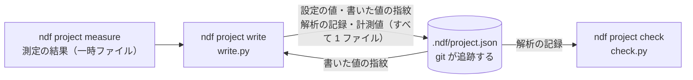
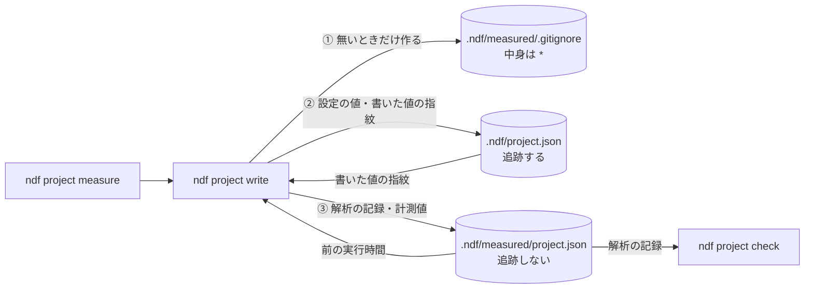
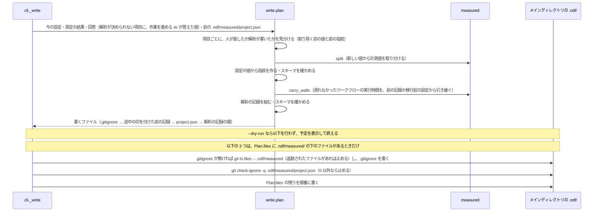

# プロジェクトの設定: 解析をやり直しても、設定の値が変わらなければ追跡するファイルに差分が出ない（#4516）

解析の書き出し（`ndf project write`）は、実行のたびに変わる値を追跡する設定 `.ndf/project.json` へ書く。そのため、設定が変わらなくても差分が出て `git pull` を止める。実行のたびに変わる値（解析の記録と計測値）は、中に置いた `.gitignore` でディレクトリ全体を git から外した `.ndf/measured/` の別のファイルへ移す。`.ndf/project.json` には、設定の値と、どの値を解析が書いたかの指紋だけを残す。置き場と移すキーの採否は「決定の記録」に、関数の粒度は [issue-4516-design-detail.md](./issue-4516-design-detail.md) に、調べた製品は末尾の「外部の調査」にある。

## 今の姿

何が起きたか・目的・受け入れ条件は要求仕様（[issue-4516-requirements.md](./issue-4516-requirements.md)、正は #4516 の本文）にある。この文書は「どう解くか」と「なぜその解き方か」だけを書く。



`.ndf/project.json` のうち、設定の値でないものは次の 4 種類である（このリポジトリの `main` の `.ndf/project.json` で確かめた）。

| 種類 | キー | 書き手 | 読み手 |
| --- | --- | --- | --- |
| 解析の記録（解析器のバージョン・解析した時刻・入力のファイルのハッシュ・ブランチの構成） | `analysis.analyzer`・`analysis.at`・`analysis.inputs`・`analysis.branches` | `write.plan` | `check.judge`（設定が古くなっていないかの判定） |
| 書いた値の指紋 | `analysis.written` | `write.merge_project`・`write._declare_ci_tests` | `write.written_digests`（人が直した値か解析が書いた値かの見分け） |
| 計測値（言語ごとのファイル数・ワークフローごとの直近の実行時間・直近の実行のジョブ数） | `languages[].files`・`ci.workflows[].wall_seconds`・`ci.workflows[].jobs` の一部（`measure_ci._workflow_entry` が、定義から数えたジョブ数と直近の実行のジョブ数の大きい方を `jobs` に書く） | `measure_repo.measure_languages`・`measure_ci`。実行時間は `write._carry_walls` が前の値を引き継ぐ | 書き出しのほかに無い（`jobs` も、`checks/model.py` の `jobs` はワークフローの定義の YAML のキーで、設定の値は読まない） |
| テストの所要時間（廃止の予定） | `test_duration` | 今の書き出しは書かない（スキーマで `deprecated`。書く項目の一覧 `ITEM_KEYS` から外れる） | 無い |

読み手の有無は `grep -rn "wall_seconds\|test_duration\|\"analysis\"\|languages" plugins/ndf/src scripts experimental` で確かめた（テストを除く）。

- 入力のファイルは、解析が読むファイル（CI のワークフローの定義・`pyproject.toml` などの依存とテストの設定・指示書）で、一覧は `check.is_input` が決める。そのハッシュは HEAD のコミットの blob の ID である
- 書いた値の指紋は、項目の値全体から作る。そのため、ファイル数や実行時間が変わると `languages`・`ci` の指紋も変わり、計測値の揺れが指紋の差分としても出る
- 書き出しは、時刻のほかに変わりが無ければ `.ndf/project.json` を書かない（`_same_but_time`）。しかし入力のファイルが 1 つでも変わると、入力のファイルのハッシュの表が変わって書く
- NDF が書くファイルの一覧（`plugins/ndf/contracts/domains/ndf-files.json`。保存先のディレクトリの定義は `locations.json` が持つ）の行 `project-measured` は、計測値をリポジトリの外の状態の保存先（`~/.local/state/ndf/measured/<リポジトリ>/project.json`）に置くと定めるが、書くコードは無い

## 文脈と制約

- 書き出しは、clone した元のディレクトリ（worktree でない側。以下メインディレクトリ）の `.ndf/` に書く。worktree から打っても同じ位置になる（`check.repo_dirs` が返すメインディレクトリ）
- `.ndf/project.json` は利用者の設定のファイルで、それを変える Pull Request は取り込む前に人が確かめる（NDF の共通原則の C7）。書き出しそのものは「コミットしない限り取り消せる」ので承認を求めない、と `project-analysis.md` が定めている
- このリポジトリの方針（MVV）の Value 4「普及のフェーズに入るまで、後方互換は求めない」に従い、旧い形を読む仕組みを持たない。次の書き出しが新しい形へ移す
- `ndf project branch-strategy` は `.ndf/project.json` のセクション `branch_strategy` だけを書く。解析の書き出しはこのセクションを変えない
- スキーマは `plugins/ndf/contracts/schemas/ndf-settings/project.schema.json` が正である。`plugins/ndf/skills/development-workflow/schemas/project.schema.json` はバイト単位で同一のコピーで、`scripts/check-ndf-contracts.py` が一致を確かめる
- 設定の説明の文書（`plugins/ndf/docs/contracts/ndf-settings.md`）とファイルの説明の文書（`files.md`）は、ファイルの一覧・保存先のディレクトリの定義・スキーマから生成する（`ndf.checks.spec_render`）。手で書かない

## 解き方の全体像



- `.ndf/project.json` には、設定の値と書いた値の指紋（`analysis.written`）だけが残る。指紋は計測値を除いた値から作るので、設定の値が変わったときだけ変わる
- 解析の記録と計測値は `.ndf/measured/project.json` に書く。書き出しは、`.ndf/measured/.gitignore` が無いときだけ中身 `*` で作り、ディレクトリ全体を git から外す（pytest・ruff のキャッシュと同じ形）。記録を書く前に、記録のパスが実際に git に無視されることを `git check-ignore` で確かめ、無視されなければ止まる
- 書き出しは、設定を書く前に前の記録へ途中の印を付け、最後に印の無い記録を書く。途中で止まれば、次の判定は必ず「古い」になる
- `ndf project check` は `.ndf/measured/project.json` の解析の記録で判定する。無い・読めないときは「古い」と判定し、開発の作業の始めの手順に解析をやり直させる
- 既存の `.ndf/project.json` に残る解析の記録・計測値・テストの所要時間（旧い形のキー）も「古い」と判定し、次の書き出しが取り除く。項目ごとに人が直したか解析が書いたかは、計測値を取り除く前の値のハッシュを前の指紋と比べて見分ける

## ドメインモデル

### コンテキスト

| コンテキスト | この範囲で意味が 1 つに決まる語 |
| --- | --- |
| プロジェクトの設定（`ndf-project-settings`） | 設定・解析・解析の記録・計測値・書いた値の指紋・測った値 |

### 集約

| 集約 | 書き換えてよい主体 | 集約ルート | エンティティ | 値オブジェクト |
| --- | --- | --- | --- | --- |
| 設定 | 人と解析の書き出し（人が直した値は解析が書き換えない） | `.ndf/project.json` | 項目（`languages`・`test`・`ci` など） | 書いた値の指紋（`analysis.written`） |
| 解析の記録と計測値 | 解析の書き出しだけ（人は書かない） | `.ndf/measured/project.json` | 無し | 解析の記録（入力のファイルのハッシュ・ブランチの構成など）・ファイル数の表・実行時間の表 |

### 不変条件

| # | 集約 | 条件 | 破れたときの扱い |
| --- | --- | --- | --- |
| I1 | 設定 | 書き出しの後、`.ndf/project.json` に解析の記録・計測値・テストの所要時間のキーが無い | 書き出しがスキーマの検査（`additionalProperties`）で止まる |
| I2 | 設定 | 書いた値の指紋は、計測値を取り除いた値から作る。設定の値が同じなら指紋も同じ | テストが落ちる |
| I3 | 設定 | 解析が書いたかの見分けは、計測値を取り除く前の値と前の指紋で行う（移行の 1 回目に、解析が書いた値を人が直した値と取り違えない） | テストが落ちる |
| I4 | 解析の記録 | 書き出しが `.ndf/measured/` の下へ書くとき、記録のパスは git に無視され、追跡されていない（`git check-ignore -q` が真）。`.gitignore` を作るときは、`.ndf/measured/` の下に追跡されたファイルが無い（`git ls-files` が空）。書き出しは設定と記録を書く前にこれらを確かめる。既存の `.gitignore` の中身だけでは信じない（空のファイル・独自のパターン・追跡済みの記録では、`*` があっても外れない） | 書き出しが既存のファイルを変えずに止まる（終了コード 1） |
| I5 | 解析の記録 | 解析の記録が無い・読めない（不正な UTF-8 を含む）・形が違うとき、判定は「古い」である（「壊れている」にしない） | テストが落ちる |
| I6 | 設定 | `.ndf/project.json` に旧い形のキーが残っているとき、判定は「古い」で、書き出しはそのキーを取り除いてから形を確かめる（旧い形を「壊れている」にしない） | テストが落ちる |
| I7 | 解析の記録 | 書き出しが設定か記録を書き換えるときは、先に前の記録へ途中の印（`pending: true`）を付け、最後に印の無い記録を書く。印の付いた記録を、判定は「古い」とする | テストが落ちる |

### ドメインイベント

番号は要求仕様のドメインイベントを引き継ぐ。

| # | イベント | 発生元 | 受け手 |
| --- | --- | --- | --- |
| E1 | 設定が古くなっていないかを確かめた | `check.judge` | 開発の作業の始めの手順。NDF の開発の手順（`development-workflow` の Skill の手順 0）が `ndf project check` を打ち、終了コード 3 なら同じ手順が `ndf project measure` と `ndf project write` を打って解析をやり直す |
| E2 | リポジトリと CI を測った | `ndf project measure` | `ndf project write` |
| E3 | `.ndf/measured/` を git から外す `.gitignore` を置き、記録のパスが無視されることを確かめた | `write.plan` → `cli._write` | git |
| E4 | 前の記録に途中の印を付け、設定を書き出した | `write.plan` → `cli._write` | 次の E1（途中の印）・次の E4（書いた値の指紋） |
| E5 | 解析の記録と計測値を書き出した | `write.plan` → `cli._write` | 次の E1・次の E5（前の実行時間） |

## 構成要素

| 要素 | 責務 |
| --- | --- |
| `measured.py`（新設） | 解析の記録の形を持つ。設定の値から計測値を取り分ける・旧い形のキーを取り除く・前の実行時間を引き継ぐ・記録を読む |
| `measure_ci.py`（変更） | ワークフローの行の `jobs` を定義から数えたジョブ数だけにし、直近の実行のジョブ数を別のキー `run_jobs` で返す |
| `write.py`（変更） | 設定の値を決め、解析の記録を組み、`.gitignore`・途中の印を付けた前の記録・`.ndf/project.json`・解析の記録を書く計画を作る |
| `check.py`（変更） | 設定が古くなっていないかを、`.ndf/project.json` でなく `.ndf/measured/project.json` の解析の記録から判定する |
| `cli.py`（変更） | 書き出しの入力に前の解析の記録を足す。記録を書く前に、記録のパスが git に無視されることを確かめる。`.ndf/measured/` の下のファイルは差分でなく要約で表示する |
| 設定のスキーマ（変更） | `analysis` を `written` だけにし、`languages[].files`・`ci.workflows[].wall_seconds`・`test_duration` を外す |
| 解析の記録のスキーマ（新設） | `plugins/ndf/contracts/schemas/internal/project-measured.schema.json` |
| ファイルの一覧と保存先のディレクトリの定義（変更） | 保存先の表（`locations.json`）の項目 `measured` の場所を、リポジトリの `.ndf/measured` に変える。ファイルの表（`ndf-files.json`）の行 `project-measured` のキーを新しい形に合わせ、`.gitignore` の行を足す |

## データ構造

解析の記録と計測値を置くファイル（`.ndf/measured/project.json`。コードとスキーマの名前は `measured`）の形:

```json
{
  "version": 1,
  "analyzer": 3,
  "at": "2026-11-25T11:02:57+00:00",
  "inputs": {".github/workflows/pytest.yml": "2187b0d3…", "pyproject.toml": "3634277f…"},
  "branches": {"head": "main", "present": ["develop", "main"]},
  "file_counts": {"python": 1064, "shell": 21, "javascript": 8},
  "wall_seconds": {".github/workflows/pytest.yml": 922.0, ".github/workflows/lint.yml": 19.0},
  "run_jobs": {".github/workflows/pytest.yml": 6, ".github/workflows/lint.yml": 1}
}
```

| キー | 型 | 必須 | 中身 |
| --- | --- | --- | --- |
| `version` | 整数（1） | 必須 | 形のバージョン |
| `analyzer` | 整数 | 必須 | 解析器のバージョン（`check.ANALYZER`） |
| `at` | 文字列（ISO 8601） | 必須 | 解析した時刻（UTC） |
| `inputs` | パス → blob の ID の表 | 必須 | 入力のファイルのハッシュ（`check.inputs`） |
| `branches` | `{head, present}` | 必須 | ブランチの構成（`check.branch_state`） |
| `file_counts` | 言語の名前 → 整数 | 任意 | 言語ごとのファイル数。`languages` が不明なら無い |
| `wall_seconds` | ワークフローのパス → 数 | 任意 | ワークフローごとの直近の実行時間。値は数だけ（`null` を持たない）。測れなかったワークフローは前の値を引き継ぐ |
| `run_jobs` | ワークフローのパス → 整数 | 任意 | 解析が選んだ直近の実行のジョブ数。実行を選べなかったワークフローは無い |
| `pending` | 真偽値（`true` だけ） | 任意 | 書き出しの途中の印（I7）。在れば判定は「古い」 |

`.ndf/project.json` の変わる箇所:

| キー | 今 | 変えた後 |
| --- | --- | --- |
| `analysis` | `{analyzer, at, inputs, branches, written}` | `{written}` |
| `languages[]` | `{name, frameworks, files, version?}` | `{name, frameworks, version?}` |
| `ci.workflows[]` | `{path, jobs, wall_seconds?}`（`jobs` は定義から数えた数と直近の実行のジョブ数の大きい方） | `{path, jobs}`（`jobs` は定義から数えた数だけ） |
| `test_duration` | 廃止の予定（書かれない。残っていれば読める） | スキーマから消す。残っていれば次の書き出しが取り除く |

書き出しは、`.ndf/measured/` の下へ何かを書くときだけ、その前に、記録が git に無視されることを git 自身に確かめさせる。`.ndf/measured/` の下へ書くときとは、`write.plan` が返す書くファイルに、`.gitignore`・途中の印・記録のどれか 1 つでも入っているときである（`.gitignore` だけの場合も含む）。

`.ndf/measured/.gitignore` は、無いときだけ作る。既にあれば変えない。中身は `# NDF の解析が書く記録。コミットしない` と `*` の 2 行である。ファイルがあることだけでは、記録が無視されるとはみなさない。確かめる手順は次のとおりで、どれも `--dry-run` では行わない。

1. `.gitignore` が無いときは、作る前に、メインディレクトリで `git ls-files -- .ndf/measured` を 1 回打つ。追跡されているファイルが 1 つでもあれば、`.gitignore` を作らずに止める。利用者が追跡していた `.ndf/measured/.gitignore` を作業ツリーで消した状態を、NDF が作り直して打ち消さないためである（作り直すと、生成した `.gitignore` が追跡されたファイルの差分に入る）。追跡済みの記録もここで見つかる
2. `git check-ignore -q .ndf/measured/project.json` を 1 回打つ。このコマンドは、パスが無視され、かつ追跡されていないときだけ 0 を返す（[gitignore](https://git-scm.com/docs/gitignore)・[git check-ignore](https://git-scm.com/docs/git-check-ignore)。`--no-index` を付けないので、追跡済みのパスは無視されないと判定される）
3. どちらかで止めるときは、既にある `.gitignore` と、設定・記録を変えずに終了コード 1 で止まる。手順 2 で止めたとき、手順 1 の後に作った `.gitignore` は残る。理由は「`.ndf/measured/` の下のファイルが git に追跡されている」か「`.ndf/measured/project.json` が git に無視されない。`.ndf/measured/.gitignore` の中身か、記録が追跡されていないかを確かめる」と出す

書くものが無い書き出し（`write.plan` が書くファイルを 1 つも返さない）では、どちらのコマンドも打たない。この場合、記録が追跡されていても終了コード 0 で終わり、今と同じく「書くものが無い（設定は解析と同じ）」と出す。記録を書かないので、追跡されている記録に新しい中身が入ることは無い。追跡されていることは、次に `.ndf/measured/` の下へ書く書き出しで見つかり、そこで終了コード 1 になる。

`--dry-run` は今と同じくファイルを書かずに予定を表示する。記録の無い clone では、`.gitignore` と記録を「書く予定」として示すだけにする。

確認のために、`.ndf/measured/` の下へ書く書き出し 1 回につき git の起動が 1 回増える。`.gitignore` を作る回（記録の無い clone の最初の書き出しなど）は 2 回増える。費用を増やす理由は、記録を誤ってコミットされる差分に混ぜないこと（I4）を、利用者ごとの除外の設定に依らず保証するためである。代わりの案と比べた結果は次のとおりである。

| 案 | git の起動 | 採らなかった理由・選んだ理由 |
| --- | --- | --- |
| 書き出しのたびに確かめる | 書き出し 1 回につき 1 回 | 採らない。同じ入力で打ち直して書くものが無い回にも起動が増えるが、その回は記録を書かないので確かめる意味が無い |
| `.ndf/measured/` の下へ書くときだけ確かめる | `.ndf/measured/` の下へ書く書き出し 1 回につき 1 回（`.gitignore` を作る回は 2 回） | 選ぶ。書くものが無い回の確認を省いても、その回は記録を書かないので、記録が差分に混ざることは無い。記録を書く回は解析をやり直した後で、測定に GitHub の API の読み取りが数十回あるので、1 回の起動は比べて小さい |
| `.gitignore` の中身を読み、`*` の行があれば無視されるとみなす | 0 回 | 採らない。根の `.gitignore` の否定のパターン・利用者の全体の除外設定（`core.excludesFile`）・追跡済みの記録を見られず、I4 を保証できない |
| gitignore の規則を Python のライブラリで再現する | 0 回 | 採らない。上と同じく、git の索引（追跡済みかどうか）と利用者ごとの設定を見られない。git の判定と食い違う所を持ち続けることになる |

## 処理の流れ



書く順は `.ndf/measured/.gitignore` → 記録のパスが無視されることの確認 → 途中の印（`pending: true`）を付けた前の記録 → `.ndf/project.json` → `.ndf/measured/project.json`（印の無い新しい記録）である。

- `.gitignore` と確認を最初に置くのは、git に無視されない場所へ記録を書き、誤ってコミットされるのを防ぐためである（I4）
- 途中の印を設定より先に書くのは、設定か記録を書く途中で止まったとき、次の判定に必ず「古い」と言わせるためである（I7）。印が無いと、前の記録の入力が今と同じ場合に判定が「新しい」を返し、反映できなかった回答や計測値の更新が再試行されない
- 印は前の記録の中身に `pending: true` を足して書く。前の実行時間は印の付いた記録からも引き継げる
- 前の記録が無ければ印は書かない（記録が無いことで次の判定は「古い」になる）。設定も記録も変わらない書き出しでは、印も書かない
- 印を書いた書き出しは、必ず最後に印の無い記録を書く。記録の中身が時刻を除いて前と同じでも書く。たとえば、同じ測定の結果で回答だけを変えると、設定だけが変わって印が付く。このとき最後の記録を省くと、成功しても印が残り、作業を始めるたびに「古い」と判定されて解析を繰り返す
- 前の記録に印が残っている（前の書き出しが途中で止まった）ときも、最後に印の無い記録を書く。同じ内容での打ち直しでも、成功すれば印が消える

途中で止まったときの状態と次の判定は次のとおりである。印を書く前に止まれば、設定と記録は前のまま揃っている。印を書いた後に止まれば、次の判定が「古い」になり、解析のやり直しで揃う。

| 止まった所 | 残る状態 | 次の `ndf project check` |
| --- | --- | --- |
| `.gitignore` の後・無視の確認で | `.gitignore` だけが新しいか、どれも前のまま | 前の判定のまま。書き出しは終了コード 1 で、利用者が除外の設定を直す |
| 途中の印を書く所 | 設定も記録も前のまま揃っている | 前の判定のまま。書き出しは終了コード 1 で、呼び出した手順が書き出しを打ち直す |
| 途中の印の後・`.ndf/project.json` の後 | 記録に途中の印が残る | 「古い」（理由「前の書き出しが終わっていない」） |
| 前の記録が無く、`.ndf/project.json` の後 | 記録が無い | 「古い」（理由「解析の記録が無い」） |

## 決定の記録

### 決定 1: 追跡するファイルを書き換えずに解析の記録を git から外すため、`.ndf/measured/` の中に `*` の `.gitignore` を置く

- **質問**: 解析の記録と計測値をどこに置き、どう git から外すか
- **選んだ案**: メインディレクトリの `.ndf/measured/project.json` に置き、同じディレクトリに中身 `*` の `.gitignore` を書き出しが作る。保存先の表の項目 `measured` を「リポジトリの `.ndf/measured`・追跡しない」へ直す
- 採らなかった案: ファイルの一覧の今の行のとおり、リポジトリの外の状態の保存先（`~/.local/state/ndf/measured/<リポジトリ>/`）に置く（利用者の指示は「.gitignore される別ファイル」で、リポジトリの外は指示と食い違う。clone を消しても記録だけが残り、片付けの対象が増える）
- 採らなかった案: `.ndf/project.local.json` に置き、`.ndf/.gitignore` へ行を足す（理由は下の 2 つ）
  - 追跡する `.ndf/.gitignore` に差分が 1 回出て、利用者の設定の書き換え（C7）になる
  - 名前の `.local` は、`worktree.local.json` で「各自の機械の値で共有設定を上書きする個人設定」の意味で使っている。上書きしないファイルに付けると、1 語が 2 つの意味になる
- 採らなかった案: 根の `.gitignore` に行を足す（`project-analysis.md` の「`.ndf/` の追跡」は、NDF が根の `.gitignore` を書き換えないと定めている）
- **代償**: `.ndf/` の下にディレクトリが 1 つ増える。`git status --ignored` には `.ndf/measured/` が出る
- 作り方: 標準に倣う（pytest・ruff のキャッシュと同じく、ディレクトリの中に `*` の `.gitignore` を置く）
- 比べた候補: STD1 / PRD1 / PRD2
- 根拠: Value 6「NDF が作業で生んだもの（ブランチ・作業ディレクトリ・状態の記録・一時ファイル）は役目を終えると自動で片付き、利用者のストレージとリポジトリの構造は常に整理された状態に保たれる」・Value 12「広く利用され、メンテナンスが活発で実績のある、著名かつ最新のものがあればそれが使われ」（MVV バージョン 11）。STD1・PRD1・PRD2

### 決定 2: 新しく clone した場所でも人が直した値と解析が書いた値を見分けるため、書いた値の指紋は `.ndf/project.json` に残す

- **質問**: 書いた値の指紋（`analysis.written`）も、解析の記録と一緒に別のファイルへ移すか
- **選んだ案**: 移さない。`.ndf/project.json` の `analysis` を `{written}` だけにする。指紋は計測値を取り除いた値から作るので、設定の値が変わったときだけ変わり、push しても問題が無い
- 採らなかった案: 指紋も移し、記録が無ければすべての値を人が直した値とみなす（新しく clone した場所では、解析が書いた値がすべて人の値になり、その後も解析が値を直せない。`languages` のような測った値がその場所で古いまま固まる）
- 採らなかった案: 指紋も移し、記録が無ければすべての値を解析が書いた値とみなす（人が直した値を解析が書き換える。`project-analysis.md` の「手で書いた値は変えない」を破る）
- **代償**: `.ndf/project.json` に人が書かないキー（`analysis.written`）が 1 つ残る。設定の値を変えた Pull Request では、その項目の指紋の 1 行も変わる
- 根拠: Value 3「同じ操作を打ち直しても、結果は 1 回打ったときと変わらない」（MVV バージョン 11）。指紋を設定と一緒に追跡すれば、どこで clone して書き出しても、人が直した値と解析が書いた値の見分けが同じになる

### 決定 3: 設定として共有する意味の無い値だけを移すため、移すキーを実行と時刻で変わる値に限る

- **質問**: どのキーを `.ndf/project.json` から外すか
- **選んだ案**: 解析の記録（解析器のバージョン・時刻・入力のファイルのハッシュ・ブランチの構成）と計測値（言語ごとのファイル数・ワークフローごとの実行時間）を移す。テストの所要時間（`test_duration`）は読み手も書き手も無い廃止の予定のキーなので、移さずにスキーマから消し、残っていれば取り除く
- ワークフローのジョブ数は、定義から得た数と実行から得た数を分ける。設定の `ci.workflows[].jobs` には、ワークフローの定義から数えたジョブ数だけを残す。定義を変えない限り変わらないので、ワークフローの構成を表す設定の値として共有してよい。解析が選ぶ 1 回の実行（ジョブを飛ばしていない直近の成功の実行）のジョブ数は、記録の `run_jobs` へ移す。動的なマトリクスでは実行ごとに変わる統計だからである
  - 今は `measure_ci._workflow_entry` が両者の大きい方を `jobs` に書く。これを、`jobs` に定義の数、`run_jobs` に実行の数を書く形に変え、`measured.split` が `run_jobs` を記録へ取り分ける
  - ジョブ数を読む経路は書き出しのほかに無い（`plugins/ndf/src` と `scripts` を `grep` で確かめた。`checks/model.py` の `jobs` はワークフローの YAML のキーで、設定の値ではない）。そのため、意味を定義の数だけに変えても壊れる読み手は無い
- 採らなかった案: 入力のファイルのハッシュとブランチの構成を `.ndf/project.json` に残す（ワークフローや指示書を変えるたびに、設定の値が同じでも差分が出る。受け入れ条件 1 を満たさない）
- 採らなかった案: 読み手の無いファイル数と実行時間を書くのをやめる（利用者の指示は「別ファイルに配置する」で、消すことではない。消すかは、読み手の要否と一緒に別に決める）
- 採らなかった案: ジョブ数を今の「大きい方」のまま設定に残す（動的なマトリクスのリポジトリでは、定義を変えなくても直近の実行のジョブ数が変わるだけで `.ndf/project.json` に差分が出る。利用者の指示の「統計情報等は別ファイル」に反する）
- **代償**: 解析が書いた `ci` の `jobs` が、移行の 1 回目に定義の数へ変わることがある（今の値が実行の数で大きくなっていたワークフロー）。差分は 1 回だけ出る。人が直した `ci` は変えない
- 根拠: Value 1「利用者が手を止めるのは、作るかを決めるときと、出してよいかを決めるときだけである」・Value 8「データ構造は正規化を既定にし、同じ事実を 2 か所に持たない」（MVV バージョン 11）

### 決定 4: 移行のための別のコマンドを持たないため、次の書き出しが旧い形の値を取り除いて移す

- **質問**: 既存の `.ndf/project.json` に残る解析の記録と計測値を、どう新しい形へ移すか
- **選んだ案**: 次の `ndf project write` が移す。旧い形のキーは、`analysis` の `written` 以外のすべて・`languages[].files`・`ci.workflows[].wall_seconds`・`test_duration` である
  - `ndf project check` は、旧い形のキーを見つけたら「古い」と判定し、開発の作業の始めの手順に解析をやり直させる（I6）
  - 書き出しは、項目ごとに、計測値を取り除く前の値のハッシュを前の指紋と比べる（I3）。一致すれば解析が書いた値として新しい値へ置き換え、違えば人が直した値として計測値のキーだけを取り除いて残す
  - 前の `analysis` の時刻と入力のファイルのハッシュは捨て、新しい解析の値で解析の記録を作る
  - 移行前の `ci.workflows[].wall_seconds` は捨てずに、実行時間の引き継ぎ元にする。移行の 1 回目は前の記録が無いので、新しい測定で実行時間を得られなかったワークフローは、移行前の設定に残る同じパスの数値を引き継ぐ。値が `null`（旧スキーマが認める未計測）なら引き継がない。新しい記録の `wall_seconds` は数だけを認めるので、`null` をそのまま移すと記録の形の検査で止まる
- NDF 自身のリポジトリ（このリポジトリ）では、実装の Pull Request の中で、追跡している `.ndf/project.json` もスキーマの変更と同じコミットで移す
  - 理由: `ndf check` の設定の形の検査（`spec-decl`）は、`check.load` を通らず、`checks/spec_docs.py` の `_real_errors` が実ファイルをスキーマで直接確かめる。このリポジトリの追跡している `.ndf/project.json` には `test_duration` と `languages[].files` が残っているので、スキーマだけを先に厳しくすると、実装の Pull Request の CI が落ちる
  - 移し方: 追跡している `.ndf/project.json` から、`measured.strip_legacy` で旧い形のキーを取り除く。あわせて `analysis.written` のうち、取り除く前の値の指紋と一致していた項目の指紋を、取り除いた後の値の指紋（`write.value_digest`）に書き直す。一致していなかった項目の指紋は変えない。これは書き出しの移行（I3）と同じ結果になる。指紋を書き直さずにキーだけを取り除くと、次の書き出しで解析が書いた項目が人の値に見えてしまう
  - メインディレクトリでは `ndf project write` を打たない（書き出しは worktree から打ってもメインディレクトリへ書くため、実装の Pull Request に入らない）。移し方は実装の作業ディレクトリで、上の 2 つの関数を呼ぶ 1 回きりの手順として行い、スクリプトとしては残さない
  - 確かめ方: 受け入れ条件 14 を、新しくチェックアウトした場所（Pull Request の CI）の `ndf check` で確かめる。手元のメインディレクトリには利用者の未コミットの差分があり、その差分は確かめの対象にしない
  - 利用者への影響: この Pull Request が `main` に入ると、メインディレクトリの未コミットの差分（ファイル数と `analysis` の書き直し）と、取り込む `.ndf/project.json` の変更がぶつかり、`git pull` が止まる。未コミットの差分は計測値の書き直しだけなので、利用者はそれを捨ててから取り込む（要求仕様の「含まない」の 3 つ目のとおり、片付けは利用者が行う）
- 採らなかった案: 移行のコマンド（`ndf settings migrate` の改名の表の行）を足す（改名の表はキーの名前と値を改める表で、ファイルをまたいで値を移す形を持たない。解析の記録は次の解析で作り直せるので、旧い値を移す意味も無い）
- 採らなかった案: 旧い形の `analysis` も読む互換を持つ（Value 4 が互換の仕組みを求めない）
- 採らなかった案: スキーマに旧い形のキーを期限付きで残し、設定の移行をリリースの後に回す（スキーマとコードの変更と、追跡している設定の移行を同じコミットにすれば、受け入れる範囲や期限を決めなくて済む。期限を決めると、その期限に消す作業がもう 1 回要る）
- **代償**: 移行の 1 回目は判定が必ず「古い」になり、解析が 1 回走る。旧い形のキーを取り除く処理（`measured.strip_legacy`）を残し続ける。消す時期は決めていない
- 根拠: Value 4「普及のフェーズに入るまで、後方互換は求めない。旧い設定の形を残す互換の仕組みを持たず、移行のコマンドできれいな最終形へ移す」（MVV バージョン 11）。この設計では、次の `ndf project write` が移行のコマンドの役を兼ねる。別のコマンドを足さないのは、解析の記録が次の解析で作り直せるためである

### 決定 5: 利用者に直させないため、解析の記録が無い・壊れているときは「古い」と判定する

- **質問**: 解析の記録が無い・読めない・形が違うとき、`ndf project check` は何を返すか
- **選んだ案**: 「古い」（終了コード 3）を返し、理由に「解析の記録が無い」か「解析の記録が読めない（<誤り>）」を出す。開発の作業の始めの手順が解析をやり直し、書き出しが記録を作り直す
- 採らなかった案: 読めない記録を「壊れている」（終了コード 2）にする（作業の始めの手順が先へ進まず、利用者に直させる。記録は人が書かないファイルで、作り直せば直る）
- **代償**: 新しく clone した場所と、記録を消した場所では、最初の作業で解析が 1 回走る（タイムアウト 120 秒。GitHub の API の読み取りのリクエストが数十回）。作業ごとに新しく clone する使い方では、これが clone ごとに起きる
- **費用が増える理由**: 比べる相手は、今の「追跡している設定が新しい」場合である。今は、設定の中の入力のファイルのハッシュとブランチの構成が今のリポジトリと一致すれば、新しく clone した場所でも `ndf project check` だけで済み、`measure` と `write` は走らない。変えた後は、その照合の材料が追跡しない記録へ移るため、clone ごとに `ndf project measure` と `ndf project write` が各 1 回、GitHub の API の読み取りが最大で数十回増える。照合の材料を追跡するファイルに残す限り、入力のファイルが変わるたびに差分が出て、受け入れ条件 1 を満たせない。増える費用は、この差分を無くすことの代わりに払う
- 費用を減らす代わりの案と、採らなかった理由:

| 案 | 増える費用 | 採らなかった理由 |
| --- | --- | --- |
| 入力のファイルのハッシュとブランチの構成を、今のとおり追跡する設定に残す | 増えない | ワークフローや指示書を変えるたびに設定の値が同じでも差分が出る。受け入れ条件 1 を満たさない（決定 3） |
| 入力のハッシュを 1 つにまとめた値だけを追跡する設定に残す | 増えない | 入力のファイルが変わるたびに 1 行の差分が出る。受け入れ条件 1 が挙げる「入力のファイルのハッシュが変わっても差分が出ない」を満たさない |
| 記録が無いときは解析せず、今の入力で記録だけを作って「新しい」とみなす（軽い判定） | 増えない | 追跡している設定が、どの入力から作られたかを確かめる材料が無い。設定が古い clone でも「新しい」と判定し、古い設定のまま作業が進む |
| 記録をリポジトリの外の状態の保存先にも置き、同じリポジトリの別の clone から引き継ぐ | 同じ機械の 2 回目以降の clone では増えない | 引き継ぐ記録が、その clone の設定に対して新しいかを確かめる材料は、結局その clone の入力である。記録の置き場が 2 か所になり、clone を消しても外の記録が残る（決定 1 の採らなかった案と同じ問題） |

- 選んだ案では、作業用に分けたディレクトリ（worktree）はメインディレクトリの記録を読むので、worktree を作るたびには解析は走らない。費用が増えるのは、clone ごとに 1 回だけである
- 根拠: Value 1「ワークフロー上の課題（再起動・告知・確認）で、利用者に操作を求めない」・Value 2「利用者が払う費用（LLM の token・API の利用料・CI の時間・マシンの資源）が小さい」（MVV バージョン 11）。Value 2 の「費用が増える仕組みを足すときは、その理由と代わりの案が示される」に従い、理由と代わりの案を上に示した

### 決定 6: 同じ事実を 2 か所に持たないため、計測値は名前から値への表で持つ

- **質問**: `.ndf/measured/project.json` で、計測値を設定と同じ配列の形で持つか、名前から値への表で持つか
- **選んだ案**: 言語の名前 → ファイル数（`file_counts`）、ワークフローのパス → 実行時間（`wall_seconds`）の表で持つ。言語とワークフローの並びは設定だけが持つ
- 採らなかった案: 設定の `languages[]`・`ci.workflows[]` と同じ配列をコピーする（言語とワークフローの並びを 2 か所に持ち、片方だけが変わると食い違う）
- **代償**: 言語の名前が重なる測定の結果では、後の行が前の行を上書きする。今の測定は言語の名前ごとに 1 行を返す（`measure_repo.measure_languages`）
- 根拠: Value 8「データ構造は正規化を既定にし、同じ事実を 2 か所に持たない」（MVV バージョン 11）

## 影響と危険

- **働く範囲**: NDF を使うすべてのリポジトリで働く。開発の作業の始めの手順で `ndf project check`・`ndf project write` を通るとき
- **プロジェクトごとに違うもの**: 無い。置き場は保存先の表が持ち、設定も引数も足さない
- **当たるモード**: 作業の始めの手順を通るすべてのモード（`standard`・`light`・`operation`・`documentation`・`legacy-refactor`）
- **壊れうる箇所**: 移行の 1 回目に、利用者の `.ndf/project.json` に数十行の差分が出る。利用者がコミットして片付ける。この手順は、この実装で `project-analysis.md` に書き足す
- **前のバージョンの NDF との混在**: 前のバージョンのスキーマは `analysis.analyzer` などと `languages[].files` を必須にしている。そのため、前のバージョンの NDF は新しい形の `.ndf/project.json` を「壊れている」と判定する。NDF を新しいバージョンへ上げれば直る（要求仕様の「今の利用者への影響と互換」）
- **同じファイルを触る別の変更**: 設計の時点で無い。開いた Pull Request 100 件の変更ファイルに、`write.py`・`check.py`・`cli.py`・設定のスキーマ・ファイルの表・保存先の表を触るものは無かった（`gh pr list --state open --json files`、2026-11-25）。実装の計画で確かめ直す
- **新しく clone した場所**: 最初の作業で解析が 1 回走る（決定 5 の代償と、費用が増える理由）。worktree はメインディレクトリの記録を読むので走らない
- **書き出しの結果の表示**: 今の `cli._print_write` は、書くファイルすべての unified diff を出す。記録をそのまま差分で出すと、記録の無い clone や壊れた記録の作り直しのたびに、入力のファイルの数だけパスとハッシュの行が出て、作業を進める AI のトークンを使う。そこで `.ndf/project.json` は今と同じく差分で出し、`.ndf/measured/` の下のファイルは「書いた: `.ndf/measured/project.json`（解析の記録。入力 N 件・言語 M 件・ワークフロー K 件）」のような 1 行の要約だけにする（受け入れ条件 16）

### 代表のリポジトリでの振る舞い

| 代表のリポジトリ | 設定の要点 | 直した後に起きること | この種類で扱えなくなること |
| --- | --- | --- | --- |
| Web サービス | `languages`・`test`・`ci`・`services` を解析が書く | 解析の記録と計測値が `.ndf/measured/` へ移り、`.ndf/project.json` は設定の値だけになる | 無し |
| モバイルアプリ | 同上（CI の実行時間が長い） | 同上。実行時間は `.ndf/measured/project.json` だけに残る | 無し |
| 業務文書だけ | `languages` が少ない・CI が無いこともある | 同上。`file_counts`・`wall_seconds` が無い記録になる | 無し |

### このリポジトリだけの事情

| 値 | 今の状態と片付き方 | 持つ Issue |
| --- | --- | --- |
| メインディレクトリの `.ndf/project.json` にある利用者の未コミットの差分（ファイル数と `analysis` の書き直し） | 実装をリリースした後、書き出しをやり直すと解析の記録と計測値が移る。差分は計測値の削除と `analysis` の縮小だけになり、利用者がコミットする | #4516 |
| `ci` が人の値として扱われている（`analysis.written` に `ci` が無い） | `ci` の値は今後も解析が書き換えない。移行では `wall_seconds` だけを取り除く | 無し（今の振る舞いのまま） |

## 用語

| 用語 | 意味 | 用語集への反映 |
| --- | --- | --- |
| 解析の記録 | 解析が書く、解析をいつどの入力で行ったかの値（解析器のバージョン・解析した時刻・入力のファイルのハッシュ・ブランチの構成）。git で追跡しないファイルに置き、設定には置かない | 追加 |
| 計測値 | 解析が測る、実行ごとに変わる数（言語ごとのファイル数・CI のワークフローごとの実行時間）。解析の記録と同じ、git で追跡しないファイルに置き、設定には置かない | 追加 |
| 書いた値の指紋 | 解析が書いた設定の値の SHA-256。今の値の指紋と一致すれば解析が書いた値、違えば人が直した値として扱う。設定の値が変わったときだけ変わるため、設定と一緒に追跡する | 追加 |

## テスト設計

番号は要求仕様の受け入れ条件と、上の不変条件である。

| 受け入れ条件・不変条件 | どの振る舞いで縛るか | どう壊したら落ちるべきか |
| --- | --- | --- |
| 1・I2 | 同じ測定の結果で、時刻・入力のファイルのハッシュ・ファイル数・実行時間・直近の実行のジョブ数（`run_jobs`）だけを変えて 2 回書き出すと、2 回目に `write.plan` が返す書き込み対象に `.ndf/project.json` が含まれない | 計測値を設定に残す・指紋を計測値込みの値から作る・`jobs` に実行の数を混ぜると落ちる |
| 2・3・I1 | 書き出した `.ndf/project.json` の `analysis` が `written` だけで、`languages[].files`・`ci.workflows[].wall_seconds`・`ci.workflows[].run_jobs`・`test_duration` が無い | 項目のどれかを取り除き忘れると落ちる |
| 4・5・6・I4 | 書き出しの後、`.ndf/measured/project.json` に `git check-ignore` が真。追跡するファイルの変更は `.ndf/project.json` だけ。根の `.gitignore` に `!.ndf/measured/` を書いても外れたまま | `.ndf/measured/.gitignore` を置かない・`.ndf/.gitignore` へ書くと落ちる |
| 4・I4 | `.ndf/measured/` の下へ書く書き出しで、既存の `.ndf/measured/.gitignore` が空・`*` を含まない独自のパターン・記録が `git add -f` で追跡済み、のどれでも、書き出しは終了コード 1 で止まり、`.gitignore`・設定・記録の中身が前のまま | `.gitignore` があることだけで無視が効くとみなすと落ちる |
| 4・I4 | (g) 追跡していた `.ndf/measured/.gitignore` を作業ツリーで消した状態で書き出すと、`.gitignore` を作らずに終了コード 1 で止まる。(h) 記録と設定が前と同じで `.gitignore` だけが消えている（書くファイルが `.gitignore` だけ）とき、`git ls-files` と `git check-ignore` を 1 回ずつ呼ぶ。記録が追跡済みなら終了コード 1、そうでなければ `.gitignore` を作って終了コード 0 | `.gitignore` の存在だけを見て作り直す・`.gitignore` だけの計画で確かめないと落ちる |
| 4・I4 | (i) 記録を作った後に `git add -f` で追跡し、同じ測定の結果と回答で打ち直す（書くものが無い）と、git を呼ばずに終了コード 0 で「書くものが無い」と出る | 書くものが無い回に確かめて止めると落ちる（この回の扱いは受け入れ条件 4 の対象外と決めたとおり） |
| 7 | 記録の入力のファイルのハッシュと今の HEAD が同じなら「新しい」、入力のファイルかブランチの構成を変えると「古い」 | 判定が `.ndf/project.json` の `analysis` を読むままだと落ちる |
| 8・I5 | 記録が無い・JSON でない・不正な UTF-8 を含む・スキーマに合わないとき「古い」（終了コード 3）で、理由に解析の記録が無い・読めないと出る | 「壊れている」（終了コード 2）を返す・`UnicodeDecodeError` を捕まえないと落ちる |
| 15・I7 | 前の記録の入力が今と同じ状態で、(a) `.ndf/project.json` の書き込みを失敗させる、(b) 新しい記録の書き込みを失敗させる。どちらも書き出しは終了コード 1 で、次の判定が「古い」（理由「前の書き出しが終わっていない」） | 途中の印を書かない・印を判定で見ないと落ちる |
| 15・I7 | (c) 同じ測定の結果で回答だけを変えて書き出す（設定だけが変わる）。(d) 印の残った記録の状態で、同じ内容で書き出しを打ち直す。どちらも成功の後、記録に印が無く、次の判定が「新しい」 | 記録の中身が時刻を除いて同じとき最後の記録を省くと落ちる |
| 4・I4 | (e) 書くものが無い書き出しでは `git ls-files` も `git check-ignore` も打たない。(f) 記録の無い clone で `--dry-run` を打つと、`.ndf/measured/` の下に何も作られず、表示に `.gitignore` と記録が「書く予定」として出る | 書くものが無くても確かめる・`--dry-run` で `.gitignore` を書くと落ちる |
| 9 | 記録の無い状態で、前の指紋が一致する項目は新しい値になり、一致しない項目は残る | 記録が無いと指紋を読まない・すべてを置き換えると落ちる |
| 10・I6 | 旧い形（`analysis` の全体・`files`・`wall_seconds`・`test_duration` を持つ）の設定で、判定が「古い」（終了コード 3）を返す | 旧い形を「壊れている」にすると落ちる |
| 11・12・I3 | 10 の設定から書き出すと旧いキーが消え、旧い指紋が一致した項目は新しい値で置き換わり、一致しない項目は計測値だけを取り除いて残る | 取り除いた後の値でハッシュを比べる（解析が書いた値が人の値になる）と落ちる |
| 13 | 新しい測定で実行時間の無いワークフローは、前の記録の同じパスの実行時間を残し、出力に「前の値を残した」の行が出る | 引き継ぎを外す・設定の側で引き継ぐと落ちる |
| 11・13 | 移行の 1 回目（前の記録が無い）で新しい測定に実行時間が無いワークフローは、移行前の設定の同じパスの数値を記録へ引き継ぐ。移行前の値が `null` のワークフローは記録に入らず、書き出しは記録の形の検査で止まらない | 旧い設定の実行時間を引き継ぎ元にしない・`null` をそのまま移すと落ちる |
| 13 | 新しい測定の `ci` が不明（`{"unknown": …}`）なら、前の記録の実行時間をすべて残す。測定に成功してワークフローが 0 本なら、前の実行時間を捨てる | 不明と 0 本を区別しないと落ちる |
| 14 | 実装の Pull Request の CI（新しくチェックアウトした場所）で、`ndf check`（追跡している `.ndf/project.json` の形・生成した説明の文書の食い違い・スキーマのコピーの一致）と `python3 scripts/check-skill-frontmatter.py` が通る | 追跡している設定を移さない・生成物を作り直さない・コピーを直さないと落ちる |
| 16 | 記録の無い状態で書き出すと、表示に `.ndf/project.json` の差分と、記録の 1 行の要約が出て、記録の入力のパスとハッシュの行は出ない | 記録を差分で出すと落ちる |

詳細設計は [issue-4516-design-detail.md](./issue-4516-design-detail.md) にある（新設する関数 4・シグネチャを変える関数と型 3 のため別ファイルにした）。

## 設計の結果

| 課題 | 扱い | 統合先 | 触るファイル |
| --- | --- | --- | --- |
| #4516 | 実装する | — | `.ndf/project.json`、`plugins/ndf/src/ndf/domains/project/measured.py`、`plugins/ndf/src/ndf/domains/project/measure_ci.py`、`plugins/ndf/src/ndf/domains/project/write.py`、`plugins/ndf/src/ndf/domains/project/check.py`、`plugins/ndf/src/ndf/domains/project/cli.py`、`plugins/ndf/contracts/schemas/ndf-settings/project.schema.json`、`plugins/ndf/skills/development-workflow/schemas/project.schema.json`、`plugins/ndf/contracts/schemas/internal/project-measured.schema.json`、`plugins/ndf/contracts/domains/ndf-files.json`、`plugins/ndf/contracts/domains/locations.json`、`plugins/ndf/docs/contracts/ndf-settings.md`、`plugins/ndf/docs/contracts/files.md`、`plugins/ndf/skills/development-workflow/references/project-analysis.md`、`plugins/ndf/tests/domains/project/test_project_cli.py`、`plugins/ndf/tests/domains/project/test_project_measure.py`、`plugins/ndf/tests/domains/project/test_project_measured.py` |

## 外部の調査

| 種類 | 調べるか | 理由 |
| --- | --- | --- |
| 標準・仕様 | 調べる | 追跡しないファイルの外し方（`.gitignore` の優先順位と、共有するパターンと個人のパターンの使い分け）に git の仕様がある |
| 主要な製品 | 調べる | 実行で変わるファイルをリポジトリの中に書くツールが、どう追跡から外しているかを比べる |
| ライブラリとサービス | 調べない | JSON を読み書きするだけで、既存の `ndf.domains.records.jsonfile`・`ndf.contracts` で足りる |

### 標準・仕様

| # | 標準・仕様 | 何を定めているか | 設計への反映 | 出典 |
| --- | --- | --- | --- | --- |
| STD1 | gitignore | 下の階層の `.gitignore` のパターンが、上の階層のものに優先する（"patterns in the higher level files being overridden by those in lower level files down to the directory containing the file"）。共有するパターンは `.gitignore` に置き、clone で配る | 解析の記録のディレクトリに置いた `.gitignore` は、根の `.gitignore` の外さない行より優先する（受け入れ条件 6）。手元で `!.ndf/measured/` を根に書いても外れたままなことを確かめた | https://git-scm.com/docs/gitignore （2026-11-25）・`git check-ignore -v`（git 2.53.0、2026-11-25） |

### 主要な製品

| # | 製品 | どう解いているか | 設計への反映 | 出典 |
| --- | --- | --- | --- | --- |
| PRD1 | pytest（キャッシュ `.pytest_cache/`） | キャッシュのディレクトリを作るとき、中に `# Created by pytest automatically.` と `*` の `.gitignore` と `CACHEDIR.TAG` を置き、利用者の `.gitignore` を書き換えない | 決定 1 の形（ディレクトリの中に `*` の `.gitignore` を置く） | `.venv/lib/python3.14/site-packages/_pytest/cacheprovider.py` の 49 行目（pytest 9.2.0、2026-11-25） |
| PRD2 | ruff（キャッシュ `.ruff_cache/`） | 同じく、中に `# Automatically created by ruff.` と `*` の `.gitignore` を置く | 決定 1 の形 | `/work/ai-plugins/.ruff_cache/.gitignore`（2026-11-25） |

調べた量: 候補 3 件・取得の試み 4 回。
