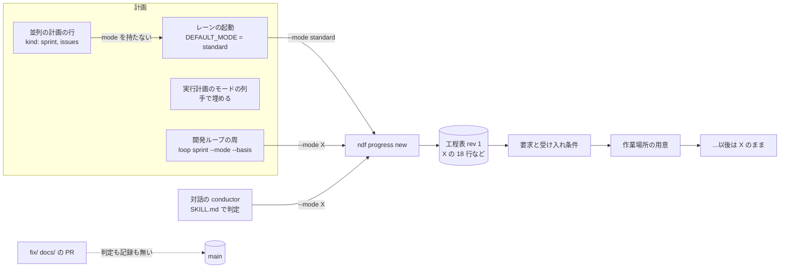
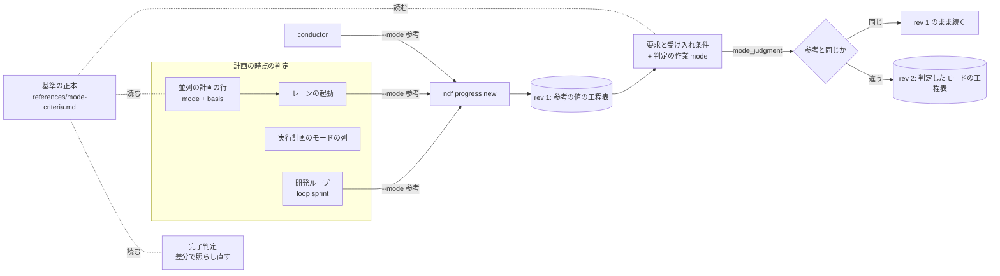

# モード判定: 即時修正をモードに加え、課題ごとに計画とスプリントの開始で判定する（#4517）

11 系のスプリント 61 本がすべて `standard` で流れ、軽い仕事 52 本は判定を通らずにマージされていた（[要求仕様](./issue-4517-requirements.md)）。判定の基準を 1 つのファイルに移し、「値だけを変える」を `operation`、「1 つの手順書に閉じる直し」を `light`、「4 条件を満たす不具合」を新しいモード `hotfix`（即時修正）へ振り分ける。判定は開発計画の行と工程「要求と受け入れ条件」の終わりの 2 か所で行い、`--mode` は仮の工程表を作る参考の値にする。判定し直した分布は「判定し直した分布」に、採らなかった案は各決定の「採らなかった案」に、外部の手法は「外部の調査」にある。

## 今の姿

何が起きたか・目的・受け入れ条件は要求仕様（[issue-4517-requirements.md](./issue-4517-requirements.md)、正は #4517 の本文）にある。ここには設計に要る今の構造だけを書く。

| 場所 | 今の振る舞い |
| --- | --- |
| 判定の基準 | SKILL.md の「2. 上から順に条件を判定する」と `references/workflow-modes.md` の 2 か所。`operation` → `documentation` → `standard` → `legacy-refactor` → `light` の順に問う。`standard` の条件「本番の振る舞いの追加・変更、バグ修正」「複数モジュールにまたがる変更」が先に当たるので、小さな直しも `standard` になる |
| 判定の入口 | `ndf progress new --mode` の値がそのまま工程表を決める（`plugins/ndf/src/ndf/progress/command.py` の `_sprint_new`）。工程「要求と受け入れ条件」は判定の後に流れるのに、判定の入力（要求）はその工程の出力である。順序が逆である |
| レーン | `plugins/ndf/src/ndf/progress/lane/launch.py` の `start_commands` が、行に `--mode` が無ければ `DEFAULT_MODE = "standard"` を入れる。並列の計画の行（`contracts/workflow/parallel-plan.schema.json`）はモードの欄を持たない |
| 即時修正 | SKILL.md の「即時修正」の 4 条件と、テンプレート `contracts/templates/fix.json`（テスト → push → PR → CI → マージ）がある。ステートマシンを作らないので記録が残らない。案内の先（`pace.md` の「流出不具合の記録」、`new impl --escape-of`）は無い |
| 定義の改訂 | ステートマシンの DB は定義を改訂（`rev`）ごとに持ち、事象も `rev` で畳む（`store.py` の `DEFINITIONS`、`model.fold`）。改訂 2 を書く経路はまだ無い |

## 文脈と制約

- 承認ゲートは「設計 Pull Request のマージ」と「本番系へ届く操作」の 2 つで、増やさない（SKILL.md の「人手の承認を求める承認ゲート」、共通原則）
- 判定の基準を持つのは `development-workflow` だけである。計画の手順・テンプレート・コードは基準を写さずに指す
- worker は工程 Skill の `SKILL.md` を読めない（`agent-layers.md` の worker の規則 6）。worker に基準を読ませるには、作業の種類（`contracts/worker/kinds.json`）の `excerpt` で 1 つのファイルを渡す
- 普及のフェーズまで後方互換は求めない（MVV の Value 4）。`--mode` の意味・モードの値・計画の行の形は作り直してよい
- 代表のリポジトリの種類（Web サービス・モバイルアプリ・業務文書だけ）のどれも扱えることを保つ（P2）
- 11 系では MVV 判定でリリース承認ゲートを省かない（`pace.md` の「MVV 判定」）

## 解き方の全体像

- **基準は `development-workflow/references/mode-criteria.md` の 1 か所にある。** SKILL.md・計画の手順・判定の worker・完了判定はこのファイルを指す
- **判定は 2 回行う。** 開発計画で課題ごとに判定してモードでスプリントを切り、スプリントの工程「要求と受け入れ条件」の終わりに要求仕様から判定し直す。スプリントの工程表を決めるのは後の判定で、計画の値と `--mode` は仮の工程表を作る参考の値である
- **判定の記録（課題ごとのモードと根拠・スプリントのモード・参考の値）は工程の出力 `mode_judgment` としてスプリントの文脈に残り、判定が参考と違えば工程表を改訂 2 として作り直す。** 判定の記録が無いまま後の工程へ進めない
- **即時修正はモード `hotfix` になる。** 要求と受け入れ条件（判定と再現の手順）→ 作業場所 → 実装（再現テストが先）→ 完了判定 → Pull Request → クリーンアップ → デプロイ → リリース後テスト → **リリース後レビュー** → 棚卸し の順に流れ（クリーンアップとデプロイの順は今の工程の定義のまま）、リリース承認ゲートは人が見る

## 判定の基準

**ここに書くのは決める内容で、実装で `references/mode-criteria.md` へ移す。** 移した後は、この設計書でなくそのファイルが正本になる。

### 課題ごとの判定

課題ごとに、上から問い、最初に「はい」になったモードを採る。問いの入力は課題の本文・要求仕様と、あれば差分である。

| 順 | モード | 問い（すべて満たせば「はい」） |
| --- | --- | --- |
| 1 | `documentation` | 変えるのが、リポジトリの外の読み手へ渡すビジネス文書である（`README.md`・`docs/` は当たらない） |
| 2 | `hotfix` | 約束（受け入れ条件・手順書・仕様・既存のテスト）と違う振る舞いを直す不具合で、4 条件をすべて満たす（下の「`hotfix` の 4 条件」） |
| 3 | `operation` | 変えるのが値だけである。値とは、設定ファイルの値・コードの中の定数と閾値・依存の版・IaC のパラメタ・外部の系の設定と状態（権限・保護の規則・リポジトリの設定・リリースの出し直し・データ）。値を読む処理（分岐・関数・スキーマ・入出力の形・キーの有無）は変えない。外部の系への実行を伴うかは問わない |
| 4 | `light` | 振る舞いを変えない局所の直し（文言・誤記・リンク・コメント・リポジトリの説明文書と確定仕様・テストの追加・ログの追加・生成物の再生成）か、手順書（Skill の本文と `references/`）の直しで、1 つの Skill に閉じ、コマンド・出力の形・承認ゲート・工程表・ほかの Skill との受け渡しを変えないもの |
| 5 | `legacy-refactor` | 振る舞いを変えずに構造だけを変え、対象にテストが無い・少ない |
| 6 | `standard` | 上のどれにも当たらない |

#### `hotfix` の 4 条件

今の SKILL.md の「即時修正」の 4 条件を引き継ぎ、判定し直しで割れた読み方（「判定し直した分布」の「基準の穴」）を決める。

| # | 条件 | 読み方 |
| --- | --- | --- |
| a | 原因が特定でき、再現するテスト（書けなければ再現の手順）を先に置ける | 直す場所が手順書かコードか決まらない不具合は満たさない |
| b | 既存のコントラクト（コマンドの引数と出力の形・結果 JSON・プラン JSON・状態ファイル・hook の入出力・用語集の形・設定のキー）を壊さない | 任意の項目・サブコマンド・受け入れる入力を足す変更は壊さない。項目の名前・型・必須を変える変更は、文書の約束に合わせる直しでも壊す |
| c | 方針・既定値・閾値そのものを変えない | 約束と違っていた値を約束どおりに直すのは満たす。意図どおりの値を調整するのは満たさず、`operation` へ回る |
| d | revert 1 回で戻せ、課題 1 つで閉じる | 「課題 1 つ」は課題ごとの判定では見ず、スプリントのモードを決めるときに見る。課題を 2 つ以上含むスプリントでは、`hotfix` と判定した課題も `standard` として数える（「スプリントのモード」） |

### 境界事例

| 変更 | モード | 理由 |
| --- | --- | --- |
| 閾値・上限・タイムアウトの値だけを変える（例 #4418・#4464） | `operation` | 値だけ。読む処理は変えない |
| 設定のキーを足す・型を変える | `standard` | 値を読む処理と形が変わる |
| 設定の既定値を変える | `operation` | 値だけ。既存の利用者の振る舞いは変わるが、値の変更として計画・実行・レビュー・リリース承認を通る |
| 依存の版の更新（互換範囲） | `operation` | 値（版）だけ。完了判定で既存のテスト一式を通す |
| 依存の入れ替え・新しい自動化の導入（例 Renovate の新設） | `standard` | 処理が変わる |
| IaC のパラメタを変えて適用する | `operation` | 値と外部の系の状態だけ |
| IaC にリソース・モジュールを足す、構成を変える | `standard` | 構造が変わる |
| リリースの出し直し・ブランチ運用の設定・ruleset の変更（例 #3552・#3119） | `operation` | 外部の系の状態だけ |
| 手順書だけの直しで、手順どおりに打つと失敗する・無い物を指す | `hotfix`（4 条件を満たすとき）、満たさなければ `standard` | 約束と違う振る舞いの不具合 |
| 手順書だけの直しで、記述が古い・説明を補う | `light` | 手順の結果を変えない |
| 手順書の直しが 2 つ以上の Skill の受け渡し・工程表・承認ゲートを変える | `standard` | 1 つの Skill に閉じない |
| 新しい Skill を足す | `standard` | 機能の追加 |
| テストの削除・書き換え | `standard` | 何を担保しなくなるかの判断が要る |
| MVV・指示書の運用のセクションの改訂 | `standard` | 方針の変更。設計承認ゲートで見る |
| 設計書だけを作る課題 | 実装する課題と同じスプリントに入れる。単独で出すなら `light` | 設計書はリポジトリの文書で、実装は後の判定で決まる |
| バグ修正の大小 | 大小で決めない。4 条件で `hotfix` か `standard` | 小さくても契約を変える直しがある |
| 1 つの課題・PR が、性質の違う部分を含む（例: リンクの直しと検査の追加） | 部分ごとに上から問い、得たモードのうち高いもの（`hotfix` は `standard` として比べる） | 分けられるなら課題を分ける |

### スプリントのモード

**スプリントのモードは、課題ごとの判定からコードが決める。** AI は課題ごとの判定と根拠だけを書く。

| 課題のモードの組 | スプリントのモード |
| --- | --- |
| 1 つのモードだけ | そのモード。ただし `hotfix` は課題が 1 つのときだけで、2 つ以上なら `standard` |
| `documentation` とほかのモード | 断る（分ける。今の規則のまま） |
| それ以外の混ざり | 高いもの（`standard` > `legacy-refactor` > `operation` > `light`）。`hotfix` の課題は `standard` として数える。高さはモードの定義（`contracts/workflow/modes/*.json`）の `metadata.ndf.height` が持つ |

## 工程表

### 加える列 `hotfix`（即時修正）

| 工程 | `hotfix` | 理由 |
| --- | --- | --- |
| 要求と受け入れ条件 | `requirements-design`（要求仕様のファイルは書かず、課題の本文に再現の手順と受け入れ条件を書く）と判定 | 判定の入力と、リリース後テストの合否の基準が要る |
| 作業場所の用意 | `worktree` | — |
| 設計・詳細設計・ドキュメント再構成・ドキュメントレビュー・計画 | — | 4 条件が契約・方針を変えないことを保証する |
| 実装 | `tdd-cycle`（再現するテストを先に書く）。単位は課題 1 つで、PR はベースブランチ宛て | 条件 a |
| リファクタリング | — | 構造を変えない |
| コードレビュー | —（リリース後レビューへ移す） | 受け入れ条件 1-2 |
| 完了判定 | `quality-gates`。差分でモードを照らし直す | 4 条件を差分で確かめる最後の場所 |
| Pull Request | `pr` | — |
| 確定仕様化 | — | 仕様を変えない |
| クリーンアップ | `merged`（工程表ではデプロイの前に並ぶ。PR がまだマージされていなければ、ブランチと PR を残して片付けを後へ回す。#4409 の決まり） | — |
| デプロイ | `release`。リリース承認ゲートは人が見る | 決定 5 |
| リリース後テスト | `release-verification` | 直した不具合が配った版で直ったかを確かめる |
| **リリース後レビュー**（加える行） | `cross-review`（直さずに読むラウンド） | 受け入れ条件 1-2 |
| 振り返り | — | 進め方を変える材料が出ない |
| 棚卸し | `backlog-refinement` | 全モードの終わり |

### 直す列

| モード | 変えること |
| --- | --- |
| `operation` | 工程「実装」は、リポジトリのファイルの値は直接編集し、外部の系は今のとおり [operation-run.md](../plugins/ndf/skills/development-workflow/references/operation-run.md) の実行で変える。値だけの変更でテストがあれば完了判定で走らせる。ほかの行は変えない |
| `light` | 行は変えない。基準が広がり、1 つの Skill に閉じる手順書の直しが入る。その差分は今の「振る舞いの確認」を通る。振る舞いの確認は、変えた手順書（Skill の本文・`references/`・エージェント定義）ごとに `claude -p` を 1 回起動し、変わった指示どおりに動くかを確かめて PR のコメントに残す工程である（SKILL.md の「差分の中身で選ぶ工程」）。加えてコードレビューと完了判定の照らし直し（決定 9）を通る |
| `legacy-refactor` | 工程「要求と受け入れ条件」の行を先頭に足す。判定はこの工程の中で行うので、どのモードの工程表もこの行から始まる必要がある。このモードの要求仕様は今と同じく書かず、工程は判定の作業だけを通す |
| すべて | 工程「要求と受け入れ条件」の最後に判定の作業 `mode` を通す |

## 判定し直した分布

2026-11-25 に、上の基準の下書きで判定し直した（集計は worker 2 件。判定の割れは下の「基準の穴」で基準へ戻し、その結果で件数を直した）。別のリポジトリ 2 つは非公開なので、件数と種類だけを書く。

### 11 系のスプリント 61 本

| モード | 今の記録 | 今の切り方のまま判定し直す | モードで切ったとすると |
| --- | --- | --- | --- |
| `standard` | 61 | 53 | 53 |
| `light` | 0 | 6 | 8 |
| `hotfix` | 0 | 2 | 2 |
| `operation` | 0 | 0 | 1 |
| 合計 | 61 | 61 | 64 |

- 「モードで切ったとすると」は、混ざっていた 3 本（`light` と `standard` が 2 本、`operation` と `standard` が 1 本）を分けた数である。課題単位では延べ 87 件（再実行で同じ課題が 2 本以上のスプリントに出たものを重ねて数えた）のうち `standard` 74・`light` 10・`hotfix` 2・`operation` 1 である
- `standard` に残る 53 本の大半は、機能の追加・契約の変更・2 つ以上の Skill にまたがる手順の変更である。課題を 2 つ以上まとめたレーンでは、不具合の課題も `standard` として数えた（#3604・#3877・#3908 など）。計画でモードを判定して切れば、このうち 4 条件を満たす課題は `hotfix` の行へ分かれる。ただし差分を読んで 4 条件を確かめていないので、上の表の `hotfix` の数（2）には足していない。表の `hotfix` は下限である
- 標本

| モード | スプリントの課題 | 根拠 |
| --- | --- | --- |
| `hotfix` | #4217 並列の計画の許可のテストが消え、受け入れ条件を満たさない | 約束（受け入れ条件）と違う。テストを戻すだけで契約と方針は変えない |
| `light` | #3960 作り直しの決定を指すコメントの書き換え | コメントだけ |
| `light` | #3990 設計文書 36 本の削除とリンクの固定 | リポジトリの文書だけ |
| `operation` | 別のリポジトリの、検証環境で外部の認証基盤を有効にする課題 | 設定の値と外部の系の状態だけ |
| `standard` | #3989 並列の制御を 2 層にし、設定のキーを廃止する | 設定のキーと構造が変わる |
| `standard` | #4409 承認の前のマージを止める | 不具合の直しだが、マージのコマンドの確かめと工程の順を変える（条件 b） |

### 直接マージ 52 本（11/19 以降、`main` 宛て）

| モード | 本数 | 内訳 |
| --- | --- | --- |
| `standard` | 26 | `feature/` 6、`fix/` 12、`docs/` 3（MVV の改訂 2・文書の規則 1）、ほか 5 |
| `light` | 13 | `docs/` 10、`fix/` 2、ほか 1 |
| `hotfix` | 11 | すべて `fix/` |
| `operation` | 2 | `fix/` 2（閾値 #4418、待ちの上限 #4464） |

- `fix/` 27 本のうち `hotfix` は 11 本で、残りは契約の変更（#3831・#3940）・課題を 2 つ以上まとめた PR（#3869・#3870）・方針の変更（#4205）・機能の追加（#3944・#4116）などで `standard` だった
- 標本

| モード | PR | 根拠 |
| --- | --- | --- |
| `hotfix` | #4203 上限の行を検出しない正規表現のハイフン漏れ | 4 行・テスト付き。契約と既定は変えない |
| `hotfix` | #4514 11.0.0 の作り直しで抜けた SessionStart の 2 処理を戻す | 原因が特定でき、hook の呼び出しを足すだけ |
| `operation` | #4418 文脈の切り替えの閾値を上げる | 2 つの JSON の値だけ |
| `light` | #4416 仕様書を実装に合わせて直す | `docs/` の確定仕様だけ |
| `standard` | #4212 本物の時間を待つテストを消す | テストの削除 |

### 基準の穴（判定し直しで割れた読み方）と決めた答え

| 割れた読み方 | 例 | 決めた答え（上の基準に入れた） |
| --- | --- | --- |
| 契約を約束どおりに直す変更は条件 b を破るか | #3831 | 破る（名前・型・必須を変えるため） |
| 足すだけの変更は条件 b を破るか | #3835・#3859・#4514 | 破らない |
| 不具合を直す値の変更は `hotfix` か `operation` か | #4255 | 約束と違っていた値なら `hotfix`、調整なら `operation` |
| 手順書の直しの線 | #3837 と #3841 | 打つと失敗するなら不具合、記述が古いだけなら `light` |
| 1 つの PR が 2 つ以上の行に当たる | #3841・#3930 | 高いもの |
| MVV の改訂 | #3958・#4075 | `standard` |
| テストの削除 | #4212 | `standard` |
| 新しい Skill | #4189 | `standard` |
| 設計書だけの課題 | 別のリポジトリの 3 件 | 実装する課題と同じスプリント。単独なら `light` |
| `hotfix` の「課題 1 つ」 | — | スプリントの性質。2 つ以上なら `standard` として数える |

## 決定の記録

### 決定 1: 基準を 1 か所に置いて worker と計画からも読めるようにするため、基準を `references/mode-criteria.md` へ移す

- **質問**: 判定する者が 3 つ（対話の conductor・工程の worker・計画を作る者）になる。worker は工程 Skill の `SKILL.md` を読めない。基準をどこに置けば、写さずに 3 者が読めるか
- **選んだ案**: 課題ごとの判定・`hotfix` の 4 条件・境界事例・スプリントのモードの規則を `development-workflow/references/mode-criteria.md` に置く。SKILL.md の「2. 上から順に条件を判定する」と「即時修正」、`workflow-modes.md` の「判定に使う質問」「よくある境界事例」は消して、このファイルへのリンクにする。worker へは作業の種類の `excerpt` でこのファイルを渡す（`contracts/worker/kinds.json` の `plan-to-spec` が前例）
- 採らなかった案: 基準を SKILL.md に残し、worker 向けに `references/excerpt.md` へ抜粋を写す（基準が 2 か所になり、片方だけが古くなる）
- **代償**: SKILL.md を開いても基準の本文が無く、リンクを 1 つたどる
- 根拠: Value 11「同じ規則・定数・処理は 1 か所にまとまり、ほかはそこを参照する」（MVV バージョン 11）

### 決定 2: `--mode` で判定を飛ばす経路を無くすため、判定を工程「要求と受け入れ条件」の出力にし、`--mode` を仮の工程表の値にする

- **質問**: 判定をどの時点・どの入口で行えば、対話・レーン・開発ループのどの経路でも飛ばされないか
- **選んだ案**: 工程「要求と受け入れ条件」の最後に判定の作業 `mode`（worker の作業の種類）を置き、出力 `mode_judgment`（課題ごとのモードと根拠・参考の値）を書く。`ndf progress new` の `--mode` は省略でき、仮の工程表（省けば `standard`）を作るだけになる。工程「要求と受け入れ条件」の出力に `mode_judgment` が無ければ、後の工程へ進まない。判定の入力は要求で、要求を書く工程の終わりが情報のそろう最も早い時点である
- 採らなかった案: 工程表に行「モード判定」を足す（行の値が増え、SKILL.md の「モード判定は工程表の行を持たない」に反する）
- 採らなかった案: `ndf progress new` の前に判定のコマンドを打たせる（入口ごとに同じ手順を足すことになり、飛ばす経路が再び生まれる）
- **代償**: 仮の工程表と判定後の工程表が違うと、`ndf progress show` の行が途中で変わる
- 根拠: Value 3 / Value 15（MVV バージョン 11）

### 決定 3: スプリントのモードを実行ごとにばらつかせないため、課題ごとの判定からコードが決める

- **質問**: 混ざったスプリントのモードを、AI が書くか、コードが規則で決めるか
- **選んだ案**: AI は課題ごとのモードと根拠を書く。スプリントのモード（混ざったときの高い方・`hotfix` の課題が 2 つ以上なら `standard`・`documentation` の混ざりは断る）は `ndf progress` が「スプリントのモード」の表の規則で決める。根拠が空・知らないモード・スプリントの課題と判定の課題が食い違う出力は断る
- 採らなかった案: AI がスプリントのモードも書く（規則が手順書とコードの 2 か所になり、食い違ったときの正が決まらない）
- **代償**: 規則を変えるにはコードの変更が要る
- 根拠: Value 3「判断の要らない手順は仕組みが進めるので、結果が実行ごとにばらつかない」（MVV バージョン 11）

### 決定 4: 判定が参考の値と違っても工程を流せるよう、工程表を定義の改訂 2 として作り直す

- **質問**: 判定したモードが仮の工程表と違うとき、同じステートマシンを作り直すか、別のステートマシンを作るか
- **選んだ案**: 判定したモードの定義（`contracts/workflow/modes/<モード>.json`）で改訂を 1 つ足し、両方にある行の状態（終えた工程・`--disable` で外した工程）を引き継ぐ。事象 `mode_decided` に判定の記録を残す。同じなら改訂を足さず、事象だけを残す。DB は既に改訂ごとの定義と事象を持つ（`DEFINITIONS` の `rev`、`model.fold`）
- 採らなかった案: 中止して別の名前のステートマシンを作り直す（レーンの行・引継ぎ文書が持つ ID が変わり、レーンの終わりの判定を直す範囲が広がる）
- **代償**: 既存のコードは最新の改訂だけを読む前提で書かれている。前の改訂の事象を読む箇所が無いかを、実装で 1 つずつ確かめる手間がかかる
- 根拠: Value 8「履歴を残す事実は追記だけで持ち、今の値は最新の記録から引く」（MVV バージョン 11）

### 決定 5: 承認ゲートを増やさずに実装を先に出すため、`hotfix` は設計承認ゲートを持たず、リリース承認ゲートは人が見る

- **質問**: `hotfix` で 2 つの承認ゲートをどう扱うか。リリース承認ゲートを MVV 判定で省けるようにするか
- **選んだ案**: `hotfix` は設計 PR を出さないので設計承認ゲートが無い。リリース承認ゲートは他のモードと同じ工程「デプロイ」にあり、MVV 判定で省かないモード（`gated_mode`）に入れる。承認資料にはモードの根拠・4 条件の確かめ・再現テスト・「レビューはリリースの後」を載せる
- 採らなかった案: リリース承認ゲートを MVV 判定で省けるようにする（11 系はリリース承認ゲートを MVV で省かない方針で、その変更はこの課題の範囲を超える）
- **代償**: 即時修正にも人の承認の待ちが 1 回残る
- 根拠: Value 1「速さや費用のために、人の承認を省かない」（MVV バージョン 11）

### 決定 6: リリースの後に見つかった指摘を確実に扱うため、工程「リリース後レビュー」を足し、指摘を「戻す・直す・見送る」に分ける

- **質問**: リリースの後のレビューの指摘を、同じスプリントで直すか、別のスプリントへ渡すか
- **選んだ案**: `hotfix` の工程「リリース後テスト」の後に工程「リリース後レビュー」を置く。マージ済みの PR の差分を `cross-review` の相手役（レビューだけをする別の AI。既定は codex と kiro）が 1 回読み（1 ラウンド）、修正担当（指摘を直すか見送るかを決める claude）はコミットせずに指摘を分けて PR のコメントに残す。「戻す」（受け入れ条件を満たさない・コントラクトを壊した・元より重い不具合を生んだ）は課題を起票して revert を `hotfix` のスプリントで出す。「直す」は 4 条件を満たせば `hotfix` のスプリント、満たさなければ起票して計画で判定する。「見送る」は理由をコメントに残す
- 採らなかった案: 指摘の直しを同じスプリントの続きの PR で出す（1 つのスプリントに本番へ届くマージが 2 回でき、リリース承認ゲートが 2 回になる）
- **代償**: 直しと戻しは新しいスプリントになり、課題が 1 つ増える
- 作り方: 自前で作る・標準に倣う
- 比べた候補: STD1 / PRD1
- 根拠: Value 7 / Value 1（MVV バージョン 11）。STD1・PRD1

### 決定 7: 開発計画でスプリントを切れるよう、計画の行に課題ごとの判定を載せ、モードで行を分ける

- **質問**: 開発計画の行にモードを必須で持たせるか、任意のままにするか
- **選んだ案**: 並列の計画のスプリントの行（`kind: sprint`）に `mode` と `basis` を必須で持たせ、`ndf lanes init` は欠けた行・`hotfix` で課題が 2 つ以上の行・`documentation` とほかが混ざった行を断る。実行計画のモードの列は同じ基準で埋め、モードの違う課題を同じ行に入れない。開発ループの `ndf loop sprint --mode --basis` は計画の時点の判定として残す。どの計画の値も、スプリントでは `--mode` の参考の値として渡る。レーンの起動の `DEFAULT_MODE` は消す。手順は `mode-criteria.md` を指し、基準を写さない
- 採らなかった案: 計画の行のモードを任意のままにする（レーンの 54 本で `--mode` が 0 本だった今の姿が残る）
- **代償**: 計画を作る手順に、課題ごとの判定の手間が増える
- 根拠: Value 3 / Value 11（MVV バージョン 11）

### 決定 8: 計画の時点の判定とスプリントの開始の判定が食い違ったら、スプリントの開始の判定を上げ下げどちらも採る

- **質問**: 計画の値とスプリントの開始の判定が食い違ったとき、上げる方向だけを許すか、下げる方向も許すか
- **選んだ案**: 工程「要求と受け入れ条件」の判定は、計画の値より上でも下でも採る。違ったときは `ndf progress next` の結果に注意（`mode_changed`）を出し、オーガナイザーか conductor が計画の行のモードを書き直す（実行計画では「見直し」の表に 1 行）。工程「要求と受け入れ条件」の終わりでは、作業場所も設計もまだ無い。だから判定を下げても失う作業が無く、上げ下げどちらも採れる。この工程を終えた後にモードを上げる必要が分かったときは、今の「途中でモードが変わったとき」の決まりに従い、上げる方向だけを許す
- 採らなかった案: 上げる方向だけを許す（計画で `standard` と見積もった課題が `standard` のまま残り、今の偏りが直らない）
- 採らなかった案: 計画の値を正にする（計画の時点は要求仕様が無く、判定の入力が少ない）
- **代償**: 計画の行と実際のスプリントのモードがずれることがあり、計画の書き直しが要る
- 根拠: Value 5 / Value 2（MVV バージョン 11）

### 決定 9: 判定を下げて工程を省く誤りを止めるため、完了判定で差分からモードを照らし直す

- **質問**: 判定が要求の時点の予測で外れたとき、どこで捕まえるか。パスの規則で機械に判定させるか
- **選んだ案**: 工程「完了判定」は、差分を `mode-criteria.md` の基準で判定し直し、スプリントのモードより高ければ工程を失敗で返す。続きは今の「途中でモードが変わったとき」と「文書を省いたときの工程」の流し直しと同じで、新しいステートマシンで上げたモードから流す。`hotfix`・`operation`・`light` は設計承認ゲートを持たないので、ここが人の承認の前の最後の機械の確かめになる
- 採らなかった案: パスの規則（`contracts/` を触れば `standard` など）だけで判定させる（値の変更と処理の変更は同じファイルの中で混ざり、パスでは分けられない）
- **代償**: 完了判定で外れると、そこまでの工程を新しいステートマシンでやり直す。決定 4 のように同じステートマシンを作り直さないのは、完了判定の時点では低いモードで終えた工程（省いた設計・マージした実装の単位）があり、終えた工程は同じステートマシンで開き直せないためである。要求の工程の終わりには、そうした工程がまだ無い
- 根拠: Value 13 / Value 1（MVV バージョン 11）

## 影響と危険

| 項目 | 内容 |
| --- | --- |
| 働く範囲 | NDF を使うすべてのリポジトリ。判定の基準・工程表・`ndf progress new`・並列の計画の形が変わる |
| プロジェクトごとの違い | 受けない。基準はリポジトリの種類によらない |
| 当たるモード | すべて。`hotfix` が加わり、`light`・`operation` の範囲が広がる |
| 書きかけの文書・同じファイルを触る変更 | #4516（`.ndf/project.json` の統計の分離）は `.ndf/project.json` と `ndf project` を触り、この設計のファイルと重ならない |
| 壊れうる箇所 | 判定を下げすぎて設計承認ゲートを通らない変更が出る（決定 9 の完了判定と、リリース承認ゲートで人がモードの根拠を読むことで受ける）。並列の計画の既存の設定ファイルは `mode` を持たないので `ndf lanes init` で断られる（コミットしない入力なので作り直す。後方互換は求めない） |
| 改訂 2 の読み手 | `progress show`・`next`・`finish`・`gathered`・レーンの状態は最新の改訂を読む。改訂 1 の事象を読む箇所が無いかを実装で確かめる |

### 代表のリポジトリでの振る舞い

| 種類 | 直した後に起きること | この種類で扱えなくなること |
| --- | --- | --- |
| Web サービス（別のリポジトリの Web アプリ） | IaC の値の変更と適用が `operation` で流れ、検証環境の設定の変更が機能のスプリントに混ざらない。本番の不具合を `hotfix` で先に出せる | 無し |
| モバイルアプリ | ストアの審査を伴うリリースも工程「デプロイ」のまま。`hotfix` のリリース承認ゲートは他のモードと同じ場所で止まる | 無し |
| 業務文書だけ | `documentation` の判定は今と同じ。混ざりは今と同じく断る | 無し |

### ai-plugins だけの事情

- `main` へのマージが利用者へ届く設定なので、`hotfix` の PR は工程「デプロイ」でリリース承認ゲートを通ってからマージする（#4409 の決まり）。その前の工程「クリーンアップ」は、開いたままの PR のブランチを消さない。正式版の PATCH として出す
- 直接マージ 52 本の経路（人が GitHub の画面でマージする）は工程の外で、この設計は止めない

## 用語

| 用語 | 反映 | 意味 |
| --- | --- | --- |
| 即時修正（`hotfix`） | 意味の変更 | 4 条件を満たす不具合を、実装・完了判定・リリースを先に通し、リリースの後にレビューするモード。今は「起票せずその場のプランで直すこと」 |
| リリース後レビュー | 追加 | `hotfix` のリリースの後に、マージ済みの差分を相手役が読み、指摘を戻す・直す・見送るに分ける工程 |
| 計画の時点の判定 | 追加 | 開発計画の行に載せる課題ごとのモード。スプリントでは参考の値になる |
| 判定の記録（`mode_judgment`） | 追加 | 工程「要求と受け入れ条件」の出力。課題ごとのモードと根拠・スプリントのモード・参考の値 |
| conductor・オーガナイザー・worker | 既存 | conductor は利用者と対話して工程を進める AI のセッション。オーガナイザーは並列の計画のレーンを起動・監視するセッション。worker は 1 つの作業だけを行うサブエージェント |
| MVV・MVV 判定 | 既存 | MVV はこのリポジトリの判断の基準（`.ndf/mvv.md`）。MVV 判定は、利用者が任せた進め方で、AI が MVV に照らして承認ゲートを通してよいかを決めること |
| P2 | 既存 | MVV の「必ず人の承認が要る操作」の 1 つ。代表のリポジトリの種類を NDF で扱えなくする変更 |

## テスト設計

| 受け入れ条件 | どの振る舞いで縛るか | どう壊したら落ちるべきか |
| --- | --- | --- |
| 1 | `hotfix` の定義から作ったステートマシンが「リリース後レビュー」を「リリース後テスト」の後に持ち、設計の行を持たない | 定義から行を消す・順を入れ替える |
| 1 | リリース後レビューの出力が戻す・直す・見送るの 3 つの分け方だけを受ける | 知らない分け方を通す |
| 4 | `--mode light` で作ったスプリントで、要求の工程の出力に判定が無ければ `next` が後の工程へ進まない | 判定の確かめを外す |
| 4 | 判定が `standard` なら改訂 2 が足され、`show` が `standard` の行を出し、終えた要求の工程は終えたまま | 改訂を足さない・状態を引き継がない |
| 4 | 判定が参考と同じなら改訂は 1 のまま、事象 `mode_decided` だけが足される | 同じでも改訂を足す |
| 5 | レーンの起動が、行の `mode` を `--mode` に渡し、`mode` が無い行を組まない | `standard` を補う |
| 6 | 課題のモードの組ごとに、スプリントのモードが表のとおりになる（`hotfix` 2 件は `standard`、`documentation` の混ざりは断る） | 高い方の比べ方を逆にする |
| 7 | `ndf lanes init` が `mode` の無い行・`hotfix` で課題 2 つの行を断る | スキーマの必須を外す |
| 8 | `.md` の文言は照合しない。参照切れは `ndf check` が見る | — |

## 設計の結果

| 課題 | 扱い | 統合先 | 触るファイル |
| --- | --- | --- | --- |
| #4517 | 実装する | — | `plugins/ndf/skills/development-workflow/SKILL.md`、`plugins/ndf/skills/development-workflow/references/mode-criteria.md`、`plugins/ndf/skills/development-workflow/references/workflow-modes.md`、`plugins/ndf/skills/development-workflow/references/stage-notes.md`、`plugins/ndf/skills/development-workflow/references/agent-layers.md`、`plugins/ndf/skills/development-workflow/references/conductor-entrypoints.md`、`plugins/ndf/skills/development-workflow/references/glossary.md`、`plugins/ndf/skills/development-workflow/references/loop.md`、`plugins/ndf/skills/issue-plan-strategy/references/parallel-plan.md`、`plugins/ndf/skills/issue-plan-strategy/references/execution-plan.md`、`plugins/ndf/skills/out-of-scope/SKILL.md`、`plugins/ndf/contracts/workflow/modes/hotfix.json`（新設）、`plugins/ndf/contracts/workflow/modes/legacy-refactor.json`、`plugins/ndf/contracts/workflow/stages/post-release-review.json`（新設）、`plugins/ndf/contracts/workflow/stages/requirements.json`、`plugins/ndf/contracts/workflow/context.schema.json`、`plugins/ndf/contracts/workflow/parallel-plan.schema.json`、`plugins/ndf/contracts/worker/kinds.json`、`plugins/ndf/src/ndf/progress/command.py`、`plugins/ndf/src/ndf/progress/judgment.py`（新設）、`plugins/ndf/src/ndf/progress/run.py`、`plugins/ndf/src/ndf/progress/store.py`、`plugins/ndf/src/ndf/progress/lane/launch.py`、`plugins/ndf/src/ndf/progress/plan/cli.py`、`plugins/ndf/src/ndf/domains/crossreview/cli.py`、`plugins/ndf/tests/progress/test_judgment.py`（新設）、`plugins/ndf/tests/progress/test_command.py`、`plugins/ndf/tests/progress/test_lane_launch.py`、`plugins/ndf/tests/progress/test_definition.py`、`plugins/ndf/tests/progress/test_run.py`、`plugins/ndf/tests/progress/test_plan.py`、`plugins/ndf/tests/domains/crossreview/test_crossreview_post_release.py`（新設） |

ファイルの役割・関数の責務・異常系は詳細設計（[issue-4517-design-detail.md](./issue-4517-design-detail.md)）にある。

## 外部の調査

| 種類 | 調べるか | 理由 |
| --- | --- | --- |
| 標準・仕様 | 調べる | 問題が出たときの戻し方の実践を確かめる |
| 主要な製品 | 調べる | マージの前と後のどちらでレビューするかを変更ごとに選ぶ手法がある |
| ライブラリとサービス | 調べない | 判定はこのリポジトリの工程の規則で、ライブラリで置き換える部品が無い |

### 標準・仕様

| # | 標準・仕様 | 何を定めているか | 設計への反映 | 出典 |
| --- | --- | --- | --- | --- |
| STD1 | Google SRE Workbook「Canarying Releases」 | 問題のある変更は止めて戻す。戻す手段が無いと、その場の修正が利用者への影響を長引かせる | `hotfix` の条件 d（revert 1 回で戻せる）と、リリース後レビューの「戻す」 | https://sre.google/workbook/canarying-releases/ （2026-11-25） |

### 主要な製品

| # | 製品 | どう解いているか | 設計への反映 | 出典 |
| --- | --- | --- | --- | --- |
| PRD1 | Ship / Show / Ask（Rouan Wilsenach、martinfowler.com、2021-09-08） | 変更ごとに、レビューなしで入れる（Ship）・入れた後にレビューする（Show）・入れる前にレビューする（Ask）を選ぶ。Show は自動の検査だけを先に通す | `hotfix` を Show に当て、自動の検査（完了判定）とリリース承認を先に、レビューを後に置く。Ship（レビューなし）は採らない（Pull Request は必ずレビューする今の規則を保つ） | https://martinfowler.com/articles/ship-show-ask.html （2026-11-25） |

### 確かめられなかったこと

| 対象 | 試した手段 | 結果と理由 |
| --- | --- | --- |
| 変更の種類で工程を分ける他の AI 開発ツールの判定の基準 | 試していない | 時間の上限。設計の決定は上の 2 件と今の工程表で成り立つ |

調べた量: 候補 2 件・取得の試み 2 回。
