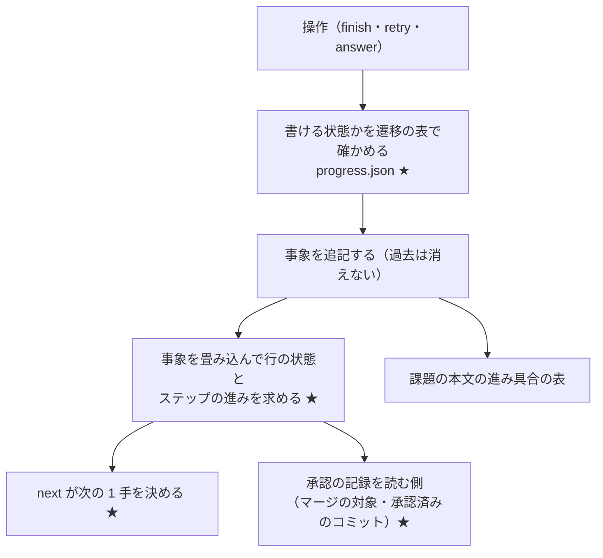
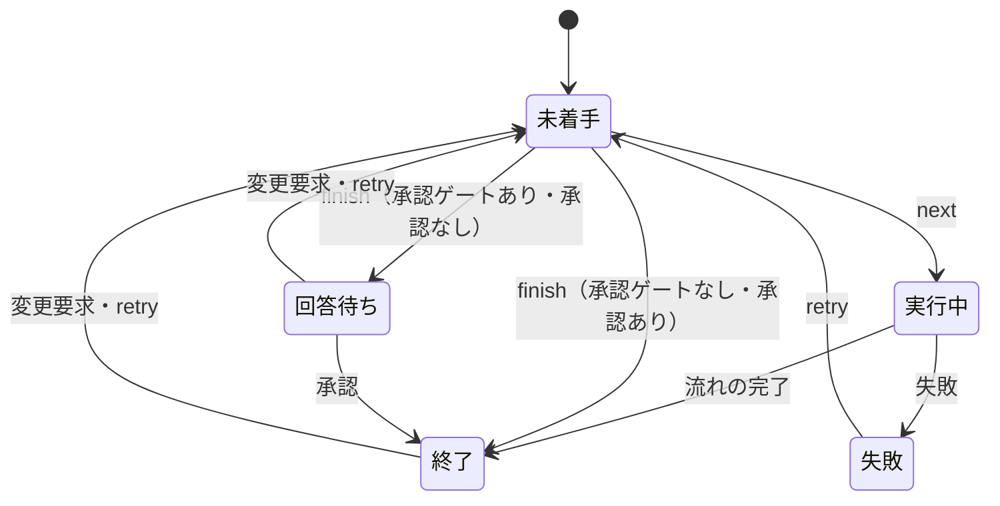
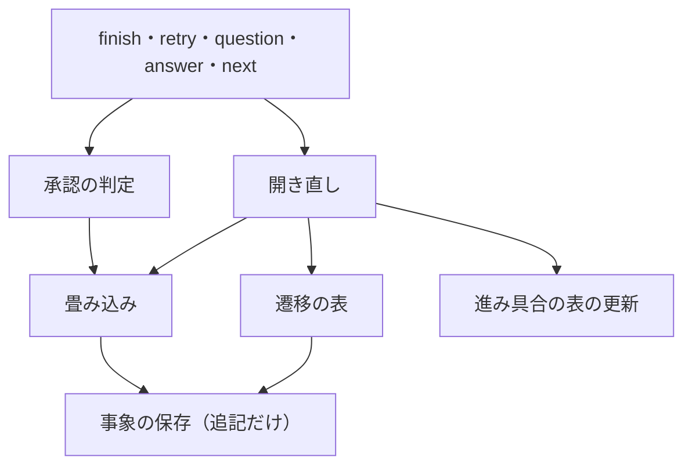
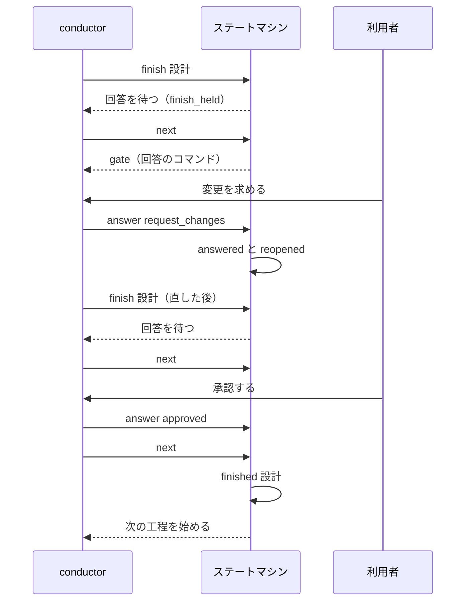
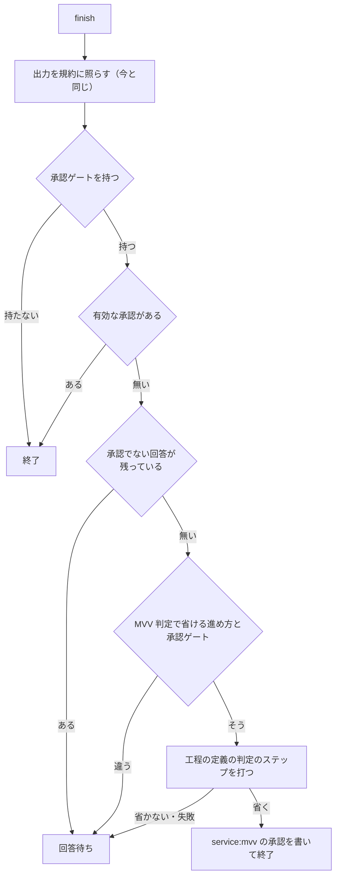

# スプリントのステートマシン: 工程を開き直せるようにし、承認の無い工程の先へ進ませない（#4520）

終えた工程はやり直せず、承認ゲートの回答は回答待ちの工程にしか書けない。一方で、手で終える操作は承認を待たない。工程を「開き直す」事象と、手で終えた承認ゲートの工程を回答待ちに置く事象を足し、承認の有効・無効は追記した記録の順から決める。採らなかった案は「決定の記録」、他の製品と標準の調査は末尾の「外部の調査」にある。

## 今の姿

何が起きたか・目的・受け入れ条件は要求仕様（[issue-4520-requirements.md](./issue-4520-requirements.md)、正は #4520 の本文）にある。

★ が変える場所である。工程は進み具合の表の 1 行にあたり、この文書でも「工程」と呼ぶ。

不具合の根本原因は 2 つある。

| 根本原因 | 起きること |
| --- | --- |
| 遷移の表と回答の処理が「自動の流れが順に進む」場合だけを想定している。終えた状態から戻る事象が無く、回答は待っている質問にしか結び付かない | 終えた工程をやり直せない。流れの外の回答を記録できない |
| 承認ゲートの有無を見るのは自動の流れ（ステップの並び）と無効化の操作だけで、手で終える操作は見ない | 承認ゲートを素通りする |

## 文脈と制約

- 記録は追記だけである。過去の事象を消したり書き換えたりしない
- 承認ゲートの数、承認できる者、MVV 判定で省ける条件は変えない
- 状態の遷移の決まりは `plugins/ndf/contracts/workflow/progress.json` の 1 か所が持つ
- この改修より前に作ったステートマシンはそのまま読む。改修より前に手で終えた承認ゲートの工程は終了のままにする
- レーンと並行開発の計画のステートマシン、完了・中止したスプリント、流れている作業の手動の終了は扱わない

## 解き方の全体像

- 図の「回答待ち」は新しい状態ではない。状態は「実行中」のままで、承認ゲートのステップが回答を待っている
- 開き直しは `reopened` の事象 1 つで表す。それより前のステップの結果・出力・承認は、記録に残るが今の判断には使わない
- 承認ゲートを持つ工程には、どの状態でも質問を作れる。回答は今と同じ検査を通る
- 手で終えた承認ゲートの工程は、承認が記録されるまで終了にならないので、`next` は後ろの工程を始めない

## ドメインモデル

### コンテキスト

| コンテキスト | 何の語が 1 つの意味に決まるか |
| --- | --- |
| NDF の開発ワークフロー（`ndf-workflow`） | 工程・承認ゲート・開き直し |

### 集約

| 集約 | オーナー（書き換えてよいもの） | 根 | エンティティ | 値オブジェクト |
| --- | --- | --- | --- | --- |
| スプリントのステートマシン | `ndf progress` と `ndf answer`（事象を追記する関数を通る） | ステートマシン | 工程の行 | 事象・回答・見た対象 |

### 不変条件

| # | 集約 | 条件 | 破れたときの扱い |
| --- | --- | --- | --- |
| I1 | スプリントのステートマシン | 承認ゲートを持つ工程が終了になるのは、直近の開き直しより後の最新の回答が承認で、回答が見た対象（PR の番号と HEAD。「処理の流れ」の「有効な承認」の 3）が一致するときだけ。この改修より前の記録は除く | 終了を書かず、回答待ちにする |
| I2 | 同上 | 開き直しより前のステップの結果・出力・承認は、次の手の判断に使わない | — |
| I3 | 同上 | 事象は追記だけ | 書く関数が追記しか持たない |
| I4 | 同上 | 工程を流す作業が動いている間は開き直さない | 操作を断る |
| I5 | 同上 | 本番へ反映される承認は利用者本人の回答だけ | 今の検査のまま断る |

### ドメインイベント

| # | イベント | 発生元 | 受け手 |
| --- | --- | --- | --- |
| E1 | 工程を終えた | 自動の流れ・`finish` | `next`、進み具合の表 |
| E2 | 承認を求めた | `finish`（回答待ち）・自動の流れ | 利用者 |
| E3 | 回答を記録した | `ndf answer` | `next`、マージの側 |
| E4 | 工程を開き直した | 変更要求・却下の回答、`retry` | `next`、進み具合の表 |
| E5 | 開き直した工程を終えた | 流し直し・`finish` | E1 と同じ |

## 機能一覧

| # | 機能 | 誰が使うか |
| --- | --- | --- |
| F1 | 手で終えた承認ゲートの工程で承認を待つ | conductor、利用者 |
| F2 | どの状態の承認ゲートの工程にも回答を記録する | 利用者、conductor |
| F3 | 終えた工程を開き直す（後ろを開き直すか残すかを選ぶ） | conductor |

## 構成要素

| 要素 | 責務 |
| --- | --- |
| 遷移の表（`progress.json` とそのスキーマ） | 事象 `reopened`・`finish_held` を足し、`answered` と `failed` の書ける状態を広げる |
| 畳み込み（ステップの進みと文脈） | `reopened` で進みを捨てて世代を上げる。手で終えた回答待ちを表す。開き直しより前の出力を文脈から外す |
| 承認の判定（新設） | 工程の事象の列と今の対象から「有効な承認があるか」を返す純粋な処理 |
| 開き直し（新設） | 対象の工程と後ろの工程を決め、`reopened` を書き、取り消されない操作の一覧を作る |
| 手で終える操作（`finish`） | 承認ゲートの有無と有効な承認を見て、終了か回答待ちかを書き分ける |
| 質問の作成（`ndf progress question`、新設） | 待っていない承認ゲートの工程の質問・承認資料・回答のコマンドを作る |
| 回答の記録（`ndf answer`） | 待っている質問に加え、上で作った質問への回答を受ける |
| 次の 1 手の判断（`next`） | 回答待ちの工程は承認ゲートの結果を返し、承認を読んだら終了を書く |
| 承認を読む側（マージの対象・承認済みのコミット・リリースの識別子） | 直近の開き直しより前の回答を読まない |
| 進み具合の表の更新 | 開き直しと、回答待ちからの終了の後に、課題と PR の本文を書き直す |
| 手順書（進み具合の記録・supervisor の経路・承認の回答の記録） | 新しい操作と振る舞いを説明する |

## 入出力のコントラクト

### 操作と工程の状態の組み合わせ

「回答待ち」は、承認ゲートの回答を待っている実行中の工程である（自動の流れで着いたものと、手で終えたもの）。無効・中止の工程と、完了・中止したスプリントは、どの操作も今と同じく断る。

| 状態 | `finish` | `retry` | 承認 | 変更要求 | 承認しない（却下） |
| --- | --- | --- | --- | --- | --- |
| 未着手 | 終了か回答待ち | 断る（`next` を打つ） | 記録する | 記録する | 記録する |
| 実行中（作業あり・途中で止まった） | 断る（`wait` を打つ） | 断る | 記録する | 記録する | 記録する |
| 回答待ち（自動の流れ） | 断る（回答する） | 断る（変更要求を回答する） | 今と同じ | 今と同じ（ステップを初めから） | 今と同じ（失敗） |
| 回答待ち（手で終えた） | 断る（回答するか変更要求） | `--later` を付けて開き直す | 終了にする（次の `next` が終了を書く） | 工程と後ろを開き直す | 工程を失敗にし、後ろを開き直す |
| 失敗 | 終了か回答待ち | 今と同じ | 記録する | 記録する | 記録する |
| 終了 | 断る（`retry` か変更要求） | `--later` を付けて開き直す | 記録する | 工程と後ろを開き直す | 工程を失敗にし、後ろを開き直す |

承認ゲートを持たない工程への回答と質問の作成は、理由を示して断る。

### コマンド

| コマンド | 変わる中身 |
| --- | --- |
| `ndf progress finish <ID> <工程> --output <JSON> --reason <理由>` | 承認ゲートを持つ工程で有効な承認が無ければ、結果は `ok` で「回答を待つ」と返し、`next` に `ndf progress next` を載せる |
| `ndf progress retry <ID> <工程> --reason <理由> [--later reopen\|keep]` | 終了と手で終えた回答待ちの工程では `--later` が必須。失敗の工程では受けない |
| `ndf progress question <ID> <工程> [--pr <番号>]` | 新設。結果は `gate` で、回答ごとの `ndf answer` を返す。回答待ちの工程には今の質問を返す。設計承認ゲートで PR が文脈に無ければ `--pr` が必須 |
| `ndf answer <ID> --gate <質問の id> ...` | 引数は変わらない。`question` が作った質問の id を受ける |
| `ndf progress next <ID>` | 引数は変わらない。手で終えた回答待ちの工程では `gate` と回答のコマンドを返す |

開き直しを起こす操作の結果は、次を持つ。

| 項目 | 中身 |
| --- | --- |
| `items` | 開き直した工程の名前（進みがあったものだけ） |
| `warnings` | マージかリリースを済ませた工程が含まれれば「この操作は取り消されない」と工程名 |

断る結果の `summary` は、理由と、代わりに打てるコマンドを 1 つ以上持つ。

### 事象

| 事象 | 書ける状態 | 後の状態 | payload |
| --- | --- | --- | --- |
| `finish_held`（新設） | 未着手・失敗 | 実行中 | 承認ゲートのステップ、出力のファイル |
| `reopened`（新設） | 未着手・実行中・失敗・終了 | 未着手 | きっかけ（`retry` か回答）、変更要求の指摘 |
| `answered` | 未着手・実行中・失敗・終了（未着手と終了を足す） | 変えない | 待っていない質問への回答には `late: true` |
| `failed` | 実行中・未着手（未着手を足す） | 失敗 | 今と同じ |

事象 `reopened` と `finish_held` は理由が必須である。変えるのは遷移の表の定義だけで、DB の表の形は変えない。

## 処理の流れ

2026-11-25 の実例（受け入れ条件 22）は次の順になる。

`finish` の判断は次のとおりである。

「承認でない回答が残っている」は、直近の `reopened` より後の、この承認ゲートの最新の回答が承認でないことを指す。

「有効な承認」は次をすべて満たす回答である。

1. 直近の `reopened` より後の、この承認ゲートの最新の回答である
2. 回答が承認で、数えない MVV 判定の回答でない
3. 回答の見た PR の番号と HEAD が、出力の PR の番号と今の HEAD に一致する。対象の PR を持たない承認ゲートでは、両方に PR が無いことを一致とする。HEAD を読めなければ一致としない

## 非機能の実現方式

| 大項目 | 条件 | 実現方式 |
| --- | --- | --- |
| 移行性 | 変更の前のステートマシンをそのまま読む | 事象の種類を足すだけにする。回答待ちは `finish_held` を書いたときだけ生じるので、過去の `manual_finished` は終了のままになる |
| セキュリティ | 承認の記録が無いまま承認ゲートの後が始まらない | 承認ゲートを持つ工程に終了を書く経路は 3 つだけにする。(1) 自動の流れの承認ゲートのステップ、(2) `finish`、(3) 回答待ちの工程の承認を読む `next`。`next` は終了でない最初の工程から流すので、後ろは始まらない |

## 決定の記録

### 決定 1: 過去の記録を残したまま作業を戻すため、開き直しを追記の事象 1 つで表す

- **質問**: 終えた工程を戻すことを、どう記録するか。定義の改訂を作り直す、行を複製する、事象を足す、の選択がある
- **選んだ案**: 事象 `reopened` を足す
  - 畳み込みは、これより前のステップの結果を捨てて世代を上げる
  - 世代が上がるとプランの実行の保存先が新しくなり、前の回の結果を使い回さない（変更要求の流し直しと同じ仕組み）
- 採らなかった案: 定義の改訂を上げて全工程を作り直す（終了を残す工程の事象までコピーする必要があり、同じ事実が 2 か所になる）
- 採らなかった案: DBOS の `fork_workflow`・`rewind_workflow` で実行を巻き戻す（ステートマシンの記録は DBOS の表を使わない。手で終えた工程には DBOS の実行が無い）
- **代償**: 事象を読む側が「直近の開き直し」を意識する必要がある。読む側は構成要素の「承認を読む側」と「畳み込み」に集める
- 作り方: 自前で作る・標準に倣う
- 比べた候補: PRD1 / PRD3 / LIB1 / LIB2 / LIB3
- 根拠: Value 8「履歴を残す事実は追記だけで持ち、今の値は最新の記録から引く」（MVV バージョン 11）。PRD1

### 決定 2: 回答待ちを今の仕組みで扱うため、新しい状態を足さず実行中の待ちにする

- **質問**: 承認の無いまま手で終えた承認ゲートの工程を、どの状態にするか
- **選んだ案**: 事象 `finish_held` で「実行中」にし、承認ゲートのステップの待ちにする
  - 質問・承認資料・回答の検査・対象の見直し（`recheck`）は今のものを使う
  - 承認を読んだら、ステップを流さずに終了を書く
  - 工程の出力は `finish_held` と同じトランザクションで文脈へ書く（質問が PR を読むため）
- 採らなかった案: 状態「承認待ち」を足す（状態の語・中止・表示・進み具合の表のすべてに分岐が増える）
- 採らなかった案: 終了にして、`next` が承認の有無を毎回見る（変更の前に手で終えた工程も回答待ちに戻り、移行性の条件に反する。進み具合の表も終了のままになる）
- 採らなかった案: 承認が無ければ `finish` を断る（supervisor の経路で工程の出力を残せず、承認資料の対象の PR も決まらない）
- **代償**: 「実行中」に、流れる作業の無いものが加わる。承認の後に残るステップ（設計 PR のマージなど）を NDF は流さない。これらは今の手で終える操作と同じく、流れの外で行う
- 根拠: Value 11「同じ規則・定数・処理は 1 か所にまとまり、ほかはそこを参照する」（MVV バージョン 11）

### 決定 3: 待っていない工程への回答も同じ検査に通すため、質問を先に作るコマンドを足す

- **質問**: 質問の id がまだ無い状態で、回答する承認ゲートをどう指定するか
- **選んだ案**: `ndf progress question <ID> <工程>` を足す
  - 待ちの質問と同じ形の id・承認資料・提示した対象・回答のコマンドを作る
  - id は工程の最後の事象の番号から作るので、事象が増えると古いコマンドは断られる
  - 先に書いた承認は自動の流れの承認ゲートでは使わず、`finish` の有効な承認の判定だけが使う
- 採らなかった案: `--gate design` のように区分の名前で受ける（利用者が何を見て回答したかを結び付けられず、対象が変わった回答を断れない）
- 採らなかった案: `ndf answer` に工程の名前と PR の番号を渡す（承認資料と提示の識別子が無く、今の検査の一部が抜ける）
- **代償**: 待っていない工程への回答は 2 つのコマンドになる。自動の流れが後で承認ゲートに着くと、改めて質問する
- 根拠: Value 3「同じ操作を打ち直しても、結果は 1 回打ったときと変わらない」・Value 15（MVV バージョン 11）

### 決定 4: 変更要求の後に後ろの工程が古い成果の上で進まないよう、終えた工程への回答は後ろも開き直す

- **質問**: 終えた工程への変更要求と却下で、後ろの工程と指定の工程をどうするか
- **選んだ案**: 回答の種類と工程の状態で、次のように分ける
  - 終えた工程と、手で終えた回答待ちの工程への変更要求: 指定の工程と後ろの工程を未着手に戻す
  - 同じ工程への却下: 後ろを未着手に戻し、指定の工程は失敗にする。自動の流れの却下と同じく、`next` は流し直さず `retry`・`finish`・`cancel` を返す
  - 変更要求の指摘: `reopened` に持たせ、流し直す作業へ今の経路で渡す
  - 待っていない未着手・実行中・失敗の工程への承認でない回答: 記録だけにする。その工程の承認ゲートは MVV 判定で省かず人へ質問する
- 採らなかった案: 却下も変更要求と同じく扱う（`next` が却下された工程を流し直す）
- 採らなかった案: 後ろの扱いを回答のたびに選ばせる（受け入れ条件 6 が開き直すと決めている）
- **代償**: 後ろの工程に手戻りの無い部分があっても流し直す。残したいときは `retry --later keep` を使う
- 根拠: Value 3 / Value 1（MVV バージョン 11）

### 決定 5: 取り違えを防ぐため、後ろの扱いを指定しないやり直しは断る

- **質問**: 終えた工程の `retry` で後ろの工程の扱いを省いたら、断るか既定を置くか
- **選んだ案**: `--later reopen|keep` を必須にして断る。失敗の工程の `retry` は今の打ち方のままにする
- 採らなかった案: 既定を `reopen` にする（意図せず済んだ工程が流し直され、費用がかかる）
- 採らなかった案: 既定を `keep` にする（直した内容を後ろが読まないまま進む）
- **代償**: 打つ引数が 1 つ増える
- 根拠: Value 3（MVV バージョン 11）。PRD1

### 決定 6: 直した内容を後ろに読ませるため、開き直した工程の前の出力と承認を判断から外す

- **質問**: 開き直した工程が前に書いた出力と承認を、文脈と承認の読み手にどう扱わせるか
- **選んだ案**: 直近の `reopened` より前のものを、次のように扱う
  - その工程が書いた出力は、文脈へ重ねない。設計承認で外した課題（`issues`）だけは残す
  - 承認を読む側（マージの対象・承認済みのコミット・リリースの識別子・有効な承認の判定）は、回答を読まない
  - 回答の一覧（`ndf answer list`）はすべて出す
- 採らなかった案: 古い出力を残し、新しい出力で上書きされるのを待つ（流し直しが出さなくなったキーが残り、後ろが古い PR や MVV 判定を読む）
- 採らなかった案: `issues` も戻す（外した課題はレーン（並行開発の 1 本）の次のスプリントへ入れてあり、戻すと 2 か所で進む）
- **代償**: 開き直して `keep` で残した後ろの工程の成果は、前の出力を基にしたままになる。進み具合の表の PR の欄は、開き直す前の PR の番号で書き直す
- 根拠: Value 8（MVV バージョン 11）。PRD2

### 決定 7: MVV 判定で省く条件を変えずに手の経路を通すため、`finish` が判定を打つ

- **質問**: 承認を MVV 判定で省く進め方で、手で終えた工程の省略をどう記録するか
- **選んだ案**: 承認を MVV 判定で省ける進め方（`auto`・`fast`）の、省ける承認ゲート（設計）で有効な承認が無ければ、`finish` が判定を打つ
  - 打つのは工程の定義の判定のステップ（`ndf records mvv gate`）で、入力は同じにする
  - 省くと決まれば、`service:mvv` の承認を自動の流れと同じ形で書いて終了にする
  - 省かない・打てなければ、回答待ちにする
- 採らなかった案: `finish` の出力に書かれた `mvv_gate` を採る（手で書けるファイルを承認の根拠にすることになり、直前の判定だけを採る今の条件を緩める）
- 採らなかった案: 手の経路では省かない（`auto`・`fast` の利用者が設計のたびに止まる）
- 採らなかった案: 回答待ちにしてから `next` が判定と読み手役のステップを流す（読み手役が文書を直すと自動の流れの設計レビューへ戻り、手で行った工程と混ざる）
- **代償**: `auto`・`fast` の `finish` は判定の時間と費用がかかる。手で終えた工程の承認待ちでは読み手役（文書を読んで通じない箇所を確かめる AI）のステップを流さず、承認資料の読み手役の確認は無い（今の手の経路と同じ）
- 根拠: Value 1「速さや費用のために、人の承認を省かない」・Value 11（MVV バージョン 11）

## 影響と危険

- **働く範囲**: 利用先のリポジトリでも働く（`ndf progress` と `ndf answer`）
- **プロジェクトごとに違うもの**: 足さない。承認ゲートの有無は工程の定義、省ける進め方はステートマシンの文脈が持つ
- **当たるモード**: ステートマシンを作るすべてのモード。承認ゲートの扱いは、設計かデプロイの承認ゲートを持つモード
- **打ち方が変わる箇所**: 流れの外で進めた設計とデプロイは、承認を記録するまで次へ進まない
- **流し直しで当たる外の状態**: 済んだマージ・リリースは取り消されない。流し直したステップが、マージ済みの PR やブランチを前に止まる可能性がある（未確認）
- **PR の承認の証跡**: `retry` の開き直しは、PR に書いた承認の証跡を取り消さない。ステートマシンの中では改めて承認を求める
- **リリースのリクエスト**: `retry` でリリース承認の待ちを開き直すと、並行開発の計画が持つ承認のリクエストは開いたまま残る。質問の id が変わるので、古いリクエストへの回答は読まない
- **NDF のバージョンを戻した場合**: 古い NDF は `finish_held` の工程を普通の実行中と読み、工程のステップを初めから流す
- **同じファイルを触る別の変更**: [#4431](https://github.com/devbasex/ai-plugins/issues/4431)（変更要求の指摘が担当の AI の起動指示に入らない）は回答と畳み込みの周りを触る。この変更は指摘を渡す経路を変えない

### 代表のリポジトリでの振る舞い

| 代表のリポジトリ | 設定の要点 | 直した後に起きること | この種類で扱えなくなること |
| --- | --- | --- | --- |
| Web サービス | 本番へのデプロイにリリース承認ゲートがある | 流れの外のデプロイも、承認を記録するまで終了にならない。変更要求と開き直しを記録できる | 無し |
| モバイルアプリ | ストアへの申請の前にリリース承認ゲートがある | Web サービスと同じ。申請済みのバージョンは開き直しても取り消されず、結果にそう出る | 無し |
| 業務文書だけ | 設計承認ゲートが企画承認に当たる | 企画の差し戻しとやり直しを記録できる | 無し |

### このリポジトリだけの事情

- 無し（足す設定と値が無く、このリポジトリの運用を既定へ入れない）

## 用語

| 用語 | 意味 | 用語集への反映 |
| --- | --- | --- |
| 開き直し | 終えた・進んだ工程を未着手へ戻し、前の結果と承認を判断から外すこと。記録は残る | 追加 |
| 有効な承認 | 直近の開き直しより後の最新の回答が承認で、対象が一致するもの | 追加 |

## テスト設計

| 受け入れ条件・不変条件 | どの振る舞いで縛るか | どう壊したら落ちるべきか |
| --- | --- | --- |
| 1・I1 | 承認ゲートの工程を `finish` した後、`next` が `gate` と回答のコマンドを返し、後ろは未着手のまま | `finish` が終了を書くようにする |
| 2 | 承認を記録した後の `next` が次の工程を始める | 回答待ちの承認の読み取りを外す |
| 3 | 同じ PR と HEAD の承認がある `finish` は終了になる。HEAD が違えば回答待ち | 対象の比較を外す・常に不一致にする |
| 4 | 承認ゲートの無い工程の `finish` と `next` の事象と結果が今と同じ | 全工程を回答待ちにする |
| 5・8 | 4 つの状態の承認ゲートの工程で質問を作り回答を記録できる。承認ゲートの無い工程は理由付きで断る | `answered` の書ける状態を戻す |
| 6 | 終了の工程への変更要求（承認の後を含む）で、その工程と後ろが開き直り、`next` がその工程を流す | 後ろの開き直しを外す |
| 7 | 承認でない回答の間、`next` は後ろを始めない。却下は失敗のルートを返す。MVV 判定で省かない | 待っていない回答を数えない |
| 9・I5 | 対象が変わった回答、利用者でない本番の承認を断り、同じキーの打ち直しは増えない | 待っていない質問の検査を省く |
| 10・11 | 終了の工程の `retry` は理由と `--later` が無ければ断る | 既定を置く |
| 12・I2 | 開き直した後ろの工程が未着手で、新しい保存先で流れ、新しい出力を読む。無効・中止は変わらない | 世代を上げない・古い出力を重ねる |
| 13 | `keep` では指定の工程だけが戻り、終えると `next` が残した終了を飛ばす | 常に後ろも戻す |
| 14 | 開き直した承認ゲートの工程の `finish` と自動の流れが改めて承認を求め、承認済みのコミットは返らない | 開き直しより前の回答を読む |
| 15 | 結果に開き直した工程の一覧と、取り消されない操作の警告が出る | 一覧か警告を落とす |
| 16 | 失敗の工程の `retry` が `--later` なしで今と同じ事象を書き、済んだステップを残す | `reopened` に置き換える |
| 17・I3 | 開き直しの後も、前の事象と回答が `show` と `answer list` に出る | 事象を消す・回答の一覧を絞る |
| 18 | 開き直しの後、課題の本文の表でその工程の終了のマーカーが外れる。PR の欄も書き直す | 本文の書き直しを呼ばない |
| 19・I4 | 作業の排他が取られている間の開き直しを断り、何も書かない | 排他を取らない |
| 20 | 完了・中止したスプリントへの操作を断る | 終端の確かめを避ける |
| 21 | 断る結果が理由と代わりのコマンドを持つ | 理由だけにする |
| 22 | 実例の順を通しで打つと、最後に次の工程が始まる | 手で終えた回答待ちの変更要求で開き直さない |
| 23 | 手順書の更新は差分のレビューで見る（文言のテストは書かない） | — |
| 決定 7 | `auto` の `finish` で判定が省くなら終了、省かない・失敗なら回答待ち。出力に書いた省略は採らない | 出力の `mvv_gate` を読む |

## 設計の結果

| 課題 | 扱い | 統合先 | 触るファイル |
| --- | --- | --- | --- |
| #4520 | 実装する | — | `plugins/ndf/contracts/workflow/progress.json`、`plugins/ndf/src/ndf/progress/folding.py`、`plugins/ndf/src/ndf/progress/run_view.py`、`plugins/ndf/src/ndf/progress/approval.py`（新設）、`plugins/ndf/src/ndf/progress/reopening.py`（新設）、`plugins/ndf/src/ndf/progress/command.py`、`plugins/ndf/src/ndf/progress/run.py`、`plugins/ndf/src/ndf/progress/stages.py`、`plugins/ndf/src/ndf/progress/records.py`、`plugins/ndf/src/ndf/progress/gate/answering.py`、`plugins/ndf/src/ndf/progress/gate/asking.py`、`plugins/ndf/src/ndf/progress/gate/entry.py`、`plugins/ndf/src/ndf/progress/gate/records.py`、`plugins/ndf/tests/progress/test_reopen_operations.py`（新設）、`plugins/ndf/tests/progress/test_manual_gate.py`（新設）、`plugins/ndf/tests/progress/test_model.py`、`plugins/ndf/tests/progress/test_command.py`、`plugins/ndf/skills/progress-tracking/SKILL.md`、`plugins/ndf/skills/development-workflow/references/agent-layers.md`、`plugins/ndf/skills/development-workflow/references/approval-answer.md`、`docs/glossary/glossary.json`、`docs/glossary/ndf-workflow.md`、`docs/glossary.md` |

[#3957](https://github.com/devbasex/ai-plugins/issues/3957)（手で終えると回答を待たずに次の工程が始まる）の受け入れ条件 3 件は、要求仕様の受け入れ条件 1・2・4 に含まれる。

## 未確認のまま残ること

| 項目 | 内容 |
| --- | --- |
| 流し直したステップの外の状態への反応 | マージ済みの設計 PR や実装のブランチがある状態で、開き直した工程のプランがどう進むかは、実装のテストでは外の状態を作り物にするため確かめられない。リリースの後に実際の開き直しで分かる |
| `finish` の中の MVV 判定の所要時間 | `auto`・`fast` で実際に打つまで分からない |

## 外部の調査

| 種類 | 調べるか | 理由 |
| --- | --- | --- |
| 標準・仕様 | 調べない | 開発の工程の進み具合の開き直しと承認の扱いを定めた公開の規格は、対象にする当てが無い |
| 主要な製品 | 調べる | 終えた処理の再実行と、後ろの扱い、承認の失効の解き方を比べる |
| ライブラリとサービス | 調べる | 依存している DBOS の巻き戻しと、状態遷移のライブラリを使えるかを比べる |

### 主要な製品

| # | 製品 | どう解いているか | 設計への反映 | 出典 |
| --- | --- | --- | --- | --- |
| PRD1 | Apache Airflow | タスクの「Clear」で状態を無しに戻して流し直す。試行の番号は増える。下流を含めるかは選ぶ | 開き直しは状態を戻して世代を上げる。後ろの扱いを選ぶ | https://raw.githubusercontent.com/apache/airflow/main/airflow-core/docs/core-concepts/dag-run.rst （2026-11-27） |
| PRD2 | GitHub のブランチ保護と GitHub Actions | 差分に影響する push で古い承認を失効させる設定がある。ジョブの再実行は依存するジョブも流し、含めないジョブは前の出力を保つ | 承認は対象の HEAD に結び付ける。後ろを流し直すか前の成果を残すかを分ける | https://raw.githubusercontent.com/github/docs/main/content/repositories/configuring-branches-and-merges-in-your-repository/managing-protected-branches/about-protected-branches.md ・ https://docs.github.com/en/actions/how-tos/manage-workflow-runs/re-run-workflows-and-jobs （2026-11-27） |
| PRD3 | Temporal | `workflow reset` で、イベントの履歴の指定の点から実行を再開する | 過去の履歴を残して、ある点から先をやり直す | https://docs.temporal.io/cli/workflow （2026-11-27） |

### ライブラリとサービス

| # | 候補 | バージョン | ライセンス | 最後のリリースの日付 | 終了のアナウンス | 要件を満たすか | 出典 |
| --- | --- | --- | --- | --- | --- | --- | --- |
| LIB1 | DBOS の `fork_workflow`・`rewind_workflow`（依存済み） | 依存は 3.1.0 | 未確認 | 未確認 | 未確認 | 満たさない。DBOS の実行を巻き戻すもので、ステートマシンの事象と、手で終えた工程を扱わない | https://docs.dbos.dev/python/reference/contexts （2026-11-27）、`pyproject.toml` |
| LIB2 | python-statemachine | 3.2.2 | MIT | 2026-10-14 | 未確認 | 満たさない。メモリ上の状態遷移で、追記の記録と畳み込みは自分で持つことになる | https://pypi.org/pypi/python-statemachine/json （2026-11-27） |
| LIB3 | transitions | 0.9.3 | MIT | 2025-07-02 | 未確認 | 満たさない（LIB2 と同じ） | https://pypi.org/pypi/transitions/json （2026-11-27） |

### 確かめられなかったこと

| 対象 | 試した手段 | 結果と理由 |
| --- | --- | --- |
| Temporal の CLI の文書の原文 | https://raw.githubusercontent.com/temporalio/documentation/main/docs/cli/workflow.mdx | HTTP 404。公開サイトのページで代えた |
| LIB の終了のアナウンスと DBOS のライセンス・リリース日 | 試していない | 採らない理由が要件の側にあるため調べていない |

調べた量: 候補 6 件・取得の試み 16 回。
