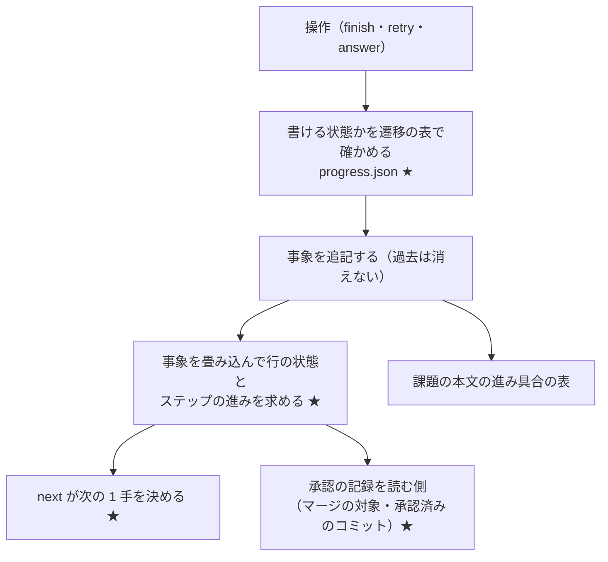
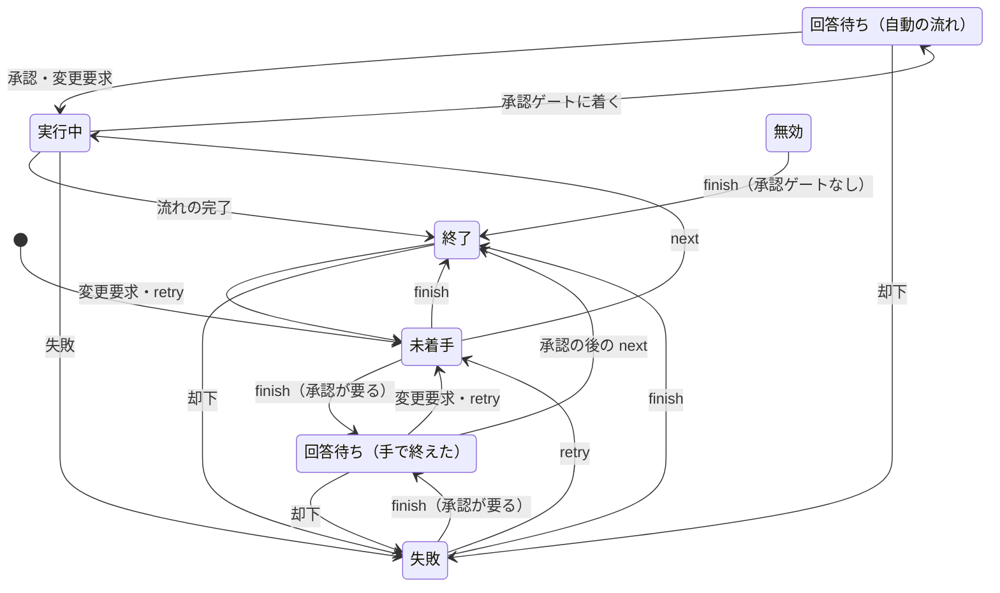
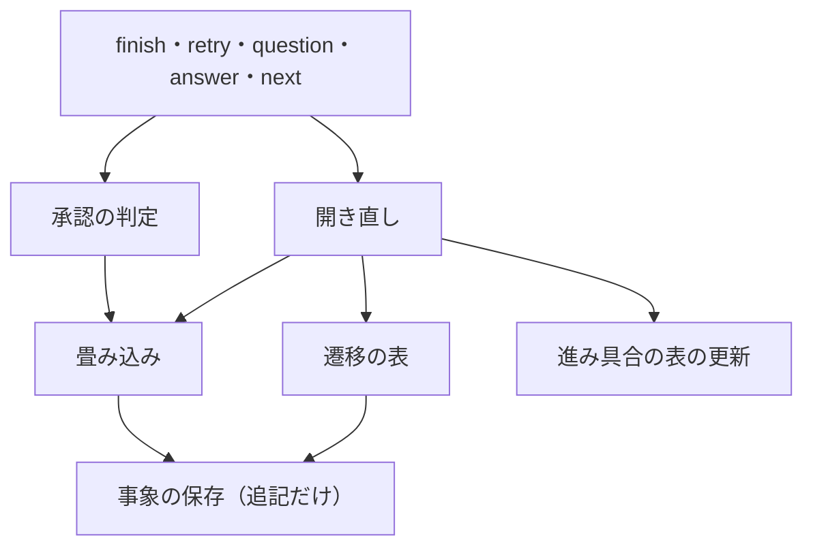
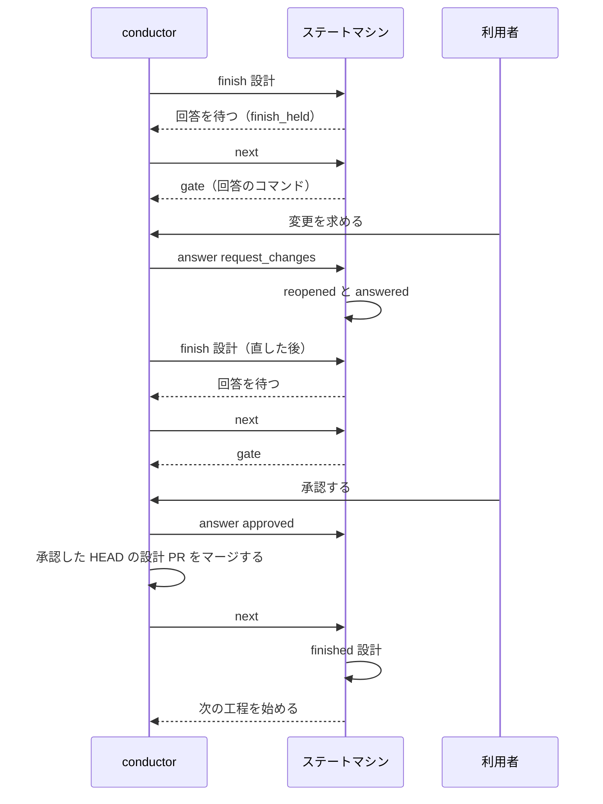
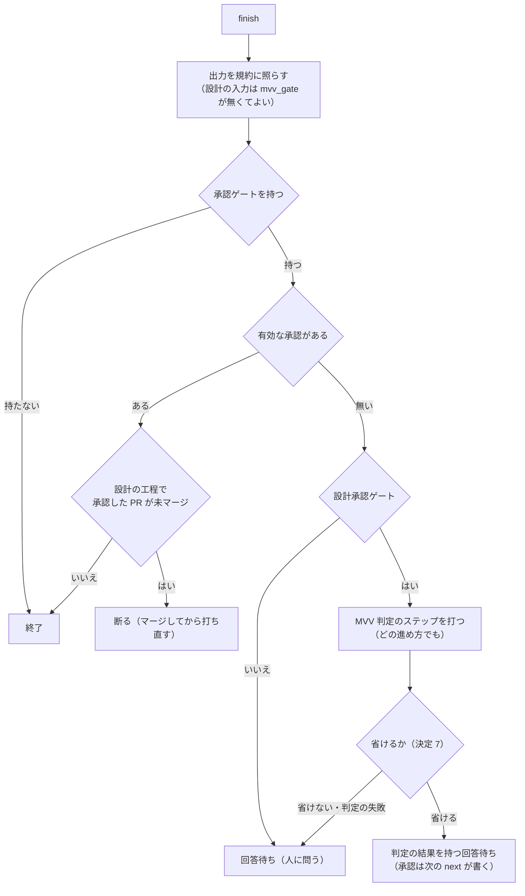

# スプリントのステートマシン: 工程を開き直せるようにし、承認の無い工程の先へ進ませない（#4520）

終えた工程はやり直せず、承認ゲートの回答は回答待ちの工程にしか書けない。一方で、手で終える操作は承認を待たない。工程を「開き直す」事象と、手で終えた承認ゲートの工程を回答待ちに置く事象を足し、承認の有効・無効は追記した記録の順から決める。採らなかった案は「決定の記録」、他の製品と標準の調査は末尾の「外部の調査」にある。

## 今の姿

何が起きたか・目的・受け入れ条件は要求仕様（[issue-4520-requirements.md](./issue-4520-requirements.md)、正は #4520 の本文）にある。

この文書で使う語の関係は次のとおりである。工程は複数のステップから成る。プランを実行するステップでは、プランの中に実行手順が並ぶ。この設計が扱う承認ゲートは工程のステップの 1 つで、プランの中の実行手順ではない。

| 語 | 意味 |
| --- | --- |
| 工程 | 進み具合の表の 1 行（設計・実装・デプロイなど）。状態を持つのは工程である |
| ステップ | 工程の中の 1 区切り。設計の工程なら、設計・レビュー・MVV 判定・読み手役（文書を読んで通じない箇所を確かめる AI）の確認・承認ゲート・マージの順に並ぶ |
| 承認ゲートのステップ | 人の回答を待つステップ。工程がこのステップを持てば「承認ゲートを持つ工程」である |
| プラン | 1 つのステップの中で AI の作業を順に流す手順の定義（`ndf plan`） |
| 自動の流れ | `ndf progress next` が工程とステップを順に流すこと |
| 手の経路 | 自動の流れを使わずに工程を進めること。supervisor（工程を代わりに進める AI）が作業し、conductor（統括する AI）が `ndf progress finish` で工程を終える。承認の後に残る作業（設計 PR のマージなど）も conductor が行う |
| 文脈 | 工程が出力した値（`design_pr` など）を重ねて持つ、ステートマシンの中の共有データ。後ろの工程が入力として読む |
| 世代 | 工程を最初からやり直すたび（開き直し、自動の流れの回答待ちでの変更要求）に 1 つ進む番号。番号が変わると、前の回の実行結果は使わない |
| 証跡（承認の証跡・却下の証跡） | 承認か却下を、対象（ベースリポジトリ・PR・マージ先・HEAD）と担い手（利用者 `user` か MVV 判定 `mvv`）を添えて PR に書くコメント。`ndf ci merge` がこれを読んでマージの可否を決める |
| オーガナイザー | 並行開発の複数のレーンをまとめる役。レーンのリリースなどの承認依頼（リクエスト）を受けて回答を返す。並行開発の計画の外にいる場合は、依頼をファイルで受け取る |

★ が変える場所である。

不具合の根本原因は 2 つある。

| 根本原因 | 起きること |
| --- | --- |
| 遷移の表と回答の処理が「自動の流れが順に進む」場合だけを想定している。終えた状態から戻る事象が無く、回答は待っている質問にしか結び付かない | 終えた工程をやり直せない。待っていないときの回答を記録できない |
| 承認ゲートの有無を見るのは自動の流れ（ステップの並び）と無効化の操作だけで、手で終える操作は見ない | 承認ゲートを素通りする |

## 文脈と制約

- 記録は追記だけである。過去の事象を消したり書き換えたりしない
- 承認ゲートの数、承認できる者、MVV 判定で省ける条件は変えない
- 状態の遷移の決まりは `plugins/ndf/contracts/workflow/progress.json` の 1 か所が持つ
- この改修より前に作ったステートマシンはそのまま読む。改修より前に手で終えた承認ゲートの工程は終了のままにする
- レーンと並行開発の計画のステートマシン、完了・中止したスプリント、流れている作業の手動の終了は扱わない

## 解き方の全体像

- 図の 2 つの「回答待ち」は新しい状態ではない。状態は「実行中」のままで、承認ゲートのステップが回答を待っている
- 自動の流れの回答待ちで変更を求めると、今と同じく工程の中のステップを初めからやり直す。工程は開き直さない
- 開き直しは `reopened` の事象 1 つで表す。それより前のステップの結果・出力・承認は、記録に残るが今の判断には使わない
- 承認ゲートを持つ工程には、未着手・実行中・失敗・終了のどの状態でも質問を作れる。回答は今と同じ検査を通る
- 手で終えた承認ゲートの工程は、承認が記録されるまで終了にならないので、`next` は後ろの工程を始めない

## ドメインモデル

### コンテキスト

| コンテキスト | 何の語が 1 つの意味に決まるか |
| --- | --- |
| NDF の開発ワークフロー（`ndf-workflow`） | 工程・承認ゲート・開き直し |

### 集約

| 集約 | オーナー（書き換えてよいもの） | 根 | エンティティ | 値オブジェクト |
| --- | --- | --- | --- | --- |
| スプリントのステートマシン | `ndf progress` と `ndf answer`（事象を追記する関数を通る） | ステートマシン | 工程の行 | 事象・回答・見た対象 |

### 不変条件

| # | 集約 | 条件 | 破れたときの扱い |
| --- | --- | --- | --- |
| I1 | スプリントのステートマシン | 承認ゲートを持つ工程が終了になるのは、「有効な承認」（定義は「処理の流れ」）があるときだけ。設計承認ゲートでは、承認した HEAD がマージ済みであることも要る。デプロイの工程を手の経路で終えるときは、PR に残ったリリース記録で、出力のバージョンが本番へ出たと確かめられることも要る（「リリース済みの確かめ」）。この改修より前の記録は除く | 終了を書かない |
| I2 | 同上 | 開き直しより前のステップの結果・出力・承認は、次の手の判断に使わない。ただし変更要求と却下の回答は、開き直しの後も、MVV 判定で承認を省かないための判断に使う（決定 4） | — |
| I3 | 同上 | 事象は追記だけ | 書く関数が追記しか持たない |
| I4 | 同上 | 工程を流す作業が動いている間は開き直さない | 操作を断る |
| I5 | 同上 | `ndf answer` で本番へ反映される承認を記録できるのは、利用者本人の回答だけ。例外は今の決まりと同じく MVV 判定の通過（`service:mvv`）だけで、設計承認ゲートを決定 7 の条件で省くときは、設計 PR のマージが本番へ反映される対象でも承認になる（[今の仕様](../docs/specifications/ndf-production-merge-approval.md)）。リリース承認ゲートは省かない | 今の検査のまま断る |

### ドメインイベント

| # | イベント | 発生元 | 受け手 |
| --- | --- | --- | --- |
| E1 | 工程を終えた（承認ゲートを持つ工程では、承認の後） | 自動の流れ・`finish`・回答待ちの承認を読んだ `next` | `next`、進み具合の表 |
| E2 | 承認を求めた | 有効な承認の無い `finish`・自動の流れが承認ゲートに着いた | 利用者 |
| E3 | 回答を記録した | `ndf answer` | `next`、マージの側 |
| E4 | 工程を開き直した | 変更要求・却下の回答、`retry` | `next`、進み具合の表 |
| E5 | 開き直した工程を終えた | 流し直し・`finish` | E1 と同じ |

## 機能一覧

| # | 機能 | 誰が使うか |
| --- | --- | --- |
| F1 | 手で終えた承認ゲートの工程で承認を待つ | conductor、利用者 |
| F2 | どの状態の承認ゲートの工程にも回答を記録する | 利用者、conductor |
| F3 | 終えた工程を開き直す（後ろを開き直すか残すかを選ぶ） | conductor |

## 構成要素

| 要素 | 責務 |
| --- | --- |
| 遷移の表（`progress.json` とそのスキーマ） | 事象 `reopened`・`finish_held` を足し、`answered` と `failed` の書ける状態を広げる |
| 畳み込み（ステップの進みと文脈） | `reopened` で進みを捨てて世代を上げる。手で終えた回答待ちを表す。開き直しより前の出力を文脈から外す |
| 承認の判定（新設） | 工程の事象の列と今の対象から「有効な承認があるか」と「承認でない回答が残っているか」を返す純粋な処理 |
| 開き直し（新設） | 対象の工程と後ろの工程を決め、`reopened` を書き、取り消されない操作の一覧を作る |
| 手で終える操作（`finish`） | 承認ゲートの有無と有効な承認を見て、終了か回答待ちかを書き分ける。設計の回答待ちでは MVV 判定を打つ。デプロイではリリース記録を確かめる。承認の証跡は書かない |
| 質問の作成（`ndf progress question`、新設） | 待っていない承認ゲートの工程の質問・承認資料・回答のコマンドを作る |
| 回答の記録（`ndf answer`） | 待っている質問に加え、上で作った質問への回答を受ける。リリースの後の回答は追認として記録する |
| 依頼の有効性の問い合わせ（`ndf progress request-status`、新設） | 外のオーガナイザーが持つ依頼の ID が、今の質問のものかを答える |
| 次の 1 手の判断（`next`） | 回答待ちの工程は承認ゲートの結果を返し、承認を読んだら終了を書く。承認でない回答が残る承認ゲートは MVV 判定で省かない。MVV 判定の承認を記録した後に、承認の証跡を PR へ書く |
| 承認を読む側（マージの対象・承認済みのコミット・リリースの識別子） | 直近の開き直しより前の回答と、見た PR が工程の対象の PR と違う回答を読まない |
| リリースのリクエスト（並行開発の計画か、計画の外のオーガナイザーへ出す承認の依頼） | 開き直しで失効する承認ゲートのリクエストだけを取り下げる |
| 進み具合の表の更新 | 開き直しと、回答待ちからの終了の後に、課題と PR の本文を書き直す。失敗したときは、記録を足さずにもう一度書き直せる |
| 作り直し用の作業場所 | マージ済みの設計を開き直したとき、現在のベースから作業場所を作って記録し、マージの後に取り込んで片付ける |
| 手順書（進み具合の記録・supervisor の経路・承認の回答の記録） | 新しい操作と振る舞いを説明する |

## 入出力のコントラクト

### 操作と工程の状態の組み合わせ

「回答待ち」は、承認ゲートの回答を待っている実行中の工程である（自動の流れで着いたものと、手で終えたもの）。中止の工程と、完了・中止したスプリントは、どの操作も今と同じく断る。

| 状態 | `finish` | `retry` | 承認 | 変更要求 | 承認しない（却下） |
| --- | --- | --- | --- | --- | --- |
| 未着手 | 終了か回答待ち | 断る（`next` を打つ） | 記録する | 記録する | 記録する |
| 実行中（作業あり・途中で止まった） | 断る（`wait` を打つ） | 断る | 記録する | 記録する | 記録する |
| 回答待ち（自動の流れ） | 断る（回答する） | 断る（変更要求を回答する） | 今と同じ | 今と同じ（ステップを初めから） | 今と同じ（失敗） |
| 回答待ち（手で終えた） | 断る（回答するか変更要求） | `--later` を付けて開き直す | 記録する（次の `next` が終了を書く） | 工程と後ろを開き直す | 工程を失敗にし、後ろを開き直す |
| 失敗 | 終了か回答待ち | 今と同じ | 記録する | 記録する | 記録する |
| 終了 | 断る（`retry` か変更要求） | `--later` を付けて開き直す | 記録する | 工程と後ろを開き直す | 工程を失敗にし、後ろを開き直す |
| 無効 | 終了（承認ゲートなし。今と同じ） | 断る | 断る | 断る | 断る |

表の「実行中」への変更要求と却下を記録するのは、工程の作業が止まっているときだけである。作業が流れている間は断る（「排他と送り直し」）。

承認ゲートを持たない工程への回答と質問の作成は、理由を示して断る。

承認ゲートを持つ工程は無効にできないので、「無効で承認ゲートを持つ」組み合わせは通常は生じない。古い記録などで生じたときは、`finish` を断り、`ndf progress enable` で有効に戻すよう案内する。

### コマンド

| コマンド | 変わる中身 |
| --- | --- |
| `ndf progress finish <ID> <工程> --output <JSON> --reason <理由> [--record-pr <番号>]` | `--record-pr` はデプロイの工程だけで受ける（「リリース済みの確かめ」）。承認ゲートを持つ工程で有効な承認が無ければ、結果は `ok` で「回答を待つ」と返し、`next` に `ndf progress next` を載せる。設計の工程で有効な承認があっても承認した PR が未マージなら、何も書かずに断る |
| `ndf progress retry <ID> <工程> --reason <理由> [--later reopen\|keep]` | 終了と手で終えた回答待ちの工程では `--later` が必須。失敗の工程では受けない |
| `ndf progress question <ID> <工程> [--pr <番号>]` | 新設。結果は `gate` で、回答ごとの `ndf answer` を返す。回答待ちの工程には今の質問を返す。設計承認ゲートでは対象の PR が必要である。文脈に対象の PR が無いときは `--pr` で指定し、文脈に対象があるときは省ける。文脈の対象と違う番号は断る。ほかの承認ゲートは文脈の `pr` だけを対象にし、`--pr` を受けない |
| `ndf answer <ID> --gate <質問の id> ...` | 引数は変わらない。`question` が作った質問の id を受ける |
| `ndf progress request-status <ID> <依頼の ID>` | 新設。依頼の ID が今の質問のものかを `valid` で返す（「依頼が今も有効かの確かめ」）。何も書かない |
| `ndf progress next <ID>` | 引数は変わらない。手で終えた回答待ちの工程では `gate` と回答のコマンドを返す。設計承認ゲートの承認を読むとき、承認した PR が未マージなら `stopped`（`precondition`）で「マージしてから打ち直す」と返す |

開き直しを起こす操作の結果は、次を持つ。

| 項目 | 中身 |
| --- | --- |
| `items` | 開き直した工程の名前（進みがあったものだけ） |
| `warnings` | マージかリリースを済ませた工程が含まれれば「この操作は取り消されない」と工程名 |

断る結果の `summary` は、理由と、代わりに打てるコマンドを 1 つ以上持つ。

### 事象

| 事象 | 書ける状態 | 後の状態 | payload |
| --- | --- | --- | --- |
| `finish_held`（新設） | 未着手・失敗 | 実行中 | 承認ゲートのステップ、出力のファイル、MVV 判定を打ったときはその結果（決定 7） |
| `reopened`（新設） | 未着手・実行中・失敗・終了 | 未着手 | きっかけ（`retry` か回答）、変更要求の指摘 |
| `answered` | 未着手・実行中・失敗・終了（未着手と終了を足す） | 変えない | 待っていない質問への回答と、開き直しを起こす回答には `late: true` |
| `failed` | 実行中・未着手（未着手を足す） | 失敗 | 今と同じ |

事象 `reopened` と `finish_held` は理由が必須である。変えるのは遷移の表の定義だけで、DB の表の形は変えない。

畳み込みは、`late: true` の回答で世代を上げず、自動の流れの待っている質問への回答としても読まない。`late: true` の承認は、「有効な承認」の条件を満たすときだけ、承認ゲートを通す根拠にする（「自動の流れが先の承認を使う」）。

文脈に `design_pr` が無い設計の工程へ承認を記録するときは、回答者に提示した PR の番号を、`answered` と同じトランザクションで文脈の `design_pr` へ書く（出力の事象 `outputs_recorded`）。これで、その世代の正式な対象が決まり、承認を読む側と `ndf answer head` が同じ PR を引く。開き直すと、ほかの出力と同じく文脈から外れる（決定 6）。承認でない回答では書かない。後で `finish` の出力に違う `design_pr` があれば、出力の値が対象になる。

開き直しを起こす回答は、次の順で書く。

1. `reopened`（指定の工程は未着手になる。後ろの工程にも書く）
2. 指定の工程への `answered`（`late: true`）。開き直しより後に置くので、新しい世代の回答になる
3. 却下のときだけ、指定の工程への `failed`（未着手から失敗にする。終了の工程から直接 `failed` は書かない）

### 排他と送り直し

送り直しは作業が流れていても受け、新しく追記する操作は作業が止まっているときだけ受ける。変更要求・却下の回答は次の順で処理する。

1. 排他を取らずに冪等のキーを照らす。記録済みのキーは、質問の id・回答の種類・回答者が記録と一致するときだけ送り直しとして扱い、記録済みの結果を返す。質問が今も有効かは確かめ直さない。どれかが違えば、今と同じく断る
2. 初めてのキーなら、作業の排他を取り、起動のマーカーも確かめる（`is_live` と同じ判定）。作業が流れているか、起動した作業がまだ排他を取っていなければ、何も追記せずに断る
3. 排他を持ったまま冪等のキーをもう一度照らし、質問と対象を確かめ、開き直す工程を決める
4. 下の「外への書き込みの順序」に従って書く

`retry` は冪等のキーを持たないので、手順 2 から始める。手順 1 で終わる送り直しは、何も追記せず、何も消さず、課題と PR の本文も読まない。本文の更新の失敗は `ndf progress resync <ID>` で直す。

`finish` も作業の排他を取る。有効な承認の確かめから、MVV 判定、`finished` か `finish_held` の追記まで排他を持ったままにするので、その間の変更要求と却下は「作業が流れている」で断られる。

承認の回答は排他を取らないので、判定の間に事象が増えることがある。この場合も `finish` は中断せず、判定し直さない。追記の前に事象を読み直し、次のように分ける。

| 読み直した結果 | `finish` の動き |
| --- | --- |
| 判定の間に有効な承認が記録された | 有効な承認がある場合と同じにする（承認した HEAD がマージ済みなら終了、未マージなら断る） |
| 有効な承認が無い | 打ってある判定の結果を持つ `finish_held` を追記する |

追記は読み直した最後の事象の番号を条件にする。さらに事象が増えていれば、読み直しからやり直す。有効な承認の確かめで PR を読むのは、承認の回答が増えた場合だけである。

判定の間に回答が増えても `finish` は打ち直しを求めないので、同じ判定のコメントは重ならず、判定の結果を別に保存して使い回す必要も無い。使い回すには、差分の起点、PR の HEAD、マージ先の設定など、判定が読んだ入力をすべて読み直して照らすことになる。

プロセスが途中で止まって打ち直した場合は判定し直し、PR の判定のコメントがもう 1 件増える。増えるコメントに承認の証跡は含まれない。LLM が「MVV に従う」と返した判定は、今と同じく手元の記録を再利用する。

### 外への書き込みの順序

まとめて確定するのは DB の変更だけである。PR の証跡とファイルは DB の取り消しで戻らないので、DB より先に書き、途中で止まっても打ち直せる順にする。

| 順 | 書くもの | 途中で止まったとき |
| --- | --- | --- |
| 1 | PR の却下の証跡（今の回答の処理と同じ。変更要求も却下として書く） | DB に回答は無い。証跡は残るが、先の承認を取り消す記録なので、承認ゲートを通す根拠にはならない。打ち直しは下の「証跡の再利用」に従う |
| 2 | 開き直す工程の承認ゲートが計画の外のオーガナイザーへ出した、リリースのリクエストのファイルを消す（対象と、消す前の照合は、下の「出したリクエストの記録」で決める）。リクエストの取り下げは、ファイルの削除で表す | 一致したファイルを消せなければ、DB へ何も書かずに断る。打ち直すと残りを消して続ける。工程が回答待ちのままなら、次の `next` がリクエストを出し直す |
| 3 | DB の変更。全工程の `reopened`、`answered`、`failed`、並行開発の計画のリリースのリクエストを閉じる事象を、1 つのトランザクションで追記する | 何も残らない。打ち直しは順 1 から続ける |
| 4 | 進み具合の表を書き直す | 記録は戻さず、警告にする。警告には `ndf progress resync <ID>` を載せる |

記録のあるファイルは DB より先に消すので、開き直した記録があるのに、取り下げの対象にした古いリクエストのファイルが残ることはない。中身が記録と一致しないファイルと、この改修より前に出したリクエストのファイルは残るので、結果の `warnings` に載せる（下の 2 項）。

**出したリクエストの記録。** 保存先の環境変数 `NDF_ORGANIZER_DIR` は、リクエストを出したシェルにしか無いことがある。そこで、リクエストを出すたびに、状態の保存先の承認資料の隣へ次の記録を残す。

| 項目 | 中身 |
| --- | --- |
| 工程と質問の id | 取り下げの対象を、開き直す工程の質問に絞る |
| 出し先の種類 | 外部のオーガナイザーのファイル、並行開発の計画、出し先なし |
| 発行先 | ファイルの絶対パス（ファイルの場合だけ） |
| リクエストの中身 | 書いた項目の全部（リクエストの ID、`sprint_state`、`prs`、`issues` など） |

- 記録はファイルを書く前に、リクエストの ID と発行先の組ごとに 1 件残す。同じ組の記録は上書きしない。同じ質問を別の `NDF_ORGANIZER_DIR` で出し直すと、記録が 1 件増える
- 同じ名前で中身の違うファイルがあって書けなかった場合は、今回作った記録を消す。NDF が書いていないファイルを指す記録を残さないためである
- 取り下げでは、開き直す工程の記録にあるパスをすべて読む。中身が記録と一致するときだけ消す。比べるのは、書いた時刻（`at`）を除く全項目である。打った側の `NDF_ORGANIZER_DIR` は使わない
- 中身が一致しないファイルは消さない。開き直しは進め、結果の `warnings` に「未取り下げ」としてリクエストの ID とパスを載せる
- `--later keep` で残した工程の記録は対象にしないので、残した承認ゲートのリクエストは消えない

**この改修より前に出したリクエスト。** NDF はこのリクエストのファイルを自動で消さない。発行先と、書いたファイルを指す記録が残っていないためである。承認資料の隣の対象のファイル（`<提示の識別子>.seen.json`）から分かるのは、どの質問でリクエストを出したかまでで、どのファイルを NDF が作ったかは分からない。打ったシェルの `NDF_ORGANIZER_DIR` にある同じ中身のファイルは、利用者が置いた控えかもしれない。NDF が自動で消すのは、自分が作ったと確かめられるものだけである。

- 並行開発の計画へ出した分は、計画の事象に記録があるので、計画の事象で閉じる
- ファイルで出した分は、開き直しを進め、結果の `warnings` にリクエストの ID と「発行先の記録が無いので消していない」ことを載せる。打ったシェルの `NDF_ORGANIZER_DIR` に `requests/<ID>.json` があれば、そのパスも載せる。消すかは利用者が決める
- ファイルが残っても、外のオーガナイザーの回答は承認にならない。NDF は今の質問のリクエストの ID の回答だけを読む

**依頼が今も有効かの確かめ。** 取り下げた依頼を、ファイルの有無で見分けることはできない。中身が違うファイルと、この改修より前に出したファイルは残るためである。外のオーガナイザーが依頼を読み込んだ後に取り下げることもある。そこで、NDF が依頼の ID の有効性を答えるコマンドを足し、外のオーガナイザーとの取り決め（`plugins/ndf/contracts/`）に次を書く。

- 外のオーガナイザーは、依頼を利用者へ示す前と、回答を書く前に、`ndf progress request-status <依頼の sprint_state> <依頼の ID> --cwd <レーンのリポジトリ>` を打つ
- 結果が `valid: true` でなければ、依頼を捨て、利用者へ承認を求めない。コマンドが失敗したときは、示さずに打ち直す
- NDF が `valid: true` を返すのは、そのステートマシンが今回答を待つ質問の、依頼の ID と一致するときだけである。ステートマシンの記録だけを読み、GitHub は読まない
- NDF は、取り下げた依頼の ID への回答を読まない。確かめた直後に取り下げられて回答が書かれても、承認にはならない

並行開発の計画へ出したリクエストは、計画の事象 `request_closed` で閉じるので、この確かめは要らない。

**進み具合の表の再同期。** 本文の更新に失敗しても、回答を記録し直さずに直せるようにする。`ndf progress resync <ID>`（今あるコマンド）が、確定済みの記録から課題と PR の表を書き直す。開き直しで文脈の `pr` が外れた場合、PR の欄の宛先は、開き直しより前に最後に記録した `pr` にする。同じ冪等のキーの送り直しでは書き直さない。表が正しいときも、送り直しのたびに本文の読み取りが増えるためである。

**証跡の再利用。** DB に回答が無い打ち直しは、初めての回答と同じ確かめ（質問の id と対象）を通る。そのうえで、PR に同じ記録の識別子（質問の id と提示の識別子）・同じ回答・同じ対象の証跡があれば、新しく書かずに使い、`answered` と `reopened` を確定する。どれかが違う証跡は別の回答のものなので使わず、新しく書く。今の重複の確かめは記録の識別子だけを見るので、回答と対象も見るように変える。打ち直しまでに対象や質問が変わっていれば、今と同じく断る。

## 処理の流れ

2026-11-25 の実例（受け入れ条件 22）は次の順になる。

`finish` の判断は次のとおりである。

### 手の経路の工程の出力と MVV 判定

手の経路の MVV 判定の結果 `mvv_gate` は、設計とデプロイで扱いが違う。設計は省略の根拠になるので NDF が作る値だけを使い、デプロイは省略しないので今の扱いを変えない。

| 項目 | 設計の工程 | デプロイの工程 |
| --- | --- | --- |
| 判定を打つ人 | `finish`（決定 7） | supervisor（今のまま。`finish` は打たない） |
| `check`・`finish` が受ける出力の `mvv_gate` | 無くてよい。書かれていれば捨てて警告にする | 今のまま必須で、書かれた値を使う。書き写す元も今の手順のまま（自動の流れの記録があれば `release-mvv` の記録） |
| 文脈の `mvv_gate` | `finish` が打った判定の結果。判定の失敗と、有効な承認があって打たないときは書かない | 出力の値 |
| NDF の承認資料の「MVV 判定」の欄が読む記録 | `finish_held` が持つ `design-mvv` の記録。無ければ「判定できない」 | `release-mvv` のステップの記録。無ければ「判定できない」。supervisor が打った判定は今と同じく supervisor の承認資料に載るので、conductor は、NDF の承認資料と supervisor の承認資料の両方を利用者に示して問う |

今は工程の定義の `outputs` がすべて必須になる。`outputs` は「工程が文脈へ公開するキー」の宣言でもあるので、設計の `mvv_gate` は `outputs` に残す。代わりに、NDF が作るキーを工程の定義の `metadata.ndf.generated_outputs` に宣言し、`check` と `finish` が受ける手書きの出力の必須の確かめからだけ外す。自動の流れの工程の終わりの確かめは変えない。

### 有効な承認

次をすべて満たす回答を「有効な承認」と呼ぶ。

1. この承認ゲートの最新の回答で、次のうち最も新しいものより後に記録されている。`reopened`、`finish_held`、質問の出し直し（`recheck` や `reread` が、新しい質問の id で待ちを書き直した記録）。`recheck` は回答を読む前に回答者が見た対象と今の対象を比べる処理で、違えば待ちへ戻す。`reread`（`ndf progress reread`）は、承認の前の確認をやり直して待ちを出し直す操作である。この回答が下の条件を満たさなくても、それより前の承認へはさかのぼらない
2. 回答が承認で、`model.mvv_answer_void(回答, 承認ゲートの区分)` が偽である。つまり MVV 判定の回答（`service:mvv`）は、次の両方を満たすときだけ数える。(a) 判定で人の承認を省ける承認ゲート（設計）である。(b) 回答が持つ判定結果の写しで、レビューの保留（人の承認を待つ指摘）を確かめて 0 件である
3. 回答が見た対象が、今の対象と一致する
    - 対象の PR は、質問を作るときと同じ取り方で決める。設計承認ゲートは `design_pr`（`finish` の出力、無ければ文脈）、リリース承認ゲートは文脈の `pr`（デプロイの工程では入力で、出力には無い）
    - 回答のときに提示したベースリポジトリ・PR の番号・マージ先・HEAD と、本番へ反映されるかを、今の値と比べる（`ndf answer` が提示と照らす項目と同じ）
    - PR の題と本文のハッシュ、承認資料のハッシュ、HEAD が進んでもよい例外（本番へ反映されないリリースに文書だけが加わった）は、回答を読む前の確かめ（`recheck`）の規則を使う
    - MVV 判定の回答は、判定した対象の全体（判定結果の `target` が持つベースリポジトリ・PR の番号・マージ先・HEAD・本番へ反映されるか）も今の値と比べる。`target` が無いか、1 つでも違えば一致としない
    - 対象の PR を持たない承認ゲートでは、両方に PR が無いことを一致とする。今の値を読めなければ一致としない

**マージされたことの確かめ（設計承認ゲート）。** `next` と `finish` は、PR の 1 回の読み取りで、次の 3 つをまとめて確かめる。マージ済みである。HEAD が承認の見た HEAD と同じである。マージ先が承認の見たマージ先と同じである。GitHub は、マージした後の PR の HEAD を、ブランチへの push があっても動かさない。そのため、この組はマージに使われたコミットを表す。HEAD かマージ先が違えば有効な承認ではなく、終了を書かない。承認ゲートは今のマージされた HEAD を対象に質問し直し、結果に「承認と違う HEAD がマージされた」と載せる。

今の `recheck` はマージ先と本番への反映を比べないので、手の経路と MVV 判定の回答ではこの比較を足す。

**対象は 1 回の呼び出しで 1 回だけ読む。** `next` と `finish` は、1 回の呼び出しの中で、対象の PR を 1 回、マージ先の設定を 1 回だけ読む。読んだ結果（ベースリポジトリ・PR の番号・マージ先・HEAD・本文と題・マージ済みか・本番へ反映されるか）を、次のすべてに渡す。

- MVV 判定の対象の照合
- 有効な承認の照合
- マージされたことの確かめ
- 証跡を発行する前の確かめ

読み直すのは、読んだ後に対象が変わりうる場合だけである。同じ呼び出しで工程のステップを流した後（ステップが PR へ push しうる）と、`finish` の判定の間に承認の回答が増えた場合（「排他と送り直し」）が当たる。読み直すときは、PR とマージ先の設定の両方を読み直す。流したステップや待っている間の push で、設定も変わりうるためである。今の確かめに比べて増えるのは、読み直しの無い呼び出しではマージ先の設定の読み取り 1 回である。読み直す呼び出しでは、読み直し 1 回につき、PR とマージ先の設定の読み取りがさらに 1 回ずつ増える。

「承認でない回答が残っている」は、この承認ゲートへの `late: true` の承認でない回答があり、その後に承認が記録されていないことを指す。開き直しより前の回答も数える。

### 手で終えた回答待ちの工程を `next` が進める

- 工程のステップは流さない。次のステップは承認ゲートだけである
- 承認を読んだら、「有効な承認」の条件で対象を照らす
- 設計承認ゲートでは、同じ PR の読み取りでマージ済みかも確かめる。未マージなら、承認の記録を残したまま `stopped` でマージを案内する
- 通れば終了を書き、続けて次の工程を始める

MVV 判定で省くときの順序は次のとおりである。

1. `next` が作業の排他を取り、判定した対象の全体（`target` の 5 項目）を今の対象と照らす。すべて一致すれば `service:mvv` の承認を記録する。`target` が無いか 1 つでも違えば、承認も証跡も書かず、今の対象で人へ質問する。判定の後に PR のマージ先を付け替えた場合は、HEAD が同じでもここで止まる
2. 同じ `next` が承認の証跡を PR へ書き（「MVV 判定の承認の証跡」）、マージ済みかを確かめる。未マージなら `stopped`（`precondition`）で、承認した HEAD と、「その HEAD の設計 PR をマージしてから `ndf progress next` を打つ」という手順を返す。承認を記録するためだけの呼び出しは挟まない
3. conductor が承認した HEAD の設計 PR をマージし、`next` を打つと終了になる

承認の後に残る作業は conductor が行う。順序は次のとおりである。

| 承認ゲート | 順序 | NDF が確かめること |
| --- | --- | --- |
| 設計 | 承認の記録（人の回答か、`next` が書く `service:mvv` の承認）→ conductor が承認した HEAD の設計 PR をマージする（`ndf answer head` の値を `--expect-head` へ渡す）→ `next` | `next` と `finish` は、承認した HEAD がマージ済みでなければ終了を書かない |
| 設計（承認した HEAD がマージ済み。差分が無く前の設計 PR を承認した場合など） | 承認の記録 → `next`。マージは打たない | `next` は、承認した HEAD がマージ済みと確かめて終了を書き、マージの案内を返さない |
| リリース | `question` → 承認の記録 → conductor がリリースする → 工程の出力を添えて `finish` | `finish` は、リリース記録で本番へ出たと確かめられなければ断る（「リリース済みの確かめ」） |

**リリースには、実行の前の承認が要る。** これは今の決まりで、この改修は変えない。承認の無いままリリースする経路は、上の表にも、ほかのどこにも足さない。

#### 承認の前に起きたリリースの記録（追認）

手の経路では、決まりに反して、または承認の対象が変わった後にリリースされ、その後に `finish` が打たれることがある。起きたリリースは取り消せないので、`finish` は終了を書かずに回答待ち（`finish_held`）にし、利用者の回答を求める。この回答は事前の承認ではなく追認である。承認済みのリリースと取り違えないように、次のようにする。

- デプロイの工程の回答待ち（手で終えた）への回答は、`answered` の payload に `after_release: true` を持つ。`ndf progress show` と `ndf answer list` は、この回答を「追認」と表示する
- 質問と承認資料には、「リリースは実行済みで、この回答は事前の承認ではない」と書く
- 追認の承認では、PR にマージの承認の証跡を書かない。後のマージを通す根拠にしないためである。承認しない回答の却下の証跡は、今と同じく書く
- リリースのリクエストを、計画にも外のオーガナイザーにも出さない。受け取った側がもう一度リリースしないためである

NDF が前後を見分けられるのは、記録の順だけである。承認が無いままリリースし、`finish` より先に `question` と `ndf answer` を打った場合は、事前の承認と区別できない。これを防ぐのは、今と同じく、承認の無い本番の操作を禁じる決まりと hook である。

追認を承認すると、次の `next` が終了を書く。順は、回答待ち（`finish_held`）→ 追認の記録 → `next` である。

#### リリース済みの確かめ

工程の出力の `product_version`（出したバージョン）と `delivery`（届けた先）は、書いた側の申告で、リリースが成功した証拠ではない。そこで、手の経路でデプロイの工程に `finished` か `finish_held` を書く前に、`finish` と `next` は PR のリリース記録を読む。今のリリースの手順は、どの形でもリリースの後にこの記録を置き、反映に失敗したら `段階: 反映失敗` を書く（`release` の Skill）。

| 項目 | 決め方 |
| --- | --- |
| 読む PR | `finish --record-pr <番号>`。省けば文脈の `release_pr`、無ければ文脈の `pr` |
| 読む記録 | 信用する書き手（今の `ndf release-steps records` と同じ）の最後のリリース記録。workflow の `record` が書いた記録と、手で置いた `## リリース記録` の両方を読む |
| バージョンの照合 | 記録のバージョンが出力の `product_version` と同じ。手で置いた記録の取り出し方は、[context.schema.json](../plugins/ndf/contracts/workflow/context.schema.json) の `product_version` の説明に合わせる |
| 対象の照合 | 記録が文脈の `pr` を含む。workflow の記録は `included` か `release`、手で置いた記録は `スプリント:` の行で見る |
| 段階 | 手で置いた記録は `段階: 本番` であること。`反映失敗`・`デプロイなし`・`検証` は確かめられない扱いにする |

1 つでも合わないか、記録を読めなければ、何も書かずに断り、足りないものと打ち直し方を返す。承認の有無は問わない。そのため、手で終えた回答待ちのデプロイの工程は、本番への記録があるものだけである。CD の結果が未確定の場合は、今の決まりのまま扱う。記録の段階は本番で、リリース後テストが本番の状態を直接確かめる。

増える費用は、手の経路のデプロイの工程の `finish` と、終了を書く `next` の 1 回につき、記録を持つ PR の本文とコメントの読み取りが 1 回である。

承認を記録しただけで `finish` していないデプロイの工程は、終了にならない。工程が未着手のまま `next` を打つと、`next` は後ろの工程へ進まず、自動の流れでデプロイの工程を始める。有効な承認があれば、リリースも自動の流れが行う。

### MVV 判定の承認の証跡

今は、判定のコマンド `ndf records mvv gate` が、省く結果のときにマージに使える承認の証跡を PR へ書く。この書き込みをやめ、判定のコマンドは、どこから打っても判定の記録だけを書く。担い手 `mvv` の証跡を書くのは、`service:mvv` の承認を記録する `next`（自動の流れと回答待ちの工程の両方）だけにする。

1. 作業の排他を持ったまま、対象、世代、承認でない回答が残っていないことを、同じステートマシンの記録で確かめる
2. 承認を記録する。読んだ後に事象が増えていれば記録しない
3. 記録した承認が有効な承認のままであることを確かめ、証跡を PR へ書く。本文は、判定の記録の見出し、判定の記録のコメントへのリンク、証跡の行である。記録の識別子には質問の id と HEAD を入れ、世代の違う証跡を重複とみなさない
4. 書けなければ `stopped` を返し、後ろのステップ（`design-merge` など）へ進まない。次の `next` は、記録した承認がまだ有効で証跡が無ければ書く

増える費用は、MVV 判定で省いた設計 1 件につき、PR のコメントの投稿 1 回と、重複を確かめる読み取り 1 回である。コメントを増やさない次の 3 つの案と比べて、この形を選ぶ。

| 案 | 費用 | 書き手の照合と、打ち直し | 採否 |
| --- | --- | --- | --- |
| 承認の後に、証跡を別のコメントで投稿する | 投稿 1 回と読み取り 1 回が増える | 今の照合（token の利用者と同じアカウントで、編集されていないコメントだけを数える）のまま使える。記録の識別子で重複を防ぐ | 採る |
| 判定のときにコメントの ID を控え、承認の後に同じコメントへ証跡を追記する | コメントは増えない。更新 1 回と、本文の読み取り 1 回 | 追記したコメントは「編集済み」になり、今の照合は証跡に数えない。数えるには、編集されたコメントを認めるように承認の照合を緩める必要があり、後から書き換えた本文を承認と読む余地ができる | 採らない |
| 省く判定のコメントは判定のときに投稿せず、承認の後に証跡と合わせて 1 件で投稿する | 増えない | 照合は今のまま使える | 採らない。承認に至らなかった判定（事象が増えた、差し戻された、コマンドを直接打った）が PR に残らず、承認資料が判定の全文の参照先を示せない |
| 承認が成り立つ経路では判定と証跡を 1 件で投稿し、承認に至らなかった経路とコマンドを単独で打った場合は判定だけを投稿する | 増えない | 照合は今のまま使える | 採らない。理由は表の下に書く |

4 つ目の案を採らない理由は 3 つある。

- 判定のコマンドは、打った時点では、後で承認が成り立つかを知らない。省く判定の投稿を後に回すと、`next` が打たれないまま終わった判定が PR に残らない。承認に至らない経路（回答の記録、開き直し、中止）のすべてに、判定を投稿する処理が要る
- 後で投稿するには、判定の全文を手元に持ち越す必要がある。閲覧範囲を限れない保存先では、判定の理由などの自由な記述は伏せて記録するので、`next` は全文を組み直せない
- 今は、判定を PR に書けなければ省かない。投稿を後に回すと、この確かめが承認の後になる

この形で増えるのは、省いた設計 1 件につき、GitHub の API の投稿 1 回と読み取り 1 回である。所要時間と費用は測っていない。

### 自動の流れが先の承認を使う

自動の流れが承認ゲートのステップに着いたとき、同じ世代に有効な承認があれば、質問せずにステップを済みにする（どの回答を使ったかを記録する）。対象が変わっていれば有効な承認ではないので、今と同じく質問する。設計の工程では、有効な承認があれば読み手役のステップを打たない。読み手役が文書を直すと、承認した対象が変わるためである。

### 開き直した設計を新しい PR に載せる

マージ済みの PR は開き直せないので、前の設計 PR は再利用せず、現在のベースブランチから作り直して新しい設計 PR を出す。対象は、設計・詳細設計・ドキュメント再構成・ドキュメントレビュー（以下「設計の工程」）である。実装の工程を始めた後でも同じ順で、開き直した工程は `next` が自動で流す。

#### 作り直しの記録

作り直すかどうかは、開き直した後に、`next` が設計の工程を初めて始めるときか、`finish` で設計の工程を初めて終えるときの、早い方で 1 回だけ決める。見るのは、**開き直しの時点の** `design_pr`（開き直しより前の記録にある最後の値）である。この PR を 1 回読み、無いかマージしていなければ、今の作業場所とブランチのまま流して以下は行わない。マージ済みなら、次の項目をステートマシンの事象に残す。

| 項目 | 中身 |
| --- | --- |
| 開き直しの時点の設計 PR | 番号と HEAD。後で新しい `design_pr` が記録されても変えない |
| 元の作業場所 | 文脈の `worktree` と `branch`（取り込む先） |
| ベース | ベースブランチとリモートの名前 |
| 作り直し用の作業場所 | パスとブランチの名前。NDF が作るまでは空 |
| この作業場所からマージした PR | 番号と HEAD。設計の工程のマージとドキュメントレビューのマージが終わるたびに足す |
| 取り込みと片付け | 取り込むベースのコミット、済んだかと、残ったもの |

後に続く設計の工程は、この記録を使い、作り直すかを決め直さない。

作り直し用の作業場所を作るのは、`next` が設計の工程を自分で流すときだけである。`finish` は記録を作るが、作業場所は作らない。

| 記録を作った後の進め方 | 作業場所 |
| --- | --- |
| 残りの設計の工程も、すべて手で終える（無効の工程は除く） | 作らない。記録の「作り直し用の作業場所」は空のままで、取り込みの cherry-pick と片付けは行わない |
| 手で終えた工程の後の詳細設計やドキュメントレビューを、`next` が流す | `next` が流す直前に作り（下の「作業場所を作る」）、その工程はそこで流す。ベースには、手でマージした設計が入っている |

もう一度開き直した場合は新しい記録を作る。前の作業場所が残っていれば、先に「片付け」の条件で片付ける。

#### 作業場所を作る

1. ベースは `.ndf/project.json` の `branch_strategy.branches.base`（設計 PR のマージ先）、リモートは `.ndf/worktree.json` の `remote`（省けば既定）から決める
2. ブランチの名前は `design/<課題の番号>-redo-<ステートマシンの ID から作る 8 桁>-<世代>` にする
3. 同じ名前のローカルのブランチか保存先があり、このステートマシンの記録が無ければ、使わずに `stopped` にする
4. 作る予定のパスとブランチを事象に残してから、`ndf worktree --cwd <メインディレクトリ> create <ブランチ> --from <ベース>` を打つ。`--from` を省くとスプリントの起点から切られ、起点が本番ブランチのプロジェクトではマージ済みの設計が入らない
5. 結果の `new_branch` が偽なら使わず、予定の記録を無効にして `stopped` にする。同じ名前のブランチがローカルかリモートにあると、このコマンドは成功のまま、そのブランチを使うためである

打ち直しで予定の記録だけがある場合は、記録のパスがそのブランチの worktree で、ブランチに独自のコミットが無ければ使う。パスもブランチも無ければ作る。それ以外は `stopped` にする。後の工程を始めるときは、記録のパスが記録のブランチの worktree であることを確かめる。

設計の工程の入力 `worktree` と `branch` は、この作業場所に差し替える。`finish` と `ndf records mvv gate --machine` が組む入力も同じにする。今の作業場所とブランチには手を付けないので、実装のコミットは失われず、設計 PR にも混ざらない。設計のプランは開いた PR だけを探すので新しい PR を作り、その差分は再設計の分だけになる。

自動の流れで設計に差分が出なければ、新しい PR は作れず、`pr` ステップが失敗する。変えずに終えるときは、`finish` の出力に前の `design_pr` を書き、その PR を対象に改めて承認を取る。承認した HEAD はマージ済みなので、マージは打たない。

#### 後ろの工程へ戻る前の取り込み

作り直しの記録があり、開き直した設計の工程がすべて終わっていて、取り込みが済んでいなければ、`next` は次の工程を始める前かスプリントを完了する前に、次を 1 回行う。工程を自動の流れで終えたか手で終えたかは問わない。`--later keep` で後ろを残した場合も通る。取り込む先は記録の「元の作業場所」である。

1. ベースを fetch し、その時点のベースのコミットを事象に残して、そのコミットを今の作業場所のブランチへマージする
2. 作り直し用の作業場所があるときは、そのブランチを調べる。最後にマージした PR の HEAD より後のコミット（マージした PR が無ければ独自のコミット）があれば、今の作業場所へ cherry-pick する。ドキュメントレビューの工程が無効で、詳細設計のコミットがマージされない場合などに当たる

1 の衝突では、衝突したファイルのブランチ側の中身が、開き直しの時点の設計 PR の HEAD と同じなら、ベース側を採る。前の設計より後の変更が無いので、失う作業は無い。squash や rebase でマージしたブランチでは、この衝突が起きうる。1 のそれ以外の衝突と 2 の衝突では、取りやめて `stopped`（`precondition`）を返し、衝突したファイルと、解消してから `ndf progress next` を打つことを案内する。

開き直した設計の工程を手の経路（`finish`）で終える場合は、conductor がベースブランチから `design/` で始まるブランチを作り、設計 PR を出す。このブランチは、`finish` が判定に使う入力の作業場所のブランチと違う。判定のコマンドは、`--expect-pr` で渡した PR と判定する PR が違えば判定しないので（決定 7）、`finish` は人へ質問する。取り込むのは 1 の「ベースのマージ」だけで、conductor がベースへマージした内容が元の作業場所へ入る。conductor が作ったブランチは NDF が作ったものではないので、NDF はコミットを移さず、片付けもしない。

**中断した取り込みの再開。** Git の更新が終わってから「取り込み済み」を記録するまでの間に、`next` が止まることがある。打ち直した `next` が同じ結果になるように、次のようにする。

- 取り込みを始める前に、取り込むベースのコミット、移すコミットの一覧（順を含む）、取り込む先の開始時の HEAD を事象に残す。打ち直しは fetch も一覧の作り直しもせず、この記録を使う。その間にベースが進んでも、取り込む内容は変わらない
- 1 のマージは、記録したベースのコミットを指定して打ち直す。済んでいれば何も変えずに終わる
- 2 の cherry-pick は `-x` を付ける。コミットメッセージに元のコミットの ID が残るので、開始時の HEAD より後のコミットにその ID があるものは適用済みとして飛ばす。適用した結果が空になるコミット（内容がベースのマージで入っている）も飛ばす
- 取り込む先にマージか cherry-pick の途中の状態が残っていれば、何もせず `stopped` にし、`git cherry-pick --continue`（マージなら `git commit`）で終えるか `--abort` で戻してから打ち直すよう案内する
- 衝突を利用者が手で解消する案内には、マージする記録したベースのコミットと、`git cherry-pick -x` を使うことを載せる

2026-11-27 に、作り物のリポジトリ（git 2.53.0）で、衝突した `git cherry-pick -x` を解消して `--continue` しても、元のコミットの ID がメッセージに残ることを確かめた。

#### 片付け

取り込みの後に、**記録のパスとブランチ**を片付ける。`ndf worktree merged <PR番号>` は使わない。PR の head のブランチを片付けるコマンドなので、差分が無く前の PR を承認した場合に番号を渡すと、今回の作業場所ではなく前の PR のブランチが対象になる。

- 条件: 記録のパスが記録のブランチの worktree であり、ブランチのコミットがすべて、マージ済みの PR か今の作業場所に入っている。満たさなければ何も消さない
- 手順: `ndf worktree merged` と同じ外し方（未コミットの変更があれば残す、追跡していないファイルは退避する、`--force` を使わない `git worktree remove`）の後、今の作業場所から `git branch -d` を打つ
- 結果の確認: worktree かブランチが残れば、名前と理由を事象と `warnings` に残し、スプリントの完了の結果にも載せる。工程は止めない

2026-11-27 に、作り物のリポジトリ（git 2.53.0）で `git worktree remove` と `git branch -d` を打った結果は次のとおりである。

| 設計 PR のマージ | worktree | ブランチ（ベースを取り込んだ今の作業場所から `git branch -d`） |
| --- | --- | --- |
| merge コミット | 外れる | 消える |
| squash | 外れる | 「not fully merged」で残る |
| rebase | 外れる | 「not fully merged」で残る |
| 差分なし（PR なし） | 外れる | 消える |

残ったブランチを消すには `git branch -D` が要り、人の承認が要る操作（共通原則の C4）に当たる。`next` は打たない。`warnings` に、残ったブランチの名前、内容を含むマージ済みの PR の番号、消すコマンドを載せ、利用者が決める。cherry-pick で移したブランチも同じ扱いになる。

同じ作り物のリポジトリで `ndf worktree create` も打った。`--from` にベースを渡すとリモートのベースから切られた。省くと、起点が本番の設定では本番ブランチから切られた。同じ名前のローカルのブランチがあると、`new_branch` が偽の成功になった（リモートにだけある場合はコードを読んで確かめた）。GitHub での PR の作成とマージ、`next` からの呼び出しは確かめていない。

## 非機能の実現方式

| 大項目 | 条件 | 実現方式 |
| --- | --- | --- |
| 移行性 | 変更の前のステートマシンをそのまま読む | 事象の種類を足すだけにする。回答待ちは `finish_held` を書いたときだけ生じるので、過去の `manual_finished` は終了のままになる |
| セキュリティ | 承認の記録が無いまま承認ゲートの後が始まらない | 承認ゲートを持つ工程に終了を書く経路は 3 つだけにする。(1) 自動の流れの承認ゲートのステップ、(2) 有効な承認がある `finish`、(3) 回答待ちの工程の承認を読む `next`。`next` は終了でない最初の工程から流すので、後ろは始まらない |

## 決定の記録

### 決定 1: 過去の記録を残したまま作業を戻すため、開き直しを追記の事象 1 つで表す

- **質問**: 終えた工程を戻すことを、どう記録するか。定義の改訂を作り直す、行を複製する、事象を足す、の選択がある
- **選んだ案**: 事象 `reopened` を足す
  - 畳み込みは、これより前のステップの結果を捨てて世代を上げる
  - 世代が上がるとプランの実行の保存先が新しくなり、前の回の結果を使い回さない（変更要求の流し直しと同じ仕組み）
- 採らなかった案: 定義の改訂を上げて全工程を作り直す（終了を残す工程の事象までコピーする必要があり、同じ事実が 2 か所になる）
- 採らなかった案: DBOS の `fork_workflow`・`rewind_workflow` で実行を巻き戻す（ステートマシンの記録は DBOS の表を使わない。手で終えた工程には DBOS の実行が無い）
- **代償**: 事象を読む側が「直近の開き直し」を意識する必要がある。読む側は構成要素の「承認を読む側」と「畳み込み」に集める
- 作り方: 自前で作る・標準に倣う
- 比べた候補: PRD1 / PRD3 / LIB1 / LIB2 / LIB3
- 根拠: Value 8「履歴を残す事実は追記だけで持ち、今の値は最新の記録から引く」（MVV バージョン 11）。PRD1

### 決定 2: 回答待ちを今の仕組みで扱うため、新しい状態を足さず実行中の待ちにする

- **質問**: 承認の無いまま手で終えた承認ゲートの工程を、どの状態にするか
- **選んだ案**: 事象 `finish_held` で「実行中」にし、承認ゲートのステップの待ちにする
  - 質問・承認資料・回答の検査・対象の見直し（`recheck`）は今のものを使う。対象の比較には、マージ先と本番への反映を足す（「有効な承認」）
  - 承認を読んだら、ステップを流さずに終了を書く。条件は「処理の流れ」の「手で終えた回答待ちの工程を `next` が進める」にある
  - 工程の出力は `finish_held` と同じトランザクションで文脈へ書く（質問が PR を読むため）
- 採らなかった案: 状態「承認待ち」を足す（状態の語・中止・表示・進み具合の表のすべてに分岐が増える）
- 採らなかった案: 終了にして、`next` が承認の有無を毎回見る（変更の前に手で終えた工程も回答待ちに戻り、移行性の条件に反する。進み具合の表も終了のままになる）
- 採らなかった案: 承認が無ければ `finish` を断る（supervisor の経路で工程の出力を残せず、承認資料の対象の PR も決まらない）
- **代償**: 「実行中」に、流れる作業の無いものが加わる。承認の後に残る作業（設計 PR のマージなど）は NDF が流さず、conductor が行う。設計 PR は、未マージのまま実装が始まらないように `next` がマージ済みを確かめる
- 根拠: Value 11「同じ規則・定数・処理は 1 か所にまとまり、ほかはそこを参照する」（MVV バージョン 11）

### 決定 3: 待っていない工程への回答も同じ検査に通すため、質問を先に作るコマンドを足す

- **質問**: 質問の id がまだ無い状態で、回答する承認ゲートをどう指定するか
- **選んだ案**: `ndf progress question <ID> <工程>` を足す
  - 待ちの質問と同じ形の id・承認資料・提示した対象・回答のコマンドを作る
  - id は工程の最後の事象の番号から作るので、事象が増えると古いコマンドは断られる
  - 先に書いた承認は、有効な承認であれば `finish` と自動の流れの承認ゲートの両方が使う。対象と世代が同じ承認を 2 回求めないためである（Value 1）
  - 文脈に `design_pr` が無いときの承認は、提示した PR を文脈の `design_pr` にする
  - 終了の工程へ後から書いた承認は、見た PR が工程の対象の PR と同じときだけ、承認を読む側が使う。`--pr` で別の PR をマージの対象にすることはできない
- 採らなかった案: `--gate design` のように区分の名前で受ける（利用者が何を見て回答したかを結び付けられず、対象が変わった回答を断れない）
- 採らなかった案: `ndf answer` に工程の名前と PR の番号を渡す（承認資料と提示の識別子が無く、今の検査の一部が抜ける）
- 採らなかった案: 自動の流れは先の承認を使わず、改めて質問する（対象が変わっていない同じ設計を、利用者がもう一度承認することになる）
- **代償**: 待っていない工程への回答は 2 つのコマンドになる
- 根拠: Value 3「同じ操作を打ち直しても、結果は 1 回打ったときと変わらない」・Value 15「人も AI も同じ入口から使える」（MVV バージョン 11）

### 決定 4: 変更要求の後に後ろの工程が古い成果の上で進まないよう、終えた工程への回答は後ろも開き直す

- **質問**: 終えた工程への変更要求と却下で、後ろの工程と指定の工程をどうするか
- **選んだ案**: 回答の種類と工程の状態で、次のように分ける
  - 終えた工程と、手で終えた回答待ちの工程への変更要求: 指定の工程と後ろの工程を未着手に戻す
  - 同じ工程への却下: 後ろを未着手に戻し、指定の工程は失敗にする。自動の流れの却下と同じく、`next` は流し直さず `retry`・`finish`・`cancel` を返す
  - 変更要求の指摘: `reopened` に持たせ、畳み込みが開き直した工程の進みの指摘（`StepProgress.notes`）にする。この改修の契約はここまでで、自動の流れの回答待ちで変更を求めた場合と同じ状態になる
    - そこから先は今の経路（`StageRun.notes`）のままで、指摘が起動指示に入るのは Skill を呼ぶステップだけである。プランを呼ぶステップ（設計など）の担当の AI へ届けることは [#4431](https://github.com/devbasex/ai-plugins/issues/4431) が扱う。それまでは conductor が `ndf answer list` で指摘を読んで渡す
  - 待っていない未着手・実行中・失敗の工程への承認でない回答: 記録だけにする
  - 上のどの承認でない回答も、`late: true` で残す。同じ承認ゲートに承認が記録されるまで、`finish` も自動の流れの承認ゲートも MVV 判定で省かず、人へ質問する。`retry` と開き直しでは消えない
  - 残っている間は、判定のコマンドにも省かないことを渡す（決定 7）。省く結果を返すと、人へ質問するのに読み手役のステップが省かれるためである
  - 自動の流れの回答待ちで受けた変更要求は、今と同じ扱いのままにする（省ける条件を変えないため）
- 採らなかった案: 却下も変更要求と同じく扱う（`next` が却下された工程を流し直す）
- 採らなかった案: 後ろの扱いを回答のたびに選ばせる（受け入れ条件 6 が開き直すと決めている）
- **代償**: 後ろの工程に手戻りの無い部分があっても流し直す。残したいときは `retry --later keep` を使う
- 根拠: Value 3 / Value 1「任せた範囲は、利用者がいつでも人の承認へ戻せる」（MVV バージョン 11）

### 決定 5: 取り違えを防ぐため、後ろの扱いを指定しないやり直しは断る

- **質問**: 終えた工程の `retry` で後ろの工程の扱いを省いたら、断るか既定を置くか
- **選んだ案**: `--later reopen|keep` を必須にして断る。失敗の工程の `retry` は今の打ち方のままにする
- 採らなかった案: 既定を `reopen` にする（意図せず済んだ工程が流し直され、費用がかかる）
- 採らなかった案: 既定を `keep` にする（直した内容を後ろが読まないまま進む）
- **代償**: 打つ引数が 1 つ増える
- 根拠: Value 3（MVV バージョン 11）。PRD1

### 決定 6: 直した内容を後ろに読ませるため、開き直した工程の前の出力と承認を判断から外す

- **質問**: 開き直した工程が前に書いた出力と承認を、文脈と承認の読み手にどう扱わせるか
- **選んだ案**: 直近の `reopened` より前のものを、次のように扱う
  - その工程が書いた出力は、文脈へ重ねない。設計承認で外した課題（`issues`）だけは残す
  - 承認を読む側（マージの対象・承認済みのコミット・リリースの識別子・有効な承認の判定）は、回答を読まない。承認でない回答が残っているかの判定だけは読む（決定 4）
  - 回答の一覧（`ndf answer list`）はすべて出す
- 採らなかった案: 古い出力を残し、新しい出力で上書きされるのを待つ（流し直しが出さなくなったキーが残り、後ろが古い PR や MVV 判定を読む）
- 採らなかった案: `issues` も戻す（外した課題はレーン（並行開発の 1 本）の次のスプリントへ入れてあり、戻すと 2 か所で進む）
- **代償**: 開き直して `keep` で残した後ろの工程の成果は、前の出力を基にしたままになる。進み具合の表の PR の欄は、開き直す前の PR の番号で書き直す
- 根拠: Value 8（MVV バージョン 11）。PRD2

### 決定 7: MVV 判定で省く条件を変えずに手の経路を通すため、`finish` だけが設計の判定を打つ

- **質問**: 手で終えた設計の工程の MVV 判定を、誰が打ち、省略をどう記録するか
- **選んだ案**: 判定を打つ条件と、承認を省く条件を分ける
  - 打つ: 設計承認ゲートの工程で有効な承認が無ければ、`finish` が進め方（`pace`）によらず判定を打つ。`normal` でも承認資料に判定が載る（自動の流れと同じ）
  - 省く: 次のすべてを満たすときだけである。進め方が `auto` か `fast`、承認でない回答が残っていない（決定 4）、判定が省くと出した
  - 本番へ反映される設計 PR: 省く条件は変えない。判定結果の `target.production` が真でも、上の条件を満たせば `service:mvv` の承認になる（今の決まりと同じ。I5）。証跡の「本番へ反映される」の行には `target.production` の値を書く。この値が今の値と違えば、承認も証跡も書かない
  - 承認の証跡: `ndf records mvv gate` は、マージに使える承認の証跡を書かない。証跡は、承認を記録した `next` が、同じステートマシンの記録を確かめてから書く（「MVV 判定の承認の証跡」）。コマンドを直接打っても、証跡は出ない
  - 判定のコマンドへ渡す引数は次の 2 つである。安全はこの引数に頼らない
    - 承認でない回答が残るときは、省かないことを引数で渡す。`skip` が偽になり、読み手役のステップが流れる。自動の流れの `design-mvv` も同じ引数を渡す
    - `finish` は承認の対象の PR（出力の `design_pr`）を `--expect-pr` で渡す（今はリリースだけで受けるので、設計でも受ける）。判定する PR が違えば、判定せず、PR へ何も書かず、回答待ちにする
  - 判定の実行: 工程の定義から判定のステップ（`ndf records mvv gate`）と入力を解決する。自動の流れのステップと同じ作業ディレクトリ（入力の `worktree`）で実行する。`finish` を打った場所は使わない。判定する PR はその作業ディレクトリのブランチで決まるためである
  - 記録: 結果は `finish_held` が判定のステップの済みとして持つ。省くときだけ、承認ゲートの待ちの記録を付けない
  - 承認: `finish` は承認を書かず、終了にもしない。`service:mvv` の承認を書くのは次の `next` で、書く前に判定した対象の全体（ベースリポジトリ・PR の番号・マージ先・HEAD・本番へ反映されるか）を今の対象と照らす。違えば人へ質問する
  - 担当: 判定を打つのは `finish` の 1 か所にする。supervisor が手の経路の設計承認ゲートで判定を打つ決まり（`agent-layers.md` の規則 15・17 と `pace.md` の「supervisor の経路の打ち方」）から設計を外す。承認資料の「MVV 判定」の欄は、`finish` の後の `next` が返す資料で示す。リリースの判定は今のまま supervisor が打つ
- 採らなかった案: `finish` の出力に書かれた `mvv_gate` を採る（手で書けるファイルを承認の根拠にすることになり、直前の判定だけを採る今の条件を緩める）
- 採らなかった案: `finish` が承認を書いてその場で終了にする（判定の後に HEAD が進んだことと、判定した PR が違うことを確かめられない）
- 採らなかった案: 判定のコマンドが証跡を書いたまま、引数やステートマシンの確かめで止める（引数を渡さない直接の実行が残り、確かめた後に確定した否定の回答も防げない）
- 採らなかった案: 手の経路では省かない（`auto`・`fast` の利用者が設計のたびに止まる）
- 採らなかった案: 回答待ちにしてから `next` が判定と読み手役のステップを流す（読み手役が文書を直すと自動の流れの設計レビューへ戻り、手で行った工程と混ざる）
- **代償**: 設計の `finish` は判定の時間と費用がかかる。supervisor の判定を外すので、設計 1 件あたりの判定の回数は増えない。手で終えた工程の承認待ちでは読み手役のステップを流さず、承認資料の読み手役の確認は無い（今の手の経路と同じ）
- 根拠: Value 1「速さや費用のために、人の承認を省かない」・Value 11（MVV バージョン 11）

### 決定 8: 前の設計と実装を混ぜないため、マージ済みの設計は現在のベースから作り直す

- **質問**: マージ済みの設計を開き直したとき、新しい設計 PR をどのブランチから出すか
- **選んだ案**: 現在のベースブランチから作り直し用の作業場所を作り、設計の工程だけをそこで流す。マージの後にベースを今の作業場所へ取り込み、後ろの工程を `next` が続ける（「開き直した設計を新しい PR に載せる」）
- 採らなかった案: 今のブランチのまま新しい PR を出す（squash や rebase でマージした後は、前の設計の差分がもう一度含まれる。実装を始めた後は、実装のコミットが設計 PR に混ざる）
- 採らなかった案: conductor が手でブランチを作り、設計の工程を手の経路で終える（`next` が開き直した工程から流すという受け入れ条件 6・12 を満たさない）
- 採らなかった案: 片付けに `ndf worktree merged` を使う（PR の番号から対象を決めるので、新しい PR が無いと今回の作業場所を指せない。PR の読み取りと fetch も増える）
- **代償**: `next` が作業場所の用意、取り込み、片付けを持つ。squash と rebase ではブランチが残り、利用者が消すかを決める。マージ済みの設計を開き直すたびに、次の処理が増える

  | 処理 | 回数 | 使い回せないもの |
  | --- | --- | --- |
  | PR の読み取り | 1 | 開き直しの時点の設計 PR がマージ済みかと HEAD を、この 1 回で読む |
  | 作業場所の作成（`ndf worktree create`） | 1 | コマンドの中で fetch を 1 回行う |
  | 取り込みの fetch | 1 | 作成の後に設計 PR がマージされるので、作成時の参照は使えない |
  | 片付け | 1 | 記録と取り込み済みの参照を使うので、fetch と PR の読み取りは増えない |

- 根拠: Value 1「ワークフロー上の課題（再起動・告知・確認）で、利用者に操作を求めない」（MVV バージョン 11）

## 影響と危険

- **働く範囲**: 利用先のリポジトリでも働く（`ndf progress` と `ndf answer`）
- **プロジェクトごとに違うもの**: 足さない。承認ゲートの有無は工程の定義、省ける進め方はステートマシンの文脈が持つ
- **当たるモード**: ステートマシンを作るすべてのモード。承認ゲートの扱いは、設計かデプロイの承認ゲートを持つモード
- **打ち方が変わる箇所**: 手の経路の設計とデプロイは、承認を記録するまで次へ進まない。設計は、承認した PR をマージするまで次へ進まない。手の経路のデプロイの `finish` は、PR にリリース記録が無ければ断る
- **流し直しで当たる外の状態**: 済んだマージ・リリースは取り消されない。設計は現在のベースから作り直して新しい PR に載せる（「開き直した設計を新しい PR に載せる」）。ほかの工程のステップが、マージ済みの PR やブランチを前に止まる可能性がある（未確認）
- **PR の承認の証跡**: `retry` の開き直しは、PR に書いた承認の証跡を取り消さない。ステートマシンの中では改めて承認を求める
- **リリースのリクエスト**: リリース承認の待ちを開き直すと、その承認ゲートの開いたリクエストを、開き直しと同じトランザクションで閉じる（`request_closed`）。`ndf lanes wait` には、出し直したリクエストだけが出る。利用者の操作は要らない。計画の外のオーガナイザーへ書いたリクエストのファイルは、中身が記録と一致すれば、開き直しを確定する前に NDF が消す。一致したファイルの削除に失敗した場合だけ、開き直さない。中身が一致しないファイルと、この改修より前に出したファイルは、消さずに警告して開き直す（「外への書き込みの順序」）。外のオーガナイザーには、依頼を示す前と回答を書く前に、依頼の ID が有効かを確かめてもらう（「依頼が今も有効かの確かめ」）
- **NDF のバージョンを戻した場合**: 古い NDF は `finish_held` の工程を普通の実行中と読み、工程のステップを初めから流す
- **同じファイルを触る別の変更**: [#4431](https://github.com/devbasex/ai-plugins/issues/4431)（変更要求の指摘が担当の AI の起動指示に入らない）は回答と畳み込みの周りを触る。この変更は指摘を起動指示へ渡す経路を変えない（決定 4）

### 代表のリポジトリでの振る舞い

表の「この種類」は、1 列目のリポジトリの種類を指す。

| 代表のリポジトリ | 設定の要点 | 直した後に起きること | この種類で扱えなくなること |
| --- | --- | --- | --- |
| Web サービス | 本番へのデプロイにリリース承認ゲートがある | 手の経路のデプロイも、承認を記録するまで終了にならない。変更要求と開き直しを記録できる | 無し |
| モバイルアプリ | ストアへの申請の前にリリース承認ゲートがある | Web サービスと同じ。申請済みのバージョンは開き直しても取り消されず、結果にそう出る | 無し |
| 業務文書だけ | 設計承認ゲートが企画承認に当たる | 企画の差し戻しとやり直しを記録できる | 無し |

### このリポジトリだけの事情

- 無し（足す設定と値が無く、このリポジトリの運用を既定へ入れない）

## 用語

| 用語 | 意味 | 用語集への反映 |
| --- | --- | --- |
| 開き直し | 終えた工程や途中の工程を未着手に戻し、その工程で開き直す前に記録した結果と承認を、次の作業の判断に使わないこと。過去の記録は残る | 追加 |
| 有効な承認 | 直近の開き直しより後の最新の回答が承認で、提示した対象が現在の対象と一致し、承認ゲートの承認の検査を満たすもの。条件は「処理の流れ」の「有効な承認」 | 追加 |

## テスト設計

| 受け入れ条件・不変条件 | どの振る舞いで縛るか | どう壊したら落ちるべきか |
| --- | --- | --- |
| 1・I1 | 承認ゲートの工程を `finish` した後、`next` が `gate` と回答のコマンドを返し、後ろは未着手のまま | `finish` が終了を書くようにする |
| 2 | 承認を記録し、PR をマージした後の `next` が次の工程を始める | 回答待ちの承認の読み取りを外す |
| I1（マージ） | 設計の承認の後でも PR が未マージなら、`next` と `finish` は終了を書かず、後ろは始まらない | マージの確かめを外す |
| I1（デプロイ済み） | 承認を記録してもデプロイしていなければ、デプロイの工程は終了にならない。出力にバージョンと届け先があっても、リリース記録が無い・`反映失敗`・バージョンか対象の PR が違う場合の `finish` は、承認の有無によらず断る | 承認だけで終了を書く・出力の値だけでリリース済みにする・段階や対象を見ない |
| 追認 | 承認の無いまま `finish` したデプロイの工程への承認は `after_release` を持ち、承認の証跡もリリースのリクエストも出ない | 事前の承認と同じに記録する・証跡やリクエストを出す |
| 依頼の有効性 | `request-status` は、今の質問の依頼の ID だけに `valid: true` を返す。開き直した後の古い ID は、ファイルが残っていても偽である | ファイルの有無で答える・過去の ID を有効にする |
| 判定の対象 | 判定の後に、HEAD は同じで PR のマージ先かマージ先の設定が変わると、`next` は承認も証跡も書かず、人へ質問する | PR の番号と HEAD だけを比べる |
| I5（MVV の通過） | 本番へ反映される設計 PR は、省く条件を満たせば `next` が `service:mvv` の承認と「本番へ反映される: はい」の証跡を書く。`ndf answer` の AI の承認は断る | 本番へ反映される対象で省かない・AI の回答を受ける |
| 対象の読み取り（読み直し無し） | ステップを流さない `next` の 1 回の呼び出しで、PR とマージ先の設定の読み取りは 1 回ずつである | 照合ごとに読み直す |
| 対象の読み取り（読み直し有り） | ステップを流した後の確かめと、判定の間に回答が増えた `finish` は、読み直し 1 回につき PR とマージ先の設定を 1 回ずつ読み、新しい値で照らす | 前に読んだ値を使い回す・設定だけ読み直さない |
| 3 | 同じ対象の承認がある `finish` は終了になる（設計とデプロイの両方）。HEAD が違う場合と、同じ HEAD で PR の本文か承認資料が変わった場合は回答待ち | 比較の項目を PR と HEAD だけにする・常に不一致にする・デプロイの対象を出力から引く |
| 4 | 承認ゲートの無い工程の `finish`（未着手・失敗・無効）と `next` の事象と結果が今と同じ | 全工程を回答待ちにする・無効の工程を断る |
| 5・8 | 4 つの状態の承認ゲートの工程で質問を作り回答を記録できる。承認ゲートの無い工程は理由付きで断る | `answered` の書ける状態を戻す |
| 6 | 終了の工程への変更要求（承認の後を含む）で、その工程と後ろが開き直り、`next` がその工程を流す | 後ろの開き直しを外す |
| 7 | 承認でない回答の間、`next` は後ろを始めない。終了の工程を却下した後の `next` は、失敗として `retry`・`finish`・`cancel` を返す。`auto` で、未着手の工程への否定回答と開き直しを起こした回答があると、`finish` でも `next` の承認ゲートでも MVV 判定で省かない | 待っていない回答を数えない・開き直しで否定回答を忘れる・自動の流れの確かめを外す |
| 9・I5 | 対象が変わった回答、利用者でない本番の承認を断り、同じキーの打ち直しは増えない | 待っていない質問の検査を省く |
| 10・11 | 終了の工程の `retry` は理由と `--later` が無ければ断る | 既定を置く |
| 12・I2 | 開き直した後ろの工程が未着手で、新しい保存先で流れ、新しい出力を読む。無効・中止は変わらない | 世代を上げない・古い出力を重ねる |
| 13 | `keep` では指定の工程だけが戻り、終えると `next` が残した終了を飛ばす | 常に後ろも戻す |
| 14 | 開き直した承認ゲートの工程の `finish` と自動の流れが改めて承認を求め、承認済みのコミットは返らない | 開き直しより前の回答を読む |
| 15 | 結果に開き直した工程の一覧と、取り消されない操作の警告が出る | 一覧か警告を落とす |
| Value 6（使うほど散らからない） | 開き直しの後、古いリリースのリクエストが閉じ、出し直したものだけが開いている | 閉じる事象を落とす |
| 出したリクエストの記録 | 打った側に `NDF_ORGANIZER_DIR` が無くても、開き直す工程のリクエストのファイルが消える。同じ質問を 2 つの発行先へ出していれば両方消える。`--later keep` で残した工程のファイルと、同じ名前で中身の違うファイルは残る | 環境変数から保存先を決める・パスか `sprint_state` の一致だけで消す |
| 改修前のリクエスト | 記録の無いリクエストのファイルは、中身が一致しても消さず、結果に未取り下げが出る | 中身の一致で消す・黙って残す |
| 進み具合の表の再同期 | 本文の更新に失敗した後、`resync` で表が直り、事象は増えない。文脈の `pr` が外れても PR の欄を直す。同じキーの送り直しは本文を読まない | `resync` が文脈の `pr` だけを宛先にする・送り直しで本文を読む |
| `design_pr` の確定 | `design_pr` の無い工程へ `question --pr` で承認した後、`ndf answer head` が HEAD を返し、マージ後の `finish` が終了を書く | 文脈へ書かない |
| 先の承認 | 対象が同じ先の承認があれば、自動の流れの承認ゲートは質問せず、読み手役のステップも打たない。HEAD が違えば質問する | `late` の承認を常に読まない・対象を比べない |
| 開き直した設計の経路 | 開き直しの時点の設計 PR がマージ済みなら、宣言のベースから作った作業場所で設計の工程が流れる。マージしていなければ今の作業場所で流れる | 今の作業場所で流す・起点を省いて作る |
| 作り直しの記録 | 新しい設計 PR のマージの後に始める詳細設計とドキュメントレビューは、同じ作業場所を使う | 工程ごとに最新の `design_pr` で決め直す |
| 作業場所の由来 | 記録の無い同じ名前のブランチがあれば使わない。`new_branch` が偽の結果は使わない | ブランチの名前だけで再利用する |
| 取り込みの再開 | cherry-pick の後、完了の記録の前に止めて打ち直すと、適用済みのコミットを飛ばし、1 回打った結果と同じになる。止まった後にベースが進んでも、記録したベースのコミットだけが入る | 一覧のすべてを適用し直す・打ち直しで fetch し直す |
| 手の経路の作り直し | 開き直した設計を `finish` で終えてマージすると、次の工程の前に元の作業場所へベースが取り込まれる。手で作ったブランチは残る。残りの設計の工程を `next` が流さなければ、作業場所は作らない。流すときは直前に作る | 記録を `next` だけが作る・手のブランチを片付ける・`finish` で作業場所を作る・空の作業場所で流す |
| 後続の工程の再開 | 新しい設計 PR のマージの後の `next` は、ベースを取り込み、マージされていないコミットを移して後ろの工程を始める。実装のコミットは残る。解けない衝突は止まる | 取り込まずに始める・未マージのコミットを捨てる・衝突をベース側で上書きする |
| 作り直し用の片付け | 差分なしで終えた場合も記録の作業場所だけを外し、元のブランチは残る。ブランチを消せなければ結果に名前が出る | PR の番号で対象を決める・残ったことを報告しない・`-D` で消す |
| 指摘の保持 | 開き直した工程の進みが指摘を持つ | `reopened` の指摘を畳み込まない |
| 排他と送り直し | 開き直した後に同じキーで送り直すと、作業が流れていても同じ結果が返り記録は増えない。同じキーで質問の id・回答・回答者が違えば断る | 排他を冪等の照合より先に取る・キーだけで同じ結果を返す |
| I4（起動直後） | 起動のマーカーがあり作業が排他を取る前の開き直しを断り、何も書かない | 排他だけを確かめる |
| 外への書き込みの順序 | 中身が記録と一致するファイルを消せないと、開き直しは何も記録しない。打ち直して消せれば開き直る。中身が一致しないファイルは残して、警告付きで開き直る | 削除を DB の確定の後に移す |
| 証跡の再利用 | 証跡を書いた後に確定が失敗した回答を打ち直すと、証跡は増えず工程が開き直る。同じ識別子で回答の違う証跡は使わない | 識別子だけで重複を判定する |
| 決定 7（証跡） | `ndf records mvv gate` と `finish` は承認の証跡を書かない。`next` が承認を記録した後にだけ書かれる。承認でない回答が残る場合は書かれない。書けなかったら後ろへ進まず、次の `next` が書く | 判定のコマンドで書く・承認の記録より先に書く・失敗を無視して進む |
| マージ済みの PR の承認 | 承認した HEAD が既にマージ済みなら、`next` はマージを案内せずに終了を書く | 承認の後は必ずマージを案内する |
| 承認した HEAD のマージ | 承認と違う HEAD でマージされた PR では、`next` と `finish` は終了を書かない | マージ済みの真偽だけを見る |
| `finish` の排他 | `finish` の判定の間の変更要求は断られる | 排他を外す |
| 判定の間の承認 | 判定の間に有効な承認が記録されれば、`finish` は判定し直さずに有効な承認の分岐へ進む。対象が違う承認なら `finish_held` を書き、判定のコメントは 1 件である | 読み直さずに `finish_held` を書く・中断して打ち直させる |
| 省くときの結果 | 最初の `next` が承認を記録し、同じ結果でマージの案内を返す | 承認の記録だけで返る |
| 手の経路の出力（デプロイ） | デプロイの出力の `mvv_gate` は今と同じく必須で、文脈へ書く | 設計の扱いをデプロイにも当てる |
| 有効な承認（対象） | HEAD が同じでマージ先か本番への反映が変わった承認では終了にならない | 比べる項目から外す |
| 有効な承認（境界） | `recheck` が失効させた承認は、対象を元に戻しても使わない | 境界を `reopened` だけにする |
| 手の経路の出力 | `mvv_gate` の無い設計の出力が `check` と `finish` を通り、書かれた `mvv_gate` は使わない | 必須のままにする |
| 決定 3 | `question` は文脈の対象と違う `--pr` を断り、承認を読む側は対象と違う PR の回答を読まない | 比較を外す |
| 16 | 失敗の工程の `retry` が `--later` なしで今と同じ事象を書き、済んだステップを残す | `reopened` に置き換える |
| 17・I3 | 開き直しの後も、前の事象と回答が `show` と `answer list` に出る | 事象を消す・回答の一覧を絞る |
| 18 | 開き直しの後、課題の本文の表でその工程の終了のマーカーが外れる。PR の欄も書き直す | 本文の書き直しを呼ばない |
| 19・I4 | 作業の排他が取られている間の開き直しを断り、何も書かない | 排他を取らない |
| 20 | 完了・中止したスプリントへの操作を断る | 終端の確かめを避ける |
| 21 | 断る結果が理由と代わりのコマンドを持つ | 理由だけにする |
| 22 | 実例の順を通しで打つと、最後に次の工程が始まる | 手で終えた回答待ちの変更要求で開き直さない |
| 23 | 手順書の更新は差分のレビューで見る（文言のテストは書かない） | — |
| 決定 7 | `auto` の `finish` で判定が省くなら、次の `next` が承認を書き、PR のマージの後に終了にする。判定した対象の 5 項目のどれかが今と違えば人へ質問する。省かない・失敗なら回答待ち。`normal` も判定が承認資料に載る。判定は入力の `worktree` で実行する。出力に書いた省略は採らない | 出力の `mvv_gate` を読む・`finish` がその場で終了にする・`normal` で判定を打たない・打った場所で実行する |

## 設計の結果

| 課題 | 扱い | 統合先 | 触るファイル |
| --- | --- | --- | --- |
| #4520 | 実装する | — | `plugins/ndf/contracts/workflow/progress.json`、`plugins/ndf/contracts/workflow/stages/design.json`、`plugins/ndf/contracts/workflow/ndf.schema.json`、`plugins/ndf/contracts/domains/ndf-files.json`、`plugins/ndf/skills/development-workflow/references/parallel.md`、`plugins/ndf/src/ndf/progress/folding.py`、`plugins/ndf/src/ndf/progress/model.py`、`plugins/ndf/src/ndf/progress/run_view.py`、`plugins/ndf/src/ndf/progress/approval.py`（新設）、`plugins/ndf/src/ndf/progress/reopening.py`（新設）、`plugins/ndf/src/ndf/progress/command.py`、`plugins/ndf/src/ndf/domains/release/record.py`、`plugins/ndf/src/ndf/domains/release/record_decide.py`、`plugins/ndf/src/ndf/progress/run.py`、`plugins/ndf/src/ndf/progress/stages.py`、`plugins/ndf/src/ndf/progress/definition.py`、`plugins/ndf/src/ndf/progress/records.py`、`plugins/ndf/src/ndf/progress/invoke.py`、`plugins/ndf/src/ndf/progress/stage_inputs.py`、`plugins/ndf/src/ndf/domains/worktree/merged.py`、`plugins/ndf/src/ndf/progress/gate/answering.py`、`plugins/ndf/src/ndf/progress/gate/asking.py`、`plugins/ndf/src/ndf/progress/gate/entry.py`、`plugins/ndf/src/ndf/progress/gate/records.py`、`plugins/ndf/src/ndf/progress/gate/release.py`、`plugins/ndf/src/ndf/progress/plan/external.py`、`plugins/ndf/src/ndf/domains/records/cli.py`、`plugins/ndf/src/ndf/domains/records/mvv_gate.py`、`plugins/ndf/src/ndf/core/merge_approval.py`、`plugins/ndf/tests/progress/test_reopen_operations.py`（新設）、`plugins/ndf/tests/progress/test_manual_gate.py`（新設）、`plugins/ndf/tests/progress/test_model.py`、`plugins/ndf/tests/progress/test_command.py`、`plugins/ndf/skills/progress-tracking/SKILL.md`、`plugins/ndf/skills/development-workflow/references/agent-layers.md`、`plugins/ndf/skills/development-workflow/references/approval-answer.md`、`plugins/ndf/skills/development-workflow/references/pace.md`、`docs/glossary/glossary.json`、`docs/glossary/ndf-workflow.md`、`docs/glossary.md` |

[#3957](https://github.com/devbasex/ai-plugins/issues/3957)（手で終えると回答を待たずに次の工程が始まる）の受け入れ条件 3 件は、要求仕様の受け入れ条件 1・2・4 に含まれる。

## 未確認のまま残ること

| 項目 | 内容 |
| --- | --- |
| 流し直したステップの外の状態への反応 | 作業場所の作成と片付けの git の振る舞いは作り物のリポジトリで確かめ、PR の作成の経路はプランの定義を読んで確かめた（「開き直した設計を新しい PR に載せる」）。実際の GitHub での動きと、ほかの工程のプランがマージ済みの PR を前にどう進むかは、実装のテストでは外の状態を作り物にするため確かめられない。リリースの後に実際の開き直しで分かる |
| `finish` の中の MVV 判定の所要時間 | 実際に打つまで分からない |

## 外部の調査

| 種類 | 調べるか | 理由 |
| --- | --- | --- |
| 標準・仕様 | 調べない | 開発の工程の進み具合の開き直しと承認の扱いを定めた公開の規格は、対象にする当てが無い |
| 主要な製品 | 調べる | 終えた処理の再実行と、後ろの扱い、承認の失効の解き方を比べる |
| 類似の AI 開発ツール | 調べる | 承認の後の変更要求と、成果物の作り直しの扱いを比べる（Value 12） |
| ライブラリとサービス | 調べる | 依存している DBOS の巻き戻しと、状態遷移のライブラリを使えるかを比べる |

### 主要な製品

| # | 製品 | どう解いているか | 設計への反映 | 出典 |
| --- | --- | --- | --- | --- |
| PRD1 | Apache Airflow | タスクの「Clear」で状態を無しに戻して流し直す。試行の番号は増える。下流を含めるかは選ぶ | 開き直しは状態を戻して世代を上げる。後ろの扱いを選ぶ | https://raw.githubusercontent.com/apache/airflow/main/airflow-core/docs/core-concepts/dag-run.rst （2026-11-27） |
| PRD2 | GitHub のブランチ保護と GitHub Actions | 差分に影響する push で古い承認を失効させる設定がある。ジョブの再実行は依存するジョブも流し、含めないジョブは前の出力を保つ | 承認は対象の HEAD に結び付ける。後ろを流し直すか前の成果を残すかを分ける | https://raw.githubusercontent.com/github/docs/main/content/repositories/configuring-branches-and-merges-in-your-repository/managing-protected-branches/about-protected-branches.md ・ https://docs.github.com/en/actions/how-tos/manage-workflow-runs/re-run-workflows-and-jobs （2026-11-27） |
| PRD3 | Temporal | `workflow reset` で、イベントの履歴の指定の点から実行を再開する | 過去の履歴を残して、ある点から先をやり直す | https://docs.temporal.io/cli/workflow （2026-11-27） |

### 類似の AI 開発ツール

| # | 製品 | どう解いているか | 設計への反映と理由 | 出典 |
| --- | --- | --- | --- | --- |
| AI1 | cc-sdd | 要求・設計・タスクの順に承認の印を持つ。設計の工程の手順は、設計を作ると設計の承認の印を未承認にし、未承認の要求の上では先へ進まない | 作り直した成果には前の承認を使わない（決定 6）。承認が無ければ後ろを始めない（I1）。承認の印の上書きは採らない。記録が追記だけのためである | https://raw.githubusercontent.com/gotalab/cc-sdd/main/tools/cc-sdd/templates/agents/claude-code-skills/skills/kiro-spec-design/SKILL.md （2026-11-27） |
| AI2 | Kiro | 要求を直したら設計を直し、タスクの一覧を同期して新しい要求の分のタスクを足す、という繰り返しを案内している | 前の工程を直したら後ろも流し直す（決定 4）。残したいときは選べる（決定 5） | https://kiro.dev/docs/specs/best-practices/ （2026-11-27） |
| AI3 | OpenSpec | 工程の関門を固定せず、どの成果物もいつでも直せると掲げる | どの状態の工程にも回答を記録でき、終えた工程を開き直せるようにする点を採る。関門を無くす点は採らない。承認ゲートを素通りしないことがこの課題の目的である | https://raw.githubusercontent.com/Fission-AI/OpenSpec/main/README.md （2026-11-27） |
| AI4 | LangGraph | 過去のチェックポイントから分岐して先を実行し直す。元の履歴は残り、後ろの処理と人への割り込みはもう一度起きる | 履歴を残して後ろをやり直し、承認を改めて求める（決定 1・決定 6） | https://docs.langchain.com/oss/python/langgraph/use-time-travel （2026-11-27） |

### ライブラリとサービス

| # | 候補 | バージョン | ライセンス | 最後のリリースの日付 | 終了のアナウンス | 要件を満たすか | 出典 |
| --- | --- | --- | --- | --- | --- | --- | --- |
| LIB1 | DBOS の `fork_workflow`・`rewind_workflow`（依存済み） | 依存は 3.1.0 | 未確認 | 未確認 | 未確認 | 満たさない。DBOS の実行を巻き戻すもので、ステートマシンの事象と、手で終えた工程を扱わない | https://docs.dbos.dev/python/reference/contexts （2026-11-27）、`pyproject.toml` |
| LIB2 | python-statemachine | 3.2.2 | MIT | 2026-10-14 | 未確認 | 満たさない。メモリ上の状態遷移で、追記の記録と畳み込みは自分で持つことになる | https://pypi.org/pypi/python-statemachine/json （2026-11-27） |
| LIB3 | transitions | 0.9.3 | MIT | 2025-07-02 | 未確認 | 満たさない（LIB2 と同じ） | https://pypi.org/pypi/transitions/json （2026-11-27） |

### 確かめられなかったこと

| 対象 | 試した手段 | 結果と理由 |
| --- | --- | --- |
| Temporal の CLI の文書の原文 | https://raw.githubusercontent.com/temporalio/documentation/main/docs/cli/workflow.mdx | HTTP 404。公開サイトのページで代えた |
| LIB の終了のアナウンスと DBOS のライセンス・リリース日 | 試していない | 採らない理由が要件の側にあるため調べていない |

調べた量: 候補 10 件・取得の試み 26 回。
