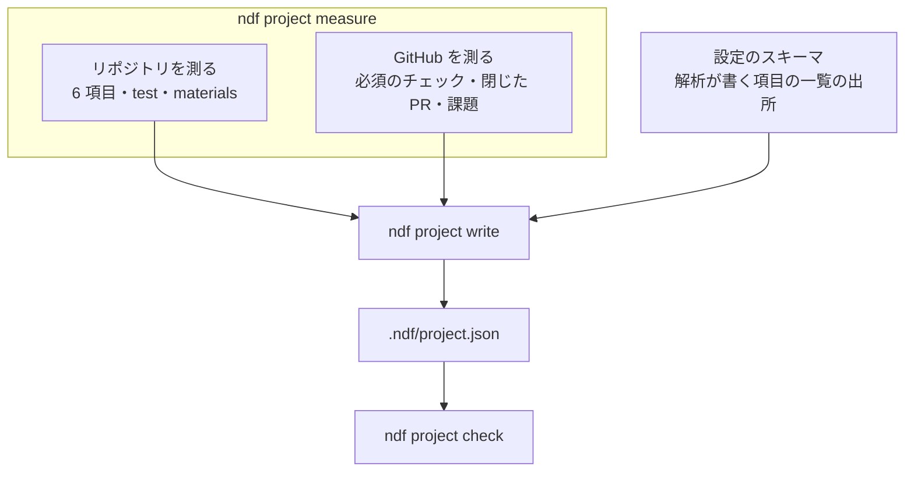
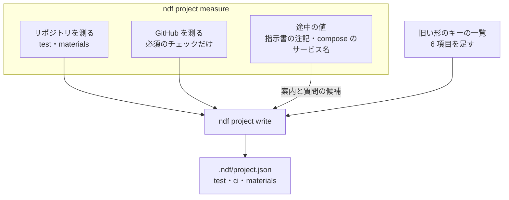
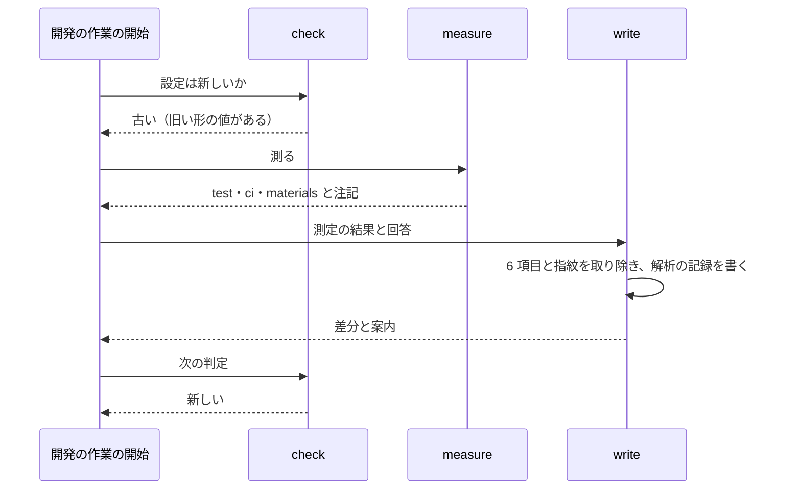

# プロジェクトの解析: 読み手のある項目だけを測って設定に書く（#4521）

解析が `.ndf/project.json` に書く項目のうち 6 つは読み手が無く、測る時間・GitHub の API・AI の token を使い、チームが確かめる差分も増やしている。そこで 6 項目を設定の形と解析から消す。既存の設定に残る値は、今ある「旧い形のキー」を取り除く仕組みで、次の書き出しが消す。

6 項目の測定のうち、次の 2 つは設定の項目をやめても残す。

- 指示書（`AGENTS.md`・`CLAUDE.md` など、AI への指示を書くファイル）の案内。指示書が無いことや、古い NDF の案内を読み込んでいることを、書き出しの出力で利用者に知らせる行である
- compose のサービス名。テストの走らせ方を AI に回答させる解析の質問（以下「テストの質問」）に、候補として載せる

比べた作り方は「決定の記録」にある。

## 今の姿

何が起きたか・項目ごとの読み手の表・目的・受け入れ条件は要求仕様（[issue-4521-requirements.md](./issue-4521-requirements.md)、正は #4521 の本文）にある。この文書は「どう解くか」と「なぜその解き方か」だけを書く。以下で「6 項目」は `languages`・`services`・`issues`・`checks`・`ndf_policies`・`instructions` を指す。



変更が触るのは、図の全部の箱である。設計に要る今の構造は次の 4 つである。

| 今の構造 | 中身 |
| --- | --- |
| 解析が書く項目の一覧 | 設定のスキーマの最上位のキーから作る。スキーマからキーを消せば、測定の結果の項目と書き出しの対象から外れる |
| 旧い形のキー | 設定から取り除くキーの一覧を 1 か所に持つ（`analysis_record.py`）。キーが残っていれば、判定は「古い」にする。読み込みはキーを取り除いたコピーで形を確かめる。書き出しはキーを取り除く |
| 指示書の案内 | 今の測定は、指示書の項目の中にある注記を、測定の結果の注記へ移している |
| テストの質問の候補 | サービスの項目を測る途中で、compose のサービス名を拾って渡している |

GitHub の閉じた PR と課題の呼び出しは、`issues` の質問の根拠にしか使っていない。

この後の `main` には [#4580](https://github.com/devbasex/ai-plugins/issues/4580) が入った（コミット `7504f88a3`）。`write` は、測定の `branch_state` と今のブランチの構成が違えば、何も書かずに終了コード 1 で終わる。必須のチェックを取れない場合の `ci` は不明になる。この設計は、どちらもそのまま使う。

以下で使う呼び名は、次のものを指す。

- **指紋**: 書き出しが項目ごとに残す、書いた値の SHA-256。`.ndf/project.json` の `analysis.written` に持つ。次の書き出しは、今の値の指紋が一致すれば解析が書いた値とみなして置き換え、違えば人が直した値として残す
- **解析の記録**: 設定が新しいかの判定が読む値（解析器のバージョン、入力のファイルのハッシュなど）。git で追跡しない `.ndf/analysis/project.json` に持つ
- **suite**: `test` に書くテストの 1 まとまりの定義（走らせるコマンドなど）。`kind` は `test`（テスト）か `lint`（静的解析）で、書かなければ `test`
- **`ci_jobs`**: suite と同じ検査を走らせる CI のジョブの指定。`<ワークフローのファイル>#<ジョブ>` の形で、`#` より後は省ける
- **`test.ci.only`**: テストを CI に任せる印。`write` が、`ci_jobs` の指すワークフローのファイルがリポジトリにあるかを見て決める
- **版 4・版 5**: 解析器（`measure` の測り方）のバージョン。測定の結果の `analyzer` に入る。この変更で 4 から 5 に上げる（決定 4）
- **秘密の形**: 2 段ある（`adapters/secret_lines.py`）。「書かない値の形」はアクセスキー・トークン・秘密鍵・URL に埋めた資格情報などの形（`SECRET_VALUE`）で、当たる値は設定に保存しない。「出力で伏せる形」はそれに代入の形（`password=…` など。`ASSIGNED_SECRET`）を足したもので、出力では当たる行を `（伏せた）` に置き換える

## 文脈と制約

- 設定のスキーマは知らないキーを許さない。6 項目をスキーマから消すだけだと、既存の設定が「壊れている」になり、利用者が手で直すまで作業が止まる
- 設定を NDF の中で読むほかの経路は、設定の全体をスキーマで検証しない。工程の前の確かめ（`ndf records preflight`）は知らないキーを警告に数えるだけで、ブランチ戦略と予算の読み手は自分のセクションだけを検査する
- `test`・`ci`・`materials` の値の形と、同じリポジトリに対する測定の結果（値・候補・根拠）は変えない。質問の項目に足す「今の設定の値」（決定 7）と保管した回答（決定 8）は、リポジトリを測った結果ではないので、ここに含めない
- 書き出しの規則は、`test`（決定 6）、人が書いた 6 項目を削除するときの知らせと控え（決定 1）、回答の元にした値の照合（決定 7）、適用しなかった回答の保管（決定 8）で変える。測定の結果が空の suite の一覧でも、設定に保存済みの suite は残す。`test.ci.only` を決めるときに存在を確かめるファイルは、`--root` の中に限る
- 普及のフェーズに入るまで後方互換は求めない（MVV Value 4。MVV の所在と語の意味は「決定の記録」の冒頭）

## 解き方の全体像



- 解析が測って書く項目は `test`・`ci`・`materials` の 3 つになる。設定のスキーマから 6 項目と、その値の型の定義を消す
- 指示書の案内は測定の結果の注記に、compose のサービス名はテストの質問の候補に、今と同じ形で出る
- 6 項目が残る設定は「古い」になり、次の書き出しが、人の直した値も含めて値と指紋を消す。人が書いた値は、消す前に控えを残す（決定 1）
- GitHub へ呼ぶのは必須のチェックだけになり、AI が回答する質問は `test` と `materials` だけになる

## 構成要素

| 要素 | 責務の変化 |
| --- | --- |
| 設定のスキーマ（`ndf-settings/project.schema.json`）と Skill の下のコピー | 6 項目と、その値の型の定義を消す。説明の文から言語と課題の保存先を外す |
| ファイルの表（`ndf-files.json`） | 行 `project` のキーの並びから 6 項目を外す。保管した回答（決定 8）と控え（決定 1）の行を足す |
| リポジトリの測定（`measure_repo.py`） | `test`・`materials` の 2 項目を返す。指示書の注記と compose のサービス名を、項目にせず返す。言語・静的解析の Tool・方針・データベースを測る処理と、それだけが使う表を消す |
| CI の測定（`measure_ci.py`） | 必須のチェックだけを測る。閉じた PR・課題の呼び出しと、`issues` の質問を消す |
| 測定の組み立て（`cli.py`） | 指示書の注記と CI の注記を、測定の結果の注記に今と同じ順で並べる。質問の項目には、今の設定の値を秘密の検査をしてから `current` に載せる（決定 7）。結果に測った場所とブランチ `context` を載せる（決定 8）。`--out` は `mkstemp` と `os.replace` で書く（下の「入出力のコントラクト」） |
| 回答の判定（新しいモジュール `answer_decide.py`）と秘密の判定（`secret.py`） | `current` の形と比べる値、回答の順序表、回答が秘密を含むかの判定（決定 7）。`measure` と `write` が同じ処理を使う |
| 書き出し（`write.py`） | 項目の番号の表（`p_number`）から 6 項目を消す。この番号（`P1` など）は、`measure` と `write` の出力の行と、開発の作業の開始の `不明 <番号>` の表示で、項目を指すために使う。残る `test`（P2）と `ci`（P4）の番号は振り直さない。回答できる項目は、測定の結果で `status: question` であり、かつ今の解析が書く項目に限る。`test` の測定の結果が空の suite の一覧で、今の値に suite があるときは、今の値を残して案内の行を出す（決定 6）。`test.ci.only` を決めるときと案内の行を作るときは、同じ処理で `--root` の中のパスだけの存在を確かめる（決定 6）。解析の記録の `analyzer` と `branches` には、測定の結果の `analyzer` と `branch_state` を書く。人が書いた 6 項目を取り除くときは確認を求める案内の行を出し（決定 1）、回答の元にした値が変わったか確かめられなければ回答を適用せず、伏せる形の値は行に載せない（決定 7）。適用しなかった回答は保管する（決定 8）（どれも下の「入出力のコントラクト」） |
| 旧い形のキー（`analysis_record.py`） | 項目ごと消すキーに 6 項目を足す。言語の行の中のキー（`languages[].files`）は、`languages` の項目ごと消える。そのため、配列の中のキーを取り除く処理は消す |
| 判定（`check.py`） | 解析器のバージョンを上げる。再開を待つ保管した回答があれば「古い」にする（決定 8） |
| 言語の表（`contracts/domains/languages.json`） | 要約（`summary`）から「言語の計測」を外す。表と行は変えない |
| 控えと保管（新しいモジュール `held.py` と、保管のファイルの形 `internal/project-held-answers.schema.json`） | 人が書いた 6 項目の控え（決定 1）と、適用しなかった回答（決定 8）を、メインディレクトリの `.ndf/analysis/` の下に読み書きする |
| 手順書と確定仕様（`project-analysis.md`・`ndf-project-analysis-record.md`）、生成物の `ndf-settings.md` | 新しい形を書く。`project-analysis.md` には、回答の適用結果の報告と回答のファイルの片付け（下の「入出力のコントラクト」）、人が書いた値の削除の確認（決定 1）、再解析で今の値を引き継ぐ条件（決定 6・7）、保管した回答の使い方（決定 8）も書く |
| `write` の引数 `--answers` の説明（`cli.py`。生成物の `project.args.schema.json`・`commands.md`） | 再解析で今の値を引き継ぐ規則と、保管した回答の扱いを書く（決定 6・7・8） |
| このリポジトリの `.ndf/project.json` | 6 項目とその指紋を消す |

## 入出力のコントラクト

| コントラクト | 今 | 変えた後 |
| --- | --- | --- |
| `.ndf/project.json` の解析が書くキー | 9 個 | `test`・`ci`・`materials`。6 項目を持つ設定は読めるが「古い」 |
| `ndf project measure` の結果の `items` | 9 個 | `test`・`ci`・`materials`。質問の項目は、今の設定の値を表す `current` を持つ（決定 7）。同じ作業場所とブランチで保管した回答があれば、1 件（再開できる回答があればその中の最新、無ければ全体の最新）と残りの件数を `held` に持つ（決定 8）。`notes` の中身と並びは、下の行の注記 1 種類と、保管した回答を読めないときの注記を除き変わらない |
| `ndf project measure` の結果の `context` | — | 測った作業場所の絶対パス `root`、ローカルのブランチ名 `branch`（ブランチに居なければ `null`）、HEAD のコミット `commit`、git が作業場所に付ける管理名 `worktree`（メインの作業場所は `null`）、作業場所の識別子 `worktree_id`（メインの作業場所は `null`）、「場所の値」の指紋 `place`（名前が秘密の形に当たる場所では `null`）、`measure` の実行ごとに一意な `measure_id`、`measure` が読んだ保管した回答の版の一覧 `seen`（決定 8） |
| `ndf project measure --out` の書き方 | 実行した人の umask の権限。`--out` がシンボリックリンクなら、行き先へ書く | 所有者だけが読み書きできる 0600。保存先と同じディレクトリに、`tempfile.mkstemp`（新規作成に限る `O_EXCL`、0600）で一時ファイルを作り、`os.replace` で置き換える。`--out` は親のディレクトリだけを解決し、末尾のリンクはたどらない。ほかの人も書けるディレクトリで、先に置かれたファイルやリンクへ書かないためである。`current` には、秘密の形に当たらなくても公開していないコマンドや環境の値が入りうる |
| `ndf project write` の回答 | `test`・`issues`・`ndf_policies`・`materials` | `test`・`materials`。ほかのキーは「無視した回答」と出る。今回消す項目が、旧版の測定の結果に `status: question` で入っていても、同じく無視する |
| `ndf project write` が解析の記録に書く `analyzer` | 書き出す側の解析器のバージョン（`check.ANALYZER`） | 測定の結果の `analyzer`（実際に測ったバージョン）。測定の結果に正の整数の `analyzer` が無ければ、何も書かずに終了コード 1（`result: remeasure` の行を出す） |
| `ndf project write` が解析の記録に書く `branches` | 書き出すときに取り直したブランチの構成。測定の `branch_state` と違えば、何も書かずに終了コード 1（#4580） | 測定の結果の `branch_state` と同じ構成（測ったときの構成）。ただし #4580 の例外を残す。既定ブランチが前の記録から変わり、必須のチェックを取れずに前の `ci` を残した場合は、前の記録の構成を書き、次の `check` は「古い」（終了コード 3）になる。`branch_state` が無い、または形が合わなければ、何も書かずに終了コード 1（`result: remeasure` の行を出す）。測定の後にブランチの構成が変わっていれば、#4580 の確かめで何も書かずに終了コード 1 になり、前の記録が残る。次の `check` は「古い」（終了コード 3）になる |
| 版 4 の測定の結果を版 5 の `write` で書き出した直後の `ndf project check` | 終了コード 0（記録に版 5 が残る） | 終了コード 3、理由は「解析器のバージョンが古い（4 < 5）」。次に開発の作業を始めたとき、版 5 の解析器が測り直す |
| 同じ版 4 の測定の結果で、版 5 の `write` をもう 1 回打つ | — | 記録の `analyzer` は 4 のままで、`check` は終了コード 3 のまま。`write` が版を 5 へ繰り上げることはない。受け入れ条件 11 の「同じ入力」は、版 5 の測定の結果とその回答を指す |
| `ndf project write`（6 項目のうち、人が書いた値を取り除く） | — | 取り除く前の値の控えをメインディレクトリの `.ndf/analysis/removed/` に残してから取り除き、キーごとに `kind: note` の行を足す。値は行に書かない（決定 1） |
| `ndf project write`（回答の元にした値が、測定の後に変わった） | 古い値を元にした回答でも適用する | 回答値が今の値と同じ場合を除き、適用せず今の値を残す。`mismatch` の行と、次の解析で回答し直すことを知らせる `kind: note` の行を出し、回答を保管する。終了コードは 0（決定 7・8） |
| `ndf project write`（版 4 以前の測定の結果と回答で、設定に値がある項目。値が `{"unknown": …}` の項目は含まない） | 回答を適用する | 回答値が今の値と同じ場合を除き、適用しない。回答は保管せず、`result: remeasure_v4` の行を出す。呼び出し元は回答のファイルを残し、下の「版 4 の回答を測り直す手順」で測り直す（決定 7） |
| `ndf project write`（版 5 以上の測定の結果で、`context` か質問の項目の `current` が無いか形が違う） | — | 何も書かずに終了コード 1。`result: remeasure` の行を出す（決定 7・8） |
| `ndf project write`（`--root` の作業場所かブランチが、測定の結果の `context` と違う） | 書き出す | 設定を書き換えず、保管した回答も足さず消さずに、終了コード 1。`result: context_mismatch` の行を出し、測った場所と今の場所を行に書く（決定 8） |
| `ndf project write`（測った作業場所のパスかブランチ名が秘密の形に当たり、`--answers` がある） | 書き出す | 何も書かずに終了コード 1。`result: place_hidden` の行を出す。`--answers` が無ければ書き出す（決定 8） |
| `ndf project write`（保管した回答の削除か `resume` の更新に失敗した） | — | 終了コード 0。失敗した回答ごとに、`name` に `<id>@<版>` を持つ行を出す。版は、失敗した時点の回答の `measure_ids` の最後の値である。削除の失敗は `result: held_delete_failed`、`resume` の更新の失敗は `result: held_resume_failed` である。呼び出し元は失敗した後処理だけを打ち直す（決定 8） |
| `ndf project write` の回答 `{"discard": ["<id>", …]}` と、`value` に添える `"resolves": ["<id>", …]` | — | 指定した保管の回答を消す。`discard` は項目が質問でなくても処理する。`resolves` は `value` が適用されたか、今の値と同じだったときだけ消す（決定 8） |
| `ndf project write` の回答が、`discard` と `unresume`（`{"unresume": ["<id>", …]}`）だけを持つ | — | 後処理だけを行う。指定した回答の削除と、`resume` を `false` にする更新のほかは、何も書かない。`<id>@<版>` の指定は、回答の今の版が同じ場合だけ適用する。設定と解析の記録を変えず、回答の保管も、作業場所が削除された回答の片付けもしない（決定 8） |
| `ndf project write` の差分（通常の書き出しと `--dry-run`） | 秘密の形に当たる行を `（伏せた）` にする | 加えて、取り除く 6 項目の値は、形によらずすべて `（伏せた）` にする。結果 JSON は差分を持たない（決定 1） |
| `ndf project write`（設定の値か回答が、出力で伏せる形に当たる） | 伏せた文字列を含む値を行に載せる | その項目の行は値を持たず、キーと理由だけを出す。回答が当たる場合は `result: answer_secret` を持つ（決定 7） |
| `ndf project check`（6 項目が残る設定） | — | 終了コード 3、理由は「旧い形の値が設定にある: <キー>」 |
| `ndf project check`（この作業場所とブランチに、今すぐ再開できる保管した回答がある） | — | 終了コード 3、理由は「保管した回答がある: <キー>」（決定 8） |
| 測定が呼ぶ GitHub の API | 必須のチェック・閉じた PR・課題 | 必須のチェック |
| 注記「PR のマージ先と GitHub Issues を測れない」 | 測れないときに出る | 出ない |
| `ndf project write` の `test`（測定の結果が `status: measured` の空の suite の一覧で、今の値に suite がある） | 解析が書いた値は空の一覧で置き換える。手で書いた値は残し、`mismatch` の行を出す | どちらも今の値を残す。解析が書いた値は `kind: unknown`・`kept_previous` の行で理由「テストの手がかりが無い」を出し、残した値の指紋を書く。手で書いた値は今と同じ `mismatch` の行を出し、指紋を書かない。どちらも `kind: note`・`key: test` の案内の行を足す。秘密の検査が先に働き、`test.ci.only` は下の行の決め方である（決定 6） |
| `ndf project write` の `test.ci.only`（回答を適用する、測った値を書く、前の値を残すなど、すべての書き出し） | `ci_jobs` が指すパスは、`--root` の外でも存在を確かめる | `--root` の中に収まる相対パスだけを確かめ、範囲外のパス（絶対パス、`..` を含むパス、シンボリックリンクを通るパス）は存在するファイルに数えない。ほかの決め方は変わらない（決定 6） |
| `ndf project write` の `--answers` の説明 | 回答の形だけを書く | 回答の形、再解析で今の値を引き継ぐ規則、保管した回答の使い方、`resolves`・`discard`・`unresume` の指定と、`remeasure_v4`・`context_mismatch` を受けた後の手順を書く（決定 6・7・8） |

サブコマンドの引数の名前と終了コードは変えない。

`result: remeasure` の行は `kind: note` で、測定の結果が読めない、`analyzer`・`branch_state`・`context`・`current` が欠けるか形が違う、のどれかで書き出せないときに出す。同じ入力で打ち直しても直らない失敗を、呼び出し元が文を読まずに区別するためである。

測定の結果は正しいが、`context` が書き出し先と違う場合（決定 8 の「場所」）は、`remeasure` ではなく `result: context_mismatch` の `kind: note` の行を出す。回答は測った場所では使えるが、切り替え先では使えないためである。行には、測った場所と今の場所（`root` と、ブランチかコミット）を書く。同じパスに作り直した worktree や、伏せ字を掛けると同じになる名前では、2 つの表示が同じになる。そのため行には、表示が同じでも別の場所であることを書く。作り直して元の場所が無い場合は、下の表の「切り替え先」の経路を進める。

今の書き出し（`write.plan`）は、測定の結果で `status: question` の項目をすべて回答できる項目とみなす。スキーマからキーを消すだけでは、測定と書き出しの間に NDF を更新した利用者の `issues` と `ndf_policies` の回答が、設定に書かれないまま何も知らせずに捨てられる。そのため、回答できる項目を、今の解析が書く項目の一覧（`write.ITEM_KEYS`）で絞る。保管した回答を消す指定 `discard` は、回答の適用ではないので、この絞り込みより先に処理する（決定 8）。

回答を無視した書き出しは、受け入れ条件 8 のとおり終了コード 0・`status: ok` で終わる。呼び出し元は、結果 JSON の `items` にある `kind: ignored` の行（`key` が項目の名前）で、回答がすべて適用された書き出しと区別する。この行は今の結果の形にあるので、形は変えない。

`kind: ignored` の行が無くても、残る項目の回答が反映されたとは限らない。今の `write` は、手で書いた値と回答が食い違えば手で書いた値を残し、形に合わない回答は不明（`unknown`）にする。そこで呼び出し元は、回答した項目の行も確かめる。「保管」の列は、`write` がその回答を残すか（決定 8）を表す。

| 回答した項目の行 | 意味 | 保管 | 利用者への報告 |
| --- | --- | --- | --- |
| `written`（`origin` が `判断した`） | 回答を適用した | しない | 要らない |
| `mismatch`（`result: answer_held` の案内の行がある） | 回答の元にした値を確かめられず適用しなかった（決定 7） | する。次の解析で再開する | 項目と、設定の値・回答の値、案内の行 |
| `mismatch`（`result: remeasure_v4` の案内の行がある） | 版 4 以前の測定の結果なので適用しなかった（決定 7） | しない。呼び出し元が回答のファイルを残して測り直す | 項目と、設定の値・回答の値、案内の行 |
| `mismatch`（案内の行が無い） | 手で書いた値を残した。回答は別の値である | する。自動では再開しない | 項目と、設定の値・回答の値 |
| `kept`（`reason` なし） | 手で書いた値を残した。回答が同じ値か、回答を使えなかったかは、この行からは分からない | 回答が同じ値か `{"unknown": …}` なら、しない。形に合わない `value` は、する（今の値が秘密の形に当たる場合を除く） | 項目と、設定の値を保ったこと、回答の内容 |
| `kept`（`reason` あり） | 今の値か回答の値が秘密の形に当たるので適用せず、値を行に載せていない（決定 7） | しない | 項目と理由。回答の内容は載せない |
| `unknown` | 回答を使えず、不明にしたか前の値を残した | 形に合わない `value` はする（回答か今の値が秘密の形に当たる場合を除く）。`{"unknown": …}` の回答はしない | 項目と理由、回答の内容 |
| `secret` | 秘密の形の値を捨てた | しない | 項目と理由だけ。回答の内容は載せない |
| `ignored` | 回答できる項目ではない | しない | 項目と回答の内容 |
| どの種類でも `result: answer_secret` を持つ行 | 回答が秘密を含む（決定 7） | しない | 項目と理由だけ。回答の内容は、値・理由・根拠のどれも載せない |

どの行も今の出力の欄（`kind`・`reason`・`result`）で表せるので、出力の形は変えない。**回答の内容は、項目ごとに 1 回だけ報告に載せる。** `mismatch` の行の回答の値を載せたら、同じ回答をもう一度写さない。回答の内容を報告に載せてよいかは、呼び出し元が判定しない。`write` が回答の全体を調べ、秘密を含む項目の行に、行の種類によらず `result: answer_secret` を付ける（調べ方は決定 7）。表のほかの行より、この印を優先する。この表と下の回答のファイルの扱いは、解析の手順書（`project-analysis.md`）の `write` の行に足す。

**`write` は、回答のファイルを変えず、消さない。** 適用しなかった回答のうち後で要るものは `write` が保管するので、呼び出し元は回答の中身から保管や削除を判定しない。呼び出し元の片付けは、終了コードと、結果の行の `result` の 2 つの印で決まる。

| `write` の結果 | 利用者か、外の連携先が用意した回答のファイル | NDF の手順が一時ディレクトリに作ったファイル（手順書の `$TMP/answers.json`） |
| --- | --- | --- |
| 終了コード 0 で、下の 2 つの印が無い | 変えず、消さない。適用されなかった回答があれば、ファイルのパスを報告に載せる | 報告を作った後に、一時ディレクトリを消す |
| 終了コード 0 で、`result: remeasure_v4` の行がある | 変えず、消さない。下の手順で測り直す | 一時ディレクトリを残し、下の手順で続けて測り直す。書き出しが終わったら新旧の一時ディレクトリを消す。中断した場合は、残したパスを報告に載せる |
| 終了コード 0 で、`result: held_delete_failed` か `held_resume_failed` の行がある | 変えず、消さない。原因を除いた後に、下の「後処理だけの打ち直し」を行う | 一時ディレクトリを残し、後処理だけの回答のファイルをそこに作る。原因を除いた後に打ち直すコマンドを報告に載せる |
| 終了コード 0 以外 | 変えず、消さない | 一時ディレクトリを残し、パスと次の手を報告に載せる |

**後処理だけの打ち直し**では、元の回答のファイルを使わない。打ち直すまでの間に別の `write` が設定を変えると、元の `value` は適用されず、`resolves` の回答が残ったまま、元の `value` まで保管されるためである。次の手順は、回答のファイルを誰が用意したかによらず同じである。

1. 結果の行の `name` から回答のファイルを作る。`held_delete_failed` の `name` は `discard` に、`held_resume_failed` の `name` は `unresume` に、そのまま並べる。ほかのキーは書かない
2. `ndf project write --measure <同じ測定の結果> --answers <作ったファイル> --root <同じ作業ディレクトリ>` を打つ

`name` に版を含めるのは、打ち直すまでの間に、後の測定で同じ値が保管し直される場合があるためである。保管し直しは、同じ `id` のまま `resume` と測定の欄を更新する。`id` だけを指定すると、古い失敗の後処理が、新しく再開を待つ回答を消すか取り下げる。版が違う指定は何も変えず、案内の行で知らせる。後に残すのは結果の行と呼び出し元の報告で、`write` は後処理の予定をファイルに残さない。残すためのファイルの書き込みも、削除と同じ原因で失敗しうるためである。

**版 4 の回答を測り直す手順**は、回答のファイルを誰が用意したか（NDF の手順、利用者、Factory などの連携先）によらず同じである。

1. 渡した回答のファイルを、変えずに残す
2. 同じ `--root` を指定して、`ndf project measure --out <新しい測定の結果>` を打つ
3. 新しい測定の結果の `current` と根拠から、新しい回答のファイルを作る。残した回答は参考にする
4. `ndf project write --measure <新しい測定の結果> --answers <新しい回答> --root <同じ作業ディレクトリ>` を打つ

この手順は、`--answers` の説明と `remeasure_v4` の案内の行にも書く。解析の手順書を読まない呼び出し元にも届くようにするためである。版 4 の測定の結果への回答を保管しないのは、測った作業場所とブランチの記録が無く、どの作業の回答かを決められないためである。

終了コードが 0 でないとき、`write` は保管した回答を 1 件も消していない。設定の書き込みは確定していない（書き込みの順は決定 8）。次の手は 3 つに分かれる。

| 判別 | 次の手 |
| --- | --- |
| `result: remeasure` の行がある | 保持した測定の結果では打ち直さない。今の作業場所で先に測り直し、残した回答を参考にして、新しい測定の結果への回答を作る |
| `result: context_mismatch` の行がある | 下の 2 つのどちらかを選ぶ |
| `result: place_hidden` の行がある | 回答のファイルを残し、`--answers` を外して打ち直す。回答を使うには、作業場所かブランチの名前を変えて測り直す |
| 上のどの行も無い（ロックが取れない、書けない、保管の置き場のファイルが git に追跡されている、既存の設定が壊れている、回答のファイルが読めない） | 原因を除いた後に、`ndf project write --measure <ファイル> --answers <ファイル> --root <元の作業ディレクトリ>` で打ち直す |

場所が違う（`context_mismatch`）場合の 2 つの経路は次のとおりである。

| 続けたい場所 | 次の手 |
| --- | --- |
| 元の場所（測った作業場所とブランチ） | 元の場所へ戻り、同じ測定の結果と回答で、`--root` に行の測った作業場所を指定して打ち直す。ブランチに居なかった場合は、測ったコミットへ戻る |
| 切り替え先 | 切り替え先で `measure` から打ち直し、回答は切り替え先の `current` と根拠だけから作る。元の場所向けの回答は使わず、参考にもしない |

NDF の手順は、利用者のブランチや worktree を自分では切り替えない。切り替え先の経路を進め、元の場所向けの回答のファイルと測定の結果のパスを報告に載せる。

打ち直すコマンドの `--root` には、失敗した `write` と同じ作業ディレクトリの絶対パスを渡す（`context_mismatch` の経路は上の表に従う）。別の worktree を起点にすると、`ci_jobs` のファイルの有無が測定と食い違い、`test.ci.only` が変わるためである。失敗した場合の報告には回答の内容を写さない（項目ごとの行が出ないため）。どの場合も、開発の作業は続ける。

## 処理の流れ

次の図は、6 項目が残る設定が新しい形へ移るまでの流れである。図には順に実行されるものだけを描き、スキーマ・表・文書は描かない。



## 決定の記録

各決定の「根拠」の Value は、このリポジトリの MVV（Mission・Vision・Value をまとめた文書。[.ndf/mvv.md](../.ndf/mvv.md)、バージョン 11）にある判断の基準の番号である。ここで引くのは次の 7 つである。

| 番号 | 中身（MVV の本文の要約） |
| --- | --- |
| Value 2 | 安く使える。利用者が払う費用（token・API・CI の時間・マシンの資源）を小さくし、費用が増える仕組みには理由と代案を示す |
| Value 3 | 同じ手順は毎回同じ結果になる。手順は使うほど減り、同じ手当てが繰り返されたら、その手順そのものを無くす。バージョンを上げても、進行中の作業と人の回答は失われず、止まった所から続く |
| Value 4 | どのプロジェクトでもそのまま使える。普及のフェーズに入るまでは後方互換を求めず、旧い設定の形を残す互換の仕組みを持たず、移行のコマンドできれいな最終形へ移す（「普及のフェーズ」は NDF が広く使われる段階を指す。入る条件は MVV に書かれていない） |
| Value 6 | 使うほど散らからない。使わなくなったコード・設定・文書は整理する。自動で片付けるのは NDF が自分で作ったものだけである |
| Value 9 | 責務の分かれた設計で作る。まだ要らない仕組みは先回りして作らない |
| Value 11 | 重複と冗長が無い。同じ規則や定義は 1 か所にまとめる |
| Value 15 | 人も AI も同じ入口から使える。Skill の手順だけでなく、`ndf` のコマンドと規約（`plugins/ndf/contracts/`）から同じように呼べる |

### 決定 1: 既存の設定を止めずに移すため、6 項目を「旧い形のキー」に足して取り除く

- **質問**: スキーマから消した 6 項目が残る既存の設定を、どの仕組みで移すか
- **選んだ案**: 設定から項目ごと消すキーの一覧に 6 項目を足し、今ある書き出しのコマンド `ndf project write` を移行のコマンドにする。判定は「古い」を返し、次の書き出しが値と指紋を消す。人が書いた値も消すが、指紋（`analysis.written`）で区別し、控えを残して利用者の確認事項にする
- 採らなかった案: スキーマに非推奨のキーとして残す（解析が書く項目の一覧からは外れるが、判定が「古い」にならず、値が設定に残り続ける。残った値は書き換えれば効くように読める）
- 採らなかった案: 移行専用のサブコマンドを足す（旧いキーを取り除く処理と差分の表示は `write` にあり、入口が 2 つになる。開発の作業を始める手順は `write` を打つので、専用のコマンドを打たなくても移る）
- 採らなかった案: 人が直した値は残す（読む仕組みが無い値を残す理由が無く、残すにはスキーマにキーを残すことになる）
- 採らなかった案: 人が書いた値があれば書き出しを止めて確認を取る（開発の作業の開始のたびに止まり、承認の工程が増える。控えがあれば、利用者は作業を止めずに後から処分を決められる）
- 採らなかった案: 控えを作らず、案内の行だけを出す（コミットしていない手の編集が戻せない）
- **代償**: 利用者が手で直した値も設定からは消える。残したい値は、利用者が控えから取り出す。6 項目を取り除くだけの操作は無いので、移行のために `write` を打つと、残る項目にも今の書き出しの規則が働く
- 根拠: Value 4「旧い設定の形を残す互換の仕組みを持たず、移行のコマンドできれいな最終形へ移す」・Value 6・Value 11（MVV バージョン 11）

**人が書いた値は、控えを残してから取り除き、移行のときの確認事項にする。** 利用者が自分で入力した値は、NDF が作ったものではない（Value 6）。コミットしていない手の編集は、設定から消すと git から戻せない。そこで `write` は次のように扱う。

- 取り除く前の値の指紋が `analysis.written` と一致しない項目（指紋が無い項目を含む）を、人が書いた値とみなす
- 設定を書き換える前に、その項目の値の控えを、メインディレクトリの `.ndf/analysis/removed/<一意な名前>.json` に 0600 で作る。取り除く値と中身が同じ控えがすでにあれば、作らずにそのファイルを使い、案内の行にそのパスを載せる。使うのは、控えの置き場の直下にある、リンクでない通常のファイルで、権限が 0600 のものだけである。条件に合わないファイルは変えず、新しい控えを作る。再利用する場合も、新しく作る場合と同じく、控えが git に追跡されず無視されることを確かめる（確かめ方は決定 8 の置き場と同じ）。確かめに通らなければ、設定から値を取り除く前に終了コード 1 で止まる。控えを作った後に保管や設定の書き込みが失敗すると、旧い設定が残り、打ち直しが同じ値をもう一度取り除くためである。中身の違う控えは変えない。名前を中身の指紋にする案は採らない。案内の行のパスから、秘密を含む値の指紋が出力に出る。作れなければ、何も書かずに終了コード 1 で終わる。置き場の作り方と git から外す方法は、保管した回答と同じである（決定 8）。どの worktree から打っても同じ場所になる
- 控えは取り除いた値をそのまま持つ。秘密の形の値も伏せない。同じ値が置かれていた `.ndf/project.json` より広い権限にはならず、伏せると取り戻せないためである
- キーごとに「人が書いた値を取り除く: <キー>。控えは <控えのパス>。コミットの前に差分で確かめる」という `kind: note` の行を足す。値は行に書かない
- `--dry-run` でも案内の行は出る（控えは作らないので、パスは載せない）
- 差分には、取り除く 6 項目のキーは出すが、値は出さない。通常の書き出しでも `--dry-run` でも同じである。差分の前の側を作る時に、6 項目の値をまるごと `（伏せた）` に置き換える。CLI の出力は AI や連携先が読み、旧い値には形で見分けられない認証情報もありうるためである。残る項目の行は、今と同じく 1 行ずつ秘密の形を調べて伏せる。値を確かめる利用者は、控えか `git diff` を自分で読む
- 呼び出し元は、この行を利用者への報告に載せる。移行の Pull Request の本文には、キーの名前を確認事項として載せる
- NDF は控えを自動で消さず、値を別の所へ移す操作も持たない。控えは、利用者が手で読み、移し、消すファイルとして残る

この削除は控えから戻せるので、承認の工程は足さない。同じ書き出しを打ち直すと、取り除く値がもう無いので、控えは増えない。

移行の対象と差分は、次の順で書く前に確かめられる。この手順は解析の手順書（`project-analysis.md`）に書く。

| 順 | コマンド | 分かること・起きること |
| --- | --- | --- |
| 1 | `ndf project check` | 対象。終了コード 3 の理由に、残っている旧いキーが出る |
| 2 | `ndf project measure --out <ファイル>` | リポジトリと CI を測る。設定は変わらない |
| 3 | `ndf project write --measure <ファイル> --dry-run` | 差分。何も書かない |
| 4 | `ndf project write --measure <ファイル>` | 移行する。リンクされた worktree から打っても、設定はメインディレクトリへ書く。差分はメインディレクトリで確かめ、解析の手順書の「移行の後」に従って移行用のブランチでコミットする |

- 移行だけなら回答（`--answers`）は要らず、AI を使わない。回答が無くても、質問の項目に今の値があれば残る。回答するときは、3 と 4 に同じ `--answers` を渡す
- 開発の作業を始める手順は、今と同じく `check`・`measure`・`write` の順に打つ。`--dry-run` は挟まず、`write` が出す差分をコミットの前に確かめる

### 決定 2: 利用者が直せる案内を残すため、指示書は設定の項目にせず、確かめた結果を測定の注記に出す

- **質問**: `instructions` の項目を消すとき、指示書の案内をどこで作るか
- **選んだ案**: 指示書の確かめは注記の並びだけを返し、測定の結果の `notes` に入れる。確かめが失敗・時間切れなら注記を出さずに、残りの測定を続ける
- 採らなかった案: `instructions` を測定の結果の項目にだけ残し、設定に書かない（解析が書く項目の一覧がスキーマと別になり、受け入れ条件 3 を満たさない）
- 採らなかった案: 案内もやめる（利用者が読んで指示書を直すための出力で、今も利用者に出している）
- **代償**: 確かめが失敗したことは出力に出ない。今は項目の「不明」として出ている
- 根拠: Value 6・Value 11（MVV バージョン 11）

### 決定 3: テストの質問の根拠を変えないため、compose のファイルはサービス名だけを読む

- **質問**: `services` の項目を消すとき、テストの質問に載せる compose のサービス名をどう得るか
- **選んだ案**: compose のファイルからサービス名の並びだけを返す。データベースの判定、CI のワークフローの image の読み取り、コンテナの有無は消す
- 採らなかった案: 今の測定をそのまま呼び、値を捨てる（読み手の無い値を測り続ける）
- **代償**: データベースを使う機能を後で作るときは、読み取りを作り直す
- 根拠: Value 2・Value 9「まだ要らない仕組みは先回りして作らず」（MVV バージョン 11）

### 決定 4: 古い解析の記録と区別するため、解析器のバージョンを 5 に上げる

- **質問**: 測る項目が減るとき、解析器のバージョンを上げるか
- **選んだ案**: 上げる。6 項目が無い設定でも、次の作業で 1 回解析し直す。この区別が効くように、解析の記録には書き出す側のバージョンでなく、測定の結果の `analyzer` を書く。今の `write` は `check.ANALYZER` を書くので、版 4 で測ってから NDF を更新して書き出すと、版 5 で一度も測っていない設定が「新しい」になる。ブランチの構成（`branches`）には、測ったときの構成を書く。必須のチェックは測ったときの既定ブランチに対して取った値なので、測った後に構成が変わった結果は記録できない。この確かめは [#4580](https://github.com/devbasex/ai-plugins/issues/4580) がすでに持つ。測定の `branch_state` と今の構成が違えば何も書かないので、書く値は測ったときの構成と同じになる。#4580 の例外が 1 つあり、これも残す。既定ブランチが前の解析の記録から変わり、必須のチェックを取れずに前の `ci` を残した場合は、前の記録の構成を書く。前の `ci` は前の既定ブランチの値なので、次の `check` に「古い」と判定させる
- 採らなかった案: 上げない（6 項目が残る設定は決定 1 で「古い」になるが、測る項目を変えたら上げるという解析器の決まりに反する。記録に残るバージョンの番号から、どの項目の組を測ったかが分からなくなる）
- **代償**: 6 項目を手で消していた clone でも、解析が 1 回走る
- 根拠: Value 3（MVV バージョン 11）

### 決定 5: ほかの読み手を巻き込まないため、言語の表は残す

- **質問**: 解析が言語を測らなくなる。言語の表（`contracts/domains/languages.json`）も消すか
- **選んだ案**: 残し、要約（`summary`）から「言語の計測」だけを外す。表には解析のほかにも使う側がある。cross-refactoring が調べる範囲を決める処理（`plugins/ndf/src/ndf/domains/crossrefactor/range_decide.py`）は、表の拡張子の列（`extensions`）とプロダクションコードの列（`code`）でコードのファイルを見分ける。テストのファイルを見分ける表（`contracts/domains/test-files.json`）の `language` の列は、言語の表の言語の名前を参照している
- 採らなかった案: 表も消す（cross-refactoring の範囲の決め方、テストのファイルを見分ける表、言語の表を確かめるテストの作り直しまで広がる。対象は解析が書く設定の項目である）
- **代償**: 解析が使わなくなる表が、コントラクトに残る。解析が表を読まない状態でも `ndf check` が通ることは、解析の側の言語の表の読み取りを空にして 1 回走らせて確かめた（1749 ファイルに違反なし）
- 根拠: Value 9（MVV バージョン 11）

### 決定 6: 回答を再解析で失わないため、今も成り立つ値は引き継ぎ、空の測定値で suite を消さない

- **質問**: 回答から書いた `test` と `materials` には解析が書いた値として指紋が付き、次の再解析の値で置き換わる。前の回答をどう引き継ぐか
- **選んだ案**: 項目が質問にならない場合は `write` の規則で、質問になる場合は回答する側の規則で引き継ぐ

**質問にならない場合（`write` が守る）**

テストの手がかり（テストのツール、コマンド、指示書の記述）が無くなると、前は質問だった `test` が、測った値の空の suite の一覧になる。指示書からテストの記述を整理しただけでも、独自のスクリプトを走らせる前の回答は使える。手がかりが無いことは、使えなくなった根拠にならない。

- 秘密の検査はこの規則より先に働く。今の値に秘密の形があれば、今と同じく項目を `{"unknown": "秘密の形"}` にする。suite は残さず、値を持つ `mismatch` の行も案内の行も出さない
- 今の値に suite が 1 つ以上あれば、`write` は今の値を残す。出力と指紋は、今の値を誰が書いたかで次のように分かれる

| 残す値 | 出力の行 | 指紋（`analysis.written`） |
| --- | --- | --- |
| 解析が書いた値 | `kind: unknown`・`kept_previous`。理由は「テストの手がかりが無い」。空の測定値を不明と同じに扱う | 残した値の指紋を書く。後の回答で置き換えられる |
| 手で書いた値 | `mismatch`（今の振る舞いのまま）。解析の側の値が空の一覧なので、手がかりが無かったと分かる | 書かない。手で書いた値のままである |

- 今の値が出力で伏せる形（代入の形）の場合は、上の表の行も案内の行も値を持たない。手で書いた値の `mismatch` の行は、理由を持つ `kept` の行になる（決定 7）
- 空の一覧を書くのは、`test` のキーが無いか、今の値が不明か、今の値の suite が 0 件のときだけである
- テストをすべてやめたリポジトリでは、利用者が下の手順で `test` のキーを消し、解析し直す。キーを消すだけでは解析は始まらない。`check` は設定と解析の記録の対応を `analysis.written` の指紋で見るので、`test` を消しても、ほかの入力が変わらなければ「新しい」のままである

  1. メインディレクトリの `.ndf/project.json` から `test` のキーを消す
  2. リポジトリの外の一時ファイルを指定して、`ndf project measure --out <ファイル>` を打つ
  3. 測定の結果の `test` が、`status: measured` で suite が空であることを確かめる
  4. 同じファイルを指定して、`ndf project write --measure <ファイル>` を打つ。空の suite の一覧が書かれる

  3 で `test` が `status: question` なら、テストのツールの依存、テストのコマンド、指示書や README の記述のどれかが残っている。測定の結果の `candidates` と `evidence` で残りを確かめる。取り除けるなら取り除いて測り直す。残す場合は、回答（`--answers`）で `test` に空の suite の一覧を渡して書き出す。回答を渡さずに書き出すと、`test` は空の一覧でなく不明（`unknown`）になる

  コマンドを直接打つときは、`ndf project check` は要らない。開発の作業を始める手順で解析し直すときは、AI に再解析を頼む。AI は `ndf project check --force`（終了コード 3）で解析へ分岐してから、2〜4 を打つ。この手順は解析の手順書（`project-analysis.md`）に書く
- 残すのは `test.ci.only` を除く部分である。`test.ci.only` は、残した suite に対して、ほかの書き出しと同じ決め方で `write` が決める。テスト用の suite（`kind` が `test` か未指定）の `ci_jobs` が指すファイルが 1 本も存在しないとき、解析が書いた `true` を消す。1 本でも存在すれば `true` のままにする。人が書いた値は変えない。解析が書いた `test` の指紋は、`ci.only` を決めた後の値で書く

**残した suite を知らせる（`write` が行う）**

手がかりが見つからないだけでなく、前の suite が使うファイルが削除されていることもある。そのまま残すと後の検証が失敗するので、`write` は suite を残したことを案内の行で知らせる。suite を残すかは `write` が判定するので、呼び出し元は条件を自分で判定せず、出た案内の行を報告に載せればよい。案内の行は、上の表のどちらの場合も 1 行出る。

| 案内の行に書くこと | 中身 |
| --- | --- |
| 残した理由 | テストの手がかりが無いので、前の suite の名前を挙げて残したと書く |
| 無くなったファイル | suite の `container.compose_files` のうち、リポジトリに無いパスを suite の名前と一緒に書く。無ければ書かない |
| 範囲外で未確認のパス | `container.compose_files` のうち、範囲外のパス（判定は下の表）を suite の名前と一緒に「未確認」と書く。あるか無いかは書かない。該当が無ければ書かない |
| 確かめていないこと | コマンドが参照するファイルは確かめていない。使わなくなった suite は、利用者が `test` を直すか消す。消しただけでは解析は始まらないので、消した後に解析し直す |

- ファイルがあるかは、`write` の作業ディレクトリ（`--root`）を起点に確かめる。`test.ci.only` を決めるときの `ci_jobs` の確かめと同じ起点で、同じ処理を使う。作業ブランチに足したファイルは、欠けと数えない
- 存在を確かめるのは、`--root` の中に収まるパスだけである。次のパスは範囲外とし、指す先があるかを調べない。

  | パス | 判定 |
  | --- | --- |
  | 絶対パス | 表記だけで範囲外。指す先が `--root` の中でも同じ |
  | `..` を含むパス | 表記だけで範囲外。解決すると `--root` の中になる場合も同じ |
  | 上の 2 つに当たらない相対パス | 途中か末尾の要素がシンボリックリンクなら、行き先がどこでも範囲外。リンクを通らなければ存在を確かめる（下の条件） |

  存在の確かめは、パス名を引き直さず、ディレクトリの参照（ファイル記述子）をたどって行う。`--root` を開き、要素を 1 つずつ、直前の参照を起点（`dir_fd`）にして調べる。要素がシンボリックリンクでないことを確かめ（`follow_symlinks=False` の `stat`）、途中の要素は `O_NOFOLLOW` と `O_DIRECTORY` で開いて次の起点にする。確かめと開く操作の間に要素がリンクへ差し替わると、開く操作が失敗するので、範囲外にする。リンクは行き先を読まず、たどらないので、行き先の中の `..` や絶対パスを解釈する処理は要らない。途中の要素が別のディレクトリへ差し替わっても、参照は `--root` から順に開いたものなので、外を調べない。

  末尾の要素は、リンクをたどらない `stat` で通常のファイルと判定できた場合だけ、存在するファイルに数える。`stat` が成功しただけでは数えない。ディレクトリを CI のワークフローのファイルと数えないように、今の `is_file()` の条件を引き継ぐ。`compose_files` と `ci_jobs` のどちらも同じである。

  シンボリックリンクを一律に拒むのは、行き先を 1 段ずつ追って中かどうかを判定する処理より単純で、判定の抜けが起きにくいからである。`--root` の中を指すリンクを通るパスも、`compose_files` では「未確認」になり、`ci_jobs` では存在するファイルに数えない。

  絶対パスと `..` を表記で拒むのは、共有する設定に書くパスはリポジトリの根からの相対パスで足り、worktree ごとのテスト環境の設定（`.ndf/worktree.json`）の `compose_files` も同じ扱いだからである。出力は、指す先の有無で変えない。設定を書ける人が、`write` を実行した環境の `--root` の外にあるファイルの有無を、出力から知れないようにするためである
- 範囲外のパスは未確認として扱う。`compose_files` は無くなったファイルに数えない。`ci_jobs` は存在するファイルに数えないので、ほかに存在するファイルが無ければ、解析が書いた `true` は消え、新しく `true` を書くこともない
- この範囲の制限は、suite を残す場合に限らず、すべての書き出しに適用する。回答を適用した `test` を書く通常の書き出しでも、範囲外を指す `ci_jobs` だけでは `ci.only: true` にならない。存在を確かめる処理を 1 つにし、書き出しの場面で結果が変わらないようにするためである
- 確かめるのは、設定のキーから用途とパスが決まる `container.compose_files` だけである。`ci_jobs` は `test.ci.only` の決め方が扱う。`paths` は検査の範囲を絞る値で、glob も書けるので確かめない
- コマンドの文字列が参照するファイルは確かめない。参照先を取り出すにはシェルの解釈が要り、機械では決まらないためである。確かめていないことは、上の表のとおり案内の行に書く
- `write` は suite を消さない。案内の行は、既存の出力の形（`kind: note`）なので、Skill を通さない呼び出し元も結果 JSON の `items` から読める。読み手向けの出力では `案内:` の行になる

**質問になる場合（回答する側が守る）**

回答は今の設定の値を元に作り、変える必要がある部分だけを置き換える。今の値は、測定の結果の質問の項目の `current` から読み、`.ndf/project.json` を直接読まない（決定 7）。`current` が値を伏せている項目は、回答しない。回答を省けば `write` は今の値を残すか、秘密の形なら不明にする。回答する側は、キーの名前だけを利用者への報告に載せる。

| 今の値の部分 | 回答への書き方 |
| --- | --- |
| 今の設定の形に合い、測定の根拠・指示書・リポジトリのファイルと食い違わない | 変えずに `value` に写す |
| 形に合わないか、食い違う | その部分だけを根拠から作り直し、変えた理由を利用者への報告に載せる |
| 人が書くか選ぶ部分（上の 2 行より優先する。`materials` の `needs`・`seeds.libraries`・`seeds.environment`・`deferred_milestones` など） | 引き継ぐ。古くなったと考える根拠があっても値は変えず、変更の候補として利用者への報告に載せて確かめてもらう |

- `seeds.libraries`（調べる依存の一覧）は、依存を測定できても、どれを調べるかは人が選んだ値である。測定で増えた依存を足さず、無くなった依存も外さない
- 今の値が無いか不明（`unknown`）なら、今のとおり根拠から回答を作る
- 引き継ぐのは回答できるキーである。`test.ci.only` は回答に含めず、従来どおり `write` が決める
- 項目の回答を省いた場合も、`write` は今の値を残す（今の振る舞い）
- 版 4 の回答を版 5 の `write` に渡すと、設定に値がある項目には、同じ値の回答を除いて適用されない。キーが無い項目と、値が不明（`{"unknown": …}`）の項目には適用する（決定 7）。測り直して回答するときも、この規則に当たる

**規則を置く所**: Skill を通さずに `measure` と `write` を組み合わせる呼び出し元（Factory など）にも届くように、`write` の引数 `--answers` の説明に規則の要点を書く。要点には、次の 3 つを含める。今の値は測定の結果の `current` から読む。値が伏せられた項目は回答しない。上の表の「人が書くか選ぶ部分」は、挙げたキーの名前を添えて、今の値を引き継ぐ。この部分を変えるのは、利用者が変更の候補を確かめた場合だけで、確かめた値を回答に入れるか、`.ndf/project.json` を直す。`write` はこの規則を強制せず、利用者はコミットの前に差分で確かめる。この説明は、引数のスキーマ（`plugins/ndf/contracts/schemas/io/project.args.schema.json`）と `commands.md` に生成される。解析の手順書（`project-analysis.md`）の「回答方」には、上の表を書く。残した suite の知らせは `write` の出力なので、手順書の今の指示（`案内` の行を利用者への報告に載せる）で届く。

- 採らなかった案: `write` が回答から書いた値を置き換えないようにする（テストの走らせ方が変わっても、設定が更新されなくなる）
- 採らなかった案: `write` が回答と今の値を部分ごとに合わせる（部分が今も成り立つかは仕組みで決まらず、回答で値を消すこともできなくなる）
- 採らなかった案: 規則を手順書にだけ書く（CLI を直接呼ぶ連携では、新しく作った回答が前の回答を置き換える）
- 採らなかった案: 残した suite の参照先を呼び出し元が確かめる（呼び出すたびに報告が変わり、Skill を通さない呼び出し元には届かず、確かめる工程の token と時間が増える）
- 採らなかった案: 測定の結果にファイルの一覧を足して使う（`write` には `ci_jobs` のファイルを確かめる処理がすでにあり、数個のパスの確かめで足りるので、測定の結果の欄を増やす理由が無い）
- 採らなかった案: コマンドの文字列を解釈して参照先を取り出す（シェルの展開やコンテナの中のパスがあり、無いと誤って知らせる）
- **代償**: テストをすべてやめても、利用者が `test` のキーを消すまで前の suite が残る。コマンドが参照するスクリプトが削除されても `write` は気づかず、案内の行を読んだ利用者か、後の検証の失敗が知らせる。質問になる場合の規則は回答する側の判断で、仕組みでは強制しない。手順書と説明の文言を固定するテストは置かない
- 根拠: Value 2・Value 3・Value 15（MVV バージョン 11）

### 決定 7: 古い回答で上書きせず秘密を渡さないため、回答の元にする値は測定の結果で渡し、書き出しで照合する

- **質問**: 回答を作る呼び出し元に今の設定の値をどう渡し、回答を作る間に設定が変わったときにどう扱うか
- **選んだ案**: `measure` が、質問の項目ごとに今の設定の値を `current` に載せる。読むのは、`write` が更新するメインディレクトリの `.ndf/project.json` である。`write` は、ロックを持ったまま、今の値を `current` と照合する

`current` の形は次のとおりである。比べる値とは、値から旧い形のキーを取り除き、`test` はさらに `test.ci.only` を除いたものである（`test.ci.only` は `write` が決めるため。除いて空になった `test.ci` も除く。最上位の項目 `ci` は除かない）。照合では、今の設定の値と回答の値の両方を、この同じ処理で比べる値にする。

| 今の値 | `current` |
| --- | --- |
| ある | `{"value": <値>, "digest": <比べる値の指紋>}` |
| キーが無い | `{"digest": null}` |
| 秘密の形を含む（書かない値の形か、出力で伏せる形に当たる） | `{"withheld": "秘密の形"}`。値も指紋も載せない |

伏せた文字列（`（伏せた）`）に置き換えた値は渡さない。回答に写されて、設定の値が壊れるためである。項目ごと渡さなければ、伏せた値は回答にも報告にも転記されない。

`write` は、何かを書く前に測定の結果を確かめる。測定の結果の `analyzer` が 5 以上なら、回答できる質問の項目の `current` は、次をすべて満たさなければならない。満たさなければ、旧版の結果とはみなさず、`result: remeasure` の行を出し、何も書かずに終了コード 1 で終わる。

- 上の表の 3 つの形のどれか 1 つに当たる。形ごとのキーの組が完全に一致し、ほかのキーを持たない（`value` と `digest` の両方、`digest: null` だけ、`withheld` だけ）
- `value` がある形の `digest` は、64 桁の小文字の 16 進数である
- その `digest` は、`value` を比べる値にして計算し直した指紋と一致する。回答する側が読む `value` と、`write` が照合する `digest` が、別の値を指さないためである

そのうえで、回答を判定する。秘密の形は 2 段あるので（「今の姿」の用語）、今ある秘密の検査と照合の順序を、次の表のように定める。上の行が当たれば、下の行は見ない。「同じ」は、比べる値の指紋が一致することである。

| 順 | 条件 | 設定に残る値 | 結果の行 | 回答の保管 |
| --- | --- | --- | --- | --- |
| 1 | 今の値が、書かない値の形を含む（回答の有無と中身によらない。今の振る舞い） | `{"unknown": "秘密の形"}` | `secret` | しない |
| 2 | 回答の `value` が、書かない値の形を含む（今の振る舞い。回答を不明に置き換え、照合しない） | キーが無ければ不明。解析が書いた値か手で書いた値があれば、その値 | `secret` と、今の規則の行（`unknown`・`kept_previous`・`kept`） | しない |
| 3 | 回答が `{"unknown": …}` か、形に合わない `value`（今の振る舞い。照合しない） | 2 と同じ決め方 | 今の規則の行 | 形に合わない `value` だけ、する（今の値が出力で伏せる形なら、しない） |
| 4 | 今の値が、出力で伏せる形に当たる（書かない値の形ではない。代入の形）。回答が同じ値でも、ここで終わる | 今の値 | `kept`（`reason` あり） | しない。前に保管した回答は消さない |
| 5 | 回答の `value` が、出力で伏せる形に当たる（書かない値の形ではない。代入の形） | 2 と同じ決め方 | `kept`（`reason` あり）。キーが無ければ `unknown`。どちらも `result: answer_secret` | しない |
| 6 | 今の値が、回答の値と同じ（版や `current` によらない。同じ書き出しの打ち直しを含む） | 今の値（回答と同じ） | 今の規則の行（解析が書いた値なら `written`、手で書いた値なら `kept`） | しない |
| 7 | 版 4 以前の測定の結果で、設定にキーが無いか、今の値が不明 | 回答の値 | `written` | しない |
| 8 | 版 4 以前の測定の結果で、設定に値がある | 今の値 | `mismatch` と、`result: remeasure_v4` の案内 | しない。測定した場所とブランチの記録が無い |
| 9 | `current` が `withheld` | 今の値 | `mismatch` と、`result: answer_held` の案内 | する。再開を待つ |
| 10 | 今の値の指紋が `current.digest` と違う（測定の後に、ほかの書き出しか人が変えた。`digest: null` の後にキーができた場合を含む） | 今の値 | 9 と同じ | する。再開を待つ |
| 11 | 上のどれでもなく、今の値が手で書いた値 | 今の値 | `mismatch`（今の振る舞い） | する。自動では再開しない |
| 12 | 上のどれでもない | 回答の値 | `written` | しない |

「版 4 以前の測定の結果」は、`analyzer` が 4 以下で `current` を持たない結果である。順 7・8 と「入出力のコントラクト」でいう「設定に値がある」は、キーがあり、その値が不明（`{"unknown": …}`）でないことを指す。不明は値に数えないので、版 4 の回答で置き換える。版 4 以前の結果には回答の元の指紋が無く、測定の後に別の書き出しが保存した値かを確かめられない。そのため、今ある値は、同じ値の回答を除いて置き換えない。同じ値の回答（順 6）は設定の値を変えないので、版を問わず決着したものとする。

「保管」が「する」の行でも、回答が秘密を含めば保管しない（下の「回答が秘密を含むか」）。順 6・7・12 で値が決着したときに、前に保管した回答のうちどれを消すかは、決定 8 が定める。

**今の値が出力で伏せる形に当たる項目は、順序表のどの行で終わっても、回答を保管しない。** 順 3 は順 4 より先に当たるので、形に合わない回答でも、今の値が代入の形なら保管しない。

**回答の `value` が秘密の形に当たれば、設定に書かない**（順 2・5）。代入の形の認証情報を含むコマンドが、git で追跡する `.ndf/project.json` に入らないようにするためである。テスト用の固定値が代入の形に当たる場合も適用しないので、その値は人が直接書く。

適用しなかった場合の終了コードは 0 で、出力は理由ごとに分ける。

| 理由 | 出力 |
| --- | --- |
| 秘密（順 4・5） | `kind: kept` の行（順 5 でキーが無ければ `unknown`）。`key` と `reason`「秘密の形に当たる値があるので適用しない。変えるなら人が `.ndf/project.json` を直す」だけを持つ。次の解析での回答し直しは案内しない（回答し直しても適用できないため） |
| 測り直し（順 9・10） | `mismatch` の行（設定の値と回答の値）と、`kind: note` の行「回答の元にした値を確かめられないので、適用しなかった。次の解析で測り直して回答し直す」。案内の行は `key` と `result: answer_held` を持つ |
| 版 4 以前の測定の結果（順 8） | `mismatch` の行と、`kind: note` の行「古いバージョンで測った回答なので、適用しなかった。回答は保管しない。回答のファイルを残して `ndf project measure` から打ち直し、回答を作り直して書き出す」。案内の行は `key` と `result: remeasure_v4` を持つ |

**回答が秘密を含むかは、順序表より先に、回答の全体で決める。** 調べる対象は、回答の項目の名前と、その中身（`value`・`unknown` の理由・`evidence` など）のすべての階層の、辞書のキーと文字列の値である。どれか 1 つが、書かない値の形か出力で伏せる形に当たれば、秘密を含む回答とする。今の `secret.mask` は辞書の値だけを調べるので、キーも調べる確かめを足す。キーに認証情報を入れた形の崩れた回答が、保管されて次の解析の AI や連携先に渡るのを防ぐためである。

秘密を含む回答は、設定に残る値を順序表のとおりに決め、行・保管・案内を次のように置き換える。

| 順序表で当たる順 | 結果の行 | 保管 | 案内の行 |
| --- | --- | --- | --- |
| 1〜7・12 | 順序表の種類のまま。値と回答の内容を持たず、`result: answer_secret` を持つ | しない | 順序表のとおり（これらの順は回答し直しの案内が無い） |
| 8〜11（本来は `mismatch`） | `kind: kept`。キー、固定の文の理由、`result: answer_secret` だけを持つ | しない | `answer_held`・`remeasure_v4` の案内を出さない |
| 回答できる項目ではない（`ignored`） | `kind: ignored`、`result: answer_secret`。項目の名前が秘密の形なら `（伏せた）` にする | しない | 無し |

行の理由は固定の文にする。形の誤りの説明には、回答のキーや値が引用されることがあるためである。**設定に残る不明の理由も固定の文にする。** 秘密を含む回答が不明になる場合（`{"unknown": …}` の回答の理由に代入の形がある、形に合わない `value` を持つ、など）は、回答の理由や形の誤りの説明を `{"unknown": …}` に写すと、認証情報が追跡する `.ndf/project.json` に入る。そこで、設定に書く値を組み立てる前に、理由を固定の文に置き換える。書かない値の形を含む理由は、今と同じく `{"unknown": "秘密の形"}` になる。今の設定の値が出力で伏せる形に当たる場合は、順 1〜4 で終わる。どの行も今の値を載せない。

どの場合も指紋の扱いは変えない。解析が書いた値なら指紋を書き、人が書いた値には付けない。`ci.only` は、残した値に対して今の規則で決める。

**測り直しの費用**: 順 9・10 で回答を保管した `write` の後は、次の `check` から始まる解析が多くて 1 回かかる。内訳は、`measure` 1 回、GitHub の必須のチェックの取得が最大 1 回、AI の回答の作成 1 回である。起きるのは、回答を作る間に同じ項目が変わった場合だけである。同じ項目に回答が何件たまっても、自動で再開するのは最後に保管した 1 件だけである（決定 8 の「自動の再開には上限がある」）。回答できないと分かる項目では、この解析を始めない（決定 8 の `check` の条件）。版 4 の測定の結果を版 5 で書き出した場合は、保管せず、その場で測り直して回答する。この 1 回は、解析器のバージョンの違いで次の作業の開始にかかる解析（決定 4）を前倒ししたものなので、回数は増えない。

- 採らなかった案: 呼び出し元が `.ndf/project.json` を直接読む（秘密の検査をする前の値が、回答を作る AI や連携先に渡る。`write` は、回答がどの値を元にしたかを知れない）
- 採らなかった案: ロックを `measure` から `write` まで持つ（回答を AI が作る間ロックを持ち続け、ほかの作業ディレクトリの書き出しが失敗する）
- 採らなかった案: 回答のファイルに元の値の指紋を書かせる（回答を作る側が指紋を写し忘れると照合できない。回答の形も変わる）
- 採らなかった案: 入力のファイルのハッシュとブランチの構成が変わっていなければ、前の測定の結果を使い回して `current` だけを取り直す（省けるのは `measure` 1 回と GitHub の呼び出し最大 1 回で、AI の回答の作成は残る。前の測定の結果の保管、使い回せるかの判定、`measure` の動き方の追加が要る。入力かブランチの構成が変わった場合は、結局測り直す。まれな競合のためにこの仕組みは足さない）
- **代償**: 測定の結果に欄が増える。適用されなかった回答は、測り直して作り直す。版 4 で測った回答は、設定に値がある項目（不明は含まない）には、同じ値の回答を除いて適用されず、その場で測り直して回答し直す。秘密の形に当たる値を持つ項目（テストのコマンドに `PASSWORD=…` を書いたものなど）は回答で更新できず、人が直す。回答の値が秘密の形に当たる場合も、設定に書けない
- 根拠: Value 3・Value 15（MVV バージョン 11）と、共通原則 C1（秘密に触れる操作）

### 決定 8: 適用しなかった回答を失わないため、保管・再開・破棄は `ndf project` のコマンドが行う

- **質問**: 適用しなかった回答を、誰が残し、いつ次の解析へ渡し、いつ消すか
- **選んだ案**: `write` が保管し、`check` が再開を決め、`measure` が回答する側へ渡し、`write` が消す。呼び出し元（Skill、CLI を直接使う人、Factory）は、どれも同じコマンドを打つだけで同じ結果になる

保管の置き場は、メインディレクトリの `.ndf/analysis/held/` である。どの worktree から打っても同じ場所になり、`.git/` の下には置き場を作らない（[#3500](https://github.com/devbasex/ai-plugins/issues/3500) の決定）。ディレクトリは 0700 で作り、中に `*` を書いた `.gitignore` を置く。置き場へファイルを足すか書き換える `write` は、`.gitignore` を作る回に限らず毎回、置き場の下に追跡されたファイルが無いことと、これから書くファイルの実際のパスが git に無視されることを確かめる。確かめるのは、`.gitignore` が無ければ置いた後で、控え・回答・設定のどれを書くよりも前である。`.gitignore` は追跡済みのファイルの変更を隠さず、中身が書き換えられていれば無視の指定にもならないためである。無視の確かめは、書くパスをまとめて `git check-ignore` の 1 回に渡す。この 1 回の終了コードでは判定しない。渡したパスに無視されるものとされないものが混ざっていても、終了コードは 0 になるためである。出力をパスごとに読み（今の `write.check_ignored` と同じく、否定の行に当たったパスは数えない）、書くパスがすべて無視の対象に挙がった場合だけ書く。控えの置き場 `removed/` も同じである。

置き場のファイルを消すだけの `write`（`discard` だけの回答、作業場所が削除された回答の片付け、適用した値と同じ回答の削除）も、消す前に、置き場の下に追跡されたファイルが無いことを `git ls-files` の 1 回で確かめる。追跡されたファイルがあれば、何も書かず何も消さずに終了コード 1 で終わる。追跡されたファイルは利用者の作業ツリーの一部で、NDF が消してよいものではないためである。消すだけの場合は、`.gitignore` を作らず、無視の確かめもしない。

| 確かめた結果 | `write` の動き |
| --- | --- |
| 置き場の下に、git が追跡するファイルがある | 何も書かずに終了コード 1。理由は「追跡されている」とファイルのパス。利用者が追跡を外してから打ち直す |
| git は判定できたが、書くパスのうち 1 つでも無視の対象でない | 控え・回答・設定を書かずに終了コード 1。理由は「無視されない」とパス。利用者が `.gitignore` を直してから打ち直す |
| 追跡の有無か、無視されるかを確かめられない（git のコマンドが失敗した） | 何も書かずに終了コード 1。理由は「確かめられない」と git のエラー |

置き場の中は、回答を作った場所ごとのディレクトリに分ける。ディレクトリの名前は、下の「場所の値」の指紋である。中に、場所を書いた `context.json` と、**回答 1 件を 1 つのファイル `<id>.json`（0600）** にして置く。1 件を足すときも消すときも、書き換えるか消すのは対象の回答のファイルだけで、ほかの回答のファイルは変えない。同じ値の回答があるかと、指定された `id` があるかを確かめるために、同じ場所の回答のファイルは読む。ファイルは `measure --out` と同じ方法（`mkstemp` と `os.replace`）で作る。

**場所の値**は、作業場所を次のように正規化した組である。`context` 全体の指紋は使わない。

| 状態 | 場所の値 |
| --- | --- |
| ブランチに居る | 作業場所の絶対パス `root`、ローカルのブランチ名 `branch`、作業場所の識別子 `worktree_id`。HEAD のコミット `commit` は含めない |
| ブランチに居ない（detached HEAD） | `root`、HEAD のコミット `commit`、`worktree_id` |

detached HEAD でコミットを含めるのは、同じ worktree で別のコミットに切り替えたときに、前のコミットで作った回答が混ざらないためである。

**作業場所の識別子**は、同じパスに作り直した worktree を、前の worktree と区別するための値である。パス、ブランチ名、git が付ける管理名は、作り直すと同じ値が再び使われる。そこで、リンクされた worktree では `<git の共通ディレクトリ>/worktrees/<管理名>/commondir` の inode 番号と更新時刻（ナノ秒）を `<inode>:<時刻>` の形で使う。git はこのファイルを worktree を作るときに書き、その後は書き換えない。git 2.53.0 で確かめると、コミット、ブランチの改名、`git worktree move`、`git worktree repair`、`git gc` では変わらず、削除して同じパスに作り直すと変わった。ファイルを調べるだけなので、git の起動は増えない。メインの作業場所は `null` にする。保管の置き場がメインディレクトリの中にあり、作り直せば保管も一緒に無くなるためである。リポジトリをコピーするなどで識別子が変わった場合は、前の回答が渡らないだけである。

**場所の比較と置き場のディレクトリの名前には、場所の値の指紋（SHA-256）を使う。名前が秘密の形に当たる場所では、指紋を作らない。** ここでいう名前が秘密の形に当たる場所とは、場所の値のどれかが、伏せ字（`secret.mask`）で変わる場所である。伏せた後の値で比べると、別々のパスやブランチ名が同じ `（伏せた）` になる。伏せる前の値の指紋を出力すると、受け取った AI や連携先が名前の候補と照らして、伏せた認証情報を当てられる。指紋を作らなければ、どちらも起きない。この場所では、次のように扱う。

| コマンド | 振る舞い |
| --- | --- |
| `measure` | `context.place` を `null` にする。`held` を載せず、`context.seen` は空にする。注記「作業場所のパスかブランチ名が秘密の形に当たるので、回答は適用も保管もしない。回答を作らず、`--answers` を付けずに書き出す」を足す |
| `write`（`context.place` が `null` で、`--answers` がある） | 何も書かずに終了コード 1。`result: place_hidden` の行を出す |
| `write`（`context.place` が `null` で、`--answers` が無い） | 場所を比べずに書き出す。保管の追加、削除、片付けはしない |
| `check` | 保管を理由にしない |

指紋のある測定の結果を、名前が秘密の形に当たる場所で書き出すと、指紋が一致しないので `context_mismatch` になる。`context.json` には、場所の値をそのまま書く（0600）。指紋を作る場所の名前は秘密の形に当たらないので、認証情報は入らない。

- 採らなかった案: リポジトリの中だけで使う鍵を持つ指紋（HMAC）にする。鍵のファイルが増え、並行して作る場合の排他、鍵が追跡されていないかの確かめ、鍵を失った後の回答の回収と片付けが要る。clone ごとの最初の `measure` で git の起動も増える。まれな名前のためにこの仕組みは持たない
- **代償**: パスかブランチ名が秘密の形に当たる作業場所では、回答を使えない。利用者は名前を変えて測り直すか、`.ndf/project.json` を直接直す

**回答は、測った場所でだけ書き出せる。** `write` は、何かを書く前に、`--root` の今の場所の値の指紋を、測定の結果の `context.place` と比べる。違えば、設定を書き換えず、保管した回答を足さず消さずに、`result: context_mismatch` の行を出して終了コード 1 で終わる。次の手は「入出力のコントラクト」の 2 つの経路である。適用や同値の判定は書き出し先の設定に対して行うので、場所が違うと、切り替え先に覚えのない変更が入り、測った場所の保管まで消えるためである。ブランチに居る間にコミットが増えただけなら、同じ場所とする。同じパスと同じブランチ名で作り直した worktree は、別の場所とする。版 4 以前の測定の結果は `context` を持たないので、この比較をせず、保管の追加と削除もしない。

**保管する中身**は、次の値だけである。回答のファイル全体、`evidence`、測定の結果は残さない。

| 欄 | 中身 |
| --- | --- |
| `id` | ファイル名と同じ、一意な名前 |
| `at` | 保管した時刻。最新の 1 件を選ぶのに使う |
| `key` | 項目の名前 |
| `value` | 回答の値。秘密を含まない回答だけを保管し、今の値が出力で伏せる形に当たる項目も保管しない |
| `reason` | `remeasure`（決定 7 の順 9・10）・`manual`（順 11）・`invalid`（順 3 の形に合わない値） |
| `resume` | 次の解析を自動で始めるか（下の「`resume` の決め方」） |
| `inputs_digest`・`branch_state` | 回答の元になった測定の、入力のファイルのハッシュの指紋とブランチの構成 |
| `measure_ids` | この回答を保管した測定の結果の `context.measure_id` の一覧。打ち直しを見分けるのに使う。ほかの欄が持つのは、一覧の最後に足した測定の値である |

同じ場所の同じ項目に、値の違う回答は何件でも残る。新しい回答で前の回答を置き換えない。値が同じ回答がすでにあれば、足さずに、次のように扱う。

| 今回の測定の `measure_id` | 扱い |
| --- | --- |
| すでにある回答の `measure_ids` にある（同じ入力の打ち直し。後の測定で保管し直した後に、前の入力を打ち直した場合を含む） | ファイルを変えない。`at`・`reason`・`resume` が変わらないので、次に渡る回答の順も変わらない |
| `measure_ids` に無い（測り直した後に、同じ値をもう一度回答した） | `at`・`reason`・`resume`・測定の欄を今回のものにし、`measure_ids` に足す |

**保管した回答は、次の 4 つの場合にだけ消す。** 最初の 3 つは、書き出し先の場所の回答が対象である。

| 消す場合 | 対象 |
| --- | --- |
| `write` が適用した値か、今の値と同じだと確かめた値が、保管の値と同じ | その回答 |
| 回答の `resolves` に `id` を挙げ、添えた `value` が適用されたか、今の値と同じだった | 挙げた回答。呼び出し元が、新しい回答に取り込んだか、使わないと利用者が決めたものを挙げる |
| 回答 `{"discard": ["<id>", …]}` を渡した | 挙げた回答。項目が質問でなくても消し、`ignored` の行は出さずに、消したことを案内の行で知らせる |
| 場所の作業場所が削除された（下の条件） | その場所の回答 |

**作業場所の移動やブランチの改名では消さない。** 両方を同時にしても同じである。パスとブランチ名は作業を続けたまま変えられるので、この 2 つが無いことだけでは、作業が終わったと判断できない。そこで、git が作業場所に付ける管理名も使う。管理名は、リンクされた worktree の git ディレクトリ `<git の共通ディレクトリ>/worktrees/<管理名>` の名前である。`git worktree move` でもブランチの改名でも変わらず、worktree を削除すると無くなる。ただし、後で同じ名前の worktree を作ると再び使われるので、作業場所の識別子も照らす。

`measure` は管理名と識別子を `context.worktree`・`context.worktree_id` に載せ、`write` は場所の `context.json` に残す。管理名は「場所の値」には含めない。「作業場所が削除された」とは、記録した管理名の git ディレクトリが無いか、そこから取れた識別子が記録と違うことである。ディレクトリがあるのに識別子を取れない場合（`commondir` が無い、読めない）は判定できないので、回答を残す。修復できる worktree の回答を消さないためである。`write` は、次の条件がそろった場所の回答だけを消す。

| 場所 | 消す条件（すべて） |
| --- | --- |
| ブランチ | 作業場所が削除された。`branch` の名前のローカルブランチが無い |
| detached HEAD | 作業場所が削除された |
| メインの作業場所 | 自動では消さない |

どれかを判定できない場合は消さない。上の識別子を取れない場合、`context.json` を読めない場合や、ブランチの一覧を取れない場合がこれに当たる。NDF の後片付けは worktree とブランチの両方を削除するので、この条件に当たる。移した場所や改名したブランチには回答が渡らないが、元の名前へ戻せば再開できる。

確かめるための git の起動は、保管の場所の数で増えない。作業場所が削除されたかは、ファイルを調べるだけで分かる。作業場所が削除されたブランチの場所が 1 つでもあれば、ローカルブランチの一覧（`git for-each-ref refs/heads`）を 1 回だけ取り、全部の場所に使う。管理名は、`measure` が今打っている `git rev-parse` に引数を足して取り、起動の回数を増やさない。

**場所を取るための git の起動は増える。** 今のブランチ名と HEAD のコミットは、`git rev-parse HEAD --symbolic-full-name HEAD` を 1 回打って取る。コミットの無いリポジトリではこれが失敗するので、`git symbolic-ref -q HEAD` をもう 1 回打つ。

| コマンド | 増える起動（コミットの無いリポジトリ） |
| --- | --- |
| `measure` | 1 回（2 回） |
| `write`（版 5 以上の測定の結果。`--dry-run` と後処理だけの打ち直しを含む） | 1 回（2 回） |
| `check` | 保管した回答が 1 件以上あり、ほかに古い理由が無い場合だけ 1 回（2 回）。1 件も無ければ 0 回 |

増やす理由は、回答を測った場所とブランチ以外へ渡さないためである。作業場所の根を取る今の `git rev-parse` にまとめる案は採らない。この呼び出しは全部のサブコマンドが使い、`HEAD` の解決を足すと、コミットの無いリポジトリで根も取れなくなる。git の `HEAD` ファイルを直接読む案も採らない。参照の保存形式（reftable）によっては、ブランチ名が書かれていない。

**`resolves`・`discard`・`unresume` の `id` は、信頼しない入力として扱う。** 回答のファイルは利用者や連携先が作るためである。`write` は、その場所のディレクトリを一覧して読み込んだ回答の `id` か `<id>@<版>` と、文字列として一致するものだけを消すか更新する。`id` だけの指定は版を問わない。利用者や呼び出し元が、回答そのものを片付ける指定である。受け取った `id` からパスを組み立てない。一覧に無い `id`（`../` などを含む値、別の場所の `id`、消した後の `id`）は無視し、案内の行で知らせる。利用者と呼び出し元は、`id` を `measure` の `held` と、保管したことを知らせる案内の行から知る。

**`resume` の決め方**は、同じ `write` の中で次の表の上から順に当てる。

| 回答 | `resume` |
| --- | --- |
| 今回の `write` が保管した回答（同じ値があって欄を更新したものを含む） | `reason` が `remeasure` なら `true`、ほかは `false` |
| 同じ場所の同じ項目のほかの回答で、今回の `write` がその項目の回答を `resume: true` で保管した場合 | `false`。自動で再開するのは、最後に保管した 1 件だけである。この更新は、新しい回答を書くより先に行う（下の「書き込みの順」） |
| 回答の `unresume` に `id` を挙げた回答 | `false` |
| 打ち直しで、ファイルを変えないと決めた回答 | 変えない |
| 同じ場所の、今回保管しなかった回答で、版が `context.seen` にあり、測定の結果でその項目が質問でない（`status` が `measured` か `unknown`）か、`current` が伏せられている。`--answers` の有無によらない | `false`。回答する側に渡せない回答のために、解析を繰り返さない |
| 同じ場所の、今回保管しなかった回答で、版が `context.seen` にあり、`--answers` を渡し、測定の結果の `held.id` がその回答 | `false`。再開の機会は回答ごとに 1 回で、回答を省いた項目のために毎回解析し直さない |
| 同じ場所の、上のどれでもない回答（回答する側に渡っていない回答を含む） | 変えない |
| ほかの場所の回答 | 変えない |

**測定の結果を根拠に `resume` を下げるのは、`measure` が読んだ版のままの回答だけである。** `measure` は、読んだ回答の `<id>@<版>` を `context.seen` に並べる。同じ作業場所で 2 つの解析が重なると、先の解析が回答を読んだ後に、後の解析が同じ値を同じ `id` で保管し直すことがある。版を見ないと、先の解析の書き出しが、読んでいない新しい回答の自動の再開を取り下げる。`held` だけに版を載せる案は採らない。質問でなくなった項目の回答を下げる場合には、`held` が無い。

**自動の再開には上限がある。** 1 つの場所で `resume` が `true` の回答は、項目ごとに 1 件までである。`false` にした古い回答は消さず、手動の確認に回す。別の理由で始まった解析の `measure` が 1 件ずつ渡すか、利用者が `resolves`・`discard` で片付ける。自動の再開が 1 回で使う候補は、質問の項目（`test`・`materials`）ごとに 1 件である。回答を保管した `write` 1 回の後に始まる自動の再開は、多くて 1 回である。再開した解析の回答がもう一度保管されるのは、その解析の間に同じ項目がまた変わった場合だけである。保管した回答が何件たまっても、解析の回数は件数で増えない。

**書き込みの順は、足すのが先、消すのが後である。** 例外は、同じ項目の古い回答を `resume: false` にする更新である。新しい回答を `resume: true` で書く直前に行う。後に回すと、間の設定の書き込みの失敗や中断で `true` が 2 件残る。打ち直しでは新しい回答が保管済みになるので、古い回答を下げる機会が無い。先に下げれば、どこで止まっても `true` は項目ごとに 1 件までで、打ち直すと新しい回答が足される。打ち直さなければ、古い回答は手動の確認に回るだけで、消えない。

| 順 | すること | 失敗したとき |
| --- | --- | --- |
| 1 | 6 項目の控え（決定 1）と、新しい回答の保管（同じ項目の古い回答を先に `resume: false` にする） | 設定は確定せずに終了コード 1。先に足した回答と、下げた `resume` は残る。打ち直しても回答は増えない |
| 2 | 解析の記録と設定の書き込み（今の順） | 終了コード 1。保管した回答は 1 件も消していないので、打ち直せる |
| 3 | 保管した回答を消し、`resume` を下げる | 設定は確定しているので終了コード 0。失敗した回答ごとに案内の行を出し、`result: held_delete_failed` か `held_resume_failed` を付ける。呼び出し元は、行の `name`（`<id>@<版>`）だけを指定した後処理を打ち直す（「入出力のコントラクト」の「後処理だけの打ち直し」）。打ち直さないと、破棄した回答が次の解析にまた渡る |

順 3 の `held_delete_failed` と `held_resume_failed` は、書き出し先の場所の回答の後処理が失敗した場合だけに付ける。別の場所の自動の片付け（作業場所が削除された回答の削除）が失敗した場合は、`result` を持たない案内の行でパスと理由を知らせる。呼び出し元の打ち直しは要らない。後処理だけの打ち直しは今の場所の回答しか扱わないためである。次の通常の `write` が、削除の条件を確かめ直してもう一度片付ける。

`--dry-run` では、どれも書かない。

**あるのに読めない保管のファイル**（読み取りに失敗する、JSON か形が壊れている）は、書き換えも削除もしない。`write` と `measure` は、パスと理由を案内の行と注記で知らせ、ほかの回答を扱って続ける。`check` はそのファイルを再開の理由にしない。その場所のディレクトリがあるのに一覧を取れない場合は、`write` は何も書かずに終了コード 1 で終わる。ディレクトリが無い場合は、保管した回答が無いものとする。

**ふだんの判定は、回答が 1 件でもあるかを調べてから、今の場所のディレクトリだけを読む。** あるかは、場所のディレクトリの一覧だけで調べ、1 件見つかれば打ち切る。`context.json` と `.` で始まるファイルは数えない。置き場の `.gitignore` は、回答をすべて片付けた後も残る。そのため、置き場があるかでは判定しない。ほかの worktree やブランチに回答が何件あっても、中身の読み取りは増えない。全部の場所を見るのは、消えた場所を片付ける `write` だけで、場所ごとに 1 ファイルである。

| 場面 | 振る舞い |
| --- | --- |
| `check` | 保管を読むのは、ほかの理由が無く「新しい」と決まる場合だけである。入力の指紋とブランチの構成は、鮮度の判定で取った値をそのまま使う。次をすべて満たす回答があれば、終了コード 3（理由は「保管した回答がある: <キー>」）。`resume` が `true`。`inputs_digest` と `branch_state` が今の値と同じ。設定の今の値が、出力で伏せる形に当たらない |
| `measure` | 項目が質問で、`current` が値を伏せていなければ、その項目に `held` を載せる。中身は、1 件の `id`・`value`・`reason` と、残りの件数 `others` である。1 件は、再開できる回答があればその中で `at` が最新のもの、無ければ全体で `at` が最新のものである。「再開できる回答」は、上の行の `check` の条件をすべて満たす回答で、`check` と `measure` は同じ関数で判定する。`measure` は、自分が測った入力の指紋とブランチの構成を今の値に使う。`check` が解析を始める理由にした回答が、手動確認の回答や、古い入力を元にした回答に隠れないためである。回答する側は `held` を参考にし、回答は `current` を元に作る |

`check` が測定の入力まで比べるのは、再開しても項目が質問にならない解析を始めないためである。入力かブランチの構成が変わっていれば、`check` はふつうの理由で「古い」を返し、その解析の `measure` が `held` を渡す。保管した回答が理由の解析が増えるのは、測定の入力が回答したときのままで、今の値が伏せられていない場合に限る。

**AI に渡す回答は、項目ごとに 1 件にする。** 比べた案は次のとおりである。

| 案 | AI に渡る量 | 採否 |
| --- | --- | --- |
| 保管した全件を渡す | 件数に比例して増える。未解決の回答が残る限り、解析のたびに払う | 採らない |
| 1 件と残りの件数を渡す（再開できる回答を優先し、その中の最新） | 解析 1 回につき、質問の項目（`test`・`materials`）ごとに 1 件まで | 採る。最新の回答は、今に近い値を元にしている |
| `id` の一覧だけを渡し、値は別のコマンドで取る | 少ないが、読むためのコマンドの実行が 1 回増える | 採らない。値を読むサブコマンドも要る |

渡さなかった回答は消さない。渡した回答を `resolves` か `discard` で片付けると、次の `measure` に次の回答が載る。

- 採らなかった案: 呼び出し元の手順（Skill の本文）が、回答のファイルを置き場へ移し、結果の行を読んで残すか消すかを決める（同じ `write` の結果でも実行する AI の解釈で結末が変わる。CLI を直接使う人と Factory は、同じ仕組みを自分で作ることになる）
- 採らなかった案: 書き出しの失敗でも回答を保管する（ロックが取れない、書けないといった失敗では、保管も安全に書けない。呼び出し元の一時ディレクトリに回答が残り、設定が古いままなので次の作業の開始でも解析する）
- 採らなかった案: すべての回答を 1 つの `held.json` に持つ（読んで書き直すので、一時的な読み取りの失敗でほかの worktree の回答まで消える。回答を消すと足すが 1 回の書き込みになり、設定の書き込みに失敗すると回答だけが消える）
- 採らなかった案: 同じ項目の新しい回答で、前の回答を置き換えるか、どの回答でも決着したら消す（解決していない回答が、別の回答の打ち直しで失われる）
- 採らなかった案: 解析の記録（`.ndf/analysis/project.json`）に持たせる（記録は読めなければ作り直すので、そのとき回答が消える）
- 採らなかった案: 回答を保管せず、報告に載せるだけにする（次のセッションに残らず、Value 3「人の回答は失われず、止まった所から続く」を満たさない）
- **代償**: `ndf project` に保管のファイルとその形、回答の指定が 3 つ（`resolves`・`discard`・`unresume`）増える。秘密の形で適用しなかった回答は残らないので、利用者が `.ndf/project.json` を直接直す。値の違う回答は、同じ値を適用するか、`resolves`・`discard` で指定するか、作業場所が削除されるまで残る（ブランチの場所は、ブランチの削除もそろうまで）。この条件がそろわない回答（メインディレクトリで作業してブランチを消した場合など）は自動では消えず、利用者が `.ndf/analysis/held/` の下を消すまで残る。版 4 以前の測定の結果への回答は保管せず、その場で測り直す。測った後にブランチを切り替えると書き出しは失敗し、元のブランチへ戻って打ち直すか、切り替え先で測り直す。保管と控えは追跡しないディレクトリにあるので、`git clean -fdx` を打つと消える
- 根拠: Value 3・Value 6・Value 9・Value 15（MVV バージョン 11）

## 影響と危険

- **働く範囲**: NDF を使うすべてのリポジトリの、開発の作業の開始の解析と書き出し
- **プロジェクトごとに違うもの**: 無し。足す設定も引数も無い
- **当たるモード**: 開発の作業の開始で解析を通すすべてのモード（モードは、開発ワークフローが変更の内容で工程を振り分ける `standard`・`light` などの区分）

| 壊れうる箇所 | 扱い |
| --- | --- |
| 6 項目が残る設定で、解析の前に工程の前の確かめが走る | 知らないキーの警告が出る。止めない。次の書き出しで消える |
| チームの中の古い NDF が書き出すと、6 項目が書き戻る | 要求仕様の「今の利用者への影響と互換」のとおり、チームで NDF のバージョンをそろえる。リリースの変更履歴に書く |
| 2 つの解析が並行して回答を作る | 後から書き出す側の回答は、元にした値が変わっていれば適用されず、保管される（決定 7・8） |
| テストをすべてやめたリポジトリ | 前の suite が残り、案内の行が出る。利用者が `test` のキーを消して解析し直すと、空の一覧が書かれる。テストの手がかりが残っていれば、回答が要る（決定 6） |
| 解析に失敗する・差分をコミットしない | 6 項目が残り、次の作業でまた「古い」になる。作業は止まらない |
| #2239 が `issues.primary` を読む前提 | 要求仕様の「影響」のとおり、#2239 の実装で設定の形と作り方を決め直す |
| 確定仕様 `ndf-issue-items.md`・`ndf-usage-ledger-by-runtime.md` が `issues.primary` を読むと書いている | どちらも NDF 10.x のスクリプトの記録で、今の `plugins`・`scripts` に読む処理は無い。`git grep` で当たるのは、設定の形の定義（スキーマ）、その説明（`ndf-settings.md`）、解析の手順書 `project-analysis.md` の「回答方」の表（回答の `value` の形）だけである。この変更では確定仕様の 2 本を書き換えない |

### 代表のリポジトリでの振る舞い

| 代表のリポジトリ | 設定の要点 | 直した後に起きること | この種類で扱えなくなること |
| --- | --- | --- | --- |
| Web サービス | compose でテストを走らせる | テストの質問の候補に compose のサービス名が今と同じく載る。データベースの一覧は設定に書かれない。worktree のテスト環境は `worktree.json` を読むので変わらない | 無し |
| モバイルアプリ | 静的解析の Tool とワークフローを持つ | 静的解析はテストの suite の設定で走るので変わらない。Tool の一覧は設定に書かれない | 無し |
| 業務文書だけ | テストの suite が無い | `test` は空の一覧のまま。課題の保存先と方針の質問が出なくなる | 無し |

### このリポジトリだけの事情

| 値 | 置く所 | 持つ Issue |
| --- | --- | --- |
| 追跡している `.ndf/project.json` の 6 項目と指紋 | このリポジトリの `.ndf/project.json`。実装の中で直接消す（`ndf project write` はメインディレクトリへ書くので、worktree の差分は作れない） | #4521 |
| マージの後、リリースを導入するまでの間は、導入済みの旧版 NDF の解析が、6 項目と指紋をメインディレクトリへ書き戻す | メインディレクトリの `.ndf/project.json` の未コミットの差分。手で取り消さない。このための実装は足さない | #4521 |

書き戻しのたびに差分を取り消す手順は持たない。旧版は解析のたびに書き戻すので、手で取り消しても同じ作業が繰り返される（MVV の Value 3 は、同じ手当てが繰り返されたら、その手順そのものを無くすと定める）。開発担当者は次のように扱う。

- 差分はコミットせず、そのまま置く。リリース版を導入した後の最初の書き出しが、6 項目と指紋を取り除く（決定 1 と同じ仕組み）
- この間に `.ndf/project.json` のほかの値を変えるときは、作業用の worktree のファイルを直し、メインディレクトリのファイルをコピーしない
- 誤って 6 項目をコミットした場合は、`ndf check` が追跡中の設定をスキーマで確かめて落ちるので、マージの前に分かる

ただし、この間に `.ndf/project.json` を変える Pull Request がマージされると、未コミットの差分があるメインディレクトリは fast-forward で更新できない。更新が止まったときだけ、メインディレクトリで次を行う。

1. 未コミットの差分を保存してから、このファイルを戻して更新する。ステージした変更と作業ファイルの変更は、別々のファイルに保存する。1 つにまとめると、ステージにだけ残した編集が消える。差分には未コミットの値が含まれるので、保存先は本人だけが読める新しいディレクトリ（`mktemp -d`）にする。コマンドは `&&` でつなぎ、保存に失敗したら戻さない

   ```bash
   SAVE="$(mktemp -d)" &&
   git diff --cached --binary --no-ext-diff --no-textconv -- .ndf/project.json > "$SAVE/staged.patch" &&
   git diff --binary --no-ext-diff --no-textconv -- .ndf/project.json > "$SAVE/unstaged.patch" &&
   git restore --staged --worktree -- .ndf/project.json &&
   git pull --ff-only
   echo "$SAVE"
   ```

2. 保存した 2 つの差分を読み、旧版の書き戻しのほかに残したい変更があれば、更新後のファイルに書き直す。6 項目と指紋は書き直さない
3. 書き直しが済んだら、保存先のディレクトリを消す

追跡中の設定からの削除は、実装の Pull Request に含める。リリース版の導入まで遅らせる案は採らない。スキーマから 6 項目を消すと、6 項目が残る追跡中の設定では、その Pull Request の `ndf check` が通らないためである。

## 用語

| 用語 | 意味 | 用語集への反映 |
| --- | --- | --- |
| プロジェクトの設定 | リポジトリの根の `.ndf/` に置く、そのプロジェクトの形（テスト・CI・ブランチ・デプロイなど）を表すファイルの集まり | 意味の変更 |

変える前の意味は、括弧の中に「言語」と「課題の SSOT」も挙げていた。解析がこの 2 つを設定に書かなくなるので、例から外す。用語集のほかの部分は変えない。

## テスト設計

| 受け入れ条件 | どの振る舞いで縛るか | どう壊したら落ちるべきか |
| --- | --- | --- |
| 1 | 課題の本文の読み手の表（要求仕様にある。テストを置かない） | — |
| 2・3 | 言語・compose・指示書・静的解析の設定を持つリポジトリを測ると、結果の項目は `test`・`ci`・`materials` だけ | 6 項目のどれかを測定の結果に戻すと落ちる |
| 4 | 設定の無いリポジトリへ書き出すと、6 キーが設定にも指紋にも無い | スキーマにキーを戻すと落ちる |
| 5 | 測定が呼ぶ API の並びは、必須のチェックの 1 つだけ | 閉じた PR か課題の呼び出しを戻すと落ちる |
| 6 | 同じリポジトリで、`test` と `materials` の測定の結果（値・候補・根拠。compose のサービス名を含む）が変更の前と同じ。`test` は、質問になるリポジトリと、質問にならず測った値になるリポジトリの両方で比べる。`ci` の値は、GitHub の応答を差し替えて比べる | compose の読み取りか依存の読み取りを落とす、`materials` の根拠を落とす、`ci` の必須のチェックを落とすと、それぞれ落ちる。変える前の値を固定するテストを先に置く |
| 7 | 指示書が無いリポジトリと、古い案内のマーカーを持つファイルを読み込むリポジトリで、書き出しの出力に案内の行が出る | 注記を測定の結果へ入れないと落ちる |
| 8 | `issues`・`ndf_policies` の回答は「無視した回答」と出て、終了コード 0 で、設定に書かれない。旧版の測定の結果（2 項目を `status: question` で持つ）と旧版の回答を組み合わせて確かめる。結果 JSON の `items` に 2 項目の `kind: ignored` があり、回答のファイルは変わらない | 回答を設定へ書くか、回答できる項目を今の項目の一覧で絞らないか、`ignored` の行を落とすと落ちる |
| 14（決定 4） | 版 4 の測定の結果を書き出すと、直後の判定は終了コード 3 で、理由に解析器のバージョンが出る。同じ入力でもう 1 回書き出しても同じである | 解析の記録に `check.ANALYZER` を書くと、終了コード 0 になって落ちる |
| 14（決定 4・ブランチ） | 前の記録がある状態で、測定の後にリモートの既定ブランチを変えて書き出すと、何も書かれずに終了コード 1 になり、直後の判定は終了コード 3 で、理由にブランチの構成が出る | 構成の比較（#4580）を外して解析の記録に書き出し時の構成を書くと、終了コード 0 になって落ちる |
| 14（決定 4・ブランチの例外） | 前の記録と `ci` の値がある状態で、リモートの既定ブランチを変えてから測り、必須のチェックの取得を失敗させて書き出すと、前の `ci` が残り、記録の `branches` は前の記録の構成になる。直後の判定は終了コード 3 である | 測定の構成を無条件に記録すると、終了コード 0 になって落ちる |
| 15（決定 7・照合） | 測った後に、同じ項目を別の回答で書き出してから、元の回答を書き出すと、後の値が残り、`mismatch` と測り直しの案内の行が出る。同じ回答の打ち直しと、`ci.only` だけが違う場合（回答の値が `ci.only` を持つ場合を含む）は適用される。適用しなかった書き出しの `items` には `result: answer_held` の行があり、すべて適用した書き出しには無い | 照合を外すと古い回答で置き換わって落ちる。`ci.only` を含めて比べるか、片方の値だけから除くと、適用すべき回答が落ちる。`answer_held` を落とすと落ちる |
| —（決定 7・旧い入力） | 版 4 の測定の結果と回答は、設定に値がある項目を置き換えず、キーが無い項目と、値が `{"unknown": …}` の項目には適用する（後の 2 つは `remeasure_v4` の行が出ない）。版 5 の測定の結果から `current` を消すと、終了コード 1 で何も書かれず、`result: remeasure` の行が出る。ロックが取れない失敗では出ない | `current` が無いだけで適用するか、版を見ずに旧版とみなすか、不明を値に数えると落ちる |
| —（決定 7・秘密） | 秘密の形と、代入の形（`password=…`）の値を持つ設定を測ると、測定の結果のどこにもその値が無く、`current` は `withheld`。決定 7 の順 1・2・4・5 の組み合わせ（今の値が書かない値の形、回答が書かない値の形、今の値が代入の形、回答の値が代入の形）ごとに、保存値と結果の行が表のとおりになる。今の値が代入の形の項目へ形に合わない回答を渡しても、保管のファイルは作られない。回答の値が代入の形なら、キーが無い設定にも手で書いた値の設定にも、その値は書かれない。測定の後に今の値を代入の形へ変えた場合と、回答の値だけが代入の形の場合も、行に値が無く、保管のファイルにも値が無い | `current` に値をそのまま載せるか伏せ字に置き換えた値を載せる、行や保管に値を載せる、代入の形の今の値を不明に置き換える、照合を秘密の検査より先に置く、代入の形の回答の値を適用する、今の値が代入の形の項目の回答を保管すると、それぞれ落ちる |
| —（決定 7・不明の理由の秘密） | 設定にキーが無い項目へ、理由に代入の形の値を持つ `{"unknown": …}` の回答と、代入の形の値を持つ形に合わない `value` を渡して書き出すと、設定の不明の理由は固定の文になり、設定、差分、結果の行のどこにもその値が無い | 回答の理由か形の誤りの説明を設定に写すと落ちる |
| —（決定 7・`current` の検証） | `value` を書き換えて `digest` を残した結果、64 桁の 16 進数でない `digest`、`value` と `withheld` の両方を持つ `current` 、版 5 の結果から `context` を消したものは、どれも終了コード 1 で何も書かれず、`result: remeasure` の行が出る | 指紋の再計算、形式の確かめ、形の排他の確かめのどれかを外すと落ちる |
| —（決定 7・同じ値） | 今の値と同じ回答は、版 4 の測定の結果でも、`current` が `withheld` で今の値は伏せる形でなくなった結果でも、設定を変えず、指紋の扱いは今の規則のままで、`answer_held` も保管も無い | 版か `withheld` の判定を同じ値の判定より先に置くと落ちる |
| 15（決定 8） | 照合で適用しなかった回答は保管され、`check` は終了コード 3 になり、`measure` の項目に `held` が載る。回答をすべて片付けた後の `check` は、置き場が残っていても、場所を解決する git を起動しない。別の worktree、別のブランチ、detached HEAD の別のコミットの `check`・`measure` には現れない。測定の後にブランチを切り替えるか別の worktree を `--root` にして書き出すと、終了コード 1 で `result: context_mismatch` の行が出て（`remeasure` の行は出ない）、設定も保管も変わらない。ブランチに居てコミットを足した後の `check`・`measure` には、前のコミットで保管した回答が現れる。worktree を削除して同じパスと同じブランチ名で作り直した後の `check`・`measure` には現れず、作り直す前の測定の結果を書き出すと `context_mismatch` になる。代入の形に当たるブランチ名で測ると、`context.place` は `null` で、測定の結果にその名前から作った指紋が無い。その結果は、回答を渡して書き出すと終了コード 1 で `result: place_hidden` の行が出て、回答なしでは書き出せ、保管は増えない。回答を省いて `--answers` を渡すと回答は残り、`check` は終了コード 0 に戻る。今の値が伏せる形になるか、測定の入力が回答したときと違えば、保管を理由にした終了コード 3 にならない。手で書いた値で適用しなかった回答は保管され、`check` は終了コード 0 のままである | 保管を外す、場所かブランチを見ない、作業場所の識別子を場所の値から外す、伏せ字の後の値で場所を比べる、秘密の形に当たる名前から指紋を作る、ブランチ上でコミットを指紋に含める、場所の違う書き出しを通すか `remeasure` にする、`resume` を下げない、`check` で入力か今の値を見ないと、それぞれ落ちる |
| 15（決定 8・消し方） | 保管の値と違う値を適用しても回答は残り、同じ値の適用、適用された回答の `resolves`、`discard` で消える。適用されなかった回答の `resolves` では消えない。項目が質問でない測定の結果でも `discard` で消え、`ignored` の行は出ない。worktree とブランチの両方を削除した回答は、次の `write` で消える。`git worktree move` だけ、ブランチの改名だけ、その両方をした回答は残る。detached HEAD の worktree を移してコミットを足した回答も残る。管理名のディレクトリを残して `commondir` だけを除いた worktree の回答も残る。同じ項目の 2 つの違う回答は 2 件残り、同じ回答の打ち直しでは増えない。`measure` の `held` は 1 件と残りの件数だけを持つ。再開を待つ回答の後に再開を待たない回答を足すと、`held` は再開を待つ回答である。同じ項目に `resume: true` で 2 回目の保管をすると、1 回目の回答は消えずに `false` になる。2 回目の書き出しを、古い回答を下げた直後と、設定の書き込みで失敗させても、`true` は 1 件以下で、打ち直した後は 2 回目の回答だけが `true` になる。2 回目の回答を渡して `--answers` で書き出すと、1 回目が残っていても `check` は保管を理由にした終了コード 3 を返さない。入力の指紋が今と違う回答は、`check` が再開の理由にしない。同じ測定の結果と回答で打ち直すと、`at` と `held` の回答は変わらない。測定 A で保管し、測定 B で同じ値を保管した後に A を打ち直しても、B の `at`・`resume` と `held` の回答は変わらない | 値を見ずに消す、パスとブランチ名が無いことだけで消す、`commondir` が無いことだけで消す、新しい回答で置き換える、`discard` を質問の絞り込みの後で処理する、全件を `held` に載せる、`resume` を見ずに最新を選ぶ、`check` と違う条件で選ぶ、同じ項目の古い回答を `resume: true` のまま残す、新しい回答を書いた後で古い回答を下げる、打ち直しで `at` を更新する、最後の `measure_id` だけを残すと、それぞれ落ちる |
| 15（決定 8・不正な `id`） | `discard` と `resolves` に、`../` を含む値、絶対パス、`.ndf/project.json` を指す値、別の場所の回答の `id` を入れても、置き場の外のファイルと別の場所の回答は変わらず、案内の行が出る | `id` からパスを組み立てて消すと落ちる |
| 15（決定 8・`resume`） | 再開した回答が同じ値でもう一度適用されないと、その回答の `resume` は `true` のままである。測定の後に、後の測定で同じ値を保管し直してから、古い測定の結果を回答を省いて書き出すと、保管し直した回答は `true` のままである。回答を保管しない書き出しでは、保管してある回答のうち `held` で渡した回答だけが `false` になり、渡していない回答と別の場所の回答は変わらない。項目が `status: unknown` の測定の結果を `--answers` なしで書き出すと、その項目の回答は `false` になり、`check` は保管を理由にした終了コード 3 を返さない | 保管し直した回答か、渡していない回答の `resume` を下げると落ちる。`unknown` の項目を `--answers` があるときだけ下げても落ちる |
| 15（決定 8・失敗） | 設定の書き込みを失敗させると終了コード 1 で、前からある保管の回答は残る。壊れた保管のファイルがあると、そのファイルは変わらず、案内の行にパスが出て、ほかの回答の保管と削除は進む。削除を失敗させると、終了コード 0 で `result: held_delete_failed` の行が出て、行の `name` を `discard` に並べた打ち直しで消える。打ち直しの前に、後の測定で同じ値を保管し直すと、古い `name` の `discard` と `unresume` は回答を消さず、`resume` も下げない。`resume` の更新の失敗は `held_resume_failed` になり、`unresume` で `false` になる。別の場所の自動の片付けを失敗させると、行は `held_delete_failed` を持たずにパスを出し、次の通常の `write` が削除する。打ち直しの前に別の `write` が同じ項目の設定を変えても、打ち直しは対象の回答を片付け、設定を変えず、回答を足さない。置き場のファイルを git に追跡させると、終了コード 1 で、理由に「追跡されている」とパスが出て、何も変わらない。`discard` だけの回答と、作業場所が削除された回答の片付けだけをする書き出しでも同じで、追跡したファイルは消えない。親の `.ndf/analysis/.gitignore` の指定を外したうえで置き場の `.gitignore` を書き換えて、書くパスが無視されないようにすると（親の `*` が効く間は、置き場の中の指定は読まれない）、終了コード 1 で、控え・回答・設定は書かれない。控えと回答を同じ書き出しで作る場合に、一方のパスだけが無視されないようにしても、同じ結果になる | 後処理の打ち直しで設定を書くか元の `value` を保管する、版を見ずに後処理を適用する、設定より先に回答を消す、読めないファイルを無いものとして書き直す、追跡の確かめを `.gitignore` を作る回だけにする、消すだけの書き出しで追跡の確かめを省く、無視の対象外でも書く、`git check-ignore` の終了コードだけで判定すると、それぞれ落ちる |
| 15（決定 7・回答の秘密） | 形に合わない回答の値、辞書のキー、`evidence`、無視する項目の回答に、代入の形の値かトークンの形の値を入れると、行は値を持たず `result: answer_secret` を持ち、保管のファイルは作られず、`answer_held` の案内も出ない | 辞書のキーか `evidence` を調べない、判定を `mismatch` の行か保管だけに掛けると、それぞれ落ちる |
| 16（`measure --out` の書き方） | umask が 022 でも `--out` のファイルは 0600 になる。`--out` が別のファイルを指すリンクなら、指す先は変わらない | 権限の指定を外すか、末尾のリンクを解決すると落ちる |
| 16（決定 1・控え） | 人が直した 6 項目の値を持つ設定を書き出すと、書き換え前の値の控えが 0600 でメインディレクトリの `.ndf/analysis/removed/` に作られ、git に無視され、案内の行にパスが出て、値は行に無い。指紋が一致する値だけなら控えは作られない。打ち直しても控えは増えない。控えを作った直後に失敗させて打ち直しても、控えは 1 つのままで、案内の行はそのパスを指す。控えを作れなければ終了コード 1 で設定は変わらない。中身が同じでも、権限が 0644 のファイルとシンボリックリンクは使わず、新しい控えを作る。中身が同じ控えを git に追跡させるか、無視の対象から外すと、終了コード 1 で設定は変わらない | 控えを作らない、設定を書いた後に作る、解析が書いた値でも作る、打ち直しで同じ中身の控えをもう 1 つ作る、再利用で権限か追跡の確かめを省くと、それぞれ落ちる |
| —（決定 1・差分の秘密） | 6 項目の中に、代入の形の値と、形で見分けられないキーと値の組（`"password": "…"`）を持つ設定を書き出す。通常の書き出しでも `--dry-run` でも、標準出力と結果 JSON にその値が無く、取り除くキーの名前は差分に出る | 差分の前の側に旧い値をそのまま使うか、`--dry-run` だけ伏せないと落ちる |
| 9 | 6 キーのどれかが残る設定の判定は終了コード 3 | キーを一覧から外すと終了コード 2 になって落ちる |
| 10 | 解析が書いた値・人が直した値・指紋の 3 つがそろう設定から書き出すと 6 キーと指紋が消え、残る項目の「書いた」「手の値を保った」の区別は変わらない。取り除いた 6 項目のうち、人が直した値のキーにだけ確認の案内の行が出る | 人が直した値を残すか、指紋を見ずに案内の行を全部に出すか出さないと落ちる |
| —（決定 6） | 解析が書いた suite がある設定へ、`test` が空の suite の一覧の測定の結果を書き出すと、suite は残り、`kept_previous` の行が出て、指紋が残る。手で書いた suite がある設定では、suite は残り、`mismatch` の行が出て、指紋は付かない。どちらも案内の行が出る。`test` のキーが無い設定へ書き出すと、空の一覧が書かれる。書き出した後に `test` のキーだけを消すと、`check` は終了コード 0 のままで、同じ空の測定値を書き出すと空の一覧が書かれる | 空の測定値で置き換える、手で書いた suite に `kept_previous` の行か指紋を付ける、案内の行を落とすと、それぞれ落ちる |
| —（決定 6・秘密） | 秘密の形を含む suite がある設定へ、同じ空の測定値を書き出すと、`test` は秘密の形の不明になり、秘密の値は設定にも出力にも無い。代入の形の値を含む手で書いた suite がある設定では、値は残り、値を持たない `kept` の行が出て、CLI は終了コード 0 で結果を返す | suite を残す処理を秘密の検査より先に置くと落ちる |
| —（決定 6・`ci.only`） | 解析が `ci.only: true` を書いた設定で、`ci_jobs` のファイルを消して同じ空の測定値を書き出すと、suite は残り、`ci.only` は消える。ファイルがあれば `true` のまま。`ci_jobs` が 2 本のファイルを指し、1 本だけ残る場合も `true` のまま。人が書いた `false` は残る | `test` 全体をそのまま残すと、`true` が残って落ちる。1 本でも欠ければ消すと、2 本のうち 1 本が残る場合で落ちる |
| —（決定 6・案内） | suite の `compose_files` の 1 つが `--root` に無いと、案内の行に suite の名前とそのパスが出る。あれば出ない | ファイルの確かめを外すか、起点を取り違えると落ちる |
| —（決定 6・範囲外のパス） | `compose_files` と `ci_jobs` に、絶対パス、`..` を含むパス、シンボリックリンク（外を指すもの、中を指すもの、途中のディレクトリがリンクのもの）を書く。指す先があってもなくても出力は同じで、`compose_files` は案内の行に未確認と出る。`ci_jobs` が範囲外のパスだけなら、解析が書いた `ci.only: true` は消える | 範囲を確かめずに存在を調べると、指す先の有無で出力か `ci.only` が変わって落ちる |
| —（決定 6・範囲外のパス・通常の書き出し） | `test` が質問の測定の結果へ回答を適用する。回答の `ci_jobs` が `--root` の外にある実在のファイルだけを指すと `ci.only` は書かれず、`--root` の中の実在のファイルを相対パスで指すと `true` になる。同じファイルを絶対パス、`..` を含むパス、シンボリックリンクで指すと書かれない。`--root` の中のディレクトリを指しても書かれない | 範囲の制限を suite を残す場合だけに掛けると、外のファイルで `true` になって落ちる。解決先だけで判定すると、中を指す絶対パスかリンクで `true` になって落ちる |
| 11 | 版 5 の測定の結果で 10 の書き出しをした後、同じ入力でもう 1 回書き出すと設定は変わらず、判定は終了コード 0 | 書き出しのたびに指紋が変わると落ちる |
| 12 | 人が書いた `materials` が移行の書き出しの後も同じ値で残る | `materials` を解析の値で置き換えると落ちる |
| 13 | `ndf check`（スキーマのコピー・キーの並び・生成物・設定の実物）と `check-skill-frontmatter.py` が通る | コピーか生成物を直し忘れると落ちる |

この変更で消す処理を確かめる今のテスト（言語の行・サービス・指示書の読み込み・`issues` の質問・配列の中の旧いキー）は消すか書き換える。書き出しのテストが例に使う `checks` は、残る項目へ置き換える。

## どこを変えるか

ファイル配置・関数の責務・異常系の処理は [issue-4521-design-detail.md](./issue-4521-design-detail.md) にある。新設する関数が 2 つ以上あり、シグネチャを変える関数もあるので、別ファイルにした。分け方と順序は [issue-4521-plan.md](./issue-4521-plan.md) にある。

## 設計の結果

| 課題 | 扱い | 統合先 | 触るファイル |
| --- | --- | --- | --- |
| #4521 | 実装する | — | `plugins/ndf/src/ndf/domains/project/measure_repo.py`、`plugins/ndf/src/ndf/domains/project/measure_ci.py`、`plugins/ndf/src/ndf/domains/project/cli.py`、`plugins/ndf/src/ndf/domains/project/write.py`、`plugins/ndf/src/ndf/domains/project/analysis_record.py`、`plugins/ndf/src/ndf/domains/project/check.py`、`plugins/ndf/src/ndf/domains/project/held.py`、`plugins/ndf/src/ndf/domains/project/answer_decide.py`、`plugins/ndf/src/ndf/domains/project/items.py`、`plugins/ndf/src/ndf/domains/project/secret.py`、`plugins/ndf/contracts/data/internal-names.json`、`plugins/ndf/tests/domains/project/test_answer_decide.py`、`plugins/ndf/tests/domains/project/test_write_plan.py`、`plugins/ndf/contracts/schemas/internal/project-held-answers.schema.json`、`plugins/ndf/tests/domains/project/test_project_held.py`、`plugins/ndf/contracts/schemas/ndf-settings/project.schema.json`、`plugins/ndf/skills/development-workflow/schemas/project.schema.json`、`plugins/ndf/contracts/domains/ndf-files.json`、`plugins/ndf/contracts/domains/languages.json`、`plugins/ndf/docs/contracts/ndf-settings.md`、`plugins/ndf/contracts/schemas/io/project.args.schema.json`、`plugins/ndf/contracts/schemas/io/project.result.schema.json`（`items` の `result` の説明）、`plugins/ndf/docs/contracts/commands.md`、`plugins/ndf/skills/development-workflow/references/project-analysis.md`、`docs/specifications/ndf-project-analysis-record.md`、`.ndf/project.json`、`plugins/ndf/tests/domains/project/test_project_measure.py`、`plugins/ndf/tests/domains/project/test_project_cli.py`、`plugins/ndf/tests/domains/project/test_analysis_record.py`、`plugins/ndf/tests/domains/project/test_measure_project_branch_state.py` |

## 人へ残す判断

| 判断 | 当たるレッドライン | なぜ当たるか |
| --- | --- | --- |
| 利用者とこのリポジトリの設定に残る 6 項目を、人が直した値も含めて取り除く | C7（NDF の共通原則の「必ず人の承認が要る操作」の 1 つ。利用者の設定 `.ndf/` と指示書を書き換える操作は、人の承認が要る） | 利用者の設定（`.ndf/`）を書き換える。人が直した値は控えを残して取り除く（決定 1）。設計承認ゲートで承認する |
| パスかブランチ名が秘密の形に当たる作業場所では、回答を適用も保管もしない | なし（利用者が扱える範囲を狭める選択） | 受け入れ条件 15 に例外が 1 つ増える。鍵を持つ指紋にすれば例外は要らないが、鍵のファイルの管理が増える（決定 8）。設計承認ゲートで確かめる |

## 外部の調査

6 項目を消す変更には、外部の方式が要らない。足す 3 つの仕組み（回答の照合、パスの範囲の確かめ、適用しなかった回答の引き継ぎ）は、2026-11-27 に次の候補を調べて選んだ。どれも新しい依存は足さない。

| 仕組み | 調べた方式・実装 | 採否と理由 |
| --- | --- | --- |
| 回答の照合（決定 7） | HTTP の条件付き要求 `If-Match`（[RFC 9110](https://www.rfc-editor.org/rfc/rfc9110.html#name-if-match)） | 採る。読んだ版の指紋を持ち帰り、書くときに一致を確かめる楽観的な排他で、ロックを AI の回答の間持ち続けずに済む |
| 同上 | Kubernetes の `kubectl apply`（[前回の適用値を持つ 3 者の比較](https://kubernetes.io/docs/tasks/manage-kubernetes-objects/declarative-config/)） | 採らない。欄ごとに合わせる方式で、決定 6 で退けた「`write` が部分ごとに合わせる」案に当たる |
| 適用しなかった回答の引き継ぎ（決定 8） | Terraform の保存した計画（[saved plan](https://developer.hashicorp.com/terraform/cli/commands/apply#saved-plan-mode)） | 考え方の一部を採る。保存したものを自動で打ち直さず、今の状態を読み直してから作り直す。置き場と形は NDF の設定に固有なので、使える部品は無い |
| パスの範囲の確かめ（決定 6） | Linux の [`openat2` の `RESOLVE_BENEATH`](https://man7.org/linux/man-pages/man2/openat2.2.html) | 採らない。Linux だけの機能で、Python の標準ライブラリの `os` に呼び出しが無い。同じ保証を `os` の `dir_fd` と `O_NOFOLLOW` で作る |
| 同上 | [pathvalidate](https://pypi.org/project/pathvalidate/)（MIT） | 採らない。パスの文字列を検査・整形するライブラリで、途中のシンボリックリンクと差し替えは扱わない |
| 同上 | `Path.resolve()` の後に `is_relative_to` で比べる（標準ライブラリ） | 採らない。解決の後に要素が差し替わると外を調べる。リンクの行き先も読む |

保管と控えのファイルは標準ライブラリの `tempfile.mkstemp` と `os.replace` で書き、ロックは NDF が今使っている `filelock` を使う。今の `signals.replace_text` は一時ファイルの名前が予測でき、先にあるリンクを拒まないので、秘密を含みうるこれらのファイルには使わない。

保管した回答を次の解析へ渡すと、AI の入力が変わる。そこで、中断した作業を後で続ける仕組みを持つ AI 開発ツールの公式文書も調べた。調べた文書では、未適用の提案だけを次の実行へ渡す仕組みは見つからなかった。

| ツール | 引き継ぎ方（公式文書の記述） | 決定 8 に取り込んだ点と、採らない点 |
| --- | --- | --- |
| Claude Code（[Manage sessions](https://code.claude.com/docs/en/sessions)） | 会話をプロジェクトのディレクトリに結び付けて手元に保存し、`--resume` で会話全体を戻す | 保存を作業場所に結び付け、手元に置く点を取り込む。会話全体は戻さない。設定の回答に要るのは値だけで、会話は token を増やし、秘密も混じりうる |
| Codex CLI（[CLI の機能](https://developers.openai.com/codex/cli/features)） | `codex resume` で、今のリポジトリの保存した会話を選んで開き直す | 同上。人が選んで再開する点は、`resolves`・`discard` で人と呼び出し元が選ぶ形にする |
| Kiro CLI（[Session management](https://kiro.dev/docs/cli/chat/session-management/)） | 会話をターンごとに自動で保存し、ディレクトリごとに分ける。消す操作は利用者が打つ | 自動で保存し、場所ごとに分ける点を取り込む。ブランチでも分けるのは、設定の値がブランチで違いうるためである |
| Aider（[Options](https://aider.chat/docs/config/options.html)） | 前の会話の履歴を戻すのは、`--restore-chat-history` を付けたときだけ（既定は戻さない） | 前の内容をそのまま使わない点を取り込む。回答は `current` を元に作り直し、保管した回答は参考にする |
