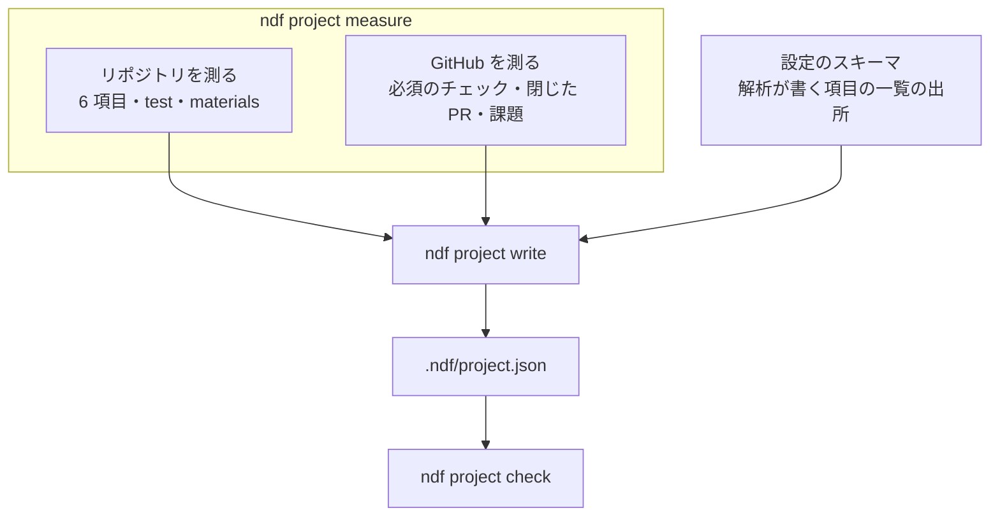
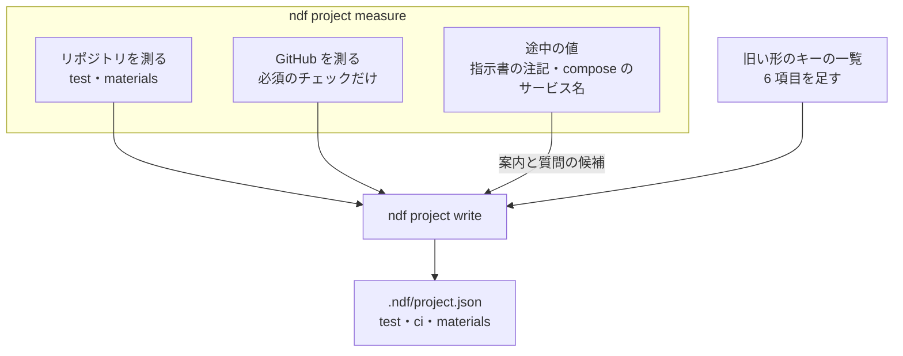
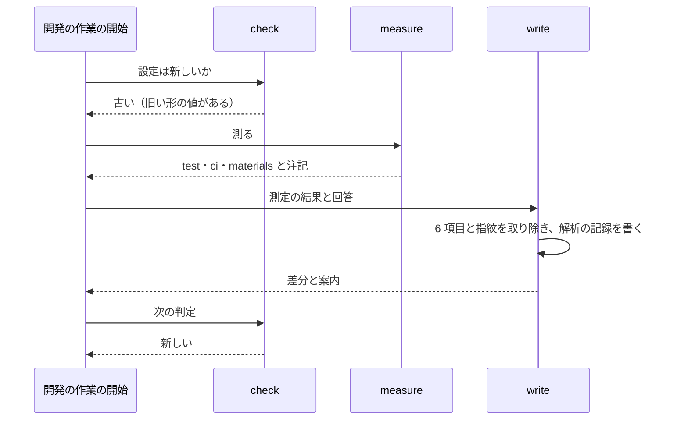

# プロジェクトの解析: 読み手のある項目だけを測って設定に書く（#4521）

解析が `.ndf/project.json` に書く項目のうち 6 つは読み手が無く、測る時間・GitHub の API・AI の token を使い、チームが確かめる差分も増やしている。そこで 6 項目を設定の形と解析から消す。既存の設定に残る値は、今ある「旧い形のキー」を取り除く仕組みで、次の書き出しが消す。

6 項目の測定のうち、次の 2 つは設定の項目をやめても残す。

- 指示書（`AGENTS.md`・`CLAUDE.md` など、AI への指示を書くファイル）の案内。指示書が無いことや、古い NDF の案内を読み込んでいることを、書き出しの出力で利用者に知らせる行である
- compose のサービス名。テストの走らせ方を AI に回答させる解析の質問（以下「テストの質問」）に、候補として載せる

比べた作り方は「決定の記録」にある。

## 今の姿

何が起きたか・項目ごとの読み手の表・目的・受け入れ条件は要求仕様（[issue-4521-requirements.md](./issue-4521-requirements.md)、正は #4521 の本文）にある。この文書は「どう解くか」と「なぜその解き方か」だけを書く。以下で「6 項目」は `languages`・`services`・`issues`・`checks`・`ndf_policies`・`instructions` を指す。



変更が触るのは、図の全部の箱である。設計に要る今の構造は次の 4 つである。

| 今の構造 | 中身 |
| --- | --- |
| 解析が書く項目の一覧 | 設定のスキーマの最上位のキーから作る。スキーマからキーを消せば、測定の結果の項目と書き出しの対象から外れる |
| 旧い形のキー | 設定から取り除くキーの一覧を 1 か所に持つ（`analysis_record.py`）。キーが残っていれば、判定は「古い」にする。読み込みはキーを取り除いたコピーで形を確かめる。書き出しはキーを取り除く |
| 指示書の案内 | 今の測定は、指示書の項目の中にある注記を、測定の結果の注記へ移している |
| テストの質問の候補 | サービスの項目を測る途中で、compose のサービス名を拾って渡している |

GitHub の閉じた PR と課題の呼び出しは、`issues` の質問の根拠にしか使っていない。

以下で使う 2 つの呼び名は、次のものを指す。

- **指紋**: 書き出しが項目ごとに残す、書いた値の SHA-256。`.ndf/project.json` の `analysis.written` に持つ。次の書き出しは、今の値の指紋が一致すれば解析が書いた値とみなして置き換え、違えば人が直した値として残す
- **解析の記録**: 設定が新しいかの判定が読む値（解析器のバージョン、入力のファイルのハッシュなど）。git で追跡しない `.ndf/analysis/project.json` に持つ

## 文脈と制約

- 設定のスキーマは知らないキーを許さない。6 項目をスキーマから消すだけだと、既存の設定が「壊れている」になり、利用者が手で直すまで作業が止まる
- 設定を NDF の中で読むほかの経路は、設定の全体をスキーマで検証しない。工程の前の確かめ（`ndf records preflight`）は知らないキーを警告に数えるだけで、ブランチ戦略と予算の読み手は自分のセクションだけを検査する
- `test`・`ci`・`materials` の値の形と、同じリポジトリに対する測定の結果（値・候補・根拠）は変えない
- 書き出しの規則は `test` で変える（決定 6）。測定の結果が空の suite の一覧でも、設定に保存済みの suite は残す。`test.ci.only` を決めるときに存在を確かめるファイルは、`--root` の中に限る
- 普及のフェーズに入るまで後方互換は求めない（MVV Value 4。MVV の所在と語の意味は「決定の記録」の冒頭）

## 解き方の全体像



- 解析が測って書く項目は `test`・`ci`・`materials` の 3 つになる。設定のスキーマから 6 項目と、その値の型の定義を消す
- 指示書の案内は測定の結果の注記に、compose のサービス名はテストの質問の候補に、今と同じ形で出る
- 6 項目が残る設定は「古い」になり、次の書き出しが、人の直した値も含めて値と指紋を消す
- GitHub へ呼ぶのは必須のチェックだけになり、AI が回答する質問は `test` と `materials` だけになる

## 構成要素

| 要素 | 責務の変化 |
| --- | --- |
| 設定のスキーマ（`ndf-settings/project.schema.json`）と Skill の下のコピー | 6 項目と、その値の型の定義を消す。説明の文から言語と課題の保存先を外す |
| ファイルの表（`ndf-files.json` の行 `project`） | キーの並びから 6 項目を外す |
| リポジトリの測定（`measure_repo.py`） | `test`・`materials` の 2 項目を返す。指示書の注記と compose のサービス名を、項目にせず返す。言語・静的解析の Tool・方針・データベースを測る処理と、それだけが使う表を消す |
| CI の測定（`measure_ci.py`） | 必須のチェックだけを測る。閉じた PR・課題の呼び出しと、`issues` の質問を消す |
| 測定の組み立て（`cli.py`） | 指示書の注記と CI の注記を、測定の結果の注記に今と同じ順で並べる |
| 書き出し（`write.py`） | 項目の番号の表（`p_number`）から 6 項目を消す。この番号（`P1` など）は、`measure` と `write` の出力の行と、開発の作業の開始の `不明 <番号>` の表示で、項目を指すために使う。残る `test`（P2）と `ci`（P4）の番号は振り直さない。回答できる項目は、測定の結果で `status: question` であり、かつ今の解析が書く項目に限る。`test` の測定の結果が空の suite の一覧で、今の値に suite があるときは、今の値を残して案内の行を出す（決定 6）。`test.ci.only` を決めるときと案内の行を作るときは、同じ処理で `--root` の中のパスだけの存在を確かめる（決定 6）。解析の記録の `analyzer` には、測定の結果の `analyzer` を書く（どちらも下の「入出力のコントラクト」） |
| 旧い形のキー（`analysis_record.py`） | 項目ごと消すキーに 6 項目を足す。言語の行の中のキー（`languages[].files`）は、`languages` の項目ごと消える。そのため、配列の中のキーを取り除く処理は消す |
| 判定（`check.py`） | 解析器のバージョンを上げる |
| 言語の表（`contracts/domains/languages.json`） | 要約（`summary`）から「言語の計測」を外す。表と行は変えない |
| 手順書と確定仕様（`project-analysis.md`・`ndf-project-analysis-record.md`）、生成物の `ndf-settings.md` | 新しい形を書く。`project-analysis.md` には、回答の適用結果の報告と無視した回答があるときの扱い（下の「入出力のコントラクト」）、再解析で今の値を引き継ぐ条件（決定 6）も書く |
| `write` の引数 `--answers` の説明（`cli.py`。生成物の `project.args.schema.json`・`commands.md`） | 再解析で今の値を引き継ぐ規則を書く（決定 6） |
| このリポジトリの `.ndf/project.json` | 6 項目とその指紋を消す |

## 入出力のコントラクト

| コントラクト | 今 | 変えた後 |
| --- | --- | --- |
| `.ndf/project.json` の解析が書くキー | 9 個 | `test`・`ci`・`materials`。6 項目を持つ設定は読めるが「古い」 |
| `ndf project measure` の結果の `items` | 9 個 | `test`・`ci`・`materials`。`notes` の中身と並びは、下の行の注記 1 種類を除き変わらない |
| `ndf project write` の回答 | `test`・`issues`・`ndf_policies`・`materials` | `test`・`materials`。ほかのキーは「無視した回答」と出る。旧版の測定の結果が消した項目を `status: question` で持っていても同じである |
| `ndf project write` が解析の記録に書く `analyzer` | 書き出す側の解析器のバージョン（`check.ANALYZER`） | 測定の結果の `analyzer`（実際に測ったバージョン）。測定の結果に正の整数の `analyzer` が無ければ、何も書かずに終了コード 1 |
| 版 4 の測定の結果を版 5 の `write` で書き出した直後の `ndf project check` | 終了コード 0（記録に版 5 が残る） | 終了コード 3、理由は「解析器のバージョンが古い（4 < 5）」。次の開発の作業の開始で版 5 が測り直す |
| 同じ版 4 の測定の結果で、版 5 の `write` をもう 1 回打つ | — | 記録の `analyzer` は 4 のままで、`check` は終了コード 3 のまま。`write` が版を 5 へ繰り上げることはない。受け入れ条件 11 の「同じ入力」は、版 5 の測定の結果とその回答を指す |
| `ndf project check`（6 項目が残る設定） | — | 終了コード 3、理由は「旧い形の値が設定にある: <キー>」 |
| 測定が呼ぶ GitHub の API | 必須のチェック・閉じた PR・課題 | 必須のチェック |
| 注記「PR のマージ先と GitHub Issues を測れない」 | 測れないときに出る | 出ない |
| `ndf project write` の `test`（測定の結果が `status: measured` の空の suite の一覧で、今の値に suite がある） | 解析が書いた値は空の一覧で置き換える。手で書いた値は残し、`mismatch` の行を出す | どちらも今の値を残す。解析が書いた値は `kind: unknown`・`kept_previous` の行で理由「テストの手がかりが無い」を出し、残した値の指紋を書く。手で書いた値は今と同じ `mismatch` の行を出し、指紋を書かない。どちらも `kind: note`・`key: test` の案内の行を足す。秘密の検査が先に働き、`test.ci.only` は下の行の決め方である（決定 6） |
| `ndf project write` の `test.ci.only`（回答を適用する、測った値を書く、前の値を残すなど、すべての書き出し） | `ci_jobs` が指すパスは、`--root` の外でも存在を確かめる | `--root` の中に収まる相対パスだけを確かめ、範囲外のパス（絶対パスと `..` を含むパスも範囲外）は存在するファイルに数えない。ほかの決め方は変わらない（決定 6） |
| `ndf project write` の `--answers` の説明 | 回答の形だけを書く | 回答の形と、再解析で今の値を引き継ぐ規則を書く（決定 6） |

サブコマンドの引数の名前と終了コードは変えない。

今の書き出し（`write.plan`）は、測定の結果で `status: question` の項目をすべて回答できる項目とみなす。スキーマからキーを消すだけでは、測定と書き出しの間に NDF を更新した利用者の `issues` と `ndf_policies` の回答が、設定に書かれないまま何も知らせずに捨てられる。そのため、回答できる項目を、今の解析が書く項目の一覧（`write.ITEM_KEYS`）で絞る。

回答を無視した書き出しは、受け入れ条件 8 のとおり終了コード 0・`status: ok` で終わる。呼び出し元は、結果 JSON の `items` にある `kind: ignored` の行（`key` が項目の名前）で、回答がすべて適用された書き出しと区別する。この行は今の結果の形にあるので、形は変えない。

`kind: ignored` の行が無くても、残る項目の回答が反映されたとは限らない。今の `write` は、手で書いた値と回答が食い違えば手で書いた値を残し、形に合わない回答は不明（`unknown`）にする。そこで呼び出し元は、回答した項目の行も確かめる。

| 回答した項目の行 | 意味 | 利用者への報告 |
| --- | --- | --- |
| `written`（`origin` が `判断した`） | 回答を適用した | 要らない |
| `mismatch` | 手で書いた値を残した。回答は別の値である | 項目と、設定の値・回答の値 |
| `kept` | 手で書いた値を残した。回答が同じ値か、回答を使えなかったかは、この行からは分からない | 項目と、設定の値を保ったこと |
| `unknown`・`secret` | 回答を使えず、不明にしたか前の値を残した | 項目と理由 |

どの行も今の出力にあるので、出力の形は変えない。無視した回答があるとき、呼び出し元は次のように作業を再開する。表の報告と次の手順は、解析の手順書（`project-analysis.md`）の `write` の行に足す。

1. `write` は回答のファイルを変えず、消さない。呼び出し元もこのファイルを残す
2. 利用者への報告に、無視されたキーと回答のファイルのパスを載せる。利用者はそのファイルで元の回答を確かめる
3. 書き出しは打ち直さず、開発の作業を続ける。消した項目には設定の置き場が無いので、回答は適用し直せない。残る項目の回答が反映されたかは、上の表で判断する

## 処理の流れ

次の図は、6 項目が残る設定が新しい形へ移るまでの流れである。図は実行の順を持つ要素だけを描き、スキーマ・表・文書は描かない。



## 決定の記録

各決定の「根拠」の Value は、このリポジトリの MVV（Mission・Vision・Value をまとめた文書。[.ndf/mvv.md](../.ndf/mvv.md)、バージョン 11）にある判断の基準の番号である。ここで引くのは次の 7 つである。

| 番号 | 中身（MVV の本文の要約） |
| --- | --- |
| Value 2 | 安く使える。利用者が払う費用（token・API・CI の時間・マシンの資源）を小さくし、費用が増える仕組みには理由と代案を示す |
| Value 3 | 同じ手順は毎回同じ結果になる。バージョンを上げても、進行中の作業と人の回答は失われず、止まった所から続く |
| Value 4 | どのプロジェクトでもそのまま使える。普及のフェーズに入るまでは後方互換を求めず、旧い設定の形を残す互換の仕組みを持たず、移行のコマンドできれいな最終形へ移す（「普及のフェーズ」は NDF が広く使われる段階を指す。入る条件は MVV に書かれていない） |
| Value 6 | 使うほど散らからない。使わなくなったコード・設定・文書は整理する。自動で片付けるのは NDF が自分で作ったものだけである |
| Value 9 | 責務の分かれた設計で作る。まだ要らない仕組みは先回りして作らない |
| Value 11 | 重複と冗長が無い。同じ規則や定義は 1 か所にまとめる |
| Value 15 | 人も AI も同じ入口から使える。Skill の手順だけでなく、`ndf` のコマンドと規約（`plugins/ndf/contracts/`）から同じように呼べる |

### 決定 1: 既存の設定を止めずに移すため、6 項目を「旧い形のキー」に足して取り除く

- **質問**: スキーマから消した 6 項目が残る既存の設定を、どの仕組みで移すか
- **選んだ案**: 設定から項目ごと消すキーの一覧に 6 項目を足し、今ある書き出しのコマンド `ndf project write` を移行のコマンドにする。判定は「古い」を返し、次の書き出しが値と指紋を消す。人が直した値かどうかは見ない
- 採らなかった案: スキーマに非推奨のキーとして残す（解析が書く項目の一覧からは外れるが、判定が「古い」にならず、値が設定に残り続ける。残った値は書き換えれば効くように読める）
- 採らなかった案: 移行専用のサブコマンドを足す（旧いキーを取り除く処理と差分の表示は `write` にあり、入口が 2 つになる。開発の作業を始める手順は `write` を打つので、専用のコマンドを打たなくても移る）
- 採らなかった案: 人が直した値は残す（読む仕組みが無い値を残す理由が無く、残すにはスキーマにキーを残すことになる）
- **代償**: 利用者が手で直した値も消える。差分は git に出るので、コミットの前に確かめられる。移行だけを行う操作は無いので、移行の書き出しでは残る項目にも今の書き出しの規則が働く
- 根拠: Value 4「旧い設定の形を残す互換の仕組みを持たず、移行のコマンドできれいな最終形へ移す」・Value 6・Value 11（MVV バージョン 11）

移行の対象と差分は、次の順で書く前に確かめられる。この手順は解析の手順書（`project-analysis.md`）に書く。

| 順 | コマンド | 分かること・起きること |
| --- | --- | --- |
| 1 | `ndf project check` | 対象。終了コード 3 の理由に、残っている旧いキーが出る |
| 2 | `ndf project measure --out <ファイル>` | リポジトリと CI を測る。設定は変わらない |
| 3 | `ndf project write --measure <ファイル> --dry-run` | 差分。何も書かない |
| 4 | `ndf project write --measure <ファイル>` | 移行する。リンクされた worktree から打っても、設定はメインディレクトリへ書く。差分はメインディレクトリで確かめ、解析の手順書の「移行の後」に従って移行用のブランチでコミットする |

- 移行だけなら回答（`--answers`）は要らず、AI を使わない。回答が無くても、質問の項目に今の値があれば残る。回答するときは、3 と 4 に同じ `--answers` を渡す
- 開発の作業を始める手順は、今と同じく `check`・`measure`・`write` の順に打つ。`--dry-run` は挟まず、`write` が出す差分をコミットの前に確かめる

### 決定 2: 利用者が直せる案内を残すため、指示書は設定の項目にせず、確かめた結果を測定の注記に出す

- **質問**: `instructions` の項目を消すとき、指示書の案内をどこで作るか
- **選んだ案**: 指示書の確かめは注記の並びだけを返し、測定の結果の `notes` に入れる。確かめが失敗・時間切れなら注記を出さずに、残りの測定を続ける
- 採らなかった案: `instructions` を測定の結果の項目にだけ残し、設定に書かない（解析が書く項目の一覧がスキーマと別になり、受け入れ条件 3 を満たさない）
- 採らなかった案: 案内もやめる（利用者が読んで指示書を直すための出力で、今の約束である）
- **代償**: 確かめが失敗したことは出力に出ない。今は項目の「不明」として出ている
- 根拠: Value 6・Value 11（MVV バージョン 11）

### 決定 3: テストの質問の根拠を変えないため、compose のファイルはサービス名だけを読む

- **質問**: `services` の項目を消すとき、テストの質問に載せる compose のサービス名をどう得るか
- **選んだ案**: compose のファイルからサービス名の並びだけを返す。データベースの判定、CI のワークフローの image の読み取り、コンテナの有無は消す
- 採らなかった案: 今の測定をそのまま呼び、値を捨てる（読み手の無い値を測り続ける）
- **代償**: データベースを使う機能を後で作るときは、読み取りを作り直す
- 根拠: Value 2・Value 9「まだ要らない仕組みは先回りして作らず」（MVV バージョン 11）

### 決定 4: 古い解析の記録と区別するため、解析器のバージョンを 5 に上げる

- **質問**: 測る項目が減るとき、解析器のバージョンを上げるか
- **選んだ案**: 上げる。6 項目が無い設定でも、次の作業で 1 回解析し直す。この区別が効くように、解析の記録には書き出す側のバージョンでなく、測定の結果の `analyzer` を書く。今の `write` は `check.ANALYZER` を書くので、版 4 で測ってから NDF を更新して書き出すと、版 5 で一度も測っていない設定が「新しい」になる
- 採らなかった案: 上げない（6 項目が残る設定は決定 1 で「古い」になるが、測る項目を変えたら上げるという解析器の決まりに反する。記録に残るバージョンの番号から、どの項目の組を測ったかが分からなくなる）
- **代償**: 6 項目を手で消していた clone でも、解析が 1 回走る
- 根拠: Value 3（MVV バージョン 11）

### 決定 5: ほかの読み手を巻き込まないため、言語の表は残す

- **質問**: 解析が言語を測らなくなると、言語の表を読むプロダクションのコードが無くなる。表も消すか
- **選んだ案**: 残し、要約（`summary`）から「言語の計測」だけを外す。テストのファイルを見分ける表（`contracts/domains/test-files.json`）の `language` の列が、言語の表（`contracts/domains/languages.json`）の言語の名前を参照している
- 採らなかった案: 表も消す（テストのファイルを見分ける表と、言語の表を確かめるテストの作り直しまで広がる。対象は解析が書く設定の項目である）
- **代償**: 表の拡張子の列とプロダクションコードの列を読むのは、テストだけになる。解析が表を読まない状態でも `ndf check` が通ることは、読み取りを空にした 1 回の実行で確かめた（1749 ファイルに違反なし）
- 根拠: Value 9（MVV バージョン 11）

### 決定 6: 回答を再解析で失わないため、今も成り立つ値は引き継ぎ、空の測定値で suite を消さない

- **質問**: 回答から書いた `test` と `materials` には解析が書いた値として指紋が付き、次の再解析の値で置き換わる。前の回答をどう引き継ぐか
- **選んだ案**: 項目が質問にならない場合は `write` の規則で、質問になる場合は回答する側の規則で引き継ぐ

**質問にならない場合（`write` が守る）**

テストの手がかり（テストのツール、コマンド、指示書の記述）が無くなると、前は質問だった `test` が、測った値の空の suite の一覧になる。指示書からテストの記述を整理しただけでも、独自のスクリプトを走らせる前の回答は使える。手がかりが無いことは、使えなくなった根拠にならない。

- 秘密の検査はこの規則より先に働く。今の値に秘密の形があれば、今と同じく項目を `{"unknown": "秘密の形"}` にする。suite は残さず、値を持つ `mismatch` の行も案内の行も出さない
- 今の値に suite が 1 つ以上あれば、`write` は今の値を残す。出力と指紋は、今の値を誰が書いたかで次のように分かれる

| 残す値 | 出力の行 | 指紋（`analysis.written`） |
| --- | --- | --- |
| 解析が書いた値 | `kind: unknown`・`kept_previous`。理由は「テストの手がかりが無い」。空の測定値を不明と同じに扱う | 残した値の指紋を書く。後の回答で置き換えられる |
| 手で書いた値 | `mismatch`（今の振る舞いのまま）。解析の側の値が空の一覧なので、手がかりが無かったと分かる | 書かない。手で書いた値のままである |

- 空の一覧を書くのは、`test` のキーが無いか、今の値が不明か、今の値の suite が 0 件のときだけである
- テストをすべてやめたリポジトリでは、利用者が下の手順で `test` のキーを消し、解析し直す。キーを消すだけでは解析は始まらない。`check` は設定と解析の記録の対応を `analysis.written` の指紋で見るので、`test` を消しても、ほかの入力が変わらなければ「新しい」のままである

  1. メインディレクトリの `.ndf/project.json` から `test` のキーを消す
  2. リポジトリの外の一時ファイルを指定して、`ndf project measure --out <ファイル>` を打つ
  3. 測定の結果の `test` が、`status: measured` で suite が空であることを確かめる
  4. 同じファイルを指定して、`ndf project write --measure <ファイル>` を打つ。空の suite の一覧が書かれる

  3 で `test` が `status: question` なら、テストのツールの依存、テストのコマンド、指示書や README の記述のどれかが残っている。測定の結果の `candidates` と `evidence` で残りを確かめる。取り除けるなら取り除いて測り直す。残す場合は、回答（`--answers`）で `test` に空の suite の一覧を渡して書き出す。回答を渡さずに書き出すと、`test` は空の一覧でなく不明（`unknown`）になる

  コマンドを直接打つときは、`ndf project check` は要らない。開発の作業を始める手順で解析し直すときは、AI に再解析を頼む。AI は `ndf project check --force`（終了コード 3）で解析へ分岐してから、2〜4 を打つ。この手順は解析の手順書（`project-analysis.md`）に書く
- 残すのは `test.ci.only` を除く部分である。`test.ci.only` は、残した suite に対して、ほかの書き出しと同じ決め方で `write` が決める。テスト用の suite（`kind` が `test` か未指定）の `ci_jobs` が指すファイルが 1 本も存在しないとき、解析が書いた `true` を消す。1 本でも存在すれば `true` のままにする。人が書いた値は変えない。解析が書いた `test` の指紋は、`ci.only` を決めた後の値で書く

**残した suite を知らせる（`write` が行う）**

手がかりが見つからないだけでなく、前の suite が使うファイルが削除されていることもある。そのまま残すと後の検証が失敗するので、`write` は suite を残したことを案内の行で知らせる。発動するかは `write` の中で決まるので、呼び出し元は出力の行を見分けなくてよい。案内の行は、上の表のどちらの場合も 1 行出る。

| 案内の行に書くこと | 中身 |
| --- | --- |
| 残した理由 | テストの手がかりが無いので、前の suite の名前を挙げて残したと書く |
| 無くなったファイル | suite の `container.compose_files` のうち、リポジトリに無いパスを suite の名前と一緒に書く。無ければ書かない |
| 範囲外で未確認のパス | `container.compose_files` のうち、範囲外のパス（判定は下の表）を suite の名前と一緒に「未確認」と書く。あるか無いかは書かない。該当が無ければ書かない |
| 確かめていないこと | コマンドが参照するファイルは確かめていない。使わなくなった suite は、利用者が `test` を直すか消す。消しただけでは解析は始まらないので、消した後に解析し直す |

- ファイルがあるかは、`write` の作業ディレクトリ（`--root`）を起点に確かめる。`test.ci.only` を決めるときの `ci_jobs` の確かめと同じ起点で、同じ処理を使う。作業ブランチに足したファイルは、欠けと数えない
- 存在を確かめるのは、`--root` の中に収まるパスだけである。次のパスは範囲外とし、指す先があるかを調べない。

  | パス | 判定 |
  | --- | --- |
  | 絶対パス | 表記だけで範囲外。指す先が `--root` の中でも同じ |
  | `..` を含むパス | 表記だけで範囲外。解決すると `--root` の中になる場合も同じ |
  | 上の 2 つに当たらない相対パス | シンボリックリンクをたどった実体が `--root` の外なら範囲外。中なら存在を確かめる |

  絶対パスと `..` を表記で拒むのは、共有する設定に書くパスはリポジトリの根からの相対パスで足り、worktree のテスト環境の `compose_files` も同じ扱いだからである。出力は、指す先の有無で変えない。設定を書ける人が、`write` を実行した環境の `--root` の外にあるファイルの有無を、出力から知れないようにするためである
- 範囲外のパスは未確認として扱う。`compose_files` は無くなったファイルに数えない。`ci_jobs` は存在するファイルに数えないので、ほかに存在するファイルが無ければ、解析が書いた `true` は消え、新しく `true` を書くこともない
- この範囲の制限は、suite を残す場合に限らず、すべての書き出しに適用する。回答を適用した `test` を書く通常の書き出しでも、範囲外を指す `ci_jobs` だけでは `ci.only: true` にならない。存在を確かめる処理を 1 つにし、書き出しの場面で結果が変わらないようにするためである
- 確かめるのは、設定のキーから用途とパスが決まる `container.compose_files` だけである。`ci_jobs` は `test.ci.only` の決め方が扱う。`paths` は検査の範囲を絞る値で、glob も書けるので確かめない
- コマンドの文字列が参照するファイルは確かめない。参照先を取り出すにはシェルの解釈が要り、機械では決まらないためである。確かめていないことは、上の表のとおり案内の行に書く
- `write` は suite を消さない。案内の行は、既存の出力の形（`kind: note`）なので、Skill を通さない呼び出し元も結果 JSON の `items` から読める。読み手向けの出力では `案内:` の行になる

**質問になる場合（回答する側が守る）**

回答は今の設定の値を元に作り、変える必要がある部分だけを置き換える。今の値は、`write` が更新するメインディレクトリの `.ndf/project.json` から読む。呼び出し元が作業の開始などでメインディレクトリをすでに得ていれば、それを使い、Git を打ち直さない。得ていない呼び出し元だけが、`write` と同じ規則で求める。`--root` が属する Git リポジトリの共通 Git ディレクトリ（`git rev-parse --path-format=absolute --git-common-dir`）の親である。`--root` がリンクされた worktree でも、その worktree のファイルは読まない。古い値を回答に写すと、メインディレクトリに保存した新しい回答を上書きするためである。

| 今の値の部分 | 回答への書き方 |
| --- | --- |
| 今の設定の形に合い、測定の根拠・指示書・リポジトリのファイルと食い違わない | 変えずに `value` に写す |
| 形に合わないか、食い違う | その部分だけを根拠から作り直し、変えた理由を利用者への報告に載せる |
| 人が書くか選ぶ部分（上の 2 行より優先する。`materials` の `needs`・`seeds.libraries`・`seeds.environment`・`deferred_milestones` など） | 引き継ぐ。古くなったと考える根拠があっても値は変えず、変更の候補として利用者への報告に載せて確かめてもらう |

- `seeds.libraries`（調べる依存の一覧）は、依存を測定できても、どれを調べるかは人が選んだ値である。測定で増えた依存を足さず、無くなった依存も外さない
- 今の値が無いか不明（`unknown`）なら、今のとおり根拠から回答を作る
- 引き継ぐのは回答できるキーである。`test.ci.only` は回答に含めず、従来どおり `write` が決める
- 項目の回答を省いた場合も、`write` は今の値を残す（今の振る舞い）
- 版 4 の回答を版 5 の `write` で適用した直後の再解析も、この規則に当たる

**規則を置く所**: Skill を通さずに `measure` と `write` を組み合わせる呼び出し元（Factory など）にも届くように、`write` の引数 `--answers` の説明に規則の要点（今の値をメインディレクトリから読むことと、その求め方、得ている値は使い回すことを含む）を書く。この説明は、引数のスキーマ（`plugins/ndf/contracts/schemas/io/project.args.schema.json`）と `commands.md` に生成される。解析の手順書（`project-analysis.md`）の「回答方」には、上の表を書く。残した suite の知らせは `write` の出力なので、手順書の今の指示（`案内` の行を利用者への報告に載せる）で届く。

- 採らなかった案: `write` が回答から書いた値を置き換えないようにする（テストの走らせ方が変わっても、設定が更新されなくなる）
- 採らなかった案: `write` が回答と今の値を部分ごとに合わせる（部分が今も成り立つかは仕組みで決まらず、回答で値を消すこともできなくなる）
- 採らなかった案: 規則を手順書にだけ書く（CLI を直接呼ぶ連携では、新しく作った回答が前の回答を置き換える）
- 採らなかった案: 残した suite の参照先を呼び出し元が確かめる（呼び出すたびに報告が変わり、Skill を通さない呼び出し元には届かず、確かめる工程の token と時間が増える）
- 採らなかった案: 測定の結果にファイルの一覧を足して使う（測定の結果の形が変わる。`write` には `ci_jobs` のファイルを確かめる処理がすでにあり、数個のパスの確かめで足りる）
- 採らなかった案: コマンドの文字列を解釈して参照先を取り出す（シェルの展開やコンテナの中のパスがあり、無いと誤って知らせる）
- **代償**: テストをすべてやめても、利用者が `test` のキーを消すまで前の suite が残る。コマンドが参照するスクリプトが削除されても `write` は気づかず、案内の行を読んだ利用者か、後の検証の失敗が知らせる。質問になる場合の規則は回答する側の判断で、仕組みでは強制しない。手順書と説明の文言を固定するテストは置かない
- 根拠: Value 2・Value 3・Value 15（MVV バージョン 11）

## 影響と危険

- **働く範囲**: NDF を使うすべてのリポジトリの、開発の作業の開始の解析と書き出し
- **プロジェクトごとに違うもの**: 無し。足す設定も引数も無い
- **当たるモード**: 開発の作業の開始で解析を通すすべてのモード（モードは、開発ワークフローが変更の内容で工程を振り分ける `standard`・`light` などの区分）

| 壊れうる箇所 | 扱い |
| --- | --- |
| 6 項目が残る設定で、解析の前に工程の前の確かめが走る | 知らないキーの警告が出る。止めない。次の書き出しで消える |
| チームの中の古い NDF が書き出すと、6 項目が書き戻る | 要求仕様の「今の利用者への影響と互換」のとおり、チームで NDF のバージョンをそろえる。リリースの変更履歴に書く |
| テストをすべてやめたリポジトリ | 前の suite が残り、案内の行が出る。利用者が `test` のキーを消して解析し直すと、空の一覧が書かれる。テストの手がかりが残っていれば、回答が要る（決定 6） |
| 解析に失敗する・差分をコミットしない | 6 項目が残り、次の作業でまた「古い」になる。作業は止まらない |
| #2239 が `issues.primary` を読む前提 | 要求仕様の「影響」のとおり、#2239 の実装で設定の形と作り方を決め直す |
| 確定仕様 `ndf-issue-items.md`・`ndf-usage-ledger-by-runtime.md` が `issues.primary` を読むと書いている | どちらも NDF 10.x のスクリプトの記録で、今の `plugins`・`scripts` に読む処理は無い。`git grep` で当たるのは、設定の形の定義（スキーマ）、その説明（`ndf-settings.md`）、解析の手順書 `project-analysis.md` の「回答方」の表（回答の `value` の形）だけである。この変更では確定仕様の 2 本を書き換えない |

### 代表のリポジトリでの振る舞い

| 代表のリポジトリ | 設定の要点 | 直した後に起きること | この種類で扱えなくなること |
| --- | --- | --- | --- |
| Web サービス | compose でテストを走らせる | テストの質問の候補に compose のサービス名が今と同じく載る。データベースの一覧は設定に書かれない。worktree のテスト環境は `worktree.json` を読むので変わらない | 無し |
| モバイルアプリ | 静的解析の Tool とワークフローを持つ | 静的解析はテストの suite の設定で走るので変わらない。Tool の一覧は設定に書かれない | 無し |
| 業務文書だけ | テストの suite が無い | `test` は空の一覧のまま。課題の保存先と方針の質問が出なくなる | 無し |

### このリポジトリだけの事情

| 値 | 置く所 | 持つ Issue |
| --- | --- | --- |
| 追跡している `.ndf/project.json` の 6 項目と指紋 | このリポジトリの `.ndf/project.json`。実装の中で直接消す（`ndf project write` はメインディレクトリへ書くので、worktree の差分は作れない） | #4521 |
| マージの後、リリースを導入するまでの間は、導入済みの旧版 NDF の解析が、6 項目と指紋をメインディレクトリへ書き戻す | メインディレクトリの `.ndf/project.json` の未コミットの差分。手で取り消さない。このための実装は足さない | #4521 |

書き戻しのたびに差分を取り消す手順は持たない。旧版は解析のたびに書き戻すので、手で取り消しても同じ作業が繰り返される（MVV の Value 3 は、同じ手当てが繰り返されたら、その手順そのものを無くすと定める）。開発担当者は次のように扱う。

- 差分はコミットせず、そのまま置く。リリース版を導入した後の最初の書き出しが、6 項目と指紋を取り除く（決定 1 と同じ仕組み）
- この間に `.ndf/project.json` のほかの値を変えるときは、作業用の worktree のファイルを直し、メインディレクトリのファイルをコピーしない
- 誤って 6 項目をコミットした場合は、`ndf check` が追跡中の設定をスキーマで確かめて落ちるので、マージの前に分かる

ただし、この間に `.ndf/project.json` を変える Pull Request がマージされると、未コミットの差分があるメインディレクトリは fast-forward で更新できない。更新が止まったときだけ、メインディレクトリで次を行う。

1. 未コミットの差分を保存してから、このファイルを戻して更新する。ステージした変更と作業ファイルの変更は、別々のファイルに保存する。1 つにまとめると、ステージにだけ残した編集が消える。差分には未コミットの値が含まれるので、保存先は本人だけが読める新しいディレクトリ（`mktemp -d`）にする。コマンドは `&&` でつなぎ、保存に失敗したら戻さない

   ```bash
   SAVE="$(mktemp -d)" &&
   git diff --cached --binary --no-ext-diff --no-textconv -- .ndf/project.json > "$SAVE/staged.patch" &&
   git diff --binary --no-ext-diff --no-textconv -- .ndf/project.json > "$SAVE/unstaged.patch" &&
   git restore --staged --worktree -- .ndf/project.json &&
   git pull --ff-only
   echo "$SAVE"
   ```

2. 保存した 2 つの差分を読み、旧版の書き戻しのほかに残したい変更があれば、更新後のファイルに書き直す。6 項目と指紋は書き直さない
3. 書き直しが済んだら、保存先のディレクトリを消す

追跡中の設定からの削除は、実装の Pull Request に含める。リリース版の導入まで遅らせる案は採らない。スキーマから 6 項目を消すと、6 項目が残る追跡中の設定では、その Pull Request の `ndf check` が通らないためである。

## 用語

| 用語 | 意味 | 用語集への反映 |
| --- | --- | --- |
| プロジェクトの設定 | リポジトリの根の `.ndf/` に置く、そのプロジェクトの形（テスト・CI・ブランチ・デプロイなど）を表すファイルの集まり | 意味の変更 |

変える前の意味は、括弧の中に「言語」と「課題の SSOT」も挙げていた。解析がこの 2 つを設定に書かなくなるので、例から外す。用語集のほかの部分は変えない。

## テスト設計

| 受け入れ条件 | どの振る舞いで縛るか | どう壊したら落ちるべきか |
| --- | --- | --- |
| 1 | 課題の本文の読み手の表（要求仕様にある。テストを置かない） | — |
| 2・3 | 言語・compose・指示書・静的解析の設定を持つリポジトリを測ると、結果の項目は `test`・`ci`・`materials` だけ | 6 項目のどれかを測定の結果に戻すと落ちる |
| 4 | 設定の無いリポジトリへ書き出すと、6 キーが設定にも指紋にも無い | スキーマにキーを戻すと落ちる |
| 5 | 測定が呼ぶ API の並びは、必須のチェックの 1 つだけ | 閉じた PR か課題の呼び出しを戻すと落ちる |
| 6 | 同じリポジトリで、`test` と `materials` の測定の結果（値・候補・根拠。compose のサービス名を含む）が変更の前と同じ。`test` は、質問になるリポジトリと、質問にならず測った値になるリポジトリの両方で比べる。`ci` の値は、GitHub の応答を差し替えて比べる | compose の読み取りか依存の読み取りを落とす、`materials` の根拠を落とす、`ci` の必須のチェックを落とすと、それぞれ落ちる。変える前の値を固定するテストを先に置く |
| 7 | 指示書が無いリポジトリと、古い案内のマーカーを持つファイルを読み込むリポジトリで、書き出しの出力に案内の行が出る | 注記を測定の結果へ入れないと落ちる |
| 8 | `issues`・`ndf_policies` の回答は「無視した回答」と出て、終了コード 0 で、設定に書かれない。旧版の測定の結果（2 項目を `status: question` で持つ）と旧版の回答を組み合わせて確かめる。結果 JSON の `items` に 2 項目の `kind: ignored` があり、回答のファイルは変わらない | 回答を設定へ書くか、回答できる項目を今の項目の一覧で絞らないか、`ignored` の行を落とすと落ちる |
| —（決定 4） | 版 4 の測定の結果を書き出すと、直後の判定は終了コード 3 で、理由に解析器のバージョンが出る。同じ入力でもう 1 回書き出しても同じである | 解析の記録に `check.ANALYZER` を書くと、終了コード 0 になって落ちる |
| 9 | 6 キーのどれかが残る設定の判定は終了コード 3 | キーを一覧から外すと終了コード 2 になって落ちる |
| 10 | 解析が書いた値・人が直した値・指紋の 3 つがそろう設定から書き出すと 6 キーと指紋が消え、残る項目の「書いた」「手の値を保った」の区別は変わらない | 人が直した値を残すと落ちる |
| —（決定 6） | 解析が書いた suite がある設定へ、`test` が空の suite の一覧の測定の結果を書き出すと、suite は残り、`kept_previous` の行が出て、指紋が残る。手で書いた suite がある設定では、suite は残り、`mismatch` の行が出て、指紋は付かない。どちらも案内の行が出る。`test` のキーが無い設定へ書き出すと、空の一覧が書かれる。書き出した後に `test` のキーだけを消すと、`check` は終了コード 0 のままで、同じ空の測定値を書き出すと空の一覧が書かれる | 空の測定値で置き換える、手で書いた suite に `kept_previous` の行か指紋を付ける、案内の行を落とすと、それぞれ落ちる |
| —（決定 6・秘密） | 秘密の形を含む suite がある設定へ、同じ空の測定値を書き出すと、`test` は秘密の形の不明になり、秘密の値は設定にも出力にも無い | suite を残す処理を秘密の検査より先に置くと落ちる |
| —（決定 6・`ci.only`） | 解析が `ci.only: true` を書いた設定で、`ci_jobs` のファイルを消して同じ空の測定値を書き出すと、suite は残り、`ci.only` は消える。ファイルがあれば `true` のまま。`ci_jobs` が 2 本のファイルを指し、1 本だけ残る場合も `true` のまま。人が書いた `false` は残る | `test` 全体をそのまま残すと、`true` が残って落ちる。1 本でも欠ければ消すと、2 本のうち 1 本が残る場合で落ちる |
| —（決定 6・案内） | suite の `compose_files` の 1 つが `--root` に無いと、案内の行に suite の名前とそのパスが出る。あれば出ない | ファイルの確かめを外すか、起点を取り違えると落ちる |
| —（決定 6・範囲外のパス） | `compose_files` と `ci_jobs` に、絶対パス、`..` を含むパス、外を指すシンボリックリンクを書く。指す先があってもなくても出力は同じで、`compose_files` は案内の行に未確認と出る。`ci_jobs` が範囲外のパスだけなら、解析が書いた `ci.only: true` は消える | 範囲を確かめずに存在を調べると、指す先の有無で出力か `ci.only` が変わって落ちる |
| —（決定 6・範囲外のパス・通常の書き出し） | `test` が質問の測定の結果へ回答を適用する。回答の `ci_jobs` が `--root` の外にある実在のファイルだけを指すと `ci.only` は書かれず、`--root` の中の実在のファイルを相対パスで指すと `true` になる。同じファイルを絶対パスか `..` を含むパスで指すと書かれない。`--root` の中の実体を指すシンボリックリンクの相対パスは `true` になる | 範囲の制限を suite を残す場合だけに掛けると、外のファイルで `true` になって落ちる。解決先だけで判定すると、中を指す絶対パスで `true` になって落ちる |
| 11 | 版 5 の測定の結果で 10 の書き出しをした後、同じ入力でもう 1 回書き出すと設定は変わらず、判定は終了コード 0 | 書き出しのたびに指紋が変わると落ちる |
| 12 | 人が書いた `materials` が移行の書き出しの後も同じ値で残る | `materials` を解析の値で置き換えると落ちる |
| 13 | `ndf check`（スキーマのコピー・キーの並び・生成物・設定の実物）と `check-skill-frontmatter.py` が通る | コピーか生成物を直し忘れると落ちる |

この変更で消す処理を確かめる今のテスト（言語の行・サービス・指示書の読み込み・`issues` の質問・配列の中の旧いキー）は消すか書き換える。書き出しのテストが例に使う `checks` は、残る項目へ置き換える。

## 設計の結果

| 課題 | 扱い | 統合先 | 触るファイル |
| --- | --- | --- | --- |
| #4521 | 実装する | — | `plugins/ndf/src/ndf/domains/project/measure_repo.py`、`plugins/ndf/src/ndf/domains/project/measure_ci.py`、`plugins/ndf/src/ndf/domains/project/cli.py`、`plugins/ndf/src/ndf/domains/project/write.py`、`plugins/ndf/src/ndf/domains/project/analysis_record.py`、`plugins/ndf/src/ndf/domains/project/check.py`、`plugins/ndf/contracts/schemas/ndf-settings/project.schema.json`、`plugins/ndf/skills/development-workflow/schemas/project.schema.json`、`plugins/ndf/contracts/domains/ndf-files.json`、`plugins/ndf/contracts/domains/languages.json`、`plugins/ndf/docs/contracts/ndf-settings.md`、`plugins/ndf/contracts/schemas/io/project.args.schema.json`、`plugins/ndf/docs/contracts/commands.md`、`plugins/ndf/skills/development-workflow/references/project-analysis.md`、`docs/specifications/ndf-project-analysis-record.md`、`.ndf/project.json`、`plugins/ndf/tests/domains/project/test_project_measure.py`、`plugins/ndf/tests/domains/project/test_project_cli.py`、`plugins/ndf/tests/domains/project/test_analysis_record.py`、`plugins/ndf/tests/domains/project/test_measure_project_branch_state.py` |

## 人へ残す判断

| 判断 | 当たるレッドライン | なぜ当たるか |
| --- | --- | --- |
| 利用者とこのリポジトリの設定に残る 6 項目を、人が直した値も含めて取り除く | C7（NDF の共通原則の「必ず人の承認が要る操作」の 1 つ。利用者の設定 `.ndf/` と指示書を書き換える操作は、人の承認が要る） | 利用者の設定（`.ndf/`）を書き換える。設計承認ゲートで承認する |

## 外部の調査

省く: 外部の判断が要らない変更（NDF の中の取り決めだけで形が決まり、足す機能もライブラリも無い）
