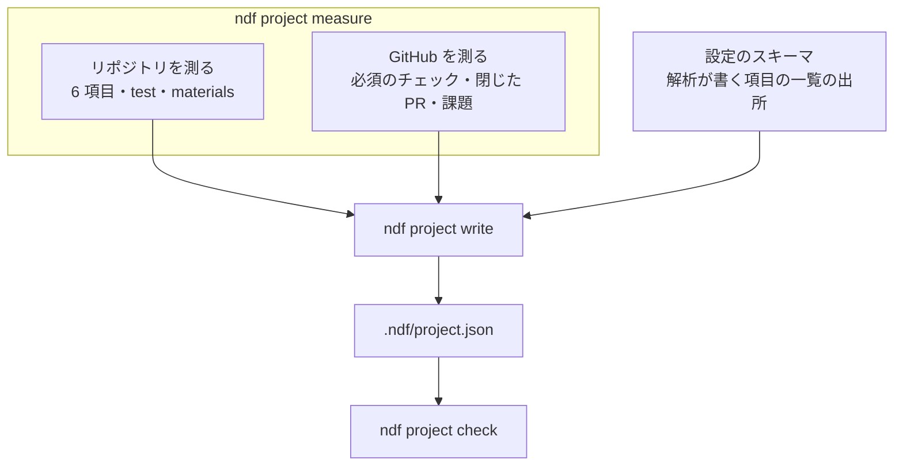
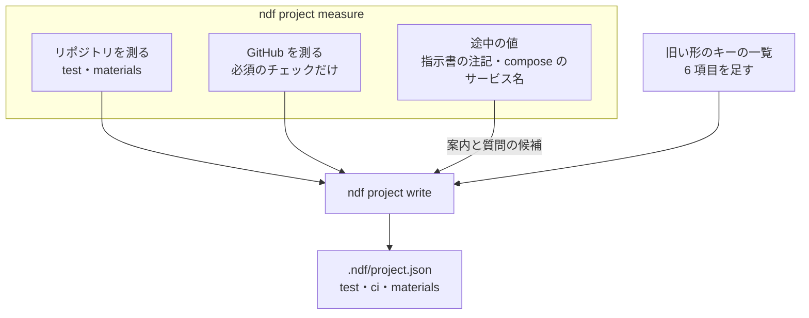
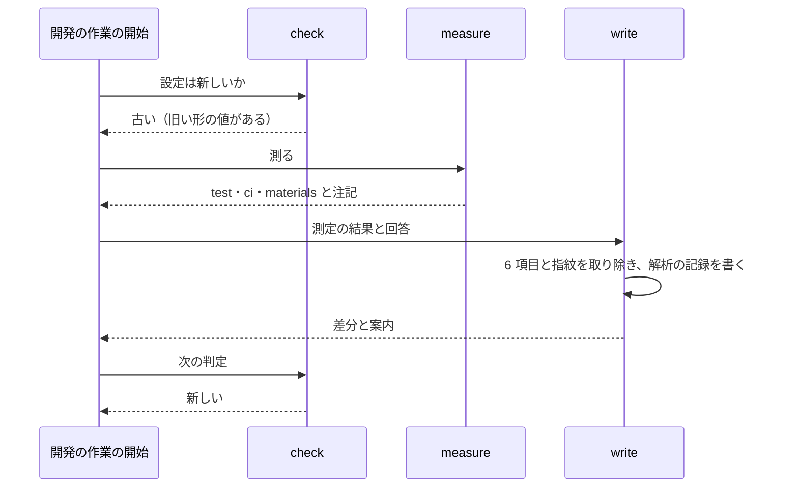

# プロジェクトの解析: 読み手のある項目だけを測って設定に書く（#4521）

解析が `.ndf/project.json` に書く項目のうち 6 つは読み手が無く、測る時間・GitHub の API・AI の token を使い、チームが確かめる差分も増やしている。そこで 6 項目を設定の形と解析から消す。既存の設定に残る値は、今ある「旧い形のキー」を取り除く仕組みで、次の書き出しが消す。

6 項目の測定のうち、次の 2 つは設定の項目をやめても残す。

- 指示書（`AGENTS.md`・`CLAUDE.md` など、AI への指示を書くファイル）の案内。指示書が無いことや、古い NDF の案内を読み込んでいることを、書き出しの出力で利用者に知らせる行である
- compose のサービス名。テストの走らせ方を AI に回答させる解析の質問（以下「テストの質問」）に、候補として載せる

比べた作り方は「決定の記録」にある。

## 今の姿

何が起きたか・項目ごとの読み手の表・目的・受け入れ条件は要求仕様（[issue-4521-requirements.md](./issue-4521-requirements.md)、正は #4521 の本文）にある。この文書は「どう解くか」と「なぜその解き方か」だけを書く。以下で「6 項目」は `languages`・`services`・`issues`・`checks`・`ndf_policies`・`instructions` を指す。

変更が触るのは、図の全部の箱である。設計に要る今の構造は次の 4 つである。

| 今の構造 | 中身 |
| --- | --- |
| 解析が書く項目の一覧 | 設定のスキーマの最上位のキーから作る。スキーマからキーを消せば、測定の結果の項目と書き出しの対象から外れる |
| 旧い形のキー | 設定から取り除くキーの一覧を 1 か所に持つ（`analysis_record.py`）。キーが残っていれば、判定は「古い」にする。読み込みはキーを取り除いたコピーで形を確かめる。書き出しはキーを取り除く |
| 指示書の案内 | 今の測定は、指示書の項目の中にある注記を、測定の結果の注記へ移している |
| テストの質問の候補 | サービスの項目を測る途中で、compose のサービス名を拾って渡している |

GitHub の閉じた PR と課題の呼び出しは、`issues` の質問の根拠にしか使っていない。

以下で使う 2 つの呼び名は、次のものを指す。

- **指紋**: 書き出しが項目ごとに残す、書いた値の SHA-256。`.ndf/project.json` の `analysis.written` に持つ。次の書き出しは、今の値の指紋が一致すれば解析が書いた値とみなして置き換え、違えば人が直した値として残す
- **解析の記録**: 設定が新しいかの判定が読む値（解析器のバージョン、入力のファイルのハッシュなど）。git で追跡しない `.ndf/analysis/project.json` に持つ

## 文脈と制約

- 設定のスキーマは知らないキーを許さない。6 項目をスキーマから消すだけだと、既存の設定が「壊れている」になり、利用者が手で直すまで作業が止まる
- 設定を NDF の中で読むほかの経路は、設定の全体をスキーマで検証しない。工程の前の確かめ（`ndf records preflight`）は知らないキーを警告に数えるだけで、ブランチ戦略と予算の読み手は自分のセクションだけを検査する
- `test`・`ci`・`materials` の形と中身は変えない
- 普及のフェーズに入るまで後方互換は求めない（MVV Value 4。MVV の所在と語の意味は「決定の記録」の冒頭）

## 解き方の全体像

- 解析が測って書く項目は `test`・`ci`・`materials` の 3 つになる。設定のスキーマから 6 項目と、その値の型の定義を消す
- 指示書の案内は測定の結果の注記に、compose のサービス名はテストの質問の候補に、今と同じ形で出る
- 6 項目が残る設定は「古い」になり、次の書き出しが、人の直した値も含めて値と指紋を消す
- GitHub へ呼ぶのは必須のチェックだけになり、AI が回答する質問は `test` と `materials` だけになる

## 構成要素

| 要素 | 責務の変化 |
| --- | --- |
| 設定のスキーマ（`ndf-settings/project.schema.json`）と Skill の下のコピー | 6 項目と、その値の型の定義を消す。説明の文から言語と課題の保存先を外す |
| ファイルの表（`ndf-files.json` の行 `project`） | キーの並びから 6 項目を外す |
| リポジトリの測定（`measure_repo.py`） | `test`・`materials` の 2 項目を返す。指示書の注記と compose のサービス名を、項目にせず返す。言語・静的解析の Tool・方針・データベースを測る処理と、それだけが使う表を消す |
| CI の測定（`measure_ci.py`） | 必須のチェックだけを測る。閉じた PR・課題の呼び出しと、`issues` の質問を消す |
| 測定の組み立て（`cli.py`） | 指示書の注記と CI の注記を、測定の結果の注記に今と同じ順で並べる |
| 書き出し（`write.py`） | 項目の番号の表（`p_number`）から 6 項目を消す。この番号（`P1` など）は、`measure` と `write` の出力の行と、開発の作業の開始の `不明 <番号>` の表示で、項目を指すために使う。残る `test`（P2）と `ci`（P4）の番号は振り直さない。回答できる項目は、測定の結果で `status: question` であり、かつ今の解析が書く項目に限る。解析の記録の `analyzer` には、測定の結果の `analyzer` を書く（どちらも下の「入出力のコントラクト」） |
| 旧い形のキー（`analysis_record.py`） | 項目ごと消すキーに 6 項目を足す。言語の行の中のキー（`languages[].files`）は、`languages` の項目ごと消える。そのため、配列の中のキーを取り除く処理は消す |
| 判定（`check.py`） | 解析器のバージョンを上げる |
| 言語の表（`contracts/domains/languages.json`） | 要約（`summary`）から「言語の計測」を外す。表と行は変えない |
| 手順書と確定仕様（`project-analysis.md`・`ndf-project-analysis-record.md`）、生成物の `ndf-settings.md` | 新しい形を書く。`project-analysis.md` には、無視した回答があるときの扱い（下の「入出力のコントラクト」）も書く |
| このリポジトリの `.ndf/project.json` | 6 項目とその指紋を消す |

## 入出力のコントラクト

| コントラクト | 今 | 変えた後 |
| --- | --- | --- |
| `.ndf/project.json` の解析が書くキー | 9 個 | `test`・`ci`・`materials`。6 項目を持つ設定は読めるが「古い」 |
| `ndf project measure` の結果の `items` | 9 個 | `test`・`ci`・`materials`。`notes` の中身と並びは、下の行の注記 1 種類を除き変わらない |
| `ndf project write` の回答 | `test`・`issues`・`ndf_policies`・`materials` | `test`・`materials`。ほかのキーは「無視した回答」と出る。旧版の測定の結果が消した項目を `status: question` で持っていても同じである |
| `ndf project write` が解析の記録に書く `analyzer` | 書き出す側の解析器のバージョン（`check.ANALYZER`） | 測定の結果の `analyzer`（実際に測ったバージョン）。測定の結果に正の整数の `analyzer` が無ければ、何も書かずに終了コード 1 |
| 版 4 の測定の結果を版 5 の `write` で書き出した直後の `ndf project check` | 終了コード 0（記録に版 5 が残る） | 終了コード 3、理由は「解析器のバージョンが古い（4 < 5）」。次の開発の作業の開始で版 5 が測り直す |
| `ndf project check`（6 項目が残る設定） | — | 終了コード 3、理由は「旧い形の値が設定にある: <キー>」 |
| 測定が呼ぶ GitHub の API | 必須のチェック・閉じた PR・課題 | 必須のチェック |
| 注記「PR のマージ先と GitHub Issues を測れない」 | 測れないときに出る | 出ない |

サブコマンドの引数と終了コードは変えない。

今の書き出し（`write.plan`）は、測定の結果で `status: question` の項目をすべて回答できる項目とみなす。スキーマからキーを消すだけでは、測定と書き出しの間に NDF を更新した利用者の `issues` と `ndf_policies` の回答が、設定に書かれないまま何も知らせずに捨てられる。そのため、回答できる項目を、今の解析が書く項目の一覧（`write.ITEM_KEYS`）で絞る。

回答を無視した書き出しは、受け入れ条件 8 のとおり終了コード 0・`status: ok` で終わる。呼び出し元は、結果 JSON の `items` にある `kind: ignored` の行（`key` が項目の名前）で、回答がすべて適用された書き出しと区別する。この行は今の結果の形にあるので、形は変えない。

無視した回答があるとき、呼び出し元は次のように作業を再開する。この手順は解析の手順書（`project-analysis.md`）の `write` の行に足す。

1. `write` は回答のファイルを変えず、消さない。呼び出し元もこのファイルを残す
2. 利用者への報告に、無視されたキーと回答のファイルのパスを載せる。利用者はそのファイルで元の回答を確かめる
3. 書き出しは打ち直さず、開発の作業を続ける。消した項目には設定の置き場が無いので、回答は適用し直せない。残る項目の回答は、同じ書き出しで適用されている

## 処理の流れ

次の図は、6 項目が残る設定が新しい形へ移るまでの流れである。図は実行の順を持つ要素だけを描き、スキーマ・表・文書は描かない。

## 決定の記録

各決定の「根拠」の Value は、このリポジトリの MVV（AI と人が判断するときの基準。[.ndf/mvv.md](../.ndf/mvv.md)、バージョン 11）にある判断の基準の番号である。ここで引くのは次の 5 つである。

| 番号 | 中身（MVV の本文の要約） |
| --- | --- |
| Value 3 | 同じ手順は毎回同じ結果になる。バージョンを上げても、進行中の作業は止まった所から続く |
| Value 4 | どのプロジェクトでもそのまま使える。普及のフェーズに入るまでは後方互換を求めず、旧い設定の形を残す互換の仕組みを持たない（「普及のフェーズ」は NDF が広く使われる段階を指す。入る条件は MVV に書かれていない） |
| Value 6 | 使うほど散らからない。使わなくなったコード・設定・文書は整理する。自動で片付けるのは NDF が自分で作ったものだけである |
| Value 9 | 責務の分かれた設計で作る。まだ要らない仕組みは先回りして作らない |
| Value 11 | 重複と冗長が無い。同じ規則や定義は 1 か所にまとめる |

### 決定 1: 既存の設定を止めずに移すため、6 項目を「旧い形のキー」に足して取り除く

- **質問**: スキーマから消した 6 項目が残る既存の設定を、どの仕組みで移すか
- **選んだ案**: 設定から項目ごと消すキーの一覧に 6 項目を足す。判定は「古い」を返し、次の書き出しが値と指紋を消す。人が直した値かどうかは見ない
- 採らなかった案: スキーマに非推奨のキーとして残す（解析が書く項目の一覧からは外れるが、判定が「古い」にならず、値が設定に残り続ける。残った値は書き換えれば効くように読める）
- 採らなかった案: 移行のコマンドを足す（利用者が打つまで値が残る。開発の作業を始める手順が書き出しを打つので、書き出しが移行を兼ねられる）
- 採らなかった案: 人が直した値は残す（読む仕組みが無い値を残す理由が無く、残すにはスキーマにキーを残すことになる）
- **代償**: 利用者が手で直した値も消える。差分は git に出るので、コミットの前に確かめられる
- 根拠: Value 4「旧い設定の形を残す互換の仕組みを持たず」・Value 6（MVV バージョン 11）

### 決定 2: 利用者が直せる案内を残すため、指示書は設定の項目にせず、確かめた結果を測定の注記に出す

- **質問**: `instructions` の項目を消すとき、指示書の案内をどこで作るか
- **選んだ案**: 指示書の確かめは注記の並びだけを返し、測定の結果の `notes` に入れる。確かめが失敗・時間切れなら注記を出さずに、残りの測定を続ける
- 採らなかった案: `instructions` を測定の結果の項目にだけ残し、設定に書かない（解析が書く項目の一覧がスキーマと別になり、受け入れ条件 3 を満たさない）
- 採らなかった案: 案内もやめる（利用者が読んで指示書を直すための出力で、今の約束である）
- **代償**: 確かめが失敗したことは出力に出ない。今は項目の「不明」として出ている
- 根拠: Value 6・Value 11（MVV バージョン 11）

### 決定 3: テストの質問の根拠を変えないため、compose のファイルはサービス名だけを読む

- **質問**: `services` の項目を消すとき、テストの質問に載せる compose のサービス名をどう得るか
- **選んだ案**: compose のファイルからサービス名の並びだけを返す。データベースの判定、CI のワークフローの image の読み取り、コンテナの有無は消す
- 採らなかった案: 今の測定をそのまま呼び、値を捨てる（読み手の無い値を測り続ける）
- **代償**: データベースを使う機能を後で作るときは、読み取りを作り直す
- 根拠: Value 2・Value 9「まだ要らない仕組みは先回りして作らず」（MVV バージョン 11）

### 決定 4: 古い解析の記録と区別するため、解析器のバージョンを 5 に上げる

- **質問**: 測る項目が減るとき、解析器のバージョンを上げるか
- **選んだ案**: 上げる。6 項目が無い設定でも、次の作業で 1 回解析し直す。この区別が効くように、解析の記録には書き出す側のバージョンでなく、測定の結果の `analyzer` を書く。今の `write` は `check.ANALYZER` を書くので、版 4 で測ってから NDF を更新して書き出すと、版 5 で一度も測っていない設定が「新しい」になる
- 採らなかった案: 上げない（6 項目が残る設定は決定 1 で「古い」になるが、測る項目を変えたら上げるという解析器の決まりに反する。記録に残るバージョンの番号から、どの項目の組を測ったかが分からなくなる）
- **代償**: 6 項目を手で消していた clone でも、解析が 1 回走る
- 根拠: Value 3（MVV バージョン 11）

### 決定 5: ほかの読み手を巻き込まないため、言語の表は残す

- **質問**: 解析が言語を測らなくなると、言語の表を読むプロダクションのコードが無くなる。表も消すか
- **選んだ案**: 残し、要約（`summary`）から「言語の計測」だけを外す。テストのファイルを見分ける表（`contracts/domains/test-files.json`）の `language` の列が、言語の表（`contracts/domains/languages.json`）の言語の名前を参照している
- 採らなかった案: 表も消す（テストのファイルを見分ける表と、言語の表を確かめるテストの作り直しまで広がる。対象は解析が書く設定の項目である）
- **代償**: 表の拡張子の列とプロダクションコードの列を読むのは、テストだけになる。解析が表を読まない状態でも `ndf check` が通ることは、読み取りを空にした 1 回の実行で確かめた（1749 ファイルに違反なし）
- 根拠: Value 9（MVV バージョン 11）

## 影響と危険

- **働く範囲**: NDF を使うすべてのリポジトリの、開発の作業の開始の解析と書き出し
- **プロジェクトごとに違うもの**: 無し。足す設定も引数も無い
- **当たるモード**: 開発の作業の開始で解析を通すすべてのモード（モードは、開発ワークフローが変更の内容で工程を振り分ける `standard`・`light` などの区分）

| 壊れうる箇所 | 扱い |
| --- | --- |
| 6 項目が残る設定で、解析の前に工程の前の確かめが走る | 知らないキーの警告が出る。止めない。次の書き出しで消える |
| チームの中の古い NDF が書き出すと、6 項目が書き戻る | 要求仕様の「今の利用者への影響と互換」のとおり、チームで NDF のバージョンをそろえる。リリースの変更履歴に書く |
| 解析に失敗する・差分をコミットしない | 6 項目が残り、次の作業でまた「古い」になる。作業は止まらない |
| #2239 が `issues.primary` を読む前提 | 要求仕様の「影響」のとおり、#2239 の実装で設定の形と作り方を決め直す |
| 確定仕様 `ndf-issue-items.md`・`ndf-usage-ledger-by-runtime.md` が `issues.primary` を読むと書いている | どちらも NDF 10.x のスクリプトの記録で、今の `plugins`・`scripts` に読む処理は無い。`git grep` で当たるのは、設定の形の定義（スキーマ）、その説明（`ndf-settings.md`）、解析の手順書 `project-analysis.md` の「回答方」の表（回答の `value` の形）だけである。この変更では確定仕様の 2 本を書き換えない |

### 代表のリポジトリでの振る舞い

| 代表のリポジトリ | 設定の要点 | 直した後に起きること | この種類で扱えなくなること |
| --- | --- | --- | --- |
| Web サービス | compose でテストを走らせる | テストの質問の候補に compose のサービス名が今と同じく載る。データベースの一覧は設定に書かれない。worktree のテスト環境は `worktree.json` を読むので変わらない | 無し |
| モバイルアプリ | 静的解析の Tool とワークフローを持つ | 静的解析はテストの suite の設定で走るので変わらない。Tool の一覧は設定に書かれない | 無し |
| 業務文書だけ | テストの suite が無い | `test` は空の一覧のまま。課題の保存先と方針の質問が出なくなる | 無し |

### このリポジトリだけの事情

| 値 | 置く所 | 持つ Issue |
| --- | --- | --- |
| 追跡している `.ndf/project.json` の 6 項目と指紋 | このリポジトリの `.ndf/project.json`。実装の中で直接消す（`ndf project write` はメインディレクトリへ書くので、worktree の差分は作れない） | #4521 |
| マージの後、リリースを導入するまでの間は、導入済みの旧版 NDF の解析が、6 項目と指紋をメインディレクトリへ書き戻す | メインディレクトリの `.ndf/project.json` の未コミットの差分。手で取り消さない。このための実装は足さない | #4521 |

書き戻された差分を取り消す手順は持たない。旧版は解析のたびに書き戻すので、手で取り消しても同じ作業が繰り返される（Value 3 は、繰り返す手当ての手順そのものを無くすと定める）。開発担当者は次のように扱う。

- 差分はコミットせず、そのまま置く。リリース版を導入した後の最初の書き出しが、6 項目と指紋を取り除く（決定 1 と同じ仕組み）
- この間に `.ndf/project.json` のほかの値を変えるときは、作業用の worktree のファイルを直し、メインディレクトリのファイルをコピーしない
- 誤って 6 項目をコミットした場合は、`ndf check` が追跡中の設定をスキーマで確かめて落ちるので、マージの前に分かる

追跡中の設定からの削除は、実装の Pull Request に含める。リリース版の導入まで遅らせる案は採らない。スキーマから 6 項目を消すと、6 項目が残る追跡中の設定では、その Pull Request の `ndf check` が通らないためである。

## 用語

| 用語 | 意味 | 用語集への反映 |
| --- | --- | --- |
| プロジェクトの設定 | リポジトリの根の `.ndf/` に置く、そのプロジェクトの形（テスト・CI・ブランチ・デプロイなど）を表すファイルの集まり | 意味の変更 |

変える前の意味は、括弧の中に「言語」と「課題の SSOT」も挙げていた。解析がこの 2 つを設定に書かなくなるので、例から外す。用語集のほかの部分は変えない。

## テスト設計

| 受け入れ条件 | どの振る舞いで縛るか | どう壊したら落ちるべきか |
| --- | --- | --- |
| 1 | 課題の本文の読み手の表（要求仕様にある。テストを置かない） | — |
| 2・3 | 言語・compose・指示書・静的解析の設定を持つリポジトリを測ると、結果の項目は `test`・`ci`・`materials` だけ | 6 項目のどれかを測定の結果に戻すと落ちる |
| 4 | 設定の無いリポジトリへ書き出すと、6 キーが設定にも指紋にも無い | スキーマにキーを戻すと落ちる |
| 5 | 測定が呼ぶ API の並びは、必須のチェックの 1 つだけ | 閉じた PR か課題の呼び出しを戻すと落ちる |
| 6 | 同じリポジトリで、`test` と `materials` の測定の結果（値・候補・根拠。compose のサービス名を含む）が変更の前と同じ。`test` は、質問になるリポジトリと、質問にならず測った値になるリポジトリの両方で比べる。`ci` の値は、GitHub の応答を差し替えて比べる | compose の読み取りか依存の読み取りを落とす、`materials` の根拠を落とす、`ci` の必須のチェックを落とすと、それぞれ落ちる。変える前の値を固定するテストを先に置く |
| 7 | 指示書が無いリポジトリと、古い案内のマーカーを持つファイルを読み込むリポジトリで、書き出しの出力に案内の行が出る | 注記を測定の結果へ入れないと落ちる |
| 8 | `issues`・`ndf_policies` の回答は「無視した回答」と出て、終了コード 0 で、設定に書かれない。旧版の測定の結果（2 項目を `status: question` で持つ）と旧版の回答を組み合わせて確かめる。結果 JSON の `items` に 2 項目の `kind: ignored` があり、回答のファイルは変わらない | 回答を設定へ書くか、回答できる項目を今の項目の一覧で絞らないか、`ignored` の行を落とすと落ちる |
| —（決定 4） | 版 4 の測定の結果を書き出すと、直後の判定は終了コード 3 で、理由に解析器のバージョンが出る | 解析の記録に `check.ANALYZER` を書くと、終了コード 0 になって落ちる |
| 9 | 6 キーのどれかが残る設定の判定は終了コード 3 | キーを一覧から外すと終了コード 2 になって落ちる |
| 10 | 解析が書いた値・人が直した値・指紋の 3 つがそろう設定から書き出すと 6 キーと指紋が消え、残る項目の「書いた」「手の値を保った」の区別は変わらない | 人が直した値を残すと落ちる |
| 11 | 10 の後にもう 1 回書き出すと設定は変わらず、判定は終了コード 0 | 書き出しのたびに指紋が変わると落ちる |
| 12 | 人が書いた `materials` が移行の書き出しの後も同じ値で残る | `materials` を解析の値で置き換えると落ちる |
| 13 | `ndf check`（スキーマのコピー・キーの並び・生成物・設定の実物）と `check-skill-frontmatter.py` が通る | コピーか生成物を直し忘れると落ちる |

この変更で消す処理を確かめる今のテスト（言語の行・サービス・指示書の読み込み・`issues` の質問・配列の中の旧いキー）は消すか書き換える。書き出しのテストが例に使う `checks` は、残る項目へ置き換える。

## 設計の結果

| 課題 | 扱い | 統合先 | 触るファイル |
| --- | --- | --- | --- |
| #4521 | 実装する | — | `plugins/ndf/src/ndf/domains/project/measure_repo.py`、`plugins/ndf/src/ndf/domains/project/measure_ci.py`、`plugins/ndf/src/ndf/domains/project/cli.py`、`plugins/ndf/src/ndf/domains/project/write.py`、`plugins/ndf/src/ndf/domains/project/analysis_record.py`、`plugins/ndf/src/ndf/domains/project/check.py`、`plugins/ndf/contracts/schemas/ndf-settings/project.schema.json`、`plugins/ndf/skills/development-workflow/schemas/project.schema.json`、`plugins/ndf/contracts/domains/ndf-files.json`、`plugins/ndf/contracts/domains/languages.json`、`plugins/ndf/docs/contracts/ndf-settings.md`、`plugins/ndf/skills/development-workflow/references/project-analysis.md`、`docs/specifications/ndf-project-analysis-record.md`、`.ndf/project.json`、`plugins/ndf/tests/domains/project/test_project_measure.py`、`plugins/ndf/tests/domains/project/test_project_cli.py`、`plugins/ndf/tests/domains/project/test_analysis_record.py`、`plugins/ndf/tests/domains/project/test_measure_project_branch_state.py` |

## 人へ残す判断

| 判断 | 当たるレッドライン | なぜ当たるか |
| --- | --- | --- |
| 利用者とこのリポジトリの設定に残る 6 項目を、人が直した値も含めて取り除く | C7（NDF の共通原則の「必ず人の承認が要る操作」の 1 つ。利用者の設定 `.ndf/` と指示書を書き換える操作は、人の承認が要る） | 利用者の設定（`.ndf/`）を書き換える。設計承認ゲートで承認する |

## 外部の調査

省く: 外部の判断が要らない変更（NDF の中の取り決めだけで形が決まり、足す機能もライブラリも無い）
