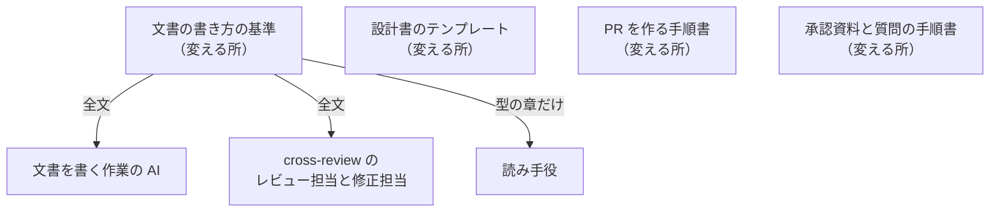
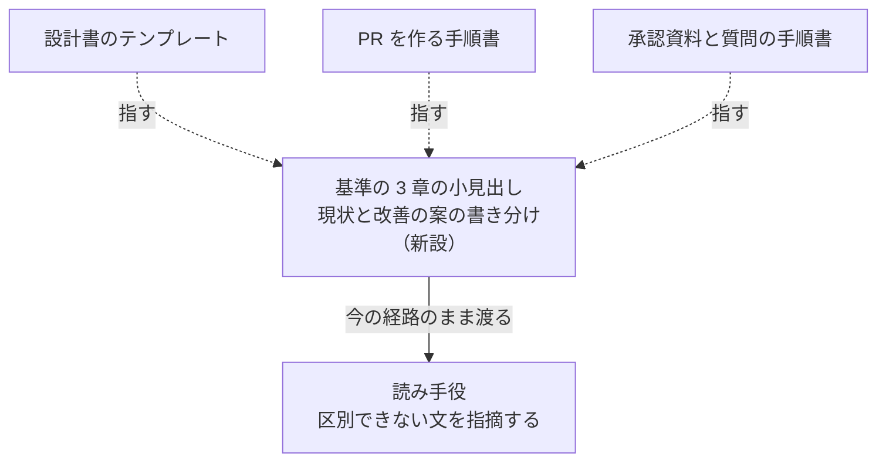

# 設計書と Pull Request の概要: 現状と改善の案を 1 回で読み分けられるようにする（#4543）

AI が書く設計書や Pull Request（PR）の概要は、今の状態も変える内容も現在形で書かれ、読み手が区別できないことがあった。この設計では、書き分けの表を[文書の書き方の基準](../plugins/ndf/contracts/data/writing-criteria.md)の 1 か所に置き、概要と承認の文を書く手順書がそれを指すようにする。表は「読み手に通じない文の型」の章に置くので、プログラムを変えなくても、現状と案を区別できない文を、読み手役（会話を知らずに読み手の立場で読む AI）も指摘するようになる。比べた案は「決定の記録」に、調べた他の規約は末尾の「外部の調査」にある。

## 今の姿

何が起きたか・目的・受け入れ条件は要求仕様（[issue-4543-requirements.md](./issue-4543-requirements.md)、正は #4543 の本文）にある。

これまで、書き方の基準の本文は次の経路で AI へ渡っていた。線はプログラムが基準の本文を指示へ入れる経路である。線の無いテンプレートと手順書は、書き分けを指示していなかった。図の「承認資料と質問の手順書」には、判断を求める手順書も含む。

- 基準の 3 章（読み手に通じない文の型）は、見出しから次の章の見出しの前までが読み手役への指示に入る。小見出しも入る（`plugins/ndf/src/ndf/contracts/writing.py` の `types_section`）
- 工程のプランが作る設計と実装の PR は、課題の本文のコピーを PR の本文にしていた（`plugins/ndf/src/ndf/progress/issue_values.py`）。課題の本文は、要求を書く作業の AI が基準の全文を受け取って書く。工程のプランとは、開発の工程を自動で進める仕組みである
- 設計書のテンプレートは「解き方の全体像」に「実装を終えた後の姿」を書くとだけ定めていた。そのため、変えた後の姿が現在形で書かれ、今の姿と見分けられなかった。承認資料の「目指す姿」はこのセクションをそのまま載せる

## 文脈と制約

- 仕組みが読み取る設計書の見出しと PR の本文の見出しは変えない（受け入れ条件 5）
- 語の有無を機械で調べる検査は作らない（要求の対象範囲）
- 確定仕様、変更履歴、コミットメッセージ、レビューの指摘と返信の書き方は変えない（同上）
- 設計 PR の本文は、解き方と決定を言い換えて書かない決まりを保つ（要求の「影響」）
- [テンプレートの形をそろえる PR 4548](https://github.com/devbasex/ai-plugins/pull/4548)（2026-11-27 時点で未マージ）は、設計書のテンプレートと PR を作る手順書も変える。書き方の基準は変えない

## 解き方の全体像

この設計では、基準の 3 章に小見出し「現状と改善の案の書き分け」を足し、書き分けの規則をそこだけに持たせる。

- この設計では、概要と承認の文を書く AI が、手順書のリンクから同じ表にたどり着くようにする
- この設計では、読み手役が現状と案を区別できない文を「判断や作業を誤らせる文」（不合格）として挙げるようにする
- この設計では、型の数（4 つ）、章の見出し、プログラムを変えない

## 決定の記録

### 決定 1: 書く側と読んで確かめる側が同じ規則を読むため、書き分けの表は基準の 3 章に 1 か所だけ置く

- **質問**: 書き分けの規則をどこに置くか。書く指示は手順書に分かれ、読み手役には基準の 3 章だけが渡る
- **選んだ案**: 基準の 3 章の末尾に小見出し「現状と改善の案の書き分け」を足す。当てる文章、当てない文章、2 行の表、指摘する条件を持たせる。手順書は表を写さずに指す
- 採らなかった案: 基準の 4 章（書き方）に置く（読み手役への指示に入らず、3 章にも条件をもう一度書くことになる）
- 採らなかった案: 手順書ごとに表を書く（同じ規則が 4 か所以上に分かれ、片方だけが直される）
- 採らなかった案: 読み手役への指示を組むプログラムに文を足す（基準の本文の出所が 2 つになる）
- **代償**: 「通じない文の型」の章に、書くときの表も並ぶ。書く側の手順書は、3 章を指すことになる
- 作り方: 自前で作る
- 比べた候補: PRD1 / PRD2 / STD1
- 根拠: Value 11 / Value 3（MVV バージョン 11）

### 決定 2: 型の呼び方を変えずに済むため、区別できない文は型 C（説明の不足）の 1 つの場合にする

- **質問**: 読み手役が指摘する型を 1 つ増やすか、今の 4 つの型のどれかに入れるか
- **選んだ案**: 型 C に入れる。「今の話か、これからの話か」が抜けた文として、型 C の見分け方の欄に聞き返しの例を足す
- 採らなかった案: 5 つ目の型を足す（章の見出し、プログラム、複数の手順書に「4 つの型」「型 A〜D」と書いてあり、直すことになる）
- **代償**: 指摘の一覧では型 C とだけ出る。現状と案の混同であることは、指摘の理由の文で読み取る
- 根拠: Value 11（MVV バージョン 11）

### 決定 3: 承認の判断を誤らせないため、区別できない文は「判断や作業を誤らせる文」に数える

- **質問**: 要求の「未決」。区別できない文を不合格にするか、読みにくいだけの文にするか
- **選んだ案**: 「判断や作業を誤らせる文」に数える。変える前の話にも後の話にも取れる文は、今の区分の「別の意味に取れる文」に当たる
- 採らなかった案: 「読みにくいだけの文」にする（直すかを書き手が決めるので、混ざったまま承認を求められる）
- **代償**: 読み手役の不合格と cross-review の指摘が増え、書き直しが増える
- 根拠: Value 1（MVV バージョン 11）

### 決定 4: 正しい現在形の文を指摘しないため、見出しや表の列で分かる文は区別できる文として扱う

- **質問**: 「これまで」などの語も過去形も無い文を、すべて指摘するか
- **選んだ案**: 文とその見出し・表の列を合わせて読み、今の話かこれからの話かが分かれば指摘しない。「今の姿」の下の現在形の文や、「これまで」の列のセルは指摘しない。概要を書くときは、見出しに頼らず 2 行の表に従う
- 採らなかった案: 「これまで」などの語も過去形も無い文をすべて指摘する（仕様の表や「今の姿」の章が指摘で埋まり、承認の前の確認が通らなくなる）
- 採らなかった案: 語の有無を機械で調べる（要求の対象範囲に含まないと定めてある）
- **代償**: 見出しから離れて引用されると分かりにくくなる文が残ることがある
- 根拠: Value 1 / Value 2（MVV バージョン 11）。STD1

### 決定 5: 同じ指示を重ねないため、要求仕様と詳細設計書のテンプレートには指示を足さない

- **質問**: 工程のプランが作る PR は、課題の本文をそのまま PR の本文にする。要求仕様と詳細設計書のテンプレートにも指示を足すか
- **選んだ案**: 足さない。要求仕様と詳細設計書を書く作業の指示には基準の全文がすでに入るので、小見出しはそこから届く
- 採らなかった案: 両方のテンプレートに参照を足す（受け入れ条件が求めず、PR 4548 が同じ 2 つのファイルを組み直している）
- **代償**: テンプレートだけを読んで手で書く場合は、小見出しにたどり着かない
- 根拠: Value 11・Value 2（MVV バージョン 11）

## 影響と危険

- **働く範囲**: NDF を使うすべてのリポジトリ。AI が書く設計書、PR の本文の概要、承認資料、質問の文の書き方が変わる。読み手役の指摘も変わる。cross-review は基準の全文を読むので、PR で変わった文書にも同じ指摘が出る
- **プロジェクトごとに違うもの**: 無い。英語など日本語以外の文書では、表の語の例をその言語の言い方に読み替える
- **当たるモード**（`development-workflow` が変更ごとに選ぶ工程の区分）: 概要を書くすべてのモード。設計書のテンプレートの指示は、設計書を書く `standard` と `legacy-refactor` に当たる
- **今の決まりとの関係**: `document-style` の「変更履歴を本文に残さない」は、文書を直した経緯を残さない決まりである。変える対象の現状を過去形で書くことと混同されないよう、1 文を足す。確定仕様を現在形で書く指示と、PR の「利用者向けの変化」に今の決まりだけを書く指示は変えない。小見出しの「当てない文章」がこの 2 つを外す。承認資料のうち、リリースの変更点の一覧は変更履歴から写すので対象にしない
- **同じファイルを触る別の変更**: PR 4548 が先にマージされた場合、「承認する人が読む欄」は新しいファイル `design/references/design-writing.md` へ移る。実装は、欄の表がある方のファイルへ指示を足す
- **壊れうる箇所**: 基準の 3 章の中に `## ` の見出しを足すと、読み手役への指示がそこで切れる。小見出しは `### ` にする

### 代表のリポジトリでの振る舞い

| 代表のリポジトリ | 設定の要点 | 直した後に起きること | この種類で扱えなくなること |
| --- | --- | --- | --- |
| Web サービス | デプロイを持つ | 設計と承認の文が書き分けられ、読み手役と cross-review が区別できない文を指摘する | 無し |
| モバイルアプリ | ストアへの提出 | 同上 | 無し |
| 業務文書だけ | 文書の提出 | 現状と提案の両方を書く文書で、読み手役が区別できない文を指摘する | 無し |

### このリポジトリだけの事情

- 無し（基準と手順書の文だけを変え、リポジトリごとの値を持たない）

## テスト設計

文書の文言を固定するテストは書かない（このリポジトリの方針）。受け入れ条件は次の方法で確かめる。

| 受け入れ条件・不変条件 | どの振る舞いで縛るか | どう壊したら落ちるべきか |
| --- | --- | --- |
| 1. 概要を書く指示に書き分けがある | 設計書のテンプレートと PR を作る手順書のそれぞれから、リンクをたどると 2 行の表に着く。工程のプランの経路では、要求を書く作業の指示に入る基準の全文に表がある。参照切れの検査が通る | 手順書のリンクを消すか、小見出しの名前を変えると、たどり着けない |
| 2. 読み手役が指摘する | 要求の「何が起きたか」の書き分ける前の引用を読み手役に読ませると、現状と案を区別できないことが一覧に挙がる。書き分けた後の引用では挙がらない | 小見出しを 3 章の外へ置くと、読み手役への指示に入らず、前の引用で指摘が出ない |
| 3. 最初の設計 PR で書き分けられる | リリースの後に、人が最初の設計 PR の概要と設計書の概要を 1 文ずつ読む | 設計書のテンプレートの指示が無いと、変えた後の姿が現在形で書かれる |
| 4. 承認資料と質問の文を書く指示にもある | 承認資料の手順書と、判断を求める手順書から、同じ表に着く | どちらかのリンクを消すと、たどり着けない |
| 5. 見出しが変わらず、テストが通る | 差分で見出し（`#` の行）の変更が小見出しの追加だけであることを見る。CI の全体テストが通る。小見出しが読み手役への指示に入ることは、章の切り出しの今のテストが確かめている | 小見出しを `## ` にすると、章の切り出しがそこで終わる |

## どこを変えるか

詳細設計はこのセクションに畳む。新設する関数 0・シグネチャを変える関数 0 で、プログラムは変えないため。

| ファイル | 変える中身 | 決定 |
| --- | --- | --- |
| `plugins/ndf/contracts/data/writing-criteria.md` | 型 C の見分け方に「今の話か、これからの話か」を足す。3 章の末尾に小見出し「現状と改善の案の書き分け」を足す（下の表） | 1・2・3・4 |
| `plugins/ndf/skills/design/references/design-template.md` | 「承認する人が読む欄」のセクションに「要約の段落と解き方の全体像は小見出しに従って書く」という指示を足し、小見出しを指す。テンプレート本体のコードブロックにある「解き方の全体像」の説明は、「この設計では〜」と分かる形で書くように直す。`legacy-refactor` の「目的」「目指す姿」にも同じ指示を足す | 1 |
| `plugins/ndf/skills/pr/SKILL.md` | 「PR の作成・更新」の本文の書き方に、概要（`## Summary`・`## 概要`）は小見出しに従って書くと足す。設計 PR と実装 PR の両方に当たると書き、「利用者向けの変化」「移行の手順」は対象外とする | 1 |
| `plugins/ndf/skills/development-workflow/references/approval-request.md` | 「承認資料は 2 層に分ける」に、書き足す判断の材料と質問の文は小見出しに従うと足す。PR の本文と設計書から写した行の直し方は今の扱いのままにする | 1・3 |
| `plugins/ndf/skills/decision-request/SKILL.md` | 「示すもの」に、今の状態と、選んだ後に変わることは小見出しに従って書き分けると足す | 1 |
| `plugins/ndf/skills/document-style/SKILL.md` | ルール 4 に、変える対象の現状を過去形や「これまで」で書くのは文書を直した経緯ではないと 1 文足し、小見出しを指す | 1 |

小見出しに書くこと（言い回しは実装で整える。中身は変えない）:

| 項目 | 中身 |
| --- | --- |
| 当てる文章 | 変える前と後の両方に触れる文章。特に、設計書の要約の段落と解き方の全体像、設計と実装の PR の本文の概要、承認資料と質問の文 |
| 当てない文章 | 今の状態だけを書く文書（確定仕様など。現在形のままにする）、変更履歴とそこへ載る PR のセクション、コミットメッセージ、レビューの指摘と返信 |
| 書き方の表 | いまの状態（変える前）は「これまで」「従来」などの語を入れるか、過去形で書く。改善の案（変えた後）は「この PR により〜する」「この設計では〜する」のように、これからの話だと分かる形で書く |
| 指摘する条件と区分 | 文と、その見出し・表の列を合わせて読んでも、今の話かこれからの話かが分からない文。型 C で、「判断や作業を誤らせる文」に数える |
| 例 | 要求仕様の「何が起きたか」の、書き分ける前と後の文を短くして 1 組。番号と内部の呼び名を持ち込まない |

## 設計の結果

| 課題 | 扱い | 統合先 | 触るファイル |
| --- | --- | --- | --- |
| #4543 | 実装する | — | `plugins/ndf/contracts/data/writing-criteria.md`、`plugins/ndf/skills/design/references/design-template.md`、`plugins/ndf/skills/pr/SKILL.md`、`plugins/ndf/skills/development-workflow/references/approval-request.md`、`plugins/ndf/skills/decision-request/SKILL.md`、`plugins/ndf/skills/document-style/SKILL.md` |

## 未確認のまま残ること

| 項目 | 内容 |
| --- | --- |
| 読み手役の指摘の出方 | 小見出しを足した指示で、読み手役が前の引用を指摘し、後の引用を指摘しないかは、実装の時に読ませて分かる |
| 指摘の増え方 | 読み手役と cross-review の指摘がどれだけ増えるかは、リリースの後の工程の記録で分かる |

## 外部の調査

| 種類 | 調べるか | 理由 |
| --- | --- | --- |
| 標準・仕様 | 調べる | 現状と提案を書き分ける、広く使われる取り決めがあるかを見る |
| 主要な製品 | 調べる | 大きな開発の場が、現状と提案をどう分けているかを比べる |
| ライブラリとサービス | 調べない | 語の有無を機械で調べる検査は要求の対象外で、足すプログラムが無い |

### 標準・仕様

| # | 標準・仕様 | 何を定めているか | 設計への反映 | 出典 |
| --- | --- | --- | --- | --- |
| STD1 | Google の開発者向け文書スタイルガイド「Timeless documentation」 | 製品の文書は今のバージョンの振る舞いを書き、「現在」「新しい」などの時点を指す語を避ける。リリースノートやブログでは使ってよい | 確定仕様を書き分けの対象から外し、現在形のままにする裏づけにした。変更を告げる文章では時点の語を使う | https://developers.google.com/style/timeless-documentation （2026-11-27） |

### 主要な製品

| # | 製品 | どう解いているか | 設計への反映 | 出典 |
| --- | --- | --- | --- | --- |
| PRD1 | Git の `SubmittingPatches` | 問題の説明（現状）は現在形で書き、変更は命令形で書く。現状とは変更を含まないコードのことだと取り決め、「現在」という語を省く | 動詞の形で書き分ける例はある。日本語の概要には命令形が合わないので、語と言い回しで分ける | `gh api repos/git/git/contents/Documentation/SubmittingPatches`（2026-11-27） |
| PRD2 | Kubernetes の拡張提案（KEP）のテンプレート | `Summary`・`Motivation`・`Proposal` の見出しで、動機と提案を分ける | 見出しで分かる文は区別できる文として扱う（決定 4）。要約の段落と PR の概要は 1 つのまとまりなので、見出しだけには頼らない | `gh api repos/kubernetes/enhancements/contents/keps/NNNN-kep-template/README.md`（2026-11-27） |

### 確かめられなかったこと

| 対象 | 試した手段 | 結果と理由 |
| --- | --- | --- |
| 日本語の技術文書で、現状と提案の書き分けを定めた公開の取り決め | 試していない | 要求が書き方の 2 行を定めているため、探していない |

調べた量: 候補 3 件・取得の試み 3 回。
