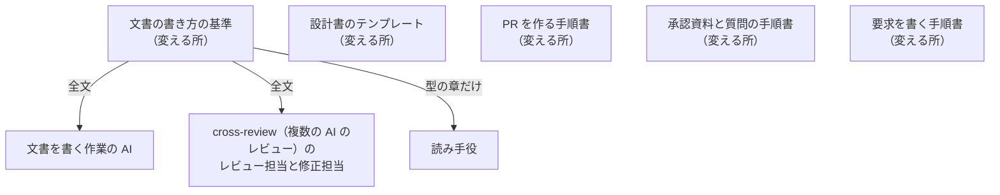
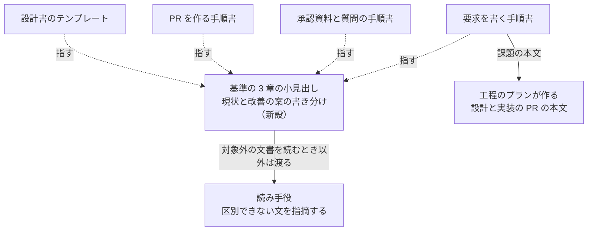

# 設計書と Pull Request の概要: 現状と改善の案を 1 回で読み分けられるようにする（#4543）

これまで、AI が書く設計書や Pull Request（PR）の概要は、今の状態も変える内容も現在形で書かれ、読み手が区別できないことがあった。この設計では、書き分けの表を[文書の書き方の基準](../plugins/ndf/contracts/data/writing-criteria.md)の 1 か所に置き、概要と承認の文を書く手順書と、要求を書く手順書がそれを指すようにする。表は「読み手に通じない文の型」の章に置くので、現状と案を区別できない文を、読み手役（会話を知らずに読み手の立場で読む AI）も指摘するようになる。プログラムは、この表が要らないと分かっている AI への指示から表を外すために変える。比べた案は「決定の記録」に、調べた他の規約は末尾の「外部の調査」にある。

## 今の姿

何が起きたか・目的・受け入れ条件は要求仕様（[issue-4543-requirements.md](./issue-4543-requirements.md)、正は #4543 の本文）にある。

これまで、書き方の基準の本文は次の経路で AI へ渡っていた。線はプログラムが基準の本文を指示へ入れる経路である。線の無いテンプレートと手順書は、書き分けを指示していなかった。図の「承認資料と質問の手順書」には、判断を求める手順書も含む。



- 基準の 3 章（読み手に通じない文の型）は、見出しから次の章の見出しの前までが読み手役への指示に入る。小見出しも入る（`plugins/ndf/src/ndf/contracts/writing.py` の `types_section`）
- 工程のプラン（開発の工程を自動で進める仕組み）は、設計と実装の PR を作るときに、PR を作る手順書（`plugins/ndf/skills/pr/SKILL.md`）を読んでいなかった。課題の本文のコピー（`plugins/ndf/src/ndf/progress/issue_values.py`）を、そのまま `gh pr create --body-file` へ渡していた。そのため、PR を作る手順書に指示を足しても、この経路の PR の本文には届かない。この経路で書き分けを効かせられるのは、課題の本文を書く時点である。課題の本文は、要求を書く作業の AI が、要求を書く手順書（`requirements-design`）と基準の全文を受け取って書いていた
- 設計書のテンプレートは「解き方の全体像」に「実装を終えた後の姿」を書くとだけ定めていた。そのため、変えた後の姿が現在形で書かれ、今の姿と見分けられなかった。承認資料の「目指す姿」はこのセクションをそのまま載せる

## 文脈と制約

- 仕組みが読み取る設計書の見出しと PR の本文の見出しは変えない（受け入れ条件 5）
- 語の有無を機械で調べる検査は作らない（要求の対象範囲）
- 確定仕様、変更履歴、コミットメッセージ、レビューの指摘と返信の書き方は変えない（同上）
- 設計 PR の本文は、解き方と決定を言い換えて書かない決まりを保つ（要求の「影響」）
- [テンプレートの形をそろえる PR 4548](https://github.com/devbasex/ai-plugins/pull/4548)（2026-11-27 時点で未マージ）は、設計書のテンプレートと PR を作る手順書も変える。書き方の基準は変えない

## 解き方の全体像

この設計では、基準の 3 章に小見出し「現状と改善の案の書き分け」を足し、書き分けの規則をそこだけに持たせる。



- この設計では、概要と承認の文を書く AI が、手順書のリンクから同じ表にたどり着くようにする
- この設計では、工程のプランが作る PR の本文には、課題の本文を書く時点で書き分けを効かせる。PR を作る前に概要を組み直すステップは足さない
- この設計では、読み手役が現状と案を区別できない文を「判断や作業を誤らせる文」として挙げるようにする。この区分の指摘が 1 件でもあると、その文書の確認は不合格になる
- この設計では、書き分けが要らないと分かっている経路では、指示を組むプログラムが小見出しを外して渡す（決定 6）
- この設計では、型の数（4 つ）と章の見出しを変えない

## 決定の記録

各決定の「根拠」の行の MVV は、このプロジェクトの判断基準（Mission・Vision・Value をまとめた文書）である。Value は番号の付いた判断の基準で、行には使った項目の文を引く。

### 決定 1: 書く側と読んで確かめる側が同じ規則を読むため、書き分けの表は基準の 3 章に 1 か所だけ置く

- **質問**: 書き分けの規則をどこに置くか。書く指示は手順書に分かれ、読み手役には基準の 3 章だけが渡る
- **選んだ案**: 基準の 3 章の末尾に小見出し「現状と改善の案の書き分け」（以下「書き分けの小見出し」。中身は「どこを変えるか」の 2 つ目の表）を足す。当てる文章、当てない文章、2 行の表、指摘する条件を持たせる。手順書は表を写さずに指す
- 採らなかった案: 基準の 4 章（書き方）に置く（読み手役への指示に入らず、3 章にも条件をもう一度書くことになる）
- 採らなかった案: 手順書ごとに表を書く（同じ規則が 4 か所以上に分かれ、片方だけが直される）
- 採らなかった案: 読み手役への指示を組むプログラムに文を足す（基準の本文の出所が 2 つになる）
- **代償**: 「通じない文の型」の章に、書くときの表も並ぶ。書く側の手順書は、3 章を指すことになる。基準を受け取る AI への入力は小見出しの分だけ増えるので、増える経路は決定 6 で絞る
- **増える量の見積もり**: 小見出しは表と例を合わせて約 1,500 字で、渡す起動 1 回あたり約 1,100〜1,800 トークンの追加になる。1 字を 0.7〜1.2 トークンと置いた見積もりで、実測していない。これまで読み手役に渡していた 3 章は約 900 字だった。実装では小見出しを 1,700 字以内に収め、例は短い 1 組にし、増えた字数を実装の PR に書く
- 採らなかった案: 規則を指摘の条件の数行に縮め、表と例を 3 章の外に置く（追加は数百トークンで済むが、語が及ぶ範囲や当てない文章を読み手役が受け取れず、正しい文の指摘と書き直しが増える。書く側の表と指摘の条件が 2 か所に分かれる）
- 作り方: 自前で作る
- 比べた候補: PRD1 / PRD2 / STD1
- 根拠: Value 11「同じ規則・定数・処理は 1 か所にまとまり、ほかはそこを参照する」・Value 3「同じ手順は毎回同じ結果になる」（MVV バージョン 11）。書く側と確認する側が同じ文を読むことで、適用する規則の食い違いを防ぐ

### 決定 2: 型の呼び方を変えずに済むため、区別できない文は型 C（説明の不足）の 1 つの場合にする

- **質問**: 読み手役が指摘する型を 1 つ増やすか、今の 4 つの型のどれかに入れるか
- **選んだ案**: 型 C に入れる。「今の話か、これからの話か」が抜けた文は型 C の 1 つの場合だと、書き分けの小見出しに書く。型の表には足さない（小見出しを外して渡す経路に、条件だけが残らないようにする）
- 採らなかった案: 5 つ目の型を足す（章の見出し、プログラム、複数の手順書に「4 つの型」「型 A〜D」と書いてあり、直すことになる）
- **代償**: 指摘の一覧では型 C とだけ出る。現状と案の混同であることは、指摘の理由の文で読み取る
- 根拠: Value 11「同じ規則・定数・処理は 1 か所にまとまり、ほかはそこを参照する」（MVV バージョン 11）。型を増やすと、型の数を書いた章の見出し・プログラム・手順書を同じように直すことになる。今の型に入れれば、直す所は書き分けの小見出しで済む

### 決定 3: 承認の判断を誤らせないため、区別できない文は「判断や作業を誤らせる文」に数える

- **質問**: 要求の「未決」。区別できない文を不合格にするか、読みにくいだけの文にするか
- **選んだ案**: 「判断や作業を誤らせる文」に数える。変える前の話にも後の話にも取れる文は、今の区分の「別の意味に取れる文」に当たる
- 採らなかった案: 「読みにくいだけの文」にする（直すかを書き手が決めるので、混ざったまま承認を求められる）
- **代償**: 読み手役の不合格と cross-review の指摘が増え、書き直しが増える
- 根拠: Value 1「人の判断を、読み切れる量の大事な所だけにする」（MVV バージョン 11）。承認する人が現状と案を読み返して見分ける手間を、承認を求める前に取り除く

### 決定 4: 正しい現在形の文を指摘せず、概要の合否もそろえるため、見出しを根拠にできる範囲を決める

- **質問**: 「これまで」などの語も過去形も無い文を、すべて指摘するか。指摘しないなら、見出しをどこまで根拠にしてよいか
- **選んだ案**: 書くときと、読んで確かめるときの両方に、同じ 2 つの扱いを当てる
  - 区別を求めるのは、製品・仕組み・業務の今の状態か、変える内容を述べる文である。指摘しないのは、参照先を案内する文（「比べた案は『決定の記録』にある」など）と、読んでいる文書や PR 自体が何を説明しているかを述べる文（「ここで説明するのは〜です」など）だけで、この 2 つは語が及ぶ範囲を打ち切る理由にもしない。仕組みが作る文書に何が載るかを述べる文（「承認資料には受け入れ条件の件数が載ります」など）は、仕組みを述べる文なので区別を求める
  - **概要**（書き分けの小見出しの「概要」の項目で定める範囲）では、見出しと表の列を根拠にしない。現状か案の片方だけを書く欄にも当てる。次のどれかに当たる文を、区別できる文とする
    - 「これまで」「この設計では」のような、どちらの話かを示す語がその文にある
    - 過去形で書いてある
    - 目標を述べる形（「〜できるようにすることです」など）で、これからの話だと分かる
    - 前の文の上の語が、この文にも及んでいる。及ぶ範囲は、書き分けの小見出しの「語が及ぶ範囲」の項目で定める。前の文の過去形は、後ろの文の根拠にしない。時制が同じでも、前の文を受けて読んでなお、もう一方の側の話に取れる文には及ばない。語が及ばない文や箇条が出たら、その後ろの文や箇条にも及ばない
  - **概要以外**では、文とその見出し・表の列を合わせて読み、今の話かこれからの話かが分かれば指摘しない。「今の姿」の下の現在形の文や、「これまで」の列のセルは指摘しない
- 採らなかった案: 「これまで」などの語も過去形も無い文をすべて指摘する（仕様の表や「今の姿」の章が指摘で埋まり、承認の前の確認が通らなくなる）
- 採らなかった案: 概要では 1 文ごとに語か過去形を求め、前の文の語を及ぼさない（「この設計では」に続く文のすべてに同じ語が並び、読みにくくなる）
- 採らなかった案: 前の文の過去形も後ろの文に及ぼす（段落の途中で案に切り替わった文が、現状の話として合格になる）
- 採らなかった案: 語が及ばなくなる条件を、別の側の語と時制の変化だけにする（現状の説明に続けて同じ現在形で書いた提案が、現状の話として合格になる）
- 採らなかった案: 単独で両側に読める文には、すべて語を及ぼさない（前置きを受ければ案だと分かる箇条まで指摘され、すべての箇条に同じ語が要る）
- 採らなかった案: 概要でも見出しを根拠にする（「解き方の全体像」の現在形がすべて合格になり、利用者が指摘した混同が残る）
- 採らなかった案: 書くときだけ見出しに頼らず、読んで確かめるときは見出しを根拠にする（同じ概要が、書く担当には直す対象、レビューする担当には合格になる）
- 採らなかった案: 語が及ばない文や箇条の次から、前の語をまた及ぼす（どこで話が戻ったかを読み手が推し量ることになり、書く担当とレビューする担当で結果が分かれる）
- 採らなかった案: 語の有無を機械で調べる（要求の対象範囲に含まないと定めてある）
- **代償**: 概要以外では、見出しから離れて引用されると分かりにくくなる文が残ることがある
- 根拠: Value 1「人の判断を、読み切れる量の大事な所だけにする」・Value 2「安く使える」（MVV バージョン 11）。STD1。承認の判断に使う概要は 1 文ずつ区別できるようにし、それ以外では正しい文の指摘と書き直しに費用を使わない

### 決定 5: 工程のプランが作る PR にも書き分けを届けるため、課題の本文を書く AI が書くときに適用する

- **質問**: 工程のプランは、課題の本文をそのまま設計と実装の PR の本文にする。その本文のどこに、だれが書き分けの規則を適用するか
- **選んだ案**: 要求を書く AI が、課題の本文を書くときに適用する。書き分けの小見出しの「概要」の項目に、課題の本文の「何が起きたか」と「目的」を含める。「今の姿」と「何を足すか・変えるか」は、見出しと表の列で分かれば足りる。要求を書く手順書（`requirements-design` の SKILL.md の手順 7）が書き分けの小見出しを指す。設計書を書く作業は、課題の本文を要求仕様のコピーへ写すだけで、書き直さない
- 採らなかった案: 基準の全文が指示に入ることだけに任せる（書き分けの小見出しが課題の本文のどこに当たるかを定めなければ、要求を書く AI は適用せず、書き分けの無い本文が PR に載る）
- 採らなかった案: PR を作る前に、プランで概要を組み立てるステップを足す（AI の起動が PR ごとに増え、プログラムとテンプレートも変える。PR の本文が課題の本文と食い違う）
- 採らなかった案: 詳細設計書のテンプレートにも指示を足す（詳細設計書は PR の本文にならず、受け入れ条件も求めない）
- **代償**: 変更の前に書かれた本文と、人が直接書いた本文は、直されないまま PR の本文になる。[PR 4548](https://github.com/devbasex/ai-plugins/pull/4548) も同じ手順書を変えるので、後からマージする側が指示の位置を合わせる
- 根拠: Value 11「同じ規則・定数・処理は 1 か所にまとまり、ほかはそこを参照する」・Value 2「安く使える」（MVV バージョン 11）。手順書は表を写さずに指し、PR を作るための AI の起動を増やさない

### 決定 6: 要らない入力に費用を払わせないため、書き分けが要らないと分かる経路では小見出しを外して渡す

- **質問**: 基準の本文を AI への指示に入れる経路は 3 つある（読み手役、作業の AI、cross-review）。小見出しをどの経路に渡すか
- **選んだ案**: 正本は 3 章の小見出しの 1 か所のままにし、指示を組むときに、次の表の条件で小見出しを外す。外す範囲は、正本の小見出しの前後に置く目印のコメント（`<!-- ndf:distinction-begin -->` と `<!-- ndf:distinction-end -->`）で決める。プログラムは見出しの文を持たないので、見出しを書き換えても外せる

| 経路 | 小見出しを渡すとき | 外すとき | 判定の材料 |
| --- | --- | --- | --- |
| 読み手役（`ndf records reading prompt`） | 下の「外すとき」以外のすべて。指定が無ければ渡す | 確定仕様、変更履歴、README・利用者への案内を読ませるとき | 頼む側が指示の JSON の任意のキー `distinction` に `false` を書く |
| 作業の AI（基準の全文を受け取る作業） | 設計（`design`）、詳細設計（`design-detail`）、設計の検査の直し（`design-check-fix`）、要求（`requirements`） | 素材集め（`document-sources`）、実装計画（`implementation-plan`）、確定仕様化（`plan-to-spec`）、振り返り（`retrospective`） | 作業の定義 `contracts/worker/kinds.json` の作業ごとの値 |
| cross-review（レビュー担当と修正担当） | PR の変更に、課題の設計書か要求仕様のコピーがある | どちらも無い（基準の残りはこれまでどおり渡す） | 変更したファイルの名前。名前の形は `ndf/core/issue_docs.py` だけに置く |

- 採らなかった案: 小見出しの見出しの文で外す範囲を探す（同じ文を基準とプログラムの 2 か所に持ち、見出しだけを直すと外れなくなる）
- 採らなかった案: どの経路にも常に渡す（プログラムを変えずに済むが、書き分けを扱わない作業やレビューでも、起動のたびに約 1,100〜1,800 トークンが増える）
- 採らなかった案: 読み手役の `questions_kind` で判定する（承認資料も、文書の一部だけを読ませるときも `none` なので、対象と対象外を分けられない）
- 採らなかった案: 読んで確かめる文書の中身から対象かをプログラムで推し量る（誤ると指摘が黙って抜ける）
- **代償**: プログラムとテストが増える。cross-review は、設計書も要求仕様のコピーも無い PR の文書では、現状と案の区別を指摘しない。要求の受け入れ条件が指摘を求めるのは読み手役で、cross-review ではない。読み手役の指定を頼む側が忘れた場合は、小見出しが渡って費用が増えるだけで、指摘は抜けない
- 根拠: Value 2「安く使える」（MVV バージョン 11）。書き分けを扱わない起動の入力を増やさず、文脈を最適な量に保つ

### 決定 7: 要求仕様と課題の本文を食い違わせないため、cross-review の修正担当は課題の本文を直してからコピーを作り直す

- **質問**: cross-review が要求仕様のコピーへの指摘を出したとき、修正担当はどこを直すか。要求の正本は課題の本文で、コピーだけを直すことは禁じられている（`requirements-design` の手順 7）
- **選んだ案**: PR の変更に要求仕様のコピーがあるときは、修正担当への指示に次の扱いを足す。指示の文は、ほかの指摘の基準と同じ `contracts/data/review-criteria.json` に置く
  - コピーへの指摘を直すときは、手順 7 のとおりに課題の本文を直し（`## 進行` より前だけを書き替える）、本文からコピーを作り直してコミットする
  - 課題の本文を書き替えられないときは、コピーも変えず、利用者の判断が要る指摘（`needs_user`）として返す。本文の案は見送りの理由に書く
- 採らなかった案: コピーを通常のファイルとして直す（設計 PR の要求仕様と課題の本文が食い違う）
- 採らなかった案: コピーへの指摘をすべて利用者へ返す（文の直しだけでも工程が止まる）
- **代償**: 修正担当が課題の本文を書き替える。要求仕様のコピーを含む PR では、修正担当への指示が数行増える
- 根拠: Value 8「正しいデータ構造で作られる」（MVV バージョン 11）。コピーは正本の課題の本文から作る

## 影響と危険

- **働く範囲**: NDF を使うすべてのリポジトリ。AI が書く設計書、課題の本文（要求仕様）、PR の本文の概要、承認資料、質問の文の書き方が変わる。読み手役の指摘も変わる。cross-review の指摘が変わるのは、設計書か要求仕様のコピーを変える PR だけである（決定 6）
- **プロジェクトごとに違うもの**: 無い。英語など日本語以外の文書では、表の語の例をその言語の言い方に読み替える
- **当たらない PR**: スプリントの PR は本文をコミットから作る（`gh pr create --fill`）ので、書き分けの対象にならない。変更の前に書かれた課題の本文と、人が直接書いた課題の本文は、工程のプランがそのまま PR の本文にする
- **当たるモード**（`development-workflow` が変更ごとに選ぶ工程の区分）: 概要を書くすべてのモード。設計書のテンプレートの指示は、設計書を書く `standard` と `legacy-refactor` に当たる
- **今の決まりとの関係**: `document-style` の「変更履歴を本文に残さない」は、文書を直した経緯を残さない決まりである。変える対象の現状を過去形で書くことと混同されないよう、1 文を足す。確定仕様を現在形で書く指示と、PR の「利用者向けの変化」に今の決まりだけを書く指示は変えない。書き分けの小見出しの「当てない文章」の項目が、この 2 つを外す。承認資料のうち、リリースの変更点の一覧は変更履歴から写すので対象にしない
- **同じファイルを触る別の変更**: PR 4548 が先にマージされた場合、「承認する人が読む欄」は新しいファイル `design/references/design-writing.md` へ移る。実装は、欄の表がある方のファイルへ指示を足す
- **壊れうる箇所**: 基準の 3 章の中に `## ` の見出しを足すと、読み手役への指示がそこで切れる。小見出しは `### ` にする。小見出しを囲む目印のコメントを消すか書き換えると、プログラムが外す範囲を見つけられず、全部の経路に渡る

### 代表のリポジトリでの振る舞い

| 代表のリポジトリ | 設定の要点 | 直した後に起きること | この種類で扱えなくなること |
| --- | --- | --- | --- |
| Web サービス | デプロイを持つ | 設計と承認の文が書き分けられ、読み手役と、設計の PR の cross-review が区別できない文を指摘する | 無し |
| モバイルアプリ | ストアへの提出 | 同上 | 無し |
| 業務文書だけ | 文書の提出 | 現状と提案の両方を書く文書で、読み手役が区別できない文を指摘する | 無し |

### このリポジトリだけの事情

- 無し（基準と手順書の文と、指示を組むプログラムを変え、リポジトリごとの値を持たない）

## テスト設計

文書の文言を固定するテストは書かない（このリポジトリの方針）。受け入れ条件は次の方法で確かめる。

| 受け入れ条件・不変条件 | どの振る舞いで縛るか | どう壊したら落ちるべきか |
| --- | --- | --- |
| 1. 概要を書く指示に書き分けがある | 設計書のテンプレートと PR を作る手順書のそれぞれから、リンクをたどると 2 行の表に着く。工程のプランの経路では、設計と実装の両方のプランが `--body-file` に渡すのは課題の本文なので、要求を書く手順書の手順 7 から同じ表に着くことと、書き分けの小見出しの「概要」の項目に本文の「何が起きたか」「目的」が入っていることを確かめる。参照切れの検査が通る | 手順書のリンクを消すか、小見出しの名前を変えると、たどり着けない。書き分けの小見出しの「概要」の項目から課題の本文を外すと、工程のプランの PR に規則が当たらない |
| 2. 読み手役が指摘する | 要求の「何が起きたか」の書き分ける前と後の引用（[PR 4509](https://github.com/devbasex/ai-plugins/pull/4509) をもとにした比較用の例で、前の引用は現状と案をともに現在形にしてある）を、引用ブロックを外して「## 何が起きたか」の下の地の文にし、1 つずつ別の入力として読ませる。下の「読み手役に読ませる例」の例も 1 つずつ読ませる。2 つの引用と各例の結果が、そのセクションの末尾の「期待する結果」の表と一致する | 小見出しを 3 章の外へ置くと、読み手役への指示に入らず、負例の指摘が出ない。打ち切った後に前置きの語をまた及ぼす指示にすると、箇条書きの例の 3 つ目の箇条が挙がらない。指摘しない文の定め（参照先の案内と文書自体の説明）を消すと、正例の前の段落が挙がる |
| 決定 6 の渡し分け | 指示を組む 3 つの経路の出力を、子のプロセスを起動しないテストで見る。決定 6 の表の「渡すとき」では小見出しがあり、「外すとき」では無い。読み手役の指示の JSON に `distinction` が無ければある。小見出しの見出しの文を変えた本文でも、「外すとき」には無い | 外す処理を消すと「外すとき」の出力に小見出しが残る。見出しの文で範囲を探す作りにすると、見出しを変えた本文で小見出しが残る。正本の目印のコメントを消すと、「外すとき」のテストが落ちる |
| 決定 7 の要求仕様の指摘 | 子のプロセスを起動しないテストで修正担当の指示を組み、変更に要求仕様のコピーがあるときだけ決定 7 の扱いが入ることを見る。実装の後に修正担当がコピーを変えた設計 PR では、`design` の手順 7 の比較でコピーと課題の本文が一致する | 扱いを足す処理を消すと、指示に入らない。修正担当がコピーだけを直すと、比較が食い違う |
| 決定 4 の見出しの扱い | 下の境界例を読ませる。同じ文が「解き方の全体像」の下では挙がり、「今の姿」の下では挙がらない | 書き分けの小見出しから概要の扱いを消すと、「解き方の全体像」の下の文が挙がらない |
| 引用の扱い | 要求仕様の全体を読ませる。比較用の書き分ける前の引用も、「リクエスト（原文）」の見出しの下の引用も、現状と案の区別では挙がらない | 書き分けの小見出しの「当てない文章」の項目から引用を消すと、比較用の引用か原文が挙がる。「比較例」を書き忘れると比較用の書き分ける前の引用が挙がり、「直上の見出し」を書き忘れると「リクエスト（原文）」の下の引用が挙がる |
| 3. 最初の設計 PR で書き分けられる | リリースの後に、人が最初の設計 PR の実際の本文（`gh pr view <番号> --json body`。工程のプランの経路では課題の本文）の概要と、設計書の概要を 1 文ずつ読む。同じ確かめを最初の実装 PR の本文にも行い、受け入れ条件 1 の指示が届いたことを見る。確かめる課題は、この変更を含む版で本文を書いたものにする | 要求を書く手順書か設計書のテンプレートの指示が無いと、変える内容が現在形で書かれる |
| 4. 承認資料と質問の文を書く指示にもある | 承認資料の手順書と、判断を求める手順書から、同じ表に着く | どちらかのリンクを消すと、たどり着けない |
| 5. 見出しが変わらず、テストが通る | 差分で見出し（`#` の行）の変更が小見出しの追加だけであることを見る。CI の全体テストが通る。小見出しが読み手役への指示に入ることは、章の切り出しの今のテストが確かめている | 小見出しを `## ` にすると、章の切り出しがそこで終わる |

### 読み手役に読ませる例

例は 1 つずつ別の Markdown のファイルにし、別々の読み手役に読ませる。読み手役に渡すのは下のコードブロックの中身だけで、例の名前と期待する結果は渡さない。目的の例の 1 文目は要求仕様の「目的」の文で、ほかは作り物の文である。どれも、Issue や PR の番号と内部の呼び名を持たない。

読み手役を起動するのは、実装の時にこの確かめをするときだけで、CI や自動テストの実行では起動しない。例の数だけ起動すると費用がかかるが、次の理由で 1 例ずつ起動する。

- 1 つの入力にまとめると、読み手役がほかの例の語や書き分け方を手がかりにできる。同じ文を見出しだけ変えて置く負例と境界例は、特に互いに影響する
- 採らなかった案: 例を独立したセクションにして 1 つのファイルに並べ、1 回の起動で読ませる（起動は減るが、期待どおりでないときに、指示の不足か例どうしの影響かを分けられない）

負例（どちらにも取れる）:

```markdown
## 解き方の全体像

承認資料には、受け入れ条件の件数が載ります。
```

正例（負例の文を書き分け、前に参照先の案内と文書自体の説明を置いた）:

```markdown
## 解き方の全体像

ここで説明するのは、承認資料に載せる項目です。詳しい比較は「決定の記録」にあります。

この設計では、承認資料に受け入れ条件の件数を載せるようにします。
```

時制が変わる切り替わりの例（段落の途中で案に変わる）:

```markdown
## 解き方の全体像

これまで、承認資料には解き方の全体像が載っていました。受け入れ条件の件数も載ります。
```

時制が変わらない切り替わりの例（2 文目は、今の運用の続きにも追加する機能にも読める）:

```markdown
## 解き方の全体像

従来の運用では、担当者が申請の内容を確認します。システムが承認者に通知します。
```

箇条書きの例（案を導入する文の後の 2 つ目に、今の状態にも読める箇条が混ざる。3 つ目で打ち切りが続くことを、次の対照の例と比べて確かめる）:

```markdown
## 解き方の全体像

この設計では、次のようにします。

- 承認資料に受け入れ条件の件数を載せます
- 承認資料には、解き方の全体像が載っています
- 件数の下に受け入れ条件の一覧へのリンクが並びます
```

箇条書きの対照の例（箇条書きの例から 2 つ目の箇条だけを除く）:

```markdown
## 解き方の全体像

この設計では、次のようにします。

- 承認資料に受け入れ条件の件数を載せます
- 件数の下に受け入れ条件の一覧へのリンクが並びます
```

3 つ目の箇条は、単独では今の状態にも案にも読めるが、前置きを受けて読めば案に決まる。そのため対照の例では挙がらない。箇条書きの例では、今の状態に取れる 2 つ目の箇条で前置きの語が打ち切られるので挙がる。「件数の下に受け入れ条件の一覧へのリンクが並びます」の箇条が、対照の例では挙がらず、箇条書きの例では挙がることを合格の条件にする。両方の例で挙がる場合は、打ち切りの規則を確かめたことにならないので、不合格にする。

目的の例（1 文目は語も過去形も無いが、目標だと文だけで分かる。2 文目は、今の状態にも目標にも読める対照の文）:

```markdown
## 目的

読み手が 1 回読んだだけで、現状とこれから変える内容を区別して、承認やマージの判断ができるようにすることです。

承認する人は、受け入れ条件の件数を見て判断します。
```

境界例（負例と同じ文を、概要でない見出しの下に置く）:

```markdown
## 今の姿

承認資料には、受け入れ条件の件数が載ります。
```

期待する結果は、確かめる人が照合に使う。

| 例 | 期待する結果 |
| --- | --- |
| 書き分ける前の引用 | 語も過去形も無い 1 文目が挙がる |
| 書き分けた後の引用 | 挙がらない |
| 負例 | 挙がる |
| 正例 | 現状と案の区別では、どの文も挙がらない |
| 時制が変わる切り替わりの例 | 2 文目が挙がる |
| 時制が変わらない切り替わりの例 | 2 文目が挙がる |
| 箇条書きの例 | 2 つ目と 3 つ目の箇条が挙がる |
| 箇条書きの対照の例 | 挙がらない |
| 目的の例 | 2 文目だけが挙がる |
| 境界例 | 挙がらない |

## どこを変えるか

詳細設計はこのセクションに畳む。新設する関数は小見出しを外す 1 つだけで、シグネチャを変える関数は 0 のため。外す関数は、渡された本文から目印のコメントで囲まれた範囲を除いて返し、各経路の呼ぶ側が決定 6 の条件で呼ぶ。

| ファイル | 変える中身 | 決定 |
| --- | --- | --- |
| `plugins/ndf/contracts/data/writing-criteria.md` | 3 章の末尾に書き分けの小見出し「現状と改善の案の書き分け」を足し（中身は次の表）、前後を決定 6 の目印のコメントで囲む | 1・2・3・4・6 |
| `plugins/ndf/src/ndf/contracts/writing.py` | 目印のコメントの定数と、本文から目印で囲まれた範囲を外す関数を足す | 6 |
| `plugins/ndf/src/ndf/domains/records/reading.py` | 指示の JSON の任意のキー `distinction`（真偽。省けば真）を受け取り、偽なら小見出しを外す | 6 |
| `plugins/ndf/src/ndf/core/worker.py` と `plugins/ndf/contracts/worker/kinds.json` | 決定 6 の表の 4 つの作業の定義にだけ、小見出しを渡す値を持たせる。ほかの作業へ渡す全文からは外す | 6 |
| `plugins/ndf/src/ndf/core/issue_docs.py` と `plugins/ndf/src/ndf/domains/docrebuild/drive.py` | 要求仕様のコピーの名前の形を `issue_docs.py` に置く。`drive.py` の `REQUIREMENTS_FILE` は定義をやめ、`issue_docs.py` の定義を参照する | 6 |
| `plugins/ndf/src/ndf/domains/crossreview/drive.py`・`fixer.py` | 変更に設計書も要求仕様のコピーも無ければ、文書の基準の全文から小見出しを外す。変更に要求仕様のコピーがあれば、修正担当への指示に決定 7 の扱いを足す | 6・7 |
| `plugins/ndf/contracts/data/review-criteria.json` | 修正担当へ足す、要求仕様のコピーへの指摘の扱いの文を置く | 7 |
| `plugins/ndf/skills/document-rebuild/SKILL.md` | `prompt` の JSON の説明に、確定仕様、変更履歴、README・利用者への案内では `distinction` を `false` にすると足す | 6 |
| `plugins/ndf/skills/design/references/design-template.md` | 「承認する人が読む欄」のセクションに「要約の段落と解き方の全体像は書き分けの小見出しに従って書く」という指示を足し、その小見出しを指す。テンプレート本体のコードブロックにある「解き方の全体像」の説明は、「この設計では〜」と分かる形で書くように直す。`legacy-refactor` の「目的」「目指す姿」にも同じ指示を足す | 1 |
| `plugins/ndf/skills/pr/SKILL.md` | 「PR の作成・更新」の本文の書き方に、概要（`## Summary`・`## 概要`）は書き分けの小見出しに従って書くと足す。設計 PR と実装 PR の両方に当たると書き、「利用者向けの変化」「移行の手順」は対象外とする | 1 |
| `plugins/ndf/skills/requirements-design/SKILL.md` | 手順 7 の「仕様の正は課題の本文である」の段落に、課題の本文は PR の本文にもなるので、概要に当たるセクションは書き分けの小見出しに従って書くと足し、その小見出しを指す | 1・5 |
| `plugins/ndf/skills/development-workflow/references/approval-request.md` | 「承認資料は 2 層に分ける」に、書き足す判断の材料と質問の文は書き分けの小見出しに従うと足す。区別できない行の直し方は今の扱いのまま変えず、`document-rebuild` の SKILL.md の「直すものごとの扱い」を指す。今の扱いでは、PR の本文から写した行は工程を止めて PR の本文の直しを求め、設計文書は直して設計のレビューへ戻し、書き足した判断の材料はそのまま直す | 1・3 |
| `plugins/ndf/skills/decision-request/SKILL.md` | 「示すもの」に、今の状態と、選んだ後に変わることは書き分けの小見出しに従って書き分けると足す | 1 |
| `plugins/ndf/skills/document-style/SKILL.md` | ルール 4 に、変える対象の現状を過去形や「これまで」で書くのは文書を直した経緯ではないと 1 文足し、書き分けの小見出しを指す | 1 |

書き分けの小見出しに書くこと（言い回しは実装で整える。中身は変えない）:

| 項目 | 中身 |
| --- | --- |
| 当てる文章 | 変える前と後の両方に触れる文章と、承認資料と質問の文。下の「概要」に挙げる欄は、現状か案の片方だけを書く場合も当てる |
| 概要 | 設計書の要約の段落と解き方の全体像（`legacy-refactor` では「目的」と「目指す姿」）。設計と実装の PR の本文の概要。課題の本文（要求仕様。PR の本文にコピーされる）の「何が起きたか」と「目的」 |
| 当てない文章 | 今の状態だけを書く文書（確定仕様など。現在形のままにする）、変更履歴と、そこへ載る PR のセクション（「利用者向けの変化」「移行の手順」「置き換える箇条」）、承認資料のうち変更履歴から写すリリースの変更点の一覧、コミットメッセージ、レビューの指摘と返信。書き換えずに載せる原文の引用ブロックと、比較のために示す例の引用ブロックで、直前の文か直上の見出し（「リクエスト（原文）」など）が引用・原文・比較例だと示しているもの（引用の外の地の文には当てる） |
| 書き方の表 | いまの状態（変える前）は「これまで」「従来」などの語を入れるか、過去形で書く。改善の案（変えた後）は「この PR により〜する」「この設計では〜する」のように、これからの話だと分かる形で書く。「〜できるようにすることです」のように、今の課題に対する目標だと文だけで分かる形も、これからの話の形に数える |
| 指摘する条件と区分 | 製品・仕組み・業務の今の状態か変える内容を述べる文のうち、今の話かこれからの話かが分からない文。指摘しないのは、参照先を案内する文と、読んでいる文書や PR 自体が何を説明しているかを述べる文だけで、この 2 つは語を打ち切る理由にもしない。仕組みが作る文書に何が載るかを述べる文は、区別を求める。型 C の 1 つの場合で、「判断や作業を誤らせる文」に数える。概要では見出しと表の列を根拠にせず、文自身の語か過去形か目標を述べる形、または前の文から及ぶ語で見分ける。概要以外では、見出し・表の列を合わせて読んで見分ける |
| 語が及ぶ範囲 | 及ぶのは「これまで」「この設計では」のような語だけで、前の文の過去形は及ばない。後ろの文の語は前の文に及ばない。段落では、後ろの文が前の語の話の続き（その内訳や理由など）としか読めないときに限り、語が同じ段落の後ろの文に及ぶ。箇条書きでは、前置きの文が「この設計では次のようにする」のように箇条の全体を指して導入する場合に、語が箇条に及ぶ。段落でも箇条書きでも、次のどれかに当たる文や箇条が出たら、そこで打ち切る。その文や箇条にも、後ろの文や箇条にも、前の語は及ばない（後ろで再び及ぼさない）。(1) 前の文や前置きを受けて読んでなお、もう一方の側の話に取れる（時制が同じでも打ち切る。「この設計では次のようにする」の下の「〜が載っています」は、今の状態の説明に取れる）。単独では両側に読めても、受けて読めば一方に決まる文では打ち切らない (2) 別の側の語が出る (3) 文末が過去形と現在形の間で変わる。自分の語を持つ文や箇条は、その語で見分ける |
| 例 | 要求仕様の「何が起きたか」の、書き分ける前と後の文を短くして 1 組。番号と内部の呼び名を持ち込まない |

## 設計の結果

| 課題 | 扱い | 統合先 | 触るファイル |
| --- | --- | --- | --- |
| #4543 | 実装する | — | `plugins/ndf/contracts/data/writing-criteria.md`、`plugins/ndf/contracts/worker/kinds.json`、`plugins/ndf/src/ndf/contracts/writing.py`、`plugins/ndf/src/ndf/domains/records/reading.py`、`plugins/ndf/src/ndf/core/worker.py`、`plugins/ndf/src/ndf/core/issue_docs.py`、`plugins/ndf/src/ndf/domains/docrebuild/drive.py`、`plugins/ndf/contracts/data/review-criteria.json`、`plugins/ndf/src/ndf/domains/crossreview/drive.py`、`plugins/ndf/src/ndf/domains/crossreview/fixer.py`、`plugins/ndf/skills/design/references/design-template.md`、`plugins/ndf/skills/pr/SKILL.md`、`plugins/ndf/skills/requirements-design/SKILL.md`、`plugins/ndf/skills/development-workflow/references/approval-request.md`、`plugins/ndf/skills/decision-request/SKILL.md`、`plugins/ndf/skills/document-style/SKILL.md`、`plugins/ndf/skills/document-rebuild/SKILL.md` |

## 未確認のまま残ること

| 項目 | 内容 |
| --- | --- |
| 読み手役の指摘の出方 | 小見出しを足した指示で、読み手役が前の引用・負例・2 つの切り替わりの例・箇条書きの例・目的の例の対照の文を指摘し、後の引用・正例・箇条書きの対照の例・目的の例の 1 文目・境界例を指摘しないかは、実装の時に読ませて分かる |
| 指摘の増え方 | 読み手役と cross-review の指摘がどれだけ増えるかは、リリースの後の工程の記録で分かる |

## 外部の調査

| 種類 | 調べるか | 理由 |
| --- | --- | --- |
| 標準・仕様 | 調べる | 現状と提案を書き分ける、広く使われる取り決めがあるかを見る |
| 主要な製品 | 調べる | 大きな開発の場が、現状と提案をどう分けているかを比べる |
| ライブラリとサービス | 調べない | 語の有無を機械で調べる検査は要求の対象外である。足すのは本文から小見出しを外す処理だけで、ライブラリを要しない |

### 標準・仕様

| # | 標準・仕様 | 何を定めているか | 設計への反映 | 出典 |
| --- | --- | --- | --- | --- |
| STD1 | Google の開発者向け文書スタイルガイド「Timeless documentation」 | 製品の文書は今のバージョンの振る舞いを書き、「現在」「新しい」などの時点を指す語を避ける。リリースノートやブログでは使ってよい | 確定仕様を書き分けの対象から外し、現在形のままにする裏づけにした。変更を告げる文章では時点の語を使う | https://developers.google.com/style/timeless-documentation （2026-11-27） |

### 主要な製品

| # | 製品 | どう解いているか | 設計への反映 | 出典 |
| --- | --- | --- | --- | --- |
| PRD1 | Git の `SubmittingPatches` | 問題の説明（現状）は現在形で書き、変更は命令形で書く。現状とは変更を含まないコードのことだと取り決め、「現在」という語を省く | 動詞の形で書き分ける例はある。日本語の概要には命令形が合わないので、語と言い回しで分ける | `gh api repos/git/git/contents/Documentation/SubmittingPatches`（2026-11-27） |
| PRD2 | Kubernetes の拡張提案（KEP）のテンプレート | `Summary`・`Motivation`・`Proposal` の見出しで、動機と提案を分ける | 見出しで分かる文は区別できる文として扱う（決定 4）。要約の段落と PR の概要は 1 つのまとまりなので、見出しだけには頼らない | `gh api repos/kubernetes/enhancements/contents/keps/NNNN-kep-template/README.md`（2026-11-27） |

### 確かめられなかったこと

| 対象 | 試した手段 | 結果と理由 |
| --- | --- | --- |
| 日本語の技術文書で、現状と提案の書き分けを定めた公開の取り決め | 試していない | 要求が書き方の 2 行を定めているため、探していない |

調べた量: 候補 3 件・取得の試み 3 回。
