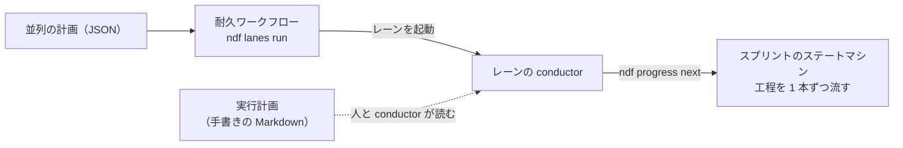
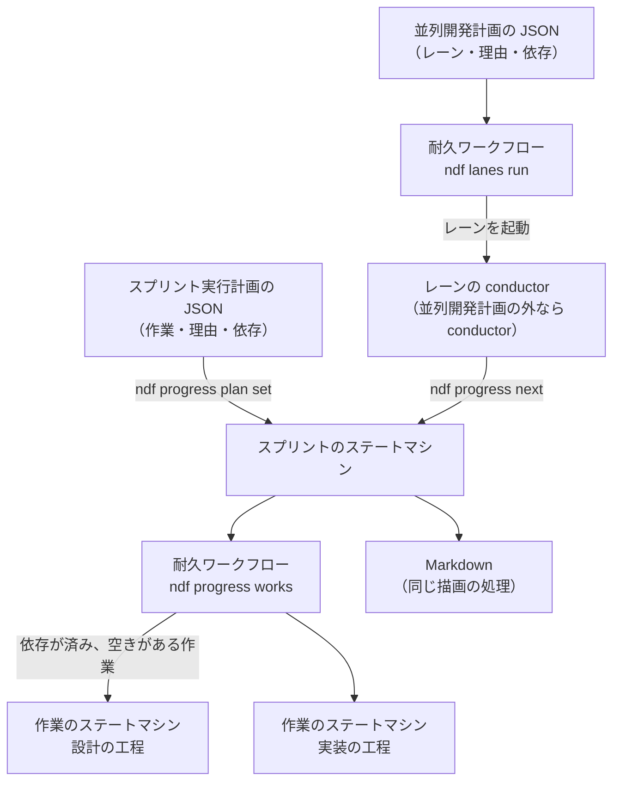
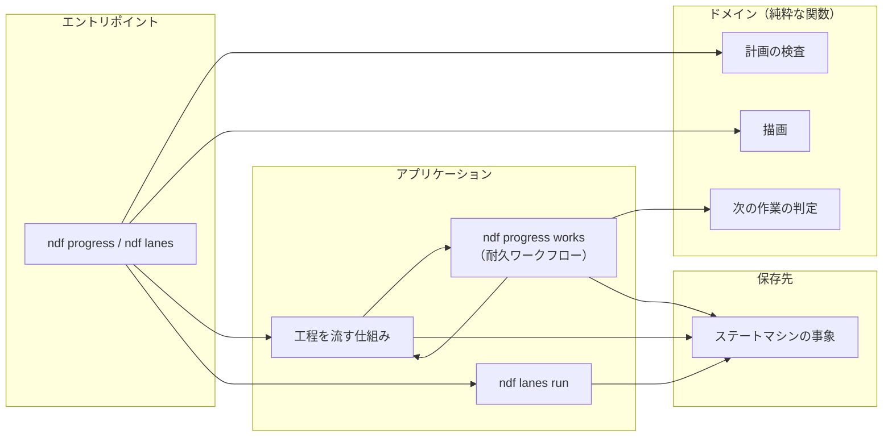
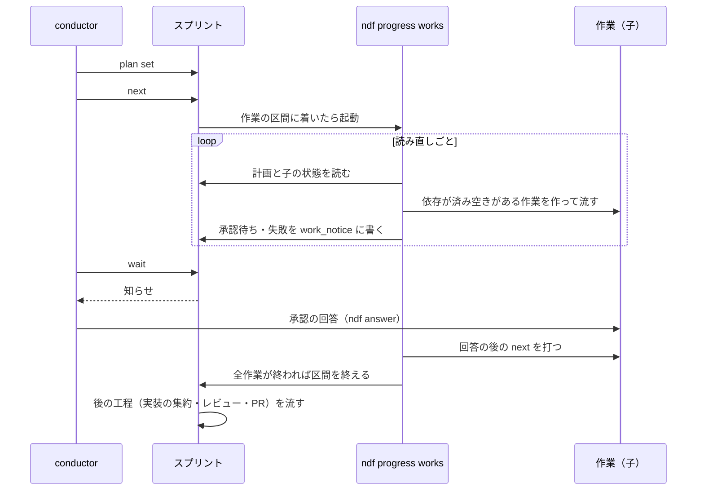

# 開発計画: 2 つの計画を同じ形で読め、耐久ワークフローがそのとおりに作業を進める（#4550）

これまで、2 つの開発計画は名前と形が違い、分け方と順の理由が残らず、スプリントの中の順は進行役の AI（conductor）が表を読んで手で決めていた。この設計では、呼び名を「スプリント実行計画」と「並列開発計画」にし、どちらも理由を持つ JSON を入力にして（始めた後の SSOT はステートマシンの事象）、同じ描画の処理で Markdown にする。スプリントの中の順は、作業（課題のまとまりの設計か実装）ごとに子のステートマシンを 1 本作り、スプリントの耐久ワークフローが依存と同時実行数に従って流す。採らなかった案は決定の記録に、比べた製品とライブラリは付録の「外部の調査」にある。

## 今の姿

何が起きたか・目的・受け入れ条件は要求仕様（[issue-4550-requirements.md](./issue-4550-requirements.md)、正は #4550 の本文）にある。この文書は「どう解くか」と「なぜその解き方か」だけを書く。パスは `plugins/ndf/` からの相対で書く。値は main の `cf4e3ee1d` で確かめた。



| 部品 | これまでの振る舞い | 場所 |
| --- | --- | --- |
| 並列の計画の形 | `version` 1。理由の欄は無く、スキーマに無い欄は断る。`after` は文字列の並び | `contracts/workflow/parallel-plan.schema.json` |
| 計画の状態 | JSON は入力で、状態は計画とレーンのステートマシンが持つ。Markdown へ変換する手段は無い | `src/ndf/progress/plan/`・`progress/lane/` |
| 実行計画 | conductor が手で書き、工程の終わりごとに読み直して行を起動する。読むコードは無い | `skills/issue-plan-strategy/references/execution-plan.md` |
| スプリントの進行 | 工程の行を定義の順に 1 本ずつ流す。バンドル・依存・並列を持たない | `src/ndf/progress/run.py` の `decide` |
| 設計の工程 | スプリントの課題すべてを 1 回の起動で扱い、出力の設計 PR は 1 本（`design_pr`） | `contracts/workflow/stages/design.json` |
| 実装の工程 | レビューの単位を 1 つずつ順に流し、最後にスプリントの PR を開く | `src/ndf/progress/units_invoke.py` |

## 文脈と制約

- 2 つの計画が扱う範囲と、計画を書かずに済む条件は変えない（要求の前提 1・2）
- 旧い形の JSON を読み続ける経路は持たない。進行中の作業と人の回答は失わない（要求の非機能の条件）
- ステートマシンの事象は追記だけで、今の状態は事象を畳み込んで出す。この形は変えない
- 承認ゲートの数と置く場所は変えない
- 同じ耐久ワークフローとステートマシンを変える作業が、別に 2 つ進んでいる

| 作業 | 内容 | 進み具合 |
| --- | --- | --- |
| [#4050](https://github.com/devbasex/ai-plugins/issues/4050) | スプリントを 7 つのフェーズに分ける | main には設計だけがある |
| [#3702](https://github.com/devbasex/ai-plugins/issues/3702) | レビューの単位を機械が読むファイルにし、並列に流す | main に単位のファイルの読み手は無い。別のブランチに実装のコミットがある |

- 作業やレーンが宣言する触る場所（`touches`）は見込みで、作業の制限には使わない

## 解き方の全体像

この設計では、次の形にする。



- この設計では、2 つの計画を「バージョン・名前・目標・分け方の理由・決まり・分けた単位（理由と依存を持つ）」の同じ構成の JSON にする。始めた後の SSOT はステートマシンの事象である。`render` は入力のファイルからでも始めた後の状態からでも同じ構成の Markdown を作る
- この設計では、スプリント実行計画の作業ごとに子のステートマシンを 1 本作り、今の工程を流す仕組みのまま流す。次にどの作業を始めるかはスプリントの耐久ワークフローが決め、人と conductor は選ばない
- この設計では、conductor の操作は承認と質問への回答、止まった原因への対応、計画の変更だけになる
- 並列開発計画のレーンのスプリントも同じ `ndf progress next` を通るので、レーンの中でもスプリント実行計画に従う

## ドメインモデル

### コンテキスト

| コンテキスト | 何の語が 1 つの意味に決まるか |
| --- | --- |
| 並列開発計画（`ndf lanes`） | レーン・レーンの順番表・`touches`・`after` |
| スプリントの進行（`ndf progress`） | 工程・承認ゲート・スプリント実行計画・計画の作業・依存の待つもの |

関係: スプリントの進行が上流、並列開発計画が下流（今のとおり）。

### 集約

| 集約 | オーナー（書き換えてよいもの） | 根 | エンティティ | 値オブジェクト |
| --- | --- | --- | --- | --- |
| スプリント実行計画 | conductor（`plan set`） | スプリントのステートマシン | 計画の作業 | 依存（待つ先・待つもの・理由）・理由・触る場所・同時実行数 |
| 作業の進行 | 工程を流すワークフロー・回答する conductor かオーガナイザー | 作業のステートマシン | 工程の行 | 回答・ステップの結果 |
| 並列開発計画 | オーガナイザー | 計画のステートマシン | レーン | 依存（先・理由）・理由・触る場所 |

### 不変条件

| # | 集約 | 条件 | 破れたときの扱い |
| --- | --- | --- | --- |
| I1 | スプリント実行計画 | 依存の先はすべて計画の中にあり、依存は輪にならない | `plan set` が断り、前の計画のまま進む |
| I2 | スプリント実行計画 | 計画・作業・依存のそれぞれが空でない理由を持つ | `plan set` と `render` が断る |
| I3 | スプリント実行計画 | 始めた作業は消せず、種類・課題・依存を変えられない | `plan set` が断る |
| I4 | スプリント実行計画 | 作業の課題はスプリントの課題の中にあり、同じ種類の 2 つの作業に入らない。実装の作業は、同じ課題の設計の作業を「マージ」で待つ | `plan set` が断る |
| I5 | スプリント実行計画 | 作業は、依存がすべて満たされ、流れている作業が同時実行数より少ないときだけ始める | 始めない。待つ理由を状態の表示に出す |
| I6 | 作業の進行 | 1 つの作業の子のステートマシンは 1 本だけで、済んだ作業は流し直さない | 作成を同じトランザクションで確かめ、2 本目を作らない |
| I7 | 並列開発計画 | 今の検査（レーン名・無い依存先と輪・課題の重なり・触る場所の重なり）はそのまま当てる | 書き込みを断る（今のとおり） |
| I8 | 並列開発計画 | 新しく書くレーンと依存と 2 行目以降の行は理由を持つ | `init`・`lane add`・`set`・`move` が断る |

### ドメインイベント

| # | イベント | 発生元 | 受け手 |
| --- | --- | --- | --- |
| E1・E2 | 計画を受けて検査した（`plan_set`） | conductor・オーガナイザー | 耐久ワークフロー |
| E3 | 計画の Markdown を作った | `render` | 人・振り返り |
| E4・E5 | 作業を始めた（`work_started`） | スプリントの耐久ワークフロー | 状態の表示 |
| E6 | 作業が承認を待つ・止まった・終わった（`work_notice`） | スプリントの耐久ワークフロー | conductor（`ndf progress wait`） |
| E7 | 始めた後に計画を変えた（`plan_set`） | conductor | 次の読み直しの耐久ワークフロー |
| E8 | 計画を閉じて Markdown を PR へ残した | 工程を流すワークフロー | 振り返り |

## 構成要素

| 要素 | 責務 |
| --- | --- |
| スプリント実行計画の形と検査（新設） | `contracts/workflow/sprint-plan.schema.json` と、I1〜I4 を確かめる純粋な関数 |
| 並列開発計画の形（変更） | `parallel-plan.schema.json` を `version` 2 にし、理由の欄と依存の形を持たせる |
| 計画の描画（新設） | 2 つの計画の文書（JSON と同じ形の値）と状態から Markdown を作る純粋な関数 1 つ |
| 計画を操作するコマンド（新設・変更） | `ndf progress plan set・show・render`、`ndf lanes render`、`ndf lanes set` の依存の理由 |
| 次の作業を決める関数（新設） | 計画・子の状態・同時実行数から、始める作業・知らせ・終わりを返す。DB を読まない |
| スプリントの耐久ワークフロー（新設） | `ndf progress works`。読み直し・子の作成と起動・知らせの記録を耐久ステップで打つ |
| 工程の定義（変更） | 工程に「作業の種類」（`design`・`impl`）の属性を持たせる。子はその工程だけを持つ |
| 工程を流す仕組み（変更） | 親は作業の工程の区間で耐久ワークフローに任せ、`wait` は知らせで戻る。子は進捗記録を書かない |
| 実装の単位の流し（変更） | 子では単位を流すだけにし、スプリントの PR と `gathered` は親が行う |
| 承認ゲートとレーンの接続（変更） | 子の承認ゲートから、親を辿ってレーンの行を引く |
| 手順書と用語集（変更） | 呼び名を入れ替え、手で表を書いて起動する手順を消す |



## データ構造

新しい表は作らず、ステートマシンの事象の中身を足す。表の形を表すバージョン番号は変えない。

### 2 つの計画の JSON

| 構成 | スプリント実行計画 | 並列開発計画 |
| --- | --- | --- |
| バージョン | `version` 1 | `version` 2 |
| 全体 | `name`・`goal`・`reason`・`rules` | 同じ |
| 分けた単位 | `works[]` | `lanes[]` |
| 単位の共通の欄 | `name`・`reason`・`touches`・`after[]` | 同じ |
| 依存 1 つ | `{on, wait, reason}`（`wait` は `converged` か `merged`） | `{on, reason}`（`on` は `<レーン>` か `<レーン>/<行のキー>`） |
| 片方だけの欄 | `kind`（`design`・`impl`）・`issues`・全体の `max_parallel`（任意） | `input` か `rows`（2 行目以降の行は `reason` を持つ）・`repo` |

`converged` は「相手の設計のレビューが収束するまで」、`merged` は「相手がマージされるまで」である。`converged` は相手が設計の作業のときだけ書ける。理由の欄は、空と空白だけの値を断る。

```json
{"version": 1, "name": "m10", "goal": "工程ごとの所要時間を測れるようにする",
 "reason": "触る手順書が違うので 2 つのまとまりに分ける", "rules": [],
 "works": [
  {"name": "g1-design", "kind": "design", "issues": [101], "touches": ["docs/a.md"],
   "reason": "記録の形を決める", "after": []},
  {"name": "g2-design", "kind": "design", "issues": [102], "touches": ["docs/b.md"],
   "reason": "表示を決める",
   "after": [{"on": "g1-design", "wait": "converged", "reason": "記録の形を前提に表示を決める"}]},
  {"name": "g1-impl", "kind": "impl", "issues": [101], "touches": ["src/a.py"], "reason": "記録を書く",
   "after": [{"on": "g1-design", "wait": "merged", "reason": "承認した設計で実装する"}]}
 ]}
```

### ステートマシン

| 保存先 | 足す中身 |
| --- | --- |
| スプリントの事象 `plan_set`（書き手 conductor） | 計画の文書の全体と変えた理由。今の計画は最後の `plan_set` |
| スプリントの事象 `work_started`（書き手 workflow） | 作業の名前と子のステートマシンの ID |
| スプリントの事象 `work_notice`（書き手 workflow） | 作業の名前・知らせの種類（承認待ち・失敗・中止・全作業の終わり）・理由・子の事象の番号 |
| 作業のステートマシン | 階層はスプリントのまま。親はスプリントで、名前は `<スプリント>/<作業>`。定義は、モードの定義からその作業の種類の工程だけを取る。文脈はスプリントの値と作業の課題 |
| 計画の事象（`created`・`lane_added`・`lane_changed`） | `goal`・`reason`、レーンの `reason`、依存の理由（`after_reasons`）を足す。`after` の形は変えない |

`after_reasons` を別の欄にするのは、これまでの事象をそのまま畳み込めるようにするためである。理由の無い古い計画は、描画で「記録なし」と出る。

### 描画する Markdown

見出しの並びと表の列は 2 つの計画で同じにする。片方にしか無い項目は列を足す。

| 順 | 見出し | 中身 |
| --- | --- | --- |
| 1 | 題（`# スプリント実行計画: <名前>` か `# 並列開発計画: <名前>`） | 状態・目標・分け方の理由 |
| 2 | 分け方 | 名前・中身（種類と課題、またはレーンの行）・触る場所・状態・分けた理由 |
| 3 | 順 | 作業かレーン・待つ先・待つもの・順の理由 |
| 4 | 決まり | `rules` |
| 5 | 変更の記録 | 時刻・変えたこと・理由（始める前の計画には出さない） |

並びは JSON の並びで、時刻は事象の時刻だけを使う。生成の時刻を書かないので、同じ内容からは同じ Markdown になる。状態の無い入力のファイルから作るときは、状態の列に「未着手」を出す。

## 入出力のコントラクト

| コマンド | 引数 | 返り・失敗 |
| --- | --- | --- |
| `ndf progress plan set <ステートマシン> <ファイル> --reason <理由>`（新設） | 計画の JSON の全体 | 検査を通れば `plan_set` を書く。形か I1〜I4 に当たれば、当たった理由を並べて断り、何も書かない |
| `ndf progress plan show <ステートマシン>`（新設） | — | 今の計画の JSON。直して `set` へ渡せる |
| `ndf progress plan render <ステートマシンかファイル>`（新設） | — | Markdown。形の合わない入力は作らずに理由を返す |
| `ndf lanes render <計画名かファイル>`（新設） | — | 同上 |
| `ndf progress works <ステートマシン>`（新設。内部） | `next` が切り離して起動する | 同じスプリントで 1 本に限る |
| `ndf progress wait <ステートマシン> [--after <番号>]`（変更） | 知らせの番号 | 計画のあるスプリントでは、番号より後の知らせか、区間の終わりで返る。次に打つ 1 行を `next` に持つ |
| `ndf progress show <ステートマシン>`（変更） | — | 作業ごとの状態・何を待つか・子の ID・PR を足す |
| `ndf progress next <ステートマシン>`（変更） | — | 新しいバージョンで作った課題 2 件以上のスプリントで計画が無ければ、`plan set` を示して止まる（precondition） |
| `ndf lanes set <計画> <レーン> [--after <先> <理由>]... --reason <理由>`（変更） | 依存と理由の組 | 理由が空なら断る |
| `ndf lanes init`・`start`・`lane add`（変更） | `version` 2 の JSON | `version` 1 と理由の欠けは、直す欄を並べて断る |

子の承認ゲートの回答は、今の `ndf answer <子の ID>` で書く。止まった作業は、原因を直して子に `retry`、やめるなら子に `cancel` を打つ。始めた作業を作り直すときは、子を中止してから新しい名前の作業を足す。

## 処理の流れ



- **作業の工程の区間**: 親は、定義の中で作業の種類の属性を持つ工程が並ぶ区間に着くと、耐久ワークフローに任せる
  - 区間の工程の行は、最初の作業が始めた時点で実行中にする。その工程を持つ作業がすべて終わった時点で終了にする
  - 「実装」の行は、作業がすべて終わった後に親が単位の流れを 1 回通す。マージ済みの単位は飛ばし、スプリントの PR と `gathered` を書く
- **作業の種類と工程**: 作業が持つ工程は次の表のとおりで、モードの定義にあるものだけを持つ

| 作業の種類 | 持つ工程 |
| --- | --- |
| 設計 | 素材の収集と出典の確定・設計・詳細設計・ドキュメント再構成・ドキュメントレビュー |
| 実装 | 計画・実装 |

- **作業のブランチ**: 設計の作業は自分の作業場所とブランチを作り、設計 PR を今と同じ起点へマージする
  - 実装の作業は、始める手前でスプリントブランチへ起点を取り込み、単位のブランチを切る
  - レビューの単位の無い実装の作業は、作業の全体を 1 つの単位として単位の経路で流す
  - スプリントの作業場所を書き換える操作は、スプリントの排他 1 つの中で行う
- **依存の判定**: `merged` は子が完了した時点、`converged` は子の定義のレビューのステップがすべて済んだ時点である。変更要求でレビューが流し直しになれば、まだ始めていない後続はまた待つ
- **同時実行数**: 子の工程が実際に流れている数を数える。承認待ち・失敗の子は数えないので、依存の無い作業は進む。上限は計画の `max_parallel` である。無ければ上限の設定（`contracts/limits/sprint-run.works.json`。値は 3）を使う
- **失敗**: 止まった子に依存する作業は始めない。依存の無い作業は進め、知らせは 1 回だけ書く
- **回復**: 判定に要る状態はすべて事象にある。耐久ワークフローが落ちたら `ndf progress next` が起動し直し、完了した子は流さない
- **流す作業が無いとき**: 流れる子が無く、始められる作業も無ければ、耐久ワークフローは知らせを書いて終わる。回答や `retry` の後の `ndf progress next` が起動し直す
  - 流れている子があれば回り続け、回答の後の子の `next` も打つ
- **閉じる**: 親の「Pull Request」の工程が終わった時点で、描画した Markdown をスプリントの PR へコメントする
  - 同じコメントは 2 回書かない
  - 書けなければ警告を返し、`ndf progress resync` が書き直す
  - 計画は事象に残るので消えない

### レーンのスプリントとの接続

レーンの conductor は今と同じ `ndf progress next` と `wait` を打つ。子の承認ゲートの質問とリリースのリクエストは、親を辿ってレーンの行を引いてから計画へ載せる。レーンの生死の判定では、親の持つ情報に子の承認待ちがあれば、正常な待ちとして扱う。

## 非機能の実現方式

| 条件 | 実現方式 |
| --- | --- |
| 運用・保守性（何が動き、何が何を待つかを読める） | `ndf progress show` が作業ごとの状態と待つ理由を返し、`ndf lanes status` がレーンごとの状態と満たしていない依存を返す |
| 移行性（旧い形の JSON は断る） | `version` 1 の並列の計画は、`version`・理由の欄・`after` の形を直す欄として並べて断る |
| 移行性（進行中の作業と回答を失わない） | 事象の形を表すバージョン番号は変えない。動いている計画は理由の無いまま畳み込んで続く。更新の前に作ったスプリントは、作成の事象に計画の要否の印が無いので、今のとおり 1 本で流す。手で書いた実行計画のあるスプリントも同じである |

## 決定の記録

### 決定 1: 名前から範囲が分かるように、呼び名を「スプリント実行計画」と「並列開発計画」にする

- **質問**: 2 つの計画を何と呼ぶか
- **選んだ案**: 起票の案のとおり「スプリント実行計画」「並列開発計画」にする
- 採らなかった案: 「スプリント内計画」と「レーン計画」（利用者が指示で挙げた名前と離れ、レーンという内部の語を知らないと範囲が分からない）
- **代償**: 用語集・手順書・コードの表示の文を入れ替える
- 根拠: Value 14（MVV バージョン 11）

### 決定 2: 呼び名の変更で操作を壊さないように、コマンド `ndf lanes` は残し、計画のファイルと欄だけを揃える

- **質問**: ファイル名・コマンド名・JSON の項目名も呼び名に合わせるか
- **選んだ案**: 手順書は `execution-plan.md` を `sprint-plan.md` に改名し、`parallel-plan.md` とそのスキーマの名前は残す。スプリント実行計画のコマンドは `ndf progress plan`、並列開発計画のコマンドは `ndf lanes` に置く。JSON の欄は 2 つの計画で同じ名前にする
- 採らなかった案: `ndf lanes` を `ndf parallel-plan` に改名する（`lanes` は操作の対象のレーンを指す名前で、これまでの呼び名を含まない）
- 採らなかった案: スプリント実行計画のコマンドを `ndf plan` の下に置く（`ndf plan` はステップを流すプランのコマンドで、1 つの語が 2 つの意味になる）
- **代償**: 2 つの計画のコマンドが別のサブコマンドに分かれる
- 根拠: Value 14 / Value 11（MVV バージョン 11）

### 決定 3: 理由と状態が食い違わないように、JSON を入力にし、始めた後の SSOT はステートマシンの事象にする

- **質問**: 「SSOT は JSON」を、どこに持つ JSON にするか
- **選んだ案**: 2 つの計画とも、ファイルの JSON は入力にする。始めた後は事象が SSOT で、`show` が同じ形の JSON を返し、`render` がそこから Markdown を作る。手で直す Markdown と、追跡しない計画のファイルは持たない
- 採らなかった案: 計画のファイルを SSOT にしてコードが毎回読む（ファイルと実行の状態が別々に変わり、始めた作業を変えたかを確かめられない）
- 採らなかった案: 描画した Markdown をファイルに保つ（同じ事実が 2 か所になる）
- **代償**: 計画を読むにはコマンドを打つ
- 根拠: Value 8（MVV バージョン 11）

### 決定 4: 2 つの Markdown の形が揃い続けるように、描画の処理を 1 つにする

- **質問**: Markdown をどう作るか
- **選んだ案**: 2 つの計画を同じ構成の値にしてから、1 つの関数で描く。表は依存に既にある `tabulate` で作り、セルの `|` と改行は自分でエスケープする
- 採らなかった案: テンプレートのエンジン Jinja2 を足す（見出し 5 つと表 3 つのために依存が 1 つ増える）
- 採らなかった案: 計画ごとに別の描画を書く（片方だけ直されて形がずれる）
- **代償**: 片方の計画にしか無い項目の分岐を描画が持つ
- 作り方: ライブラリやサービスを使う・自前で作る
- 比べた候補: LIB2 / LIB3
- 根拠: Value 11（MVV バージョン 11）

### 決定 5: 今の承認ゲート・打ち直し・回復をそのまま使えるように、作業 1 つを子のステートマシン 1 本にする

- **質問**: スプリントの中の順と並行を、何の状態として持つか
- **選んだ案**: 作業ごとに子のステートマシンを作り、モードの定義からその作業の種類の工程だけを持たせて、今の `decide`・承認ゲート・`retry`・回復で流す。工程の定義には作業の種類の属性だけを足す
- 採らなかった案: スプリントのステートマシンの行を「作業×工程」に広げる（行のキー・次の 1 手・承認ゲート・進捗記録のすべてが 1 本の流れを前提にしていて、全部を作り直す）
- 採らなかった案: 作業ごとにステップのプランを組んで `ndf plan queue` に渡す（起動の後の変更が効かず、承認待ちの 1 本が後ろのステージを止める）
- **代償**: ステートマシンが親子になり、承認ゲートとレーンの接続が親を辿る。進捗記録は親がまとめて書く
- 作り方: 自前で作る
- 比べた候補: PRD1 / PRD2 / PRD3 / STD1 / LIB1
- 根拠: Value 10 / Value 3（MVV バージョン 11）

### 決定 6: 手で作業を選ばずに進むように、スプリントの耐久ワークフローを DBOS で足す

- **質問**: 次の作業を誰が起動するか
- **選んだ案**: 並列開発計画の耐久ワークフローと同じ形（判定は純粋な関数、読みと起動は耐久ステップ）で `ndf progress works` を足す。`next` が切り離して起動し、常駐は置かない
- 採らなかった案: `ndf lanes run` が全レーンのスプリントの中まで起動する（スプリントを進めるのはレーンの conductor である。また、計画の外のスプリントには計画の耐久ワークフローが無い）
- 採らなかった案: DBOS のキューの同時実行の指定で数を絞る（承認待ちの作業を数から外す条件と、依存の判定を持てない）
- 採らなかった案: Prefect・Airflow・Temporal を入れる（それぞれが実行の状態を持つので、依存に既にある DBOS と事象の記録に重なる）
- **代償**: 耐久ワークフローが 2 種類になる
- 作り方: ライブラリやサービスを使う・自前で作る
- 比べた候補: LIB1 / LIB4 / LIB5 / LIB6 / PRD2 / PRD4
- 根拠: Value 3 / Value 12（MVV バージョン 11）

### 決定 7: 依存の意味が 1 つに決まるように、待つものを「収束」と「マージ」の 2 つにし、すべての順を JSON に書く

- **質問**: 依存の表し方と、同じ課題の設計と実装の順を暗黙にするか
- **選んだ案**: 依存は `{on, wait, reason}` で書く。同じ課題の実装の作業が設計の作業を待つことも書かせ、欠けていれば断る。`converged` は設計の作業を待つときだけ書ける
- 採らなかった案: 同じ課題の順はコードが補う（Markdown に出る順と理由が、書いた JSON と食い違う）
- 採らなかった案: 成功・失敗などの条件式を持つ（要求の依存は 2 種類で、失敗した先を待つ作業は始めない）
- **代償**: 書き手が決まりきった依存も 1 行書く
- 作り方: 自前で作る・標準に倣う
- 比べた候補: PRD1 / PRD2 / PRD3 / STD1
- 根拠: Value 8 / Value 9（MVV バージョン 11）

### 決定 8: 始めた作業の記録が崩れないように、計画の変更は全体の置き換えにし、始めた作業の変更を断る

- **質問**: 起動の後の計画の変更をどう受けるか
- **選んだ案**: `show` で今の計画を読み、直した全体を `set` で渡す。検査に当たれば前の計画のまま進む。始めた作業の種類・課題・依存の変更と削除は断り、作り直しは子の中止と新しい作業の追加で行う
- 採らなかった案: 追加・依存の変更・削除を別々のサブコマンドにする（途中の形が検査に当たり、順番を考えて打つことになる）
- **代償**: 2 人が同時に直すと後の `set` が前を上書きする。書き手を conductor 1 人にする今の決まりで避ける
- 根拠: Value 3 / Value 9（MVV バージョン 11）

### 決定 9: 更新で作業と回答を失わないように、動いている計画は移行せずそのまま続ける

- **質問**: バージョンを上げる時点で動いている計画をどう扱うか
- **選んだ案**: 計画の事象には欄を足すだけにして、古い事象をそのまま畳み込む。古いスプリントは計画の要否の印が無いので 1 本で流す。旧い形を断るのは新しく渡す JSON だけにする
- 採らなかった案: 終えてからバージョンを上げる決まりにする（承認待ちが何時間も残る計画があり、更新を止める）
- 採らなかった案: 移行のコマンドで古い事象を書き換える（事象は追記だけで持つ）
- **代償**: 更新の前に始めた計画の Markdown は理由が「記録なし」になる
- 根拠: Value 3 / Value 4（MVV バージョン 11）

### 決定 10: 同じ箇所を 2 度作り直さないように、実装は #4050 と #3702 の実装の後に重ねる

- **質問**: 同じ耐久ワークフローと工程の定義を変える 2 つの作業と、どの順にするか
- **選んだ案**: #4050 と #3702 の実装がマージされた後に始める。作業の種類は工程の定義の属性にするので、#3702 が「計画」を設計のフェーズへ移せば属性の値 1 つで追える。#4050 のレーンの `after` の待ちは、親が最初の実装の作業を始める手前で 1 回確かめる
- 採らなかった案: #4550 を先に入れる（#4050 の設計は 1 本の流れの `next` を前提に承認されていて、設計の直しが要る）
- **代償**: 着手が後ろへずれる
- 根拠: Value 10 / Value 5（MVV バージョン 11）

## 影響と危険

- **働く範囲**: NDF を使うすべてのリポジトリで働く
- **プロジェクトごとに違うもの**: 同時実行数は計画の `max_parallel` で受ける。起点のブランチと工程の並びは今の設定とモードの定義のまま
- **当たるモード**: 工程「設計」か「実装」を持つ全モード。計画を渡さない課題 1 件のスプリントは今のとおり

壊れうる箇所と扱い:

- 子が進捗記録を書くと、課題の工程表が一部の工程だけで上書きされる。子は書かず、親がまとめる
- 複数の実装の作業が同じスプリントブランチへ単位の PR をマージする。衝突は今の決まり（後からマージする側が解き、解いた head でレビューを収束させる）で扱う
- 複数の子が同じ作業場所の git を同時に触ると失敗する。スプリントの作業場所の書き換えは排他の中で行う
- 子の `claude` の起動が増え、利用上限に早く当たる。同時実行数の既定は、今の `ndf plan queue --max 3` と同じ 3 にする
- `ndf lanes` の呼び出し側（手順書・Factory）は `version` 2 と `set --after` の新しい形へ直す

### 代表のリポジトリでの振る舞い

| 代表のリポジトリ | 設定の要点 | 直した後に起きること | この種類で扱えなくなること |
| --- | --- | --- | --- |
| Web サービス | 課題が複数のスプリント | 計画を渡すと、設計と実装の作業が依存の順に並行して流れる | 無し |
| モバイルアプリ | 実装とテストが長い | 同時実行数を計画で下げられる | 無し |
| 業務文書だけ | `documentation` のモード | 素材の収集と設計は設計の作業、執筆は実装の作業になる | 無し |

### ai-plugins だけの事情

| 値 | 置く所 | 持つ Issue |
| --- | --- | --- |
| 確定仕様・変更履歴・`docs/archive/` の本文は呼び名を直さない | 要求の受け入れ条件 1 の範囲 | #4550 |

## 用語

| 用語 | 意味 | 用語集への反映 |
| --- | --- | --- |
| スプリント実行計画 | 1 つのスプリントの中の作業・分けた理由・依存を持つ計画 | 追加 |
| 並列開発計画 | 同時に進めるレーン・分けた理由・依存を持つ計画 | 追加 |
| 計画の作業 | スプリント実行計画が順を決める 1 単位（課題のまとまりの設計か実装）。以下、単に「作業」と書く | 追加 |

これまでの 2 語は、呼び名が設計の承認で確定した後、実装で手順書とコードの文を入れ替えるのと同じ変更で、用語集の廃止した語へ移す。

## テスト設計

| 受け入れ条件・不変条件 | どの振る舞いで縛るか | どう壊したら落ちるべきか |
| --- | --- | --- |
| 条件 1 | `git grep` の当たりを読み、残りが条件の 3 種類だけ（テストは書かず手で判定） | — |
| 条件 2 | 2 つの計画の同じ内容は同じ見出しと列の Markdown になり、2 回作っても同じで、`set` の後は変えた内容が出る。形の合わない JSON は失敗する | 描画に今の時刻を混ぜる、形の検査を外す |
| 条件 3・I2・I8 | 理由の欄がすべて Markdown に出る。空と空白の理由は断る | 理由の列を落とす、空の理由を通す |
| 条件 4・I5 | 依存の無い 2 作業が並行して始まり、依存する 1 作業は後で始まる。上限 1 なら 1 本ずつ。`converged` はレビューの後、`merged` は完了の後。計画の依存を変えると起動の順が変わる | 依存を見ずに始める、上限を数えない、2 つの待つものを同じ扱いにする |
| 条件 5 | `next` を 1 回打った後、回答のほかの指示なしで全作業が終わる。承認待ちの作業があっても別の作業が進む | 承認待ちで耐久ワークフローが抜ける |
| 条件 6・I1・I3・I4 | 無い依存先・輪・始めた作業の変更を持つ計画は断り、作業を始めない。始めた後の誤った変更では前の計画で進む | 検査の 1 つを外す |
| 条件 7・I6 | 1 作業の失敗で後続は始まらず、他は進み、知らせが 1 回届く。耐久ワークフローを落として起動し直すと、完了した作業は流れない | 子を作り直す、知らせを毎回書く |
| 条件 8・I7 | 今のレーンの検査と実行中の変更のテストが、`version` 2 の入力で通る | 今の検査の 1 つを外す |
| 条件 9 | 課題 1 件のスプリントは計画なしで今のとおり流れる。課題 2 件で計画が無ければ止まる | 要否の判定を逆にする |
| 条件 10 | 全作業の後に Markdown がスプリントの PR のコメントになり、投稿の失敗では警告が出て `resync` で書ける | 失敗を握りつぶす、2 回投稿する |
| 非機能（運用） | `show` が作業の状態と待つ理由を返す | 待つ理由を落とす |
| 非機能（移行） | `version` 1 は直す欄を示して断る。理由の無い古い事象と、印の無い古いスプリントはそのまま進む | 古い事象の読みで理由を必須にする |
| 前提: 実装の単位 | 子の「実装」はスプリントの PR を開かず、親が 1 回だけ開く | 子が PR を開く |

## 設計の結果

| 課題 | 扱い | 統合先 | 触るファイル |
| --- | --- | --- | --- |
| #4550 | 実装する | — | `plugins/ndf/contracts/workflow/sprint-plan.schema.json`（新設）、`plugins/ndf/contracts/workflow/parallel-plan.schema.json`、`plugins/ndf/contracts/workflow/progress.json`、`plugins/ndf/contracts/workflow/progress.schema.json`、`plugins/ndf/contracts/workflow/ndf.schema.json`、`plugins/ndf/contracts/workflow/stages/document-sources.json`、`plugins/ndf/contracts/workflow/stages/design.json`、`plugins/ndf/contracts/workflow/stages/design-detail.json`、`plugins/ndf/contracts/workflow/stages/document-rebuild.json`、`plugins/ndf/contracts/workflow/stages/document-review.json`、`plugins/ndf/contracts/workflow/stages/plan.json`、`plugins/ndf/contracts/workflow/stages/implement.json`、`plugins/ndf/contracts/limits/sprint-run.works.json`（新設）、`plugins/ndf/contracts/limits/sprint-run.poll.json`（新設）、`plugins/ndf/contracts/schemas/io/progress.args.schema.json`、`plugins/ndf/contracts/schemas/io/progress.result.schema.json`、`plugins/ndf/contracts/schemas/io/lanes.args.schema.json`、`plugins/ndf/contracts/schemas/io/lanes.result.schema.json`、`plugins/ndf/docs/contracts/commands.md`、`plugins/ndf/src/ndf/progress/plan_doc.py`（新設）、`plugins/ndf/src/ndf/progress/works/__init__.py`（新設）、`plugins/ndf/src/ndf/progress/works/decide.py`（新設）、`plugins/ndf/src/ndf/progress/works/run.py`（新設）、`plugins/ndf/src/ndf/progress/works/cli.py`（新設）、`plugins/ndf/src/ndf/progress/command.py`、`plugins/ndf/src/ndf/progress/run.py`、`plugins/ndf/src/ndf/progress/run_view.py`、`plugins/ndf/src/ndf/progress/stages.py`、`plugins/ndf/src/ndf/progress/definition.py`、`plugins/ndf/src/ndf/progress/units_invoke.py`、`plugins/ndf/src/ndf/progress/records.py`、`plugins/ndf/src/ndf/progress/gate/answering.py`、`plugins/ndf/src/ndf/progress/gate/asking.py`、`plugins/ndf/src/ndf/progress/lane/__init__.py`、`plugins/ndf/src/ndf/progress/lane/fold.py`、`plugins/ndf/src/ndf/progress/lane/types.py`、`plugins/ndf/src/ndf/progress/lane/rules.py`、`plugins/ndf/src/ndf/progress/lane/liveness.py`、`plugins/ndf/src/ndf/progress/plan/__init__.py`、`plugins/ndf/src/ndf/progress/plan/cli.py`、`plugins/ndf/src/ndf/domains/hooks/guards/full_test.py`、`plugins/ndf/src/ndf/domains/hooks/guards/stop_wait.py`、`plugins/ndf/src/ndf/domains/worktree/mainlock.py`、`plugins/ndf/contracts/domains/branch-flows.json`、`plugins/ndf/contracts/domains/env.json`、`plugins/ndf/contracts/schemas/ndf-settings/pace.schema.json`、`plugins/ndf/docs/contracts/env.md`、`plugins/ndf/docs/contracts/ndf-settings.md`、`plugins/ndf/tests/progress/test_plan_doc.py`（新設）、`plugins/ndf/tests/progress/test_works_decide.py`（新設）、`plugins/ndf/tests/progress/test_works_run.py`（新設）、`plugins/ndf/tests/progress/test_plan.py`、`plugins/ndf/tests/progress/test_lane.py`、`plugins/ndf/tests/progress/test_definition.py`、`plugins/ndf/tests/progress/test_invoke_per_unit.py`、`plugins/ndf/skills/issue-plan-strategy/SKILL.md`、`plugins/ndf/skills/issue-plan-strategy/references/execution-plan.md`、`plugins/ndf/skills/issue-plan-strategy/references/sprint-plan.md`（新設）、`plugins/ndf/skills/issue-plan-strategy/references/parallel-plan.md`、`plugins/ndf/skills/requirements-design/references/document-roles.md`、`plugins/ndf/skills/development-workflow/SKILL.md`、`plugins/ndf/skills/development-workflow/references/agent-layers.md`、`plugins/ndf/skills/development-workflow/references/asking.md`、`plugins/ndf/skills/development-workflow/references/context-window.md`、`plugins/ndf/skills/development-workflow/references/loop.md`、`plugins/ndf/skills/development-workflow/references/parallel.md`、`plugins/ndf/skills/development-workflow/references/parallel-checks.md`、`plugins/ndf/skills/development-workflow/references/parallel-cross-repo.md`、`plugins/ndf/skills/development-workflow/references/parallel-work.md`、`plugins/ndf/skills/development-workflow/references/relay.md`、`plugins/ndf/skills/development-workflow/references/waiting.md`、`plugins/ndf/skills/backlog-refinement/references/milestones.md`、`plugins/ndf/skills/implementation-plan/SKILL.md`、`plugins/ndf/skills/out-of-scope/SKILL.md`、`plugins/ndf/skills/out-of-scope/references/issue-target.md`、`plugins/ndf/skills/pr/SKILL.md`、`plugins/ndf/skills/progress-tracking/SKILL.md`、`plugins/ndf/skills/release/references/release-steps.md`、`plugins/ndf/skills/worktree/references/ndf-settings.md`、`docs/glossary/glossary.json`、`docs/glossary.md`、`docs/glossary/ndf-parallel.md`、`docs/glossary/ndf-branch-strategy.md`、`docs/glossary/ndf-relay.md`、`docs/glossary/ndf-workflow.md` |

## 未確認のまま残ること

| 項目 | 内容 |
| --- | --- |
| 同時に流す子の数と利用上限 | 3 本で利用上限やメモリに当たるかは、実装の後に課題が複数のスプリントを流して分かる |
| 同じ作業場所への並行の git | 排他で足りるかは、実装の作業を 2 本以上並行して流すテストと実機で分かる |
| #4050・#3702 の実装の形 | 両方の実装が main に入るまで、親が区間を任せる位置と単位の流しの分け目は確定しない。実装計画を書く時点で main を読んで確かめる |
| 承認待ちのまま会話を切り替えたときの耐久ワークフロー | 切り離したプロセスが残ることは並列開発計画の耐久ワークフローで使えているが、子の起動までは実機で確かめていない |

## 外部の調査

| 種類 | 調べるか | 理由 |
| --- | --- | --- |
| 標準・仕様 | 調べる | 順と並行を書くワークフローの仕様があり、工程の定義が既に従っている |
| 主要な製品 | 調べる | 依存つきの作業を流す製品の、依存と失敗と同時実行の扱いを比べる |
| ライブラリとサービス | 調べる | 耐久実行と表の描画を、自前で作るかを決める |

### 標準・仕様

| # | 標準・仕様 | 何を定めているか | 設計への反映 | 出典 |
| --- | --- | --- | --- | --- |
| STD1 | Serverless Workflow DSL | 順の実行と、並行に枝を流す `fork`、事象を待つ `listen`。依存を名指しする有向グラフの記法は見出しに無い | 工程の定義はこの書式のまま属性を足す。作業の依存は計画の JSON に持つ | <https://raw.githubusercontent.com/serverlessworkflow/specification/main/dsl-reference.md> （2026-11-28） |

### 主要な製品

| # | 製品 | どう解いているか | 設計への反映 | 出典 |
| --- | --- | --- | --- | --- |
| PRD1 | GitHub Actions | `needs` で先の job の成功を待つ。失敗は後続を飛ばす。`max-parallel` は matrix の指定 | 失敗した先を待つ作業は始めない。同時実行数は計画の欄にする | <https://docs.github.com/en/actions/reference/workflows-and-actions/workflow-syntax> （2026-11-28） |
| PRD2 | Argo Workflows | `dependencies` の有向グラフ。既定は 1 つの失敗で新しい作業を始めず、`failFast: false` で他の枝を流し切る | 依存の無い枝は流し切る | <https://raw.githubusercontent.com/argoproj/argo-workflows/main/docs/walk-through/dag.md> （2026-11-28） |
| PRD3 | Apache Airflow | 先と後の関係と、`trigger_rule` で待つ条件を選ぶ。既定は先がすべて成功 | 待つものは 2 種類に絞り、条件の指定は持たない | <https://raw.githubusercontent.com/apache/airflow/main/airflow-core/docs/core-concepts/dags.rst> （2026-11-28） |
| PRD4 | Claude Code の agent teams | 共有の作業の一覧に依存を持たせる実験の機能（既定は無効） | 使わない。承認ゲート・記録・Codex での動きを持てない | <https://code.claude.com/docs/en/agent-teams> （2026-11-28。検索の要約で読んだ） |

### ライブラリとサービス

| # | 候補 | バージョン | ライセンス | 最後のリリースの日付 | 終了のアナウンス | 要件を満たすか | 出典 |
| --- | --- | --- | --- | --- | --- | --- | --- |
| LIB1 | DBOS（Python。依存は 3.4.0 に固定） | 3.7.0 | MIT | 2026-11-24 | 無し | 耐久ステップと回復を満たす。依存の判定は自前 | <https://pypi.org/pypi/dbos/json> （2026-11-28） |
| LIB2 | tabulate（依存にある） | 0.10.0 | MIT | 2026-03-04 | 無し | GitHub の表を作れる | <https://pypi.org/pypi/tabulate/json> （2026-11-28） |
| LIB3 | Jinja2 | 3.1.6 | BSD | 2025-03-05 | 無し | 描けるが依存が増える | <https://pypi.org/pypi/Jinja2/json> （2026-11-28） |
| LIB4 | Prefect | 3.9.5 | Apache-2.0 | 2026-11-24 | 無し | 状態を別に持ち、事象の記録と二重になる | <https://pypi.org/pypi/prefect/json> （2026-11-28） |
| LIB5 | Apache Airflow | 3.4.0 | Apache-2.0 | 2026-11-06 | 無し | 定義と状態を Airflow の形へ作り直すことになる | <https://pypi.org/pypi/apache-airflow/json> （2026-11-28） |
| LIB6 | temporalio（Temporal の Python SDK） | 1.37.0 | MIT | 2026-11-24 | 無し | 実行の状態を DBOS と別に持つことになる | <https://pypi.org/pypi/temporalio/json> （2026-11-28） |

依存の輪の検査は、標準ライブラリの `graphlib`（今のレーンの検査が使う）をそのまま使う。

### 確かめられなかったこと

| 対象 | 試した手段 | 結果と理由 |
| --- | --- | --- |
| Prefect・Temporal の依存と承認待ちの扱い、3 つの LIB4〜LIB6 の運用に要る構成 | 試していない | PyPI のバージョン・ライセンス・日付だけを確かめた。実行の状態が二重になる時点で比較を止めた |
| agent teams の依存の記録の形 | 検索 1 回 | 公式の記述が薄く、第三者の記事の内容は確かめていない |

調べた量: 候補 11 件・取得の試み 17 回。
