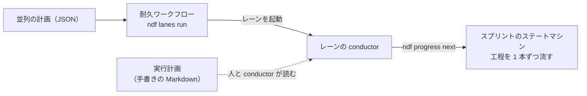
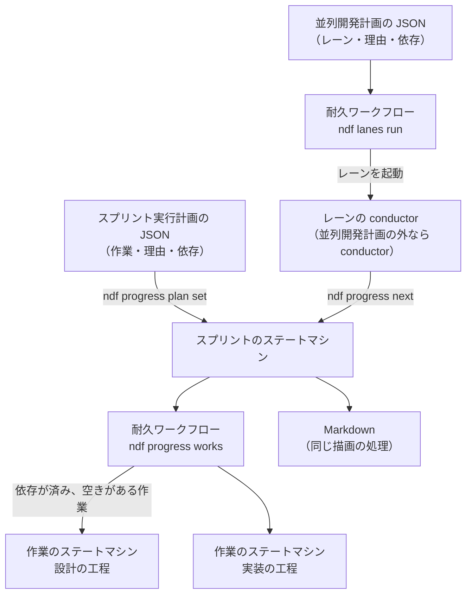
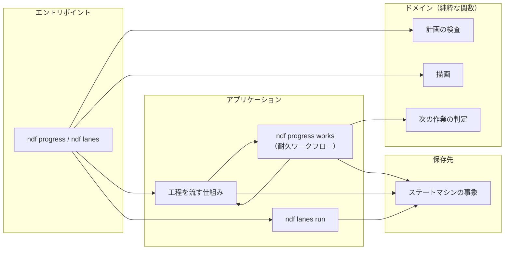
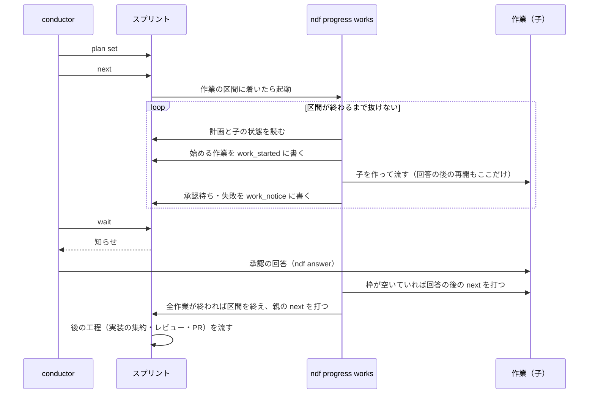

# 開発計画: 2 つの計画を同じ形で読め、耐久ワークフローがそのとおりに作業を進める（#4550）

これまで、2 つの開発計画は名前と形が違い、分け方と順の理由が残らず、スプリントの中の順は進行役の AI（conductor）が表を読んで手で決めていた。この設計では、呼び名を「スプリント実行計画」と「並列開発計画」にし、どちらも理由を持つ JSON を入力にして（始めた後の SSOT はステートマシンの事象）、同じ描画の処理で Markdown にする。スプリントの中の順は、作業（課題のまとまりの設計か実装）ごとに子のステートマシンを 1 本作り、スプリントの耐久ワークフローが依存と同時実行数に従って流す。採らなかった案は決定の記録に、比べた製品とライブラリは付録の「外部の調査」にある。

## 今の姿

何が起きたか・目的・受け入れ条件は要求仕様（[issue-4550-requirements.md](./issue-4550-requirements.md)、正は #4550 の本文）にある。この文書は「どう解くか」と「なぜその解き方か」だけを書く。パスは `plugins/ndf/` からの相対で書く。値は main の `cf4e3ee1d` で確かめた。



| 部品 | これまでの振る舞い | 場所 |
| --- | --- | --- |
| 並列の計画の形 | `version` 1。理由の欄は無く、スキーマに無い欄は断る。`after` は文字列の並び | `contracts/workflow/parallel-plan.schema.json` |
| 計画の状態 | JSON は入力で、状態は計画とレーンのステートマシンが持つ。Markdown へ変換する手段は無い | `src/ndf/progress/plan/`・`progress/lane/` |
| 実行計画 | conductor が手で書き、工程の終わりごとに読み直して行を起動する。読むコードは無い | `skills/issue-plan-strategy/references/execution-plan.md` |
| スプリントの進行 | 工程の行を定義の順に 1 本ずつ流す。バンドル・依存・並列を持たない | `src/ndf/progress/run.py` の `decide` |
| 設計の工程 | スプリントの課題すべてを 1 回の起動で扱い、出力の設計 PR は 1 本（`design_pr`） | `contracts/workflow/stages/design.json` |
| 実装の工程 | レビューの単位（個別にレビューしてスプリントブランチへマージする変更のまとまり）を 1 つずつ順に流し、最後にスプリントの PR を開く | `src/ndf/progress/units_invoke.py` |

## 文脈と制約

- 2 つの計画が扱う範囲と、計画を書かずに済む条件は変えない（要求の前提 1・2）
- 旧い形の JSON を読み続ける経路は持たない。進行中の作業と人の回答は失わない（要求の非機能の条件）
- ステートマシンの事象は追記だけで、今の状態は事象を畳み込んで出す。この形は変えない
- 承認ゲートの数と置く場所は変えない
- 同じ耐久ワークフローとステートマシンを変える作業が、別に 2 つ進んでいる

| 作業 | 内容 | 進み具合 |
| --- | --- | --- |
| [#4050](https://github.com/devbasex/ai-plugins/issues/4050) | スプリントを 7 つのフェーズに分ける | main には設計だけがある |
| [#3702](https://github.com/devbasex/ai-plugins/issues/3702) | レビューの単位を機械が読むファイルにし、並列に流す | main に単位のファイルの読み手は無い。別のブランチに実装のコミットがある |

- 作業やレーンが宣言する触る場所（`touches`）は見込みである。実ファイルの編集を禁止するためには使わない
  - レーンの `touches` は、今の規則どおり、並列開発計画の検査（I7）と #4050 の実装フェーズを始める判定に使う
  - スプリント実行計画の作業の `touches` は表示だけに使い、検査と起動の判定には使わない

## 解き方の全体像

この設計では、次の形にする。



- この設計では、2 つの計画を「バージョン・名前・目標・分け方の理由・決まり・分けた単位（理由と依存を持つ）」の同じ構成の JSON にする。始めた後の SSOT はステートマシンの事象である。`render` は入力のファイルからでも始めた後の状態からでも同じ構成の Markdown を作る
- この設計でいう「作業」は、課題のまとまりの設計か実装である。1 つの実装の作業は、1 つ以上のレビューの単位を持つ
- この設計では、スプリント実行計画の作業ごとに子のステートマシンを 1 本作り、工程を流す今の仕組みで流す。次にどの作業を始めるかはスプリントの耐久ワークフローが決め、人と conductor は選ばない
- この設計では、conductor の操作は承認と質問への回答、止まった原因への対応、計画の変更だけになる
- 並列開発計画のレーンのスプリントも同じ `ndf progress next` を通るので、レーンの中でもスプリント実行計画に従う

## ドメインモデル

### コンテキスト

| コンテキスト | 何の語が 1 つの意味に決まるか |
| --- | --- |
| 並列開発計画（`ndf lanes`） | レーン・レーンの順番表・`touches`・`after` |
| スプリントの進行（`ndf progress`） | 工程・承認ゲート・スプリント実行計画・計画の作業・依存の待つもの |

関係: スプリントの進行が上流、並列開発計画が下流（今のとおり）。

### 集約

| 集約 | オーナー（書き換えてよいもの） | 根 | エンティティ | 値オブジェクト |
| --- | --- | --- | --- | --- |
| スプリント実行計画 | conductor（`plan set`） | スプリントのステートマシン | 計画の作業 | 依存（待つ先・待つもの・理由）・理由・触る場所・同時実行数 |
| 作業の進行 | 工程を流すワークフロー・回答する conductor かオーガナイザー | 作業のステートマシン | 工程の行 | 回答・ステップの結果 |
| 並列開発計画 | オーガナイザー | 計画のステートマシン | レーン | 依存（先・理由）・理由・触る場所 |

### 不変条件

| # | 集約 | 条件 | 破れたときの扱い |
| --- | --- | --- | --- |
| I1 | スプリント実行計画 | 依存の先はすべて計画の中にあり、依存は輪にならない | `plan set` が断り、前の計画のまま進む |
| I2 | スプリント実行計画 | 計画・作業・依存のそれぞれが空でない理由を持つ | `plan set` と `render` が断る |
| I3 | スプリント実行計画 | 始めた作業は消せず、種類・課題・依存を変えられない。中止した作業は「中止」のまま計画に残り、同じ名前は使い直せない | `plan set` が断る |
| I4 | スプリント実行計画 | 作業の課題はスプリントの課題の中にあり、中止していない同じ種類の 2 つの作業に入らない。同じ課題の設計の作業があれば、実装の作業はそれを「マージ」で待つ。未着手の作業は中止した作業を待てない | `plan set` が断る |
| I5 | スプリント実行計画 | 作業は、依存がすべて満たされ、流れている作業が同時実行数より少ないときだけ始める。回答や `retry` の後の再開も同じ枠を取り直す | 始めない。待つ理由を状態の表示に出す |
| I6 | 作業の進行 | 1 つの作業の子のステートマシンは 1 本だけで、済んだ作業は流し直さない | 作成を同じトランザクションで確かめ、2 本目を作らない |
| I7 | 並列開発計画 | 今の検査（レーン名・無い依存先と輪・課題の重なり・触る場所の重なり）はそのまま当てる | 書き込みを断る（今のとおり） |
| I8 | 並列開発計画 | コマンドが新しく書くレーン・依存・レーンの 2 番目以降の行は理由を持つ。そのコマンドが書き換えない古いデータには理由を求めない | `init`・`lane add`・`set`・`move` が断る |
| I9 | スプリント実行計画 | スプリントの課題はすべて、モードで作業に書けて親がまだ終えていない種類ごとに、中止していない作業に 1 回入るか、`excluded` に理由つきで載る | `plan set` が断る。中止の後に埋まっていない課題があれば、区間を終えずに知らせる |
| I10 | スプリント実行計画 | 依存の組み合わせは 2 つだけである。設計の作業は設計の作業を「収束」で待つ。実装の作業は設計か実装の作業を「マージ」で待つ | `plan set` と `render` が断る |
| I11 | スプリント実行計画 | モードに無い作業は書けない。`light`・`operation` は設計の作業を持たない。`operation` の実装の作業は 1 つだけである | `plan set` が断る |
| I12 | スプリント実行計画 | 分け方の承認が要るモードでは、実装の作業の課題はすべて、親の承認の記録か、中止していない設計の作業が持つ | `plan set` が断る |

### ドメインイベント

| # | イベント | 発生元 | 受け手 |
| --- | --- | --- | --- |
| E1・E2 | 計画を受けて検査した（`plan_set`） | conductor・オーガナイザー | 耐久ワークフロー |
| E3 | 計画の Markdown を作った | `render` | 人・振り返り |
| E4・E5 | 作業を始めると決めた（`work_started`） | スプリントの耐久ワークフロー | 状態の表示・耐久ワークフロー |
| E6 | 作業が承認を待つ・止まった・終わった（`work_notice`） | スプリントの耐久ワークフロー | conductor（`ndf progress wait`） |
| E7 | 始めた後に計画を変えた（`plan_set`） | conductor | 次の読み直しの耐久ワークフロー |
| E8 | 計画を閉じて Markdown を PR へ残した | 工程を流すワークフロー | 振り返り |

## 構成要素

| 要素 | 責務 |
| --- | --- |
| スプリント実行計画の形と検査（新設） | `contracts/workflow/sprint-plan.schema.json` と、I1〜I4・I9〜I12 を確かめる純粋な関数 |
| 並列開発計画の形（変更） | `parallel-plan.schema.json` を `version` 2 にし、理由の欄と依存の形を持たせる |
| 計画の描画（新設） | 2 つの計画の文書（JSON と同じ形の値）と状態から Markdown を作る純粋な関数 1 つ |
| 計画を操作するコマンド（新設・変更） | `ndf progress plan set・show・render`、`ndf lanes render`、`ndf lanes set` の依存の理由 |
| 次の作業を決める関数（新設） | 計画・子の状態・同時実行数から、始める作業・知らせ・終わりを返す。DB を読まない |
| スプリントの耐久ワークフロー（新設） | `ndf progress works`。読み直し・子の作成と起動・知らせの記録を耐久ステップで打つ |
| 工程の定義（変更） | 工程に「作業の種類」（`design`・`impl`）の属性を持たせる。子はその工程だけを持つ |
| 工程を流す仕組み（変更） | 親は作業の工程の区間で耐久ワークフローに任せ、`wait` は知らせで戻る。子は進捗記録を書かない |
| 実装の単位の流し（変更） | 子はレビューの単位ごとに、ブランチを切る・実装・単位の PR・レビュー・スプリントブランチへのマージを行う。親はスプリントの PR を開き、`gathered` を記録する。開始前の確かめは、単位の並びを確定した直後に計画の要否を返せるようにする。分け方の承認の照合は、親の定義と、課題を覆う承認の記録で行う |
| 承認ゲートとレーンの接続（変更） | 子の承認ゲートから、親を辿ってレーンの行を引く |
| 手順書と用語集（変更） | 呼び名を入れ替え、手で表を書いて起動する手順を消す |



## データ構造

新しい表は作らず、ステートマシンの事象の中身を足す。表の形を表すバージョン番号は変えない。

### 2 つの計画の JSON

並列開発計画の「行」は、レーンが順に起動する実行の単位（スプリントか開発ループ）で、行のキーで指定する。工程を 1 本ずつ並べたスプリントのステートマシンの行は、この文書では「工程の行」と書いて区別する。

| 構成 | スプリント実行計画 | 並列開発計画 |
| --- | --- | --- |
| バージョン | `version` 1 | `version` 2 |
| 全体 | `name`・`goal`・`reason`・`rules` | 同じ |
| 分けた単位 | `works[]` | `lanes[]` |
| 単位の共通の欄 | `name`・`reason`・`touches`・`after[]` | 同じ |
| 依存 1 つ | `{on, wait, reason}`（`wait` は `converged` か `merged`。組み合わせは I10） | `{on, reason}`（`on` は `<レーン>` か `<レーン>/<行のキー>`） |
| 片方だけの欄 | `kind`（`design`・`impl`）・`issues`・全体の `max_parallel`（任意）・全体の `excluded[]`（任意。`{issue, kind, reason}`） | `input`（行が 1 つ）か `rows`（2 番目以降の行は `reason` を持つ）・`repo` |

`converged` は「相手の設計のレビューが収束するまで」、`merged` は「相手がマージされるまで」である。理由の欄は、空と空白だけの値を断る。

レーンの最初の行は、レーンの `reason` がその行の理由を兼ねる。2 番目以降の行は、前の行の後にその行を続ける理由を持つ。

`excluded` は、課題の設計か実装をこのスプリントで行わないことを明示する欄である。たとえば設計だけで終える課題は `{"issue": 102, "kind": "impl", "reason": "…"}` と書く。書き漏らしと区別するためである（I9）。

```json
{"version": 1, "name": "m10", "goal": "工程ごとの所要時間を測れるようにする",
 "reason": "触る手順書が違うので 2 つのまとまりに分ける", "rules": [],
 "works": [
  {"name": "g1-design", "kind": "design", "issues": [101], "touches": ["docs/a.md"],
   "reason": "記録の形を決める", "after": []},
  {"name": "g2-design", "kind": "design", "issues": [102], "touches": ["docs/b.md"],
   "reason": "表示を決める",
   "after": [{"on": "g1-design", "wait": "converged", "reason": "記録の形を前提に表示を決める"}]},
  {"name": "g1-impl", "kind": "impl", "issues": [101], "touches": ["src/a.py"], "reason": "記録を書く",
   "after": [{"on": "g1-design", "wait": "merged", "reason": "承認した設計で実装する"}]},
  {"name": "g2-impl", "kind": "impl", "issues": [102], "touches": ["src/b.py"], "reason": "記録を表示する",
   "after": [{"on": "g2-design", "wait": "merged", "reason": "承認した設計で実装する"},
             {"on": "g1-impl", "wait": "merged", "reason": "書いた記録を読んで表示する"}]}
 ]}
```

### ステートマシン

| 保存先 | 足す中身 |
| --- | --- |
| スプリントを作るときの文書の `sprint_plan_rule`（書き手 `ndf progress new`。値は `1`） | このスプリントは実行計画の要否を判定する。この欄の無いステートマシン（更新の前に作ったもの）は、今のとおり 1 本で流し、計画を求めない |
| スプリントの事象 `plan_set`（書き手 conductor） | 計画の文書の全体と変えた理由。今の計画は最後の `plan_set` |
| スプリントの事象 `plan_required`（書き手 `ndf progress next`） | 計画が要って止まったときに検査した入力と結果（「計画が要るとき」） |
| スプリントの事象 `work_started`（書き手 workflow） | 作業の名前・子のステートマシンの ID・判定に使った `plan_set` の事象の番号・「収束」で待った先の設計 PR の head |
| スプリントの事象 `work_rereview`（書き手 workflow） | レビューを流し直す作業の名前・待った先・前の head と今の head |
| スプリントの事象 `work_notice`（書き手 workflow） | 作業の名前（設計の承認待ちは複数）・知らせの種類（承認待ち・失敗・中止・実装の待ち・全作業の終わり）・理由・子の事象の番号 |
| 作業のステートマシン | ステートマシンの種類（`level`）は今のスプリントと同じ `sprint`。親の ID の欄にスプリントの ID を持ち、名前は `<スプリント>/<作業>`。定義（工程の並び）は、モードの定義からその作業の種類の工程を取り、親が完了した工程を除いたもの。子を作る時に確定して子の文書に保存し、起動し直しはこれを読むので、最初の工程は変わらない。文脈はスプリントの値と作業の課題 |
| 計画のステートマシンの事象（`created`・`lane_added`・`lane_changed`） | `goal`・`reason`、レーンの `reason`、依存の理由（`after_reasons`）を足す。`after` の形は変えない |
| レーンのステートマシンの事象（行の `created`・`row_added`） | 行の理由（`plan_reason`。任意）を足す。`move` は、移した先に足す行へ元の `plan_reason` を写す。移した理由は今の `--reason` として事象に残る |

親子の関係は、親の ID の欄で引く。作業の子の親はスプリントで、スプリントの親はレーンである。承認ゲートとレーンの経路は、子から親を 2 回辿ってレーンの行を引く。

`after_reasons` と `plan_reason` を別の欄にするのは、これまでの事象をそのまま畳み込めるようにするためである。理由の無い古い計画は、描画で「記録なし」と出る。

### 描画する Markdown

見出しの並びと表の列は 2 つの計画で同じにする。片方にしか無い項目は列を足す。

| 順 | 見出し | 中身 |
| --- | --- | --- |
| 1 | 題（`# スプリント実行計画: <名前>` か `# 並列開発計画: <名前>`） | 状態・目標・分け方の理由 |
| 2 | 分け方 | 名前・中身（種類と課題、またはレーンの行）・触る場所・状態・分けた理由（レーンの行の理由と、`excluded` の課題と理由を含む） |
| 3 | 順 | 作業かレーン・待つ先・待つもの・順の理由 |
| 4 | 決まり | `rules` |
| 5 | 変更の記録 | 時刻・変えたこと・理由（始める前の計画には出さない）。レーンの `set` と `move` の理由を含む |

並びは JSON の並びで、時刻は事象の時刻だけを使う。生成の時刻を書かないので、同じ内容からは同じ Markdown になる。状態の無い入力のファイルから作るときは、状態の列に「未着手」を出す。

## 入出力のコントラクト

| コマンド | 引数 | 返り・失敗 |
| --- | --- | --- |
| `ndf progress plan set <ステートマシン> <ファイル> --reason <理由>`（新設） | 計画の JSON の全体 | 検査を通れば `plan_set` を書く。形か I1〜I4・I9〜I12 に当たれば、当たった理由を並べて断り、何も書かない |
| `ndf progress plan show <ステートマシン>`（新設） | — | 今の計画の JSON。直して `set` へ渡せる |
| `ndf progress plan render <ステートマシンかファイル>`（新設） | — | Markdown。文書だけで確かめられる検査（形・I1・I2・I10）に当たれば、作らずに理由を返す。スプリントの課題やモードが要る検査（I3・I4・I9・I11・I12）は `plan set` が行う |
| `ndf lanes render <計画名かファイル>`（新設） | — | Markdown。形・I7・I8 に当たれば、作らずに理由を返す。状態から作るときは I8 を当てず、理由の無い欄は「記録なし」にする |
| `ndf lanes status <計画>`（変更） | — | 今の出力はレーンの `after` の宣言を出す。この設計では、各レーンが今待っている依存先（満たしていない `after`）を足す |
| `ndf progress works <ステートマシン>`（新設。内部） | 下の「耐久ワークフローの起動と回復」のコマンドが切り離して起動する | 同じスプリントで 1 本に限る |
| `ndf progress wait <ステートマシン> [--after <番号>]`（変更） | 知らせの番号 | 計画のあるスプリントでは、番号より後の知らせか、区間の終わりで返る。返りの `next` に、次に打つ 1 行を持つ |
| `ndf progress show <ステートマシン>`（変更） | — | 作業ごとの状態・何を待つか・子の ID・PR を足す |
| `ndf progress next <ステートマシン>`（変更） | — | `sprint_plan_rule` を持つスプリントで計画が要るのに無ければ、`plan set` を示して止まる（precondition。要否は下の「計画が要るとき」）。作業の子に打つと流さず、親の `wait` を案内する |
| `ndf answer`・`ndf progress retry`・`finish`・`cancel`（変更） | 作業の子の ID | 今のとおり事象を書き、親の耐久ワークフローが止まっていれば起動する。返りの `next` は親の `wait` |
| `ndf lanes set <計画> <レーン> [--after <先> <理由>]... --reason <理由>`（変更） | 依存と理由の組 | 理由が空なら断る。`--after` を渡さなければ、今の依存と理由は変えない |
| `ndf lanes init`・`start`・`lane add`（変更） | `version` 2 の JSON | `version` 1 と理由の欠けは、直す欄を並べて断る |

子の承認ゲートの回答は、今の `ndf answer <子の ID>` で書く。止まった作業は、原因を直して子に `retry`、やめるなら子に `cancel` を打つ。

始めた作業を作り直すときは、次の順で行う。

1. 子を中止する。中止した作業は計画に「中止」として残る
2. `plan set` で新しい名前の作業を足し、中止した作業を待っていた未着手の作業の依存を新しい作業へ付け替える。中止した作業は課題の重複の検査（I4）と網羅の検査（I9）に数えないので、同じ課題を新しい作業に入れられる

### 計画が要るとき

要否の条件は今のまま（課題が 1 件で PR も 1 本なら要らない）である。`ndf progress next` は、要否が分かる時点で判定する。

工程の並びは、決定 10 のとおり [#3702](https://github.com/devbasex/ai-plugins/issues/3702)（`standard`・`legacy-refactor` の工程「計画」を設計のフェーズへ移す）の実装が入った後のものである。

**課題が 2 件以上のスプリント**は、モードで作業に書ける最初の工程を始める手前で、計画が無ければ止まる。工程が無効なら、次の工程の手前で止まる。

| モード | 親が計画なしで流す最後の工程 | `next` がその手前で止まる工程 | 設計の作業の最初の工程 | 実装の作業の最初の工程 |
| --- | --- | --- | --- | --- |
| `standard`・`legacy-refactor` | 作業場所の用意 | 設計 | 設計 | 実装（「計画」は設計の作業が持つ） |
| `documentation` | 作業場所の用意 | 設計 | 設計 | 計画 |
| `light` | 設計 | 実装 | — | 実装（このモードに「計画」は無い） |
| `operation` | 設計 | 計画 | — | 計画 |

**課題が 1 件のスプリント**は、この設計では、親が工程「実装」の手前まで今のとおり流し、工程「実装」の開始前の確かめ（`units_invoke.prepare`）が確定した実行対象の単位の数で判定する。工程「計画」の有無と、実装計画の単位の見出しの有無では判定しない。`light` には「計画」が無いが、工程「設計」が書いた実装計画に単位を定義できる。

開始前の確かめは [#3702](https://github.com/devbasex/ai-plugins/issues/3702) の実装が入った後の形を使い、次の順で行う。

1. 分け方の承認（設計承認ゲートで、単位の分け方と実行対象を人が承認すること）が要るかを、スプリントの保存した定義とモードで判定する
2. 承認が要れば、承認の記録と今の中身を照合する。記録が無いか中身が違えば止まる。承認の対象だった単位の欄とファイルが両方消えていても、ここで止まる
3. 照合を通った実行対象（承認が要らなければ、今の単位のファイルか実装計画）から、単位の並びを確定する
4. 確定した単位の数で、計画の要否を判定する

| 確かめの結果 | `next` の振る舞い |
| --- | --- |
| 確かめがエラーを返す（承認の記録が無い、照合で違う、単位を読めないなど） | そのエラーを返す。計画は求めない |
| 直接の経路（承認が要らず、どの課題にも単位の欄もファイルも無い） | 計画を求めず、今の「`impl` を 1 本」の経路で流す |
| 確定した単位が 1 つ | 計画を求めず、今の単位の経路で流す |
| 確定した単位が 2 つ以上 | `plan set` を示して止まる |

この判定は開始前の確かめの 1 回の呼び出しの中で行う。この確かめはリモートの取得、課題本文の GitHub API での読み取り（承認が要るスプリントでは読まず、記録の数を使う）、スプリントブランチの push、経路のファイル（`units.json`）の書き込みをするので、判定のために別には呼ばない。

- 単位の並びを確定した直後、push の前に判定する。計画が要れば、push も `units.json` の書き込みもせずに止まる
- 要らなければそのまま続き、実装の開始はこの回の `units.json` を使う。取得・API の読み取り・push の回数は今と同じである

計画が要って止まるときは、検査した入力と結果をスプリントの事象 `plan_required` に書く。

| 書くもの | 中身 |
| --- | --- |
| 入力 | 課題の並び、読んだファイル（実装計画・単位のファイル・設計文書・`.ndf/project.json`）のパスと blob の ID、承認の回答の事象の番号（承認が要るとき） |
| 結果 | 課題ごとの受け入れ条件の数、単位の並び |

`plan set` の後は、実装の作業の子が同じ確かめを呼び、`plan_required` の入力と照らす。

| 子が打つもの | 条件 | 止まった場合に増える回数 |
| --- | --- | --- |
| リモートの取得 | 必ず打つ。リモートが変わったかは取得しないと分からない | 1 回 |
| 承認の照合と単位の検査 | 入力が同じなら `plan_required` の結果を使う。違えばやり直す | 手元の git の読み取りだけ |
| 課題本文の API の読み取り | 承認が要らず、入力が違うときだけ読む | 入力が同じなら 0 回、違えば 1 回 |
| push | 止まった回は打っていない | 0 回 |

入力はコミットでなくファイルの中身で比べる。実装の作業が始める手前で起点を取り込んでも、上のファイルが同じなら結果を使える。止まった後に課題の本文だけを直した場合は、受け入れ条件の数を読み直さない。

計画の要否による停止を追加する。実装計画の未コミットなど、既存の入力検査の停止条件は変えない。たとえば承認が要らないスプリントで実装計画に未コミットの変更があっても、手元の変更を含めてどこにも単位の欄もファイルも無ければ、今のとおり通る。

**親が終えた工程は、作業に持たせない。** 子から除くのは、モードに無い工程と、親が実際に終えた工程だけである。子の文脈には、親の工程の出力（作業場所・スプリントブランチ・設計 PR など）を引き継ぐ。

- 課題が 1 件で単位が 2 つ以上のスプリントでは、足す実装の作業は 1 つである。親が「計画」を終えていれば（モードに「計画」が無ければ、それも含めて）、子は工程「実装」から始める
- 子は終えた「計画」を流し直さない。スプリントブランチにコミット済みの実装計画から単位を読み直し、単位は分かれたまま流れる
- 親は設計も終えているので、計画に設計の作業を書かない（I9 は終えた工程の種類を求めない）

## 処理の流れ



- **作業の工程の区間**: 親は、定義の中でモードが作業に書ける種類の属性を持つ工程が並ぶ区間に着くと、耐久ワークフローに任せる
  - 区間の工程の行は、最初の作業が始めた時点で実行中にする。その工程を持つ作業がすべて終わった時点で終了にする
  - 「実装」の工程は、作業がすべて終わった後に親が単位の流れを 1 回通す（`operation` の直接の経路は下の「作業のブランチ」）。マージ済みの単位は飛ばし、スプリントの PR を開く。すべての単位 PR をマージした後のリモートのスプリントブランチの HEAD を、`gathered` として親の文脈へ記録する。後の工程「コードレビュー」は、このコミットより後の未レビューの差分を調べる
- **作業の種類と工程**: 作業が持つ工程は次の表のとおりで、モードの定義にあり、親がまだ終えていないものだけを持つ

| 作業の種類 | 持つ工程 |
| --- | --- |
| 設計 | 素材の収集と出典の確定・設計・詳細設計・計画（`standard`・`legacy-refactor`）・ドキュメント再構成・ドキュメントレビュー |
| 実装 | 計画（`documentation`・`operation`）・実装 |

工程の「作業の種類」は、モードの定義が呼ぶ工程の定義の属性で持つ。工程のフェーズが設計の「計画」（#3702 が足す `plan-design`）は設計の作業、実装の「計画」（`plan`）は実装の作業である。

モードごとに書ける作業は次のとおりである。どのモードも工程「設計」と「実装」を持つが、設計 PR と設計承認ゲートを持たないモードでは設計を作業に分けない。

| モード | 設計の作業 | 実装の作業 |
| --- | --- | --- |
| `standard`・`legacy-refactor`・`documentation` | 書ける。作業ごとに設計 PR を出す | 書ける |
| `light` | 書けない。工程「設計」は親が今のとおり流す | 書ける |
| `operation` | 書けない。工程「設計」は親が今のとおり流す | 1 つだけ。実装が本番系へ届く操作そのもので承認ゲートに当たるため、分けると承認が作業の数だけ増える |

- **作業のブランチ**: 設計の作業は自分の作業場所とブランチ（`design/` で始まる名前）を作り、設計 PR を今と同じ起点へマージする
  - 実装の作業は、始める手前でスプリントブランチへ起点を取り込み、単位のブランチを切る
  - 計画のあるスプリントでは、レビューの単位の欄の無い実装の作業は、作業の全体を 1 つの単位にする（費用の増分は決定 11）
  - `operation` は例外で、単位の見出しが無ければ今の直接の経路（`impl` を 1 本）を子が流す。実装の作業が 1 つに限られ（I11）、並行する衝突が起きないためである。スプリントの PR はこの経路が開くので、親は `impl` を流し直さず、`gathered` の記録だけをして「実装」の工程を終える
  - スプリントの作業場所を書き換える操作は、スプリントの排他 1 つの中で行う
- **後片付け**: 子が作ったブランチと作業場所は、親の `work_started` から引ける
  - マージ済みのものは、今のマージの後の片付けと工程「クリーンアップ」の経路で消す
  - 中止した作業のマージしていないブランチは、消すのに `-D` が要るので自動で消さず、一覧にして人に確かめる
  - 親子のステートマシンの事象は記録として残す。子の作業の保存先は、親の作業の保存先と同じ扱いで片付ける
- **作業の開始**: 子を起動するのは耐久ワークフローだけで、次の順で打つ
  1. 同じトランザクションで、最後の `plan_set` が判定に使ったものと同じで、作業がまだ始まっていないことを確かめて `work_started` を書く。違えば何も始めず、読み直す。`plan set` の側も同じトランザクションで `work_started` を確かめる（I3）
  2. 子を作る（名前から ID が決まるので、打ち直しても 1 本）
  3. 子の `next` を打つ
  - 2 か 3 で落ちたら、次の読み直しが、`work_started` があって子が流れ始めていない作業を打ち直す。起動が続けて失敗すれば（回数は上限の設定）、失敗の知らせを書く
- **依存の判定**
  - `converged` は、子が設計承認ゲートに着いた時点（手前のレビューが済んだ時点）である
  - `merged` は、承認したマージの記録で判定する。設計の作業は子の定義のマージのステップがすべて済んだ時点、実装の作業は全部の単位の PR がスプリントブランチへマージされた時点である
  - 子の中止は、どちらの依存も満たさない。手で `finish` した作業は、対象の PR がマージ済みのときだけ `merged` を満たす
- **収束の取り消し**: 後続の設計の承認とマージは、先の設計がマージされる前には進めない
  - 後続に承認の回答があっても、耐久ワークフローは先の設計がマージされるまで、後続の回答の後の `next` を打たない
  - 先の設計が変更要求を受けると、まだ依頼していない後続の承認は、先が収束し直すまで依頼しない
  - 先の設計 PR の head が `work_started` に記録した head と違えば、耐久ワークフローは `work_rereview` を書き、後続のレビューのステップを流し直す。後続に承認の回答があっても使わず、承認を取り直す
  - 後続は設計の作業だけなので（I10）、取り消した前提のまま実装やマージへ進む作業は無い
- **設計の承認**: 承認ゲートの数と置く場所は今のとおりで、設計 PR をまとめて 1 回の承認に載せる
  - 子は自分の設計承認ゲートで待つ。耐久ワークフローは、承認の回答なしに進める設計の作業が無くなった時点で、待っている子と設計 PR を 1 件の知らせにまとめる
  - 問うのはスプリントの conductor で 1 回、回答は子ごとに `ndf answer <子の ID>` で書き、承認で見た設計 PR の head に結び付ける
  - 設計の作業どうしは「収束」でだけ待つので（I10）、依存があっても承認は 1 回にまとまる。承認の後に足した設計の作業は、今と同じく改めて承認する
- **分け方の承認の照合**: 下の「分け方の承認の照合」で行う
- **同時実行数**: 子の工程が実際に流れている数を数える。承認待ち・失敗の子は数えないので、依存の無い作業は進む。上限は計画の `max_parallel` である。無ければ上限の設定（`contracts/limits/sprint-run.works.json`。値は 3）を使う
  - 回答や `retry` の後の再開も、同じ耐久ワークフローが空きを確かめてから打つ。空きが無ければ待たせ、再開する作業を未着手の作業より先に流す
- **失敗**: 止まった子に依存する作業は始めない。依存の無い作業は進め、知らせは 1 回だけ書く
- **流す作業が無いとき**: 全作業が承認待ちや失敗でも、耐久ワークフローは抜けずに読み直しを続ける。抜けるのは、区間が終わったときとスプリントを中止したときだけである
  - 回答・`retry`・`plan set` は事象に残るので、合図を受けた読み直しで拾う。ワークフローの終了と回答が行き違うことは無い
- **読み直しの時機と費用**: この設計では、耐久ワークフローは、合図が届くか、読み直しの間隔が過ぎると読み直す。人の回答を待つ間も、#4050 の実装の待ちの間も同じである
  - 合図は、スプリントの作業の保存先に置くファイルの更新である。親か子の事象を書く処理（`next`・`answer`・`retry`・`finish`・`cancel`・`plan set` と、子の工程を流す仕組み）が、書き込みのコミットの後に更新する
  - 耐久ワークフローは、合図のファイルの更新時刻を覚えてから状態を読む。待ちは耐久ステップ 1 つで、更新時刻が変わるか間隔が過ぎるまで、1 秒ごとにファイルの属性を確かめる。この確認は DB を読まず、記録も書かない
  - 間隔は 60 秒から始める。合図が無く、読んだ事象の番号が前の周と同じで、打つ手も無い周が終わるたびに 2 倍にし、600 秒で止める。どれか 1 つでも当たらなければ 60 秒へ戻す
  - 値（最初と最大の間隔・属性を確かめる間隔）は `contracts/limits/sprint-run.poll.json` が持つ
  - 合図を更新する前にコマンドが落ちた場合は、次の読み直し（600 秒以内）で反映する
  - 1 周で読むのは、親の事象を 1 回と、始めて終わっていない作業 1 つにつき子の事象を 1 回である。#4050 の実装の待ちがあれば、並列開発計画の状態を 1 回足す。耐久の記録への書き込みは、1 周ごとに読みと待ちの 2 件である
  - 読み直しは LLM も GitHub の API も呼ばない

始めて終わっていない作業が W 本のとき、状態が動かない 1 時間の回数は次のとおりである。

| 回数 | 固定の 60 秒 | 600 秒まで延びた後 |
| --- | --- | --- |
| 読み直しの周 | 60 | 6 |
| 親と子の事象の読み取り | 60×(1+W) | 6×(1+W) |
| 並列開発計画の状態の読み取り（#4050 の実装の待ちがあるとき） | 60 | 6 |
| 耐久の記録への書き込み | 120 | 12 |

- **耐久ワークフローの起動と回復**: `next`・`wait`・`answer`・`retry`・`finish`・`cancel`・`plan set` は、区間の途中で耐久ワークフローが動いていなければ起動する
  - conductor が `wait` で待つ間に落ちれば、`wait` が起動し直す。利用者の操作は要らない
  - 判定に要る状態はすべて事象にあり、完了した子は流さない
  - 続けて落ちれば（回数は `contracts/limits/sprint-run.works.json`）、`wait` は起動し直しをやめ、理由とログのパスを返して人の判断を求める
- **#4050 の実装の待ち**: #4050 の設計は、並列開発計画のレーンのスプリントが最初の実装フェーズの工程を始める手前で、レーンの `after` と `touches` を確かめる。実装フェーズからはコードを書き換え、ほかのレーンと衝突し得るためで、`issues/` の文書だけを触る設計は待たせない。この設計では、その確かめを親が使う
  - 当てるのは、フェーズが `implement` の工程を持つ作業を始める手前である。作業の種類ではなく工程の定義のフェーズで決めるので、「計画」が設計のフェーズへ移っても追える
  - 判定と記録は #4050 の `rules.implementation_wait`・`lane.begin_implementation` を使う。待つ間も、`implement` の工程を持たない作業は流し続ける
  - 進められる作業がほかに無くなった時点で、#4050 の待ち（`row_held` と `lane_held`）を 1 回書き、`wait` が conductor へ返す。ほかの作業が流れる間は行の待ちを書かないので、マシンの本数の数え方は崩れない
  - 実装の作業を始めてよいのは、レーンの行に実装の開始の記録（`row_entered`（`implement`））があるときだけである。待つ先が無くなったことだけでは始めない。#4050 の待ちを書いた行では、この記録は conductor の `next` が、待つ間に変わったファイルの確認を済ませて書く
  - 待ちが解けた後は、#4050 の起動し直し（耐久ワークフロー `ndf lanes run` が conductor を起動し、`next` を打つ）を使う。`next` は `ndf progress works` が止まっていれば起動し、動いていれば合図を更新する。実装の作業は、合図を受けた読み直しですぐに始まる。`ndf progress works` はスプリントに 1 本で、作業の開始は `work_started` の確かめを通るので、同じ作業は二重に始まらない
- **閉じる**: 全作業の後、スプリントの変更をベースブランチへ入れる PR（スプリントの PR。スプリントブランチを作らない進め方では最後にマージした単位の PR）がマージされた時点で、描画した Markdown をその PR へコメントする
  - マージするのが工程「Pull Request」でもリリースでも、工程を終えるごとの進捗記録の同期が PR の状態を読んで投稿する。振り返りより前に済む
  - コメントには隠しの目印（スプリントの ID）を入れる。投稿の前に PR のコメントを読み、目印があれば足さずにそのコメントを直す。投稿の後の記録で落ちても二重にならない
  - 書けなければ警告を返し、`ndf progress resync` が書き直す
  - 計画は事象に残るので消えない

### 分け方の承認の照合

#3702 の開始前の確かめは、流しているステートマシンの定義・回答・課題を読む。子は担当の工程と課題しか持たないので、そのまま当てると実装の作業では「承認は要らない」になり、照合が省かれる。この設計では、次のものを読む。

| 読むもの | 取得元 |
| --- | --- |
| 承認の要否 | スプリント（親）の保存した定義とモード。子の定義からは判定しない |
| 承認の記録 | 課題ごとに、その課題の設計承認ゲートを流したステートマシンの、そのゲートの最新の回答が有効な承認である場合の記録。ステートマシンは、親が工程「ドキュメントレビュー」を終えていれば親、そうでなければ、その課題を持つ中止していない設計の作業の子 |
| 記録と比べる課題 | 記録が持つ課題の全体。実装の作業の課題には絞らない |

承認の記録は、#3702 の `approved_of` と同じく、対象のゲートの最新の回答だけを読んで決める。過去の承認はさかのぼって探さない。次のどれかに当たれば、その課題の承認の記録は無いものとする。

- 最新の回答が変更要求である
- 最新の回答が、回答として数えない MVV 判定（AI による承認の省略の判定）の回答である
- 最新の回答より後に、レビューのやり直しでそのゲートまでの工程が未了に戻されている

設計の作業の子は、自分の課題の承認の記録を #3702 の形で作る。承認した文書の取り込み（`design-sync`）と照合は、スプリントの作業場所で行う。

実装の作業の子は、開始の手前で次の順に確かめる。どれかに当たらなければ、始めずに理由を返す。承認が要らないモードでは 1〜3 を行わず、4 だけを行う。

1. 親の今の課題が、どれも計画の作業か `excluded` にある（I9）。承認の後に増えた課題をここで拾う
2. 自分の課題をすべて覆う承認の記録を集める。記録の無い課題があれば始めない
3. 集めた記録ごとに、次を確かめる
   - #3702 の 4 つの比較をする。課題の一覧は、記録を作ったステートマシンの保存した課題と比べる。単位のファイル・扱いと統合先・省いた課題は、記録の課題の全体で比べる
   - 各承認記録について、承認した HEAD またはその記録に対応する `design-sync` の取り込みコミットが、実装の起点と同じか、その祖先にあることを確かめる。取り込みコミットは、記録を作ったステートマシンの作業の保存先（`design-sync.json`）から読む
4. 自分の課題の単位を取り出して流す。取り出し元は承認の要否で分ける

| 承認の要否 | 単位の取り出し元 | 上限と受け入れ条件の数 |
| --- | --- | --- |
| 要る | 3 を通った記録の単位 | その単位を覆う記録の値 |
| 要らない（`light`・`operation` など） | 今の単位のファイル。承認の記録は求めない | #3702 の承認が要らない場合と同じく、今の設定と課題の本文 |

承認が要らないモードで単位の欄が無い場合は、「処理の流れ」の「作業のブランチ」の規則を使う。作業の全体を 1 つの単位にし、`operation` は直接の経路（`impl` を 1 本）で流す。

設計と実装で課題の分け方は違ってよい。たとえば 1 つの設計の作業が課題 101・102 を承認し、実装の作業が 101 と 102 に分かれる場合、2 つの子は同じ記録の全体を照らし、自分の課題の単位だけを流す。逆に 101 と 102 を別々に設計して 1 つの作業で実装する場合は、子が 2 つの記録を順に照らす。次の分け方は流せないので、始めずに止まる。

- 1 つの単位が、2 つの実装の作業の課題にまたがる
- 1 つの単位が、実装の作業の課題と、実装を除いた課題（`excluded` の `kind` が `impl`）にまたがる
- 単位が先に要る単位を別の実装の作業が持ち、その作業を「マージ」で（直接か間接に）待っていない

作業がすべて終わった後に親が通す「実装」の工程も、親の定義で承認の要否を決める。親自身の承認の記録が無いことだけでは止めない。親は、計画から次の 2 つを区別する。

| 区分 | 課題 | 承認の記録 | 単位 |
| --- | --- | --- | --- |
| 実装対象 | 中止していない実装の作業の課題 | 承認が要れば必須。無い課題があれば止まる | 流す対象にする（マージ済みは飛ばす） |
| 実装除外 | `excluded` の `kind` が `impl` の課題 | 無くても止めない | 起動しない |

- 照合するのは、実装対象の課題を 1 つ以上覆う記録の全部である。手順は実装の作業の 1〜3 と同じで、記録に実装除外の課題が含まれていても、記録の課題の全体で比べる。実装除外の課題だけを覆う記録は照合しない
- 1 つの単位が実装対象と実装除外の課題にまたがる場合は、止まる
- 実装対象の単位が、マージされていない実装除外の単位を先に要る場合も、止まる
- 実装対象が 1 つも無ければ、単位を起動しない。スプリントの PR と `gathered` の記録は、単位がある場合と同じに扱う

#### 単位の起動の確かめ

実装のプランは、実装の前に `ndf progress units guard` で、承認した単位かを確かめる。#3702 の形は課題か宛先でスプリントを探し、見つけたステートマシンの起動の記録と承認の回答を読む。この設計では、課題や宛先で検索すると、親と担当の子がともに候補になる。実装の子には設計承認の回答がないため、親の保存先から起動記録を読み、その記録が指す親または設計の子から承認の回答を読む。

この形を使うのは、プランの宛先のスプリントが `sprint_plan_rule` を持つ場合だけである。この欄の無いスプリント（更新の前に作ったもの）は子を持たないので、起動の記録の置き場・形・照合を #3702 のまま使う。どちらを使うかは、下の手順 1 で決める。更新の前に起動した単位は、更新の後も同じ記録を読んで再開する。

この設計での書き手と読み手は次のとおりである。

起動の記録の置き場は、親子のどちらが単位を起動しても、親の作業の保存先の 1 か所である。ファイルは単位のブランチごとに分ける。

| 記録するもの | 中身 |
| --- | --- |
| 起動の内容（今と同じ） | ブランチ・宛先・`guard` が `--issue` で受ける課題の番号の一覧（下の「`--issue` の一覧」）・単位の指示のファイルのハッシュ |
| 単位の課題 | 代表の課題と、単位の全課題（担当タスクと受け入れ条件の課題。課題全体を 1 単位にしたものはその課題）。代表の課題は #3702 と同じく、担当タスクの所属の課題のうち番号が最も小さいもの（課題全体を 1 単位にしたものはその課題） |
| 対象 | 単位を起動したステートマシン（実装の作業の子か親）の ID |
| 承認元 | 単位の全課題を覆う記録ごとの、承認元のステートマシンの ID・承認の回答の事象の番号・承認した HEAD |

受け入れ条件だけが参照する課題は、番号がより小さくても代表にしない。たとえば担当タスクが課題 102 に属し、受け入れ条件が課題 101 と 102 を参照する単位では、代表は 102、単位の全課題は 101 と 102 である。ブランチ名・PR・`guard` はこの代表を使う。

**`--issue` の一覧**: 代表の課題と、受け入れ条件の確認の引数（`acceptance`）に `--issue` で並ぶ課題を合わせたものである。この組み立て方は #3702 の実装（2026-11-28 に確かめた時点で main に無く、ブランチ `sprint/3702-plan-in-design-pr` の `d874972fe`）のままで、この設計では変えない。#3702 の設計書が「`--issue` で渡す 1 件の課題」と書くのは代表の課題のことで、`guard` が受ける課題は 1 件に限らない。

- 単位を流す処理は、単位の受け入れ条件から `acceptance` を作り、代表の課題を `issue` に渡す
- `impl` テンプレートの `guard` のステップは `--issue {{issue}} {{acceptance}}` と並べるので、`--issue` は繰り返して複数件渡る
- 起動の記録と `guard` は、渡った番号を重複を除いた番号の順にそろえて比べる。渡す順序は結果に影響しない
- 一覧が 1 件になるのは、受け入れ条件の確認の対象が代表の課題だけか、対象が無い単位である。`sprint_plan_rule` の無いスプリントも同じ組み立て方で、件数の条件を別に持たない

`guard` は次の順で確かめる。

1. 今と同じく課題か宛先でステートマシンを探し、子は親の ID の欄で親へ置き換えて、重なりを除く。残った親のうち、スプリントブランチがプランの宛先と同じものを見て、次の表のとおりに分ける

   | 宛先と同じスプリントブランチを持つ親 | 扱い |
   | --- | --- |
   | どれも `sprint_plan_rule` を持たない（該当する親が無い場合を含む） | #3702 の照合を行い、手順 2〜5 は行わない。候補は宛先で絞らない。課題が同じだけの別のスプリントでも、承認が要るなら、その起動の記録が一致しない限り通さない |
   | `sprint_plan_rule` を持つ親が 1 つだけある | その親の定義で承認の要否を決める。要らなければ通し、要れば手順 2 へ進む。課題が同じだけの別の親の定義は、判定に使わない |
   | 2 つ以上あり、どれかが `sprint_plan_rule` を持つ | 通さない |

2. 親の作業の保存先から、単位のブランチの起動の記録を読む。無ければ通さない
3. 対象が親かその子で、中止しておらず、単位の全課題を持つことを確かめる
4. 承認元ごとに、親かその子であること（子は中止していない設計の作業）と、最新の有効な回答の事象の番号と HEAD が記録と同じことを確かめる。承認元の記録の課題を合わせると、起動の記録の単位の全課題を覆うことも確かめる。`--issue` の並びだけで判定すると、受け入れ条件の確認の対象でない課題が漏れる
5. ブランチ・宛先・指示のハッシュが、プランと同じことを確かめる。`--issue` の一覧は起動の記録の一覧と同じで、代表の課題を含み、単位の全課題に収まることを確かめる。レビューが読む指示が同じことは、今のとおり確かめる

### レーンのスプリントとの接続

レーンの conductor は今と同じ `ndf progress next` と `wait` を打つ。子の承認ゲートの質問とリリースのリクエストは、親の ID を子→スプリント→レーンと辿ってレーンの行を引いてから、並列開発計画へ載せる。レーンの生死の判定では、親の持つ情報に子の承認待ちがあれば、正常な待ちとして扱う。

## 非機能の実現方式

| 条件 | 実現方式 |
| --- | --- |
| 運用・保守性（何が動き、何が何を待つかを読める） | `ndf progress show` が作業ごとの状態と待つ理由を返す。`ndf lanes status` には、各レーンが今待っている依存先を足す |
| 移行性（旧い形の JSON は断る） | `version` 1 の並列の計画は、`version`・理由の欄・`after` の形を直す欄として並べて断る |
| 移行性（進行中の作業と回答を失わない） | 事象の形を表すバージョン番号は変えない。動いている計画は理由の無いまま畳み込んで続く。更新の前に作ったスプリントは `sprint_plan_rule` が無いので、今のとおり 1 本で流す。手で書いた実行計画のあるスプリントも同じである |

## 決定の記録

根拠の「Value N」は、このリポジトリのプロジェクト MVV（判断の基準を定めた文書）の項目番号である。この文書で引く項目は次のとおり。

| 番号 | 項目 |
| --- | --- |
| 2 | 安く使える |
| 3 | 同じ手順は毎回同じ結果になる |
| 4 | どのプロジェクトでもそのまま使える |
| 5 | 速く届く |
| 8 | 正しいデータ構造で作られる |
| 9 | 責務の分かれた設計で作られる |
| 10 | 使い続けても、読みやすく直しやすい |
| 11 | 重複と冗長が無い |
| 12 | 調べて分析した、実績のある最新のやり方で作られる |
| 14 | 判断の理由が残り、語がそろっている |

### 決定 1: 名前から範囲が分かるように、呼び名を「スプリント実行計画」と「並列開発計画」にする

- **質問**: 2 つの計画を何と呼ぶか
- **選んだ案**: 起票の案のとおり「スプリント実行計画」「並列開発計画」にする
- 採らなかった案: 「スプリント内計画」と「レーン計画」（利用者が指示で挙げた名前と離れ、レーンという内部の語を知らないと範囲が分からない）
- **代償**: 用語集・手順書・コードの表示の文を入れ替える
- 根拠: Value 14（MVV バージョン 11）

### 決定 2: 呼び名の変更で操作を壊さないように、コマンド `ndf lanes` は残し、計画のファイルと欄だけを揃える

- **質問**: ファイル名・コマンド名・JSON の項目名も呼び名に合わせるか
- **選んだ案**: 手順書は `execution-plan.md` を `sprint-plan.md` に改名し、`parallel-plan.md` とそのスキーマの名前は残す。スプリント実行計画のコマンドは `ndf progress plan`、並列開発計画のコマンドは `ndf lanes` に置く。JSON の欄は 2 つの計画で同じ名前にする
- 採らなかった案: `ndf lanes` を `ndf parallel-plan` に改名する（`lanes` は操作の対象のレーンを指す名前で、これまでの呼び名を含まない）
- 採らなかった案: スプリント実行計画のコマンドを `ndf plan` の下に置く（`ndf plan` はステップを流すプランのコマンドで、1 つの語が 2 つの意味になる）
- **代償**: 2 つの計画のコマンドが別のサブコマンドに分かれる
- 根拠: Value 14 / Value 11（MVV バージョン 11）

### 決定 3: 理由と状態が食い違わないように、JSON を入力にし、始めた後の SSOT はステートマシンの事象にする

- **質問**: 「SSOT は JSON」を、どこに持つ JSON にするか
- **選んだ案**: 2 つの計画とも、ファイルの JSON は入力にする。始めた後は事象が SSOT で、`show` が同じ形の JSON を返し、`render` がそこから Markdown を作る。手で直す Markdown と、追跡しない計画のファイルは持たない
- 採らなかった案: 計画のファイルを SSOT にしてコードが毎回読む（ファイルと実行の状態が別々に変わり、始めた作業を変えたかを確かめられない）
- 採らなかった案: 描画した Markdown をファイルに保つ（同じ事実が 2 か所になる）
- **代償**: 計画を読むにはコマンドを打つ
- 根拠: Value 8（MVV バージョン 11）

### 決定 4: 2 つの Markdown の形が揃い続けるように、描画の処理を 1 つにする

- **質問**: Markdown をどう作るか
- **選んだ案**: 2 つの計画を同じ構成の値にしてから、1 つの関数で描く。表は依存に既にある `tabulate` で作り、セルの `|` と改行は自分でエスケープする
- 採らなかった案: テンプレートのエンジン Jinja2 を足す（見出し 5 つと表 3 つのために依存が 1 つ増える）
- 採らなかった案: 計画ごとに別の描画を書く（片方だけ直されて形がずれる）
- **代償**: 片方の計画にしか無い項目の分岐を描画が持つ
- 作り方: ライブラリやサービスを使う・自前で作る
- 比べた候補: LIB2 / LIB3
- 根拠: Value 11（MVV バージョン 11）

### 決定 5: 今の承認ゲート・打ち直し・回復をそのまま使えるように、作業 1 つを子のステートマシン 1 本にする

- **質問**: スプリントの中の順と並行を、何の状態として持つか
- **選んだ案**: 作業ごとに子のステートマシンを作り、モードの定義からその作業の種類の工程だけを持たせて、今の `decide`・承認ゲート・`retry`・回復で流す。工程の定義には作業の種類の属性だけを足す
- 採らなかった案: スプリントのステートマシンの工程の行を「作業×工程」に広げる（行のキー・次の 1 手・承認ゲート・進捗記録のすべてが 1 本の流れを前提にしていて、全部を作り直す）
- 採らなかった案: 作業ごとにステップのプランを組んで `ndf plan queue` に渡す（起動の後の変更が効かず、承認待ちの 1 本が後ろのステージを止める）
- **代償**: ステートマシンが親子になり、承認ゲートとレーンの接続が親を辿る。進捗記録は親がまとめて書く
- 作り方: 自前で作る
- 比べた候補: PRD1 / PRD2 / PRD3 / STD1 / LIB1
- 根拠: Value 10 / Value 3（MVV バージョン 11）

### 決定 6: 手で作業を選ばずに進むように、スプリントの耐久ワークフローを DBOS で足す

- **質問**: 次の作業を誰が起動するか
- **選んだ案**: 並列開発計画の耐久ワークフローと同じ形（判定は純粋な関数、読みと起動は耐久ステップ）で `ndf progress works` を足す。`next` などのコマンドが切り離して起動し、区間が終われば抜ける。常駐は置かない。事象を書いた側はファイルの合図で起こし、状態が動かない間は読み直しの間隔を 60 秒から 600 秒まで延ばす（「処理の流れ」）
- 採らなかった案: 流す作業が無ければ抜け、回答の後に起動し直す（終了の直前に届いた回答を取りこぼす競合ができ、起動し直す担い手も要る）
- 採らなかった案: 状態を書いた側が耐久の通知（`durable.send`／`recv`）で起こす。SQLite の保存先では、DBOS は `recv` が待つ間 0.2 秒ごと（上限の設定 `durable.poll`）に表を読んで通知を届ける。1 時間に約 18,000 回の読み取りになり、ファイルの合図と読み直し（状態が動かない間は 1 時間に 6 周）より多い
- 採らなかった案: 合図を持たず 60 秒ごとに読み直す（状態が動かない間も 1 時間に 60 周の読み取りと 120 件の耐久の記録が続き、待ちが解けても最大 60 秒は作業が始まらない）
- 採らなかった案: 合図を持たず間隔だけを延ばす（回答を記録してから再開まで最大 10 分かかる）
- 採らなかった案: `ndf lanes run` が全レーンのスプリントの中まで起動する（スプリントを進めるのはレーンの conductor である。また、計画の外のスプリントには計画の耐久ワークフローが無い）
- 採らなかった案: DBOS のキューの同時実行の指定で数を絞る（承認待ちの作業を数から外す条件と、依存の判定を持てない）
- 採らなかった案: Prefect・Airflow・Temporal を入れる（それぞれが実行の状態を持つので、依存に既にある DBOS と事象の記録に重なる）
- **代償**: 耐久ワークフローが 2 種類になる。ファイルの合図は自分で持ち、事象を書く処理が更新する
- 作り方: ライブラリやサービスを使う・自前で作る
- 比べた候補: LIB1 / LIB4 / LIB5 / LIB6 / PRD2 / PRD4
- 根拠: Value 3 / Value 12（MVV バージョン 11）

### 決定 7: 依存の意味が 1 つに決まるように、待つものを「収束」と「マージ」の 2 つにし、すべての順を JSON に書く

- **質問**: 依存の表し方と、同じ課題の設計と実装の順を暗黙にするか
- **選んだ案**: 依存は `{on, wait, reason}` で書く。同じ課題の実装の作業が設計の作業を待つことも書かせ、欠けていれば断る。組み合わせは、設計→設計の `converged` と、実装→設計か実装の `merged` に限る
- 採らなかった案: 設計の作業にも `merged` の依存を許す（先の設計の承認とマージが済むまで後続が収束できず、設計の承認が 1 回にまとまらない）
- 採らなかった案: 実装の作業に `converged` の依存を許す（承認していない設計を前提にした実装が、変更要求の後もマージへ進める）
- 採らなかった案: 同じ課題の順はコードが補う（Markdown に出る順と理由が、書いた JSON と食い違う）
- 採らなかった案: 成功・失敗などの条件式を持つ（要求の依存は 2 種類で、失敗した先を待つ作業は始めない）
- **代償**: 書き手が決まりきった依存も 1 行書く。同じスプリントの中で、別の課題の実装がマージされてから設計を始める順は書けない（スプリントを分ける）
- 作り方: 自前で作る・標準に倣う
- 比べた候補: PRD1 / PRD2 / PRD3 / STD1
- 根拠: Value 8 / Value 9（MVV バージョン 11）

### 決定 8: 始めた作業の記録が崩れないように、計画の変更は全体の置き換えにし、始めた作業の変更を断る

- **質問**: 起動の後の計画の変更をどう受けるか
- **選んだ案**: `show` で今の計画を読み、直した全体を `set` で渡す。検査に当たれば前の計画のまま進む。始めた作業の種類・課題・依存の変更と削除は断り、作り直しは子の中止と新しい作業の追加で行う。中止した作業は履歴として計画に残し、課題の重複の検査には数えない
- 採らなかった案: 追加・依存の変更・削除を別々のサブコマンドにする（途中の形が検査に当たり、順番を考えて打つことになる）
- **代償**: 2 人が同時に直すと後の `set` が前を上書きする。書き手を conductor 1 人にする今の決まりで避ける
- 根拠: Value 3 / Value 9（MVV バージョン 11）

### 決定 9: 更新で作業と回答を失わないように、動いている計画は移行せずそのまま続ける

- **質問**: バージョンを上げる時点で動いている計画をどう扱うか
- **選んだ案**: 計画の事象には欄を足すだけにして、古い事象をそのまま畳み込む。古いスプリントは計画の要否の印が無いので 1 本で流す。旧い形を断るのは新しく渡す JSON だけにする
- 採らなかった案: 終えてからバージョンを上げる決まりにする（承認待ちが何時間も残る計画があり、更新を止める）
- 採らなかった案: 移行のコマンドで古い事象を書き換える（事象は追記だけで持つ）
- **代償**: 更新の前に始めた計画の Markdown は理由が「記録なし」になる
- 根拠: Value 3 / Value 4（MVV バージョン 11）

### 決定 10: 同じ箇所を 2 度作り直さないように、実装は #4050 と #3702 の実装の後に重ねる

- **質問**: 同じ耐久ワークフローと工程の定義を変える 2 つの作業と、どの順にするか
- **選んだ案**: #4050 と #3702 の実装がマージされた後に始める。作業の種類は工程の定義の属性にするので、#3702 が「計画」を設計のフェーズへ移せば属性の値 1 つで追える（#3702 が移すのは `standard`・`legacy-refactor` だけで、この 2 モードは設計の作業が「計画」を持ち、実装の作業は「実装」から始まる。`documentation`・`operation` は実装の作業が「計画」から始まる）。#4050 の実装の待ちは、親がフェーズ `implement` の工程を持つ作業を始める手前で、#4050 の判定と待ち・起動し直しをそのまま使う（「処理の流れ」）
- 採らなかった案: #4550 を先に入れる（#4050 の設計は 1 本の流れの `next` を前提に承認されていて、設計の直しが要る）
- **代償**: 着手が後ろへずれる
- 根拠: Value 10 / Value 5（MVV バージョン 11）

### 決定 11: 起動の費用は作業の分け方で決まるので、分ける理由を計画に書かせ、分けないことも選べるようにする

- **質問**: 作業ごとに子を作ると増える起動と読み直しを、どう扱うか
- 設計で増える分: これまで工程「設計」は、スプリントの課題すべてを 1 回の起動で扱い、設計 PR は 1 本だった。設計の作業を N 個に分けると、スプリントごとに次のように増える

| 項目 | これまで | 設計の作業が N 個 |
| --- | --- | --- |
| 設計とそのレビューの起動、共通の文書やコードの読み直し | 1 回ずつ | N 回ずつ |
| 設計 PR の作成とマージ | 1 回ずつ | N 回ずつ（N−1 回の増加） |
| 承認の回答を書く `ndf answer` | 1 回 | N 回（N−1 回の増加） |
| 承認を人に尋ねる回数 | 1 回 | 1 回のまま（変更要求と、後から足した設計の作業を除く） |
| 設計 PR を契機に動く CI（そのプロジェクトが持つ場合） | ワークフローごとに初回の実行が 1 回 | ワークフローごとに初回の実行が N 回（N−1 回の増加。文書だけの PR で省くかはプロジェクトの CI の条件による） |

- 実装で増える分: 比べる元は、スプリントが今どちらの経路を通るかで違う。作業の数を M とする

| これまでの経路 | 新しい設計で増える分 |
| --- | --- |
| 実装計画にレビューの単位があり、単位ごとの PR を使う | 単位の数が同じなら、実装とレビューの起動も単位の PR の数も増えない。「計画」の工程の起動は、「計画」を持つ作業の数になる（`standard`・`legacy-refactor` は設計の作業、ほかは実装の作業。数から 1 を引いた回数の増加） |
| 単位の見出しが無く、`impl` を 1 本流してスプリントの PR だけを出す（`operation`） | 増えない（今の経路を使う） |
| 単位の見出しが無く、`impl` を 1 本流してスプリントの PR だけを出す（`operation` 以外） | 作業ごとに単位が 1 つになる。単位の PR の作成・マージとその CI が M 回増え、実装とレビューの起動は 1 回ずつから M 回ずつになる。「計画」の工程の起動は、「計画」を持つ作業の数になる（上の行と同じ）。スプリントの PR は 1 回のままである |

- 単位の見出しが無くても単位の PR を通すのは、並行する実装の作業が同じスプリントブランチへ直接コミットすると衝突し、後から `plan set` で作業を足せば 1 つだった作業も並行になるためである。作業の数が後から増えうるモードで、実装の作業が 1 つの間だけ直接の経路を使う案は、この理由で採らない。`operation` は実装の作業が増えないので、直接の経路を使う
- **選んだ案**: 分け方は計画の書き手が決める。全課題を 1 つの設計の作業に入れれば、起動の数は今と同じである。手順書には、並行して進める得か、順序を分ける理由があるときだけ分けると書く
- 採らなかった案: 作業をまたいで 1 つのセッションや文脈を使い回す（作業は並行して流れ、1 つのセッションは同時に 2 つの作業を持てない。直列につなぐと並行の目的を失い、文脈も作業ごとに膨らむ）
- **代償**: 分けた分だけ費用が増える。`operation` 以外では、実装の作業が 1 つの計画でも単位の PR の分が増える。1 作業あたりの token と時間の増分は測っていない
- 根拠: Value 2 / Value 5（MVV バージョン 11）

## 影響と危険

- **働く範囲**: NDF を使うすべてのリポジトリで働く
- **プロジェクトごとに違うもの**: 同時実行数は計画の `max_parallel` で受ける。起点のブランチと工程の並びは今の設定とモードの定義のまま
- **当たるモード**: 全モード。モードごとに書ける作業は「処理の流れ」の表のとおり。課題が 1 件で PR も 1 本のスプリントは今のとおり

壊れうる箇所と扱い:

- 子が進捗記録を書くと、課題の工程表が一部の工程だけで上書きされる。子は書かず、親がまとめる
- 複数の実装の作業が同じスプリントブランチへ単位の PR をマージする。衝突は今の決まり（後からマージする側が解き、解いた head でレビューを収束させる）で扱う
- 複数の子が同じ作業場所の git を同時に触ると失敗する。スプリントの作業場所の書き換えは排他の中で行う
- 子の `claude` の起動が増え、利用上限に早く当たる。同時実行数の既定は、今の `ndf plan queue --max 3` と同じ 3 にする
- `ndf lanes` の呼び出し側は、`version` 2 の JSON と `set --after` の新しい形へ直す必要がある
  - 手順書は実装の PR で直す
  - Factory（NDF を Web から使う、別のリポジトリのサービス）が使う入口は、`ndf` のコマンドと `plugins/ndf/contracts/` の規約である。この課題の実装は NDF の側の規約を更新する。Factory の呼び出し側の変更は Factory のリポジトリで行い、使う NDF の版を上げる前に済ませる必要がある（旧い形を読む経路は持たない）

### 代表のリポジトリでの振る舞い

| 代表のリポジトリ | 設定の要点 | 直した後に起きること | この種類で扱えなくなること |
| --- | --- | --- | --- |
| Web サービス | 課題が複数のスプリント | 計画を渡すと、設計と実装の作業が依存の順に並行して流れる | 無し |
| モバイルアプリ | 実装とテストが長い | 同時実行数を計画で下げられる | 無し |
| 業務文書だけ | `documentation` のモード | 素材の収集と設計は設計の作業、執筆は実装の作業になる | 無し |

### ai-plugins だけの事情

| 値 | 置く所 | 持つ Issue |
| --- | --- | --- |
| 確定仕様・変更履歴・`docs/archive/` の本文は呼び名を直さない | 要求の受け入れ条件 1 の範囲 | #4550 |

## 用語

| 用語 | 意味 | 用語集への反映 |
| --- | --- | --- |
| スプリント実行計画 | 1 つのスプリントの中の作業・分けた理由・依存を持つ計画。今の呼び名は「実行計画」 | 追加 |
| 並列開発計画 | 同時に進めるレーン・分けた理由・依存を持つ計画。今の呼び名は「並列の計画」 | 追加 |
| 計画の作業 | スプリント実行計画が順を決める 1 単位（課題のまとまりの設計か実装）。以下、単に「作業」と書く | 追加 |

これまでの 2 語は、呼び名が設計の承認で確定した後、実装で手順書とコードの文を入れ替えるのと同じ変更で、用語集の廃止した語へ移す。

## テスト設計

| 受け入れ条件・不変条件 | どの振る舞いで縛るか | どう壊したら落ちるべきか |
| --- | --- | --- |
| 条件 1 | `git grep` の当たりを読み、残りが条件の 3 種類だけ（テストは書かず手で判定） | — |
| 条件 2 | 2 つの計画の同じ内容は同じ見出しと列の Markdown になり、2 回作っても同じで、`set` の後は変えた内容が出る。形の合わない JSON は失敗する | 描画に今の時刻を混ぜる、形の検査を外す |
| 条件 3・I2・I8 | 理由の欄がすべて Markdown に出る。空と空白の理由は断る | 理由の列を落とす、空の理由を通す |
| 条件 4・I5 | 依存の無い 2 作業が並行して始まり、依存する 1 作業は後で始まる。上限 1 なら 1 本ずつ。`converged` はレビューの後、`merged` はマージの後。計画の依存を変えると起動の順が変わる | 依存を見ずに始める、上限を数えない、2 つの待つものを同じ扱いにする |
| 条件 5 | `next` を 1 回打った後、回答のほかの指示なしで全作業が終わる。全作業が承認待ちでも耐久ワークフローは動き続け、回答の後に再開する。落ちた耐久ワークフローは `wait` が起動し直し、続けて落ちれば理由を返す | 承認待ちで耐久ワークフローが抜ける、`wait` が起動し直さない |
| I5（再開の枠） | 上限 1 で、承認待ちの作業の代わりに始めた作業が流れている間は、回答の後も再開しない | 回答から子を直接起動する |
| I6（開始の競合） | 読み直しの後・開始の前に `plan set` が成功したら、古い内容では始めない。`work_started` の後に落ちても、起動し直すと子は 1 本だけ始まる | 版を照合しない |
| 依存の判定・収束の取り消し | 中止や PR がマージされていない `finish` は `merged` を満たさない。先の設計が変わると、後続はレビューを流し直してから承認を依頼する | 子の完了だけで `merged` にする |
| 設計の承認 | 依存のある設計の作業が 2 つあっても承認の知らせは 1 件で、回答は PR の head ごとに残る | 作業ごとに知らせる |
| I9〜I12・中止の作り直し | 課題や種類の書き漏らし、許さない依存、モードに無い作業、承認が要るモードで設計の無い実装は断る。`excluded` に書けば通る。中止した作業の課題を新しい作業に入れた計画は通る | 網羅の検査を外す、中止した作業を重複に数える |
| #4050 の待ち | 実装の待ちの間も、依存を満たした設計の作業は始まる | 親の全体を止める |
| 条件 6・I1・I3・I4 | 無い依存先・輪・始めた作業の変更を持つ計画は断り、作業を始めない。始めた後の誤った変更では前の計画で進む | 検査の 1 つを外す |
| 条件 7・I6 | 1 作業の失敗で後続は始まらず、他は進み、知らせが 1 回届く。耐久ワークフローを落として起動し直すと、完了した作業は流れない | 子を作り直す、知らせを毎回書く |
| 条件 8・I7 | 今のレーンの検査と実行中の変更のテストが、`version` 2 の入力で通る | 今の検査の 1 つを外す |
| 条件 9 | 課題 1 件で、直接の経路か確定した単位が 1 つのスプリントは、計画なしで今のとおり流れる。課題 2 件か、単位が 2 つ以上で計画が無ければ止まる。`light` は「実装」、`operation` は「計画」の手前で止まる。開始前の確かめがエラーを返すときは今のエラーを返す | 要否の判定を逆にする、直接の経路を 0 単位として止める |
| 条件 9（止まった後の再開） | 課題 1 件・2 単位のスプリントは、止まった後に `plan set` すると、「計画」を流し直さずに「実装」から進み、単位の PR が 2 本になる | 子に「計画」を持たせる、2 単位を 1 つにまとめる |
| 耐久ワークフローの読み直し | 回答と、#4050 の待ちが解けた後の conductor の `next` は合図で次の周を始め、`ndf progress works` は 2 本にならず、実装の作業が始まる。状態が動かなければ間隔は 600 秒まで延び、動けば 60 秒へ戻る。`row_entered`（`implement`）の無い行は、待つ先が無くても待ちを書いた後は実装の作業を始めない。時計とファイルの属性の読みは偽物に差し替える | 合図を更新しない、`next` が 2 本目を起動する、間隔を延ばさないか戻さない、待つ先だけを見て始める |
| モードごとの子の最初の工程 | `standard`・`legacy-refactor` は設計の作業が「計画」を持ち、実装の作業は「実装」から始まる。`documentation`・`operation` の実装の作業は「計画」から始まる。親が流した「計画」を子は流さず、「計画」が無いまま実装が始まる経路も無い（`light` を除く） | 作業の種類をモードによらず固定する |
| 条件 9（`light` の単位） | 課題 1 件の `light` で、実装計画に単位が 2 つあれば「実装」の手前で止まり、再開すると子は「実装」から始まる | 「計画」の工程の有無で判定する |
| 要否の判定の費用 | 課題 1 件で計画が要らないスプリントは、開始前の確かめが 1 回だけ呼ばれる。承認が要らず単位の欄もファイルも無ければ、実装計画に未コミットの変更があっても通る。計画が要れば push せずに止まる。入力が同じ再開では API を読まず、ファイルが変わった再開では検査し直す | 判定で確かめをもう 1 回呼ぶ、未コミットを停止の条件にする、`plan_required` を使わないか、変わった入力にも使う |
| 要否の判定と承認の照合の順 | 承認の後に単位の欄とファイルが両方消えた課題 1 件のスプリントは、直接の経路へ進まず止まる | 照合の前に見出しの有無で経路を決める |
| 失効した承認 | 承認の後に変更要求を記録した場合と、レビューのやり直しで工程を未了に戻した場合は、実装の作業も単位の起動の確かめも通らない | 過去の承認をさかのぼって使う |
| 承認の要らないモードの単位 | `light` と `operation` の実装の作業は、承認の記録が無くても始まる | 承認の要否を見ずに記録から単位を取り出す |
| 取り込みコミット | 承認した HEAD が起点の祖先でなくても、`design-sync` の取り込みコミットが祖先なら始まる。どちらも無ければ始まらない | 承認した HEAD だけを求める |
| 実装を除いた課題 | 設計だけで終える課題があるスプリントで、親はその課題の単位を起動せず、記録が無くても止まらない。単位が実装対象と実装除外にまたがれば止まる | 記録の全単位を起動する、全課題に記録を求める |
| 単位の起動の確かめ（親子） | 実装の作業の子と親が起動した単位は、承認元が設計の作業の子でも通る。起動の記録が無い、対象か承認元が別のスプリントの子、承認の回答の番号が古い場合は通らない。承認が要る宛先のスプリントと、同じ課題を持つ承認の要らない別のスプリントを並べても、宛先の親の定義で判定し、起動の記録が無ければ通らない | 親の承認の回答だけを読む、起動の記録を子の保存先に書く、課題が重なるだけの親の定義で承認の要否を決める |
| 単位の起動の確かめ（複数の課題） | 受け入れ条件の確認の対象でない課題を含む単位は、その課題の承認元が起動の記録に無ければ通らない。`--issue` に代表の課題が無ければ通らない。担当タスクが課題 102、受け入れ条件が課題 101 と 102 の単位を、単位を流す処理が `impl` テンプレートへ渡す入力から組み、`guard` のステップの引数を同じプロセスで解析して `guard` に渡すと、代表が 102 のまま通る | `--issue` の課題だけを承認の記録で覆う、代表の課題を照らさない、テンプレートが代表の 1 件だけを渡す、全課題の最小の番号を代表にする |
| 単位の起動の確かめ（更新をまたぐ再開） | `sprint_plan_rule` の無いスプリントで、更新の前の形の起動の記録（対象と承認元を持たない）を持つプランは、再開の `guard` を通る。承認の後に変更要求があれば通らない。宛先が `sprint_plan_rule` の無い承認の要らないスプリントで、同じ課題を持つ承認の要る別のスプリントがあり、その起動の記録が一致しないプランは、更新の前と同じく通らない | 旧い形の記録を断る、旧いスプリントに承認元を求める、旧いスプリント宛てにも宛先の親だけで承認の要否を決める |
| 分け方の承認の照合（作業） | 実装の作業の子は、自分の定義にゲートが無くても照合する。1 つの記録を 2 つの実装の作業が使う場合と、2 つの記録を 1 つの作業が使う場合の両方で、承認の後に単位のファイルを変えると始まらない。単位が 2 つの作業にまたがれば止まる | 子の定義で承認の要否を決める、記録の課題を子の課題に絞らず比べる処理を外す、1 つ目の記録だけを照らす |
| 作業の再起動 | 課題 1 件・2 単位で登録した作業は、起動し直しても完了した「計画」を持たない | モードの定義から子を作り直す |
| `operation` の経路 | 単位の見出しの無い `operation` の作業は、単位の PR を作らない | 作業の全体を単位にする |
| 条件 10 | スプリントの PR がマージされた時点で Markdown がその PR のコメントになり、投稿の失敗では警告が出て `resync` で書ける。投稿の後の記録で落ちて打ち直しても、コメントは 1 件である | 失敗を握りつぶす、PR を開いた時点で投稿する、目印を見ずに投稿する |
| 非機能（運用） | `show` が作業の状態と待つ理由を返す | 待つ理由を落とす |
| 非機能（移行） | `version` 1 は直す欄を示して断る。理由の無い古い事象と、`sprint_plan_rule` の無い古いスプリントはそのまま進む。旧い形の事象で承認待ちにしたレーンは、同じ状態と回答の経路で再開する。理由の無い古い行への `set --touches` と `move` は、そのコマンドの `--reason` だけで通る。起動と時間待ちは偽物に差し替える | 古い事象の読みで理由を必須にする、書き換えない古いデータに理由を求める |
| 前提: 実装の単位 | 単位の経路では、子の「実装」はスプリントの PR を開かず、親が 1 回だけ開く（`operation` の直接の経路を除く） | 子が PR を開く |

## 設計の結果

| 課題 | 扱い | 統合先 | 触るファイル |
| --- | --- | --- | --- |
| #4550 | 実装する | — | `plugins/ndf/contracts/workflow/sprint-plan.schema.json`（新設）、`plugins/ndf/contracts/workflow/parallel-plan.schema.json`、`plugins/ndf/contracts/workflow/progress.json`、`plugins/ndf/contracts/workflow/progress.schema.json`、`plugins/ndf/contracts/workflow/ndf.schema.json`、`plugins/ndf/contracts/workflow/stages/document-sources.json`、`plugins/ndf/contracts/workflow/stages/design.json`、`plugins/ndf/contracts/workflow/stages/design-detail.json`、`plugins/ndf/contracts/workflow/stages/document-rebuild.json`、`plugins/ndf/contracts/workflow/stages/document-review.json`、`plugins/ndf/contracts/workflow/stages/plan.json`、`plugins/ndf/contracts/workflow/stages/implement.json`、`plugins/ndf/contracts/limits/sprint-run.works.json`（新設）、`plugins/ndf/contracts/limits/sprint-run.poll.json`（新設）、`plugins/ndf/contracts/schemas/io/progress.args.schema.json`、`plugins/ndf/contracts/schemas/io/progress.result.schema.json`、`plugins/ndf/contracts/schemas/io/lanes.args.schema.json`、`plugins/ndf/contracts/schemas/io/lanes.result.schema.json`、`plugins/ndf/docs/contracts/commands.md`、`plugins/ndf/src/ndf/progress/plan_doc.py`（新設）、`plugins/ndf/src/ndf/progress/works/__init__.py`（新設）、`plugins/ndf/src/ndf/progress/works/decide.py`（新設）、`plugins/ndf/src/ndf/progress/works/run.py`（新設）、`plugins/ndf/src/ndf/progress/works/cli.py`（新設）、`plugins/ndf/src/ndf/progress/command.py`、`plugins/ndf/src/ndf/progress/run.py`、`plugins/ndf/src/ndf/progress/run_view.py`、`plugins/ndf/src/ndf/progress/stages.py`、`plugins/ndf/src/ndf/progress/definition.py`、`plugins/ndf/src/ndf/progress/units_invoke.py`、`plugins/ndf/src/ndf/progress/design_record.py`、`plugins/ndf/src/ndf/progress/units_guard.py`、`plugins/ndf/src/ndf/progress/records.py`、`plugins/ndf/src/ndf/progress/gate/answering.py`、`plugins/ndf/src/ndf/progress/gate/asking.py`、`plugins/ndf/src/ndf/progress/lane/__init__.py`、`plugins/ndf/src/ndf/progress/lane/fold.py`、`plugins/ndf/src/ndf/progress/lane/types.py`、`plugins/ndf/src/ndf/progress/lane/rules.py`、`plugins/ndf/src/ndf/progress/lane/liveness.py`、`plugins/ndf/src/ndf/progress/plan/__init__.py`、`plugins/ndf/src/ndf/progress/plan/cli.py`、`plugins/ndf/src/ndf/domains/hooks/guards/full_test.py`、`plugins/ndf/src/ndf/domains/hooks/guards/stop_wait.py`、`plugins/ndf/src/ndf/domains/worktree/mainlock.py`、`plugins/ndf/contracts/domains/branch-flows.json`、`plugins/ndf/contracts/domains/env.json`、`plugins/ndf/contracts/schemas/ndf-settings/pace.schema.json`、`plugins/ndf/docs/contracts/env.md`、`plugins/ndf/docs/contracts/ndf-settings.md`、`plugins/ndf/tests/progress/test_plan_doc.py`（新設）、`plugins/ndf/tests/progress/test_works_decide.py`（新設）、`plugins/ndf/tests/progress/test_works_run.py`（新設）、`plugins/ndf/tests/progress/test_plan.py`、`plugins/ndf/tests/progress/test_lane.py`、`plugins/ndf/tests/progress/test_definition.py`、`plugins/ndf/tests/progress/test_invoke_per_unit.py`、`plugins/ndf/skills/issue-plan-strategy/SKILL.md`、`plugins/ndf/skills/issue-plan-strategy/references/execution-plan.md`、`plugins/ndf/skills/issue-plan-strategy/references/sprint-plan.md`（新設）、`plugins/ndf/skills/issue-plan-strategy/references/parallel-plan.md`、`plugins/ndf/skills/requirements-design/references/document-roles.md`、`plugins/ndf/skills/development-workflow/SKILL.md`、`plugins/ndf/skills/development-workflow/references/agent-layers.md`、`plugins/ndf/skills/development-workflow/references/asking.md`、`plugins/ndf/skills/development-workflow/references/context-window.md`、`plugins/ndf/skills/development-workflow/references/loop.md`、`plugins/ndf/skills/development-workflow/references/parallel.md`、`plugins/ndf/skills/development-workflow/references/parallel-checks.md`、`plugins/ndf/skills/development-workflow/references/parallel-cross-repo.md`、`plugins/ndf/skills/development-workflow/references/parallel-work.md`、`plugins/ndf/skills/development-workflow/references/relay.md`、`plugins/ndf/skills/development-workflow/references/waiting.md`、`plugins/ndf/skills/backlog-refinement/references/milestones.md`、`plugins/ndf/skills/implementation-plan/SKILL.md`、`plugins/ndf/skills/out-of-scope/SKILL.md`、`plugins/ndf/skills/out-of-scope/references/issue-target.md`、`plugins/ndf/skills/pr/SKILL.md`、`plugins/ndf/skills/progress-tracking/SKILL.md`、`plugins/ndf/skills/release/references/release-steps.md`、`plugins/ndf/skills/worktree/references/ndf-settings.md`、`docs/glossary/glossary.json`、`docs/glossary.md`、`docs/glossary/ndf-parallel.md`、`docs/glossary/ndf-branch-strategy.md`、`docs/glossary/ndf-relay.md`、`docs/glossary/ndf-workflow.md` |

## 未確認のまま残ること

| 項目 | 内容 |
| --- | --- |
| 同時に流す子の数と利用上限 | 3 本で利用上限やメモリに当たるかと、作業を分けたときの費用の増分は、実装の後に課題が複数のスプリントを流して分かる |
| Factory の呼び出し | Factory が今 `ndf lanes` のどのコマンドと形を使っているかは、このリポジトリからは分からない |
| 同じ作業場所への並行の git | 排他で足りるかは、実装の作業を 2 本以上並行して流すテストと実機で分かる |
| #4050・#3702 の実装の形 | 両方の実装が main に入るまで、親が区間を任せる位置と単位の流しの分け目は確定しない。実装計画を書く時点で main を読んで確かめる |
| 承認待ちのまま会話を切り替えたときの耐久ワークフロー | 切り離したプロセスが残ることは並列開発計画の耐久ワークフローで使えているが、子の起動までは実機で確かめていない |

## 外部の調査

| 種類 | 調べるか | 理由 |
| --- | --- | --- |
| 標準・仕様 | 調べる | 順と並行を書くワークフローの仕様があり、工程の定義が既に従っている |
| 主要な製品 | 調べる | 依存つきの作業を流す製品の、依存と失敗と同時実行の扱いを比べる |
| ライブラリとサービス | 調べる | 耐久実行と表の描画を、自前で作るかを決める |

### 標準・仕様

| # | 標準・仕様 | 何を定めているか | 設計への反映 | 出典 |
| --- | --- | --- | --- | --- |
| STD1 | Serverless Workflow DSL | 順の実行と、並行に枝を流す `fork`、事象を待つ `listen`。依存を名指しする有向グラフの記法は見出しに無い | 工程の定義はこの書式のまま属性を足す。作業の依存は計画の JSON に持つ | <https://raw.githubusercontent.com/serverlessworkflow/specification/main/dsl-reference.md> （2026-11-28） |

### 主要な製品

| # | 製品 | どう解いているか | 設計への反映 | 出典 |
| --- | --- | --- | --- | --- |
| PRD1 | GitHub Actions | `needs` で先の job の成功を待つ。失敗は後続を飛ばす。`max-parallel` は matrix の指定 | 失敗した先を待つ作業は始めない。同時実行数は計画の欄にする | <https://docs.github.com/en/actions/reference/workflows-and-actions/workflow-syntax> （2026-11-28） |
| PRD2 | Argo Workflows | `dependencies` の有向グラフ。既定は 1 つの失敗で新しい作業を始めず、`failFast: false` で他の枝を流し切る | 依存の無い枝は流し切る | <https://raw.githubusercontent.com/argoproj/argo-workflows/main/docs/walk-through/dag.md> （2026-11-28） |
| PRD3 | Apache Airflow | 先と後の関係と、`trigger_rule` で待つ条件を選ぶ。既定は先がすべて成功 | 待つものは 2 種類に絞り、条件の指定は持たない | <https://raw.githubusercontent.com/apache/airflow/main/airflow-core/docs/core-concepts/dags.rst> （2026-11-28） |
| PRD4 | Claude Code の agent teams | 共有の作業の一覧に依存を持たせる実験の機能（既定は無効） | 使わない。承認ゲート・記録・Codex での動きを持てない | <https://code.claude.com/docs/en/agent-teams> （2026-11-28。検索の要約で読んだ） |

### ライブラリとサービス

| # | 候補 | バージョン | ライセンス | 最後のリリースの日付 | 終了のアナウンス | 要件を満たすか | 出典 |
| --- | --- | --- | --- | --- | --- | --- | --- |
| LIB1 | DBOS（Python。依存は 3.4.0 に固定） | 3.7.0 | MIT | 2026-11-24 | 無し | 耐久ステップと回復を満たす。依存の判定は自前 | <https://pypi.org/pypi/dbos/json> （2026-11-28） |
| LIB2 | tabulate（依存にある） | 0.10.0 | MIT | 2026-03-04 | 無し | GitHub の表を作れる | <https://pypi.org/pypi/tabulate/json> （2026-11-28） |
| LIB3 | Jinja2 | 3.1.6 | BSD | 2025-03-05 | 無し | 描けるが依存が増える | <https://pypi.org/pypi/Jinja2/json> （2026-11-28） |
| LIB4 | Prefect | 3.9.5 | Apache-2.0 | 2026-11-24 | 無し | 状態を別に持ち、事象の記録と二重になる | <https://pypi.org/pypi/prefect/json> （2026-11-28） |
| LIB5 | Apache Airflow | 3.4.0 | Apache-2.0 | 2026-11-06 | 無し | 定義と状態を Airflow の形へ作り直すことになる | <https://pypi.org/pypi/apache-airflow/json> （2026-11-28） |
| LIB6 | temporalio（Temporal の Python SDK） | 1.37.0 | MIT | 2026-11-24 | 無し | 実行の状態を DBOS と別に持つことになる | <https://pypi.org/pypi/temporalio/json> （2026-11-28） |

依存の輪の検査は、標準ライブラリの `graphlib`（今のレーンの検査が使う）をそのまま使う。

### 確かめられなかったこと

| 対象 | 試した手段 | 結果と理由 |
| --- | --- | --- |
| Prefect・Temporal の依存と承認待ちの扱い、3 つの LIB4〜LIB6 の運用に要る構成 | 試していない | PyPI のバージョン・ライセンス・日付だけを確かめた。実行の状態が二重になる時点で比較を止めた |
| agent teams の依存の記録の形 | 検索 1 回 | 公式の記述が薄く、第三者の記事の内容は確かめていない |

調べた量: 候補 11 件・取得の試み 17 回。
