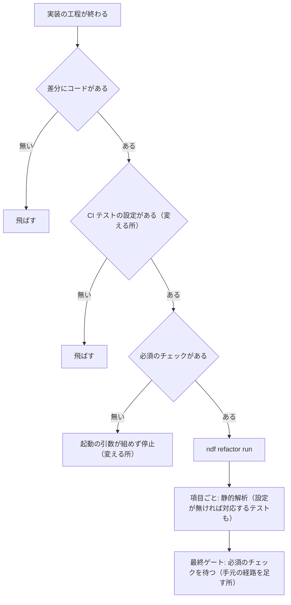
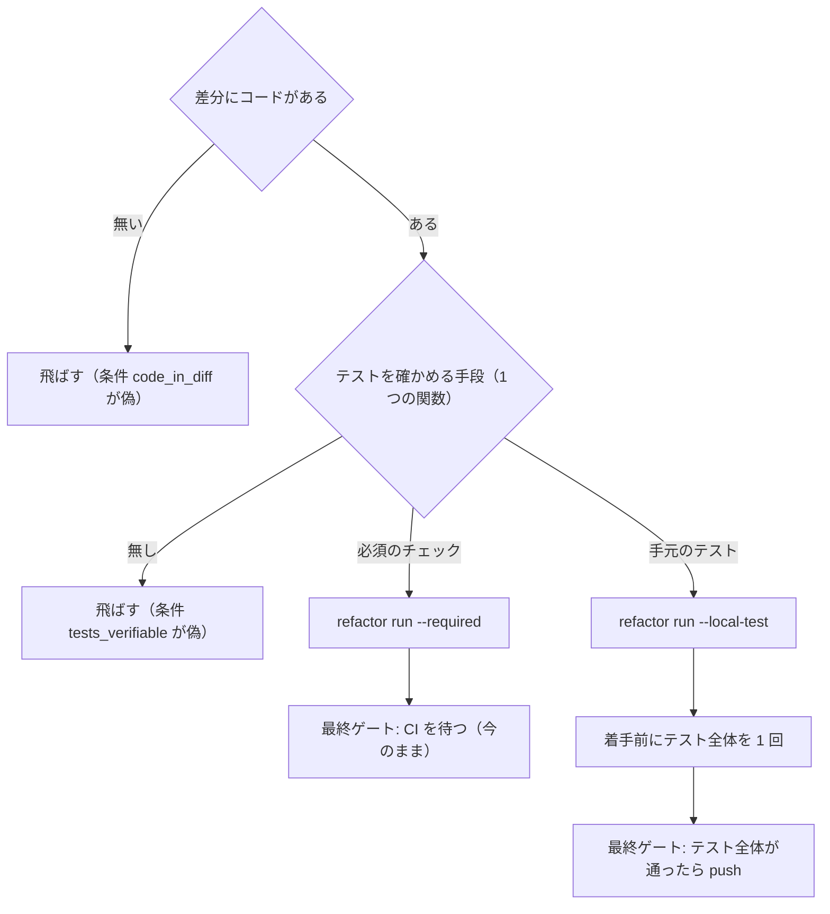
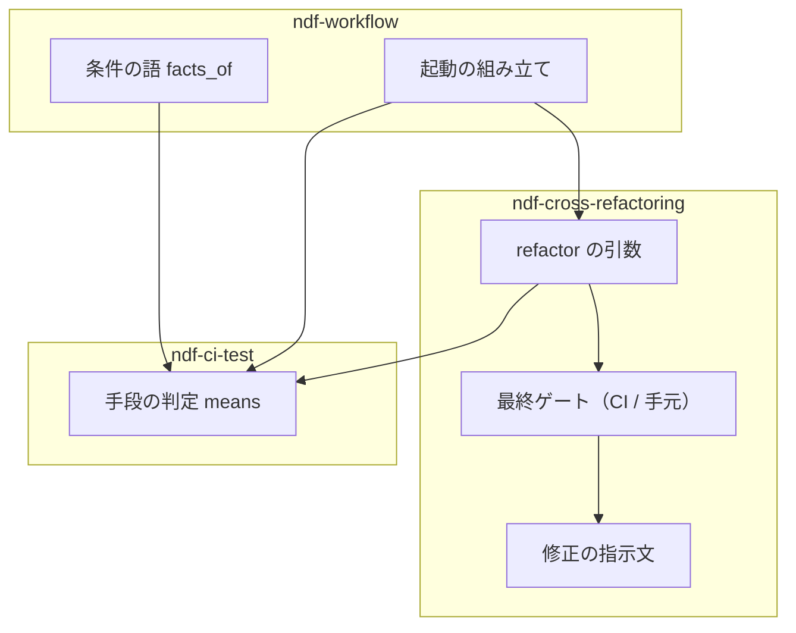
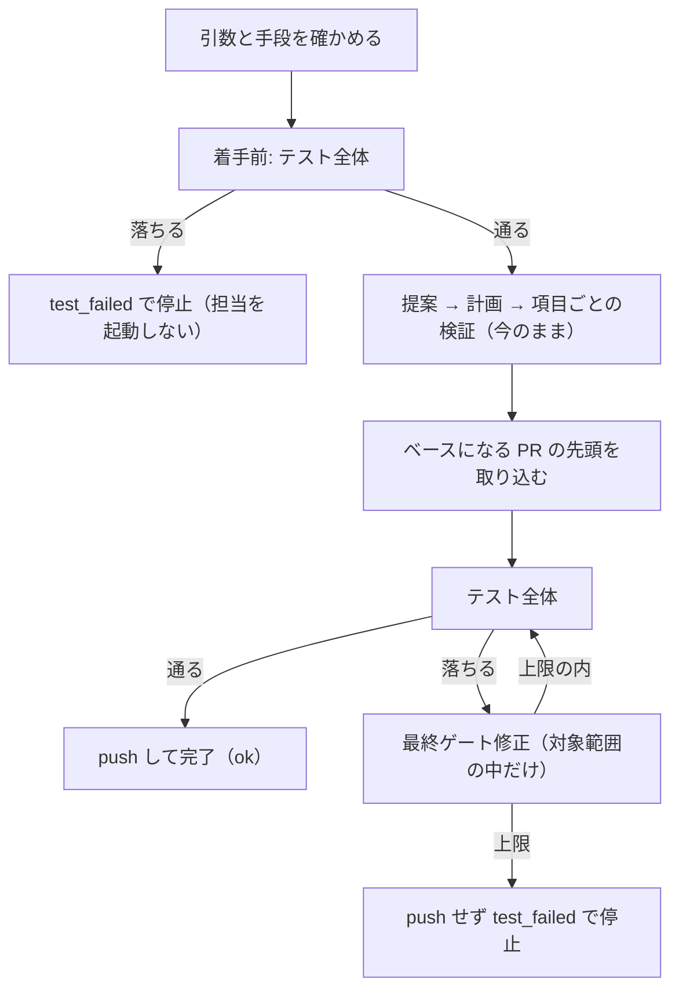

# 工程「リファクタリング」: CI テストの設定が無いリポジトリでも通せるようにする（#4566）

工程「リファクタリング」は、CI テストの設定があるリポジトリでしか実行されない。実行の条件を「テストを確かめる手段があるか」に置き換え、あわせて `ndf refactor run` に経路を足し、必須のチェックが無いリポジトリでは手元のテストで合否を決める。手段がどちらも無ければ、コードを変えずに理由を記録して飛ばす。採らなかった案は「決定の記録」、一次情報は末尾の「外部の調査」にある。

## 今の姿

何が起きたか・目的・受け入れ条件は要求仕様（[issue-4566-requirements.md](./issue-4566-requirements.md)、正は #4566 の本文）にある。この文書は「どう解くか」と「なぜその解き方か」だけを書く。



今の構造のうち、設計に要るのは次の 4 点である。

| 部分 | 今の形 |
| --- | --- |
| 実行の条件 | 工程の定義（`contracts/workflow/stages/refactor.json`）の `when` が `code_in_diff` と `ci_declared`。語の値は `ndf.progress.command.facts_of` が求める |
| 起動の組み立て | `ndf.progress.refactor_values` が、設定 `ci.required_checks` が空なら起動を組まない |
| 項目ごとの検証 | `domains/crossrefactor/verify.py`。CI テストの設定が無いリポジトリでは、今のコードのままで対応するテストを手元で打つ |
| 最終ゲート | `domains/crossrefactor/final_gate.py`。必須のチェックを待つ経路だけを持つ。`ndf refactor run` は `--required` を 1 つ以上求める |

必須のチェックの読み方（`ndf.adapters.ci.read`）は、必須の名前が 0 件だと「通った」を返す。今は `--required` が 1 件以上を求めるので起きないが、引数を緩めるだけの直し方では、何も確かめずに合格になる。

## 文脈と制約

- 手元で打つ確かめは、今ある部品を使う。テストのスロットを使ってコマンドを起動する関数（`ndf.testing.slots.run_command`）と、対象範囲の外を直したら元に戻す検査である
- 工程の定義は、スプリントを作る時点でステートマシンにコピーされる。更新の前に作ったスプリントは、古い条件の語（`ci_declared`）を持ち続ける（要求の前提 1、対象範囲の「含まない」）
- 工程を無効・有効にする設定は今ある `.ndf/project.json` の `workflow.stages` を使い、新しい設定は足さない
- 必須のチェックがあるリポジトリでは、工程が手元でテスト全体を打たない（非機能の条件）
- 利用先のリポジトリの CI・必須のチェックは用意しない

## 解き方の全体像



- 工程の実行の条件は「差分にコードがある」と「テストを確かめる手段がある」の 2 つになる。CI テストの設定の有無だけでは決まらない
- 手段は「必須のチェック」「手元のテスト」「無し」の 3 通りで、条件の判定と起動の組み立てが同じ関数で決める
- 手元の経路では、テスト全体が通らないコミットは PR に送られない
- 止めたいリポジトリは、今ある `workflow.stages` の設定で無効にする。書き方は工程の表に載る

## ドメインモデル

### コンテキスト

| コンテキスト | 何の語が 1 つの意味に決まるか |
| --- | --- |
| NDF の CI とテスト（`ndf-ci-test`） | テストを確かめる手段・必須のチェック・CI テストの設定 |
| NDF の開発ワークフロー（`ndf-workflow`） | 工程の実行の条件と、工程の有効・無効 |
| NDF の cross-refactoring（`ndf-cross-refactoring`） | 項目の検証と最終ゲート |

関係は顧客 / 供給者である。CI とテストが「どの手段で確かめるか」を供給する。受けるのは、開発ワークフロー（工程を実行するか）と cross-refactoring（どの最終ゲートを回すか）である。

### 集約

| 集約 | オーナー（書き換えてよいもの） | 根 | エンティティ | 値オブジェクト |
| --- | --- | --- | --- | --- |
| スプリントの進行 | `ndf progress` | ステートマシン | 工程の行 | 工程の定義のコピー・行を飛ばした理由 |
| リファクタリングの実行 | `ndf refactor run` | 状態ファイル | 改善項目 | テストを確かめる手段・着手前のテストの記録・最終ゲートの記録 |

テストを確かめる手段は、設定（`.ndf/project.json`）から毎回求める値で、保存しない。

### 不変条件

| # | 集約 | 条件 | 破れたときの扱い |
| --- | --- | --- | --- |
| I1 | スプリントの進行 | 工程の条件と起動の組み立ては、テストを確かめる手段を同じ関数で決める | 条件が真なのに起動が組めない状態を作らない |
| I2 | リファクタリングの実行 | テストを確かめる手段が無いときは、担当の起動・コードの変更・最終ゲートの合格のどれも行わない | 提案の前に停止の結果を返す |
| I3 | リファクタリングの実行 | 手元の経路では、テスト全体が通っていないコミットを PR に送らない | 直しの上限まで直し、通らなければ送らずに `test_failed` で止める |
| I4 | リファクタリングの実行 | 必須のチェックがあるリポジトリでは、テスト全体を手元で打たない | 手元の経路の指定を断る |
| I5 | リファクタリングの実行 | CI テストの設定があるリポジトリでは、テストを手元で打たない | 手元の経路の指定を断る |

### ドメインイベント

| # | イベント | 発生元 | 受け手 |
| --- | --- | --- | --- |
| E1 | スプリントを作り、工程の有効・無効を決めた | `ndf progress` | 工程の判定 |
| E2 | 工程「リファクタリング」を実行するか判定した | `ndf progress` | 起動の組み立て、進捗記録 |
| E3 | テストを確かめる手段を決めた | 手段を決める関数 | 工程の条件、起動の組み立て、`ndf refactor run` |
| E4 | リファクタリングの結果のテストの合否を確かめた | 最終ゲート | `ndf refactor run` の結果 |
| E5 | 工程を終えて次の工程へ進んだ | `ndf progress` | 次の工程 |

## 構成要素

| 要素 | 責務 |
| --- | --- |
| テストを確かめる手段の判定（新設 `ndf.testing.means`） | 設定の中身から「必須のチェック」「手元のテスト」「無し」を決め、手元で打つテスト全体のコマンドを返す。ファイルもプロセスも触らない |
| 工程の定義と条件の語 | `ci_declared` を `tests_verifiable` へ置き換える。`tests_verifiable` の値は上の判定が「無し」でないこと |
| 起動の組み立て（`refactor_values`・`route.refactor_launch`） | 手段が必須のチェックなら `--required`、手元のテストなら `--local-test` を付けた起動を組む |
| `ndf refactor` の引数（`cli.py`） | `--required` と `--local-test` のどちらか 1 つを求め、設定の手段と食い違う指定を断る |
| 手元の最終ゲート（`final_gate.py`・`drive.py`） | 着手前と終わりにテスト全体を打ち、通ったときだけ push する |
| 最終ゲート修正の指示文（`prompt_decide.py`） | 「CI で落ちた」と「手元で落ちた」を書き分ける |
| 手順書と確定仕様 | 新しい実行の条件と、工程を止める設定の書き方を載せる |



手順書と確定仕様はコードの呼び出し関係を持たないため、図に含めない。

## 入出力のコントラクト

### 工程の実行の条件

| 項目 | 今 | 変えた後 |
| --- | --- | --- |
| `refactor.json` の `when` | `code_in_diff`・`ci_declared` | `code_in_diff`・`tests_verifiable` |
| 条件の語の一覧（`ndf.schema.json`） | `ci_declared` を持つ | `tests_verifiable` を足す。`ci_declared` は残す（決定 7） |
| 飛ばした記録 | `条件 ci_declared が偽` | `条件 tests_verifiable が偽` |

### テストを確かめる手段

上の行から順に当てる。

| 必須のチェック（`ci.required_checks`） | CI テストの設定（`test.ci.only`） | 手元で打てるテスト（`test.suites` の `kind` が `test` で `command` を持つ） | 手段 |
| --- | --- | --- | --- |
| 1 件以上 | 問わない | 問わない | 必須のチェック |
| 0 件 | 真 | 問わない | 無し |
| 0 件 | 偽か無し | 1 件以上 | 手元のテスト |
| 0 件 | 偽か無し | 0 件 | 無し |

### `ndf refactor run`

| 項目 | 内容 |
| --- | --- |
| 入力 | `--required <チェック>...` と `--local-test`（値を持たない）のどちらか 1 つが必須。ほかの引数は今のまま |
| 手元のテストのコマンド | 呼び手は渡さない。`--work` のリポジトリの設定から読む |
| 出力 | 今の結果 JSON のまま。最終ゲートの記録に、手段（手元かどうか）が載る |
| 失敗の形 | 両方・どちらも無し、`--local-test` と `--ci-test` の併用、手段が手元のテストでないのに `--local-test` → `invalid`（担当を起動しない）。着手前のテスト全体が落ちる → `test_failed`。終わりのテスト全体が直しの上限でも落ちる → `test_failed`。対象範囲の外の直し → `refused`。ベースとの取り込みの衝突 → `base_conflict`。push の拒否 → `push_rejected` |
| 互換性 | `--required` を渡す今の呼び方はそのまま。状態ファイルの引数の記録は、`--required` の起動では今と同じ並びを保つ |
| 検査の手段 | コントラクトは `python3 scripts/check-ndf-contracts.py` で検査する。コマンドの一覧（`plugins/ndf/docs/contracts/commands.md`）は作り直す |

### 利用者が工程を止める設定

形は今のまま（`.ndf/project.json`）。工程の表に載せるのはこの例と、`reason` が必須であること・新しく作るスプリントから効くことである。

```json
{"workflow": {"stages": {"リファクタリング": {"enabled": false, "reason": "手元のテストが重い"}}}}
```

## 処理の流れ

手元の経路の `ndf refactor run` は次の順に進む。必須のチェックの経路は今のままである。



- 取り込んだ後のコミットが着手前に通したコミットと同じ（項目が 1 件も残らず、先頭も動いていない）なら、テスト全体を打ち直さない
- テスト全体は、設定のテストの suite の `command` を設定の順にすべて打つ。1 つでも落ちるか時間の上限を超えれば不合格である
- 時間の上限は、テスト 1 回の上限の方針（`test-run.test`）を使う。設定に実測の所要（`test_duration.measured`）があれば、上限を伸ばす

## 非機能の実現方式

| 大項目 | 要求の条件 | 実現方式 | 確かめ方 |
| --- | --- | --- | --- |
| 性能・拡張性 | 必須のチェックがあるリポジトリでは、工程が手元でテスト全体を打たない | 手段の判定が必須のチェックを最優先にし、`--local-test` は手段が手元のテストのときだけ受ける | 必須のチェックを持つ設定で `--local-test` が断られるテスト |
| 運用・保守性 | 飛ばした理由（設定で無効・差分が文書だけ・確かめる手段が無い）を進捗記録から区別できる | 順に、設定の `reason`・`条件 code_in_diff が偽`・`条件 tests_verifiable が偽` が行に残る。新しい記録の形は足さない | 3 つの場面で行の理由が異なるテスト |

## 決定の記録

### 決定 1: 手段の無いスプリントを記録つきで飛ばすため、実行の条件の語を「テストを確かめる手段がある」に置き換える

- **質問**: CI テストの設定の条件を外した後、手段の無いリポジトリをどこで飛ばすか
- **選んだ案**: 工程の条件の語 `ci_declared` を `tests_verifiable` に置き換える。偽なら今の仕組みが行を飛ばし、理由を記録する
- 採らなかった案: 条件を外すだけにする（必須のチェックが無いリポジトリで起動が組めず、工程が停止する）
- 採らなかった案: `ndf refactor run` の中で手段を調べて何もせず終える（工程が「完了」と記録され、飛ばしたことと区別できない。Pull Request の番号と差分を読む起動もむだになる）
- **代償**: 条件の語が 1 つ増え、古い語も残る（決定 7）
- 根拠: Value 3 / Value 13（MVV バージョン 11）

### 決定 2: 何も確かめずに合格させないため、CI テストの設定があり必須のチェックが無いリポジトリは飛ばす

- **質問**: 要求の未決 1。CI テストの設定があり必須のチェックが無いリポジトリで、何を見て合否を決めるか
- **選んだ案**: 手段「無し」とし、理由を記録して飛ばす。工程を通したい利用者は `ci.required_checks` を設定する
- 採らなかった案: PR に付いたすべてのチェックを待つ（どれがテストかが分からない。チェックが現れないと、何も確かめずに通る形になる。GitHub のブランチの保護の仕様（PRD1）のとおり、必須でないチェックはマージを止めないので、テストを含む保証が無い）
- 採らなかった案: テストのチェックの名前の設定（`test.ci.check`）を必須のチェックの代わりに使う（要求の前提 2 の手段は 2 つで、3 つ目が増える。最終ゲートが待つ名前の出所も 2 つになる）
- 採らなかった案: 停止して利用者へ返す（受け入れ条件 6 に反し、利用者が頼んでいない工程でスプリントが止まる）
- **代償**: このリポジトリの種類では、必須のチェックを設定するまで整理が行われない
- 根拠: Value 13 / Value 4（MVV バージョン 11）。PRD1

### 決定 3: 黙って確かめ方が変わらないようにするため、手元の経路は `--local-test` で明示する

- **質問**: `ndf refactor run` に、必須のチェックが無い呼び方をどう足すか
- **選んだ案**: `--required` と `--local-test` のどちらか 1 つを必須にする。`--local-test` は、設定の手段が手元のテストのときだけ受ける
- 採らなかった案: `--required` を省けるだけにする（指定の漏れが手元の経路になる。必須の名前が 0 件の CI の読み取りは「通った」を返すので、分岐を 1 か所誤ると何も確かめずに合格する）
- 採らなかった案: 手元のテストのコマンドを引数で渡す（起動の組み立てと設定で同じ事実を 2 か所に持つ）
- **代償**: 手で打つ利用者は、必須のチェックが無ければ `--local-test` を足す必要がある
- 根拠: Value 3 / Value 8（MVV バージョン 11）

### 決定 4: CI の代わりになる合否を出すため、手元の経路の最終ゲートはテスト全体を打つ

- **質問**: 要求の未決 2。必須のチェックが無いリポジトリで、手元の確かめにテスト全体を使うか、変更に対応するテストに絞るか
- **選んだ案**: 項目ごとは今のまま対応するテストを打ち、最終ゲートでは設定のテストの suite の `command` をすべて打つ
- 採らなかった案: 最終ゲートも対応するテストに絞る（対応を引けないソースや、離れた呼び出し元の壊れを見逃す。このリポジトリの種類には、後で拾う必須のチェックが無い）
- 採らなかった案: 項目ごとにテスト全体を打つ（項目の数だけ所要が掛かり、予算の中で採れる項目が減る）
- **代償**: テストの重いリポジトリでは、工程の所要とマシンの負荷が増える。困る利用者は工程を無効にする
- 作り方: 自前で作る
- 比べた候補: PRD1 / STD1
- 根拠: Value 13 / Value 2（MVV バージョン 11）

### 決定 5: 打てないテストに token を使わないため、提案の前にテスト全体を 1 回打つ

- **質問**: 着手前から落ちるテストや、環境が足りず打てないテストをどこで知るか
- **選んだ案**: 手元の経路では担当を起動する前にテスト全体を打ち、落ちれば `test_failed` で止める。理由の文に、着手前から落ちていることを書く
- 採らなかった案: 終わりにだけ打つ（提案と実装の費用を使った後で止まる。壊したのがリファクタリングかどうかも分からない）
- 採らなかった案: 落ちたら理由を残して飛ばし、完了にする（受け入れ条件 4 の「テストが落ちる状態では完了にしない」に反する）
- **代償**: テスト全体の所要が 1 回分増える。項目が残らなければ、終わりの打ち直しは省く
- 作り方: 自前で作る
- 比べた候補: PRD1 / STD1
- 根拠: Value 2 / Value 13（MVV バージョン 11）

### 決定 6: 落ちる変更を PR に入れないため、手元の経路は合格した後にだけ push する

- **質問**: 手元の最終ゲートで、push とテストのどちらを先にするか。直せないときに何を残すか
- **選んだ案**: PR の先頭を取り込む → テスト全体 → 合格なら push。落ちれば必須のチェックの経路と同じ上限と範囲の検査で直し、上限で送らずに `test_failed` で止める。コミットは作業場所に残る
- 採らなかった案: 必須のチェックの経路と同じく先に push する（待つ CI が無いのに送ると、落ちる変更が PR に残る）
- 採らなかった案: 着手前の状態へ戻して完了にする（直せなかった事実が結果に残らず、採った項目の記録と食い違う）
- **代償**: 取り込んだ後に PR の先頭が動くと push が拒まれ、打ち直しになる
- 作り方: 自前で作る
- 比べた候補: PRD1 / STD1
- 根拠: Value 13 / Value 7（MVV バージョン 11）

### 決定 7: 進行中のスプリントを止めないため、古い条件の語 `ci_declared` の値を求める手段は残す

- **質問**: 使わなくなる語を消すか
- **選んだ案**: 工程の定義からは外し、語の一覧と値を求める手段は残す。更新の前に作ったスプリントは今と同じ条件で流れる
- 採らなかった案: 語を消す（コピーした定義が語を持つスプリントが「条件を求める手段が無い」で停止する）
- 採らなかった案: 進行中のスプリントの定義を移行する（要求の対象範囲に含まず、1 工程の条件のために移行の仕組みが要る）
- **代償**: 新しい定義が使わない語が 1 つ残る
- 根拠: Value 3（MVV バージョン 11）

## 影響と危険

- **働く範囲**: NDF を使うすべてのリポジトリ。更新の後に作る `standard`・`legacy-refactor` のスプリントに効く
- **プロジェクトごとに違うもの**: 次の設定で受ける。どれも今ある設定である。`ci.required_checks`・`test.ci.only`・`test.suites`・`workflow.stages`
- **当たるモード**: `standard`・`legacy-refactor`。`light`・`operation`・`documentation` は工程を持たない

壊れうる箇所と扱いは次のとおりである。

| 壊れうる箇所 | 扱い |
| --- | --- |
| 必須のチェックはあるがテストを含まないリポジトリ（lint だけが必須など） | 手段は必須のチェックになる。CI テストの設定が無ければ項目ごとの対応するテストは手元で打つが、最終ゲートはテストを確かめない。要求の前提 2 のとおりとする |
| 起動の設定（`workflow.launch.refactor`）に必須のチェックの名前を直に書き、`ci.required_checks` が空のリポジトリ | 手段「無し」になり飛ぶ。`ci.required_checks` を設定するか、工程を有効にする |
| 工程を設定で有効にし、手段が無いリポジトリ | 今と同じく定義の条件を見ずに始め、起動が組めず `precondition` で止まる（受け入れ条件 8） |
| 手元のテストが外のサービスを要る、または時間の上限を超える | 着手前の 1 回で `test_failed` になる。失敗した工程の行は `ndf progress disable` で外せる。以後のスプリントは `workflow.stages` で無効にする |
| 工程「実装」など、ほかの工程のプラン | プランの差し込み値 `required` に `ci.required_checks` の値が必要で、必須のチェックが無いとプランを組めない（下の「未確認のまま残ること」） |
| `development-workflow` の `SKILL.md` は 499 行で、文書の行数の上限が近い | 工程の表の「リファクタリング」の行の中を書き換え、行を増やさない |
| 検査のプランの説明 | 工程の表の「設定の無いリポジトリの検査のプランは `assess`・`refactor` を持たない」は、テンプレート `check.json` の形と合わないので消す。テンプレートは変えない |

### 代表のリポジトリでの振る舞い

| 代表のリポジトリ | 設定の要点 | 直した後に起きること | この種類で扱えなくなること |
| --- | --- | --- | --- |
| Web サービス | 必須のチェックがある。CI テストの設定は有ることも無いこともある | 工程が実行され、最終ゲートは CI を待つ。設定が無ければ項目ごとの対応するテストを手元で打つ | 無し |
| モバイルアプリ | 必須のチェックが無く、手元のテストが重いか実機を要ることがある | 手元のテストがあれば着手前と終わりに打つ。打てなければ停止し、`workflow.stages` で無効にできる | 無し |
| 業務文書だけ | テストの設定が無い | 差分が文書だけなので、今と同じく飛ぶ | 無し |

### このリポジトリだけの事情

| 値 | 置く所 | 持つ Issue |
| --- | --- | --- |
| テストを CI でだけ走らせる（`test.ci.only: true`）と必須のチェック | `.ndf/project.json`。このリポジトリの振る舞いは変わらない | #3056 |

## 用語

| 用語 | 意味 | 用語集への反映 |
| --- | --- | --- |
| テストを確かめる手段 | 工程「リファクタリング」が変更の後のテストの合否を確かめる先。必須のチェックか、手元で打てるテストの設定のどちらか。どちらも無ければ工程を飛ばす | 追加（`ndf-ci-test`） |

## テスト設計

| 受け入れ条件・不変条件 | どの振る舞いで縛るか | どう壊したら落ちるべきか |
| --- | --- | --- |
| 条件 1・2 | CI テストの設定が無い・`false` で、必須のチェックがあれば、`standard` と `legacy-refactor` の工程が飛ばされず、`--required` の起動が組まれる | 条件の語へ CI テストの設定の有無を戻すと落ちる |
| 条件 3 | CI テストの設定と必須のチェックがあれば、今と同じ起動が組まれ、テストの suite を手元で打たない | 手段の判定が手元のテストを優先すると落ちる |
| 条件 4 | 必須のチェックが無く手元のテストがあれば `--local-test` の起動が組まれ、テストが通れば push して `ok`、落ちれば `ok` にならず PR に送らない | テストの合否を見ずに push する、または必須の名前 0 件で CI の経路へ入ると落ちる |
| 条件 5 | 手段がどちらも無ければ行が飛ばされ、理由が記録され、次の工程へ進む | 条件を真にすると落ちる |
| 条件 6 | CI テストの設定があり必須のチェックが無ければ、行が飛ばされる。`--local-test` は断られる | 手元のテストの有無だけで手段を決めると落ちる |
| 条件 7・8 | 設定で無効にすれば理由が行に残り、有効にすれば定義の条件を見ずに始まる | 条件を設定より先に見ると落ちる |
| 条件 9・10 | 文書だけの差分は飛び、`light`・`operation`・`documentation` の定義に工程が無い | 語の順を入れ替えて理由が変わる、またはモードの定義に行を足すと落ちる |
| 条件 11・12 | 手順書と確定仕様を読んで確かめる（`.md` の文言のテストは書かない） | — |
| I1 | 設定の 4 つの場面すべてで、条件の値が真のときは起動が組まれる | 条件と起動のどちらか一方の判定を変えると落ちる |
| I2 | 手段の無い設定で `ndf refactor run` を打つと、担当を起動せずに停止の結果を返す | 引数の検査を外すと落ちる |
| I3 | 終わりのテストが直しの上限でも落ちれば、リモートの先頭が着手前のまま `test_failed` になる | 直しの前に push すると落ちる |
| I4・I5 | 必須のチェックか CI テストの設定がある設定で `--local-test` を打つと `invalid` になる | 設定との突き合わせを外すと落ちる |
| 決定 5 | 着手前のテストが落ちれば、担当を起動せずに `test_failed` になる | 提案を先に流すと落ちる |
| 決定 6 | 最終ゲート修正が対象範囲の外を変えれば、戻して `refused` になり、送らない | 範囲の検査を手元の経路で省くと落ちる |
| 決定 7 | `ci_declared` を持つ古い定義の行が、停止せずに今と同じ判定になる | 語の値を求める手段を消すと落ちる |

詳細設計は、別のファイル `issues/issue-4566-design-detail.md` に書く。新設する関数が 2 つ以上あり、既存の関数のシグネチャも変えるためである。

## 設計の結果

| 課題 | 扱い | 統合先 | 触るファイル |
| --- | --- | --- | --- |
| #4566 | 実装する | — | `plugins/ndf/src/ndf/testing/means.py`（新設）、`plugins/ndf/contracts/workflow/stages/refactor.json`、`plugins/ndf/contracts/workflow/ndf.schema.json`、`plugins/ndf/contracts/limits/test-run.test.json`、`plugins/ndf/src/ndf/progress/command.py`、`plugins/ndf/src/ndf/progress/refactor_values.py`、`plugins/ndf/src/ndf/progress/invoke.py`、`plugins/ndf/src/ndf/core/route/__init__.py`、`plugins/ndf/src/ndf/domains/crossrefactor/cli.py`、`plugins/ndf/src/ndf/domains/crossrefactor/drive.py`、`plugins/ndf/src/ndf/domains/crossrefactor/final_gate.py`、`plugins/ndf/src/ndf/domains/crossrefactor/prompt_decide.py`、`plugins/ndf/docs/contracts/commands.md`、`plugins/ndf/tests/testing/test_means.py`（新設）、`plugins/ndf/tests/progress/test_model.py`、`plugins/ndf/tests/progress/test_run.py`、`plugins/ndf/tests/progress/test_invoke_refactor.py`、`plugins/ndf/tests/domains/crossrefactor/test_drive.py`、`plugins/ndf/tests/domains/crossrefactor/test_refactor_cli.py`、`plugins/ndf/skills/development-workflow/SKILL.md`、`plugins/ndf/skills/cross-refactoring/SKILL.md`、`docs/specifications/ndf-ci-only-tests.md`、`docs/specifications/ndf-review-units-and-refactoring-timing.md`、`docs/specifications/ndf-stage-plan-work-prompts.md`、`docs/glossary/glossary.json`、`docs/glossary.md`、`docs/glossary/ndf-ci-test.md` |

## 未確認のまま残ること

| 項目 | 内容 |
| --- | --- |
| 必須のチェックが無いリポジトリで、スプリントが工程「リファクタリング」まで進むか | 工程「実装」のプランのテンプレート（`impl.json`）は差し込み `required` を要る。必須のチェックを持たない一時リポジトリの設定で組むと「差し込みの値が無い: required」になった（2026-11-27）。この設計は工程「リファクタリング」だけを直す。受け入れ条件 4・5 は工程の単位のテストで確かめ、通しの実行は未確認である |
| CI テストの設定が無い利用先での実行 | 項目ごとの手元の検証と手元の最終ゲートを、実機のリポジトリで通していない。リリースの後の確認の計画（次のスプリント）で分かる |
| 手元のテスト全体の時間の上限が足りるか | 実測の所要（`test_duration.measured`）が無いリポジトリでは、方針の下限（900 秒）になる。超える利用先の有無は、使われるまで分からない |

## 外部の調査

| 種類 | 調べるか | 理由 |
| --- | --- | --- |
| 標準・仕様 | 調べる | リファクタリングの定義が、確かめの要否を決める |
| 主要な製品 | 調べる | 必須のチェックの意味が、チェックの無いリポジトリの扱いを決める |
| ライブラリとサービス | 調べない | 手元のテストの起動は、今ある部品（テストのスロットと起動）を使い、新しい依存を足さない |

### 標準・仕様

| # | 標準・仕様 | 何を定めているか | 設計への反映 | 出典 |
| --- | --- | --- | --- | --- |
| STD1 | Martin Fowler「Definition of Refactoring」（事実上の定義） | リファクタリングは、外から見た振る舞いを変えない構造の変更である | 振る舞いが変わらないことを確かめる手段が無ければ変えない（決定 1・4・5） | <https://martinfowler.com/bliki/DefinitionOfRefactoring.html> （2026-11-27） |

### 主要な製品

| # | 製品 | どう解いているか | 設計への反映 | 出典 |
| --- | --- | --- | --- | --- |
| PRD1 | GitHub のブランチの保護（必須のチェック） | 必須のチェックは `successful`・`skipped`・`neutral` にならないとマージできない。必須のチェックを有効にしていないブランチには、チェックによるマージの制限が無い | 合否を任せてよいのは、利用者が必須と定めたチェックだけとする（決定 2） | <https://docs.github.com/en/repositories/configuring-branches-and-merges-in-your-repository/managing-protected-branches/about-protected-branches> （2026-11-27） |

### 確かめられなかったこと

| 対象 | 試した手段 | 結果と理由 |
| --- | --- | --- |
| 他の AI 開発ツールが、CI の無いリポジトリで変更の合否をどう決めるか | 試していない | この設計は、要求が定めた 2 つの手段の範囲で決めた |

調べた量: 候補 2 件・取得の試み 3 回。
