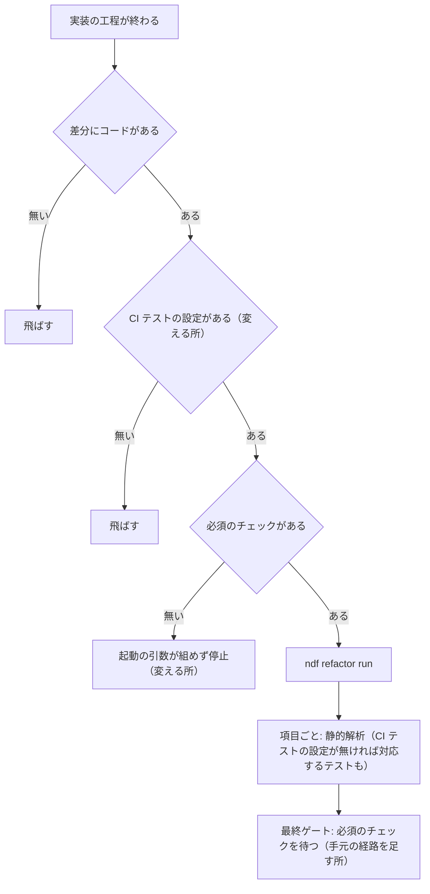
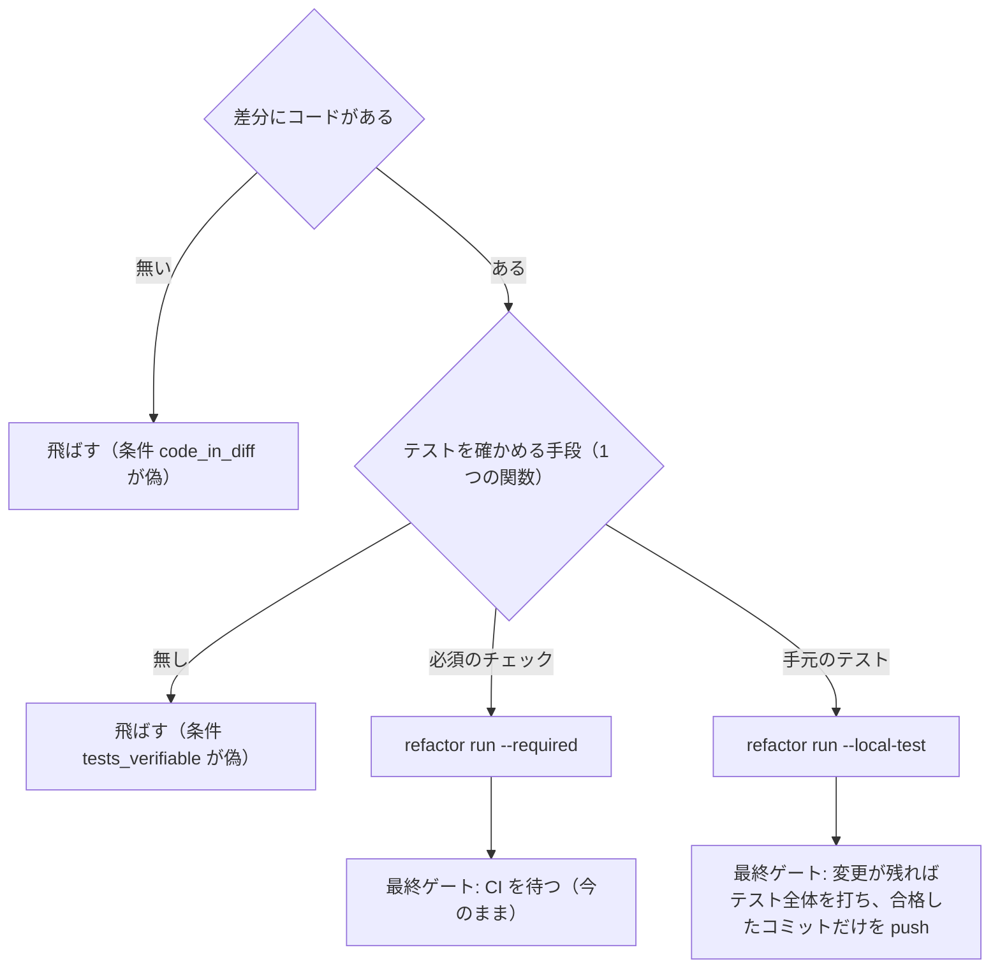
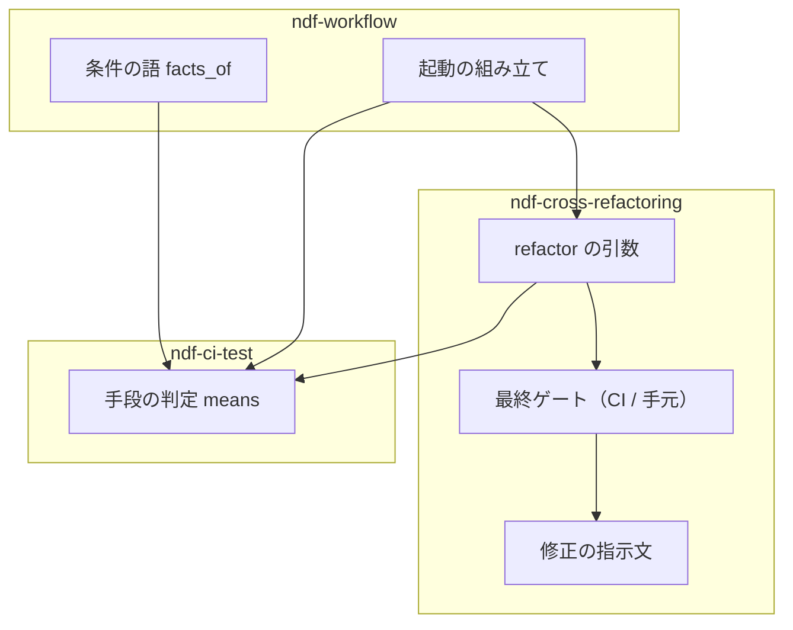

# 工程「リファクタリング」: CI テストの設定が無いリポジトリでも通せるようにする（#4566）

工程「リファクタリング」は、CI テストの設定があるリポジトリでしか実行されない。実行の条件を「テストを確かめる手段があるか」に置き換え、あわせて `ndf refactor run` に経路を足し、必須のチェックが無いリポジトリでは手元のテストで合否を決める。手段がどちらも無ければ、コードを変えずに理由を記録して飛ばす。採らなかった案は「決定の記録」、一次情報は末尾の「外部の調査」にある。

「テストを確かめる手段」とは、工程が変更の後のテストの合否を確かめる先である。必須のチェックがある場合は、指定されたチェックの通過を CI で確認する（テストの合否まで分かるのは、そのチェックにテストが含まれる場合）。無ければ、CI テストの設定が無効で、実行コマンドを持つテストの suite（`test.suites` のうち `kind` が `lint` でないもの。`kind` を省けば `test`）がある場合に手元で確かめる。この文書では次の語も使う。

| 語 | 意味 |
| --- | --- |
| 条件の語 | 工程の定義の `when` に並べる、実行条件の名前（`code_in_diff` など） |
| 担当 | `ndf refactor run` が起動して、改善の提案・実装・修正をさせる AI |
| 対象範囲 | `--scope` で渡す、この実行で直してよいファイル |
| 最終ゲート | 全項目の後に、テストの合否を確かめて終える段階 |
| 最終ゲート修正 | 最終ゲートでテストが落ちたときに担当が直すこと |
| テストのスロット | 重いテストを同じマシンで並べて動かしすぎないための実行枠 |
| 検証用の作業場所 | テスト全体を打つためだけに、NDF が対象のコミットから新しく作る git の worktree |
| 取り込んだ先頭 | リモートから取得した、PR のブランチ（`--branch`）の最新のコミット。この実行のコミットを含まない |
| 送る | 合格したコミットを PR のブランチへ push すること。AI やサービスへ内容を渡すことは「外部へ送る」と書く |

## 今の姿

何が起きたか・目的・受け入れ条件は要求仕様（[issue-4566-requirements.md](./issue-4566-requirements.md)、正は #4566 の本文）にある。この文書は「どう解くか」と「なぜその解き方か」だけを書く。



今の構造のうち、設計に要るのは次の 4 点である。

| 部分 | 今の形 |
| --- | --- |
| 実行の条件 | 工程の定義（`contracts/workflow/stages/refactor.json`）の `when` が `code_in_diff` と `ci_declared`。語の値は `ndf.progress.command.facts_of` が求める |
| 起動の組み立て | `ndf.progress.refactor_values` が、設定 `ci.required_checks` が空なら起動を組まない |
| 項目ごとの検証 | `domains/crossrefactor/verify.py`。CI テストの設定が無いリポジトリでは、今の NDF のままでも（この設計で手を入れなくても）、改善の項目ごとに対応するテストを手元で打っている |
| 最終ゲート | `domains/crossrefactor/final_gate.py`。必須のチェックを待つ経路だけを持つ。`ndf refactor run` は `--required` を 1 つ以上求める |

必須のチェックの読み方（`ndf.adapters.ci.read`）は、必須の名前が 0 件だと「通った」を返す。今は `--required` が 1 件以上を求めるので起きないが、引数を緩めるだけの直し方では、何も確かめずに合格になる。

## 文脈と制約

- 手元で打つ確かめは、今ある部品を使う。テストのスロットの下でコマンドを起動する関数（`ndf.testing.slots.run_command`）と、対象範囲の外を直したら元に戻す検査である
- 工程の定義は、スプリントを作る時点でステートマシンにコピーされる。更新の前に作ったスプリントは、古い条件の語（`ci_declared`）を持ち続ける（要求の前提 1、対象範囲の「含まない」）
- 工程を無効・有効にする設定は今ある `.ndf/project.json` の `workflow.stages` を使い、新しい設定は足さない
- 必須のチェックがあるリポジトリでは、工程が手元でテスト全体を打たない（非機能の条件）
- 利用先のリポジトリの CI・必須のチェックは用意しない

## 解き方の全体像



- 工程の実行の条件は「差分にコードがある」と「テストを確かめる手段がある」の 2 つになる。CI テストの設定の有無だけでは決まらない
- 手段は「必須のチェック」「手元のテスト」「無し」の 3 通りで、条件の判定と起動の組み立てが同じ関数で決める
- 手元の経路では、テスト全体が通らないコミットは PR に送られない。テストの合否の決め方を書くファイル（`.ndf/`、`package.json`、`Makefile` など）は、この実行では変えない
- 必須のチェックの経路が確かめるのは、必須のチェックが通ったことまでである。そのチェックがテストを含むかは NDF には分からないので、結果にはチェックの名前を載せ、「テストに合格した」とは書かない
- 止めたいリポジトリは、今ある `workflow.stages` の設定で無効にする。書き方は工程の表に載る

## ドメインモデル

### コンテキスト

| コンテキスト | 何の語が 1 つの意味に決まるか |
| --- | --- |
| NDF の CI とテスト（`ndf-ci-test`） | テストを確かめる手段・必須のチェック・CI テストの設定 |
| NDF の開発ワークフロー（`ndf-workflow`） | 工程の実行の条件と、工程の有効・無効 |
| NDF の cross-refactoring（`ndf-cross-refactoring`） | 項目の検証と最終ゲート |

関係は顧客 / 供給者である。CI とテストが「どの手段で確かめるか」を供給する。受けるのは、開発ワークフロー（工程を実行するか）と cross-refactoring（どの最終ゲートを回すか）である。

### 集約

| 集約 | オーナー（書き換えてよいもの） | 根 | エンティティ | 値オブジェクト |
| --- | --- | --- | --- | --- |
| スプリントの進行 | `ndf progress` | ステートマシン | 工程の行 | 工程の定義のコピー・行を飛ばした理由 |
| リファクタリングの実行 | `ndf refactor run` | 状態ファイル | 改善項目 | テストを確かめる手段・テスト全体の合格の記録・最終ゲートの記録 |

テストを確かめる手段は、設定（`.ndf/project.json`）から毎回求める値で、保存しない。

### 不変条件

| # | 集約 | 条件 | 破れたときの扱い |
| --- | --- | --- | --- |
| I1 | スプリントの進行 | 工程の条件と起動の組み立ては、テストを確かめる手段を同じ関数で決める | 既定の判定では、手段が無ければ理由を記録して飛ばす。設定で工程を有効にした場合は定義の条件を見ない（今の振る舞い）。起動の指定（`workflow.launch.refactor`）があればそれを打ち、指定も手段も無く起動を組めなければ `precondition` で停止する（「起動の指定と手段の優先順位」） |
| I2 | リファクタリングの実行 | 合否の確かめ先が決まらない実行（`--required` が無く、設定の手段が手元のテストでもない）では、担当の起動・コードの変更・最終ゲートの合格のどれも行わない | 提案の前に `invalid` を返す |
| I3 | リファクタリングの実行 | 手元の経路で PR に送るのは、テスト全体に合格したコミット（SHA）だけで、そのコミットまでにこの実行はテストの定義のファイルを変えていない。工程のプランも別の `HEAD` を送らない | 直しの上限まで直し、通らなければ送らずに `test_failed` で停止する。テストの定義のファイルを変えていれば、送らずに `refused` で停止する |
| I4 | リファクタリングの実行 | 設定に必須のチェックがあるリポジトリでは、テスト全体を手元で打たない | `--local-test` を断る |
| I5 | リファクタリングの実行 | CI テストの設定があるリポジトリでは、テストを手元で打たない | `--local-test` を断る。項目ごとの検証は、引数に関わらず実行のたびに設定を読み、静的解析の suite だけを打つ |

### ドメインイベント

| # | イベント | 発生元 | 受け手 |
| --- | --- | --- | --- |
| E1 | スプリントを作り、工程の有効・無効を決めた | `ndf progress` | 工程の判定 |
| E2 | 工程「リファクタリング」を実行するか判定した | `ndf progress` | 起動の組み立て、進捗記録 |
| E3 | テストを確かめる手段を決めた | 手段を決める関数 | 工程の条件、起動の組み立て、`ndf refactor run` |
| E4 | リファクタリングの結果のテストの合否を確かめた | 最終ゲート | `ndf refactor run` の結果 |
| E5 | 工程を終えて次の工程へ進んだ | `ndf progress` | 次の工程 |

## 構成要素

| 要素 | 責務 |
| --- | --- |
| テストを確かめる手段の判定（新設 `ndf.testing.means`） | 設定の中身から「必須のチェック」「手元のテスト」「無し」を決め、手元で打つテスト全体のコマンドと、テストの設定の識別値を返す。ファイルもプロセスも触らない |
| 工程の定義と条件の語 | `ci_declared` を `tests_verifiable` へ置き換える。`tests_verifiable` の値は上の判定が「無し」でないこと |
| 起動の組み立て（`refactor_values`・`route.refactor_launch`） | 手段が必須のチェックなら `--required`、手元のテストなら `--local-test` を付けた起動を組む |
| `ndf refactor` の引数（`cli.py`） | `--required` と `--local-test` のどちらか 1 つを求める。`--local-test` は、設定の手段が手元のテストのときだけ受ける |
| 手元の最終ゲート（`final_gate.py`・`drive.py`） | テストの定義のファイルを対象範囲から外す。検証用の作業場所でテスト全体を打ち、合格したコミットの SHA だけを push する |
| 工程のプランの組み立て（`ndf.core.route`・テンプレート） | 経路に合わせて、テンプレートの `follow` か、`push`・`fix-push` を外す |
| 最終ゲート修正の指示文（`prompt_decide.py`） | 「CI で落ちた」と「手元で落ちた」を書き分ける |
| 手順書と確定仕様 | 新しい実行の条件、工程を止める設定の書き方、`test.protected_files` と `test.local_total_minutes` を載せる |



手順書と確定仕様はコードの呼び出し関係を持たないため、図に含めない。

## 入出力のコントラクト

### 工程の実行の条件

| 項目 | 今 | 変えた後 |
| --- | --- | --- |
| `refactor.json` の `when` | `code_in_diff`・`ci_declared` | `code_in_diff`・`tests_verifiable` |
| 条件の語の一覧（`ndf.schema.json`） | `ci_declared` を持つ | `tests_verifiable` を足す。`ci_declared` は残す（決定 7） |
| 飛ばした記録 | `条件 ci_declared が偽` | `条件 tests_verifiable が偽` |

### テストを確かめる手段

上の行から順に当てる。この表は、工程の条件と、既定の起動の組み立てが使う。

| 必須のチェック（`ci.required_checks`） | CI テストの設定（`test.ci.only`） | 手元で打てるテスト（テストの suite で `command` を持つ） | 手段 |
| --- | --- | --- | --- |
| 1 件以上 | 問わない | 問わない | 必須のチェック |
| 0 件 | 真 | 問わない | 無し |
| 0 件 | 偽か無し | 1 件以上 | 手元のテスト |
| 0 件 | 偽か無し | 0 件 | 無し |

テストの suite かどうかは、既存の判定（`ndf.testing.weight.is_test_suite`）を使う。`kind` を省いた suite はテストに数える。手段の判定と、実行する suite の選び出しは同じ判定を通す。

手段が「必須のチェック」のとき、工程の完了の条件は「指定したチェックがすべて通る」である。チェックの名前から中身は分からないので、lint だけが必須のリポジトリでは、最終ゲートはテスト全体を確かめない。そのため最終ゲートの記録と結果の要約には通ったチェックの名前を載せ、「テストに合格した」とは書かない。テスト全体を最終ゲートで確かめたい利用者は、テストのチェックを `ci.required_checks` に含める。この条件は手順書にも載せる。

起動の指定と手段の優先順位は、次のとおりである。上の行から順に当てる。

| 工程の設定（`workflow.stages`） | 起動の指定（`workflow.launch.refactor`） | 手段 | 結果 |
| --- | --- | --- | --- |
| 無効 | 問わない | 問わない | 実行しない |
| 指定なし | 問わない | 無し | 飛ばす（指定があっても打たない） |
| 指定なしか有効 | あり | 問わない（上の行に当たらないもの） | 指定した起動を打つ。手段から組む起動より先に使う（今と同じ） |
| 指定なしか有効 | なし | 必須のチェックか手元のテスト | 手段から起動を組む |
| 有効 | なし | 無し | 起動が組めず `precondition` で停止する |

差分が文書だけのときに飛ばすかは、今と同じく、工程の設定が指定なしの場合に定義の条件が決める。

### `ndf refactor run`

| 項目 | 内容 |
| --- | --- |
| 入力 | `--required <チェック>...`（1 件以上）と `--local-test`（値を持たない）のどちらか 1 つが必須。手元の経路は `--pushed-out <ファイル>`（任意）で、呼び出し元の worktree を合わせる先の SHA（合格して送った SHA。送るコミットが無ければ取り込んだ先頭）を書き出す。書くのは、そのパスが無いか、前に書いた SHA 1 行だけのファイルのときに限る。シンボリックリンク・ディレクトリ・ほかの中身のファイルなら、書かずに `precondition` で停止する。結果を変えないので、引数の記録には入れない。ほかの引数は今のまま |
| 手元のテストのコマンド | 呼び手は渡さない。この実行のコミットを含まない側の PR の先頭の設定から読む（「合格をコミットに結び付ける条件」） |
| 出力 | 今の結果 JSON のまま。最終ゲートの記録に、手段（手元かどうか）が載る |
| 失敗の形 | 下の 2 つの表のとおり |
| 互換性 | `--required` を渡す今の呼び方は、設定の手段に関わらずそのまま使える |
| 検査の手段 | コントラクトは `python3 scripts/check-ndf-contracts.py` で検査する。コマンドの一覧（`plugins/ndf/docs/contracts/commands.md`）は作り直す |

引数と設定の手段の組み合わせは次のように扱う。待つチェックの名前は、常に引数から決まる。

| 設定の手段 | `--required <名前>...` | `--local-test` |
| --- | --- | --- |
| 必須のチェック | 受ける。引数で名前を指定したチェックの完了を待つ（設定の名前と違っていても引数が勝つ。今と同じ） | `invalid` |
| 手元のテスト | 受ける。引数で名前を指定したチェックの完了を待つ（今と同じ） | 受ける |
| 無し | 受ける。引数で名前を指定したチェックの完了を待つ（今と同じ） | `invalid` |

名前を指定した CI の確かめは、指定したチェックが現れなければ合格にしない（`missing`）。何も確かめずに合格することはない。

停止する場面と停止理由は次のとおりである。表の `--ci-test <名前...>` は、必須のチェックのうちテストを走らせるチェックの名前を渡す今の引数で、必須のチェックの経路だけが使う。

| 場面 | 停止理由 |
| --- | --- |
| `--required` と `--local-test` の両方・どちらも無し、`--local-test` と `--ci-test` の併用、上の表の `invalid` | `invalid`（担当を起動しない） |
| 終わりのテスト全体が直しの上限でも落ちる | `test_failed` |
| 変更後に落ちた suite が、すべて取り込んだ PR のブランチの先頭（この実行の変更を載せる前）でも落ちる | `test_failed`（最終ゲート修正をしない。両方の suite の並びを理由に載せる） |
| 1 回の起動の中で、テスト全体の実行の累計が上限に達する | `fix_limit` |
| この実行のコミットがテストの定義のファイル（`.ndf/` を含む）を変える | `refused`（push しない） |
| 同じ PR の別の `run` か `release` が動いている（CI の経路も同じ） | `precondition`（何も変えない） |
| 取り込んだ PR の先頭の設定では、手段が手元のテストでなくなる | `precondition`（push しない） |
| テストのコマンドが `--work` の配下を絶対パスで指す | `precondition`（push しない） |
| テストの suite のプロセスを起動できない、または取り込んだ先頭だけのテストが終了コード 126・127 を返す | `precondition`（直しの担当を起動せず、push しない） |
| テストが追跡ファイルを書き換えた、または HEAD を動かした | `precondition` |
| 手元の経路のプランで、呼び出し元の worktree の `HEAD` を検証済みの SHA にそろえられない | `precondition` |
| 手元の経路の起動で、まとめた検証のプラン（`check.json`）を組もうとする | `precondition`（プランを組まない） |
| `--pushed-out` の出力先がシンボリックリンク・ディレクトリ・SHA 1 行でない既存のファイル | `precondition`（そのファイルとリンク先を変えない） |
| 対象範囲の外の直し | `refused` |
| `--branch` のリモートの先頭を取り込むと衝突する | `base_conflict` |
| push の拒否（PR のブランチが進んでいない、または取り込み直す周が残っていない） | `push_rejected` |

工程が停止すると、工程の行は失敗として記録され、スプリントは次の工程へ進まない。利用者は原因を直して `ndf progress retry` で打ち直すか、`ndf progress disable` で工程を外して先へ進む。

CI の経路では、手元でテストを打つかどうかを引数ではなく設定（`test.ci.only`）で決める。手で起動して `--ci-test` を省いても、CI テストの設定があれば手元のテストは打たない。`--ci-test` は、落ちた CI のチェックがテストかを見分けるだけに使い、省くと直しに進まず停止する（今と同じ）。

### 状態ファイルに記録する引数

再開と、完了した結果の再利用は、状態ファイルに記録した引数の並びと今の引数の並びを比べて決める。

| 経路 | 記録する並び（この順） |
| --- | --- |
| CI（`--required`） | 今の形式のまま。起点、対象範囲、`--required` と名前、`--ci-test` と名前、`--symbols`、`--participants`、`--max-fix`、`--budget-minutes`、候補があれば `--candidates-sha256` |
| 手元（`--local-test`） | 起点、対象範囲、`--local-test`、`--symbols` 以降は CI の経路と同じ |

テストの設定は、引数の並びに入れない。テストの設定を直した利用者が、採った項目と作業コミットを残したまま続けられるようにするためである。設定が変わって無効になるのは、テストの合格の記録だけである。

テストの設定の識別値は、テストの suite の `name`・`command`・`scope_command`・`paths` を設定の順に並べた SHA-256 である。合格の記録（合格した SHA、識別値、`PATH` の値の SHA-256 の組。「落ちた原因を分ける」）はこの値を持つので、設定が変われば組が一致せず、打ち直す。環境変数 `PATH` が変わると同じコマンドでも別の実行ファイルを呼びうるので、`PATH` が変わった場合も打ち直す。`PATH` の値そのものは保存しない。

完了した結果の再利用は、手元の経路では次の 3 つがそろうときだけにする。未完了の実行が合格の記録を使う条件と同じ組（SHA・識別値・`PATH`）で判定し、どこで中断したかによって結果が分かれないようにする。

- PR のブランチのリモートの先頭が、完了のときに記録した SHA と同じ
- 引数の並びが同じ
- テストを打って完了した実行では、その合格に使った識別値が今の先頭のコミットの設定から求めた値と同じで、記録した `PATH` の SHA-256 が今の値と同じ

比べる設定は、合格を出すときと同じ読み先（「合格をコミットに結び付ける条件」）から読む。起動時の `--work` の設定は比べない。呼び出し元の worktree の更新が遅れても早くても、同じ SHA と同じ設定なら再利用できる。テストを打たずに完了した実行（変更が残らなかった実行）は識別値を持たず、先頭と引数だけで決める。

未完了の実行を打ち直すと、状態ファイルの項目・作業コミット・合格の記録を使い、続きの工程（項目が残っていれば項目、無ければ取り込みと最終ゲート）から始める。作業場所の `HEAD` には、落ちた変更や直しのコミットが残っていてよい。

### 利用者が工程を止める設定

形は今のまま（`.ndf/project.json`）。工程の表に載せるのはこの例と、`reason` が必須であること・新しく作るスプリントから効くことである。

```json
{"workflow": {"stages": {"リファクタリング": {"enabled": false, "reason": "手元のテストが重い"}}}}
```

### テストのコマンドと出力の扱い

テストのコマンドは、コミットしていない手元の設定の値を含むことがあり、出力は認証情報を含むことがある。NDF は、伏せる前のコマンドと出力をファイルに書かない。手元のログに保存するのは、伏せ字にした全文である。修正担当の AI（外部の LLM のサービス）は NDF と同じユーザーで動き、ファイルを読みコマンドを打てるので、ログの権限では担当から隠せないためである。コマンドと出力のうち NDF が外部へ送るのは、担当への指示文に載せる分だけで、伏せ字にしてから上限で切る。この扱いは、テストの不合格と起動の失敗の両方に当てる。

| 情報 | 保存する所・渡す先 |
| --- | --- |
| suite の呼び名（下の項目）、終了コード、起動できないときのエラーの種別（`OSError` の型名） | 結果 JSON、状態ファイル、PR のコメント、標準出力と標準エラー |
| コマンドと出力の全文（伏せ字にする） | 手元の `rf<PR>/logs/` のログファイル。実行ユーザーだけが読める権限で作る。NDF はこのログを外部へ送らない |
| 修正担当への指示文に載せる情報（下の表） | 最終ゲート修正の担当の AI |

指示文に載せてよいのは次の項目だけである。上限は落ちた suite 1 件あたりの値である。

| 項目 | 上限 | 伏せ字 |
| --- | --- | --- |
| suite の呼び名 | 名前の先頭の 100 文字 | する（当たれば名前全体を外す。下の 1 つ目の項目） |
| 終了コードか時間切れの別 | — | しない |
| コマンド | 先頭の 500 文字 | する |
| 出力（標準出力と標準エラー） | 末尾の 100 行、かつ 8,000 文字 | する |

- suite の呼び名は `#<設定の順番> <名前の先頭の 100 文字>`（例: `#2 unit`）である。設定の名前は任意の文字列なので、名前が伏せ字の判定に 1 か所でも当たれば、名前全体を載せず `#<順番>` だけで呼ぶ。名前の一部だけを伏せて載せることはしない
- 指示文全体は UTF-8 で 60,000 バイト以下にする。指示文は担当の CLI へ 1 つの引数で渡るので、落ちた suite が多いと引数の上限を超えて担当を起動できなくなる。収まらない suite は件数だけを知らせる
- 出力が上限より短ければ、伏せ字の後の全体が外部へ送られる
- 伏せ字は、字数を切る前の全文に掛ける。切った後では、途中で切れた認証情報が形に当たらずに残るためである
- 伏せるのは、NDF の今の判定に当たるものである。秘密を示す名前の環境変数の値、GitHub のトークン、URL に埋めた認証情報、認証ヘッダー（`ndf.adapters.run_log.redact`）と、代表的なクラウドや LLM のキー、JWT、秘密鍵、`password=` などの代入の行（`ndf.domains.project.secret.redact`。当たる行を丸ごと伏せる）である
- 秘密鍵は複数の行にわたり、今の判定は開始の行にしか当たらない。`PRIVATE KEY` を含む `-----BEGIN` の行から `-----END` の行まで（終わりの行が無ければ末尾まで）を伏せる。この処理は、行ごとの伏せ字が開始の行を置き換える前に、原文に掛ける
- この形に当たらない認証情報や、手元の設定の値は伏せられずに外部へ送られる。外部へ送りたくない利用者には 2 つの手段がある。1 つは、工程の起動のコマンドを設定 `workflow.launch.refactor` に直に書き、直しの回数の上限を 0 にする引数 `--max-fix 0` を付けることである（項目ごとの検証の直しも行わなくなる）。もう 1 つは、`workflow.stages` で工程を無効にすることである
- 上の上限と伏せ字が掛かるのは、NDF が渡す指示文とログだけである。担当が自分でテストを打ち直すか、手元の設定ファイルを読めば、伏せていない内容が外部の LLM のサービスへ渡る。NDF はこれを遮断できない

ログは、調査が終わった後に残り続けないように期限で消す。`ndf refactor release` は、PR の作業を終えた後に、その PR のリファクタリングの作業場所と状態（`rf<PR>/`）を片付ける今のコマンドである（本番への配布のリリースとは別）。`ndf refactor run` と `ndf refactor release` は、同じリポジトリのすべての PR について、30 日を過ぎた手元の最終ゲートのログを始めに消す。`release` は、期限内のログを消さない（担当の出力ログの今の扱いと同じ）。期限を過ぎたログも、どちらかのコマンドが次に打たれるまでは残る。

消すのは、このリポジトリの NDF が書いたと記録にあるログだけである。保存先は環境変数 `NDF_WORKTREE_BASE` で複数のリポジトリが共有できるので、`rf<PR>/` という名前と更新時刻だけでは、どのリポジトリのものか、利用者が置いたファイルかを見分けられない。そこで、ログを書くたびに、状態ファイルへリポジトリの識別値（git の共通ディレクトリの実パス）とログのファイル名を記録する。消す前に、その `rf<PR>/` の状態ファイルの識別値が自分のリポジトリと一致し、ファイル名が記録にあることを確かめる。ほかの PR の `rf<PR>/` は、その PR の排他ロックを待たずに取れたときだけ扱い、取れなければ飛ばす。

## 処理の流れ

手元の経路の `ndf refactor run` は次の順に進む。CI の経路は今のままである。図の「PR のブランチ」は、`--pr` で指定した PR の変更元のブランチ（`--branch` で渡し、push する先）である。マージ先（`--base`）ではない。

```mermaid
graph TB
    A["引数と手段を確かめ、テストの定義のファイルを対象範囲から外す"] --> P["提案 → 計画 → 項目ごとの検証（今のまま）"]
    A -->|対象範囲が空| S
    P --> S["PR のブランチのリモートの先頭を取り込む"]
    S -->|衝突| Z["base_conflict で停止"]
    S --> N{"送るコミットがある"}
    N -->|無い| O0["テストを打たずに完了（ok）"]
    N -->|ある| D{"テストの定義のファイルを変えている"}
    D -->|はい| Z2["refused で停止"]
    D -->|いいえ| W["対象の SHA を記録してテスト全体"]
    W -->|合格| U["記録した SHA を push"]
    U -->|受け付けた| O["完了（ok）"]
    U -->|拒まれた| R{"PR のブランチが進み、周が残る"}
    R -->|はい| S
    R -->|いいえ| Q["push_rejected で停止"]
    W -->|落ちる| X{"終了コードに 126・127 がある"}
    X -->|無い| L{"次の周が残る"}
    X -->|ある| B{"取り込んだ先頭だけのテスト"}
    B -->|126・127| Z3["precondition で停止"]
    B -->|ほかで落ちる| H
    B -->|合格| L
    L -->|残らない| Y["push せず test_failed で停止"]
    L -->|残る| C{"取り込んだ先頭だけで合格する"}
    C -->|落ちる| H{"変更後だけで落ちる suite がある"}
    H -->|無い| Y0["test_failed で停止（直さない）"]
    H -->|ある| F
    C -->|126・127| Z3
    C -->|合格| F["最終ゲート修正（対象範囲の中だけ）"]
    F --> S
```



テスト全体は、提案の前には打たない（決定 5）。この実行のコミットが 1 つも無ければ（採った項目が無い、対象範囲が空になった）、テストも検証用の作業場所の作成も行わない。最終ゲートの記録と結果の要約に「変更が無いのでテストは打っていない」と残して完了する（受け入れ条件 4）。この場合も取り込みは行い、`--pushed-out` には取り込んだ先頭の SHA を書く。

「周」は、取り込み・テスト・push か直し、のひとまとまりで、今の最終ゲートと同じく 1 回の実行で `--max-fix` + 1 回（既定 3 回）までである。最後の周でテストが落ちたら、原因の確認も最終ゲート修正の担当の起動もせずに停止する。直しても確かめ直す周が無いためである。終了コードに 126・127 があるときだけは、最後の周でも原因を確かめる（「テストの打ち方と時間の上限」）。

### push するコミット

手元の経路は、今の送信の関数（`final_gate.send`）を使わない。この関数は PR のブランチを取得し直して取り込んでから `HEAD` を送るので、テストしていないコミットが送られうる。手元の経路は、合格した SHA を指定して送る（`git push <リモート> <SHA>:refs/heads/<ブランチ>`。強制しない）。

- 取り込みは、リモートの先頭を取得し、その先頭が、担当が書く作業場所（`rf<PR>/work`）の `HEAD` の祖先でないときだけ載せ直す。載せ直すとは、作業場所をリモートの先頭へ合わせ、まだ送っていないこの実行のコミットを、その上へ `cherry-pick` で積み直すことである（今の同期の処理と同じ形で、merge はしない）。祖先であれば、この作業場所に触れない。今の同期の関数（`worktree.sync_worktree`）は先頭が同じでもコミットを作り直すので SHA が変わり、中断の後に打ち直すと合格の記録に一致しなくなる
- 取得は 1 周に 1 回にする。同期の関数から、取得済みの先頭を受け取って合わせる処理を分け、手元の経路は自分で取得した先頭を渡す。祖先の判定、取り込み、後の照合とテストは、同じ取得の結果を使う
- 合格した後、push の前には取り込み直さない
- push を打つ直前に、送る SHA と合格の組を状態ファイルに保存する。push が受け付けられた後、完了の記録を保存する前に中断すると、再開時にはリモートの先頭が作業場所の `HEAD` と同じになり、送るコミットが無い実行と区別できなくなるためである。再開で取り込んだ先頭がその SHA と同じなら、テストを打たずに「合格して送った」結果を復元して完了する
- push が拒まれたら、PR のブランチを取得し直して、拒まれた理由を分ける。理由の文面は読まず、リモートの先頭が取り込んだ時点から変わったかで判定する
  - 変わっていれば、並行して更新されただけである。周が残っていれば取り込み直し、新しい SHA でテスト全体に合格してから送り直す。利用者の操作は要らない
  - 変わっていなければ、認可やブランチの保護などで拒まれている。`push_rejected` で停止する

### 落ちた原因を分ける

テストが落ちて次の周が残るときと、終了コードに 126・127 があるとき（周が残らなくても）は、この実行の変更が原因かを先に確かめる。使うのは「合格の記録」である。合格の記録は、テスト全体に合格した SHA と、そのとき使ったテストの設定の識別値と `PATH` の値の SHA-256 の組で、状態ファイルに保存する。以下の「組が記録にある」は、3 つがすべて一致することである。最終ゲートの合格も、原因の確認の合格も記録する。

- 取り込んだ PR のブランチの先頭の SHA、今の識別値、今の `PATH` の SHA-256 の 3 つが記録と一致すれば、打ち直さずに最終ゲート修正へ進む（周が残らなければ `test_failed`）
- 組が記録に無ければ（まだ確かめていない、先頭が進んだ、または設定が変わった）、最終ゲート修正の前に、取り込んだ先頭だけ（この実行のコミットを載せない状態）を同じ検証条件でテストする
  - そこで合格すれば、組を記録して最終ゲート修正へ進む（周が残らなければ `test_failed`）。次の周で 3 つとも同じなら、打ち直さない
  - そこで落ちれば、基準側（取り込んだ先頭）と変更後（対象の SHA）で落ちた suite を、設定の順番で比べる。比べた結果は下の表のとおりに扱う。基準側の結果は、組と落ちた suite の順番と終了コードを「基準側の不合格の記録」として状態ファイルに残し、同じ組なら次の周で打ち直さない

NDF はテストの出力を解析しないので、比べられるのは suite の単位で、終了コードだけである。同じ suite の中で別のテストが落ちたかは見分けられない。そのため「この実行の変更が原因ではない」とは結論づけず、見分けられないことをそのまま結果に書く。

| 基準側と変更後の比較 | 扱い |
| --- | --- |
| 変更後に 126・127 を返した suite が、基準側でも 126・127 を返す | 環境かコマンドの設定の問題である。`precondition` で停止する |
| 変更後に落ちた suite のうち、基準側では合格した suite がある | その suite はこの実行の変更で落ちた。最終ゲート修正へ進み、指示文にはその suite だけを載せる（周が残らなければ `test_failed`）。基準側でも落ちる suite は、理由の欄に別に書く |
| 変更後に落ちた suite が、すべて基準側でも落ちる | 原因を suite の単位では見分けられない。担当に直させず `test_failed` で停止する。理由には、基準側の SHA、両方で落ちた suite の呼び名と終了コード、「同じ suite が変更の前から落ちるので、この実行の変更が新しい失敗を足したかを NDF は確かめていない」ことを載せる |

最終ゲートの記録と結果の要約には、基準側で落ちた suite と変更後に落ちた suite を、別々の並びとして載せる。

### テストを打つ場所

テスト全体は、毎回、対象の SHA から新しく作る検証用の作業場所で打つ。最終ゲートも原因の確認も同じである。

- 検証用の作業場所は、リファクタリングの保存先（`rf<PR>/`）の下に、実行のたびに別の名前で作る。作る前にパスを状態ファイルに記録し、作った後に NDF の git worktree lock を掛ける
- 打ち終えたら取り除く
- `--work` に渡された利用者の作業ツリーは、リポジトリを特定して設定を読むためだけに使う。そこではテストを打たず、ファイルを消さない
- 前のテストが作ったビルド成果物（無視の設定に当たるファイルを含む）は、次のテストへ持ち越さない。依存の取得やビルドは、テストのコマンドかコンテナが毎回用意する。リポジトリの外のキャッシュは今のまま使える

中断で残った作業場所を、使用中のものと取り違えないために、PR ごとの排他ロックを置く。

- `ndf refactor run` と `ndf refactor release` は、始めに `rf<PR>/` のロックファイルの排他ロック（`filelock`）を待たずに取り、終わるまで持つ。プロセスが終われば、中断でもロックは解ける
- ロックを取れなければ、同じ PR の別の実行が動いている。何も変えずに `precondition` で停止する
- ロックを取れた実行だけが、残った作業場所を取り除く。対象は、状態ファイルに記録のあるパスである。git worktree lock の状態で次のように扱いを分ける
  - lock が無いもの（作った後、lock を掛ける前に中断した）は取り除く
  - lock の理由の文字列が NDF の付けたものは取り除く
  - lock の理由の文字列がほかのもの（利用者が掛けた lock）は残す

### 合格をコミットに結び付ける条件

テストの設定は、この実行のコミットを含まない側の `.ndf/project.json`（取り込んだ PR のブランチの先頭のもの）から読む。

- 並行して入った変更がテストのコマンドを変えれば、新しいコマンドで確かめる
- `.ndf/project.json` がコミットに含まれないリポジトリでは、`--work` の設定を使う
- `test.protected_files` も、`test.suites` と同じ読み先から読む。担当を起動する前の絞り込みは着手時の PR の先頭、push の前の照合は取り込んだ PR の先頭である。どちらもこの実行のコミットを含まないので、この実行は宣言を変えて保護を外せない。コミットに含まれるリポジトリでは、`--work` の未コミットの書き換えも効かない
- 読んだ設定で手段が手元のテストでなくなれば（必須のチェックか CI テストの設定が足された、テストの suite が無くなった）、push せずに `precondition` で停止する

テストの後に、検証用の作業場所の `HEAD` が対象の SHA のままで、追跡ファイルに変更が無いことを確かめる。満たさなければ、書き換わったファイルを理由に載せて `precondition` で停止する。テストが作る未追跡の生成物は問わない。

#### テストの定義のファイル

この実行の変更は、自分を合格させる基準にならない。設定のコマンドが同じでも、`package.json` の scripts や `Makefile` を書き換えれば合否の中身が変わる。`pytest` が `conftest.py` を読むように、コマンドに名前が現れなくてもランナーが自動で読み、テストの収集や判定を変えるファイルもある。そこで、次のファイルをテストの定義のファイルとして扱う。

| 種類 | 当てるもの |
| --- | --- |
| NDF の設定 | `.ndf/` の下 |
| テストの suite が名指しするパス | `command` か `scope_command` の語を下の正規化でパスにしたもの（`bash scripts/test.sh` の `scripts/test.sh`）。PR の先頭のツリーに無いパスも保護の対象にする。この実行がそのパスにファイルやリンクを新しく置けば、コマンドの解決先が変わるためである |
| `PATH` の相対の要素から解決されうるファイル | `PATH` にリポジトリの中を指す相対の要素（空と `.` はルート）があれば、その下の、`/` を含まないコマンドの語と同じ名前のパス |
| 利用先が宣言したファイル | 設定の `test.protected_files`（任意）に並べたファイルかディレクトリ。当て方は suite の `paths` と同じ（`ndf.testing.scoped.in_scope`） |
| 依存とテストの定義の決まった名前（どの階層でも） | `package.json`、`composer.json`、`pyproject.toml`、`setup.cfg`、`pytest.ini`、`tox.ini`、`phpunit.xml*`、`vitest.config.*`、`jest.config.*`、`Makefile`、`Gemfile`、`Rakefile`、`go.mod`、`Cargo.toml`、`pom.xml`、`build.gradle*`、`settings.gradle*`、`compose*.y*ml`、`docker-compose*.y*ml` |
| テストランナーが自動で読むファイル（どの階層でも） | `conftest.py`、`noxfile.py`、`.coveragerc`、`jest.setup.*`、`vitest.setup.*`、`vitest.workspace.*`、`.mocharc*`、`karma.conf.*`、`playwright.config.*`、`cypress.config.*`、`.rspec`、`spec_helper.rb`、`rails_helper.rb` |

名指しするパスとシンボリックリンクは、作業ツリーではなく、この実行のコミットを載せる前の、PR のブランチの先頭のツリーで解決する。照らすテストのコマンドも、その先頭の設定から読む。この実行がファイルを削除・改名したり、リンク先を変えたりしても、変更前のパスが保護対象に残る。

| 時点 | 解決に使うツリー | 照合する相手 |
| --- | --- | --- |
| 担当を起動する前 | 着手時の PR の先頭 | 対象範囲のパス |
| push の前 | 取り込んだ PR の先頭 | その先頭から対象の SHA までに変わったパス。改名の検出を切り（`git diff --name-only --no-renames`）、削除したパスと改名前のパスも照合する |

コマンドの語は、次のように正規化してから照らす。

- コマンドを打つ作業ディレクトリ（作業場所のルート）を基準に、ルートからの相対パスにする。`./scripts/test.sh` と `scripts/../scripts/test.sh` は、どちらも `scripts/test.sh` になる
- `--work` の配下を指す絶対パスは受けない。コマンドは書かれたとおりに打つので、そのパスは検証用の作業場所ではなく `--work` のコードを指し、テストするコミットに失敗するはずのテストが含まれていても、合格になりうる。このような語があれば、担当を起動する前と、取り込んだ先頭の設定を読むときに `precondition` で停止する。リポジトリの中のファイルは相対パスで指す。リダイレクト先も調べる。ただし、分かるのはコマンドにそのまま書かれた絶対パスだけで、NDF は作業場所の外への書き込みを防がない（「未確認のまま残ること」）
- `--config=path` の形の語は、`=` の後ろも照らす
- 名指しするパスの親のディレクトリを、ファイルかリンクに置き換える変更も保護の対象にする
- シンボリックリンクは、上のツリーに記録されたリンクとリンク先の両方を保護する
- `cd` でディレクトリを移った後の相対パスなど、語だけでは決まらないものは、利用先が `test.protected_files` に宣言する

対象範囲の絞り込みと push の前の照合は、同じ関数でこの表を当てる。`package-lock.json` のようなロックファイルやテストの支援コードなど、決まった名前に無いファイルは、利用先が宣言して守る。

```json
{"test": {"protected_files": ["package-lock.json", "tests/support"], "local_total_minutes": 240}}
```

- 手元の経路では、担当を起動する前に、これらを対象範囲から外す。最終ゲート修正の担当が書き換えた場合は、今ある対象範囲の外の検査が元に戻す（これらは範囲の外として扱う）。項目ごとの工程にはこの検査が無いので、そこで書き換えたコミットは次の push の前の確かめで止まる
- push の前にも、この実行のコミットがこれらを変えていないかを確かめる。変えていれば、テストも push もせず、ファイル名を理由に載せて `refused` で停止する。コミットは担当が書く作業場所に残る
- 外した結果、対象範囲が空になれば、担当を起動せずに取り込みへ進み、変更が無い実行として完了する（「処理の流れ」）
- 名指しされたスクリプトがさらに読むファイルのように、この表の条件に当たらないものは保護できずに残る（「未確認のまま残ること」）

### テストの打ち方と時間の上限

- テスト全体は、テストの suite の `command` を設定の順にすべて打つ。1 つでも落ちるか時間の上限を超えれば不合格である
- 起動の関数がプロセスを起動できなければ（`OSError`）、起動の失敗として `precondition` で停止する
- シェルの終了コード 126・127 だけでは、起動の失敗と決めない。テストが起動した後に内部でこの値を返した場合と区別できないためである。取り込んだ先頭だけのテストと比べて分ける。直しの周が残っていなくても比べる
  - 取り込んだ先頭でも 126・127 なら、環境かコマンドの設定の問題である。直しの担当を起動せず、`precondition` で停止する
  - 取り込んだ先頭が合格するなら（合格の記録があれば打たない）、この実行の変更が原因である。ほかの不合格と同じに扱う
- 用語集の「起動の失敗」は、項目ごとの検証では、126・127 が返った時点で止めることを指す。手元の最終ゲートでは、プロセスを起動できなければすぐに止め、126・127 の場合は取り込んだ先頭と比べてから起動の失敗かを決める
- 取り込んだ後の SHA、テストの設定の識別値、`PATH` の組が合格の記録にあれば（合格の後、push の前に中断して打ち直したなど）、テスト全体を打ち直さない
- コマンドを起動するときは、判定に使った設定の suite の宣言を、起動の関数（`slots.run_command`）へ渡す。起動の関数に実行ディレクトリから読み直させると、設定がコミットに無いリポジトリでは、全体テストが重い処理と判定されず、テストのスロットを取らずに起動しうる
- suite のコマンド 1 つの上限は、方針 `test-run.test` から読む秒数（今の値は 900 秒）である。項目ごとの検証（`verify.py`）と同じく、コマンド 1 つごとに掛ける
- テスト全体の実行の累計にも上限を置く。値は、設定の `test.local_total_minutes`（任意。正の数、分）があればそれを使う。無ければ今の安全網の上限を使う。安全網の上限は `--safety-net-minutes` の値で、指定が無ければ、実装の予算（延長した場合は延長後の値）の 2 倍である。予算が既定の 60 分で延長が無ければ 120 分になる。コードを書く工程の累計とは別に、1 回の起動ごとに 0 から数える
- `test.local_total_minutes` は合否の基準ではないので、`--work` の設定から読む。利用者がコミットせずに直しても、次の起動から効く
- 各 suite には、方針から読んだ秒数と、累計の残りの小さい方を渡す。残りが無くなるか、残りで縮めた上限に当たれば `fix_limit` で停止する（テストの失敗には数えない）
- 累計に足すのは、suite のコマンドが実行されていた時間だけである。起動の関数（`slots.run_command`）はスロットの待ちを含むので、呼び出しの経過時間から `slots.waited_since` が返す待ちの秒を引く。上限の秒数は、スロットを取った後の実行にだけ掛かる
- 方針の説明にある「実測の所要の 3 倍まで延ばす」は使わない。今の読み手（`verify.py`）は `seconds` の値だけを使っていて、設定の `test_duration` は廃止予定で読み手が無い

上限で停止した後は、`ndf progress retry`（工程の外では同じコマンドの打ち直し）でそのまま続けられる。累計は状態ファイルに持ち越さないので、打ち直しは新しい上限から始まる。打ち直しを利用者が指示することが、もう 1 回分の時間を使う承認になる。引数や状態ファイルを手で直す操作は要らない。

| 残るもの | 扱い |
| --- | --- |
| 項目と作業コミット | 引き継ぐ |
| 合格の記録 | テスト全体に合格した組だけが残り、打ち直さない |
| 途中で止まったテスト全体 | 済んだ suite は引き継がず、新しい作業場所で最初の suite から打つ。後の suite が、先の suite の生成物を使うことがあるためである |

上限で停止した実行は、自動では打ち直さない。停止理由 `fix_limit` には自動の打ち直しが無く（`contracts/causes/fix_limit.json` の `retry` が null）、人へ戻る。そのため、同じテストが利用者の指示なしに繰り返し起動することはない。

利用者が `ndf progress retry` を打てば、上限を変えなくてもテスト全体をもう一度起動する。共有のランナーの負荷で一度だけ遅くなった場合は、これで進む。テスト全体の 1 周がいつも上限より長い場合は、`test.local_total_minutes` に自分が選んだ上限を書いてから打ち直す。この値は引数の並びに入らないので、項目・作業コミット・合格の記録はそのまま引き継ぐ。`fix_limit` の理由には、使った累計、上限、このキーの名前を載せる。

### 手元の経路のプラン

工程のプラン（`cross-refactoring.json`）は、`refactor` の後に呼び出し元の worktree の `HEAD` を送る `push` と `fix-push` を持つ。手元の経路でこれを残すと、テストした SHA とは別の `HEAD` が PR に入りうる。起動の引数に `--local-test` があるプランは、別の形に組む。

テンプレート `cross-refactoring.json` には、両方の経路のステップを `refactor` → `follow` → `push` → `fix-push` の順に置く。`follow` の中身は共有のステップ（`parts/steps.json`）に足す。組むときに、経路に合わせて次のように外す。

| 経路 | 外すステップ | `refactor` のステップの扱い | 残る遷移 |
| --- | --- | --- | --- |
| CI | `follow` | 今のまま（`on_cause.incomplete` は `push`） | `refactor` → `push` → 終了。`push` の失敗は `fix-push` → `push`（今と同じ） |
| 手元 | `push`・`fix-push` | `run` の後ろに `--pushed-out {state_dir}/pushed-sha` を足し、`on_cause.incomplete` を消す | `refactor` → `follow` → 終了。`refactor` が停止すればプランもそこで停止する |

ステップを外すには、手元のテストのステップを外す今の仕組み（`ndf.core.route` の `without_steps`）を使う。この仕組みはステップの除外と遷移の付け替えしかしないので、引数の追加と `on_cause.incomplete` の削除は、プランを組む側が手元の経路のときに行う。`incomplete` を残すと、付け替えの結果が「終了」になり、`follow` を通らずに成功で終わるためである。

`follow` は何も送らず、呼び出し元の worktree を検証済みの SHA へ早送りするだけのステップである。`refactor` が状態ディレクトリに書いた SHA を読み、取得した後に `git merge --ff-only --no-overwrite-ignore <その SHA>` を打ち、続けて `HEAD` がその SHA と一致することを確かめる。呼び出し元が指定の SHA より先に進んでいると、`git merge --ff-only` は `HEAD` を動かさずに成功するためである。完了した結果を再利用する実行でも、同じ SHA を書く。変更が残らず何も送らなかった実行では、取り込んだ先頭の SHA を書く。送った後に PR のブランチが進んでいても、その先頭は取り込まない。早送りできないか、`HEAD` が一致しなければ `precondition` で停止する。`--no-overwrite-ignore` を付けるのは、呼び出し元の worktree にある git の無視の対象（`.gitignore` など）のファイルを、早送りで黙って上書きしないためである。上書きになる場合は、何も変えずに停止する。

まとめた検証のプラン（`check.json`）は、この変更では手元の経路に対応させない。このプランの `ci` ステップには必須のチェックの名前（`required`）が必要で、必須のチェックが無いリポジトリでは今も組めない（#4472）。名前を手で渡して組もうとしても、起動の引数に `--local-test` があれば組まずに `precondition` で停止する。後段の `push`・`fix-push`・`ci` の組み替えは、#4472 で扱う。

## 非機能の実現方式

| 大項目 | 要求の条件 | 実現方式 | 確かめ方 |
| --- | --- | --- | --- |
| 性能・拡張性 | 必須のチェックがあるリポジトリでは、工程が手元でテスト全体を打たない | 手段の判定が必須のチェックを最優先にし、`--local-test` は手段が手元のテストのときだけ受ける | 必須のチェックを持つ設定で `--local-test` が断られるテスト |
| 運用・保守性 | 飛ばした理由（設定で無効・差分が文書だけ・確かめる手段が無い）を進捗記録から区別できる | 順に、設定の `reason`・`条件 code_in_diff が偽`・`条件 tests_verifiable が偽` が行に残る。新しい記録の形は足さない | 3 つの場面で行の理由が異なるテスト |

## 決定の記録

決定 4〜6 の「比べた候補」の番号は、末尾の「外部の調査」の行を指す。比べたのは、合否の出し方をほかがどう定めているかで、GitHub の必須のチェック（PRD1）、変更のたびに手元でテストを打って直させる Aider（PRD2）、テストが通るまで作業の完了を止められる OpenHands（PRD3）、リファクタリングの定義（STD1）である。どれも NDF の中から呼べる部品ではないので、作り方は自前になる。

### 決定 1: 手段の無いリポジトリで工程を記録つきで飛ばすため、実行の条件の語を「テストを確かめる手段がある」に置き換える

- **質問**: CI テストの設定の条件を外した後、手段の無いリポジトリをどこで飛ばすか
- **選んだ案**: 工程の条件の語 `ci_declared` を `tests_verifiable` に置き換える。偽なら今の仕組みが行を飛ばし、理由を記録する
- 採らなかった案: 条件を外すだけにする（必須のチェックが無いリポジトリで起動が組めず、工程が停止する）
- 採らなかった案: `ndf refactor run` の中で手段を調べて何もせず終える（工程が「完了」と記録され、飛ばしたことと区別できない。Pull Request の番号と差分を読む起動もむだになる）
- **代償**: 条件の語が 1 つ増え、古い語も残る（決定 7）
- 根拠: Value 3 / Value 13（MVV バージョン 11）。同じ手順を毎回同じ結果にし、確かめていないものを済んだと記録しない

### 決定 2: 何も確かめずに合格させないため、CI テストの設定があり必須のチェックが無いリポジトリは飛ばす

- **質問**: 要求の未決 1。CI テストの設定があり必須のチェックが無いリポジトリで、何を見て合否を決めるか
- **選んだ案**: 手段「無し」とし、理由を記録して飛ばす。工程を通したい利用者は `ci.required_checks` を設定する
- 採らなかった案: PR に付いたすべてのチェックを待つ（どれがテストかが分からない。チェックが現れないと、何も確かめずに通る形になる。利用者が必須にしていないチェックは、GitHub ではマージを止めない（PRD1）。利用者が合否の基準に定めていないので、通ったことを「テストに合格した」と読めない）
- 採らなかった案: テストのチェックの名前の設定（`test.ci.check`）を必須のチェックの代わりに使う（要求の前提 2 の手段は 2 つで、3 つ目が増える。最終ゲートが待つ名前の出所も 2 つになる）
- 採らなかった案: 停止して利用者へ返す（受け入れ条件 6 に反し、利用者が頼んでいない工程でスプリントが止まる）
- **代償**: CI テストの設定があり必須のチェックが無いリポジトリでは、必須のチェックを設定するまで工程「リファクタリング」が行われない
- 根拠: Value 13 / Value 4（MVV バージョン 11）。確かめたものだけを合格にし、必須のチェックの有無が違うプロジェクトでも使えるようにする。PRD1

### 決定 3: 黙って確かめ方が変わらないようにするため、手元の経路は `--local-test` で明示する

- **質問**: `ndf refactor run` に、必須のチェックが無い呼び方をどう足すか
- **選んだ案**: `--required` と `--local-test` のどちらか 1 つを必須にする。`--local-test` は、設定の手段が手元のテストのときだけ受ける。`--required` は今と同じく、設定の手段に関わらず受ける
- 採らなかった案: 設定の手段が手元のテストか無しのときに `--required` を断る（チェック名を引数で渡して手で打つ今の呼び方が使えなくなる。指定した名前が現れなければ合格にならないので、断らなくても何も確かめない合格は起きない）
- 採らなかった案: `--required` を省けるだけにする（指定の漏れが手元の経路になる。必須の名前が 0 件の CI の読み取りは「通った」を返すので、分岐を 1 か所誤ると何も確かめずに合格する）
- 採らなかった案: 手元のテストのコマンドを引数で渡す（起動の組み立てと設定で同じ事実を 2 か所に持つ）
- **代償**: 手で打つ利用者は、必須のチェックが無ければ `--local-test` を足す必要がある
- 根拠: Value 3 / Value 8（MVV バージョン 11）。確かめ方を毎回同じにし、テストのコマンドを 2 か所に持たない

### 決定 4: CI の代わりになる合否を出すため、手元の経路の最終ゲートはテスト全体を打つ

- **質問**: 要求の未決 2。必須のチェックが無いリポジトリで、手元の確かめにテスト全体を使うか、変更に対応するテストに絞るか
- **選んだ案**: 項目ごとは今のまま対応するテストを打ち、最終ゲートでは設定のテストの suite の `command` をすべて打つ
- 採らなかった案: 最終ゲートも対応するテストに絞る（対応を引けないソースや、離れた呼び出し元の壊れを見逃す。手元の経路を使うリポジトリには、後で拾う必須のチェックが無い）
- 採らなかった案: 項目ごとにテスト全体を打つ（項目の数だけ所要が掛かり、予算の中で採れる項目が減る）
- **代償**: テストの重いリポジトリでは、工程の所要とマシンの負荷が増える。困る利用者は工程を無効にする
- 作り方: 自前で作る
- 比べた候補: PRD1 / PRD2 / STD1
- 根拠: Value 13 / Value 2（MVV バージョン 11）。合否を実際に確かめ、費用は項目の数だけは増やさない

### 決定 5: 要らないテストの実行を足さないため、テスト全体は変更が残ったときに初めて打つ

- **質問**: テスト全体をいつ打つか。着手前から落ちるテストや、打てない環境をどこで知るか
- **選んだ案**: 提案の前には打たない。送るコミットがある実行だけが最終ゲートで打つ。変更が残らない実行は、元からテストが落ちていても検出せず、テストを打っていないことを結果に載せて完了する。落ちたら、取り込んだ先頭だけをテストして、この実行の変更が原因かを分ける（「落ちた原因を分ける」）
- 採らなかった案: 提案の前にテスト全体を 1 回打つ。着手前から落ちるリポジトリで LLM の費用を使わずに止まれる。ただし、採る項目が無い実行と、合格する実行の両方で、テスト全体が 1 周増える。そのようなリポジトリの多さも、省ける費用も測っていないので、通常の経路に 1 周を足す根拠が無い
- 採らなかった案: 計画の後、採る項目があるときだけ実装の前に打つ。採る項目が無い実行の 1 周は省けるが、合格する実行の 1 周は増えたままである
- 採らなかった案: 落ちたら理由を残して飛ばし、完了にする（受け入れ条件 4 の「テストが落ちる状態では完了にしない」に反する）
- **代償**: 着手前から落ちるテストがあるリポジトリや、作ったばかりの作業場所でテストが通らないリポジトリでは、提案と実装の費用を使った後で `test_failed` になる。繰り返す利用者は `workflow.stages` で工程を無効にする
- 作り方: 自前で作る
- 比べた候補: PRD2 / PRD3 / STD1
- 根拠: Value 2 / Value 13（MVV バージョン 11）。テストの実行を要るときだけにし、合格を確かめないコミットは送らない

決定 5 の 2 つの案の費用は次のように違う。テストの suite が N 件なら、1 周はコマンド N 回と、検証用の作業場所の作成と削除 1 回である。

| 場面 | 変更が残ったときに打つ（採る） | 提案の前にも打つ（採らない） |
| --- | --- | --- |
| 採る項目が無い実行 | 0 周 | 1 周 |
| 変更が残り、合格する実行 | 1 周 | 2 周 |
| 変更が残り、変更が原因で落ちる実行 | 落ちた 1 周と、取り込んだ先頭の 1 周に、直しの後の周 | 着手時の 1 周と、落ちた 1 周に、直しの後の周 |
| 着手前から落ちるテストがある実行 | 提案と実装の LLM の費用の後、2 周で停止する。直しの担当は起動しない | 1 周で停止し、LLM を使わない |

### 決定 6: 落ちる変更を PR に入れないため、手元の経路はテストに合格したコミットだけを push する

- **質問**: 手元の最終ゲートで、push とテストのどちらを先にするか。直せないときに何を残すか
- **選んだ案**: PR のブランチ（`--branch`）のリモートの先頭を取り込む → テスト全体 → 合格したら、その SHA を指定して push。push が拒まれた理由がブランチの進行なら、取り込みとテストからやり直す。テストに落ちれば原因を分け、この実行の変更が原因なら CI の経路と同じ上限と範囲の検査で直す。上限に達したら送らずに `test_failed` で停止する。コミットは担当が書く作業場所に残る
- 採らなかった案: CI の経路の送信（`final_gate.send`）を使い回す（送る直前に取り込み直すので、テストしていないコミットが PR に入りうる）
- 採らなかった案: push が拒まれたら必ず停止する（並行の更新に衝突が無くても、利用者が打ち直すことになる）
- 採らなかった案: 工程のプランの `push` を残す（呼び出し元の worktree の `HEAD` はテストしたコミットではない）
- 採らなかった案: 必須のチェックの経路と同じく先に push する（待つ CI が無いのに送ると、落ちる変更が PR に残る）
- 採らなかった案: 着手前の状態へ戻して完了にする（直せなかった事実が結果に残らず、採った項目の記録と食い違う）
- テストの定義のファイルは、対象範囲から外し、変えていれば送らない（「テストの定義のファイル」）
- 採らなかった案: テストの定義の変更を後のコードレビューに任せる（レビューは push の後なので、落ちるテストを外した変更が合格として PR に入る）
- 定義のファイルは、NDF が決まった名前とコマンドの語で守り、それに当たらないものを利用先が `test.protected_files` で足す
- 採らなかった案: 定義のファイルを宣言だけで決める（宣言を持たないリポジトリでは守られない）
- 採らなかった案: 宣言を持たず、決まった名前とコマンドの語だけで守る（一覧に無い定義ファイルを持つ利用先が、守らせる手段を持てない）
- **代償**: 任意の設定のキーが 1 つ増える。`package.json` などの構造は、手元の経路では直せない。決まった名前の一覧は NDF が保守する。テストの間に PR のブランチが進むと、取り込みとテスト全体がもう 1 周増える。周を使い切れば停止する。工程のプランは経路で形が変わる
- 作り方: 自前で作る
- 比べた候補: PRD1 / PRD3 / STD1
- 根拠: Value 13 / Value 7（MVV バージョン 11）。確かめたコミットだけを出し、テストしていないコミットが入る経路そのものを断つ

### 決定 7: 進行中のスプリントを止めないため、古い条件の語 `ci_declared` の値を求める処理は残す

- **質問**: 使わなくなる語を消すか
- **選んだ案**: 工程の定義からは外し、語の一覧と値を求める処理は残す。更新の前に作ったスプリントは今と同じ条件で流れる
- 採らなかった案: 語を消す（コピーした定義が語を持つスプリントが「条件を求める手段が無い」で停止する）
- 採らなかった案: 進行中のスプリントの定義を移行する（要求の対象範囲に含まず、1 工程の条件のために移行の仕組みが要る）
- **代償**: 新しい定義が使わない語が 1 つ残る
- 根拠: Value 3（MVV バージョン 11）。版をまたいでも進行中の作業を続けられる

### 決定 8: この変更の範囲を工程「リファクタリング」に保つため、手前の工程のプランが組めない不具合はここで直さない

- **質問**: 必須のチェックが無いリポジトリでは、スプリントが手前の工程で止まる。この設計で直すか
- **選んだ案**: 直さない。この不具合は「`ci.required_checks` の無いリポジトリで差し込み `required` が埋まらず、設計から先のプランを組み立てられない」（ <https://github.com/devbasex/ai-plugins/issues/4472> ）で扱う
- 採らなかった案: この設計に含める（差し込み `required` は 7 つのプランのテンプレートと CI の待ちが使い、空のときに何を待つかを別に決める必要がある）
- **代償**: #4472 が直るまで、受け入れ条件は次の範囲でしか満たせない。この設計の承認は、次の範囲を含めての承認になる

| 受け入れ条件 | この変更で満たす範囲 | 満たせない範囲 |
| --- | --- | --- |
| 4（手元のテストで確かめて終える） | `ndf refactor run --local-test` を直接打つ場合と、工程の単位のテスト | 必須のチェックが無いリポジトリで、スプリントが自動でこの工程まで進むこと |
| 5（手段が無ければ理由を残して飛ばす） | 工程の判定の単位のテスト | 同上 |

- 根拠: Value 13 / Value 5（MVV バージョン 11）。満たせない範囲を明記したうえで、小さく早く届ける

### 決定 9: 前のテストの残りで合格させないため、テスト全体は毎回新しい作業場所で打つ

- **質問**: テスト全体をどこで打つか。前の実行が残したファイルをどう扱うか
- **選んだ案**: 対象の SHA から検証用の作業場所を毎回新しく作り、打ち終えたら取り除く
- 採らなかった案: 担当が書く作業場所で打ち、前に未追跡ファイルを消す（利用者が置いたファイルまで消しうる。無視の設定に当たる古いビルド成果物は残り、変更後のコードを確かめないまま合格しうる）
- 採らなかった案: 同じ場所で未追跡ファイルがあれば停止する（テストが生成物を作るリポジトリは毎回止まり、古いビルド成果物の問題も残る）
- 採らなかった案: 無視の設定に当たるファイルもすべて消して使い回す（消してよいものを NDF が作ったものに限れない）
- **代償**: 依存の取得物を持ち越さないので、テストのコマンドが依存を用意する場合は毎回その時間が掛かる。作ったばかりの作業場所でテストが通らないリポジトリは、最終ゲートで停止する。同じ PR の実行は同時に 1 つになる
- 根拠: Value 13 / Value 6（MVV バージョン 11）。確かめていないものを済んだとせず、自動で片付けるのは NDF が作ったものだけにする

### 決定 10: 所要が際限なく延びないようにするため、テスト全体の累計にも安全網の上限を当てる

- **質問**: suite の数と直しの回数に比例して延びる所要を、どこで止めるか
- **選んだ案**: 安全網の上限の値を、テスト全体の実行の累計にも当てる。コードを書く工程とは別に、1 回の起動ごとに数える
- 採らなかった案: suite ごとの 900 秒だけにする（suite の数 × 周の数だけ積み上がる）
- 採らなかった案: コードを書く工程と同じ累計に足す（テストが重いリポジトリでは、実装に使える時間が減って項目が途中で止まる）
- 採らなかった案: 累計を状態ファイルに持ち越し、打ち直しでは `--safety-net-minutes` を増やす（工程の既定の起動にも `ndf progress retry` にもこの値を渡す手段が無く、利用者が引数と状態を手で扱うことになる）
- 利用者が上限を選べるように、任意の設定 `test.local_total_minutes` を足す
- 採らなかった案: 1 周が上限に収まらなかった条件（SHA・テストの設定・上限）を記録し、変わるまでテストを起動しない（ランナーの負荷で一度遅くなっただけでも、利用者は設定を変えないと再開できない。`fix_limit` は自動では打ち直さないので、繰り返しを止める記録は要らない）
- 採らなかった案: 上限を変える手段を持たない（テストが正常に通るリポジトリでも、工程を外すほかに進む手段が無い）
- 採らなかった案: 上限を引数で足す（工程の既定の起動にも `ndf progress retry` にも渡す手段が無い）
- **代償**: 任意の設定のキーが 1 つ増える。打ち直すたびに、上限 1 回分の時間をもう一度使える。1 周がいつも上限より長いまま打ち直すと、同じ所まで時間を使って停止する。コードを書く工程には、安全網の上限が掛かる。テスト全体の suite の実行の累計には、`test.local_total_minutes`（無ければ安全網の上限の値）が別に掛かる。提案と計画の担当、項目ごとの検証、スロットの待ち、git の取得、作業場所の作成と削除を含めた全体の経過時間には、この上限は掛からない
- 根拠: Value 2 / Value 1 / Value 3（MVV バージョン 11）。1 回の起動の費用は上限で止め、再開に利用者の手作業を足さない

### 決定 11: 認証情報の流出を抑えて直せるようにするため、修正担当へ渡す出力は伏せ字にして上限で切る

- **質問**: 最終ゲート修正の担当に、落ちたテストの何を渡すか
- **選んだ案**: suite の呼び名、終了コード、コマンド、出力の末尾を渡す。コマンドと出力は、今ある伏せ字を掛けてから上限で切る（「テストのコマンドと出力の扱い」）。新しい設定は足さない
- 採らなかった案: 伏せ字を掛けずに渡す（テストが出力した認証情報が、そのまま外部の LLM のサービスへ渡る）
- 採らなかった案: suite の名前と終了コードだけを渡す（担当は何が落ちたかを知るためにテストを打ち直すことになり、時間と token が増える）
- 採らなかった案: 渡すことを止める専用の設定を足す（`--max-fix 0` と `workflow.stages` の無効化で止められる）
- **代償**: 伏せ字の形に当たらない認証情報は外部へ送られうる。原因の手掛かりが、伏せた行や、上限を超えて切り捨てた出力の中にあると、担当が直せないことがある。必須のチェックの経路が担当へ渡すのは落ちたテストの名前だけなので、手元の経路は渡す情報が多い
- 根拠: Value 2 / Value 6（MVV バージョン 11）と共通原則の C1。送る量を上限で止め、秘密に触れる扱いは承認する人が確かめる（「人へ残す判断」）

## 影響と危険

- **働く範囲**: NDF を使うすべてのリポジトリ。更新の後に作る `standard`・`legacy-refactor` のスプリントに効く
- **プロジェクトごとに違うもの**: 次の設定で受ける。今ある設定は `ci.required_checks`・`test.ci.only`・`test.suites`・`workflow.stages` である。足すのは任意の `test.protected_files` と `test.local_total_minutes` で、書かなくても動く
- **当たるモード**: `standard`・`legacy-refactor`。`light`・`operation`・`documentation` は工程を持たない

壊れうる箇所と扱いは次のとおりである。

| 壊れうる箇所 | 扱い |
| --- | --- |
| テストの出力やコマンドが認証情報を含むリポジトリ | 手元のログは伏せ字にして、実行ユーザーだけが読める権限で書き、30 日を過ぎたら消す。最終ゲート修正の指示文へも伏せ字を掛けて渡すが、形に当たらない値は外部の LLM のサービスへ渡る（決定 11） |
| 必須のチェックはあるがテストを含まないリポジトリ（lint だけが必須など） | 手段は必須のチェックになる（要求の前提 2）。CI テストの設定が無ければ項目ごとの対応するテストは手元で打つが、最終ゲートはテスト全体を確かめない。結果には通ったチェックの名前だけを載せる（「テストを確かめる手段」） |
| 起動の設定（`workflow.launch.refactor`）のコマンドに必須のチェックの名前を直に書き、`ci.required_checks` が空のリポジトリ | `workflow.stages` で工程の有効・無効を指定していなければ、手段は「無し」になり工程を飛ばす（今も条件が偽なら飛ぶ）。工程を有効と指定していれば、`workflow.launch.refactor` に書いたコマンドをそのまま打つ（「起動の指定と手段の優先順位」） |
| 工程を設定で有効にし、手段が無いリポジトリ | 今と同じく定義の条件を見ずに始める。起動の指定があれば打ち、無ければ起動が組めず `precondition` で止まる（受け入れ条件 8） |
| 手元のテストが外のサービスを要る、suite 1 つが 900 秒を超える、追跡ファイルを書き換える、または作ったばかりの作業場所で通らない | 最終ゲートで `test_failed`（書き換えは `precondition`）になる。提案と実装の費用は使った後である（決定 5）。失敗した工程の行は `ndf progress disable` で外せる。以後のスプリントは `workflow.stages` で無効にする |
| 工程「実装」など、ほかの工程のプラン | 必須のチェックが無いと差し込み `required` が埋まらず、プランを組めない（決定 8。#4472） |
| `development-workflow` の `SKILL.md` は 499 行で、文書の行数の上限が近い | 工程の表の「リファクタリング」の行の中を書き換え、行を増やさない |
| 検査のプラン（テンプレート `check.json`。要求仕様の「まとめた検証のプラン」と同じもの）の説明 | 工程の表の「設定の無いリポジトリの検査のプランは `assess`（差分が文書だけかを見る最初のステップ）と `refactor`（リファクタリングのステップ）を持たない」は、テンプレートの形と合わないので消す。テンプレートは変えない（手元の経路は「手元の経路のプラン」のとおり組まない） |

### 代表のリポジトリでの振る舞い

| 代表のリポジトリ | 設定の要点 | 直した後に起きること | この種類で扱えなくなること |
| --- | --- | --- | --- |
| Web サービス | 必須のチェックがある。CI テストの設定は有ることも無いこともある | 工程が実行され、最終ゲートは CI を待つ。設定が無ければ項目ごとの対応するテストを手元で打つ | 無し |
| モバイルアプリ | 必須のチェックが無く、手元のテストが重いか実機を要ることがある | 手元のテストがあれば、変更が残ったときに打つ。打てなければ停止し、`workflow.stages` で無効にできる | 無し |
| 業務文書だけ | テストの設定が無い | 差分が文書だけなので、今と同じく飛ぶ | 無し |

### このリポジトリだけの事情

| 値 | 置く所 | 持つ Issue |
| --- | --- | --- |
| テストを CI でだけ走らせる（`test.ci.only: true`）と必須のチェック | `.ndf/project.json`。このリポジトリの振る舞いは変わらない | #3056 |

## 用語

| 用語 | 意味 | 用語集への反映 |
| --- | --- | --- |
| テストを確かめる手段 | 工程「リファクタリング」が変更の後のテストの合否を確かめる先。必須のチェックがある場合は、指定されたチェックの通過を CI で確認する（テストの合否まで分かるのは、そのチェックにテストが含まれる場合）。無ければ、CI テストの設定が無効で、実行コマンドを持つテストの suite（`kind` を省いたものを含む）がある場合に手元で確かめる。どちらも使えなければ、既定の実行条件では理由を記録して工程を飛ばす | 追加（`ndf-ci-test`） |

## テスト設計

| 受け入れ条件・不変条件 | どの振る舞いで縛るか | どう壊したら落ちるべきか |
| --- | --- | --- |
| 条件 1・2 | CI テストの設定が無い・`false` で、必須のチェックがあれば、`standard` と `legacy-refactor` の工程が飛ばされず、`--required` の起動が組まれる | 条件の語へ CI テストの設定の有無を戻すと落ちる |
| 条件 3 | CI テストの設定と必須のチェックがあれば、今と同じ起動が組まれ、テストの suite を手元で打たない | 手段の判定が手元のテストを優先すると落ちる |
| 条件 4 | 必須のチェックが無く手元のテストがあれば `--local-test` の起動が組まれ、テストが通れば push して `ok`、落ちれば `ok` にならず PR に送らない。変更が残らなければ、テストを打たず、打っていないことを要約に載せて `ok` | テストの合否を見ずに push する、または変更が無い実行の要約にテストの合格を書くと落ちる |
| 条件 5 | 手段がどちらも無ければ行が飛ばされ、理由が記録され、次の工程へ進む | 条件を真にすると落ちる |
| 条件 6 | CI テストの設定があり必須のチェックが無ければ、行が飛ばされる。`--local-test` は断られる | 手元のテストの有無だけで手段を決めると落ちる |
| 条件 7・8 | 設定で無効にすれば理由が行に残り、有効にすれば定義の条件を見ずに始まる | 条件を設定より先に見ると落ちる |
| 条件 9・10 | 文書だけの差分は飛び、`light`・`operation`・`documentation` の定義に工程が無い | 語の順を入れ替えて理由が変わる、またはモードの定義に行を足すと落ちる |
| 条件 11・12 | 手順書と確定仕様を読んで確かめる（`.md` の文言のテストは書かない） | — |
| I1 | 手段の表の 4 つの場面すべてで、条件の値が真のときは起動が組まれる | 条件と起動のどちらか一方の判定を変えると落ちる |
| I2 | 手段の無い設定で `ndf refactor run --local-test` を打つと、担当を起動せずに `invalid` を返す | 引数の検査を外すと落ちる |
| I3 | 終わりのテストが直しの上限でも落ちれば、リモートの先頭が着手前のまま `test_failed` になる | 直しの前に push すると落ちる |
| I3（テストの定義） | テストの定義のファイル（`package.json`、suite の `command` が名指しするスクリプト、`.ndf/`）は担当へ渡す対象範囲に含まれない。この実行のコミットがそれらを変えていれば、テストが通る状態でも `refused` で送らない | 対象範囲から外さない、または push の前の確かめを省くと落ちる |
| I3（解決に使うツリーと宣言の読み先） | この実行が名指しのスクリプトを削除・改名する、またはリンク先を変えると `refused`。`--work` の未コミットの設定で `test.protected_files` を消しても保護は残る | 変更後のツリーで解決する、改名の検出を切らない、または宣言を `--work` から読むと落ちる |
| I3（解決先の新設） | コマンドの語が指すパスや、`PATH` の相対の要素の下の同じ名前に、この実行がファイルを新しく置くと `refused` | 着手時のツリーに在るパスだけを保護すると落ちる |
| I3（`--work` を指す絶対パス） | テストのコマンドが `--work` の配下を絶対パスで指すと（リダイレクト先を含む）、担当を起動せず `precondition` | 絶対パスを相対に直して受けると落ちる |
| I3（パスの表記と宣言） | `command` が `./scripts/test.sh` でも `scripts/test.sh` を保護する。`test.protected_files` のファイルとディレクトリは、対象範囲から外れ、変えていれば `refused` | 語を正規化せずに照らす、または絞り込みと push の前の照合の片方だけが宣言を読むと落ちる |
| 対象範囲が空 | 保護するファイルだけを範囲に指定すると、担当を起動せず `ok` になり、`--pushed-out` に取り込んだ先頭の SHA が書かれる | SHA を書かずに返すと落ちる |
| `follow` の照合 | 呼び出し元の `HEAD` が指定の SHA より先なら `precondition`。更新先で追跡されるパスに無視の設定に当たるファイルがあれば、ファイルを残して `precondition` | `git merge --ff-only` の終了コードだけを見る、または `--no-overwrite-ignore` を外すと落ちる |
| 必須のチェックの結果の表し方 | 必須のチェックの経路の最終ゲートの記録と要約が、通ったチェックの名前を持つ | 名前を落とすと落ちる |
| 起動の指定と手段の優先順位 | 優先順位の表の 5 行。特に、工程を有効にし、`ci.required_checks` が空で、起動の指定に必須のチェックの名前を書いた設定で、指定した起動が打たれる | 手段の判定を指定した起動にも当てると落ちる |
| I4・I5 | 必須のチェックか CI テストの設定がある設定で `--local-test` を打つと `invalid` になる。CI テストの設定があれば、`--ci-test` を省いても手元でテストの suite を打たない | 設定との突き合わせを外すと落ちる |
| 引数と手段の表 | 設定の手段が手元のテストか無しでも、`--required` は拒まず、引数で名前を指定したチェックの完了を待つ | `--required` を設定で断る、または待つチェックの名前を設定から取ると落ちる |
| 取得の回数 | 載せ直しが要る周でも `git fetch` は 1 回である | `sync_fetched` の代わりに `sync_worktree` を呼ぶと落ちる |
| 同じ SHA の再利用 | テストに合格した後、push の前に中断し、リモートの先頭が変わらないまま打ち直すと、`HEAD` の SHA が変わらず、テストを打たずに送る | 先頭が同じでもコミットを載せ直すと落ちる（コミッターの時刻を変えて確かめる） |
| 送った後の中断 | push が受け付けられた後、完了の記録の前に中断して打ち直すと、テストを打たずに、テストに合格して送った結果（`tests: passed` と送った SHA）を返す | 送るコミットが無い実行として `tests: skipped` を返すと落ちる |
| `PATH` の変化 | テストに合格した後に中断し、`PATH` を変えて打ち直すと、テストを打ち直す。テストを打って完了した後に `PATH` を変えて打ち直しても、完了の結果を再利用せずテストを打ち直す | 合格の記録か完了の記録を SHA と識別値だけで引くと落ちる |
| 引数の記録 | テストの suite の `command` を変えて打ち直すと、未完了の実行は項目を残して続き、前の合格の記録は使わない。CI の経路の並びは今のまま | 識別値を引数の並びに入れる、または合格の記録を SHA だけで引くと落ちる |
| 完了の再利用 | 先頭のコミットの設定が合格に使った設定と同じなら、`--work` の設定が違っても再利用する。先頭のコミットの設定が違えば打ち直す | `--work` の設定の識別値で照合すると落ちる |
| テストのスロット | 設定がコミットに無く `--work` の設定を使う場合も、suite の起動に宣言が渡り、テストのスロットを取る | 宣言を省いて起動すると落ちる |
| 時間の上限 | suite のコマンドごとに方針 `test-run.test` から読んだ秒を渡す。スロットの待ちは累計に足さない | 全 suite で 1 つの上限にする、秒数を固定で書く、または待ちを含めて数えると落ちる |
| 決定 5 | 採る項目が無い実行は、テストのコマンドを打たず、検証用の作業場所も作らずに `ok` になる。合格する実行はテスト全体を 1 周だけ打つ | 提案の前にテストを打つと落ちる |
| 決定 6 | 最終ゲート修正が対象範囲の外を変えれば、戻して `refused` になり、送らない | 範囲の検査を手元の経路で省くと落ちる |
| 決定 6（送る SHA） | テストの間に PR のブランチが進むと、取り込み直してテストに合格してから送る。周が残らなければ `push_rejected`。進んでいない拒否は、すぐ `push_rejected` | 合格の後にテストせず `HEAD` を送る、または拒否の理由を分けないと落ちる |
| 決定 6（プラン） | `--local-test` の起動で組んだ `cross-refactoring` のプランは、`refactor` の直後が `follow` で、`push`・`fix-push` を持たない。`refactor` は `--pushed-out` を持ち、`on_cause.incomplete` を持たない。`follow` は検証済みの SHA へだけ早送りする。`check` のプランは組まない。CI の経路のプランは `follow` を持たず今のまま | `push` を残す、CI の経路に `follow` が残る、`follow` が最新の先頭を取り込む、または `check` を組むと落ちる |
| 手段の判定（`kind` の省略） | `kind` を省いた suite だけの設定で、手段が手元のテストになる | `kind` が `test` の文字列だけを数えると落ちる |
| 設定の読み先 | 取り込んだ先頭がテストのコマンドを変えていれば新しいコマンドを打つ。この実行のコミットが `.ndf/` を変えれば `refused` で送らない | テストしたコミットの設定を読む、または起動時のコマンドを使い回すと落ちる |
| 再開 | 最終ゲートで停止した実行を打ち直すと、提案と実装をやり直さず、取り込みと最終ゲートから進む | 打ち直しで状態を捨てると落ちる |
| 原因の分離 | 変更後に落ちた suite がすべて取り込んだ先頭でも落ちる場合は、最終ゲート修正を起動せず `test_failed` で、理由に両方の suite の並びと「見分けていない」ことが載る。取り込んだ先頭では合格した suite が変更後に落ちれば、基準側にほかの失敗があっても最終ゲート修正へ進み、指示文にはその suite だけが載る。合格した組は次の周で打ち直さない。設定の識別値が変われば打ち直す。最後の周で落ちたら、終了コードが 126・127 でなければ、原因の確認も担当の起動もしない | 原因を分けずに担当を起動する、基準側が落ちたことだけで停止する、別の suite の失敗を元からの失敗とする、SHA だけで再利用する、または上限の判定を後にすると落ちる |
| 決定 9 | テスト全体は新しい検証用の作業場所で打ち、`--work` の未追跡ファイルは残る。PR の排他ロックが取られていれば、`run` と `release` は何も取り除かずに停止する。ロックが空けば、記録のある残った作業場所を取り除く | 担当の作業場所や `--work` で打つ、またはロックを見ずに取り除くと落ちる |
| 決定 10 | 累計の残りが suite に渡り、尽きれば `fix_limit`。同じ引数で打ち直すと累計は 0 から始まり、途中で止まったテスト全体は最初の suite から打つ。`test.local_total_minutes` があれば安全網の値より先に使う。上限で停止した実行は、同じ SHA・設定・上限のまま打ち直してもテストを起動する。時計は差し替えて確かめる | 停止の記録を持って打ち直しを断る、累計を渡さない、または累計を状態ファイルから引き継ぐと落ちる |
| 起動の失敗 | 取り込んだ先頭も終了コード 126・127 なら `precondition` で、直しの担当を起動しない。取り込んだ先頭が合格して対象の SHA だけが 126 か 127 なら、最終ゲート修正へ進む。最後の周でも同じく分ける | 127 をすぐ環境の問題にする、または比べずに直しへ進むと落ちる |
| コマンドと出力の扱い | テストの不合格と起動の失敗のどちらでも、結果 JSON・状態ファイル・PR のコメントに、コマンドと出力の文字列が現れない | 停止の理由にコマンドか出力の末尾を載せると落ちる |
| 指示文へ渡す量と伏せ字 | 指示文に載る出力は末尾の 100 行かつ 8,000 文字まで、コマンドは 500 文字まで。トークンの形と秘密の名前の環境変数の値は伏せられる。上限の境で切れるトークンも残らない。複数行の秘密鍵は、開始の行を行ごとの伏せ字が置き換える場合でも本体が残らない | 伏せ字を省く、切ってから伏せる、秘密鍵のブロックを行ごとの伏せ字の後に探す、または全文を渡すと落ちる |
| 指示文全体の上限 | 落ちた suite が多くても指示文は UTF-8 で 60,000 バイト以下で、載せなかった suite の件数が書かれる | suite ごとの上限だけにすると落ちる |
| suite の呼び名 | 認証情報の形を含む suite の名前は、結果 JSON・状態ファイル・PR のコメント・指示文のどれにも現れず、順番で呼ぶ | 設定の名前をそのまま出すと落ちる |
| ログの名前と中身 | 同じ名前の suite と `/` を含む名前の suite が別々のログになる。ログに伏せる前の秘密が無い | ファイル名に suite の名前を使う、または原文を書くと落ちる |
| ログの期限 | 30 日を過ぎた手元の最終ゲートのログは、次の `run` か `release` で消える。ほかのファイル、記録に無い同じ接頭辞のファイル、保存先を共有するほかのリポジトリの `rf<PR>/` は残る。時刻は引数で渡して確かめる | 削除を呼ばない、`logs/` を丸ごと消す、または名前と時刻だけで消すと落ちる |
| ログの権限 | umask が 022 でも、`logs/` は 0700、ログファイルは 0600 になる。前からある 0755 の `logs/` は直してから書き、前からあるログは新しいファイルで置き換える。前のログの名前が別のファイルへのハードリンクでも、そのファイルの中身と権限は変わらない | 通常の書き込みで作る、または前からあるファイルを `O_TRUNC` で開くと落ちる |
| 合格の条件 | テストが追跡ファイルを書き換えると `precondition` になり、送らない | テストの後の照合を外すと落ちる |
| 決定 7 | 条件に `ci_declared` を使う古い工程定義でも、停止せずに今と同じ判定になる | `ci_declared` の値を求める処理を消すと落ちる |

ファイルと関数の単位の設計は、[詳細設計](./issue-4566-design-detail.md)に分けた。新設する関数が 2 つ以上あり、既存の関数のシグネチャも変えるためである。

## 設計の結果

| 課題 | 扱い | 統合先 | 触るファイル |
| --- | --- | --- | --- |
| #4566 | 実装する | — | `plugins/ndf/src/ndf/testing/means.py`（新設）、`plugins/ndf/contracts/workflow/stages/refactor.json`、`plugins/ndf/contracts/workflow/ndf.schema.json`、`plugins/ndf/contracts/limits/test-run.test.json`、`plugins/ndf/contracts/limits/cross-refactoring.gate-log.keep.json`（新設）、`plugins/ndf/contracts/schemas/ndf-settings/project.schema.json`、`plugins/ndf/src/ndf/progress/command.py`、`plugins/ndf/src/ndf/progress/refactor_values.py`、`plugins/ndf/src/ndf/progress/invoke.py`、`plugins/ndf/src/ndf/core/route/__init__.py`、`plugins/ndf/src/ndf/core/converge/worktree.py`、`plugins/ndf/src/ndf/testing/weight.py`、`plugins/ndf/contracts/templates/cross-refactoring.json`、`plugins/ndf/contracts/templates/parts/steps.json`、`plugins/ndf/src/ndf/domains/crossrefactor/workspace.py`、`plugins/ndf/tests/progress/test_sprint_templates.py`、`plugins/ndf/src/ndf/domains/crossrefactor/cli.py`、`plugins/ndf/src/ndf/domains/crossrefactor/drive.py`、`plugins/ndf/src/ndf/domains/crossrefactor/final_gate.py`、`plugins/ndf/src/ndf/domains/crossrefactor/prompt_decide.py`、`plugins/ndf/src/ndf/domains/crossrefactor/final_gate_decide.py`、`plugins/ndf/src/ndf/domains/crossrefactor/local_gate.py`（新設）、`plugins/ndf/src/ndf/domains/crossrefactor/protected_decide.py`（新設）、`plugins/ndf/contracts/schemas/io/refactor.args.schema.json`、`plugins/ndf/contracts/version.json`、`plugins/ndf/skills/development-workflow/schemas/project.schema.json`、`plugins/ndf/tests/domains/crossrefactor/test_local_gate.py`（新設）、`plugins/ndf/tests/domains/crossrefactor/test_protected.py`（新設）、`plugins/ndf/tests/domains/crossrefactor/test_prompt_decide.py`、`plugins/ndf/tests/route/test_templates.py`、`plugins/ndf/docs/contracts/commands.md`、`plugins/ndf/tests/testing/test_means.py`（新設）、`plugins/ndf/tests/progress/test_model.py`、`plugins/ndf/tests/progress/test_run.py`、`plugins/ndf/tests/progress/test_invoke_refactor.py`、`plugins/ndf/tests/domains/crossrefactor/test_drive.py`、`plugins/ndf/tests/domains/crossrefactor/test_refactor_cli.py`、`plugins/ndf/skills/development-workflow/SKILL.md`、`plugins/ndf/skills/cross-refactoring/SKILL.md`、`docs/specifications/ndf-ci-only-tests.md`、`docs/specifications/ndf-review-units-and-refactoring-timing.md`、`docs/specifications/ndf-stage-plan-work-prompts.md`、`docs/glossary/glossary.json`、`docs/glossary.md`、`docs/glossary/ndf-ci-test.md` |

## 人へ残す判断

NDF の共通原則は、必ず人の承認が要る操作を C1〜C8 の番号で定めている。この PR のレビューで、次の 5 件が秘密に触れる（C1）、利用者のデータを変える（C3）、戻せない操作（C4）、利用者の設定と指示書の書き換え（C7）に当たると指摘され、人の判断を待つため未解決にしている。下の表の「この設計の扱い」のまま実装してよいかを、承認する人が決める。

| 番号 | 判断 | なぜ当たるか | この設計の扱い（推奨） | 変える場合の案と代償 |
| --- | --- | --- | --- | --- |
| C1（秘密に触れる） | 手元の経路は、PR のブランチの先頭の設定にあるテストのコマンドを、NDF を動かすシェルの環境変数のまま実行する | 起動の後に他者が PR のブランチへコマンドを足すと、そのコマンドが秘密を読める | このまま。項目ごとの検証（`verify.py`）は、これまでも作業場所の設定のコマンドを同じ環境で実行している。PR のブランチへ書ける人は、テストのコードを書き換えれば、同じように秘密を読める | 起動の後にコマンドが変わったら実行せずに `precondition` で停止する。並行の更新でテストの設定が変わると、利用者が打ち直すことになる。認証情報を読めない実行環境で動かす案は、NDF に隔離の仕組みが無いので新しく作ることになる |
| C1（秘密に触れる） | テストが落ちて直すときは、コマンドと出力の末尾を、外部の LLM のサービスである修正担当の AI へ渡す | 出力は認証情報を含むことがある | 伏せ字を掛け、上限で切って外部へ送る（決定 11）。形に当たらない認証情報は外部へ送られうる。担当は NDF と同じユーザーで動くので、テストの打ち直しや手元のファイルの読み取りで、伏せていない内容を読むことも防げない。指示文は担当の CLI へ 1 つの引数で渡るので、同じマシンの他のユーザーがプロセスの一覧を見られる環境では、抜粋がその人にも見える | suite の名前と終了コードだけを送る。担当がテストを打ち直して原因を調べるので、時間と token が増える |
| C3（利用者のデータを変える） | 手元の経路で打つテスト全体は隔離しないので、テストが検証用の作業場所の外へ書くことを防げない | 変数で組んだパスや、テストのプログラムが内部で書くパスは、利用者のファイルを書き換えうる | このまま。防ぐのは、テストのコマンドに `--work` の配下の絶対パスがそのまま書かれた場合だけである。テストを手元で打つこと自体は、項目ごとの検証でこれまでも行っている | テストの実行を隔離する。NDF に仕組みが無いので新しく作ることになる |
| C4（戻せない操作） | 検証用の作業場所を、テストの生成物ごと `git worktree remove --force` で取り除く。中断で残ったものも次の実行が取り除く | データの削除に `--force` を使う | このまま。対象は NDF がコミットから新しく作り、状態ファイルに記録したパスだけで、利用者が作業している worktree は消さない。利用者が `git worktree lock` を掛けたものも残す。今の cross-refactoring の作業場所の片付けも同じ形である | 変更や生成物が残る作業場所は消さずに残し、利用者が片付ける。テストが生成物を作るリポジトリでは、実行のたびに作業場所が増える |
| C7（利用者の設定と指示書を書き換える） | 担当の AI による書き換えを拒むのはテストの定義のファイル（`.ndf/` を含む）だけで、`AGENTS.md`・`CLAUDE.md` は拒まない | 対象範囲に指示書が入れば、担当が書き換えて送れる | このまま。担当が提案できるのは、スプリントの実装が変えた関数とファイルだけなので、指示書が対象に入るのは実装が指示書を変えた場合に限られる。送った変更は、後のコードレビューと、リリースの承認で人が見る。必須のチェックの経路でも、これまで同じ扱いである | 指示書を保護するファイルに足し、変えていれば `refused` にする。指示書を直す課題では、この工程がその分を直せない |

## 未確認のまま残ること

| 項目 | 内容 |
| --- | --- |
| 必須のチェックが無いリポジトリで、スプリントが工程「リファクタリング」まで進むか | 進まない。必須のチェックを持たない一時リポジトリの設定で工程「実装」のプラン（`impl.json`）を組むと「差し込みの値が無い: required」になった（2026-11-27）。#4472 はさらに手前の設計のプランから組めないと報告している。この設計では直さない（決定 8）。#4472 を直した後の通しの実行は未確認である |
| CI テストの設定が無い利用先での実行 | 項目ごとの手元の検証と手元の最終ゲートを、実機のリポジトリで通していない。リリースの後の確認の計画（次のスプリント）で分かる |
| 手元のテストの時間の上限が足りるか | suite のコマンド 1 つが 900 秒を超える利用先と、累計が安全網の上限を超える利用先の有無は、使われるまで分からない |
| 作ったばかりの作業場所でテストが通る利用先の割合 | 依存の用意をコマンドに含めていない利用先は、最終ゲートで停止する。どれだけあるかは、使われるまで分からない |
| `PATH` 以外の環境の変化 | 同じ `PATH` で実行ファイルの中身を入れ替えた場合や、ほかの環境変数を変えた場合は、合格の記録を無効にしない |
| 修正担当への指示文が、同じマシンのほかの利用者に見えるか | 担当の CLI には指示文を引数で渡す起動の形があり、プロセスの一覧から読めうる。ログの権限では防げない。指示文の渡し方はこの設計で変えない |
| 修正担当が、指示文に無い秘密を自分で読む場合 | 担当は NDF と同じユーザーで動き、テストの打ち直しと手元のファイルの読み取りができる。NDF に担当を隔離する仕組みは無く、防げない |
| テストが検証用の作業場所の外を読み書きする場合 | 変数やコマンド置換で組むパス、引用符の中の別のシェル、テストのプログラム内部のアクセスは検出せず、書き込みも防がない。`--work` のファイルを上書きしうるし、`--work` のコードをテストしうる。NDF にテストの実行を隔離する仕組みは無い |
| テストの定義のファイルの表の条件に当たらないファイルを、この実行が変える場合 | 利用先が `test.protected_files` に宣言していなければ、名指しされたスクリプトがさらに読むファイル、一覧に無い名前のテストの支援コードや定義ファイルは検出しない。主なテストランナーが自動で読むファイル（`conftest.py` など）は決まった名前の一覧で守るが、一覧に無いランナーの同種のファイルは残る。後の工程のコードレビューで見る |

## 外部の調査

| 種類 | 調べるか | 理由 |
| --- | --- | --- |
| 標準・仕様 | 調べる | リファクタリングの定義が、確かめの要否を決める |
| 主要な製品 | 調べる | 必須のチェックの意味と、ほかの AI 開発ツールの手元の検証の形が、合否の出し方を決める |
| ライブラリとサービス | 調べない | 手元のテストの起動は、今ある部品（テストのスロットと起動）を使い、新しい依存を足さない |

### 標準・仕様

| # | 標準・仕様 | 何を定めているか | 設計への反映 | 出典 |
| --- | --- | --- | --- | --- |
| STD1 | Martin Fowler「Definition of Refactoring」（事実上の定義） | リファクタリングは、外から見た振る舞いを変えない構造の変更である | 振る舞いが変わらないことを確かめる手段が無ければ変えない（決定 1・4・5） | <https://martinfowler.com/bliki/DefinitionOfRefactoring.html> （2026-11-27） |

### 主要な製品

| # | 製品 | どう解いているか | 設計への反映 | 出典 |
| --- | --- | --- | --- | --- |
| PRD1 | GitHub のブランチの保護（必須のチェック） | 必須のチェックは `successful`・`skipped`・`neutral` にならないとマージできない。必須のチェックを有効にしていないブランチには、チェックによるマージの制限が無い | 合否を任せてよいのは、利用者が必須と定めたチェックだけとする（決定 2） | <https://docs.github.com/en/repositories/configuring-branches-and-merges-in-your-repository/managing-protected-branches/about-protected-branches> （2026-11-27） |
| PRD2 | Aider（AI のコーディングのツール） | テストのコマンドと自動実行を指定すると、AI が編集するたびにテストを打ち、終了コードが 0 でなければ直しを試みる。読んだページに、着手前にテストを打つ記述は無い | 手元で打って落ちれば直す形を採る（決定 4）。着手前の実行は足さない（決定 5） | <https://aider.chat/docs/usage/lint-test.html> （2026-11-27） |
| PRD3 | OpenHands（AI のコーディングのツール） | 作業を終えようとしたときに動く hook で、テストや lint が通るまで完了を止められる | 合格するまで完了にせず、push しない形を採る（決定 6） | <https://docs.openhands.dev/openhands/usage/customization/repository> （2026-11-27） |
| PRD4 | GitHub Copilot cloud agent | 使い捨ての開発環境で、テストと lint を実行できる。依存の用意は事前に定義できる | 確かめはテストのコマンドを実行して行う。環境の用意は利用先の持ち物とし、NDF は作らない | <https://docs.github.com/en/copilot/how-tos/copilot-on-github/customize-copilot/customize-cloud-agent/customize-the-agent-environment> （2026-11-27） |
| PRD5 | OpenAI Codex | 隔離した環境でテストを通るまで繰り返し実行し、失敗や不確かさは利用者に明示する | 直しの上限で通らなければ、理由を付けて停止する（決定 6） | <https://openai.com/index/introducing-codex/> （2026-11-27。公開時の記事で、今の製品の仕様とは違いうる） |

### 確かめられなかったこと

| 対象 | 試した手段 | 結果と理由 |
| --- | --- | --- |
| 上の AI 開発ツールが、テストが元から落ちるリポジトリをどう扱うか | 上の公開の文書を読んだ | 該当する記述を見つけられなかった |

調べた量: 候補 6 件。
