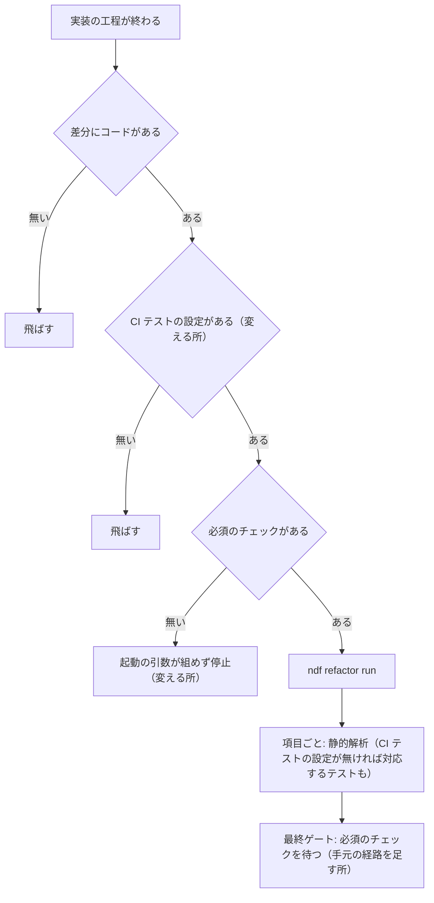
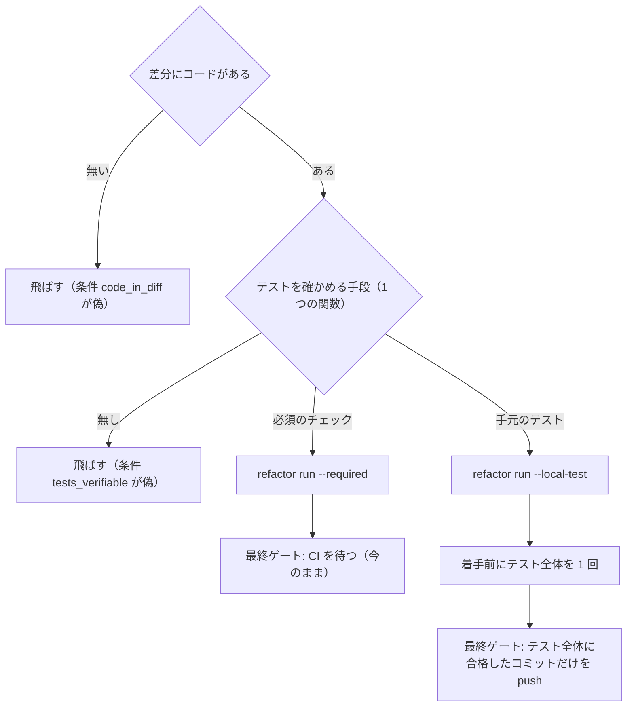
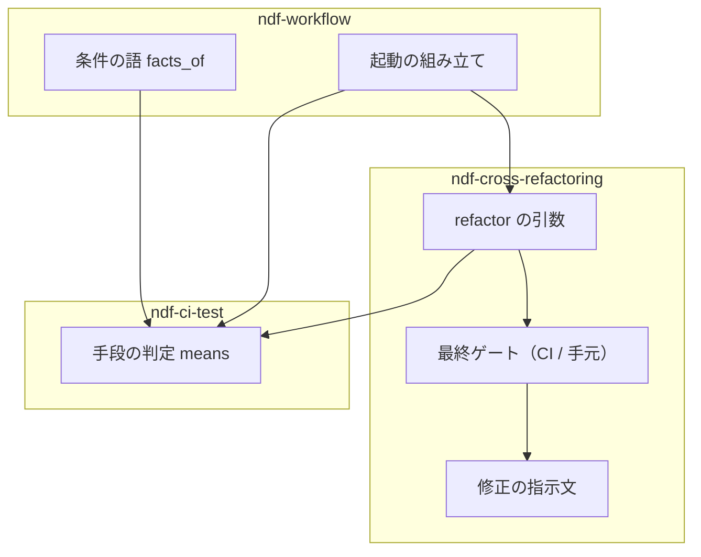
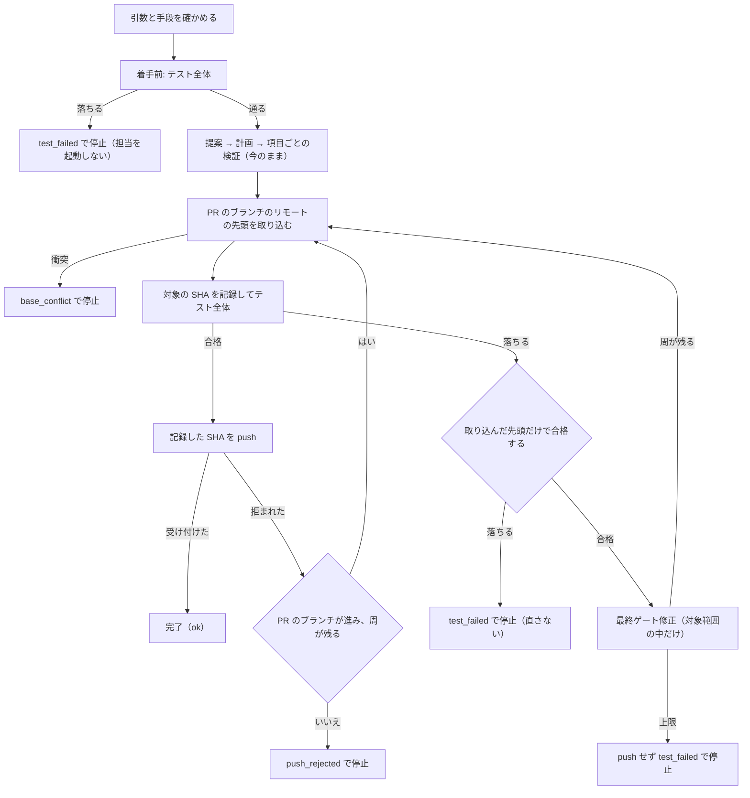

# 工程「リファクタリング」: CI テストの設定が無いリポジトリでも通せるようにする（#4566）

工程「リファクタリング」は、CI テストの設定があるリポジトリでしか実行されない。実行の条件を「テストを確かめる手段があるか」に置き換え、あわせて `ndf refactor run` に経路を足し、必須のチェックが無いリポジトリでは手元のテストで合否を決める。手段がどちらも無ければ、コードを変えずに理由を記録して飛ばす。採らなかった案は「決定の記録」、一次情報は末尾の「外部の調査」にある。

「テストを確かめる手段」とは、工程が変更の後のテストの合否を確かめる先である。必須のチェックがあれば CI で確かめる。無ければ、CI テストの設定が無効で、実行コマンドを持つテストの suite（`test.suites` のうち `kind` が `lint` でないもの。`kind` を省けば `test`）がある場合に手元で確かめる。この文書では次の語も使う。

| 語 | 意味 |
| --- | --- |
| 条件の語 | 工程の定義の `when` に並べる、実行条件の名前（`code_in_diff` など） |
| 担当 | `ndf refactor run` が起動して、改善の提案・実装・修正をさせる AI |
| 対象範囲 | `--scope` で渡す、この実行で直してよいファイル |
| 最終ゲート | 全項目の後に、テストの合否を確かめて終える段階 |
| 最終ゲート修正 | 最終ゲートでテストが落ちたときに担当が直すこと |
| テストのスロット | 重いテストを同じマシンで並べて動かしすぎないための実行枠 |
| 検証用の作業場所 | テスト全体を打つためだけに、NDF が対象のコミットから新しく作る git の worktree |

## 今の姿

何が起きたか・目的・受け入れ条件は要求仕様（[issue-4566-requirements.md](./issue-4566-requirements.md)、正は #4566 の本文）にある。この文書は「どう解くか」と「なぜその解き方か」だけを書く。



今の構造のうち、設計に要るのは次の 4 点である。

| 部分 | 今の形 |
| --- | --- |
| 実行の条件 | 工程の定義（`contracts/workflow/stages/refactor.json`）の `when` が `code_in_diff` と `ci_declared`。語の値は `ndf.progress.command.facts_of` が求める |
| 起動の組み立て | `ndf.progress.refactor_values` が、設定 `ci.required_checks` が空なら起動を組まない |
| 項目ごとの検証 | `domains/crossrefactor/verify.py`。CI テストの設定が無いリポジトリでは、コードを変えなくても対応するテストを手元で打つ |
| 最終ゲート | `domains/crossrefactor/final_gate.py`。必須のチェックを待つ経路だけを持つ。`ndf refactor run` は `--required` を 1 つ以上求める |

必須のチェックの読み方（`ndf.adapters.ci.read`）は、必須の名前が 0 件だと「通った」を返す。今は `--required` が 1 件以上を求めるので起きないが、引数を緩めるだけの直し方では、何も確かめずに合格になる。

## 文脈と制約

- 手元で打つ確かめは、今ある部品を使う。テストのスロットの下でコマンドを起動する関数（`ndf.testing.slots.run_command`）と、対象範囲の外を直したら元に戻す検査である
- 工程の定義は、スプリントを作る時点でステートマシンにコピーされる。更新の前に作ったスプリントは、古い条件の語（`ci_declared`）を持ち続ける（要求の前提 1、対象範囲の「含まない」）
- 工程を無効・有効にする設定は今ある `.ndf/project.json` の `workflow.stages` を使い、新しい設定は足さない
- 必須のチェックがあるリポジトリでは、工程が手元でテスト全体を打たない（非機能の条件）
- 利用先のリポジトリの CI・必須のチェックは用意しない

## 解き方の全体像



- 工程の実行の条件は「差分にコードがある」と「テストを確かめる手段がある」の 2 つになる。CI テストの設定の有無だけでは決まらない
- 手段は「必須のチェック」「手元のテスト」「無し」の 3 通りで、条件の判定と起動の組み立てが同じ関数で決める
- 手元の経路では、テスト全体が通らないコミットは PR に送られない
- 止めたいリポジトリは、今ある `workflow.stages` の設定で無効にする。書き方は工程の表に載る

## ドメインモデル

### コンテキスト

| コンテキスト | 何の語が 1 つの意味に決まるか |
| --- | --- |
| NDF の CI とテスト（`ndf-ci-test`） | テストを確かめる手段・必須のチェック・CI テストの設定 |
| NDF の開発ワークフロー（`ndf-workflow`） | 工程の実行の条件と、工程の有効・無効 |
| NDF の cross-refactoring（`ndf-cross-refactoring`） | 項目の検証と最終ゲート |

関係は顧客 / 供給者である。CI とテストが「どの手段で確かめるか」を供給する。受けるのは、開発ワークフロー（工程を実行するか）と cross-refactoring（どの最終ゲートを回すか）である。

### 集約

| 集約 | オーナー（書き換えてよいもの） | 根 | エンティティ | 値オブジェクト |
| --- | --- | --- | --- | --- |
| スプリントの進行 | `ndf progress` | ステートマシン | 工程の行 | 工程の定義のコピー・行を飛ばした理由 |
| リファクタリングの実行 | `ndf refactor run` | 状態ファイル | 改善項目 | テストを確かめる手段・着手前のテストの記録・最終ゲートの記録 |

テストを確かめる手段は、設定（`.ndf/project.json`）から毎回求める値で、保存しない。

### 不変条件

| # | 集約 | 条件 | 破れたときの扱い |
| --- | --- | --- | --- |
| I1 | スプリントの進行 | 工程の条件と起動の組み立ては、テストを確かめる手段を同じ関数で決める | 既定の判定では、手段が無ければ理由を記録して飛ばす。設定で工程を有効にした場合は定義の条件を見ないので（今の振る舞い）、起動を組めなければ `precondition` で停止する。利用者が自分で「必ず実行する」と指定したため、黙って飛ばさない |
| I2 | リファクタリングの実行 | 合否の確かめ先が決まらない実行（`--required` が無く、設定の手段が手元のテストでもない）では、担当の起動・コードの変更・最終ゲートの合格のどれも行わない | 提案の前に `invalid` を返す |
| I3 | リファクタリングの実行 | 手元の経路で PR に送るのは、テスト全体に合格したコミット（SHA）だけである。工程のプランも別の `HEAD` を送らない | 直しの上限まで直し、通らなければ送らずに `test_failed` で停止する |
| I4 | リファクタリングの実行 | 設定に必須のチェックがあるリポジトリでは、テスト全体を手元で打たない | `--local-test` を断る |
| I5 | リファクタリングの実行 | CI テストの設定があるリポジトリでは、テストを手元で打たない | `--local-test` を断る。項目ごとの検証は、引数に関わらず実行のたびに設定を読み、静的解析の suite だけを打つ |

### ドメインイベント

| # | イベント | 発生元 | 受け手 |
| --- | --- | --- | --- |
| E1 | スプリントを作り、工程の有効・無効を決めた | `ndf progress` | 工程の判定 |
| E2 | 工程「リファクタリング」を実行するか判定した | `ndf progress` | 起動の組み立て、進捗記録 |
| E3 | テストを確かめる手段を決めた | 手段を決める関数 | 工程の条件、起動の組み立て、`ndf refactor run` |
| E4 | リファクタリングの結果のテストの合否を確かめた | 最終ゲート | `ndf refactor run` の結果 |
| E5 | 工程を終えて次の工程へ進んだ | `ndf progress` | 次の工程 |

## 構成要素

| 要素 | 責務 |
| --- | --- |
| テストを確かめる手段の判定（新設 `ndf.testing.means`） | 設定の中身から「必須のチェック」「手元のテスト」「無し」を決め、手元で打つテスト全体のコマンドと、テストの設定の識別値を返す。ファイルもプロセスも触らない |
| 工程の定義と条件の語 | `ci_declared` を `tests_verifiable` へ置き換える。`tests_verifiable` の値は上の判定が「無し」でないこと |
| 起動の組み立て（`refactor_values`・`route.refactor_launch`） | 手段が必須のチェックなら `--required`、手元のテストなら `--local-test` を付けた起動を組む |
| `ndf refactor` の引数（`cli.py`） | `--required` と `--local-test` のどちらか 1 つを求める。`--local-test` は、設定の手段が手元のテストのときだけ受ける |
| 手元の最終ゲート（`final_gate.py`・`drive.py`） | 検証用の作業場所でテスト全体を打ち、合格したコミットの SHA だけを push する |
| 工程のプランの組み立て（`ndf.core.route`・テンプレート） | 手元の経路では `push`・`fix-push` を外し、早送りだけの `follow` を入れる |
| 最終ゲート修正の指示文（`prompt_decide.py`） | 「CI で落ちた」と「手元で落ちた」を書き分ける |
| 手順書と確定仕様 | 新しい実行の条件と、工程を止める設定の書き方を載せる |



手順書と確定仕様はコードの呼び出し関係を持たないため、図に含めない。

## 入出力のコントラクト

### 工程の実行の条件

| 項目 | 今 | 変えた後 |
| --- | --- | --- |
| `refactor.json` の `when` | `code_in_diff`・`ci_declared` | `code_in_diff`・`tests_verifiable` |
| 条件の語の一覧（`ndf.schema.json`） | `ci_declared` を持つ | `tests_verifiable` を足す。`ci_declared` は残す（決定 7） |
| 飛ばした記録 | `条件 ci_declared が偽` | `条件 tests_verifiable が偽` |

### テストを確かめる手段

上の行から順に当てる。この表は、工程の条件と、既定の起動の組み立てが使う。

| 必須のチェック（`ci.required_checks`） | CI テストの設定（`test.ci.only`） | 手元で打てるテスト（テストの suite で `command` を持つ） | 手段 |
| --- | --- | --- | --- |
| 1 件以上 | 問わない | 問わない | 必須のチェック |
| 0 件 | 真 | 問わない | 無し |
| 0 件 | 偽か無し | 1 件以上 | 手元のテスト |
| 0 件 | 偽か無し | 0 件 | 無し |

テストの suite かどうかは、既存の判定（`ndf.testing.weight.is_test_suite`）を使う。`kind` を省いた suite はテストに数える。手段の判定と、実行する suite の選び出しは同じ判定を通す。

### `ndf refactor run`

| 項目 | 内容 |
| --- | --- |
| 入力 | `--required <チェック>...`（1 件以上）と `--local-test`（値を持たない）のどちらか 1 つが必須。ほかの引数は今のまま |
| 手元のテストのコマンド | 呼び手は渡さない。テストを打つ対象のコミットの設定から読む（「合格をコミットに結び付ける条件」） |
| 出力 | 今の結果 JSON のまま。最終ゲートの記録に、手段（手元かどうか）が載る |
| 失敗の形 | 下の 2 つの表のとおり |
| 互換性 | `--required` を渡す今の呼び方は、設定の手段に関わらずそのまま使える |
| 検査の手段 | コントラクトは `python3 scripts/check-ndf-contracts.py` で検査する。コマンドの一覧（`plugins/ndf/docs/contracts/commands.md`）は作り直す |

引数と設定の手段の組み合わせは次のように扱う。待つチェックの名前は、常に引数から決まる。

| 設定の手段 | `--required <名前>...` | `--local-test` |
| --- | --- | --- |
| 必須のチェック | 受ける。引数の名前を待つ（設定の名前と違っていても引数が勝つ。今と同じ） | `invalid` |
| 手元のテスト | 受ける。引数の名前を待つ（今と同じ） | 受ける |
| 無し | 受ける。引数の名前を待つ（今と同じ） | `invalid` |

名前を指定した CI の確かめは、指定したチェックが現れなければ合格にしない（`missing`）。何も確かめずに合格することはない。

停止する場面と停止理由は次のとおりである。

| 場面 | 停止理由 |
| --- | --- |
| `--required` と `--local-test` の両方・どちらも無し、`--local-test` と `--ci-test` の併用、上の表の `invalid` | `invalid`（担当を起動しない） |
| 着手前のテスト全体が落ちる | `test_failed`（担当を起動しない） |
| 終わりのテスト全体が直しの上限でも落ちる | `test_failed` |
| 取り込んだ PR のブランチの先頭が、この実行の変更を載せる前からテストに落ちる | `test_failed`（最終ゲート修正をしない） |
| テスト全体の実行の累計が上限に達する | `fix_limit` |
| 対象のコミットの設定では、手段が手元のテストでなくなる | `precondition`（push しない） |
| テストが追跡ファイルを書き換えた、または HEAD を動かした | `precondition` |
| 手元の経路のプランで、呼び出し元の worktree を PR のブランチへ早送りできない | `precondition` |
| 対象範囲の外の直し | `refused` |
| `--branch` のリモートの先頭を取り込むと衝突する | `base_conflict` |
| push の拒否（PR のブランチが進んでいない、または取り込み直す周が残っていない） | `push_rejected` |

工程が停止すると、工程の行は失敗として記録され、スプリントは次の工程へ進まない。利用者は原因を直して `ndf progress retry` で打ち直すか、`ndf progress disable` で工程を外して先へ進む。

CI の経路では、手元でテストを打つかどうかを引数ではなく設定（`test.ci.only`）で決める。手で起動して `--ci-test` を省いても、CI テストの設定があれば手元のテストは打たない。`--ci-test` は、落ちた CI のチェックがテストかを見分けるだけに使い、省くと直しに進まず停止する（今と同じ）。

### 状態ファイルに記録する引数

再開と、完了した結果の再利用は、状態ファイルに記録した引数の並びと今の引数の並びを比べて決める。

| 経路 | 記録する並び（この順） |
| --- | --- |
| CI（`--required`） | 今の形式のまま。起点、対象範囲、`--required` と名前、`--ci-test` と名前、`--symbols`、`--participants`、`--max-fix`、`--budget-minutes`、候補があれば `--candidates-sha256` |
| 手元（`--local-test`） | 起点、対象範囲、`--local-test`、`--suites-sha256` とテストの設定の識別値、`--symbols` 以降は CI の経路と同じ |

テストの設定の識別値は、テストの suite の `name`・`command`・`scope_command`・`paths` を設定の順に並べた SHA-256 である。引数に記録する識別値は、起動時に `--work` の設定から求める。テストの設定を変えると、PR の先頭が同じでも完了した結果は再利用せず、打ち直す。未完了の状態があれば、今ある引数の食い違いと同じく `invalid` で停止し、状態ファイルを消して打ち直すよう案内する。着手前のテストに合格するまでは引数を記録しないので、着手前の失敗は設定を直せばそのまま打ち直せる。

着手前に合格したら、引数と一緒に、合格した SHA とそのとき読んだテストの設定の識別値を状態ファイルに保存する。未完了の実行を再開するときは、この記録を復元して着手前のテストを打ち直さない。作業場所の `HEAD` には、落ちた変更や直しのコミットが残っていてよい。続きの工程（項目が残っていれば項目、無ければ取り込みと最終ゲート）から始める。

### 利用者が工程を止める設定

形は今のまま（`.ndf/project.json`）。工程の表に載せるのはこの例と、`reason` が必須であること・新しく作るスプリントから効くことである。

```json
{"workflow": {"stages": {"リファクタリング": {"enabled": false, "reason": "手元のテストが重い"}}}}
```

## 処理の流れ

手元の経路の `ndf refactor run` は次の順に進む。CI の経路は今のままである。図の「PR のブランチ」は、`--pr` の送信先である `--branch` のブランチで、PR のマージ先（`--base`）ではない。



「周」は、取り込み・テスト・push か直し、のひとまとまりで、今の最終ゲートと同じく 1 回の実行で `--max-fix` + 1 回（既定 3 回）までである。

### push するコミット

手元の経路は、今の送信の関数（`final_gate.send`）を使わない。この関数は PR のブランチを取得し直して取り込んでから `HEAD` を送るので、テストしていないコミットが送られうる。手元の経路は、合格した SHA を指定して送る（`git push <リモート> <SHA>:refs/heads/<ブランチ>`。強制しない）。

- 合格した後、push の前には取り込み直さない
- push が拒まれたら、PR のブランチを取得し直して、拒まれた理由を分ける。理由の文面は読まず、リモートの先頭が取り込んだ時点から変わったかで判定する
  - 変わっていれば、並行して更新されただけである。周が残っていれば取り込み直し、新しい SHA でテスト全体に合格してから送り直す。利用者の操作は要らない
  - 変わっていなければ、認可やブランチの保護などで拒まれている。`push_rejected` で停止する

### 落ちた原因を分ける

取り込んだ PR のブランチの先頭が着手前に合格した SHA と違うときは、テストが落ちても、この実行の変更が原因とは限らない。このときは最終ゲート修正の前に、取り込んだ先頭だけ（この実行のコミットを載せない状態）でテスト全体を打つ。

- そこでも落ちれば、並行して入った変更が原因である。担当に直させず、理由にその SHA を載せて `test_failed` で停止する
- そこで合格すれば、この実行の変更を載せたことで落ちたので、最終ゲート修正へ進む
- 取り込んだ先頭が着手前に合格した SHA と同じなら、打ち直さずに最終ゲート修正へ進む

### テストを打つ場所

テスト全体は、毎回、対象の SHA から新しく作る検証用の作業場所で打つ。着手前も終わりも、原因を分ける実行も同じである。

- 検証用の作業場所は、リファクタリングの保存先（`rf<PR>/`）の下に、実行のたびに別の名前で作る。作る前にパスを状態ファイルに記録し、NDF の lock を掛ける
- 打ち終えたら取り除く。中断で残ったものは、次の実行と `ndf refactor release` が取り除く。取り除くのは、状態ファイルに記録があり NDF の lock が掛かったパスだけである
- `--work` に渡された利用者の作業ツリーは、リポジトリを特定して設定を読むためだけに使う。そこではテストを打たず、ファイルを消さない
- 前のテストが作ったビルド成果物（無視の設定に当たるファイルを含む）は、次のテストへ持ち越さない。依存の取得やビルドは、テストのコマンドかコンテナが毎回用意する。リポジトリの外のキャッシュは今のまま使える

### 合格をコミットに結び付ける条件

テストの設定は、対象の SHA に含まれる `.ndf/project.json` から読む。起動の後に PR のブランチがテストのコマンドを変えれば、新しいコマンドで確かめる。`.ndf/project.json` がコミットに含まれないリポジトリでは、`--work` の設定を使う。対象の SHA の設定で手段が手元のテストでなくなれば（必須のチェックか CI テストの設定が足された、テストの suite が無くなった）、push せずに `precondition` で停止する。

テストの後に、検証用の作業場所の `HEAD` が対象の SHA のままで、追跡ファイルに変更が無いことを確かめる。満たさなければ、書き換わったファイルを理由に載せて `precondition` で停止する。テストが作る未追跡の生成物は問わない。

### テストの打ち方と時間の上限

- テスト全体は、テストの suite の `command` を設定の順にすべて打つ。1 つでも落ちるか時間の上限を超えれば不合格である
- suite のコマンド 1 つの上限は、方針 `test-run.test`（900 秒）である。項目ごとの検証（`verify.py`）と同じ単位で、値は方針のファイルから読む。テストのスロットを待つ時間は数えない
- テスト全体の実行の累計にも上限を置く。値は今の安全網の上限（`--safety-net-minutes`、無ければ実効の予算 × 方針の倍率）を使い、コードを書く工程の累計とは別に数える。累計は状態ファイルに保存し、再開しても引き継ぐ
- 各 suite には、900 秒と累計の残りの小さい方を渡す。残りが無くなるか、残りで縮めた上限に当たれば `fix_limit` で停止する（テストの失敗には数えない）。安全網を大きくして打ち直すと続きから進む
- 方針の説明にある「実測の所要の 3 倍まで延ばす」は使わない。今の読み手（`verify.py`）は 900 秒だけを使っていて、設定の `test_duration` は廃止予定で読み手が無い
- 取り込んだ後の SHA とテストの設定の識別値が、着手前に合格した記録と両方同じ（項目が 1 件も残らず、PR のブランチも動いていない）なら、テスト全体を打ち直さない

### 手元の経路のプラン

工程のプラン（`cross-refactoring.json`）は、`refactor` の後に呼び出し元の worktree の `HEAD` を送る `push` と `fix-push` を持つ。手元の経路でこれを残すと、テストした SHA とは別の `HEAD` が PR に入りうる。起動の引数に `--local-test` があるプランは、次の形に組む。

| 経路 | `refactor` の後のステップ |
| --- | --- |
| CI | `push` → 終了（今のまま） |
| 手元 | `follow` → 終了。`push`・`fix-push` は持たない。`refactor` が停止すればプランもそこで停止する |

`follow` は、PR のブランチを取得して呼び出し元の worktree を早送りするだけのステップ（`git merge --ff-only`）で、何も送らない。早送りできなければ `precondition` で停止する。まとめた検証のプラン（`check.json`）も、手元の経路では `refactor` の直後に `follow` を入れる。ステップの出し入れは、手元のテストのステップを外す今の仕組み（`ndf.core.route` の `without_steps`）を使う。

## 非機能の実現方式

| 大項目 | 要求の条件 | 実現方式 | 確かめ方 |
| --- | --- | --- | --- |
| 性能・拡張性 | 必須のチェックがあるリポジトリでは、工程が手元でテスト全体を打たない | 手段の判定が必須のチェックを最優先にし、`--local-test` は手段が手元のテストのときだけ受ける | 必須のチェックを持つ設定で `--local-test` が断られるテスト |
| 運用・保守性 | 飛ばした理由（設定で無効・差分が文書だけ・確かめる手段が無い）を進捗記録から区別できる | 順に、設定の `reason`・`条件 code_in_diff が偽`・`条件 tests_verifiable が偽` が行に残る。新しい記録の形は足さない | 3 つの場面で行の理由が異なるテスト |

## 決定の記録

決定 4〜6 の「比べた候補」の番号は、末尾の「外部の調査」の行を指す。比べたのは、合否の出し方をほかがどう定めているかで、GitHub の必須のチェック（PRD1）、変更のたびに手元でテストを打って直させる Aider（PRD2）、テストが通るまで作業の完了を止められる OpenHands（PRD3）、リファクタリングの定義（STD1）である。どれも NDF の中から呼べる部品ではないので、作り方は自前になる。

### 決定 1: 手段の無いリポジトリで工程を記録つきで飛ばすため、実行の条件の語を「テストを確かめる手段がある」に置き換える

- **質問**: CI テストの設定の条件を外した後、手段の無いリポジトリをどこで飛ばすか
- **選んだ案**: 工程の条件の語 `ci_declared` を `tests_verifiable` に置き換える。偽なら今の仕組みが行を飛ばし、理由を記録する
- 採らなかった案: 条件を外すだけにする（必須のチェックが無いリポジトリで起動が組めず、工程が停止する）
- 採らなかった案: `ndf refactor run` の中で手段を調べて何もせず終える（工程が「完了」と記録され、飛ばしたことと区別できない。Pull Request の番号と差分を読む起動もむだになる）
- **代償**: 条件の語が 1 つ増え、古い語も残る（決定 7）
- 根拠: Value 3 / Value 13（MVV バージョン 11）。同じ手順を毎回同じ結果にし、確かめていないものを済んだと記録しない

### 決定 2: 何も確かめずに合格させないため、CI テストの設定があり必須のチェックが無いリポジトリは飛ばす

- **質問**: 要求の未決 1。CI テストの設定があり必須のチェックが無いリポジトリで、何を見て合否を決めるか
- **選んだ案**: 手段「無し」とし、理由を記録して飛ばす。工程を通したい利用者は `ci.required_checks` を設定する
- 採らなかった案: PR に付いたすべてのチェックを待つ（どれがテストかが分からない。チェックが現れないと、何も確かめずに通る形になる。利用者が必須にしていないチェックは、GitHub ではマージを止めない（PRD1）。利用者が合否の基準に定めていないので、通ったことを「テストに合格した」と読めない）
- 採らなかった案: テストのチェックの名前の設定（`test.ci.check`）を必須のチェックの代わりに使う（要求の前提 2 の手段は 2 つで、3 つ目が増える。最終ゲートが待つ名前の出所も 2 つになる）
- 採らなかった案: 停止して利用者へ返す（受け入れ条件 6 に反し、利用者が頼んでいない工程でスプリントが止まる）
- **代償**: CI テストの設定があり必須のチェックが無いリポジトリでは、必須のチェックを設定するまで工程「リファクタリング」が行われない
- 根拠: Value 13 / Value 4（MVV バージョン 11）。確かめたものだけを合格にし、必須のチェックの有無が違うプロジェクトでも使えるようにする。PRD1

### 決定 3: 黙って確かめ方が変わらないようにするため、手元の経路は `--local-test` で明示する

- **質問**: `ndf refactor run` に、必須のチェックが無い呼び方をどう足すか
- **選んだ案**: `--required` と `--local-test` のどちらか 1 つを必須にする。`--local-test` は、設定の手段が手元のテストのときだけ受ける。`--required` は今と同じく、設定の手段に関わらず受ける
- 採らなかった案: 設定の手段が手元のテストか無しのときに `--required` を断る（チェック名を引数で渡して手で打つ今の呼び方が使えなくなる。指定した名前が現れなければ合格にならないので、断らなくても何も確かめない合格は起きない）
- 採らなかった案: `--required` を省けるだけにする（指定の漏れが手元の経路になる。必須の名前が 0 件の CI の読み取りは「通った」を返すので、分岐を 1 か所誤ると何も確かめずに合格する）
- 採らなかった案: 手元のテストのコマンドを引数で渡す（起動の組み立てと設定で同じ事実を 2 か所に持つ）
- **代償**: 手で打つ利用者は、必須のチェックが無ければ `--local-test` を足す必要がある
- 根拠: Value 3 / Value 8（MVV バージョン 11）。確かめ方を毎回同じにし、テストのコマンドを 2 か所に持たない

### 決定 4: CI の代わりになる合否を出すため、手元の経路の最終ゲートはテスト全体を打つ

- **質問**: 要求の未決 2。必須のチェックが無いリポジトリで、手元の確かめにテスト全体を使うか、変更に対応するテストに絞るか
- **選んだ案**: 項目ごとは今のまま対応するテストを打ち、最終ゲートでは設定のテストの suite の `command` をすべて打つ
- 採らなかった案: 最終ゲートも対応するテストに絞る（対応を引けないソースや、離れた呼び出し元の壊れを見逃す。手元の経路を使うリポジトリには、後で拾う必須のチェックが無い）
- 採らなかった案: 項目ごとにテスト全体を打つ（項目の数だけ所要が掛かり、予算の中で採れる項目が減る）
- **代償**: テストの重いリポジトリでは、工程の所要とマシンの負荷が増える。困る利用者は工程を無効にする
- 作り方: 自前で作る
- 比べた候補: PRD1 / PRD2 / STD1
- 根拠: Value 13 / Value 2（MVV バージョン 11）。合否を実際に確かめ、費用は項目の数だけは増やさない

### 決定 5: テストを打てないまま提案と実装に token を使わないため、提案の前にテスト全体を 1 回打つ

- **質問**: 着手前から落ちるテストや、環境が足りず打てないテストをどこで知るか
- **選んだ案**: 手元の経路では担当を起動する前にテスト全体を打ち、落ちれば `test_failed` で止める。理由の文に、着手前から落ちていることを書く
- 採らなかった案: 終わりにだけ打つ（提案と実装の費用を使った後で止まる。壊したのがリファクタリングかどうかも分からない）
- 採らなかった案: 落ちたら理由を残して飛ばし、完了にする（受け入れ条件 4 の「テストが落ちる状態では完了にしない」に反する）
- 採らなかった案: 提案の前はコマンドや環境の軽い確認だけにし、変更が残ったときに初めてテスト全体を打つ。費用の比較は下の表のとおりで、秒と token は測っていない
- **代償**: テストの suite が N 件なら、着手前に N 回コマンドを打つ。変更が残れば最終ゲートでさらに N 回（直すか取り込み直すたびに N 回、原因を分けるときにも N 回）打つ。項目が残らず PR のブランチも動かなければ、終わりの N 回は省く
- 作り方: 自前で作る
- 比べた候補: PRD2 / PRD3 / STD1
- 根拠: Value 2 / Value 13（MVV バージョン 11）。LLM の費用を無駄にせず、テストを打てる状態を確かめてから始める

決定 5 の 2 つの案の費用は次のように違う。

| 場面 | 着手前にテスト全体を打つ（採る） | 軽い確認だけにする（採らない） |
| --- | --- | --- |
| 採る項目が無い実行 | テスト全体 1 周分が増える | 1 周分を省ける |
| 着手前から落ちるテストがある実行 | テスト 1 周で停止し、LLM を使わない | 提案と実装の LLM の費用と時間を使った後で停止する。最終ゲート修正が、変更と関係の無い失敗を直そうとする |
| 変更が残り、合格する実行 | 着手前と終わりの 2 周 | 終わりの 1 周 |
| 変更が残り、落ちる実行 | PR のブランチが着手時のままなら、変更が原因だと分かる。進んでいれば、取り込んだ先頭だけでもう 1 周打って分ける | 原因が変更か元からかを分けるには、起点でもう 1 周要る |

### 決定 6: 落ちる変更を PR に入れないため、手元の経路はテストに合格したコミットだけを push する

- **質問**: 手元の最終ゲートで、push とテストのどちらを先にするか。直せないときに何を残すか
- **選んだ案**: PR のブランチ（`--branch`）のリモートの先頭を取り込む → テスト全体 → 合格したら、その SHA を指定して push。push が拒まれた理由がブランチの進行なら、取り込みとテストからやり直す。テストに落ちれば原因を分け、この実行の変更が原因なら CI の経路と同じ上限と範囲の検査で直す。上限に達したら送らずに `test_failed` で停止する。コミットは作業場所に残る
- 採らなかった案: CI の経路の送信（`final_gate.send`）を使い回す（送る直前に取り込み直すので、テストしていないコミットが PR に入りうる）
- 採らなかった案: push が拒まれたら必ず停止する（並行の更新に衝突が無くても、利用者が打ち直すことになる）
- 採らなかった案: 工程のプランの `push` を残す（呼び出し元の worktree の `HEAD` はテストしたコミットではない）
- 採らなかった案: 必須のチェックの経路と同じく先に push する（待つ CI が無いのに送ると、落ちる変更が PR に残る）
- 採らなかった案: 着手前の状態へ戻して完了にする（直せなかった事実が結果に残らず、採った項目の記録と食い違う）
- **代償**: テストの間に PR のブランチが進むと、取り込みとテスト全体がもう 1 周増える。周を使い切れば停止する。工程のプランは経路で形が変わる
- 作り方: 自前で作る
- 比べた候補: PRD1 / PRD3 / STD1
- 根拠: Value 13 / Value 7（MVV バージョン 11）。確かめたコミットだけを出し、テストしていないコミットが入る経路そのものを断つ

### 決定 7: 進行中のスプリントを止めないため、古い条件の語 `ci_declared` の値を求める処理は残す

- **質問**: 使わなくなる語を消すか
- **選んだ案**: 工程の定義からは外し、語の一覧と値を求める処理は残す。更新の前に作ったスプリントは今と同じ条件で流れる
- 採らなかった案: 語を消す（コピーした定義が語を持つスプリントが「条件を求める手段が無い」で停止する）
- 採らなかった案: 進行中のスプリントの定義を移行する（要求の対象範囲に含まず、1 工程の条件のために移行の仕組みが要る）
- **代償**: 新しい定義が使わない語が 1 つ残る
- 根拠: Value 3（MVV バージョン 11）。版をまたいでも進行中の作業を続けられる

### 決定 8: この変更の範囲を工程「リファクタリング」に保つため、手前の工程のプランが組めない不具合はここで直さない

- **質問**: 必須のチェックが無いリポジトリでは、スプリントが手前の工程で止まる。この設計で直すか
- **選んだ案**: 直さない。この不具合は「`ci.required_checks` の無いリポジトリで差し込み `required` が埋まらず、設計から先のプランを組み立てられない」（ <https://github.com/devbasex/ai-plugins/issues/4472> ）で扱う
- 採らなかった案: この設計に含める（差し込み `required` は 7 つのプランのテンプレートと CI の待ちが使い、空のときに何を待つかを別に決める必要がある）
- **代償**: #4472 が直るまで、受け入れ条件は次の範囲でしか満たせない。この設計の承認は、次の範囲を含めての承認になる

| 受け入れ条件 | この変更で満たす範囲 | 満たせない範囲 |
| --- | --- | --- |
| 4（手元のテストで確かめて終える） | `ndf refactor run --local-test` を直接打つ場合と、工程の単位のテスト | 必須のチェックが無いリポジトリで、スプリントが自動でこの工程まで進むこと |
| 5（手段が無ければ理由を残して飛ばす） | 工程の判定の単位のテスト | 同上 |

- 根拠: Value 13 / Value 5（MVV バージョン 11）。満たせない範囲を明記したうえで、小さく早く届ける

### 決定 9: 前のテストの残りで合格させないため、テスト全体は毎回新しい作業場所で打つ

- **質問**: テスト全体をどこで打つか。前の実行が残したファイルをどう扱うか
- **選んだ案**: 対象の SHA から検証用の作業場所を毎回新しく作り、打ち終えたら取り除く
- 採らなかった案: 担当が書く作業場所で打ち、前に未追跡ファイルを消す（利用者が置いたファイルまで消しうる。無視の設定に当たる古いビルド成果物は残り、変更後のコードを確かめないまま合格しうる）
- 採らなかった案: 同じ場所で未追跡ファイルがあれば停止する（テストが生成物を作るリポジトリは毎回止まり、古いビルド成果物の問題も残る）
- 採らなかった案: 無視の設定に当たるファイルもすべて消して使い回す（消してよいものを NDF が作ったものに限れない）
- **代償**: 依存の取得物を持ち越さないので、テストのコマンドが依存を用意する場合は毎回その時間が掛かる。作ったばかりの作業場所でテストが通らないリポジトリは、着手前に停止する
- 根拠: Value 13 / Value 6（MVV バージョン 11）。確かめていないものを済んだとせず、自動で片付けるのは NDF が作ったものだけにする

### 決定 10: 所要が際限なく延びないようにするため、テスト全体の累計にも安全網の上限を当てる

- **質問**: suite の数と直しの回数に比例して延びる所要を、どこで止めるか
- **選んだ案**: 安全網の上限の値を、テスト全体の実行の累計にも当てる。コードを書く工程とは別に数える
- 採らなかった案: suite ごとの 900 秒だけにする（suite の数 × 周の数だけ積み上がる）
- 採らなかった案: コードを書く工程と同じ累計に足す（テストが重いリポジトリでは、実装に使える時間が減って項目が途中で止まる）
- 採らなかった案: 新しい上限の引数と方針を足す（打ち直しで大きくする手段が 2 つになる）
- **代償**: 1 回の実行は、最大で安全網の上限の 2 倍（コードを書く工程とテスト全体）まで掛かる。テストのスロットの待ちは別に掛かる
- 根拠: Value 2 / Value 3（MVV バージョン 11）。費用の上限に当たれば止め、手元の経路でも同じ手順で再開できる

## 影響と危険

- **働く範囲**: NDF を使うすべてのリポジトリ。更新の後に作る `standard`・`legacy-refactor` のスプリントに効く
- **プロジェクトごとに違うもの**: 次の設定で受ける。どれも今ある設定である。`ci.required_checks`・`test.ci.only`・`test.suites`・`workflow.stages`
- **当たるモード**: `standard`・`legacy-refactor`。`light`・`operation`・`documentation` は工程を持たない

壊れうる箇所と扱いは次のとおりである。

| 壊れうる箇所 | 扱い |
| --- | --- |
| 必須のチェックはあるがテストを含まないリポジトリ（lint だけが必須など） | 手段は必須のチェックになる。CI テストの設定が無ければ項目ごとの対応するテストは手元で打つが、最終ゲートはテストを確かめない。要求の前提 2 のとおりとする |
| 起動の設定（`workflow.launch.refactor`）に必須のチェックの名前を直に書き、`ci.required_checks` が空のリポジトリ | 手段「無し」になり飛ぶ。`ci.required_checks` を設定するか、工程を有効にする |
| 工程を設定で有効にし、手段が無いリポジトリ | 今と同じく定義の条件を見ずに始め、起動が組めず `precondition` で止まる（受け入れ条件 8） |
| 手元のテストが外のサービスを要る、suite 1 つが 900 秒を超える、追跡ファイルを書き換える、または作ったばかりの作業場所で通らない | 着手前の 1 回で `test_failed`（書き換えは `precondition`）になる。失敗した工程の行は `ndf progress disable` で外せる。以後のスプリントは `workflow.stages` で無効にする |
| 工程「実装」など、ほかの工程のプラン | 必須のチェックが無いと差し込み `required` が埋まらず、プランを組めない（決定 8。#4472） |
| `development-workflow` の `SKILL.md` は 499 行で、文書の行数の上限が近い | 工程の表の「リファクタリング」の行の中を書き換え、行を増やさない |
| 検査のプラン（テンプレート `check.json`。要求仕様の「まとめた検証のプラン」と同じもの）の説明 | 工程の表の「設定の無いリポジトリの検査のプランは `assess`（差分が文書だけかを見る最初のステップ）と `refactor`（リファクタリングのステップ）を持たない」は、テンプレートの形と合わないので消す。テンプレートは変えない |

### 代表のリポジトリでの振る舞い

| 代表のリポジトリ | 設定の要点 | 直した後に起きること | この種類で扱えなくなること |
| --- | --- | --- | --- |
| Web サービス | 必須のチェックがある。CI テストの設定は有ることも無いこともある | 工程が実行され、最終ゲートは CI を待つ。設定が無ければ項目ごとの対応するテストを手元で打つ | 無し |
| モバイルアプリ | 必須のチェックが無く、手元のテストが重いか実機を要ることがある | 手元のテストがあれば着手前と終わりに打つ。打てなければ停止し、`workflow.stages` で無効にできる | 無し |
| 業務文書だけ | テストの設定が無い | 差分が文書だけなので、今と同じく飛ぶ | 無し |

### このリポジトリだけの事情

| 値 | 置く所 | 持つ Issue |
| --- | --- | --- |
| テストを CI でだけ走らせる（`test.ci.only: true`）と必須のチェック | `.ndf/project.json`。このリポジトリの振る舞いは変わらない | #3056 |

## 用語

| 用語 | 意味 | 用語集への反映 |
| --- | --- | --- |
| テストを確かめる手段 | 工程「リファクタリング」が変更の後のテストの合否を確かめる先。必須のチェックがあれば CI で確かめる。無ければ、CI テストの設定が無効で、実行コマンドを持つテストの suite（`kind` を省いたものを含む）がある場合に手元で確かめる。どちらも使えなければ、既定の実行条件では理由を記録して工程を飛ばす | 追加（`ndf-ci-test`） |

## テスト設計

| 受け入れ条件・不変条件 | どの振る舞いで縛るか | どう壊したら落ちるべきか |
| --- | --- | --- |
| 条件 1・2 | CI テストの設定が無い・`false` で、必須のチェックがあれば、`standard` と `legacy-refactor` の工程が飛ばされず、`--required` の起動が組まれる | 条件の語へ CI テストの設定の有無を戻すと落ちる |
| 条件 3 | CI テストの設定と必須のチェックがあれば、今と同じ起動が組まれ、テストの suite を手元で打たない | 手段の判定が手元のテストを優先すると落ちる |
| 条件 4 | 必須のチェックが無く手元のテストがあれば `--local-test` の起動が組まれ、テストが通れば push して `ok`、落ちれば `ok` にならず PR に送らない | テストの合否を見ずに push すると落ちる |
| 条件 5 | 手段がどちらも無ければ行が飛ばされ、理由が記録され、次の工程へ進む | 条件を真にすると落ちる |
| 条件 6 | CI テストの設定があり必須のチェックが無ければ、行が飛ばされる。`--local-test` は断られる | 手元のテストの有無だけで手段を決めると落ちる |
| 条件 7・8 | 設定で無効にすれば理由が行に残り、有効にすれば定義の条件を見ずに始まる | 条件を設定より先に見ると落ちる |
| 条件 9・10 | 文書だけの差分は飛び、`light`・`operation`・`documentation` の定義に工程が無い | 語の順を入れ替えて理由が変わる、またはモードの定義に行を足すと落ちる |
| 条件 11・12 | 手順書と確定仕様を読んで確かめる（`.md` の文言のテストは書かない） | — |
| I1 | 手段の表の 4 つの場面すべてで、条件の値が真のときは起動が組まれる | 条件と起動のどちらか一方の判定を変えると落ちる |
| I2 | 手段の無い設定で `ndf refactor run --local-test` を打つと、担当を起動せずに `invalid` を返す | 引数の検査を外すと落ちる |
| I3 | 終わりのテストが直しの上限でも落ちれば、リモートの先頭が着手前のまま `test_failed` になる | 直しの前に push すると落ちる |
| I4・I5 | 必須のチェックか CI テストの設定がある設定で `--local-test` を打つと `invalid` になる。CI テストの設定があれば、`--ci-test` を省いても手元でテストの suite を打たない | 設定との突き合わせを外すと落ちる |
| 引数と手段の表 | 設定の手段が手元のテストか無しでも、`--required` は受けて引数の名前を待つ | `--required` を設定で断る、または待つ名前を設定から取ると落ちる |
| 引数の記録 | テストの suite の `command` を変えると、完了した結果を再利用しない。CI の経路の並びは今のまま | 識別値を記録から外すと落ちる |
| 時間の上限 | suite のコマンドごとに方針 `test-run.test` の秒を渡す | 全 suite で 1 つの上限にすると落ちる |
| 決定 5 | 着手前のテストが落ちれば、担当を起動せずに `test_failed` になる | 提案を先に流すと落ちる |
| 決定 6 | 最終ゲート修正が対象範囲の外を変えれば、戻して `refused` になり、送らない | 範囲の検査を手元の経路で省くと落ちる |
| 決定 6（送る SHA） | テストの間に PR のブランチが進むと、取り込み直してテストに合格してから送る。周が残らなければ `push_rejected`。進んでいない拒否は、すぐ `push_rejected` | 合格の後にテストせず `HEAD` を送る、または拒否の理由を分けないと落ちる |
| 決定 6（プラン） | `--local-test` の起動で組んだ `cross-refactoring` と `check` のプランは、`refactor` の直後が `follow` で、`cross-refactoring` は `push`・`fix-push` を持たない。CI の経路のプランは今のまま | プランに `push` を残すと落ちる |
| 手段の判定（`kind` の省略） | `kind` を省いた suite だけの設定で、手段が手元のテストになる | `kind` が `test` の文字列だけを数えると落ちる |
| 設定の読み先 | 取り込んだコミットがテストのコマンドを変えていれば、新しいコマンドを打つ | 起動時に読んだコマンドを使い回すと落ちる |
| 再開 | 最終ゲートで停止した実行を打ち直すと、着手前のテストを打たずに取り込みと最終ゲートから進む | 着手前の合格の記録を保存しないと落ちる |
| 原因の分離 | 取り込んだ先頭だけでも落ちる場合は、最終ゲート修正を起動せず `test_failed` | 原因を分けずに担当を起動すると落ちる |
| 決定 9 | テスト全体は新しい検証用の作業場所で打ち、`--work` の未追跡ファイルは残る | 担当の作業場所や `--work` で打つ、または消すと落ちる |
| 決定 10 | 累計の残りが suite に渡り、尽きれば `fix_limit`。時計は差し替えて確かめる | 累計を渡さないと落ちる |
| 合格の条件 | テストが追跡ファイルを書き換えると `precondition` になり、送らない | テストの後の照合を外すと落ちる |
| 決定 7 | `ci_declared` を持つ古い定義の行が、停止せずに今と同じ判定になる | 語の値を求める処理を消すと落ちる |

詳細設計は、別のファイル `issues/issue-4566-design-detail.md` に書く。新設する関数が 2 つ以上あり、既存の関数のシグネチャも変えるためである。

## 設計の結果

| 課題 | 扱い | 統合先 | 触るファイル |
| --- | --- | --- | --- |
| #4566 | 実装する | — | `plugins/ndf/src/ndf/testing/means.py`（新設）、`plugins/ndf/contracts/workflow/stages/refactor.json`、`plugins/ndf/contracts/workflow/ndf.schema.json`、`plugins/ndf/contracts/limits/test-run.test.json`、`plugins/ndf/src/ndf/progress/command.py`、`plugins/ndf/src/ndf/progress/refactor_values.py`、`plugins/ndf/src/ndf/progress/invoke.py`、`plugins/ndf/src/ndf/core/route/__init__.py`、`plugins/ndf/contracts/templates/cross-refactoring.json`、`plugins/ndf/contracts/templates/check.json`、`plugins/ndf/contracts/templates/parts/steps.json`、`plugins/ndf/src/ndf/domains/crossrefactor/workspace.py`、`plugins/ndf/tests/progress/test_sprint_templates.py`、`plugins/ndf/src/ndf/domains/crossrefactor/cli.py`、`plugins/ndf/src/ndf/domains/crossrefactor/drive.py`、`plugins/ndf/src/ndf/domains/crossrefactor/final_gate.py`、`plugins/ndf/src/ndf/domains/crossrefactor/prompt_decide.py`、`plugins/ndf/docs/contracts/commands.md`、`plugins/ndf/tests/testing/test_means.py`（新設）、`plugins/ndf/tests/progress/test_model.py`、`plugins/ndf/tests/progress/test_run.py`、`plugins/ndf/tests/progress/test_invoke_refactor.py`、`plugins/ndf/tests/domains/crossrefactor/test_drive.py`、`plugins/ndf/tests/domains/crossrefactor/test_refactor_cli.py`、`plugins/ndf/skills/development-workflow/SKILL.md`、`plugins/ndf/skills/cross-refactoring/SKILL.md`、`docs/specifications/ndf-ci-only-tests.md`、`docs/specifications/ndf-review-units-and-refactoring-timing.md`、`docs/specifications/ndf-stage-plan-work-prompts.md`、`docs/glossary/glossary.json`、`docs/glossary.md`、`docs/glossary/ndf-ci-test.md` |

## 未確認のまま残ること

| 項目 | 内容 |
| --- | --- |
| 必須のチェックが無いリポジトリで、スプリントが工程「リファクタリング」まで進むか | 進まない。必須のチェックを持たない一時リポジトリの設定で工程「実装」のプラン（`impl.json`）を組むと「差し込みの値が無い: required」になった（2026-11-27）。#4472 はさらに手前の設計のプランから組めないと報告している。この設計では直さない（決定 8）。#4472 を直した後の通しの実行は未確認である |
| CI テストの設定が無い利用先での実行 | 項目ごとの手元の検証と手元の最終ゲートを、実機のリポジトリで通していない。リリースの後の確認の計画（次のスプリント）で分かる |
| 手元のテストの時間の上限が足りるか | suite のコマンド 1 つが 900 秒を超える利用先と、累計が安全網の上限を超える利用先の有無は、使われるまで分からない |
| 作ったばかりの作業場所でテストが通る利用先の割合 | 依存の用意をコマンドに含めていない利用先は、着手前に停止する。どれだけあるかは、使われるまで分からない |

## 外部の調査

| 種類 | 調べるか | 理由 |
| --- | --- | --- |
| 標準・仕様 | 調べる | リファクタリングの定義が、確かめの要否を決める |
| 主要な製品 | 調べる | 必須のチェックの意味と、ほかの AI 開発ツールの手元の検証の形が、合否の出し方を決める |
| ライブラリとサービス | 調べない | 手元のテストの起動は、今ある部品（テストのスロットと起動）を使い、新しい依存を足さない |

### 標準・仕様

| # | 標準・仕様 | 何を定めているか | 設計への反映 | 出典 |
| --- | --- | --- | --- | --- |
| STD1 | Martin Fowler「Definition of Refactoring」（事実上の定義） | リファクタリングは、外から見た振る舞いを変えない構造の変更である | 振る舞いが変わらないことを確かめる手段が無ければ変えない（決定 1・4・5） | <https://martinfowler.com/bliki/DefinitionOfRefactoring.html> （2026-11-27） |

### 主要な製品

| # | 製品 | どう解いているか | 設計への反映 | 出典 |
| --- | --- | --- | --- | --- |
| PRD1 | GitHub のブランチの保護（必須のチェック） | 必須のチェックは `successful`・`skipped`・`neutral` にならないとマージできない。必須のチェックを有効にしていないブランチには、チェックによるマージの制限が無い | 合否を任せてよいのは、利用者が必須と定めたチェックだけとする（決定 2） | <https://docs.github.com/en/repositories/configuring-branches-and-merges-in-your-repository/managing-protected-branches/about-protected-branches> （2026-11-27） |
| PRD2 | Aider（AI のコーディングのツール） | テストのコマンドと自動実行を指定すると、AI が編集するたびにテストを打ち、終了コードが 0 でなければ直しを試みる。読んだページに、着手前にテストを打つ記述は無い | 手元で打って落ちれば直す形を採る（決定 4）。着手前の実行は、費用の比較から NDF が足す（決定 5） | <https://aider.chat/docs/usage/lint-test.html> （2026-11-27） |
| PRD3 | OpenHands（AI のコーディングのツール） | 作業を終えようとしたときに動く hook で、テストや lint が通るまで完了を止められる | 合格するまで完了にせず、push しない形を採る（決定 6） | <https://docs.openhands.dev/openhands/usage/customization/repository> （2026-11-27） |
| PRD4 | GitHub Copilot cloud agent | 使い捨ての開発環境で、テストと lint を実行できる。依存の用意は事前に定義できる | 確かめはテストのコマンドを実行して行う。環境の用意は利用先の持ち物とし、NDF は作らない | <https://docs.github.com/en/copilot/how-tos/copilot-on-github/customize-copilot/customize-cloud-agent/customize-the-agent-environment> （2026-11-27） |
| PRD5 | OpenAI Codex | 隔離した環境でテストを通るまで繰り返し実行し、失敗や不確かさは利用者に明示する | 直しの上限で通らなければ、理由を付けて停止する（決定 6） | <https://openai.com/index/introducing-codex/> （2026-11-27。公開時の記事で、今の製品の仕様とは違いうる） |

### 確かめられなかったこと

| 対象 | 試した手段 | 結果と理由 |
| --- | --- | --- |
| 上の AI 開発ツールが、テストが元から落ちるリポジトリをどう扱うか | 上の公開の文書を読んだ | 該当する記述を見つけられなかった |

調べた量: 候補 6 件。
