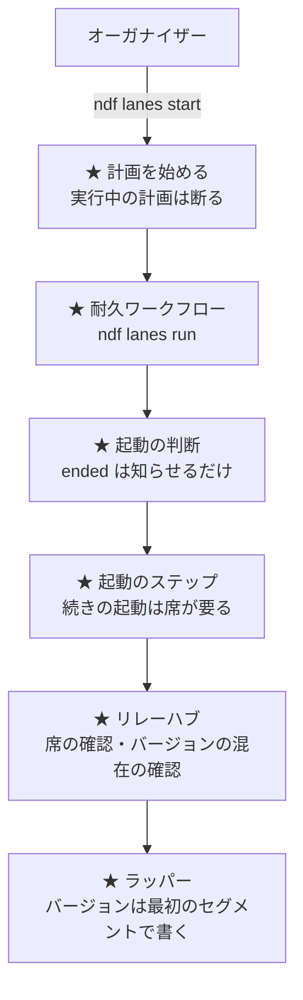
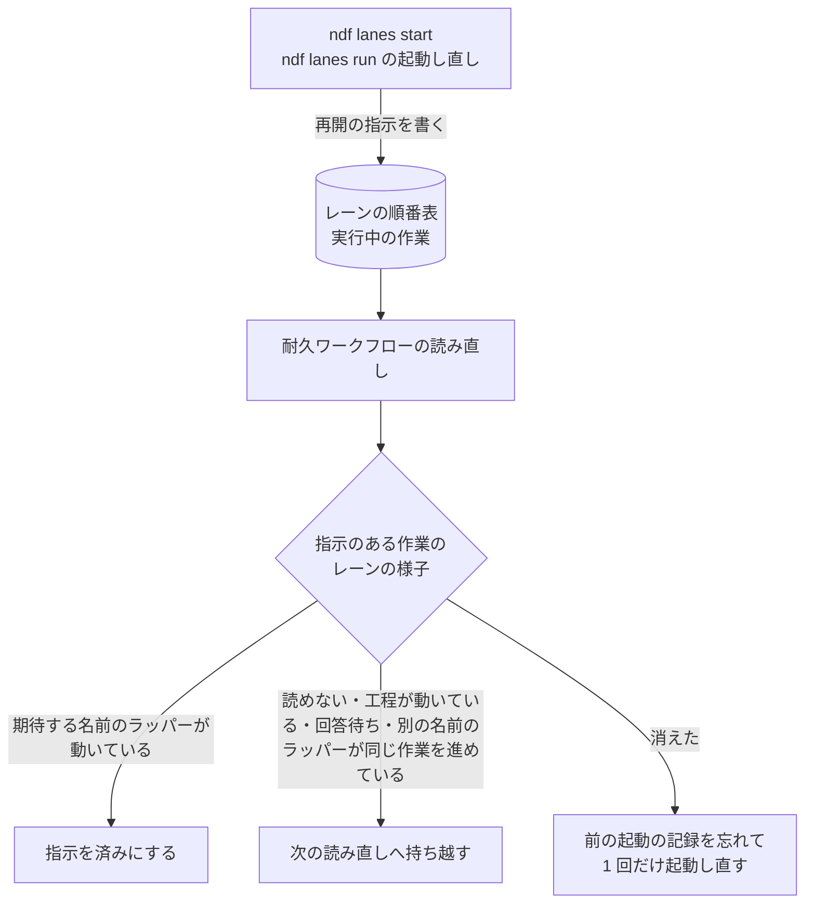
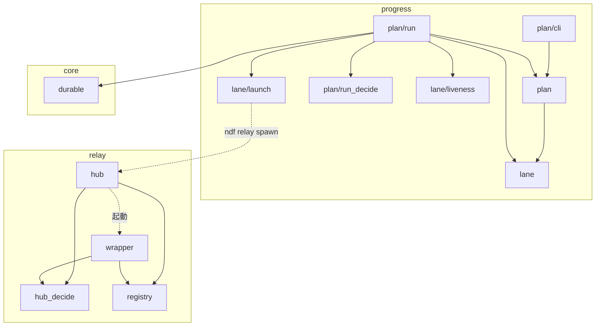
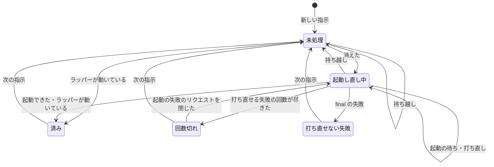
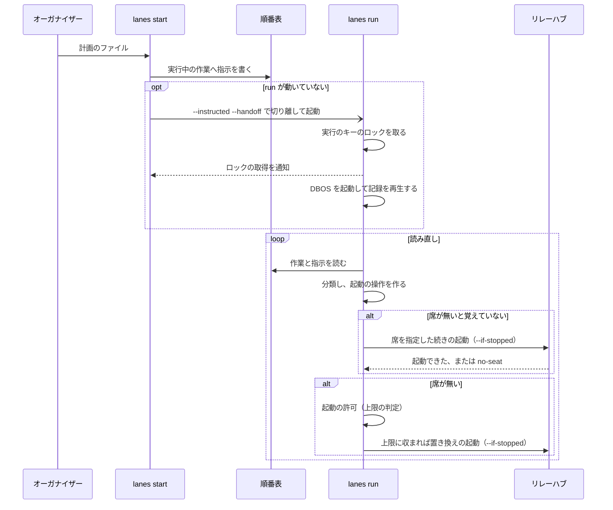

# 並列の計画: 消えたレーンを `ndf lanes start` 1 つで止まった所から再開できる（#4575）

これまで、開発コンテナの再起動などでレーンの conductor が消えると、並列の計画を元に戻す公式の手順が無かった。この設計では、`ndf lanes start` と `ndf lanes run` の起動し直しが、実行中の作業（スプリントか開発ループ）の記録へ「再開の指示」を書く。耐久ワークフローは指示を読み、消えたレーンだけを 1 回、止まった所から続ける入力で起動し直す。採らなかった案は「決定の記録」に、比べた製品とライブラリは末尾の「外部の調査」にある。

## 今の姿

何が起きたか・目的・受け入れ条件は要求仕様にある（[issue-4575-requirements.md](./issue-4575-requirements.md)、正は #4575 の本文）。この文書は「どう解くか」と「なぜその解き方か」だけを書く。

次の図は、これまでの経路である。★ の所をこの設計で変える。



この文書で使う中継と計画の部品は次のものである。

- **ラッパー**: conductor を起動して見守る常駐のプロセス。conductor（`claude` のセッション）を 1 回起動してから次へ切り替えるまでの区切りを**セグメント**と呼ぶ
- **リレーハブ**（`domains/relay/hub`）: `ndf relay spawn`・`restart`・`stop` の頼みを処理して、登録簿を書き、ラッパーを起動する（`ndf relay ls` はハブの順番を待たずに登録簿を読む）。常駐のプロセスではない。頼んだコマンドがハブの排他（`hub.lock`）を取れたら、そのプロセスがハブになって、溜まった頼みを順に処理する
- **計画のリクエスト**: オーガナイザーの対応を待つことを、計画のステートマシンに開いて残す記録（レーンの質問・リリース承認・止まり・起動の失敗）。この文書の「リクエスト」はこれを指す
- **順番表**: レーンのステートマシンの事象を畳み込んで得る、そのレーンの作業の並びと状態

これまでの構造のうち、設計に要るものは次のとおりである。

- 耐久ワークフローが起動するのは、次の 4 つのレーンである
  - 次の作業を始められるレーン
  - 回答が載ったレーン
  - 認証の失敗で `/goal` が外れたレーン
  - 中止させるレーン
- 実行中の作業を持ったままラッパーが消えたレーン（生死の判定 `ended`）には、`lane_stalled` のリクエストを開くだけである
- 耐久ワークフローを起動し直すと、DBOS は記録を再生する。判断の状態（起動したマーカー `launched`、失敗した起動 `failed`、知らせた止まり `noticed`）も前のまま戻る。判断の側からは、プロセスが入れ替わったことは分からない
- 中止した計画のステートマシンは終わっていて、事象を書けない。レーンのステートマシンは全体の状態を持たず、実行中の作業へ事象を書ける
- これまでは続きの起動（回答の後・`/goal` の入れ直し・中止）に `--seated` を付け、登録簿の席が一致すれば、レーン数の上限を再判定せずに起動していた。席は、どの作業のための起動かを登録簿に残す値である。登録簿の席が要求と違えば、リレーハブは断っていた。登録が無い場合と、席が空の場合も同じに断っていた
- これまでラッパーは、ロックを取った時点で起動できたとみなされていた。一方、バージョンを状態のファイル（`wrapper.json`）へ書くのは、最初のセグメントを始めた後だった。バージョンの無いラッパーは旧い NDF 10.x と同じに扱われていた
- これまで開発ループのオーナーのキー（1 つのループを書けるセッションを 1 つに限る記録）は、期限（6 時間）まで消えたセッションが持ち続けていた

## 文脈と制約

- 再開を指示するコマンドは新しく作らず、`ndf lanes start <計画のファイル>` を使う（要求の前提 2）
- 耐久ワークフローが動いたままで `start` を打たなければ、消えたレーンは今と同じく通知だけにする（受け入れ条件 6）。`ndf relay stop` で意図して止めたレーンを勝手に戻さないためである
- 11.0.52 で始めて途中のまま残った耐久の記録を、新しいコードが再生できなければならない（非機能の移行性）。`@durable.workflow` の関数の呼び出しの順は変えず、判断が新しい操作を打つのは、スナップショットの新しい項目に値があるときだけにする
- `progress` の層は `domains/relay` を読み込まない（import しない）。ハブの判断は結果 JSON の項目に載り、`progress` の層はそれを受け取る。上限の断り（`max-named`）はこれまでもこの形で渡している
- 計画・レーン・作業・登録簿の保存の形と、形の番号は変えない。移行は要らない

## 解き方の全体像



この設計では、次の形にする。

- 再開の指示を、実行中の作業へ追記する事象（`row_recovery_requested`）にする。耐久ワークフローが動いていてもいなくても、中止した計画でも同じに届くようにする
- 耐久ワークフローは指示のあった作業だけを見て、消えたレーンを今ある入力（`/goal` を入れて続ける・回答を受け取る・中止させる）で起動し直す
- 登録簿に席が無い続きの起動は、マシンの起動の許可（レーン数の上限の判定）を通して打ち直す
- 起動の途中のラッパーはバージョンの記録を待ってから判定し、手順書には再開の手順を足す

## ドメインモデル

### コンテキスト

| コンテキスト | 何の語が 1 つの意味に決まるか |
| --- | --- |
| 並列の計画（`ndf-parallel`） | レーン・消えたレーン・再開の指示・起動の待ち |
| 中継（`ndf-relay`） | ラッパー・登録簿・席・旧い NDF のラッパー |

これまでも並列の計画は、中継のコマンドの結果 JSON を読むだけで、中継の内部の型は読み込んでいない。この設計ではその境界を変えず、同じ結果 JSON に断りの項目（`no-seat`・`running`・`same-work`）を足す。

### 集約

| 集約 | オーナー（書き換えてよいもの） | 根 | エンティティ | 値オブジェクト |
| --- | --- | --- | --- | --- |
| レーンの順番表 | `ndf.progress.lane` の関数（再開の指示は `start` と `run` が呼ぶ） | レーンのステートマシン | 作業 | 再開の指示の番号 |
| 耐久ワークフローの判断の状態 | 判断の関数（`run_decide.decide`） | `RunState` | なし | 起動のキー・済んだ指示 |
| ラッパーの登録簿 | リレーハブ | 登録簿 | ラッパーの登録 | 席 |

### 不変条件

| # | 集約 | 条件 | 破れたときの扱い |
| --- | --- | --- | --- |
| I1 | レーンの順番表 | 再開の指示は実行中の作業にだけ書ける | 事象の表の検査が断る |
| I2 | 判断の状態 | 1 つの指示で起動し直しが成功するのは、作業 1 つにつき 1 回まで | 済みの指示は起動の候補にしない |
| I3 | 判断の状態 | 指示の無い作業の消えたレーンは起動し直さない | 今と同じ通知だけを出す |
| I4 | 判断の状態 | ラッパーが動いているレーンは、指示があっても起動し直さない | 期待する名前なら指示を済みにする。別の名前で同じ作業を進めていれば持ち越す |
| I5 | 登録簿 | 1 レーンのラッパーは 1 本である | 同じ名前の置き換えの起動と、実行のキーのロックで守る（今と同じ）。実行のキーのロックは、計画 1 つ（キー `lanes-<計画名>`）の `ndf lanes run` を、同じチェックアウトの保存先で 1 本に限る排他である |

### ドメインイベント

| # | イベント | 発生元 | 受け手 |
| --- | --- | --- | --- |
| E1 | ラッパーと耐久ワークフローが消えた | 外部（再起動・中断） | なし |
| E2 | 計画の再開を指示した | `ndf lanes start` | レーンの順番表 |
| E3 | 耐久ワークフローが動き直した | `ndf lanes run` | レーンの順番表（再開の指示） |
| E4 | レーンの様子を判定した | 読み直し | 判断の関数 |
| E5 | 消えたレーンの conductor を起動し直した | 起動のステップ | リレーハブ・`run.log` |
| E6 | conductor が止まった所から続けた | 起動した conductor | スプリントのステートマシン |
| E7 | 止まりのリクエストを閉じた | 判断の関数 | 計画のステートマシン |

## 構成要素

| 要素 | 責務（この設計で足す・変えること） |
| --- | --- |
| 事象の表（`contracts/workflow/progress.json`） | レーンの事象 `row_recovery_requested` を足す。書き手はオーガナイザーと計画の耐久ワークフロー、書けるのは実行中の作業 |
| レーンの順番表（`progress/lane`） | 実行中の作業すべてへ指示を書く関数を足す。事象を畳み込んで作る作業の記録は、最後の指示の番号、直近に記録した回答の本文、作業を実行中にした時刻を持つ。回答の後のマーカーを書く関数は回答の事象の番号を受け取り、番号が無いか最後の回答の番号と違えば書かずに断る |
| 生死の判定（`progress/lane/liveness`） | 指示のあった作業を「済ませる・持ち越す・消えた」に分ける純粋な関数を足す。材料（ラッパーの一覧・スプリントの待ちの結果・開いているリクエスト）は呼び手が渡す |
| 計画のステートマシン（`progress/plan`） | `start` は実行中の計画を断らず、指示を書く。区切りで止めた計画は、再開の事象に続けて指示を書く。リクエストは開いた時刻を持つ。起動し直しの上限待ちは、耐久の記録から読んで表示する |
| サブコマンド（`progress/plan/cli`） | 実行中の計画の `start` は、計画ごとの開始の排他の中で、`ndf lanes run` が動いていないときだけ起動し、起動した `run` の取得の通知を待つ。`row resumed` は `--answer <回答の事象の番号>` を受け取り、番号の無い呼び出しには番号を付けた次のコマンドと回答の本文を返す |
| 耐久ワークフロー（`progress/plan/run`） | 利用者が直接打った `run` は指示を書く。スナップショットに指示のあった作業の分類を載せる。起動し直したレーンを `run.log` に残す。起動し直しの起動のステップは、結果にレーン・作業のキー・指示の番号・時刻を持たせる。席が無いと断られた続きの起動は、起動の許可を通して打ち直す。指示の時刻を「最後に動いた時刻」に数えない |
| 判断の関数（`progress/plan/run_decide`） | 指示を済ませる、前の起動の記録を忘れる、起動し直しの操作を作る、古くなって打たなかった起動を数えずに読み直す、席が無かった起動を覚える、古い起動の失敗のリクエストを閉じる |
| 耐久の層（`core/durable`） | 実行のキーのロックを取った後、DBOS の起動の前に呼ぶ関数を受け取る。開始の排他を実行のキーのロックと同じ仕組みで取る。実行のキーのロックを待たずに取る指定を受け取る。DBOS を起動せずに、耐久ワークフローのステップの名前と結果を読む関数を足す |
| 起動の呼び出し（`progress/lane/launch`） | リレーハブの「席が無い」「動いている」「別の名前のラッパーが同じ作業を進めている」の断りを読み分ける。起動し直しの入力に、記録した回答と開発ループのキーの引き継ぎを加える。回答の後の入力の `row resumed` に回答の事象の番号を持たせる。指示による起動し直しは、作業の識別（リポジトリ・計画・レーン・スプリントの ID）をハブへ渡す。「バージョンが未記録」の返事には、起動の許可の排他の外で待ち、直前の確かめと許可をやり直す |
| 起動の入力の形（`contracts/conductor_input`） | 起動の入力のコマンドの並びの形と、入力からどの作業を進めるかを読み取る関数を持つ。`progress` の層と中継が同じものを使う |
| リリースのリクエスト（`progress/gate/release`・`asking`） | 同じ提示のリクエストが回答の無いまま閉じられていれば、開き直す。同じ `id` のリクエストが複数あれば、最後に開いたものを読む |
| 工程を進めるコマンド（`progress/gate/entry`） | `ndf progress next` は、回答の後の続きを待つ作業では工程を進めず、回答の本文と `row resumed` を返す |
| リポジトリの識別（`core/repo_identity`） | ラッパーの名前と、別名のラッパーの照合に使うリポジトリの識別を求める。`progress` の層と中継が同じものを使う |
| リレーハブ（`domains/relay/hub`） | 登録簿に登録が無いか席が空の続きの起動を、機械で読める項目を添えて断る。動いている対象を止めない置き換えの要求の種別を足し、その要求では、別の名前のラッパーが同じ作業を進めていないことも確かめる。バージョンの記録が無いラッパーがあれば、排他の中で待たずに「未記録」を返し、頼んだ側が排他の外で待って要求を書き直す。名前ごとの停止の回数を保存し、待つ間に止められた名前の起動を取り消す。項目の語は `contracts/named_cap` に置く |
| バージョンの確認（`domains/relay/registry`） | 今の保存先のロックを持つラッパーに今の持ち主のバージョンの記録が無ければ、「未記録」として返す。ラッパー自身の確認と頼んだ側の書き直しは、期限まで記録を待つ。上限の秒は `contracts/limits/relay.version-wait.json` に置く |
| ラッパー（`domains/relay/wrapper`） | ロックを取った直後、バージョンの確認の前に状態を書く |
| 開発ループ（`domains/loop`） | `ndf loop start` に、消えたセッションのキーを引き継ぐ `--takeover` を足す。`ndf loop get` は、結び付いた作業が回答の後の続きを待つ間、次の 1 手の代わりに回答の本文と `row resumed` を返す |
| 並列開発の手順書（`parallel.md`） | 再開の手順を足し、`start` の記述を実際の動きに合わせる。手で起動した conductor がある場合は、`ndf relay ls` で名前を確かめて `ndf relay stop` で止めてから `start` を打つことを書く |

図には呼び出しの関係を持つモジュールだけを載せる。次のものは載せない。

- 事象の表
- 手順書
- 定数と形の置き場（`contracts/named_cap`・`contracts/limits`・`contracts/conductor_input`）と、`core/repo_identity`、リリースのリクエストと工程を進めるコマンド（`progress/gate`）
- 開発ループ（起動し直した conductor がコマンドとして打つだけで、図のモジュールは呼ばない）



## 構造

この設計では、指示のあった作業 1 つを次の図のように扱う。状態は耐久ワークフローの判断が持つ（指示そのものは順番表に残る）。



失敗と回答待ちは、指示を終わらせる状態ではない。この設計では次のように扱う。

- **回答待ち**は持ち越しである。指示は未処理のまま残る。レーンの質問が回答されずに閉じられた後の読み直しでは、消えたと分類できる。リリースのリクエストは、回答の無いまま閉じられても開き直すので、回答待ちのままになる
- **回数切れ**は、起動の失敗のリクエストを閉じれば起動の候補へ戻る
- **打ち直せない失敗**（`final`）は、リクエストを閉じても戻らず、次の指示だけで試し直す
- **中止した計画**にはリクエストを書けないので、2 つの失敗はどちらも次の指示だけで試し直す。起動をすべて断念した耐久ワークフローは今と同じに `cancel_failed` で終わり、次の指示は `ndf lanes run` の起動し直しが書く（中止した計画への `start` は断る）

### 指示のあった作業の分類

この設計では、表の上から順に、先に当たったものに分ける。

| 順 | 場面 | 分類 |
| --- | --- | --- |
| 1 | ラッパーの一覧（`ndf relay ls`）を読めない | 持ち越す |
| 2 | 期待する名前のラッパーが動いている | 済ませる |
| 3 | 期待する名前でないラッパーが動いていて、その起動の入力が今の作業を進める | 持ち越す（二重の実行を避ける） |
| 4 | 中止した計画ではなく、回答の後の続きを待つ作業でもなく、今の作業に対応する未回答の質問かリリースのリクエストが開いている | 持ち越す（回答待ち） |
| 5 | `ndf progress wait <スプリントの ID> --timeout 0` の結果を読めない、または同じコマンドが、工程を進める実行が動いていると `wait_timeout` で返した | 持ち越す |
| 6 | ほか | 消えた |

順 1 と順 5 は受け入れ条件 11 に当たる。順 1 と、順 5 の前半は生死の判定の `unknown`、順 5 の後半は `working` である。順 5 はラッパーの生死とは別の判定で、ラッパーが消えても工程の実行は残りうる。

順 3 は、手で起動した conductor（起票の時の回避の手順）が同じ作業を進めている場合に当たる。ラッパーの一覧は登録簿の行の起動の引数（`args`）を持つので、追加の呼び出しは要らない。

`args` の 1 つの要素は、複数行にわたる起動の入力の全体である。要素とスプリントの ID を比べても、一部の文字列を探しても、正しく照合できない。そこで、起票の時の手動の起動と同じ形の入力（`launch.prompt` が組む、コマンドの並びを JSON で持つ文）から、次のように読み取る。

| 作業 | 同じ作業を進めると判定する条件 |
| --- | --- |
| スプリント | 作業を進めるコマンド（`progress next`・`progress cancel`・`lanes row resumed`・`lanes row end`・`loop start --row`）の引数のスプリントの ID が、今の作業の ID と完全に一致する |
| 開発ループ | 上に当たるか、次のすべてに当たる。`/goal` を入れ直す入力にはスプリントの ID が無いためである。(1) 登録簿の `cwd` から求めたリポジトリの識別が、計画のリポジトリと同じ (2) 入力の計画の名前とレーンの名前が今の作業と同じ (3) `loop get <レーン>` を持つ |

リポジトリの識別は、ラッパーの名前（`launch.wrapper_name`）に使うものと同じ値（`progress/command.repo_id`。リモートの URL、リモートが無ければメインディレクトリのパス）である。同じリポジトリの別の worktree は一致し、別のリポジトリにある同じ名前の計画とレーンは一致しない。分類とハブが同じ値を求められるように、この関数は両方の層から読める `core` へ移す。求めるのは、計画とレーンの名前が一致した別名のラッパーがあるときだけである。`cwd` から識別を求められないラッパーは当てない。

入力の形を読めないラッパーは当てない。持ち越すのは照合できたレーンだけで、ほかのレーンは起動し直す。このレーンの止まりは今と同じに知らせ、知らせの詳細に別の名前のラッパーの名前を添える。利用者が `ndf relay stop` で止めれば、後の読み直しで消えたと分類する。手で起動した conductor をレーンの起動として登録することはしない（要求の対象外）。

順 4 の「今の作業に対応する未回答の」は、次のように照合する。前の作業の質問や、回答を記録した後に閉じていない質問が開いたまま残っていても、今の作業の再開は止めない。

- リリースのリクエスト（`lane-release`）は、中身の `id` が、同じ読み直しで読んだ `ndf progress wait` の結果の `metrics.release_request.id` と同じで、開いているもの
  - この `id` は今の質問と承認資料の提示から作る値（`progress/gate/asking` の `request_id`）で、承認資料を出し直すと変わる。同じスプリントの古い提示のリクエストが開いていても当たらない
  - `ndf progress wait` は、リリース承認ゲートの待ちを返すときに、今の提示のリクエストが無ければ開き、古い提示のリクエストを閉じる（今の振る舞い）。そのため、承認資料を出し直す途中でレーンが消えても、今の承認の依頼はオーガナイザーに届く
  - 開いたかどうかは、`ndf progress wait` を読んだ後に計画のリクエストを読み直して確かめる
  - これまでは、今の提示のリクエストをオーガナイザーが回答せずに閉じると、閉じた記録を使い直すので開き直されなかった。この設計では、閉じていてリリースの回答を持たないリクエストは無いものとして扱い、同じ `id` で開き直す。回答は、同じ `id` のうち最後に開いたリクエストから読む。出し直す前の提示のリクエストは `id` が違うので、その回答は使わない。承認しない場合は、閉じるのではなく `ndf lanes release --result rejected` で回答する
- レーンの質問（`lane_question`）は作業のキーも回答も持たないので、レーン名が同じで、今の作業を実行中にした事象（`row_started`）と、作業に最後に回答を記録した事象（`row_answered`）の両方より後に開いたもの。回答より前に開いた質問は、回答済みとみなす。事象の時刻で比べるので、前のバージョンが書いた記録にも当てられる

中止した計画に順 4 を当てないのは、`ndf lanes stop --now` が開いている質問を閉じず、終わった計画には回答も閉じる事象も書けないためである。質問を待っていたレーンも中止させる。

承認ゲートの回答を待つ作業でも、リクエストが開いていなければ消えたとする。質問がオーガナイザーに届いていないので、起動し直した conductor が問い直す。順 4 で持ち越したレーンの生死の判定と止まりの知らせは変えない。レーンの質問を回答せずに閉じた場合も、次の読み直しで消えたと分類して起動し直す。

回答の後の続きを待つ作業とは、回答が載り、conductor が `ndf lanes row resumed` を打っていない作業である。この作業には順 4 を当てない。手順書では、回答を載せた後にリクエストを閉じるためである。閉じる前にコンテナが落ちても、回答の後の起動を打てるようにする。

分類の材料は、同じ読み直しの生死の判定と共有する。ラッパーの一覧は 1 回、`ndf progress wait` は作業ごとに 1 回までしか読まず、分類の関数には読んだ値を渡す。分類のために `ndf progress wait` を読み足すのは、指示が未処理で、順 1〜4 で分類が決まらず、生死の判定がその値を読んでいない作業（回答の後の続きを待つ作業と、中止した計画の作業）だけである。指示が済んだ作業と、ラッパーが動いている作業には読み足さない。指示の分類は、止まりを判定しない中止した計画でも行う。

読み足す費用は、実在するスプリントの記録の写しで測った（2026-11-28。このリポジトリの開発の環境。11 回打ち、初回を除いた中央値）。LLM の token は使わない。

| スプリントの状態 | 1 回の所要時間 | GitHub API |
| --- | --- | --- |
| 工程の途中（動いている作業は無い） | 約 1.1 秒 | 打たない |
| 設計 PR の承認待ち | 約 1.8 秒 | PR の取得 1 回と、マージ先の設定の取得 1 回（`progress/gate/answering` の `github_observe`） |

承認待ちは、承認済みのスプリントの写しから回答の事象を除いて作った。工程を流す作業が動いていて `wait_timeout` が返る状態は測っていない。

| 項目 | 値 |
| --- | --- |
| 回数 | 上の作業 1 つにつき、指示が未処理の間の読み直し 1 回ごとに 1 回 |
| 回数が増える場合 | 持ち越しが続くか、起動し直しが上限を待つとき。読み直しの間隔が 60 秒なら、1 時間で最大 60 回である |
| GitHub API が増える場合 | 回答の後の作業が承認待ちのまま上限を待つとき。1 作業につき 1 時間で最大 120 回である。回答の後の作業と中止した計画の作業は承認待ちだけでは持ち越さないので、持ち越しの間に承認待ちの取得を繰り返さない |
| 比べる値 | 生死の判定は、ほかの実行中の作業に対して、今も読み直しごとに同じコマンドを打っている |

毎回打つ形を採る。比べた案は次の 3 つである。

- **読むだけの照会を足す**: 工程の実行が動いているかを状態の保存先から直接読めば、CLI の起動も GitHub API も増えない。`ndf progress wait` は読むだけではなく、リリースの回答の取り込みや依頼の開き直しも行う。ただし、同じ判定の材料を 2 通りで読むことになり、生死の判定が打つ分は減らない。増えるのは再開の後の短い間だけなので採らない
- **工程の完了の通知を待つ**: 工程を流す作業から耐久ワークフローへ送る経路は今は無い。通知を失った場合に備える読み直しも残るので、経路が 2 つになる
- **間隔を空けて確かめ直す**: 打つ回数は減るが、前に確かめた時刻を判断の状態に持つ必要があり、工程が終わってから起動し直すまでが延びる

### 起動し直しの入力

この設計では、次の 3 つを使い分ける。

| 作業の様子 | 起動の操作 | 最初の入力 |
| --- | --- | --- |
| 計画が中止 | 中止させる操作（今と同じキー） | 中止させるコマンドの並び |
| 回答の後の続きを待つ | 回答の後の操作（今と同じキー） | `ndf lanes row resumed <ID> --answer <回答の事象の番号>` から続ける並び |
| ほか | `/goal` を入れ直す操作（キーは `recover:<スプリントの ID>:<指示の番号>`） | `/goal` の行と、`ndf progress next <ID>`（開発ループは下の 2 つのコマンド） |

「ほか」の操作は、認証の失敗の入れ直しとキーが違い、認証の失敗の入れ直しの回数には数えない。

入力には、これまでの形に次の 2 つを加える。

- **記録した回答**: 作業に回答が記録されていれば、直近の回答の本文を「この作業で直近に記録した回答」として添える。承認ゲートでない質問の回答は、順番表の `row_answered` にしか残らないためである。`ndf lanes row resumed` を打った後に消えた作業にも添える
- **開発ループのキー**: 指示による起動し直しのうち、中止させる操作でないものでは、開発ループの作業は最初に `ndf loop start <レーン> --row <スプリントの ID> --session <S> --takeover` を打つ（決定 8）。回答の後の続きを待つ作業は、キーを引き継げた後に `row resumed` を打ち、`ndf loop get <レーン>` を打つ。ほかの作業は、続けて `ndf loop get <レーン>` を打つ。引き継ぎが断られたら `row resumed` を打たないので、作業は回答の後の続きを待つままになる。作業を実行中にした後、ループを始める前に消えた場合も、このコマンドがループを始める
- **中止させる操作**には `loop start` を足さない。今の中止の入力（`ndf loop stop <レーン> --by organizer --now` から始まる並び）をそのまま使う。止める操作はキーを要らず、始まっていないループをここで始めない

回答を添えるのは、指示によらない回答の後の起動も同じである。

### 回答の後のマーカーと回答の番号の照合

これまで `ndf lanes row resumed` はスプリントの ID だけを受け取り、どの回答の続きかを確かめずにマーカーを書いていた。この設計では次のようにする。

- 回答の後の起動の入力は、起動の操作が持つ回答の事象の番号を `row resumed <ID> --answer <番号>` に持たせる。指示によらない回答の後の起動も同じである
- `row resumed` は、マーカーを書くのと同じトランザクションで、計画の排他の中で作業の最後の回答の番号を読む。番号が違えば、マーカーを書かずに終了コード 0 でなく断る
- 入力は、`row resumed` が断られたら後のコマンドを打たずに応答を終える、と指示する

起動の後に新しい回答が載っても、古い入力の conductor はその回答を再開済みにできない。作業は回答の後の続きを待つままなので、次の読み直しが新しい番号の候補でラッパーを置き換える。

**番号の無い呼び出し**は、前のバージョンが組んだ入力を持つ conductor から来る。実行中のセッションの入力は、プラグインを更新しても書き換わらない。そこで、`--answer` が無い呼び出しは引数の誤りにせず、次のように扱う。

- マーカーを書かずに断る
- 結果に、最後の回答の本文と、その番号を付けた次のコマンド（`next`）を載せる。要約には「後のコマンドより先に、この回答を受け取って `next` を打つ」と書く
- conductor が `next` を打てば、本文を受け取った回答が再開済みになる。その間にさらに回答が載れば番号が違うので、書かずに断る
- conductor が `next` を打たずに後のコマンドへ進んでも、次の項のとおり先へは進まない

**回答の後の続きを待つ作業は、マーカーの無いまま先へ進めない。** 前のバージョンの入力は、`row resumed` に続けて `ndf progress next <ID>`（開発ループは `ndf loop get <レーン>`）を打つ。また、更新の前から動いている前のバージョンの `lanes run` は、期限の後に起動し直すときも番号の無い入力を組む。そこで、入力の側ではなく、conductor が打つ新しいコマンドの側で止める。

| 呼び出し（作業が回答の後の続きを待つ間） | 振る舞い |
| --- | --- |
| `ndf progress next <ID>` | 工程を進めずに断り、回答の本文と `row resumed <ID> --answer <番号>` を `next` で返す |
| `ndf loop get <レーン>`（ループがレーンの作業に結び付いている） | 次の 1 手の代わりに、同じ本文と `next` を返す |
| `ndf progress wait` と、状態を読むほかのコマンド | 変えない |

| 前のバージョンの入力を受けた conductor | 続き方 |
| --- | --- |
| 動いている `lanes run` が新しいバージョン | 番号の無い `row resumed` か、続く `progress next`・`loop get` が返す `next` を打って続く |
| 動いている `lanes run` が前のバージョン | 同じである。`run` が組む入力は番号の無いままでも、止めるのも `next` を返すのも conductor が打つコマンドなので、`run` のバージョンに依らない |
| conductor のセッションが前のバージョンのコマンドを打つ | 今と同じに番号なしでマーカーを書く。行き止まりにはならない |

conductor がどの `next` も打たずに終われば、起動の期限（`parallel-run.launch`）の後の起動し直しを待つ（今の振る舞い）。起動し直した conductor も同じコマンドで止まり、同じ `next` を受け取る。

### 起動の候補の優先順位

指示がまだ済んでいない作業（持ち越し・起動し直し中・回数切れ・打ち直せない失敗）には、これまでの回答の後の候補と認証の失敗の候補を作らない。1 回の読み直しで 1 つの作業から作る起動の候補は 1 つまでである。候補の入力は、その読み直しの作業の様子で上の表から選ぶ。起動を待つ間や回答を待って持ち越す間に回答が載れば、次の読み直しからは回答の番号を持つキーの候補に変わる。指示が済んだ作業の候補の作り方は変えない。

中止した計画の中止させる候補は、指示のある作業では次のようにする。

| 指示の分類 | 中止させる候補 |
| --- | --- |
| 持ち越す（ラッパーの一覧を読めない、別の名前のラッパーが同じ作業を進めている、または工程の実行が動いているか読めない） | 作らない |
| 消えた | 中止させる候補を 1 つ作る |
| 済ませる（ラッパーが動いている） | 今と同じに扱う。まだ中止の入力で起動していないラッパーは、置き換えて起動する。これは中止のための起動で、消えたレーンの起動し直し（I4）ではない |

指示の無い作業の中止させる候補は、今と同じに作る。

### 起動する直前の確かめ

起動の候補を作ってから起動のステップを打つまでの間に、計画や作業は変わりうる。また、耐久ワークフローがステップの結果を記録する前に落ちると、回復した DBOS は同じステップをもう一度打つ。前のバージョンや、指示より前の読み直しが作ったステップも打ち直される。

そこでこの設計では、起動の操作に、候補を作った読み直しでの指示の番号を持たせる（指示が無ければ 0。前のバージョンが記録した操作も 0 になる）。ラッパーを止める操作を除くすべての起動のステップは、打つ直前に次を確かめる。

| 確かめること | 起動しない場合 |
| --- | --- |
| 作業の指示の番号 | 順番表の最後の指示の番号が、操作の番号より新しい |
| 計画の状態 | 中止させる操作なのに計画が中止でない。続ける操作なのに計画が中止か完了である |
| 作業の状態 | 中止させる操作と続きの操作なのに、作業が実行中でない |
| 作業を始める操作 | 今の順番表で始められる作業でない。条件は候補を作る時と同じ `wakeable_lanes` で、計画が実行中で、対象がレーンの最初の未着手の作業で、`after` を満たし、レーンに実行中の作業が無いことである |
| 回答の番号 | 回答の後の操作の持つ番号が最後の回答の番号と違うか、最後の回答より後に `row_resumed` が記録されている。前の回答に対する `row_resumed` は理由にしない。ほかの続ける操作なのに、回答の後の続きを待っている |

当たれば起動せず、成功にも失敗にも数えない。次の読み直しが、そのときの様子から候補を選び直す。このため、指示が出た行では、指示より前に作られた通常の起動のステップは、動いているラッパーを置き換えない。

起動してよいかは、この確かめの時点の状態で決める。確かめの後、起動の許可の排他やハブの順番を待つ間に、計画の中止や新しい回答が記録されることがある。その起動は取り消さず、次の読み直しの候補が置き換える。これは今の起動の扱いと同じで、排他は足さない。

| 確かめの後に起きたこと | 次の読み直し |
| --- | --- |
| 計画の中止 | 中止させる候補（キー `cancel:<ID>`）がラッパーを置き換えて、中止の入力で起動する |
| 新しい回答 | 起きた conductor の `row resumed` は番号が違うので断られる。回答の後の候補（新しい回答の番号を持つキー）がラッパーを置き換える |
| 区切り停止（作業を始める起動） | 起きた conductor の `ndf lanes row start` が、計画が実行中でないので断る |

指示による起動し直しは、さらに、同じ作業を進めるラッパーが無いことをハブの排他の中で確かめる。分類の後に手動の起動が受け付けられる場合があるためである。起動は `ndf relay spawn --replace --if-stopped` に作業の識別を添えて打つ。ハブは何も止めずに、次のように返す。

| ハブが排他の中で見たもの | 返す項目 | 指示の扱い |
| --- | --- | --- |
| 期待する名前の対象がロックを持つ | `running` | 済ませる |
| 登録簿にある別の名前のラッパーがロックを持ち、その起動の入力が同じ作業を進める（分類の順 3 と同じ条件） | `same-work` とその名前 | 済ませない。次の読み直しの分類で持ち越す。失敗と起動の試みに数えない |
| バージョンの記録を待つ間に、期待する名前への停止が処理された | `stopped` | 済ませる。利用者が止めたので起動し直さない。失敗に数えない |

ハブは手動の `ndf relay spawn` の要求も順に処理する。分類の後で手動の起動が先に受理された場合、ハブはその後に届いた自動の起動し直しを `same-work` で断り、手動で起動したラッパーを残す。指示による起動し直しの**後**に打たれた手動の起動と、ハブを通らない起動（`ndf relay run`）は防げない。

`running` が返った指示の起動は、そこで打ち切る。指示は済ませる。同じキーを続けて打たないように、起動の記録（`launched`）は起動した時と同じに残す。新しく起動していないので、起動の試みの回数には数えず、`run.log` にも書かない。`run.log` に書くのは、ハブが今回新しく起動したときだけである。

### 前の起動の記録を忘れる

この設計では、消えたと分類した最初の読み直しで、判断の関数がその作業の前の記録を 1 回だけ忘れる。忘れるのは次の記録である。

- 続きの起動のキー（`cancel:`・`next:`・`goal:`・`recover:` にその作業のスプリントの ID が続くもの）の `launched`・`failed`・`final`・回数
- まだ書いていない知らせ
- 止まりのキー（`noticed`）

打ち直しても起動できない失敗（`final`）の印も、同じ作業の続きの起動のキーから消す。新しい指示は利用者がもう一度試すことを求めたもので、その間に原因（上限の設定の誤りや、起動の入力を組めないバージョン）が直っていることがある。原因が残っていれば、1 回打った時点でまた `final` になり、起動の失敗を知らせる。同じキーの開いた起動の失敗があれば、重ねて開かない。次の指示が来るまで、`final` のキーは打ち直さず、リクエストを閉じても戻さない（今と同じ）。

起動し直す予定の作業の止まりは知らせない。起動し直した直後の 1 回の読み直しでも、続きの起動の直後と同じく、止まりを知らせない。起動し直しの回数が尽きた作業は、今と同じに `launch_failed` と止まりを知らせる。

作業を実行中にする前に消えたレーン（作業が未着手）には指示を書かない。これまでと同じに、起動の期限が過ぎた後に最初の入力で起動し直す。

### 古い起動の失敗のリクエスト

開いた `launch_failed` が残る計画は、全部の作業が終わっても完了しない。この設計では、次の 3 つがそろう `launch_failed` を耐久ワークフローが閉じる。

- 起動のキーが、指示を持つ作業のものである（`<レーン>/<作業のキー>`、または `cancel:`・`next:`・`goal:`・`recover:` にその作業のスプリントの ID が続くキー）
- 開いた時刻が、その作業の最後の指示より前である
- 今の読み直しで、そのレーンのラッパーが動いているか、その作業が終わっている（完了か中止）

起動し直した作業が次の読み直しより前に終わり、ラッパーも終わることがあるので、作業の終わりでも閉じる。

指示より後に開いた起動の失敗は閉じない。中止した計画にはリクエストを書けないので、閉じない。

## データ構造

| 場所 | 足すもの | 空の扱い |
| --- | --- | --- |
| レーンのステートマシンの事象 | `row_recovery_requested`（作業のキーと書き手。payload は持たない） | 無ければ指示は無い |
| 作業の記録の畳み込み（`LaneRow`） | 最後の指示の事象の番号と時刻、直近の回答の本文（`row_answered` の payload から引く）、作業を実行中にした事象の時刻 | 0・無し |
| 計画の畳み込みのリクエスト | 開いた事象の時刻 | — |
| 耐久の記録のスナップショット | 指示のあった作業の（レーン・作業のキー・スプリントの ID・指示の番号・分類）。終わった作業は分類を「終わった」にする。別の名前のラッパーで持ち越すレーンは、その名前を止まりの理由に載せる | 空の並び（前のバージョンが書いたスナップショット） |
| 起動の操作（`Launch`） | 候補を作った時の指示の番号と、指示による起動し直しかの印 | 0・偽（前のバージョンが記録した操作） |
| 起動のステップの結果（耐久の記録） | 指示による起動し直しでは、レーン・作業のキー・指示の番号・時刻。待たされた場合は今の `waiting` の項目も持つ | 項目が無ければ起動し直しの待ちに数えない |
| 判断の状態 | 済んだ指示、記録を忘れた指示のキー、席が無いと断られた起動のキー | 空 |
| 実行のキーのロックと同じ保存先 | 開始の排他（キー `lanestart-<計画名>`） | 取られていなければ誰も開始していない |
| リレーハブの保存先 | 名前ごとの停止の回数（停止の要求を処理するたびに 1 増やす） | 無ければ 0 |
| 同じ保存先の取得の通知 | `start` が渡した識別子。起動した `run` が実行のキーのロックを取った直後に書き、`start` が読んで消す | 無ければ、まだ取っていない |

指示の事象は追記するだけである。作業の記録が持つ指示の値は、最後の指示の番号である。前のバージョンは知らない種類の事象を読み飛ばすので、作業の状態は変わらない。

## 入出力のコントラクト

| 呼び出し | この設計の後の振る舞い |
| --- | --- |
| `ndf lanes start <計画のファイル>`（実行中の計画） | 指示を書く。`ndf lanes run` が動いていなければ切り離して起動する。子が取得を通知した場合と、通知せず終了したものの別の `run` がロックを持つ場合は成功する（終了コード 0）。通知せず期限まで生きている子は、終了を確認して失敗を返す。ほかの成否は「`start` と実行中の `run`」の表に従う |
| 同（区切りで止めた計画） | 今と同じに再開し、実行中の作業が残れば指示も書く。`run` は今と同じに必ず起動する |
| 同（未着手・作る前） | 今と同じ |
| 同（完了・中止） | 今と同じに断る |
| `ndf lanes run <計画名>` | ロックを取った後、実行中の作業へ指示を書いてから耐久ワークフローを続ける。完了した計画は今と同じに何もしない |
| `ndf lanes run <計画名> --instructed` | `start` が起動するときの形。指示は `start` が書いてあるので、書かずに耐久ワークフローを続ける |
| 同 `--instructed --handoff <識別子>` | 実行中の計画の `start` だけが使う。実行のキーのロックを待たずに取る。取れたら取得を通知してから続け、取れなければ何もせずに終わる |
| `ndf relay spawn --replace --seat <席> --seated` | 登録簿に登録が無いか席が空なら、`items` に `{"refusal": "no-seat"}` を載せて断る。別の席を持つ登録は、今と同じに項目なしで断る |
| `ndf relay spawn --replace --if-stopped ...` | 同じ名前のラッパーがロックを持っていれば、止めずに `items` に `{"refusal": "running"}` を載せて断る。作業の識別を添えた要求で、別の名前のラッパーが同じ作業を進めていれば、`{"refusal": "same-work", "name": <名前>}` を載せて断る。ハブへの要求は、`replace` とは別の新しい種別にする。種別を知らない旧版のハブは「知らないリクエスト」を返し、頼んだ側は `replace` と同じに、対応版のハブが処理するまで要求を書き直す。旧版のハブが対象を止めることは無い。`--seated` の無い新しい種別の要求には、`replace` と同じに、呼び手の上限とその出所を載せる（`hub._carries_cap`） |
| `ndf loop start <名前> --row <ID> --session <S> --takeover` | 別のセッションの期限内のキーを引き継ぐ。ループが `--row` と同じ作業に結び付いているか、まだ結び付いていないときだけで、別の作業に結び付いたループは今と同じに断る |
| 起動と再起動の要求（バージョンの記録が無いラッパーがある） | ハブは何も止めず起動せずに `items` に `{"refusal": "version-pending", "name": <名前>, "stops": <その名前の停止の回数>}` を載せて返す。頼んだ側が期限まで書き直し、期限を過ぎれば今と同じ混在の断りを返す |
| `ndf relay spawn ... --no-wait` | `version-pending` を待たずに呼び手へ返す。耐久ワークフローの起動し直しと行を始める起動が使う |
| `ndf relay spawn ... --after-stops <回数>` と、書き直した要求 | その名前の停止の回数が違えば、起動も停止もせず `{"refusal": "stopped"}` で断る |
| `ndf lanes status <計画名>` | 起動し直しが上限で待つレーンにも `machine_wait` を載せる。形は今と同じである |
| `ndf lanes row resumed <スプリントの ID> --answer <番号>` | 番号が最後の回答の事象の番号と同じならマーカーを書く。違えば書かずに断る。`--answer` が無ければ書かずに断り、回答の本文と番号を付けた `next` を返す |

### 入出力のスキーマ

引数と結果の形はスキーマ（`contracts/schemas/io/`）が決めているので、コマンドと一緒に変える。引数のスキーマとコントラクトのページ（`docs/contracts/`）は引数の定義から生成し直し、結果のスキーマは手で直す。

| スキーマ | 変えること |
| --- | --- |
| `lanes.args` | `row resumed` の `--answer`（省ける）と、`run` の `--instructed`・`--handoff` |
| `lanes.result` | `run_pid` に null を許す。`row resumed` の断りに載せる回答の本文（`answer`）を足す。番号を付けた次のコマンドは、結果の共通の `next` で返す |
| `relay.args` | `spawn` の `--if-stopped`・作業の識別を渡す引数・`--no-wait`・`--after-stops` |
| `relay.result` | `items` の `refusal` に `no-seat`・`running`・`same-work`・`version-pending`・`stopped` を足し、`stops` を足す |
| `loop.args`・`loop.result` | `start` の `--takeover` と、`get` が回答の本文を返す項目 |
| `progress.result` | `next` が回答の後の続きを待つ作業を断るときの回答の本文 |

### 計画のファイルの読み方

`start` は、今と同じに計画のファイルを読んで形を確かめ、中の `name` で記録の計画を探す。ファイル名から計画名は推定しない。記録の計画が既にあれば、ファイルに書いたレーンの構成は記録へ反映しない（区切りで止めた計画の再開と同じ扱い）。レーンの構成を変えるのは、今と同じに `ndf lanes lane add` と `ndf lanes set` である。

### `start` と実行中の `run`

この設計では、実行中の計画への `start` は、指示を書いた後に、計画ごとの**開始の排他**を取る。その中で、実行のキーのロックを待たずに 1 回だけ取りにいく。

開始の排他は、実行のキーのロックと同じ仕組み（`core/durable` の `run_lock`）を、別のキー `lanestart-<計画名>` で使う。保存先はどの worktree から打っても同じになる。計画の記録の保存先は worktree ごとに違うので、排他の置き場にしない。

| ロック | `start` がすること | `metrics.run_pid` |
| --- | --- | --- |
| 取れた（`run` が動いていない） | すぐ放して、`ndf lanes run <計画名> --instructed --handoff <識別子>` を切り離して起動する。起動した `run` の取得の通知まで、開始の排他を持ったまま待つ | 起動した `run` の pid |
| 取れない（`run` が動いている） | 起動しない。動いている `run` が次の読み直しで指示を読む | null |

引き渡しの成否は、起動した子の取得の通知で判定する。実行のキーのロックが持たれているだけでは、子が取ったとは限らないためである。

| 起動した `run` | `start` がすること |
| --- | --- |
| 取得を通知した | 開始の排他を放して pid を返す |
| 通知せずに終わり、ほかの `run` がロックを持つ | 成功を返し、`run_pid` は null にする。ロックを持つ `run` が指示を読む |
| 通知せずに終わり、ロックを持つ `run` も無い | 失敗を返す |
| 期限を過ぎても通知せず、生きている | 子を終了させ、終わったことを確かめてから、失敗を返す。打ち直せば新しい `run` を 1 つだけ起動する |

- **実行のキーのロックは、開始の排他を持つ間にだけ取りにいく。** ロックを待つ `run`（利用者が直接打ったもの、区切りで止めた計画の `start` が起動したもの）は、ロックの上で止まって待たない。開始の排他を取る・実行のキーのロックを待たずに試す・開始の排他を放す、を間隔を空けて繰り返し、今のロックを待つ上限で打ち切る。そのため、先に待っていた `run` が、引き渡しの途中にロックを取ることは無い。例外は `start` が起動した子（`--handoff`）で、親が開始の排他を持っているので、子は排他を取らずに実行のキーのロックを 1 回だけ試す
- 前のバージョンの `run` はこの手順を守らず、ロックの上で待つ。それが先に取れば、子は通知せずに終わり、上の表の「ほかの `run` がロックを持つ」になる
- `--handoff` を持つ `run` はロックを待たないので、`start` を打ち直しても、ロックを待つ余分な `run` は残らない
- 引き渡しの期限の秒と確かめる間隔は `contracts/limits/parallel-run.handoff.json` に置く。期限は、ロックを待つ上限より短くする
- 区切りで止めた計画の `start` は、前の `run` が終わりかけていることがあるので、今と同じに起動してロックを待たせる。待ち方は上のとおりである

動いている耐久ワークフローが指示を読むのは次の読み直しである。待っている間の読み直しの間隔は `parallel-run.poll`（既定 60 秒）である。起動などを処理している間は読み直さないので、その処理が終わった後の読み直しで指示を読む。ハブの応答を待つ起動があると、60 秒より長くかかることがある。

## 処理の流れ

この設計では、`start` からの再開を次の順で進める。



利用者が直接打った `run` は、ロックを取った後、DBOS の起動の前に指示を書く。DBOS の起動より前に書くのは、回復した耐久ワークフローが先に読み直して、止まりの知らせを開くのを避けるためである。`start` も `run` を起動する前に指示を書くので、同じ順になる。

席が無くて打ち直すときは、作業を始める起動と同じ経路で起動の許可を通す。上限に当たれば起動の待ちになり、失敗に数えない。判断の状態は、その起動のキーに席が無かったことを覚える。次の読み直しからは `--seated` を送らず、起動の許可から始める。上限に当たっている間は `ndf relay spawn` を打たない。覚えた値は、起動できた時点と、次の指示で消す。

起動の許可は、レーンごとの起動し直しがそれぞれ判定する。同じ読み直しで先のレーンが上限で待たされても、後のレーンの判定は省かない。

- ほかの計画は、読み直しの途中でも枠を返す。空きを知らせる経路は無いので、判定を省くと、空いた枠が次の読み直し（既定 60 秒後）まで使われない
- 行を始める起動も、今は同じようにレーンごとに判定している
- 費用は、上限を待つレーン 1 本につき、読み直し 1 回ごとに `ndf relay ls` の読み取りとマシンの計画の数え直しが 1 回である。席が無いと覚えた後は `ndf relay spawn` は打たない。LLM の token は使わない
- 速さと費用がぶつかる場合は速さを採る（MVV バージョン 11 の Value 5）

追加の時間は次のとおりである（2026-11-28。このリポジトリの開発の環境。11 回打ち、初回を除いた中央値）。

| 処理 | 1 回の時間 |
| --- | --- |
| `ndf relay ls`（登録 22 本、うち動作中 10 本） | 約 1.1 秒 |
| 計画 1 つのレーンの読み取り（SQLite。レーン 5〜6 本） | 約 10〜12 ミリ秒 |

上限を待つレーンが N 本で、読み直しの間に空きが出なければ、1 回の読み直しで 1 回の判定に比べて約 1.1 秒 × (N − 1) が増える。6 本なら約 5.5 秒で、読み直しの間隔（既定 60 秒）の 1 割ほどである。その間は起動の許可の排他も、判定 1 回ごとに約 1.1 秒持たれる。

同じ周回の空きを使えることを保って費用を減らす案は、次のように比べた。どちらも採らない。

| 案 | 採らない理由 |
| --- | --- |
| 状態の変化を検出したときだけ数え直す | 空きは、作業が終わることと、ラッパーが止まることで生まれる。ラッパーが止まったことを `progress` の層が知る手段は `ndf relay ls` で、変化の検出に、時間のほとんどを占める読み取りが要る |
| `ndf relay ls` の結果を周回の中で使い回し、計画だけ読み直す | 周回の途中で止まったラッパーの枠を数え続けるので、空きを使えない。減らせない側の読み取り（約 10 ミリ秒）だけが残る |

判定を省いて待ちの内容をほかのレーンへ適用する案も採らない。空きを使えないうえ、判定していないレーンの結果を作ることになる。

## 非機能の実現方式

| 大項目 | 条件 | 実現方式 |
| --- | --- | --- |
| 移行性 | 前のバージョンで始めて実行中のまま残った計画も再開できる | 指示は新しいバージョンが書く事象だけで決まり、既存の記録の移行は要らない。前のバージョンが書いたスナップショットには新しい項目が無いので、再生は前と同じ操作になる。登録簿の登録が欠けていても、起動の許可の経路で起動できる |
| 運用・保守性 | 起動し直したレーンの名前・続ける作業・理由を 1 レーン 1 行で残す | 起動のステップが、起動し直しに成功したときに、計画の記録の保存先の `run.log` へ直接 1 行足す（形は表の下）。`start` が起動した `run` でも、利用者が直接打った `run` でも同じ場所に残る。標準エラーには重ねて書かない。結果が記録されたステップは再生で打ち直さないので、行は重ならない |
| 運用・保守性（待ち） | 上限で起動を待つレーンの理由が見える | `ndf lanes status` は、起動し直しが上限の判定で待つレーンに `machine_wait` を載せる（これまでは未着手の作業を持つレーンだけ）。材料は下の「起動し直しの待ちの表示」。待つレーンの実行中の作業は、これまでも本数に数えているので、ほかのレーンの起動を新しく妨げない |

### 起動し直しの待ちの表示

起動し直しが上限を待っていることは、耐久の記録（起動のステップの結果とスナップショット）に残る。`ndf lanes status` はこの記録を直接読み、写したファイルは持たない。`status` が自分で待ちを推定しないのは、指示が済んだか、起動の回数が尽きたかを、順番表や通知の有無からは決められないためである。

`status` は、次のすべてに当たるレーンに `machine_wait` を載せる。

- 今の耐久ワークフローの ID で、実行のキーのロックが持たれている（`run` が動いている）
- 記録の最後のスナップショットで、そのレーンの指示の分類が「消えた」である
- そのレーンの指示による起動し直しの、最後の起動のステップの結果が待ちである
- 作業が実行中で、順番表の最後の指示の番号が結果と同じである
- そのレーンのラッパーが動いていない

待ちの結果は、そのレーンの起動のステップが自分で判定したものだけである。ほかのレーンの結果の写しは保存しない。起動した、`running`、`same-work`、失敗、直前の確かめで打たなかった結果は、前の待ちより新しいので表示が消える。上限を待つ間に今の質問やリリースのリクエストが開いた場合は、次の読み直しの分類が持ち越しになり、表示が消える。消す操作は要らない。

`status` は、実行のキーのロックを試す間、開始の排他を持つ。`status` が一瞬取ったロックを、`start` が動いている `run` と読み違えないためである。

写したファイル（`recovery-waits.json`）を耐久ワークフローが書く案と、実測で比べた（2026-11-28。開発の環境、SQLite、DBOS 3.1.0、20 回以上の中央値。待ち 6 本分の内容）。

| 読み方 | 読む時間 | 書き込み |
| --- | --- | --- |
| 耐久の記録を直接読む（記録 200 件） | 約 4 ミリ秒 | 追加なし |
| 同（記録 2000 件） | 約 15 ミリ秒 | 追加なし |
| 写したファイルを読む | 約 0.03 ミリ秒 | 待つレーン 1 本につき読み直しごとに 1 回（約 0.9 ミリ秒）と、消すための書き込み |

`status` は、実行中の作業ごとに `ndf progress wait`（約 1.1〜1.8 秒。上の実測）を打つコマンドである。読む時間の差は 15 ミリ秒以下で、写しを持つ根拠にならない。直接読む場合に初めて DBOS を読み込むと約 0.3 秒かかる。そのため、指示があり、ラッパーが動いていない実行中の作業がある場合だけ読む。この方法では、回答の後の作業や承認待ちの作業が上限で待つ場合も、同じに表示できる。`status` は待ちの表示のために、ほかの計画や登録簿の席を読み足さない。

起動し直しの 1 行は次の形にする。

```text
ndf lanes: レーン <レーン> を起動し直した（ラッパー <名前>・作業 <キー>・続ける作業 <スプリントの ID か開発ループ>・理由 <ラッパーが無い・回答の後の続き・止めた計画の中止>）
```

## 決定の記録

### 決定 1: 再開の指示を、動いている耐久ワークフローにも中止した計画にも届けるため、実行中の作業へ追記する事象にする

- **質問**: `start` と `run` の起動し直しが「消えたレーンを戻してほしい」ことを、どう耐久ワークフローへ伝えるか
- **選んだ案**: レーンのステートマシンの実行中の作業へ `row_recovery_requested` を追記し、耐久ワークフローは読み直しで読む。回答の事象（`row_answered`）と同じ形である
- 採らなかった案: 計画のステートマシンの事象にする（中止した計画は終わっていて書けず、受け入れ条件 12 を満たせない）
- 採らなかった案: DBOS のメッセージ（`durable.send`）で伝える（送り先の ID の記録があれば、耐久ワークフローが止まっていても保存され、同じ ID の回復で受け取れる。ただし記録がまだ無い ID には送れない。区切りで止めた後は次の番号の ID で始め直すので、前の ID へ送った指示は引き継がれない。指示が順番表の外に残り、`ndf lanes status` からも読めない）
- 採らなかった案: `start` が自分で conductor を起動する（起動の経路が 2 つになる。動いている耐久ワークフローと同じレーンを同時に起動しうる）
- **代償**: 動いている耐久ワークフローが起動し直すのは次の読み直しになる。待っている間なら読み直しの間隔まで、起動などを処理している間はその終わりまで遅れる
- 作り方: 自前で作る
- 比べた候補: LIB1 / PRD1 / PRD3
- 根拠: Value 3 / Value 8（MVV バージョン 11）。再起動をまたいで指示を失わず（同じ手順は毎回同じ結果になる）、作業の事実を作業の履歴 1 か所に追記だけで持つ（正しいデータ構造で作られる）。PRD1

### 決定 2: コンテナの再起動を判断の再生に頼らず見つけるため、`ndf lanes run` はロックを取った後に指示を書く

- **質問**: `start` を打たずに `ndf lanes run` だけを起動し直した場合に、何を起動し直しの合図にするか
- **選んだ案**: 利用者が直接打って実行のキーのロックを取れた `ndf lanes run` を「起動し直し」とみなし、DBOS を起動する前に指示を書く。耐久の層は、そのための関数を受け取る。`start` が起動する `run`（`--instructed`）は書かないので、利用者の 1 回の操作は作業ごとに 1 件の指示になる
- 採らなかった案: 耐久ワークフローの中で再生を見分ける（再生は決定的で、プロセスの入れ替わりは中から見えない）
- 採らなかった案: ロックの前に書く（動いている耐久ワークフローがあるときに打った 2 本目が、起動し直しを起こす）
- 採らなかった案: DBOS の起動の後に書く（回復した耐久ワークフローが先に読み直し、止まりの知らせを開く）
- **代償**: 計画の耐久ワークフローを始めるたびに、実行中の作業の数だけ事象が増える
- 作り方: 自前で作る・ライブラリやサービスを使う
- 比べた候補: LIB1 / LIB2 / PRD2
- 根拠: Value 3 / Value 8（MVV バージョン 11）。版上げ・再起動・セッションの入れ替えをまたいでも、進行中の作業と人の回答は失われず、止まった所から続く。同じ事実を 2 か所に持たない。LIB1

### 決定 3: 意図して止めたレーンを勝手に戻さないため、起動し直すのは指示のあった作業だけで、指示ごとに 1 回にする

- **質問**: 消えたレーンを、常に起動し直すか、指示があったときだけにするか
- **選んだ案**: 指示のあった作業だけを分類し、期待する名前のラッパーが動いていれば済ませ、読めない・工程が動いている・回答を待つ・別の名前のラッパーが同じ作業を進めている場合は持ち越し、消えていれば 1 回だけ起動し直す。再び消えれば止まりを知らせる
- 採らなかった案: 望ましい状態と今の状態の差を常に埋める（`ndf relay stop` で止めたレーンが戻り、受け入れ条件 6 に反する。起動して落ちるレーンを繰り返し起動する）
- 採らなかった案: 指示を書いた時点で 1 回だけ判定する（工程の処理がまだ動いていたレーンは、処理が終わっても止まったまま残る）
- **代償**: 持ち越した作業のレーンが後で消えると、`start` から時間がたってから起動し直されることがある
- 作り方: 自前で作る
- 比べた候補: PRD1 / PRD2 / PRD4
- 根拠: Value 2 / Value 3（MVV バージョン 11）。起動して落ちるレーンの繰り返しに費用を使わず（安く使える）、`start` を打ち直しても動いているレーンは変わらない（同じ操作を打ち直しても、結果は 1 回打ったときと変わらない）。PRD2

### 決定 4: 起動の期限を待たずに戻すため、消えた作業の前の起動の記録は忘れる

- **質問**: 再生した判断の状態に「起動済み」「起動の失敗が尽きた」が残る作業を、どう起動し直すか
- **選んだ案**: 消えたと分類した最初の読み直しで、その作業の続きの起動の記録と止まりのキーを消す。打ち直しても起動できない失敗の印も消し、指示ごとに 1 回は試し直す
- 採らなかった案: 起動の期限（600 秒）が過ぎるのを待つ（失敗を 1 回数え、回数が尽きた作業は戻らない）
- 採らなかった案: 耐久ワークフローの記録を捨てて新しい ID で始める（作業を始める起動の記録と、知らせた止まりまで失う）
- **代償**: 判断の関数が、起動の記録を消す規則を 1 つ持つ
- 根拠: Value 3 / Value 5（MVV バージョン 11）。止まった所から続け（同じ手順は毎回同じ結果になる）、600 秒の期限を待たせない（速く届く）

### 決定 5: 新しいスプリントを作らず続けるため、起動し直しには今ある続きの入力を使う

- **質問**: 起動し直した conductor に、どの入力を渡すか
- **選んだ案**: 中止させる入力、回答を受け取る入力、`/goal` を入れ直して続ける入力の 3 つを、作業の様子で選ぶ
- 採らなかった案: 作業を始める入力で起動する（新しいスプリントや開発ループを作り、受け入れ条件 2 に反する）
- 採らなかった案: 前の会話を引き継いで開き直す（再起動をまたいで会話の ID と記録を引く経路が要り、文脈が大きいまま始まる。進行はステートマシンにある）
- **代償**: 消えた会話の途中の考えは引き継がれず、進行の記録に残った所から始まる
- 根拠: Value 2 / Value 3 / Value 11（MVV バージョン 11）。大きい文脈を持ち越さず（安く使える）、進行中の作業と回答を失わず（同じ手順は毎回同じ結果になる）、続きの入力を 2 つ作らない（重複と冗長が無い）

### 決定 6: 席の記録が欠けていてもレーン数の上限を守るため、ハブは理由を添えて断り、呼び手が起動の許可を通す

- **質問**: 登録簿に登録が無いか席が空のレーンの続きの起動を、どこで上限の判定へ回すか
- **選んだ案**: ハブは `no-seat` の項目を添えて断る。耐久ワークフローは、作業を始める起動と同じ起動の許可を通して打ち直す。上限に当たれば起動の待ちになる
- 採らなかった案: ハブの中だけで上限の判定へ切り替える（計画をまたぐ起動の排他を取らない。ハブから見えるのは動いているラッパーと、頼みに載った名前だけなので、実行中の作業を持つがラッパーが止まったレーンを数え落とす）。この設計では今と同じに、呼び手がマシンの計画を数えて起動の許可を判定し、そのレーンの名前を頼みに載せ、ハブが動いているラッパーとの和集合で最後の判定をする
- 採らなかった案: 起動し直しは常に席を指定しない（上限が埋まっていると続きが待たされ、作業を始めた席を続きに使う今の決まりに反する）
- 採らなかった案: 手で起動した conductor の席を登録するコマンドを作る（要求の対象外で、手で起動する必要が無くなる）
- 採らなかった案: `ndf relay ls` の結果で席が無いと分かるレーンは、席を指定した起動を省いて起動の許可から始める。一覧は登録の有無と席を持つので作れる。省けるのは、席が欠けたレーンの指示ごとに最初の `ndf relay spawn` 1 回だけである。コンテナの再起動だけでは登録簿は残り、席は欠けない。一方で、席が合うかの規則（席を書く前のバージョンの行は役と計画が同じなら通す、など）を `progress` の層にもう 1 つ持つことになる。一覧を読んでから起動するまでに登録が変わる場合に備えて、ハブの確認も残る
- **代償**: 席が欠けたレーンは、最初の 1 回だけ `ndf relay spawn` を 2 回打つ
- 根拠: Value 3 / Value 9（MVV バージョン 11）。手で起動した後でも同じ手順で再開でき（同じ手順は毎回同じ結果になる）、上限の数え方は計画の層に、登録簿の確認はハブに残る（責務の分かれた設計で作られる）

### 決定 7: 起動の途中のラッパーを旧バージョンと取り違えないため、今の保存先のロックはバージョンの記録を待ってから判定する

- **質問**: バージョンをまだ書いていないラッパーと、バージョンを持たない旧い NDF 10.x のラッパーを、どう見分けるか
- **選んだ案**: ロックの保存先で分ける。保存先は 2 つで、どちらも今ある設定で解く
  - 旧い NDF 10.x: `<旧い状態の根>/relay/<作業ディレクトリ>/relay.lock`（`registry.legacy_root`）。すぐに旧バージョンとする
  - 今の版: `<状態の保存先>/relay/wrappers/<名前>/relay.lock`（`locations` の `relay-wrappers`）。今の持ち主が書いた記録のバージョンで判定する
  - 同じ名前の `wrapper.json` には、前の持ち主の記録が残る。今の持ち主の記録とみなすのは、状態が `stopped` でなく、`pid` のプロセスが生きているものだけにする。そうでなければ、記録が無いのと同じに待つ。待つ間にロックが解放された対象は、混在の判定から外す
  - 待つ期限は上限の秒（`relay.version-wait`、5 秒）で、1 回の起動の要求の全体で 1 つを共有する。記録の無いラッパーが何本あっても、待ちは合わせて 5 秒までである。期限を過ぎても記録が無いラッパーがあれば、今と同じに断る
  - あわせてラッパーは、ロックを取った直後、ほかのラッパーを確かめる前に、バージョンを書く（状態 `running`、セグメントは無し）
- 待つ範囲: 待つのは、起動と再起動を頼んだ側と、自分の起動の初めに混在を判定するラッパーである。停止の要求と `ndf relay ls` は混在を判定しないので、待ちを持たない
- ハブの排他: ハブは `hub.lock` を持ったまま待たない。混在の判定で記録の無いラッパーがあれば、何も止めず起動せずに `version-pending` を返す。頼んだ側は排他の外で少し待ち、新しい要求として書き直す。対応版のハブが排他の中で混在を判定し直す。旧版のハブを待つ今の書き直し（`hub.submit`）と同じ形で、後ろの停止の要求は待たされない
- 起動の許可の排他: 耐久ワークフローの起動は、起動の許可の排他（`machine.admitted`）を持ったまま `ndf relay spawn` を打つ。その中で待つと、空き枠があっても別の計画の起動の許可が待たされる。そこで `--no-wait` で打ち、`version-pending` が返れば排他を放してから待つ。打ち直す前に、直前の確かめと起動の許可（空き枠の判定）をやり直す。期限は同じ上限の秒で、過ぎれば混在の断りとして扱う。席を使う続きの起動も同じ手順にする
- 待つ間の停止: 同じ名前のラッパーを止める要求が待つ間に処理されたら、先の起動・再起動は取り消す。ハブは名前ごとの停止の回数を排他の中で数えて保存し、`version-pending` の返事に載せる。書き直した要求はその回数を持ち、違っていればハブは `stopped` で断る。停止の対象が動いていなくても数える。別の名前の停止は回数を変えないので、起動はそのまま続く
- 版を上げる前の頼む側は `version-pending` を書き直さず、起動の断りとして返す。打ち直せば通る
- 採らなかった案: ハブが `hub.lock` を持ったまま記録を待つ（後ろに並んだ停止の要求が、混在の判定 1 回につき最大で上限の秒だけ待たされる）
- 採らなかった案: バージョンの無い今の保存先のロックを、起動の途中とみなして通す（記録の前の短い間は、メジャーバージョンの違うラッパーも通り、受け入れ条件 14 の後半を満たさない）
- 採らなかった案: ハブがバージョンの記録まで待ってから「起動した」を返す（ハブを通らない起動と、ラッパー自身の確認には効かない）
- 採らなかった案: 登録簿のバージョンで補う（登録簿を書くのは起動の後で、ラッパー自身の確認の時点にはまだ無い）
- **代償**: 起動の途中のラッパーがある間の起動と、バージョンを書かないまま止まったラッパーがある場合の起動は、最大で上限の秒だけ遅れる
- 根拠: Value 7（MVV バージョン 11）。現象（起動の直後の断り）ではなく原因（バージョンを知る前の判定）を直し（不具合が根本原因から直される）、違うバージョンを混ぜない今の約束を保つ

### 決定 8: 消えた開発ループを待たせず続けるため、起動し直しの入力でオーナーのキーを引き継ぐ

- **質問**: 開発ループのオーナーのキーは、消えたセッションが期限（6 時間）まで持つ。起動し直した conductor はどう続けるか
- **選んだ案**: `ndf loop start` に `--takeover` を足し、指示による起動し直しの入力だけが使う。この起動は、期待する名前のラッパーが動いていないと確かめた後にしか打たない。引き継げるのは、ループが同じ作業に結び付いているか、まだ結び付いていないときだけである
- 採らなかった案: 期限を待つ（最大 6 時間止まる）
- 採らなかった案: 耐久ワークフローがキーを返す（消えたセッションの識別子で書くことになり、`progress` の層が開発ループの記録を書く）
- **代償**: キーを期限の前に別のセッションが取る経路が 1 つ増える
- 根拠: Value 3 / Value 5（MVV バージョン 11）。進行中の作業が止まった所から続き（同じ手順は毎回同じ結果になる）、空いたレーンを待ちで止めない（速く届く）

## 影響と危険

- **働く範囲**: 並列の計画（`ndf lanes`）を使う、利用先のすべてのリポジトリで働く。起動直後のラッパーの扱い（決定 7）は、中継（`ndf relay`）の起動すべてに効く。回答の後の起動に回答の本文を添える変更は、指示によらない回答の後の起動にも効く
- **プロジェクトごとに違うもの**: 足さない。レーン数の上限と読み直しの間隔は今の設定を使う
- **当たるモード**: 並列の計画と中継。スプリントの工程と承認ゲートは変えない

壊れうる箇所と扱いは次のとおりである。

| 壊れうる箇所 | 扱い |
| --- | --- |
| 耐久の記録の再生が前のバージョンと違う操作を打つ | 新しい操作はスナップショットの新しい項目があるときだけ打つ。前のバージョンの形のスナップショットを再生するテストを置く |
| 今の作業に対応する未回答の質問が、閉じ忘れのまま開いているレーン | 回答待ちとして持ち越し、起動し直さない。手順書に、このリクエストを確かめて回答することを書く。レーンの質問は閉じても起動し直す。リリースのリクエストは閉じても開き直すので、`ndf lanes release` で回答する。前の作業の質問や回答済みの質問は再開を止めないので、案内の対象にしない |
| 前のバージョンが開いた `launch_failed` のリクエスト | 指示より前に開いたものなので、レーンのラッパーが動いていると確かめた時点か、作業が終わった時点で閉じる。中止した計画では閉じない |
| 手で起動した conductor が動いたまま `start` を打つ（起票の時の回避の手順） | 起動の入力が同じ作業を進めるラッパーは、分類（順 3）とハブの排他の中の 2 か所で検出して、そのレーンを起動しない。ラッパーを使わない会話と、起動し直しの後の手動の起動は防げないので、手順書に、`start` の前に手で起動した会話を確かめて止めることと、再開の後は手で起動しないことを書く |
| 古いバージョンのプロセスがリレーハブの排他を持つ | 指示による起動し直しは新しい種別の要求なので、旧版のハブは処理せず、対象も止めない。対応版のハブが処理するまで要求を書き直し、ハブの応答の上限を過ぎれば起動の失敗になる |
| 同じファイルを触る別の変更（#4522・#4680・#4261） | 対象にしない。実装のマージで差分を合わせる |

### 代表のリポジトリでの振る舞い

| 代表のリポジトリ | 設定の要点 | 直した後に起きること | この種類で扱えなくなること |
| --- | --- | --- | --- |
| Web サービス | 並列の計画の設定。ステートマシンは SQLite か PostgreSQL | 開発の環境が再起動しても、`ndf lanes start` でレーンが続く | 無し |
| モバイルアプリ | 同上 | 同上 | 無し |
| 業務文書だけ | 同上 | 同上 | 無し |

### このリポジトリだけの事情

- 無し（このリポジトリの運用で決めた値を、振る舞いにも既定にも入れない）

## 用語

| 用語 | 意味 | 用語集への反映 |
| --- | --- | --- |
| 消えたレーン | 実行中の作業を持ち、ラッパーが動いていないと確かめられたレーン | 追加 |
| 再開の指示 | `ndf lanes start` と `ndf lanes run` の起動し直しが、実行中の作業へ書く事象 | 追加 |

ラッパー・セグメント・リレーハブ・計画のリクエスト・順番表の意味は「今の姿」の初めに書いた。

## テスト設計

コンテナの再起動は、ラッパーの一覧・スプリントの待ち・順番表の事象を差し替えて再現する。実際の待ちと子プロセスは持ち込まない。

| 受け入れ条件・不変条件 | どの振る舞いで縛るか | どう壊したら落ちるべきか |
| --- | --- | --- |
| 条件 1 | 実行中の計画で `start` が成功し、記録を作り直さない。ファイル名が `name` と違っても `name` の計画を再開する。3 本の消えたレーンが、通常の起動と同じ名前で起動し直される | `start` が実行中を断る・指示を書かない・消えたレーンを 1 本でも飛ばす・ファイル名で計画を探す |
| 条件 2 | 起動し直しの入力が `/goal` の行で始まり、中止でなければ、スプリントは `progress next`、開発ループは `loop start --takeover` と `loop get` を持つ。記録した回答があれば本文を含む | 作業を始める入力を渡す・回答を落とす |
| 条件 2（開発ループ） | 消えたセッションの期限内のキーを、同じ作業の `--takeover` が引き継ぐ。回答の後の起動し直しの入力も、引き継ぎを `row resumed` より前に持つ。ループを始める前に消えた作業も始まる。別の作業に結び付いたループは断る。中止させる入力は `loop stop --now` から始まり、`loop start` を持たない | 期限内のキーで断る・別の作業のキーを取る・引き継ぐ前に `row resumed` を打つ・中止の入力でループを始める |
| 回答の番号の照合 | 回答の後の入力の `row resumed` が回答の事象の番号を持つ。起動の後に新しい回答が載ると、古い番号の `row resumed` は断られてマーカーを書かず、作業は回答の後の続きを待つままで、新しい番号の候補が出る。入力は断られた後のコマンドを打たないよう指示する | 番号を照合せずに書く・断った後も候補が消える |
| 番号の無い呼び出し | `--answer` の無い `row resumed` はマーカーを書かず、最後の回答の本文と番号を付けた `next` を返す。その `next` を打つとマーカーが書かれる。間に回答が増えれば断る | 引数の誤りで終える・番号なしで書く |
| マーカーの無いまま進まない | 前のバージョンの入力の並びを順に打っても、回答の後の続きを待つ作業では `progress next` が工程を進めず、`loop get` が次の 1 手を返さず、どちらも `row resumed --answer` を返す。マーカーを書いた後は今と同じに進む。`progress wait` は変わらない。入力を組んだ `run` のバージョンを条件にしない | マーカーなしで工程が進む・番号なしの `row resumed` を断るだけで次の手が無い |
| 入出力のスキーマ | `run_pid` が null の成功、番号の無い `row resumed` の `next` と回答の本文、新しい `refusal` の各項目が、実際の結果のスキーマを通る（テストの共通の検査 `_checked_emit`） | スキーマを直さずに出力だけ変える |
| リリースのリクエストの開き直し | 今の提示のリクエストを回答せずに閉じると、次の `progress wait` が同じ `id` で開き直し、開き直したリクエストへの回答が承認ゲートの回答になる。出し直す前の提示への回答は使わない。変更要求で閉じたリクエストは開き直さない | 閉じた記録を使い直す・古い提示への回答を適用する・回答済みを開き直す |
| 条件 3 | 起動し直した後にラッパーが動いていれば、開いていた止まりのリクエストと、指示より前の起動の失敗のリクエストが閉じる。次の読み直しの前に作業が終わりラッパーも終わった場合も起動の失敗が閉じ、計画が完了する。起動し直す予定のレーンの止まりは開かない | 指示の直後の読み直しで止まりを知らせる・指示より後の起動の失敗まで閉じる・ラッパーが動いている時にだけ閉じる |
| 条件 4 | `start` 無しの `run` の起動し直しでも指示が書かれる。2 回目の起動し直しでも、前の記録を持つ判断の状態から起動し直される。`--instructed` の `run` は指示を書かない | 指示を最初の 1 回だけ書く・記録を忘れない・`start` の 1 回で指示が 2 件になる |
| 条件 5 | 判断の状態を持ったまま 1 レーンだけ消えて指示が来ると、そのレーンだけが起動される。ロックが持たれていれば `start` は `run` を起動せず `run_pid` は null | 全レーンを起動する・2 本目の `run` を起動する |
| 起動する直前の確かめ | 候補を作った後に、計画が中止された、回答が載った、指示が書かれた、のどれでも起動せず、成功にも失敗にも数えない。作業を始める候補は、区切り停止の後と、前に別の作業が入った後に起動しない。同じ作業の 2 度目の回答は、1 度目の `row_resumed` があっても起動する。番号を持たない前のバージョンの起動の操作は、指示のある作業では起動しない | 古い入力で起動する・失敗に数える・止めた計画で作業を始める・`row_resumed` の有無だけを調べる・前の操作が動いているラッパーを置き換える |
| 確かめの後の中止と回答 | 確かめを通った起動の後に中止が確定すると、次の読み直しで中止させる候補が出る。回答が載ると新しい番号の候補が出る | 打った起動で中止や回答の候補が消える |
| `running` の応答 | 指示は済み、同じキーを続けて打たず、`run.log` に行が足されず、起動の試みに数えない | 起動の成功として記録する・直後に同じ候補が置き換える |
| 打ち直せない失敗 | `final` になった作業は、同じ指示の間はリクエストを閉じても打たず、次の指示で 1 回だけ打ち直す。開いた起動の失敗は重ねて開かない。回数切れの作業はリクエストを閉じると打ち直す。中止した計画の 2 つの失敗は、次の指示で打ち直す | 同じ指示で打ち直す・次の指示でも打たない |
| `start` の重なり | 起動の呼び出し・ロック・取得の通知・時計を差し替える。子が通知する前に 2 回目の `start` と直接の `run` を重ねても、子の起動は 1 回で、2 回目の `run_pid` は null。先に待っている直接の `run` があり、前の `run` がロックを放した直後に `start` を重ねても、引き渡しの途中の子がロックを取る。区切りで止めた計画の `start` が起動した待つ `run` でも同じである。別の worktree からでも同じ排他になる。通知せずに終わった子は、ほかの `run` がロックを持てば成功、無ければ失敗。期限を過ぎた子は終了を確かめてから失敗を返す。実際の子プロセスと待ちは使わない | ロックが持たれていることを子の取得とみなす・期限切れの子を残す・worktree ごとに排他を分ける |
| 別の名前のラッパー | 起票の時の手動の起動と同じ形（`launch.goal_prompt` で組んだ複数行の入力が `args` の 1 要素）で、同じ作業を進める別の名前のラッパーがあると、そのレーンだけを起動せず、止まりの知らせにその名前を添える。開発ループはリポジトリ・計画・レーンの一致で当てる。同じリポジトリの別の worktree の入力は当て、別のリポジトリの同じ名前の計画とレーンは当てない（分類とハブの両方で確かめる）。ID が一部だけ一致する入力は当てない。分類の後で手動の起動が先に受理された場合、ハブはその後に届いた自動の起動し直しを `same-work` で断り、手動で起動したラッパーを残す。そのラッパーが止まると起動する | `args` の要素と ID を直接比べる・部分一致で当てる・2 本目の conductor を起動する・全部のレーンを止める |
| 旧版のハブ | 止めない置き換えの要求に「知らないリクエスト」が返ると、頼んだ側が書き直し、対象は止まらない | 旧版が処理できる種別で送る |
| 条件 6・I3 | 指示の無い消えたレーンは、通知だけで起動の操作が出ない | 指示の有無を見ずに `ended` を起動する |
| 条件 7・I4・I5 | ラッパーが動いているレーンは起動の操作が出ない。指示が 2 回続いても起動は 1 回である。起動のステップを打ち直しても、動いているラッパーは `--if-stopped` で残り、古い指示の番号のステップは起動しない | 動いているレーンを置き換える |
| I2（候補の優先順位） | 指示が済んでいない回答の後の作業から出る候補は 1 つで、持ち越しの間は 0。待つ間に回答が載ると回答の番号のキーになる | 通常の候補と起動し直しの候補が同時に出る |
| I2 | 起動し直しに成功した後、同じ指示でレーンが再び消えても起動せず、止まりを知らせる | 済みの指示をもう一度使う |
| 条件 8 | 回答の起動を打った記録が残る消えたレーンが、回答を受け取る入力で起動される。回答のリクエストが開いたままでも起動される | 記録を忘れない・順 4 を回答の後の作業にも当てる |
| 条件 9 | 今の作業の未回答の質問かリリースのリクエストが開いていれば起動せず、開いていなければ承認待ちのレーンも起動する。レーンの質問を回答せずに閉じた後の読み直しで起動する。同じスプリントの古い提示のリリースのリクエストだけが開いているレーンは持ち越しにしない。前の作業の質問や、回答と `row resumed` の後に閉じていない質問が開いたままのレーンは起動する | スプリントの承認待ちだけで起動を止める・レーン名やスプリントの ID だけで照合する・持ち越しを済みにする |
| 条件 10 | 未着手の作業には指示を書かず、起動の期限の後に最初の入力で起動する（今のテストが通る） | 未着手の作業へ指示を書く |
| 条件 11 | 一覧かスプリントの待ちを読めないレーンと、工程の処理が動いているレーンは起動せず、読めて消えた後の読み直しで起動する | 持ち越しを済ませる扱いにする |
| 条件 12 | 区切りで止めた計画は実行中の作業だけを起動する。中止した計画は、質問のリクエストが開いたレーンも含めて、中止させる入力で起動する。指示があり持ち越す作業には中止の起動を作らない。完了と中止の計画への `start` は断る | 次の作業を起動する・中止した計画へ続ける入力を渡す・中止した計画で質問待ちを除外する・工程が動く作業へ中止の conductor を起動する |
| 条件 13 | 登録が無いレーンと席が空の登録は `no-seat` で断られ、起動の許可を通して起動する。上限なら起動の待ちで、`launch_failed` を開かない。次の読み直しは `--seated` を送らず、上限を待つレーンはそれぞれ起動の許可を判定する。先のレーンが待たされた後に枠が空けば、同じ読み直しの後のレーンが起動する。`--seated` の無い要求は呼び手の上限を載せ、ハブの環境の値より先に使われる。別の席の登録は今と同じに断る | 断りを起動の失敗に数える・別の席も通す・毎周 `--seated` を送る・先の待ちを後のレーンへ当てる・上限を載せない |
| 非機能・待ちの表示 | 上限で待つ起動し直しは、回答の後と承認待ちの作業を含めて、`status` に `machine_wait` が出る。指示が済んだレーン、待つ間に回答待ちになって持ち越したレーン（次の読み直しで消える）、回数が尽きたレーン（中止した計画を含む）、別の席で断られたレーン、`run` が終わった後には出ない。`status` はほかの計画を読み足さない | 待っていないレーンに待ちを出す・待つレーンを落とす・古い結果を出す |
| 条件 14 | 状態のファイルを書く前のロックがあると、ハブは待たずに `version-pending` を返し、頼んだ側が差し替えた時計の中で書き直して、記録の後の判定で通る。その間の停止の要求は処理される。待つ間に同じ名前を止めると、書き直した要求は `stopped` で断られて起動せず、別の名前の停止では起動する。起動の許可の排他は待つ間は持たれず、打ち直しの前に許可を判定し直す。ラッパー自身の確認は記録を待つ。前の持ち主の記録（`stopped` か、`pid` が生きていない）は使わない。同じメジャーバージョンが記録されれば通り、違えば断る。記録されないままなら断る。記録の無いロックが複数あっても待ちの合計は上限の秒までである。10.x のロックは待たずに断る | 記録を待たずに旧バージョンにする・ハブの排他の中で待つ・前の記録で判定する・ラッパーごとに期限を数える |
| 条件 15 | 手順書の中身はレビューで確かめる（文言を照合するテストは書かない） | — |
| 非機能・移行性 | 指示の項目を持たないスナップショットの並びから、前と同じ操作の列が出る | 項目の無いスナップショットで例外か別の操作になる |
| 非機能・運用 | 起動し直しに成功すると、レーン名・続ける作業・理由を含む 1 行が `run.log` のファイルに足される。指示の事象は止まりの知らせの「最後に動いた時刻」を変えない | 行が出ない・失敗でも出る・標準エラーにだけ出る・指示の時刻が最後に動いた時刻になる |
| 処理の回数 | 1 回の読み直しで、`ndf progress wait` は作業ごとに 1 回まで。指示が済んだ作業と、ラッパーが動いている回答の後・中止の作業には読み足さない | 分類のために同じ作業をもう一度読む・全部の作業の値を先に読む |
| I1 | 未着手と完了の作業への指示は断られ、中止した計画の実行中の作業へは書ける | 事象の表の `from` を外す |

## 設計の結果

| 課題 | 扱い | 統合先 | 触るファイル |
| --- | --- | --- | --- |
| #4575 | 実装する | — | `plugins/ndf/contracts/workflow/progress.json`、`plugins/ndf/src/ndf/progress/lane/__init__.py`、`plugins/ndf/src/ndf/progress/lane/types.py`、`plugins/ndf/src/ndf/progress/lane/fold.py`、`plugins/ndf/src/ndf/progress/lane/liveness.py`、`plugins/ndf/src/ndf/progress/lane/launch.py`、`plugins/ndf/src/ndf/progress/plan/__init__.py`、`plugins/ndf/src/ndf/progress/plan/cli.py`、`plugins/ndf/src/ndf/progress/plan/run.py`、`plugins/ndf/src/ndf/progress/plan/run_decide.py`、`plugins/ndf/src/ndf/progress/gate/asking.py`、`plugins/ndf/src/ndf/progress/gate/release.py`、`plugins/ndf/src/ndf/progress/gate/entry.py`、`plugins/ndf/src/ndf/progress/command.py`、`plugins/ndf/src/ndf/core/repo_identity.py`、`plugins/ndf/src/ndf/progress/lane/machine.py`、`plugins/ndf/contracts/schemas/io/`（`lanes`・`relay`・`loop` の `args` と `result`、`progress.result`）、`docs/contracts/`（生成）、`plugins/ndf/src/ndf/core/durable.py`、`plugins/ndf/src/ndf/contracts/conductor_input.py`、`plugins/ndf/src/ndf/contracts/named_cap.py`、`plugins/ndf/src/ndf/domains/relay/hub.py`、`plugins/ndf/src/ndf/domains/relay/cli.py`、`plugins/ndf/src/ndf/domains/relay/registry.py`、`plugins/ndf/src/ndf/domains/relay/wrapper.py`、`plugins/ndf/contracts/limits/relay.version-wait.json`、`plugins/ndf/contracts/limits/parallel-run.handoff.json`、`plugins/ndf/src/ndf/domains/loop/cli.py`、`plugins/ndf/src/ndf/domains/loop/control_decide.py`、`plugins/ndf/skills/development-workflow/references/parallel.md`、`docs/glossary/glossary.json`、`docs/glossary.md`、`docs/glossary/ndf-parallel.md`、`plugins/ndf/tests/progress/test_lane.py`、`plugins/ndf/tests/progress/test_lane_liveness.py`、`plugins/ndf/tests/progress/test_lane_launch.py`、`plugins/ndf/tests/progress/test_plan.py`、`plugins/ndf/tests/progress/test_plan_run.py`、`plugins/ndf/tests/progress/test_plan_run_stall.py`、`plugins/ndf/tests/progress/gate/test_gate_release.py`、`plugins/ndf/tests/core/test_durable.py`、`plugins/ndf/tests/domains/relay/test_relay_hub.py`、`plugins/ndf/tests/domains/relay/test_relay_decide.py`、`plugins/ndf/tests/domains/relay/test_relay_wrapper.py`、`plugins/ndf/tests/domains/loop/test_loop_decide.py`、`plugins/ndf/tests/domains/loop/test_loop_cli.py` |

## 配布後の確認

テストと、同じコンテナの中でプロセスを終了させる確認では、再起動をまたぐ振る舞いは確かめられない。配布の後に次の 4 つを分けて確かめ、確かめていないものは済んだと記録しない。

| 確認 | 手順 | 確かめられること |
| --- | --- | --- |
| プロセスの終了 | 2 本以上のレーンを実行中にし、ラッパーと `ndf lanes run` を終了させてから `ndf lanes start` を打つ | 指示・分類・起動し直し・状態の表示。プロセスが終了すると、保持していたロックは解放される。一方、ロックのファイルや `wrapper.json`、tmux のサーバー、一時ディレクトリは、プロセスの終了だけでは消えるとは限らない。そのため再起動の確認にはならない |
| 実際のコンテナの再起動 | 2 本以上のレーンを実行中にして開発コンテナを再起動し、`ndf lanes start` を打って全レーンが `alive` に戻ることを見る | tmux のサーバーが無い状態からの起動、ロックの解放、登録簿と耐久の記録が再起動をまたいで残ること |
| 前のバージョンが残した記録からの再開 | 前のバージョン（11.0.52）で計画を始め、実行中のままラッパーと `ndf lanes run` を終了させる。プラグインを新しいバージョンへ更新してから `ndf lanes start` を打つ | 前のバージョンの耐久の記録の再生と、席・登録簿の引き継ぎ |
| 回答の後の入力の切り替え | 前のバージョンが回答の後の起動をした conductor が動いている間にプラグインを更新し、番号の無い `row resumed` を打つのを見る。前のバージョンの `lanes run` を動かしたままの場合と、新しいバージョンで起動し直した場合の両方で行う | どちらの場合も、返った `next` で回答の後の作業が続くこと。`next` を打つ前の `progress next` と `loop get` が先へ進まないこと |

再起動と前のバージョンの確認は、ほかの作業が動いていない開発コンテナで行う。

## 未確認のまま残ること

| 項目 | 内容 |
| --- | --- |
| 実際のコンテナの再起動の後の再開 | tmux のサーバー・ロック・耐久の記録のファイルの消え方は、テストでは再現しない。リリースの後に、上の「配布後の確認」の再起動で確かめる |
| 起動直後の断りの時間差 | コードから原因を読んだだけで、時間差は実測していない。バージョンの記録を待つ上限の 5 秒が足りるかは、続けて複数のレーンを起動し直す手動確認で分かる |

## 外部の調査

| 種類 | 調べるか | 理由 |
| --- | --- | --- |
| 標準・仕様 | 調べない | 変える形は NDF の中の取り決め（順番表・登録簿・結果 JSON）で決まり、合わせる相手の仕様が無い。形は製品の解き方で比べる |
| 主要な製品 | 調べる | 消えた実行の単位を、いつ誰が起動し直すかを比べる |
| ライブラリとサービス | 調べる | 回復と起動し直しを、今の依存（DBOS）や常駐の監視のツールに任せられるかを決める |

### 主要な製品

| # | 製品 | どう解いているか | 設計への反映 | 出典 |
| --- | --- | --- | --- | --- |
| PRD1 | Kubernetes のコントローラ | 望ましい状態と今の状態を繰り返し比べ、差を埋める | 判定と起動を読み直しのループに置く。差を常に埋める形は採らない（決定 3） | https://kubernetes.io/docs/concepts/architecture/controller/ （2026-11-28） |
| PRD2 | systemd の `Restart=` | プロセスが終わったときに起動し直すかを指定する。既定は `no` で、systemd の操作で止めたものは起動し直さない | 意図した停止を戻さない考え方に倣い、指示のあったときだけ起動し直す | https://man7.org/linux/man-pages/man5/systemd.service.5.html （2026-11-28） |
| PRD3 | tmux-resurrect | システムの再起動の後、利用者の操作で保存した環境を戻す（自動の復元は別のプラグイン） | 再開は 1 つのコマンドで指示する | https://github.com/tmux-plugins/tmux-resurrect （2026-11-28） |
| PRD4 | Claude Code の agent teams | `/resume` は同じプロセスの中の teammate を戻さない。利用者が作り直しを指示する | 実行の基盤の機能だけではレーンを戻せないので、NDF が起動し直す | https://code.claude.com/docs/en/agent-teams.md （2026-11-28） |

### ライブラリとサービス

| # | 候補 | バージョン | ライセンス | 最後のリリースの日付 | 終了のアナウンス | 要件を満たすか | 出典 |
| --- | --- | --- | --- | --- | --- | --- | --- |
| LIB1 | DBOS（今の依存。`plugins/ndf/uv.lock` は 3.4.0） | 3.7.0 | MIT | 2026-11-24 | 無し | 部分的。起動した実行者の途中のワークフローは記録から回復する。ワークフローが起動した外のプロセス（conductor）は戻さない | https://pypi.org/pypi/dbos/json ・ https://docs.dbos.dev/production/workflow-recovery （2026-11-28） |
| LIB2 | Supervisor | 4.3.0 | BSD 系 | 2025-08-23 | 無し | 満たさない。常駐を足す必要があり、作業の進み・質問待ち・レーン数の上限を知らない | https://pypi.org/pypi/supervisor/json （2026-11-28） |

### 確かめられなかったこと

| 対象 | 試した手段 | 結果と理由 |
| --- | --- | --- |
| ほかの AI 開発ツールの、並列の会話の再開 | 試していない（PRD4 のほか） | 起動の形が NDF の中継とリレーハブに固有で、判断に使う対象を PRD4 に絞った |

調べた量: 候補 6 件・取得の試み 8 回。
