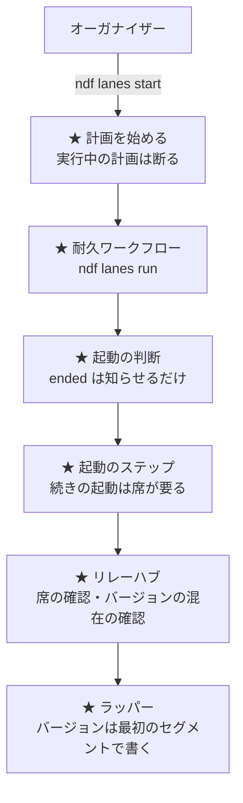
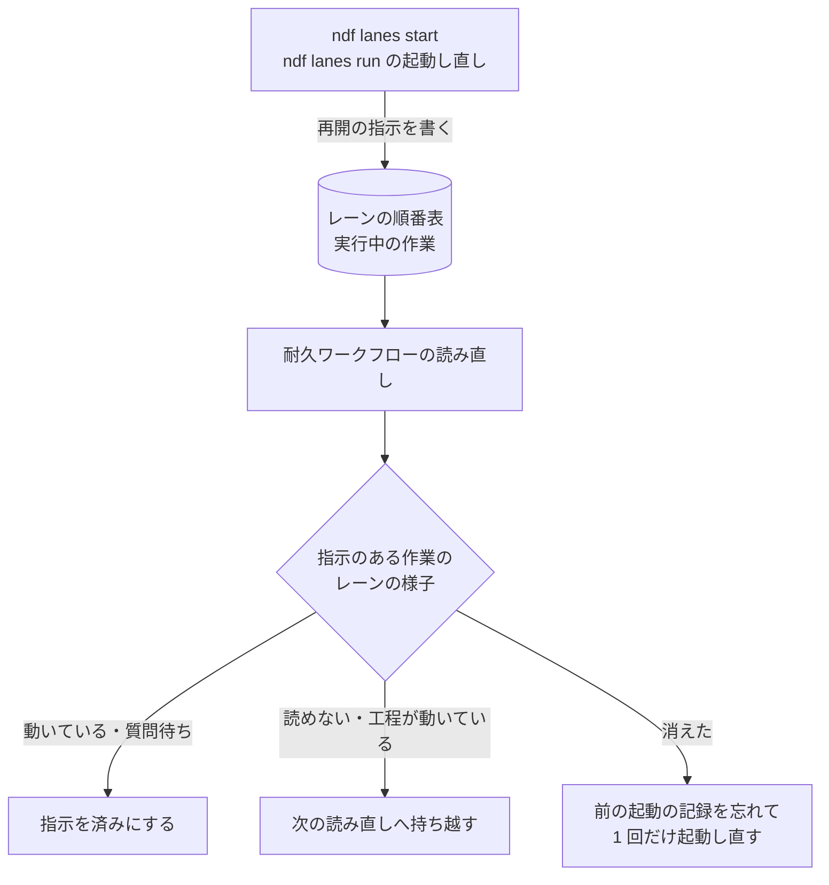
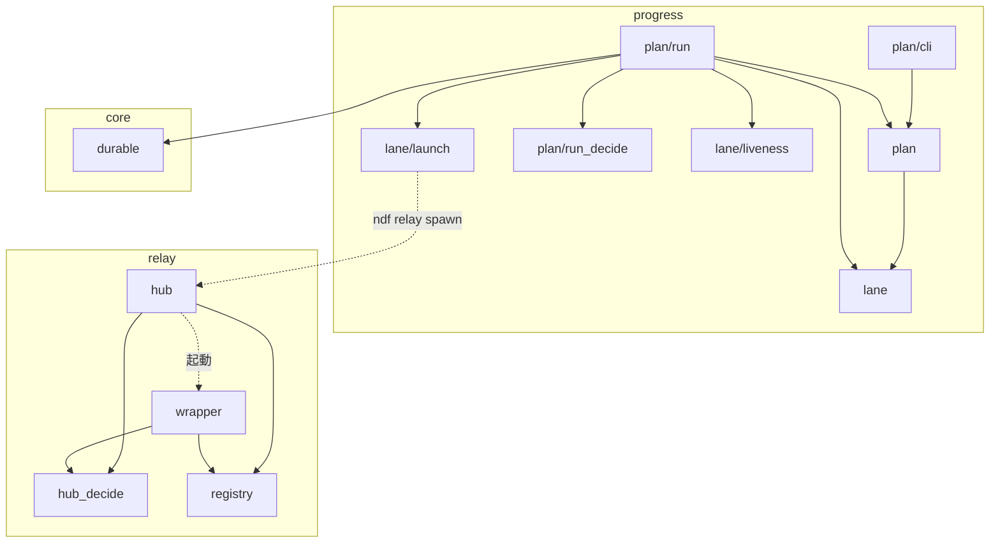
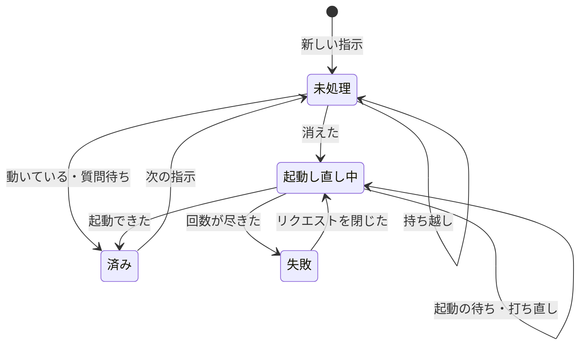
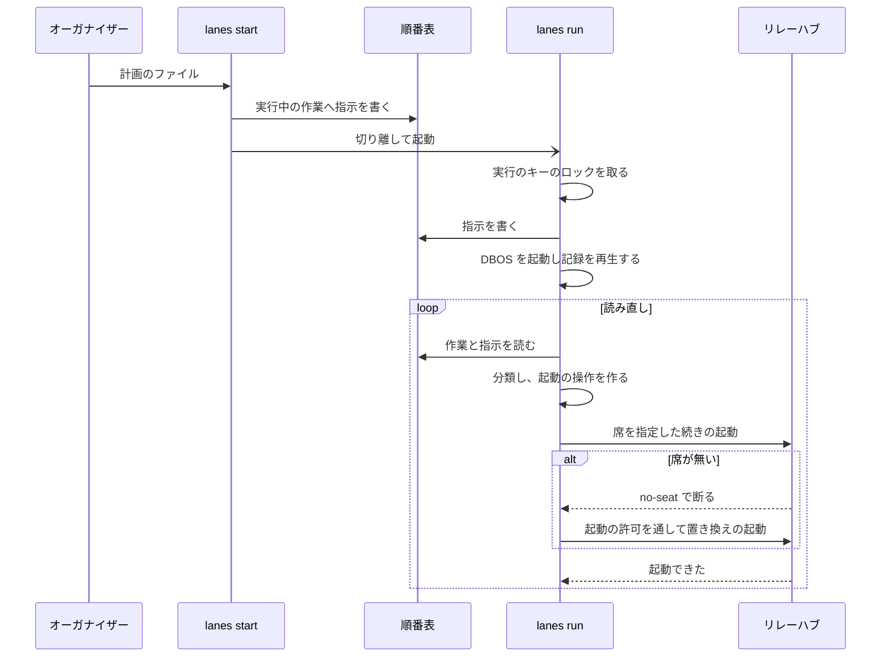

# 並列の計画: 消えたレーンを `ndf lanes start` 1 つで止まった所から再開できる（#4575）

これまで、開発コンテナの再起動などでレーンの conductor が消えると、並列の計画を元に戻す公式の手順が無かった。この設計では、`ndf lanes start` と `ndf lanes run` の起動し直しが、実行中の作業（スプリントか開発ループ）の記録へ「再開の指示」を書く。耐久ワークフローは指示を読み、消えたレーンだけを 1 回、止まった所から続ける入力で起動し直す。採らなかった案は「決定の記録」に、比べた製品とライブラリは末尾の「外部の調査」にある。

## 今の姿

何が起きたか・目的・受け入れ条件は要求仕様にある（[issue-4575-requirements.md](./issue-4575-requirements.md)、正は #4575 の本文）。この文書は「どう解くか」と「なぜその解き方か」だけを書く。

次の図は、これまでの経路である。★ の所をこの設計で変える。



これまでの構造のうち、設計に要るものは次のとおりである。

- 耐久ワークフローが起動するのは、次の 4 つのレーンである
  - 次の作業を始められるレーン
  - 回答が載ったレーン
  - 認証の失敗で `/goal` が外れたレーン
  - 中止させるレーン
- 実行中の作業を持ったままラッパーが消えたレーン（生死の判定 `ended`）には、`lane_stalled` のリクエストを開くだけである
- 耐久ワークフローを起動し直すと、DBOS は記録を再生する。判断の状態（起動したマーカー `launched`、失敗した起動 `failed`、知らせた止まり `noticed`）も前のまま戻る。判断の側からは、プロセスが入れ替わったことは分からない
- 中止した計画のステートマシンは終わっていて、事象を書けない。レーンのステートマシンは全体の状態を持たず、実行中の作業へ事象を書ける
- 続きの起動（回答の後・`/goal` の入れ直し・中止）は `--seated` で打つ。席は、どの作業のための起動かを登録簿に残す値である。リレーハブは、登録簿の席が要求と違えば断る。登録が無い場合と、席が空の場合も同じに断る
- ラッパーはロックを取った時点で起動できたとみなされる。一方、バージョンを状態のファイル（`wrapper.json`）へ書くのは、最初のセグメントを始めた後である。バージョンの無いラッパーは旧い NDF 10.x と同じに扱われる

## 文脈と制約

- 再開を指示するコマンドは新しく作らず、`ndf lanes start <計画のファイル>` を使う（要求の前提 2）
- 耐久ワークフローが動いたままで `start` を打たなければ、消えたレーンは今と同じく通知だけにする（受け入れ条件 6）。`ndf relay stop` で意図して止めたレーンを勝手に戻さないためである
- 11.0.52 で始めて途中のまま残った耐久の記録を、新しいコードが再生できなければならない（非機能の移行性）。`@durable.workflow` の関数の呼び出しの順は変えず、判断が新しい操作を打つのは、スナップショットの新しい項目に値があるときだけにする
- `progress` の層は `domains/relay` を読み込まない（import しない）。ハブの判断は結果 JSON の項目に載り、`progress` の層はそれを受け取る
- 計画・レーン・作業・登録簿の保存の形と、形の番号は変えない。移行は要らない

## 解き方の全体像



この設計では、次の形にする。

- 再開の指示を、実行中の作業へ追記する事象（`row_recovery_requested`）にする。耐久ワークフローが動いていてもいなくても、中止した計画でも同じに届くようにする
- 耐久ワークフローは指示のあった作業だけを見て、消えたレーンを今ある入力（`/goal` を入れて続ける・回答を受け取る・中止させる）で起動し直す
- 登録簿に席が無い続きの起動は、マシンの起動の許可（レーン数の上限の判定）を通して打ち直す
- 起動の途中のラッパーは旧い NDF と数えず、手順書には再開の手順を足す

## ドメインモデル

### コンテキスト

| コンテキスト | 何の語が 1 つの意味に決まるか |
| --- | --- |
| 並列の計画（`ndf-parallel`） | レーン・消えたレーン・再開の指示・起動の待ち |
| 中継（`ndf-relay`） | ラッパー・登録簿・席・旧い NDF のラッパー |

中継は結果 JSON の約束を公開し、並列の計画はそれに従う側である（中継の内部の型は読まない）。

### 集約

| 集約 | オーナー（書き換えてよいもの） | 根 | エンティティ | 値オブジェクト |
| --- | --- | --- | --- | --- |
| レーンの順番表 | `ndf.progress.lane` の関数（再開の指示は `start` と `run` が呼ぶ） | レーンのステートマシン | 作業 | 再開の指示の番号 |
| 耐久ワークフローの判断の状態 | 判断の関数（`run_decide.decide`） | `RunState` | なし | 起動のキー・済んだ指示 |
| ラッパーの登録簿 | リレーハブ | 登録簿 | ラッパーの登録 | 席 |

### 不変条件

| # | 集約 | 条件 | 破れたときの扱い |
| --- | --- | --- | --- |
| I1 | レーンの順番表 | 再開の指示は実行中の作業にだけ書ける | 事象の表の検査が断る |
| I2 | 判断の状態 | 1 つの指示で起動し直しが成功するのは、作業 1 つにつき 1 回まで | 済みの指示は起動の候補にしない |
| I3 | 判断の状態 | 指示の無い作業の消えたレーンは起動し直さない | 今と同じ通知だけを出す |
| I4 | 判断の状態 | ラッパーが動いているレーンは、指示があっても起動し直さない | 指示を済みにする |
| I5 | 登録簿 | 1 レーンのラッパーは 1 本である | 同じ名前の置き換えの起動と、実行のキーのロックで守る（今と同じ） |

### ドメインイベント

| # | イベント | 発生元 | 受け手 |
| --- | --- | --- | --- |
| E1 | ラッパーと耐久ワークフローが消えた | 外部（再起動・中断） | なし |
| E2 | 計画の再開を指示した | `ndf lanes start` | レーンの順番表 |
| E3 | 耐久ワークフローが動き直した | `ndf lanes run` | レーンの順番表（再開の指示） |
| E4 | レーンの様子を判定した | 読み直し | 判断の関数 |
| E5 | 消えたレーンの conductor を起動し直した | 起動のステップ | リレーハブ・`run.log` |
| E6 | conductor が止まった所から続けた | 起動した conductor | スプリントのステートマシン |
| E7 | 止まりのリクエストを閉じた | 判断の関数 | 計画のステートマシン |

## 構成要素

| 要素 | 責務（この設計で足す・変えること） |
| --- | --- |
| 事象の表（`contracts/workflow/progress.json`） | レーンの事象 `row_recovery_requested` を足す。書き手はオーガナイザーと計画の耐久ワークフロー、書けるのは実行中の作業 |
| レーンの順番表（`progress/lane`） | 実行中の作業すべてへ指示を書く関数を足す。事象を畳み込んで作る作業の記録は、最後の指示の番号を持つ |
| 生死の判定（`progress/lane/liveness`） | 指示のあった作業を「済ませる・持ち越す・消えた」に分ける純粋な関数を足す |
| 計画のステートマシン（`progress/plan`） | `start` は実行中の計画を断らず、指示を書く。区切りで止めた計画は、再開の事象に続けて指示を書く。リリースのリクエストの種類の定数はここへ移し、`progress/gate/asking` はそれを参照する |
| 耐久ワークフロー（`progress/plan/run`） | 起動し直すたびに指示を書く。スナップショットに指示のあった作業の分類を載せる。起動し直したレーンを `run.log` に残す。席が無いと断られた続きの起動は、起動の許可を通して打ち直す |
| 判断の関数（`progress/plan/run_decide`） | 指示を済ませる、前の起動の記録を忘れる、起動し直しの操作を作る |
| 耐久の層（`core/durable`） | 実行のキーのロックを取った後、DBOS の起動の前に呼ぶ関数を受け取る |
| 起動の呼び出し（`progress/lane/launch`） | リレーハブの「席が無い」の断りを読み分ける |
| リレーハブ（`domains/relay/hub`） | 登録簿に登録が無いか席が空の続きの起動を、機械で読める項目を添えて断る。項目の語は `contracts/named_cap` に置く |
| バージョンの確認（`domains/relay/hub_decide`・`registry`） | 旧い NDF かどうかを、バージョンの有無でなくロックの保存先で決める |
| ラッパー（`domains/relay/wrapper`） | ロックを取った直後、バージョンの確認の前に状態を書く |
| 並列開発の手順書（`parallel.md`） | 再開の手順を足し、`start` の記述を実際の動きに合わせる |

図には呼び出しの関係を持つモジュールだけを載せる。次の 3 つは載せない。

- 事象の表
- 手順書
- 定数の置き場（`contracts/named_cap`・`progress/gate/asking`）



## 構造

この設計では、指示のあった作業 1 つを次の図のように扱う。状態は耐久ワークフローの判断が持つ（指示そのものは順番表に残る）。



### 指示のあった作業の分類

この設計では、表の上から順に、先に当たったものに分ける。

| 順 | 場面 | 分類 |
| --- | --- | --- |
| 1 | ラッパーの一覧を読めない | 持ち越す |
| 2 | ラッパーが動いている | 済ませる |
| 3 | 回答の後の続きを待つ作業ではなく、そのレーンの質問かリリースのリクエストが計画に開いている | 済ませる（回答が載れば、回答の後の起動が続ける） |
| 4 | スプリントの待ちを読めない、または工程の処理が動いている | 持ち越す |
| 5 | ほか | 消えた |

承認ゲートの回答を待つ作業でも、リクエストが開いていなければ消えたとする。質問がオーガナイザーに届いていないので、起動し直した conductor が問い直す。順 3 で済ませたレーンの生死の判定と止まりの知らせは変えない。

回答の後の続きを待つ作業とは、回答が載り、conductor が `ndf lanes row resumed` を打っていない作業である。この作業には順 3 を当てない。手順書では、回答を載せた後にリクエストを閉じるためである。閉じる前にコンテナが落ちても、回答の後の起動を打てるようにする。

### 起動し直しの入力

この設計では、新しい入力を作らず、次の 3 つを使い分ける。

| 作業の様子 | 起動の操作 | 最初の入力 |
| --- | --- | --- |
| 計画が中止 | 中止させる操作（今と同じキー） | 中止させるコマンドの並び |
| 回答の後の続きを待つ | 回答の後の操作（今と同じキー） | `ndf lanes row resumed` から続ける並び |
| ほか | `/goal` を入れ直す操作（キーは `recover:<スプリントの ID>:<指示の番号>`） | `/goal` の行と、`ndf progress next <ID>`（開発ループは `ndf loop get <レーン>`） |

「ほか」の操作は、認証の失敗の入れ直しと入力が同じで、キーだけが違う。認証の失敗の入れ直しの回数には数えない。

この設計では、消えたと分類した最初の読み直しで、判断の関数がその作業の前の記録を 1 回だけ忘れる。忘れるのは次の記録である。

- 続きの起動のキーの `launched`・`failed`・回数
- まだ書いていない知らせ
- 止まりのキー（`noticed`）

打ち直しても起動できない失敗（`final`）は忘れない。

起動し直す予定の作業の止まりは知らせない。起動し直した直後の 1 回の読み直しでも、続きの起動の直後と同じく、止まりを知らせない。起動し直しの回数が尽きた作業は、今と同じに `launch_failed` と止まりを知らせる。

作業を実行中にする前に消えたレーン（作業が未着手）には指示を書かない。これまでと同じに、起動の期限が過ぎた後に最初の入力で起動し直す。

## データ構造

| 場所 | 足すもの | 空の扱い |
| --- | --- | --- |
| レーンのステートマシンの事象 | `row_recovery_requested`（作業のキーと書き手。payload は持たない） | 無ければ指示は無い |
| 作業の記録の畳み込み（`LaneRow`） | 最後の指示の事象の番号 | 0 |
| 耐久の記録のスナップショット | 指示のあった作業の（レーン・作業のキー・スプリントの ID・指示の番号・分類） | 空の並び（前のバージョンが書いたスナップショット） |
| 判断の状態 | 済んだ指示と、記録を忘れた指示のキー | 空 |
| ラッパーのバージョンの確認の入力（`hub_decide.Running`） | 旧い NDF のロックかを示すマーカー | 偽 |

指示の事象は追記するだけである。作業の記録が持つ指示の値は、最後の指示の番号である。前のバージョンは知らない種類の事象を読み飛ばすので、作業の状態は変わらない。

## 入出力のコントラクト

| 呼び出し | この設計の後の振る舞い |
| --- | --- |
| `ndf lanes start <計画のファイル>`（実行中の計画） | 終了コード 0。指示を書き、`ndf lanes run` を切り離して起動する（`metrics.run_pid` は今と同じ）。計画のファイルの中身は読み直さない（区切りで止めた計画の再開と同じ扱い） |
| 同（区切りで止めた計画） | 今と同じに再開し、実行中の作業が残れば指示も書く |
| 同（未着手・作る前） | 今と同じ |
| 同（完了・中止） | 今と同じに断る |
| `ndf lanes run <計画名>` | ロックを取った後、実行中の作業へ指示を書いてから耐久ワークフローを続ける。完了した計画は今と同じに何もしない |
| `ndf relay spawn --replace --seat <席> --seated` | 登録簿に登録が無いか席が空なら、`items` に `{"refusal": "no-seat"}` を載せて断る。別の席を持つ登録は、今と同じに項目なしで断る |

この設計では、耐久ワークフローが動いている間に `start` を打つと、2 本目の `ndf lanes run` は実行のキーのロックを待つ。ロックを待つ時間が上限（`durable.lock-wait`）に達すると止まり、`run.log` に残る。耐久ワークフローは 2 本にならない。

動いている耐久ワークフローが指示を読むのは次の読み直しで、`start` の後に最大で `parallel-run.poll`（60 秒）かかる。

## 処理の流れ

この設計では、`start` からの再開を次の順で進める。



指示を DBOS の起動の前に書くのは、回復した耐久ワークフローが先に読み直して、止まりの知らせを開くのを避けるためである。

席が無くて打ち直すときは、作業を始める起動と同じ経路で起動の許可を通す。上限に当たれば起動の待ちになり、失敗に数えず、次の読み直しで打ち直す。

## 非機能の実現方式

| 大項目 | 条件 | 実現方式 |
| --- | --- | --- |
| 移行性 | 前のバージョンで始めて実行中のまま残った計画も再開できる | 指示は新しいバージョンが書く事象だけで決まり、既存の記録の移行は要らない。前のバージョンが書いたスナップショットには新しい項目が無いので、再生は前と同じ操作になる。登録簿の登録が欠けていても、起動の許可の経路で起動できる |
| 運用・保守性 | 起動し直したレーンの名前・続ける作業・理由を 1 レーン 1 行で残す | 起動のステップが、起動し直しに成功したときに標準エラー（`run.log`）へ 1 行書く（形は表の下）。耐久ステップの中で書くので、再生では重ねて出ない |

起動し直しの 1 行は次の形にする。

```text
ndf lanes: レーン <レーン> を起動し直した（ラッパー <名前>・作業 <キー>・続ける作業 <スプリントの ID か開発ループ>・理由 <ラッパーが無い・回答の後の続き・止めた計画の中止>）
```

## 決定の記録

### 決定 1: 再開の指示を、動いている耐久ワークフローにも中止した計画にも届けるため、実行中の作業へ追記する事象にする

- **質問**: `start` と `run` の起動し直しが「消えたレーンを戻してほしい」ことを、どう耐久ワークフローへ伝えるか
- **選んだ案**: レーンのステートマシンの実行中の作業へ `row_recovery_requested` を追記し、耐久ワークフローは読み直しで読む。回答の事象（`row_answered`）と同じ形である
- 採らなかった案: 計画のステートマシンの事象にする（中止した計画は終わっていて書けず、受け入れ条件 12 を満たせない）
- 採らなかった案: DBOS のメッセージ（`durable.send`）で伝える（耐久ワークフローが動いていなければ届かない。次の番号の ID で始め直すと失われる）
- 採らなかった案: `start` が自分で conductor を起動する（起動の経路が 2 つになる。動いている耐久ワークフローと同じレーンを同時に起動しうる）
- **代償**: 動いている耐久ワークフローが起動し直すまで、最大で読み直しの間隔だけ遅れる
- 作り方: 自前で作る
- 比べた候補: LIB1 / PRD1 / PRD3
- 根拠: Value 3 / Value 8（MVV バージョン 11）。PRD1

### 決定 2: コンテナの再起動を判断の再生に頼らず見つけるため、`ndf lanes run` はロックを取った後に指示を書く

- **質問**: `start` を打たずに `ndf lanes run` だけを起動し直した場合に、何を起動し直しの合図にするか
- **選んだ案**: 実行のキーのロックを取れた `ndf lanes run` を「起動し直し」とみなし、DBOS を起動する前に指示を書く。耐久の層は、そのための関数を受け取る
- 採らなかった案: 耐久ワークフローの中で再生を見分ける（再生は決定的で、プロセスの入れ替わりは中から見えない）
- 採らなかった案: ロックの前に書く（動いている耐久ワークフローがあるときに打った 2 本目が、起動し直しを起こす）
- 採らなかった案: DBOS の起動の後に書く（回復した耐久ワークフローが先に読み直し、止まりの知らせを開く）
- **代償**: 計画の耐久ワークフローを始めるたびに、実行中の作業の数だけ事象が増える
- 作り方: 自前で作る・ライブラリやサービスを使う
- 比べた候補: LIB1 / LIB2 / PRD2
- 根拠: Value 3「版上げ・再起動・セッションの入れ替えをまたいでも、進行中の作業と人の回答は失われず、止まった所から続く」（MVV バージョン 11）。LIB1

### 決定 3: 意図して止めたレーンを勝手に戻さないため、起動し直すのは指示のあった作業だけで、指示ごとに 1 回にする

- **質問**: 消えたレーンを、常に起動し直すか、指示があったときだけにするか
- **選んだ案**: 指示のあった作業だけを分類し、動いていれば済ませ、読めないか工程が動いていれば持ち越し、消えていれば 1 回だけ起動し直す。再び消えれば止まりを知らせる
- 採らなかった案: 望ましい状態と今の状態の差を常に埋める（`ndf relay stop` で止めたレーンが戻り、受け入れ条件 6 に反する。起動して落ちるレーンを繰り返し起動する）
- 採らなかった案: 指示を書いた時点で 1 回だけ判定する（工程の処理がまだ動いていたレーンは、処理が終わっても止まったまま残る）
- **代償**: 持ち越した作業のレーンが後で消えると、`start` から時間がたってから起動し直されることがある
- 作り方: 自前で作る
- 比べた候補: PRD1 / PRD2 / PRD4
- 根拠: Value 2 / Value 3「同じ操作を打ち直しても、結果は 1 回打ったときと変わらない」（MVV バージョン 11）。PRD2

### 決定 4: 起動の期限を待たずに戻すため、消えた作業の前の起動の記録は忘れる

- **質問**: 再生した判断の状態に「起動済み」「起動の失敗が尽きた」が残る作業を、どう起動し直すか
- **選んだ案**: 消えたと分類した最初の読み直しで、その作業の続きの起動の記録と止まりのキーを消す。打ち直しても起動できない失敗は残す
- 採らなかった案: 起動の期限（600 秒）が過ぎるのを待つ（失敗を 1 回数え、回数が尽きた作業は戻らない）
- 採らなかった案: 耐久ワークフローの記録を捨てて新しい ID で始める（作業を始める起動の記録と、知らせた止まりまで失う）
- **代償**: 判断の関数が、起動の記録を消す規則を 1 つ持つ
- 根拠: Value 3 / Value 5（MVV バージョン 11）

### 決定 5: 新しいスプリントを作らず続けるため、起動し直しには今ある続きの入力を使う

- **質問**: 起動し直した conductor に、どの入力を渡すか
- **選んだ案**: 中止させる入力、回答を受け取る入力、`/goal` を入れ直して続ける入力の 3 つを、作業の様子で選ぶ
- 採らなかった案: 作業を始める入力で起動する（新しいスプリントや開発ループを作り、受け入れ条件 2 に反する）
- 採らなかった案: 前の会話を引き継いで開き直す（再起動をまたいで会話の ID と記録を引く経路が要り、文脈が大きいまま始まる。進行はステートマシンにある）
- **代償**: 消えた会話の途中の考えは引き継がれず、進行の記録に残った所から始まる
- 根拠: Value 2 / Value 3 / Value 11（MVV バージョン 11）

### 決定 6: 席の記録が欠けていてもレーン数の上限を守るため、ハブは理由を添えて断り、呼び手が起動の許可を通す

- **質問**: 登録簿に登録が無いか席が空のレーンの続きの起動を、どこで上限の判定へ回すか
- **選んだ案**: ハブは `no-seat` の項目を添えて断る。耐久ワークフローは、作業を始める起動と同じ起動の許可を通して打ち直す。上限に当たれば起動の待ちになる
- 採らなかった案: ハブの中で上限の判定へ切り替える（起動の排他と、ラッパーが止まった稼働中のレーンを数えられない）
- 採らなかった案: 起動し直しは常に席を指定しない（上限が埋まっていると続きが待たされ、作業を始めた席を続きに使う今の決まりに反する）
- 採らなかった案: 手で起動した conductor の席を登録するコマンドを作る（要求の対象外で、手で起動する必要が無くなる）
- **代償**: 席が欠けたレーンは、ハブへのリクエストが 2 回になる
- 根拠: Value 3 / Value 9（MVV バージョン 11）

### 決定 7: 起動の途中のラッパーを旧バージョンと取り違えないため、旧い NDF かはロックの保存先で決める

- **質問**: バージョンをまだ書いていないラッパーと、バージョンを持たない旧い NDF 10.x のラッパーを、どう見分けるか
- **選んだ案**: 10.x の保存先で見つけたロックだけを旧バージョンとする。今の保存先でバージョンの無いラッパーは起動の途中とみなし、混在で断らず、上限の本数には数える。あわせてラッパーは、ロックを取った直後にバージョンを書く
- 採らなかった案: ハブがバージョンの記録まで待ってから「起動した」を返す（ハブを通らない起動と、ラッパー自身の確認には効かない。受け入れ条件 14 は、バージョンを記録する前でも別のレーンを起動できることを求める）
- 採らなかった案: 登録簿のバージョンで補う（登録簿を書くのは起動の後で、ラッパー自身の確認の時点にはまだ無い）
- **代償**: バージョンを書くまでのごく短い間は、メジャーバージョンの違うラッパーを混在と判定できない
- 根拠: Value 7（MVV バージョン 11）

## 影響と危険

- **働く範囲**: 並列の計画（`ndf lanes`）を使う、利用先のすべてのリポジトリで働く。起動直後のラッパーの扱い（決定 7）は、中継（`ndf relay`）の起動すべてに効く
- **プロジェクトごとに違うもの**: 足さない。レーン数の上限と読み直しの間隔は今の設定を使う
- **当たるモード**: 並列の計画と中継。スプリントの工程と承認ゲートは変えない

壊れうる箇所と扱いは次のとおりである。

| 壊れうる箇所 | 扱い |
| --- | --- |
| 耐久の記録の再生が前のバージョンと違う操作を打つ | 新しい操作はスナップショットの新しい項目があるときだけ打つ。前のバージョンの形のスナップショットを再生するテストを置く |
| 閉じ忘れた古い質問のリクエストがあるレーン | 起動し直されない。手順書に、開いたリクエストを確かめて回答するか閉じることを書く |
| 前のバージョンが開いた `launch_failed` のリクエスト | 起動し直しは打てるが、リクエストは残る。手順書のとおりオーガナイザーが閉じる |
| 開発ループの作業を実行中にした後、ループ自体を始める前に消えた | 起動し直した conductor の `ndf loop get` がループを見つけられず、そこで止まって知らせる。自動では直さない |
| 古いバージョンのプロセスがリレーハブの排他を持つ | `no-seat` の項目が無いので、今と同じ起動の失敗になる。再起動の後は古いプロセスが残らない |
| 同じファイルを触る別の変更（#4522・#4680・#4261） | 対象にしない。実装のマージで差分を合わせる |

### 代表のリポジトリでの振る舞い

| 代表のリポジトリ | 設定の要点 | 直した後に起きること | この種類で扱えなくなること |
| --- | --- | --- | --- |
| Web サービス | 並列の計画の設定。ステートマシンは SQLite か PostgreSQL | 開発の環境が再起動しても、`ndf lanes start` でレーンが続く | 無し |
| モバイルアプリ | 同上 | 同上 | 無し |
| 業務文書だけ | 同上 | 同上 | 無し |

### このリポジトリだけの事情

- 無し（このリポジトリの運用で決めた値を、振る舞いにも既定にも入れない）

## 用語

| 用語 | 意味 | 用語集への反映 |
| --- | --- | --- |
| 消えたレーン | 実行中の作業を持ち、ラッパーが動いていないと確かめられたレーン | 追加 |
| 再開の指示 | `ndf lanes start` と `ndf lanes run` の起動し直しが、実行中の作業へ書く事象 | 追加 |

## テスト設計

コンテナの再起動は、ラッパーの一覧・スプリントの待ち・順番表の事象を差し替えて再現する。実際の待ちと子プロセスは持ち込まない。

| 受け入れ条件・不変条件 | どの振る舞いで縛るか | どう壊したら落ちるべきか |
| --- | --- | --- |
| 条件 1 | 実行中の計画で `start` が成功し、記録を作り直さない。3 本の消えたレーンが、通常の起動と同じ名前で起動し直される | `start` が実行中を断る・指示を書かない・消えたレーンを 1 本でも飛ばす |
| 条件 2 | 起動し直しの入力が `/goal` の行で始まり、スプリントは `progress next`、開発ループは `loop get` を持つ | 作業を始める入力を渡す |
| 条件 3 | 起動し直した後にラッパーが動いていれば、開いていた止まりのリクエストが閉じる。起動し直す予定のレーンの止まりは開かない | 指示の直後の読み直しで止まりを知らせる |
| 条件 4 | `start` 無しの `run` の起動し直しでも指示が書かれる。2 回目の起動し直しでも、前の記録を持つ判断の状態から起動し直される | 指示を最初の 1 回だけ書く・記録を忘れない |
| 条件 5 | 判断の状態を持ったまま 1 レーンだけ消えて指示が来ると、そのレーンだけが起動される。2 本目の `run` は指示を書けない | 全レーンを起動する・ロックの外で指示を書く |
| 条件 6・I3 | 指示の無い消えたレーンは、通知だけで起動の操作が出ない | 指示の有無を見ずに `ended` を起動する |
| 条件 7・I4・I5 | ラッパーが動いているレーンは起動の操作が出ない。指示が 2 回続いても起動は 1 回である | 動いているレーンを置き換える |
| I2 | 起動し直しに成功した後、同じ指示でレーンが再び消えても起動せず、止まりを知らせる | 済みの指示をもう一度使う |
| 条件 8 | 回答の起動を打った記録が残る消えたレーンが、回答を受け取る入力で起動される。回答のリクエストが開いたままでも起動される | 記録を忘れない・順 3 を回答の後の作業にも当てる |
| 条件 9 | 質問かリリースのリクエストが開いていれば起動せず、開いていなければ承認待ちのレーンも起動する | スプリントの承認待ちだけで起動を止める |
| 条件 10 | 未着手の作業には指示を書かず、起動の期限の後に最初の入力で起動する（今のテストが通る） | 未着手の作業へ指示を書く |
| 条件 11 | 一覧かスプリントの待ちを読めないレーンと、工程の処理が動いているレーンは起動せず、読めて消えた後の読み直しで起動する | 持ち越しを済ませる扱いにする |
| 条件 12 | 区切りで止めた計画は実行中の作業だけを起動する。中止した計画は中止させる入力で起動する。完了と中止の計画への `start` は断る | 次の作業を起動する・中止した計画へ続ける入力を渡す |
| 条件 13 | 登録が無いレーンと席が空の登録は `no-seat` で断られ、起動の許可を通して起動する。上限なら起動の待ちで、`launch_failed` を開かない。別の席の登録は今と同じに断る | 断りを起動の失敗に数える・別の席も通す |
| 条件 14 | バージョンを書いていない起動の途中のラッパーがあっても起動でき、上限には数える。メジャーバージョン違いと 10.x のロックは断る | バージョンの無いラッパーを旧バージョンにする・本数から落とす |
| 条件 15 | 手順書の中身はレビューで確かめる（文言を照合するテストは書かない） | — |
| 非機能・移行性 | 指示の項目を持たないスナップショットの並びから、前と同じ操作の列が出る | 項目の無いスナップショットで例外か別の操作になる |
| 非機能・運用 | 起動し直しに成功すると、レーン名・続ける作業・理由を含む 1 行が出る | 行が出ない・失敗でも出る |
| I1 | 未着手と完了の作業への指示は断られ、中止した計画の実行中の作業へは書ける | 事象の表の `from` を外す |

## 設計の結果

| 課題 | 扱い | 統合先 | 触るファイル |
| --- | --- | --- | --- |
| #4575 | 実装する | — | `plugins/ndf/contracts/workflow/progress.json`、`plugins/ndf/src/ndf/progress/lane/__init__.py`、`plugins/ndf/src/ndf/progress/lane/types.py`、`plugins/ndf/src/ndf/progress/lane/fold.py`、`plugins/ndf/src/ndf/progress/lane/liveness.py`、`plugins/ndf/src/ndf/progress/lane/launch.py`、`plugins/ndf/src/ndf/progress/plan/__init__.py`、`plugins/ndf/src/ndf/progress/plan/cli.py`、`plugins/ndf/src/ndf/progress/plan/run.py`、`plugins/ndf/src/ndf/progress/plan/run_decide.py`、`plugins/ndf/src/ndf/progress/gate/asking.py`、`plugins/ndf/src/ndf/core/durable.py`、`plugins/ndf/src/ndf/contracts/named_cap.py`、`plugins/ndf/src/ndf/domains/relay/hub.py`、`plugins/ndf/src/ndf/domains/relay/hub_decide.py`、`plugins/ndf/src/ndf/domains/relay/registry.py`、`plugins/ndf/src/ndf/domains/relay/wrapper.py`、`plugins/ndf/skills/development-workflow/references/parallel.md`、`docs/glossary/glossary.json`、`docs/glossary.md`、`docs/glossary/ndf-parallel.md`、`plugins/ndf/tests/progress/test_lane.py`、`plugins/ndf/tests/progress/test_lane_liveness.py`、`plugins/ndf/tests/progress/test_lane_launch.py`、`plugins/ndf/tests/progress/test_plan.py`、`plugins/ndf/tests/progress/test_plan_run.py`、`plugins/ndf/tests/progress/test_plan_run_stall.py`、`plugins/ndf/tests/core/test_durable.py`、`plugins/ndf/tests/domains/relay/test_relay_hub.py`、`plugins/ndf/tests/domains/relay/test_relay_decide.py`、`plugins/ndf/tests/domains/relay/test_relay_wrapper.py` |

## 未確認のまま残ること

| 項目 | 内容 |
| --- | --- |
| 実際のコンテナの再起動の後の再開 | tmux のサーバー・ロック・耐久の記録のファイルの消え方は、テストでは再現しない。リリースの後に、ラッパーと `ndf lanes run` を終了させる手動確認で分かる |
| 起動直後の断りの時間差 | コードから原因を読んだだけで、時間差は実測していない。実装のテストと、続けて複数のレーンを起動し直す手動確認で分かる |

## 外部の調査

| 種類 | 調べるか | 理由 |
| --- | --- | --- |
| 標準・仕様 | 調べない | 変える形は NDF の中の取り決め（順番表・登録簿・結果 JSON）で決まり、合わせる相手の仕様が無い。形は製品の解き方で比べる |
| 主要な製品 | 調べる | 消えた実行の単位を、いつ誰が起動し直すかを比べる |
| ライブラリとサービス | 調べる | 回復と起動し直しを、今の依存（DBOS）や常駐の監視のツールに任せられるかを決める |

### 主要な製品

| # | 製品 | どう解いているか | 設計への反映 | 出典 |
| --- | --- | --- | --- | --- |
| PRD1 | Kubernetes のコントローラ | 望ましい状態と今の状態を繰り返し比べ、差を埋める | 判定と起動を読み直しのループに置く。差を常に埋める形は採らない（決定 3） | https://kubernetes.io/docs/concepts/architecture/controller/ （2026-11-28） |
| PRD2 | systemd の `Restart=` | プロセスが終わったときに起動し直すかを指定する。既定は `no` で、systemd の操作で止めたものは起動し直さない | 意図した停止を戻さない考え方に倣い、指示のあったときだけ起動し直す | https://man7.org/linux/man-pages/man5/systemd.service.5.html （2026-11-28） |
| PRD3 | tmux-resurrect | システムの再起動の後、利用者の操作で保存した環境を戻す（自動の復元は別のプラグイン） | 再開は 1 つのコマンドで指示する | https://github.com/tmux-plugins/tmux-resurrect （2026-11-28） |
| PRD4 | Claude Code の agent teams | `/resume` は同じプロセスの中の teammate を戻さない。利用者が作り直しを指示する | 実行の基盤の機能だけではレーンを戻せないので、NDF が起動し直す | https://code.claude.com/docs/en/agent-teams.md （2026-11-28） |

### ライブラリとサービス

| # | 候補 | バージョン | ライセンス | 最後のリリースの日付 | 終了のアナウンス | 要件を満たすか | 出典 |
| --- | --- | --- | --- | --- | --- | --- | --- |
| LIB1 | DBOS（今の依存。`plugins/ndf/uv.lock` は 3.4.0） | 3.7.0 | MIT | 2026-11-24 | 無し | 部分的。起動した実行者の途中のワークフローは記録から回復する。ワークフローが起動した外のプロセス（conductor）は戻さない | https://pypi.org/pypi/dbos/json ・ https://docs.dbos.dev/production/workflow-recovery （2026-11-28） |
| LIB2 | Supervisor | 4.3.0 | BSD 系 | 2025-08-23 | 無し | 満たさない。常駐を足す必要があり、作業の進み・質問待ち・レーン数の上限を知らない | https://pypi.org/pypi/supervisor/json （2026-11-28） |

### 確かめられなかったこと

| 対象 | 試した手段 | 結果と理由 |
| --- | --- | --- |
| ほかの AI 開発ツールの、並列の会話の再開 | 試していない（PRD4 のほか） | 起動の形が NDF の中継とリレーハブに固有で、判断に使う対象を PRD4 に絞った |

調べた量: 候補 6 件・取得の試み 8 回。
