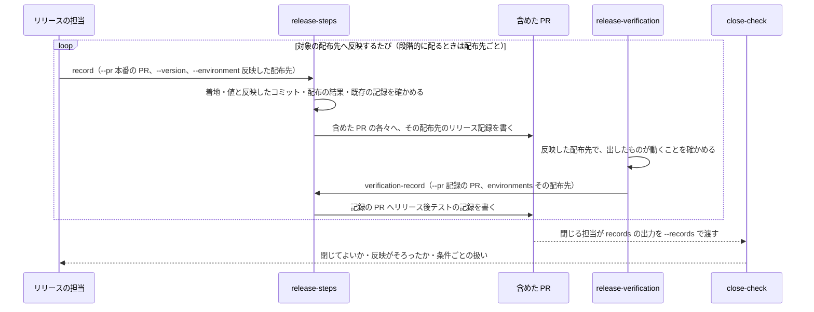

# 開発の流れ: バージョン番号の無いリリースを記録し、課題を閉じる判定に使う（#4580）

設計書 [issue-4580-design.md](./issue-4580-design.md) の「入出力のコントラクト」と「処理の流れ」のうち、リリースの記録と課題を閉じる判定の部分を分けたファイルである。「決定 N」は設計書の「決定の記録」の決定を、「Value N」は同じ章の MVV の項目を指す。「値」と「同じ値の記録」の意味は、設計書の「解き方の全体像」の定義と同じである。

## バージョンの無いリリース記録の書き方

`record --version` は、渡された値と配布先を、本番ブランチに入ったコミットと配布の結果で確かめてから書く。リリース記録は配布先ごとの反映の記録で、同じ値に何件でも書ける（決定 7）。どのリリース記録も、今回の対象の配布先の一覧（`targets`）を持つ。

```bash
ndf release-steps record --pr <本番の PR> --version "main abc1234" --environment web [--target web --target worker] [--observed web] [--production-sha <SHA>]
```

この節では、2 つのコミットを分けて呼ぶ。

| 呼び方 | 指すもの | 使う所 |
| --- | --- | --- |
| 反映したコミット | 本番の PR が本番ブランチへ入れたコミット。マージのコミットか、`strict` の squash では `--production-sha`。記録の `commit` に 40 文字の SHA で入る | 値との照合（確かめ 2）、値とコミットの対応の照合（確かめ 6）、対象を決める変更の範囲（確かめ 3） |
| push の `after` | 反映したコミットを本番ブランチへ入れた 1 回の push の、更新の後のコミット（下の「反映したコミットを含む push」）。merge queue が複数の本番の PR を 1 回の push で入れると、途中の PR では反映したコミットと違い、push の先端になる | 対象を決める push の差分（確かめ 3）、CD の結果の照会と、実環境の確認で返った値の照合（確かめ 8） |

`record` は次の順に確かめる。確かめ 0〜7 は、記録の PR・リポジトリ・push の記録だけで決まるので、CD を照会する確かめ 8 より先に行う。既存の記録だけで止まるか書かなくてよいと分かる呼び出しで、CD を照会しないためである。確かめ 0〜6 のどれかに当たれば、どの PR にも書かずに止まる。確かめ 7・8 は配布先ごとに判定する。

| # | 確かめること | 止まるとき |
| --- | --- | --- |
| 0 | 引数の組。`--version` と `--environment`（1 つ以上）はそろえて渡し、バージョンの保存先が `none` のリポジトリでだけ受ける。配布先の宣言が無いリポジトリでは `--target` が 1 つ以上要り、宣言があるリポジトリでは `--target` を受けない。`--correct-targets` を渡したときは、この規則の代わりに「対象の一覧の訂正」の引数の規則で確かめる | 保存先が `none` でないのに `--version` か `--environment` を渡した。片方だけを渡した。宣言が無いのに `--target` が無い。宣言があるのに `--target` を渡した |
| 1 | 本番の PR が本番ブランチへ入ったか。今の `record` と同じく、PR がマージ済みでなければ、`--production-sha` のコミットを `landed_squash` で正規の squash と確かめ、その PR をマージしたものとして読む | マージ済みでなく、`--production-sha` が無いか、正規の squash でない |
| 2 | 反映したコミットが値と対応するか。値の中に、そのコミットの SHA の先頭 7 文字以上と一致する 16 進の語があること | 一致する語が無い。止まる文に、反映したコミットの SHA を載せる |
| 3 | 今回の対象の配布先（`targets`）を決める。宣言（`branch_strategy.release.deliveries`）がある場合は、本番の配布先（決定 7）のうち、`paths` を持たないものと、本番の PR の差分と push の差分の両方に出るパスが `paths` のどれかに当たるものである。push の決め方は「反映したコミットを含む push」、パスの決め方は「対象を決める変更の範囲」にある。宣言が無い場合は `--target` の集合である。どちらの場合も、毎回の `record` が反映した配布先によらず同じ `targets` を求める | 宣言があって `targets` が空（同じ push の中で変更が打ち消された場合を含む）。宣言があって push を決められない |
| 4 | `--environment` が `targets` の部分集合か。`--observed` の配布先が `--environment` に含まれるか | 宣言に無い名前か、`targets` の外の名前がある。`--environment` に無い配布先の `--observed` がある |
| 5 | 正の `targets` と照らす。正は、下の「正の `targets`」で決まる。記録の PR にまだ記録が無ければ、今回の `targets` が正の候補になる | 今回の `targets` が正と違う。止まる文に、正の一覧と、訂正の打ち方（「対象の一覧の訂正」）を載せる |
| 6 | 値とコミットが 1 対 1 に対応するか。記録の PR の値とコミットの組（「正の `targets`」の後の段落。無効にした記録は数えない）と、両方の向きで照らす。1 つは、`commit` が今回と同じで `version` が文字列として違う記録である。`main abc1234` と `main abc123456` のように、同じコミットを違う長さの SHA で書いた値は、記録が別々に集まり、反映がそろわないためである。もう 1 つは、`version` が今回と同じで `commit` が違う記録である。`main abc1234 def5678` のように 2 つの SHA を含む値は、確かめ 2 をどちらのコミットでも通るので、別のコミットの配布記録とテストの記録が今回の確認に数えられてしまうためである | 同じコミットの記録が別の値で既にある。または、同じ値の記録が別のコミットで既にある。止まる文に、既にある値かコミットを載せる。前者はその値で打ち直し、後者は今回のコミットだけを指す値で打ち直すよう示す |
| 7 | `--environment` の配布先ごとに、同じ値・正の `targets` の記録が、含めた PR のすべてに既にあるか | 止まらない。すべての PR に記録がある配布先は `kept` に載せ、確かめ 8 も書き込みもしない |
| 8 | 残った配布先ごとに、反映を何で確かめたか（`confirmation`）を決める。判定の表は、この表の後の「配布先ごとの反映の確かめ」にある。配布先ごとの判定は互いに待たず、並べて行う | 止まらない。書けない配布先は、失敗なら `failed`、未確定なら `pending` に載せる。終わり方は「`record` の終わり方」の表で決まる |

### 反映したコミットを含む push

CD の結果と配布の対象は、反映したコミットを本番ブランチへ入れた 1 回の push に結び付けて決める。CD は push ごとに、その push の前後の差分で起動するので、PR ごとのコミットや、後の push の実行で読むと、CD が実際に配ったものと食い違うためである。たとえば merge queue が 3 本の本番の PR を 1 回の push で入れると、途中の PR のコミットでは CD が動かない。また、ある PR を入れた push の配布が失敗し、後の push でその PR を revert してから配ると、後の push の実行はその PR の変更を配っていない。

push は、GitHub のリポジトリのアクティビティ（[List repository activities](https://docs.github.com/en/rest/repos/repos#list-repository-activities) 、`GET /repos/{owner}/{repo}/activity`）で読む。この API は、ブランチの更新ごとに、更新の前のコミット（`before`）と後のコミット（`after`）と種類（`push`・`pr_merge`・`merge_queue_merge` など）を返す。

`record` は、次の順に push を決める。

1. `git rev-list --first-parent <反映したコミットの第一親>..<本番ブランチの先端>` で、反映したコミットから先端までの本番ブランチのコミットの集合 S を作る（git の起動は 1 回）
2. アクティビティを `ref=refs/heads/<本番ブランチ>` で新しい順に読み、`after` が S にあり、`before` が S に無い更新を探す。それが反映したコミットを含む push である。更新は新しい順に並ぶので、`after` が S に無い更新（反映したコミットより前の更新）に当たったら読むのをやめる。それでも見つからなければ、配布の対象も CD の結果も決められないので、確かめ 3 で `precondition` で止まり、時間を置いて打ち直すよう示す。push の直後には、まだアクティビティに載っていないことがありうるためである（未確認: 載るまでの遅れの大きさ）。配布先の宣言が無いリポジトリは、`targets` を `--target` で受け、CD の結果も読まないので、push を読まない
3. 見つけた push の `before` と `after` を、記録の `push` に残す。記録の PR に同じ値の信用する書き手の記録があれば、その `push` を使い、アクティビティを読まない

### 対象を決める変更の範囲

確かめ 3 で `paths` と照らすパスは、次の 2 つの差分の両方に出るパスである。本番の PR が変えたものを、CD が起動した push の差分の中で配ったときだけ、その配布先を対象にするためである。

| 差分 | 起点 | 終点 | 意味 |
| --- | --- | --- | --- |
| 本番の PR の差分 | 本番の PR をマージする直前の本番ブランチの先端。マージのコミットと squash では反映したコミットの第一親、rebase で入れた PR では、PR のコミットの数だけ反映したコミットから第一親をたどったコミット | 反映したコミット | この PR が変えたパス |
| push の差分 | push の `before` | push の `after` | CD の起動の条件（GitHub Actions の `on.push.paths` など）が判定する差分 |

どちらの差分も、`git diff --name-only --no-renames <起点> <終点>` で読む（git の起動は合わせて 2 回）。移動したファイルは、移動の前と後のパスの両方が出る。配布の監視対象のディレクトリから外へ移したファイルも、移動の前のパスで対象に入れるためである。移動を 1 つのパスにまとめる `--name-only` の既定の出し方では、前のパスが落ちる。どちらも最終的な差分なので、途中のコミットで変えて後のコミットで戻したパスは入らない。

まとめた push の中で、後の PR が前の PR の変更を打ち消すと、前の PR の差分には出るパスが push の差分には出ない。その配布先の CD は起動しないので、前の PR の対象にも入れない。打ち消されて対象が空になった PR は、確かめ 3 で止まり、「同じ push の中で変更が打ち消された」と載せる。

リリース記録が示すのは、「この PR の変更を含む push を、その配布先の CD が配った」ことまでで、PR の変更が稼働している版に残っていることではない。後の PR が同じファイルを書き換えて前の PR の変更を上書きすると、両方の差分にパスが残るので、パスだけでは打ち消しと区別できない。ファイルの中身まで照らしても、上書きと、前の変更に書き足しただけの場合を機械的には分けられない。変更が残って動くことは、リリース後テストがその配布先とその課題の組で確かめる。リリース記録だけでは `verified` は真にならず、テストの記録の合格がそろったときだけ真になる（「close-check の結果」）。そのため、上書きされた変更の課題は、テストを通る経路ではテストが不合格になって閉じない。テストを通らない経路（`enforced` が偽）でも `verified` は偽のままで、受け入れ条件のチェックは付かない。リリース記録の項目と閉じる報告では、この記録を「配布の push の CD の結果」と呼び、「変更の反映を確かめた」とは書かない。

### CD の結果の照会

CD の結果は、今の読み方（[release-steps.md](../plugins/ndf/skills/release/references/release-steps.md) の「CD の結果」）のまま、push の `after` を `--commit` に渡して読む。

```bash
gh run list --workflow <workflow のファイル名> --branch <本番ブランチ> --commit <push の after> --json databaseId,status,conclusion,url
```

SHA で絞るので、後に同じ workflow が何回動いても、取得の上限に押し出されない。後の push の実行は数えない。push の配布が失敗し、後の push で配り直した場合、この PR の記録は失敗のまま残る。後の push で revert されていないかを、コミットからは確かめられないためである。この場合、課題は今の手順と同じく、人が確かめてから手で閉じる。

結果をコマンドで読む配布先（`result.command`）は、今の読み方の契約（[cd-setup.md](../plugins/ndf/skills/release/references/cd-setup.md) の「結果の読み方を決める」）のまま、`{revision}` を push の `after` の 40 桁の SHA に置き換えて実行する。終了コード 0 は成功、75 は未完了（待つ）、1 は失敗、それ以外は未確定である。配布の手段が GitHub Actions でないリポジトリでも、宣言を書き換えずに CD の結果で記録できるようにするためである。コマンドは宣言にある文字列をリポジトリの根でそのまま 1 回実行し、待つときは照会の間隔ごとに打ち直す。コマンドの出力は記録に残さない。

### 配布先ごとの反映の確かめ

確かめ 8 は、配布先ごとに、反映を何で確かめたかを決める。決めた区分は記録の `confirmation`（配布先の名前 → 区分）に残し、`close-check` と閉じる報告に載せる。CD の結果で確かめた配布先と、実環境の確認や人の申告で受けた配布先を、記録の上で見分けられるようにするためである。

| 配布先の状態 | `confirmation` | 扱い |
| --- | --- | --- |
| 結果を読む手段（`result`）を宣言していて、push の `after` の実行の結果が成功 | `cd` | 書く |
| `result` を宣言していて、結果が失敗 | — | 書かず、`failed` に載せる |
| `result` を宣言していて、結果が未確定。`--observed` でその配布先を指定し、その配布先の宣言の `observe.url` を `record` が読んだ応答の JSON の、`observe.pointer` が指す値が、push の `after` の SHA（先頭 7 文字以上の 16 進）と一致する | `observed` | 書き、読んだ URL と値を、その配布先の記録の `evidence`（配布先の名前 → `url` と `value` の文字列）に残す |
| `result` を宣言していて、結果が未確定。`--observed` が無い。宣言に `observe` が無い。URL を読めない。応答が JSON でない。`observe.pointer` の値が無いか、push の `after` と一致しない | — | 書かず、`pending` に載せる。理由を配布先ごとに載せる |
| `result` を宣言していない（手動など） | `attested` | 打つ人が配布の結果を確かめた申告として書く |

`--observed` は、利用者が書いた証跡の文を受けず、配布先の名前だけを受ける。確かめるのは `record` で、URL と、応答のどの項目が稼働している版を表すかは、配布先の宣言から取る。配布先の宣言に任意の `observe` を足す。

| 項目 | 値 |
| --- | --- |
| `url` | その配布先で稼働している版を JSON で返す、認証の要らない URL |
| `pointer` | 応答の中で、稼働している版のコミットの SHA を持つ項目の JSON Pointer（RFC 6901。例: `/build/commit`） |

照らすのは `pointer` が指す 1 つの値だけで、応答のほかの場所に SHA があっても数えない。応答に次の配布の候補などの診断の情報が含まれていても、稼働している版が古いままなら反映済みにしないためである。値は push の `after` と一致しなければならない。その後の push が既に配られて値が新しくなっていれば、一致しないので未確定のままにする。後の push で revert されていないかを確かめられないためである。同じコミットを複数の配布先へ出しても、URL を配布先ごとの宣言から取るので、web の確認を worker に付け違えることは無い。宣言の無いリポジトリには `result` も無いので、`--observed` を使う場面は無い。

書けた配布先は、配布先ごとに 1 件ずつの記録にする（`environments` はその 1 つ）。1 つの配布先の照会や書き込みが終わり次第、その配布先の記録を書き、ほかの配布先の照会を待たない。

`close-check --records` は、`confirmation` が `cd` でない対象の配布先を `release.unconfirmed`（配布先の名前と区分の配列）に返す。閉じる報告には、その配布先と「CD の結果でなく、実環境の確認か申告で反映を記録した」を載せる。反映の判定（`release.complete`）には、3 つの区分のどれも数える。手動の配布先には CD の結果が無く、数えないと手動で配るリポジトリの課題を閉じられないためである。

### CD の結果の待ち

`--environment` を 2 つ以上渡した呼び出しは、CD の完了を待たない。照会した時点で完了していない配布先は、`--observed` があれば実環境の確認を 1 回試し、確かめられなければ待たずに `pending` に載せて返す。1 回の呼び出しの中で配布先の待ちを並べても、結果を返すのは呼び出しの終わりなので、先に成功した配布先のテストが遅い配布先の待ちに引きずられるためである。

CD の完了を待つときは、配布先ごとに 1 つずつ `record --environment <配布先>` を並べて打つ（背景で同時に起動する）。`--environment` が 1 つの呼び出しだけが、今の待ちの上限まで待つ。それぞれの呼び出しは自分の配布先が確定した時点で返るので、テストはその配布先から始められる。

1 つの配布先の判定は、次の順に行う。CD の失敗を先に見るのは、配布が失敗した配布先を実環境の確認だけで記録しないためである。

1. CD の結果を 1 回照会する。成功なら `cd`、失敗なら `failed` で終える
2. 未完了で `--observed` があれば、すぐに実環境の確認を 1 回試す。確かめられれば `observed` で終える。CD を待たないのは、実環境で既に確かめられる配布先のテストを、CD の待ちの上限まで遅らせないためである
3. 確かめられなければ、待ちの間隔ごとに、CD の結果の照会と（`--observed` があれば）実環境の確認を続ける。CD が失敗に変われば `failed`、成功に変われば `cd`、実環境で確かめられれば `observed` で終える
4. 待ちの上限に当たれば `pending` で終える

1 つの配布先の判定は、その配布先の宣言の `result.timeout_seconds`（無ければ 1800 秒）を上限に、1 回目の CD の照会を始めた時刻からの期限までに終える。照会ごとに上限を測り直すと、期限の直前に始めた照会の分だけ、利用者が決めた上限を超えて待つためである。期限は、判定の中のすべての操作に同じく効かせる。

| 操作 | 期限の効かせ方 |
| --- | --- |
| CD の実行の照会（`result.workflow`） | 期限までの残り時間を、その照会の時間の上限にする |
| 結果を読むコマンド（`result.command`） | 残り時間を、そのコマンドの時間の上限にする。上限に当たったコマンドは止め、未確定として扱う |
| 実環境の確認（`--observed` の `observe.url` の読み取り） | 残り時間を、HTTP の読み取りの時間の上限にする。上限に当たれば確かめられなかったとして扱う |
| 次の照会までの待機 | 照会の間隔と残り時間の短い方だけ待つ |

どの操作も、始める前に残り時間が無ければ始めずに `pending` で終える。始めた操作が残り時間の上限に当たったときも `pending` で終える。

### `record` の終わり方

表の「状態」は、結果 JSON の停止理由の種類（`cause.kind`）で、成功のときだけ `ok` である。終了コードの値は `contracts/facts/exit-codes.json` が持つ。`outputs` の `failed`・`pending` は配布先の一覧で、状態とは別のものである。

| 確かめ 0〜6 | 確かめ 7・8 の後 | 状態（終了コード） | 呼び出し元の続き |
| --- | --- | --- | --- |
| どれかに当たった | — | `precondition`（3）。何も書かない | 止まる文に従って引数か記録を直す |
| 通った | `recorded` か `kept` が 1 つ以上ある | `ok`（0）。`failed` と `pending` があれば outputs に載せる | `records --bodies` の `to_test` で、テストを始める組を引く。`pending` の配布先は、その配布先だけで打ち直す。`failed` の配布先は配布の失敗として報告する |
| 通った | `recorded` も `kept` も無く、`failed` が 1 つ以上ある | `refused`（1）。何も書かない | `failed` の配布先は配布の失敗として報告し、打ち直さない。`pending` の配布先があれば、その配布先だけで打ち直す |
| 通った | `recorded` も `kept` も無く、すべて `pending` | `precondition`（3）。何も書かず、`items` に配布先ごとの未確定の理由を載せる | 結果が確定してから打ち直す |
| 通った | 書く順の手順 1〜4 の途中で、GitHub への投稿か自分のコメントの削除が失敗した | `unknown`（1）。レート制限で待つ時間が分かるときは `infra_wait`（75）。今の `release-steps` が GitHub の失敗で止まるときと同じ形で、消せなかったコメントがあれば URL を `items` に載せる | 正しい引数で打ち直す（「失敗や重なりの後の動き」） |

### 正の `targets`

「正の `targets`」は、確かめ 5・重ねない判定・読み取りの 3 か所で同じものを使う。正は、記録の PR にある、同じ値の対象の一覧の訂正の記録（「対象の一覧の訂正」）のうち、最後の記録の `targets` である。訂正の記録が無ければ、同じ値の最初のリリース記録の `targets` である。

最初のリリース記録・訂正の記録・書いた後の読み直しで見る記録のどれも、信用する書き手（決定 6 の、対象のリポジトリで write 以上の権限を持つ書き手）の記録だけを数える。権限を照会できない書き手の候補があれば、正を決めずに止まる（「閉じる手順の読み取り」と同じ扱い）。write 以上の権限が無い人のコメントが、最初の一覧を決めないようにするためである。

正と違う `targets` の記録は、どの PR にあっても、重ねない判定にも、`verification-record`・`close-check` の判定にも、`record` の結果の `complete` にも数えない。

値とコミットは、記録の PR の信用する書き手のリリース記録の全体から、コメントの古い順に 1 対 1 の組を決める（値とコミットの組）。記録の読み手（`records` と `close-check`。この文書で「読み手」はこの意味だけに使う）も、`record` の確かめ 6 と書く順の手順 2 も、同じ規則を使う。

1. 記録を古い順にたどる
2. その記録の値も、そのコミットも、まだ組になっていなければ、2 つを組にする
3. その記録の値とコミットが、そのまま 1 つの組なら、その記録を有効にする
4. 値かコミットのどちらかが別の相手と組になっていれば、その記録を無効にする

無効にした記録は、正の `targets`・重ねない判定・代表・`complete`・訂正の照合のどれにも数えない。同じコミットを違う長さの SHA で書いた値も、2 つの SHA を含む同じ値を別のコミットで書いた記録も、後に書かれた側が無効になる。消せずに残った負けた側の記録が、正しい値の打ち直しを止めることは無い。テストの記録は `commit` を持たないので、値の組のコミットが 1 つに決まることで、どのコミットの確認かが決まる。

### 書く順

書く順は次のとおりである。確かめ 0〜7 を済ませ、確かめ 8 で書けると決まった配布先ごとに書き始める。配布先ごとの書き込みは互いに待たない。

1. 記録の PR に、同じ値・同じ `environments`・正の `targets` の記録が無ければ書く
2. 記録の PR を読み直し、次の 2 つを決め直す。どちらかに当たれば、自分のコメントを消し、ほかの PR へは書かずに止まる
   - 正の `targets`。並行して打たれた `record` のどちらかが先に書いた記録が正になる。自分の `targets` が正と違えば、正の一覧を示す
   - 値とコミットの対応。読み直した記録で値とコミットの組を決め直し、自分の記録が無効になれば、既にある値かコミットを示す。違う長さの SHA の値や、2 つの SHA を含む同じ値で 2 つの `record` が並行して確かめ 6 を通っても、記録の PR で先に書かれた組の 1 つにそろうためである
3. 残りの含めた PR のうち、同じ値・同じ `environments`・正の `targets` の記録が無い PR へ書く
4. 書いた PR をそれぞれ読み直す。自分のコメントより前に、同じ値・同じ `environments`・正の `targets` の記録があれば、自分のコメントを消す。同じ引数の `record` が並行して打たれ、両方が書く前の確かめを通った場合に、記録を 1 件に戻すためである。いちばん前の記録は、自分より前に同じ記録が無いので消されない。消すのは、この実行が書いたばかりのコメントだけである。書かなかった PR は読み直さない

### 対象の一覧の訂正

宣言が無いリポジトリで、最初の `record` の `--target` が誤っていた場合は、`record --correct-targets` で正の一覧を訂正する。訂正は前の記録を消さず、訂正の記録を足すだけにする。どの一覧で何を判定したかを後から追えるようにするためである（Value 8 の「履歴を残す事実は追記だけで持つ」）。

```bash
ndf release-steps record --pr <本番の PR> --version "main abc1234" --correct-targets --target web --target worker --reason "worker の配布先を落としていた"
```

| 項目 | 決め方 |
| --- | --- |
| 引数の規則（確かめ 0 の代わり） | `--version`・`--target`（1 つ以上）・`--reason` が要る。`--environment` と `--observed` は受けない。バージョンの保存先が `none` で、配布先の宣言が無いリポジトリでだけ受ける。宣言があるリポジトリでは `targets` が宣言から決まるので受けない |
| 通す確かめ | 確かめ 1（着地）・確かめ 2（値と反映したコミット）・確かめ 6（値とコミットの対応）を通す。確かめ 3 は `--target` の集合を新しい一覧にするだけで、確かめ 4・5・7・8 は行わない（配布先を記録せず、正を置き換える操作だからである） |
| 訂正だけの確かめ | 記録の PR に、信用する書き手の同じ値のリリース記録が 1 件以上あること。無ければ `precondition` で止まり、先に `record` を打つよう示す。また、通常の `record` と同じく、書く token の書き手が write 以上の権限を持つこと（`_require_trusted_writer`）。持たなければ何も書かずに `precondition` で止まる。読み手に信用されない書き手の訂正を書かせないためである |
| 書くもの | 記録の PR にだけ、訂正の記録を 1 件書く。中身は `version`・`commit`・新しい `targets`・訂正の前の `targets`・理由である。ほかの含めた PR には書かない。閉じる判定の読み先は記録の PR だけだからである |
| 正の決まり方 | 信用する書き手の最後の訂正の記録が正になる。訂正を並行して打っても、記録の PR のコメントの順で 1 つに決まる。訂正が誤っていれば、もう一度訂正する |
| 訂正の後のリリース記録 | 前の一覧で書いたリリース記録は、正と違うので数えない。すでに反映した配布先は、配り直さずに新しい一覧で `record` を打ち直す。確かめ 8 は CD の結果を読み直すだけで、配布はやり直さない |
| 訂正の後のテストの記録 | テストの記録は `targets` を持たず、`version` と `environments` を持つ。同じ値は 1 つのコミットを指す（確かめ 6 と「値とコミットの組」）ので、前の一覧のときに書いたテストの記録も、同じ配布と同じ確認を指す。配布先が新しい一覧にあり、その配布先に新しい一覧のリリース記録があれば、そのまま判定に使う。新しい一覧に無い配布先の行は数えない |

### 失敗や重なりの後の動き

失敗や重なりの後は、正しい引数で打ち直せば残りの PR へ書いて終わり、判定の結果は 1 回で書けたときと同じになる。重なったコメントを消せなかったときも、読み手（記録を読むコマンドの `records` と `close-check`）が数えないので判定は変わらず、人が GitHub でコメントを消す場面は無い。

| 場合 | 打ち直したときの動き |
| --- | --- |
| 一部の PR への投稿が失敗した | 書けた PR は重ねない判定で飛ばし、書けなかった PR だけへ書く |
| 並行して打たれ、自分の `targets` が正でなかった | 自分のコメントは手順 2 で消える。正の `targets` で打ち直せば、確かめ 5 を通り、残りの PR へ書く |
| 同じコミットを違う長さの SHA の値で並行して打った | 後に書いた側が手順 2 で自分のコメントを消し、既にある値を示して止まる。その値で打ち直す |
| 同じ引数で 2 回打った | 確かめ 7 ですべての配布先が `kept` になり、CD を照会せず、何も書かない |
| 同じ引数の 2 回が並行して走り、両方が書いた | 後に書いた側が手順 4 で自分のコメントを消し、記録は 1 件に戻る |
| 手順 2・4 で自分のコメントを消すのに失敗した | 消せなかったコメントは残る。`record` は、今の `release-steps` が GitHub の失敗で止まるときと同じ形で止まり（停止理由 `unknown`・終了コード 1。レート制限で待つ時間が分かるときは `infra_wait`・75）、消せなかったコメントの URL を結果の `items` に載せる。配布先の一覧の `outputs.failed`（CD の結果が失敗した配布先）には入れない。打ち直しても消さない（確かめ 7 で `kept` になるか、無効な記録として数えられない）。読み手（`records` と `close-check`）も確かめ 6 も、同じ値・同じ `environments`・正の `targets` の記録を何件あっても 1 件として数え、正と違う `targets` の記録と、値とコミットの組で無効にした記録を数えない。そのため、残ったコメントは判定も打ち直しの結果も変えない。同じコミットに 2 つの値が残っても、後の値の記録は無効なので、先の値での打ち直しは確かめ 6 を通る |
| 一部の配布先の CD の結果が未確定だった | 確定した配布先だけを書いて `ok` で返す。未確定の配布先は、その配布先だけで打ち直す |
| 書いた直後に実行が止まり、テストを始める前だった | 打ち直すと、書いた配布先は `kept` に入る。テストを始めてよい組は、`record` の結果でなく `records --bodies` の `to_test` で引き直せる（「処理の流れ」） |
| 宣言が無いリポジトリで、最初の `record` の `--target` が誤っていた | `record --correct-targets` で正の一覧を訂正し、反映した配布先を新しい一覧で打ち直す（「対象の一覧の訂正」） |

### 記録の照会の回数

`record` が確かめと書き込みのために GitHub を照会する回数と、git を起動する回数は次のとおりである。記号の意味は次のとおりである。

- E: 確かめ 7 で `kept` にならず、`result` を宣言した配布先の数
- N: 含めた PR の数
- W: この実行が書いた PR の数（W ≦ N）
- C: 記録の PR のコメントの数
- A: 反映したコミットの後に本番ブランチへ入った push の数
- U: 記録の PR で同じ値の記録を書いた人のうち、所属の区分が MEMBER・COLLABORATOR の人の数

| 照会・起動 | 回数（1 回の `record`） | 増える理由 |
| --- | --- | --- |
| 記録の PR のコメントの読み取り（確かめ 5〜7） | ⌈C/100⌉ 回 | — |
| ほかの含めた PR のコメントの読み取り（確かめ 7） | N − 1 回 | — |
| 書き手の権限の照会（確かめ 5〜7 と、手順 2・4 の読み直し） | 最大 U 回。同じ実行の中では 1 人 1 回で、読み直しでも照会し直さない。OWNER は照会せずに信用し、ほかの区分は照会せずに信用しない（`GitHub.trusts` と同じ） | 正の `targets` と重ねない判定を、write 以上の権限を持つ書き手の記録だけで決める。NDF が書いた記録だけなら、書き手は token の持ち主 1 人で、U は 0 か 1 |
| push の読み取り（確かめ 3） | ⌈(A + 1)/100⌉ 回。記録の PR に同じ値の信用する記録があれば 0 回 | 反映したコミットを含む push の前後を読まないと、CD の結果と配布の対象を CD の起動に結び付けられない |
| git の起動（確かめ 3） | 3 回（コミットの集合 S の 1 回、本番の PR の差分と push の差分の 2 回）。候補の数によらない | — |
| CD の結果の照会（確かめ 8） | 配布先ごとに 1 回以上（`--environment` が 1 つで未完了なら、待ちの間に繰り返す）。合計 E 回以上。`result.command` の配布先では、API の照会の代わりに宣言のコマンドの起動になる | 打つ人が CD の成功を読んだ後でも、`record` が自分で読み直す |
| 実環境の確認（確かめ 8 の `--observed`） | `--observed` を渡した未完了の配布先ごとに、URL の読み取りが 1 回以上（待つ呼び出しでは待ちの間隔ごと） | CD が未完了のときだけ |
| 書いた後の読み直し（手順 2・4） | 記録の PR の ⌈C/100⌉ 回と、ほかの書いた PR ごとに 1 回。合計 W 回以上 | 並行した書き込みの重なりを 1 件に戻す |

増えるのは、CD の結果の照会の E 回、書き手の権限の照会の最大 U 回、push の読み取り、書いた後の読み直しの W 回以上である。既存の記録で決まる確かめを CD の照会より先に行うので、同じ引数で何も書かない打ち直しでは E が 0 になり、CD を照会しない。push も既存の記録から取るので読まない。比べた案と、採らなかった理由は次のとおりである。

| 案 | 減る照会 | 採らなかった理由 |
| --- | --- | --- |
| 打つ人が読んだ CD の結果（実行の ID と結論）を引数で受け、照会しない | E 回 | 渡された結論を `record` が確かめられず、確かめていない反映が記録される（Value 13）。実行の ID だけを受けて読む形でも、照会は 1 回ずつ残り減らない |
| 書く前に重なりを防ぐ（ラベルやコミットの状態でロックを取る） | 読み直しの W 回 | GitHub のコメントには、条件つきで書く手段が無い。ロックを取るにも、PR ごとに 1 回の書き込みと 1 回の読み取りが要り、読み直しより照会が多い |
| 権限を照会せず、所属の区分（`author_association`）だけで信用する | U 回 | MEMBER・COLLABORATOR には read だけの人もいる。write の無い人のコメントが最初の一覧を決められてしまう |
| 権限の照会の結果を実行をまたいで保存し、使い回す | 2 回目以降の U 回 | 権限は取り消されうる。取り消した後も古い結果で信用してしまう |
| push を読まず、本番ブランチの CD の実行の一覧から祖先関係で探す | push の読み取り | 一覧には取得の上限があり、後の実行に押し出される。後の push で revert してから配った実行も、祖先関係だけでは反映の根拠になってしまう。候補ごとに git の起動も要る |

読み直しは、書いた PR だけにする（何も書かなければ読み直さない）。

## 閉じる条件を外したときの閉じ方

`close-check` の `--require` は、リリース後テストの記録が無ければ課題を閉じない指定である。今の手順書は、リリース後テストを通る経路でだけ付ける。設定とこの引数の組み合わせは次のとおりである。

| `close.release_verification` | リリース後テストの記録が無いときの判定 | 記録を渡したとき |
| --- | --- | --- |
| 省略、または `required: true` | 今と同じ。`--require` があれば閉じない。無ければ、この条件で閉じることを妨げない | 今と同じ。不合格は閉じず、保留は人が決める |
| `required: false` | `--require` があっても、この条件で閉じることを妨げない | 同上 |

`required: true` では、呼び出し元が渡した `--require` をそのまま使う。リリース後テストを通らない経路（`light` など）では、呼び出し元は `--require` を付けない。設定だけを理由に記録を求めると、記録が作られない経路で課題を閉じられなくなるためである。

`progress-tracking` の手順書の「閉じる条件」は次の 3 つである。この節の条件の番号は、この表の番号を指す。

| # | 今の閉じる条件 |
| --- | --- |
| 1 | 本番へ入れたリリースのリリース記録がある（デプロイを飛ばした実行は、飛ばした記録がある） |
| 2 | リリース後テストの記録がある経路では、その課題の行に不合格も保留も無い。保留があれば、閉じるかを人が決める。`--require` では記録そのものが要る |
| 3 | その課題の最終工程の記録がある。最終工程が「デプロイ」なら条件 1、「リリース後テスト」なら条件 2 の記録、「振り返り」なら課題の本文の「振り返り:」の行である |

条件を外す設定は、`close-check` の判定だけでなく、条件 3（最終工程の記録がある）にも適用する。条件 3 は、最終工程ごとに同じ記録を求めているためである。

| 外した条件 | 手順書で免除するもの | 引き続き確かめるもの |
| --- | --- | --- |
| `release_verification` | 条件 2 の記録の存在。最終工程が「リリース後テスト」なら、条件 3 の記録の存在も免除する | リリース記録（条件 1）、渡した記録の不合格と保留、ほかの有効な条件 |
| `retrospective_line` | 条件 3 の「振り返り:」の行だけ | リリース記録（条件 1）、条件 2、ほかの有効な条件 |

### 閉じる手順の変更

閉じる手順は、記録の PR のコメントと、含めた PR の本文を、書き手の権限を確かめるコマンドで 1 回だけ読み、その出力をそのまま使う。手順書（`progress-tracking` の「スプリントを閉じる」）の手順 1〜3 を次のように変える。条件を外していても同じである。

- 手順 1 は、`gh pr view --json body,comments` でなく `ndf release-steps records --pr <記録の PR> --version <値> --bodies` を打ち、出力をファイルに保存する。このコマンドは、書き手が対象のリポジトリで write 以上の権限を持つかを確かめ、信用する書き手のコメントだけからリリース記録とテストの記録を選ぶ。所属の区分（`author_association`）は、権限を照会するかどうかを決めるだけに使う（今の `GitHub.trusts` と同じ）。OWNER は照会せずに信用する。MEMBER・COLLABORATOR は照会し、write 以上のときだけ信用する。ほかの区分は照会せずに信用しない。出力には、含めた PR ごとの本文と、その本文の書き手を信用するかも入る
- 手順 1 では、閉じるリリースを `--version` の値と、配布単位があれば `--unit` で指定する。同じ作業の PR が複数のリリースに含まれて記録の PR が重なっても、今回のリリースの記録だけを選ぶためである。値は、レーンが `ndf lanes release --version` で受け取ったもの（単独のスプリントではデプロイの工程の出力 `product_version`）を渡す。本番の PR の番号が分かるときは `--release <本番の PR>` も渡す
- 配布単位は、1 つのリリースで複数のスプリントブランチを別々に上げる形（`ndf release-steps` の `--units`）での、単位の名前である。今のリリース記録は、単位が 2 つ以上のときだけ `unit` を持つ。同じ本番の PR・同じバージョン番号・同じ記録の PR に、単位ごとの記録が並ぶことがある。これは、今の `record` のテスト `test_issue_3615_two_units_on_the_same_version_each_record_the_shared_pull` が固定している契約である。そのため、値だけではリリースが 1 つに決まらない。レーンは自分のスプリントブランチの名前を単位の名前として渡す。単位を持たないリリースでは、値から 1 つのリリースが決まる。バージョン番号はリリースごとに違うためである。反映したコミットの SHA を含む値も、「バージョンの無いリリース記録の書き方」の確かめ 6 と書く順の手順 2 が値とコミットを 1 対 1 に保つので、1 つのリリースだけを指す
- 手順 2 は、`gh` を打たず、手順 1 の出力の `bodies` から課題を集める。書き手を信用しない本文（`trusted` が偽）からは課題を集めず、その PR の番号と「本文の書き手に write 以上の権限が無い」を報告に載せる。権限の無い PR の作成者が本文に別の課題を閉じる指定を書いても、閉じる候補に入らないようにするためである
- 手順 3 は、手順 1 で保存したファイルを `close-check --records` に渡す。今回のリリースと `version`・`unit` が同じテストの記録を選ぶのは `close-check` で、手順書の AI は選ばない
- 手順 1 のコマンドが失敗したときは、記録が無いとは扱わず、課題を閉じずに「失敗」と報告する
- デプロイの工程を飛ばした実行（ステートマシンに飛ばした記録がある）では、リリース記録が無いので、閉じる課題はスプリントの PR の本文から集める。スプリントの PR は、今の手順と同じく `retrospective` の「Pull Request の番号を特定する」で引く。手順 1 は `ndf release-steps records --pr <スプリントの PR> --pr-body-only` を打つ。`--pr-body-only` では、`records` はリリース記録を選ばず、記録の PR のコメントも読まない。`--pr` の PR の本文だけを、書き手の権限を確かめた `trusted` つきで `bodies` に返す。スプリントの PR が使い回されて、前のリリースの記録を持っていても、そのリリースに含まれた別の PR から課題を集めないためである。手順 2 は、ほかの経路と同じく `bodies` から、信用する書き手の本文だけで課題を集める
- デプロイを飛ばした実行の手順 3 では、`close-check` に `--records` も `--verification` も渡さない。条件 1 は、今と同じく飛ばした記録で満たす。リリース記録が無いことを理由に閉じない判定（下の「close-check の結果」）は、`--records` を渡したときだけ働く

受け入れ条件のチェック（`[x]`）の付け方は、経路で変わる。

| 経路 | チェックの付け方 |
| --- | --- |
| バージョンの保存先が `none`（流れの設定の有無を問わない） | `close-check` の結果の `outputs.verified` が真のときだけ付ける。偽なら変えず、閉じる報告に「テストで未確認」と書く |
| バージョンを持つ経路で `release_verification.required: false`（両方の条件を外した場合を含む） | 同上 |
| バージョンを持つ経路で、上に当たらない | 今と同じ |

バージョンの保存先が `none` の経路で設定を問わないのは、記録を必須にしない呼び出し（`enforced` が偽）では、課題の行が無い配布先があっても閉じることを妨げないためである。たとえば別の課題の行しか持たない記録しか無くても、課題は閉じられる。そのため、チェックは `verified` で別に決める。`verified` が真になるのは、その課題の行が、今回の対象の配布先のすべてで合格したときだけである（下の「close-check の結果」）。

## 閉じる手順の読み取り

閉じる判定に使うコメントと本文は、権限を照会できなかった書き手を「権限が無い」と扱わずに、読み取りの失敗として止める。今の `GitHub.permission` は、403・404 を `none` に変える。ただし、GitHub の API の利用量の上限（レート制限）による 403・404 は除く。`GitHub.trusts` は、その書き手のコメントを除いて続ける。この扱いのままでは、照会に失敗した書き手の新しい不合格の記録が落ち、古い合格の記録で課題を閉じてしまう。

| 照会の結果 | 今の `trusts` | `records` の扱い |
| --- | --- | --- |
| 200 で `admin`・`maintain`・`write` | 信用する | 信用する |
| 200 で `read`・`triage`・`none` | 信用しない | 信用しない（権限が足りない） |
| 403・404（レート制限によるものを除く） | 信用しない（`none` と同じ） | 照会できない。記録を選ばず、照会できなかった書き手の名前を載せて失敗で返す |
| レート制限（403 か 429 で返る）・ほかの失敗 | 例外 | 失敗で返す（今と同じ） |

`GitHub` に、照会できないことを例外で返す読み方（`permission_strict`）を足し、`records` はこれを使う。ほかの呼び出し元（承認の記録の読み取りなど）の扱いは変えない。

照会するのは、今回のリリースの判定に使うものの書き手だけである。記録と関係のない会話のコメントや、同じ記録の PR に載った別のリリースの記録の書き手を照会できないだけで、課題を閉じられなくならないようにするためである。`records` は次の順に読む。

1. 記録の PR のコメントを全部読み、リリース記録・テストの記録・対象の一覧の訂正の記録のどれかのマーカーを持つコメントを候補にする。今の `_trusted_bodies` のように、全部のコメントの書き手を先に照会しない
2. 候補の JSON を読む。JSON の形が誤った候補は、権限を照会せずに除く（今の `records` が形の誤った記録を読み飛ばすのと同じ）。バージョン付きの記録（`commit` を持たない）とテストの記録は、渡した `--version`・`--release`・`--unit` が一致する候補だけを残す。テストの記録は `release` を持たないので、`version` と `unit` で照らす
3. バージョンの無いリリースの記録（`commit` を持つ）は、値とコミットの組を決めるのに要る記録だけを集める。組の決め方は、「バージョンの無いリリース記録の書き方」の「正の `targets`」の後の段落にある。集めるときは、書き手を確かめながら次の順に進める。信用できない書き手の記録を足がかりにして候補を広げないためである。read 権限の人のコメントが橋渡しになると、閉じる対象と関係のない書き手まで照会し、その照会の失敗で `close-check` が止まってしまう
   1. 起点を決める。`--version` を渡したときは、その値の記録を起点にする。渡さないときは、値では絞らず、`--release`・`--unit` を渡していればそれが一致する記録を、どちらも無ければすべての記録を起点にする
   2. 起点の記録の書き手を照会し、信用する書き手の記録だけを残す
   3. 残った記録と値かコミットが同じで、まだ照会していない記録を足し、その書き手を照会する。信用する書き手の記録だけを残し、足す記録が無くなるまで繰り返す。広げる元は、信用を確かめた記録だけである。信用しない書き手の記録とだけ値かコミットを共有する記録は、照会しない
   4. 集めた記録で値とコミットの組を決め、組に合わない記録を無効にする。こうして決めた組は、記録の PR の信用する書き手のリリース記録の全体で決めた組と、集めた記録の値とコミットについて同じになる。集めた記録の外の記録は、値もコミットも集めた記録と共有しないので、集めた記録の値やコミットの相手を変えられないためである
   5. 有効な記録から、値ごとに正の `targets` を決める（「正の `targets`」）。ここではまだ `--version`・`--release`・`--unit` で絞らない。絞った後の記録で決めると、先に書かれた記録が外れ、並行した書き込みで消し損ねた後の記録の一覧が正になってしまうためである
   6. 有効な記録を、渡した `--version`・`--release`・`--unit` のすべてが一致するものだけに絞る。組を決めるために集めた別の値の記録は、ここで外れ、代表にも出力の `releases` にも入らない
4. 訂正の記録は、`version` が一致し、`commit` が手順 3 の組のコミットと一致する候補だけを残し、その書き手を照会して、信用する書き手の訂正だけを残す。残った訂正があれば、その値の正の `targets` を最後の訂正の一覧に置き換える。リリース記録の書き手を確かめる前に訂正を照らさないためである。信用されない書き手のリリース記録にだけ対応する訂正を照会すると、その訂正の書き手を照会できないだけで課題を閉じられなくなる
5. 残ったリリース記録から代表を 1 件選ぶ。出力の `release` と、本文を読む PR の一覧（`included`）はこの代表から取る。選び方は次のとおりである
   - バージョンの無いリリースの記録（`targets` を持つ）は、手順 3 の 6 で絞った記録から選ぶ。そのうち、手順 3・4 で決めた正の一覧と `targets` が一致する記録だけを残し、残った中の最後の 1 件を代表にする。一覧と違う記録が後にあっても、代表にも `included` の出どころにもしない
   - バージョン付きの記録（`targets` を持たない）は、`targets` で絞らず、今と同じく最後の 1 件を代表にする
6. `--bodies` があれば、代表の `included` の PR ごとに本文を書き手つきで読み（`GitHub.issue_body`）、書き手を照会して `trusted` を付ける。代表が無ければ本文を読まない。`--pr-body-only` では手順 1〜5 を行わず、`--pr` の PR の本文だけを読む

照会の回数は次のとおりである。C は記録の PR のコメントの数、N は含めた PR の数である。ページの大きさは、REST も `gh` の GraphQL も 100 件である。

| 読み方 | 記録の PR のコメントの取得 | 本文の取得 | 権限の照会 | `gh`・`ndf` の起動 |
| --- | --- | --- | --- | --- |
| 今（手順 1 の `gh pr view --json body,comments` と、手順 2 の `gh pr view --json body`） | GraphQL で ⌈C/100⌉ 回 | N 回（記録の PR を含む） | 無し（権限を確かめていない） | N + 1 回 |
| この設計（`records --bodies`） | REST で ⌈C/100⌉ 回 | N 回 | 今回のリリースに当たる候補のコメントと、本文の書き手のうち、MEMBER・COLLABORATOR の人 1 人につき 1 回（同じ実行の中では 1 人 1 回。OWNER は照会しない） | 1 回 |
| 採らなかった案: 手順 2 は今のまま `gh` で本文を読む | REST で ⌈C/100⌉ 回 | N 回 | 候補のコメントの書き手だけ（本文の書き手は確かめない） | N + 1 回 |
| 採らなかった案: 対象のリポジトリの collaborators を一覧で読む | REST で ⌈C/100⌉ 回 | N 回 | 一覧のページ数だけ（書き手の数によらない） | 1 回 |

コメントと本文の取得の回数は今と同じで、ページ送りも同じだけ増える。起動は N + 1 回から 1 回に減る。増えるのは権限の照会だけで、write 以上の書き手の記録と本文だけを使うために要る。照会は書き手ごとなので、NDF が書いた記録と PR だけなら、1 回か 2 回で済む。collaborators の一覧を読む案は、一覧を読む権限（push 以上）が token に要り、大きな組織のリポジトリではページ送りが書き手の数より多くなるので採らない。

## close-check の結果

`close-check` は、条件ごとの扱いを `outputs.conditions` に、テストでの確認を `outputs.verified` に入れる。設定で外したかと、今回の呼び出しで記録を必須にしたかは、別の項目にする。

| 項目 | 値 | 決め方 |
| --- | --- | --- |
| `conditions.release_verification.excluded` | 真偽 | `close.release_verification.required` が `false` なら真 |
| `conditions.release_verification.reason` | 文字列か `null` | 外したときの理由。外していなければ `null` |
| `conditions.release_verification.enforced` | 真偽 | `--require` があり、`excluded` が偽のときだけ真。真なら、その課題の行を持つテストの記録が無い課題を閉じない。`--records` では、対象の配布先のどれか 1 つでもその課題の行が無ければ閉じない（配布先ごとの記録があるだけでは足りない） |
| `conditions.retrospective_line.excluded` | 真偽 | `close.retrospective_line.required` が `false` なら真 |
| `conditions.retrospective_line.reason` | 文字列か `null` | 同上 |
| `conditions.retrospective_line.enforced` | 真偽 | `excluded` の否定。真なら、最終工程が「振り返り」の経路で、手順書の AI が条件 3 の行を確かめる（行は `close-check` が読まない） |
| `verified` | 真偽 | 下の規則 |
| `release.complete` | 真偽か `null` | `--records` を渡したときだけ値を持つ。数えるのは、代表のリリース記録と同じリリース・同じ配布単位の記録（`version`・`release`・`unit`・`commit` が代表と同じで、`targets` が正の一覧と同じ）だけである。その `environments` の和集合が `targets` を覆えば真。同じ値を使う別の配布単位や別の本番の PR の記録で、未反映の配布先を埋めないためである |
| `release.missing` | 名前の配列 | 反映の記録がまだ無い対象の配布先（`complete` と同じ記録で数える） |
| `release.unconfirmed` | 配布先の名前と区分（`observed`・`attested`）の配列 | 反映の記録が CD の結果でなく、実環境の確認か申告による対象の配布先（「配布先ごとの反映の確かめ」）。閉じる報告に載せる |

条件 3 の扱いは、`conditions` から次のように決まる。最終工程が「リリース後テスト」の経路では、`conditions.release_verification.excluded` が真なら条件 3 の記録の存在を免除する。最終工程が「振り返り」の経路では、`conditions.retrospective_line.enforced` が偽なら「振り返り:」の行を確かめない。`light` のように `--require` を付けない経路では、`enforced` は偽なので、無い記録を求めて閉じられなくなることは無い。

バージョンの保存先が `none` のリポジトリでは、`--verification` を受けず `precondition` で止まり、`--records` を渡すよう示す。`--verification` で渡す 1 件のテストの記録からは、どのリリースの記録か、対象の配布先のすべてに反映とテストがそろったかを確かめられないためである。デプロイを飛ばした経路では、どちらも渡さない（「閉じる条件を外したときの閉じ方」）。

`verified` は次のときだけ真である。

- `--verification` を渡したとき（バージョンを持つリポジトリだけ）: 渡した記録にその課題の行があり、すべて合格
- `--records` を渡したとき: `release.complete` が真で、対象の配布先のそれぞれについて、その配布先とその課題の行の両方を含む最後のテストの記録の行が合格

`--records` を渡したときは、配布先と課題の組ごとに、その配布先とその課題の行の両方を含む最後のテストの記録を選ぶ。ただし、不合格の行に代われるのは `retest_reason` を持つ行だけである（「判定に使う行」）。配布先を含む最後の記録を先に選ぶと、同じ配布先で別の課題だけを再テストした記録が、その課題の不合格を覆い隠すためである。その課題の行を持たない記録は、その課題の判定に使わない。

判定は次のとおりである。

| 状態 | 判定 |
| --- | --- |
| `--records` を渡し、リリース記録が無いか、`release.complete` が偽 | 閉じない（条件 1）。デプロイを飛ばした経路は `--records` を渡さないので、この行に当たらない |
| どれかの対象の配布先で、選んだ行が不合格 | 閉じない |
| 不合格が無く、どれかの対象の配布先で選んだ行が保留 | 人が決める |
| その課題の行が無い対象の配布先があり、`enforced` が真 | 閉じない |
| その課題の行が無い対象の配布先があり、`enforced` が偽 | 閉じることを妨げない。`verified` は偽で、チェックは付けない |
| すべての対象の配布先で選んだ行が合格 | 閉じてよい。`verified` は真 |

バージョンを持つリポジトリの記録（`targets` を持たない）を `--records` で渡したときは、反映の判定をせず、`release.complete` は `null` になる。テストの記録は、代表のリリース記録と `version`・`unit` が同じもののうち、記録の PR で最も後に書かれた 1 件だけを選ぶ。その 1 件は、`--verification` に渡したときと同じに判定する。それより前のテストの記録の行は使わない。

## 処理の流れ

バージョン番号を持たないリポジトリでは、マージから課題を閉じるまでが次の順になる。「本番の PR」は本番ブランチへマージした PR、「作業の PR」はそのマージに含まれた変更の PR である。「含めた PR」はこの 2 つを合わせた、リリース記録を書く先である（決定 6）。



この図に含めない要素は、流れの設定の読み取り・種類の既定・設定のスキーマ・スプリントの作成・設定の確かめ・流れの文書である。これらの関係は設計書の「解き方の全体像」の図にある。

「リリースの担当」は、進め方で次のように変わる。

| 進め方 | 記録する人 | `record` の結果の `complete` が偽のとき | `complete` が真のとき |
| --- | --- | --- | --- |
| スプリントを 1 つだけ進める | デプロイ担当の実行役（worker。作業を 1 つ受け持つ AI） | 反映した配布先のリリース後テストを始める。デプロイの工程は終えず、残りの配布先の反映を続ける | デプロイの工程を終える |
| 複数のスプリントを別々の作業単位（レーン）で進め、まとめて本番へ出す | 並列作業の取りまとめ役（オーガナイザー） | 反映した配布先のリリース後テストを始める。`ndf lanes release` は打たない | `ndf lanes release` で各レーンへリリース結果を知らせる |

知らせは 2 つあり、発火の条件が違う。

- **配布先ごとのテストを始める**: 記録された配布先から、ほかの配布先を待たずに始める。通常の進行では、`record` の結果の `recorded` に入った配布先と、手元に保存した課題の一覧から、テストする組を決める（「テストする組の引き方」）
- **デプロイの工程を終える・レーンへリリース結果を知らせる**: `record` の結果の `complete` が真になり、デプロイの工程が始めたテストがすべて記録を書いたときだけ行う。`complete` が偽のままでデプロイの工程を終えたりレーンへ知らせたりすると、残りの配布先が未反映のままレーンが最終工程へ進むためである

オーガナイザーとレーンの conductor の分担は次のとおりである。オーガナイザーは、`record` を打つところから、レーンへリリース結果を知らせるところまでを受け持ち、レーンの工程は進めない。知らせるのは、`complete` が真になり、デプロイ中に始めたテストがすべて記録を書いた後で、`ndf lanes release` で各レーンへ知らせる。知らせを受けたレーンの工程（リリース後テスト・振り返り・課題を閉じる）を進めるのは、そのレーンのスプリントの進行担当（conductor）である。役割の説明は [3 層で工程を通す](../plugins/ndf/skills/development-workflow/references/agent-layers.md) と [並列開発のオーガナイザー](../plugins/ndf/skills/development-workflow/references/parallel.md) にある。

`record` は、本番の PR ごとに、反映を確かめた時点ごとに打つ。対象の配布先へまとめて反映したなら 1 回で、段階的に配るなら配布先ごとに打つ。含めた PR の全部へ 1 回で書くので、N 本のレーンの変更を 1 本の本番の PR にまとめたときも、配布先ごとに 1 回で済む。レーンの PR を 1 本ずつ本番ブランチへマージしたときは、本番の PR が N 本あるので、その N 倍になる。ある配布先の `record` を打ち忘れると、その配布先の `verification-record` が「反映の記録が無い」で止まり、`close-check` は「反映がそろっていない」で閉じない。

記録の PR は、本番の PR ごとに、その含めた PR の中で番号が最も小さいものにする。全部の本番の PR を通した最小の番号ではない。使う場所は次のとおりである。

| 使う場所 | 本番の PR が複数あるときの扱い |
| --- | --- |
| リリース後テストの記録の書き先 | 本番の PR ごとの記録の PR |
| `ndf lanes release --release` | 本番の PR ごとに 1 回打つ。その本番の PR に変更が含まれるレーンのリクエストを並べ、その記録の PR を渡す |
| 課題を閉じるときの読み先 | レーンが受け取った記録の PR。そのリリース記録の `included` の最小の番号が、同じ PR になる。リリースは、レーンが受け取った値（`--version`）で指定する（「閉じる条件を外したときの閉じ方」の手順 1） |

### 配布先ごとに並べて打つ呼び出しの共有

CD の完了を待つ配布先が複数あるときは、配布先ごとの `record` を並べて打つ（「CD の結果の待ち」）。それぞれが返った時点で、その配布先のテストを始める。

配布先ごとに並べて打つ呼び出しは、本番の PR に共通の前処理のうち、配布の結果によらず決まるものを 1 回だけ行って共有する。共有するのは、着地の確かめ（確かめ 1）で決めた反映したコミット、反映したコミットを含む push、対象を決める 2 つの差分のパスの集合（確かめ 3）である。どれも本番の PR がマージされた後は変わらないので、後から読んでも古くならない。既存の記録の確かめ（確かめ 5〜7）は、並行した書き込みで結果が変わるので共有せず、呼び出しごとに読む。

比べた案と費用は次のとおりである。P は CD の完了を待つ配布先の数（並べて打つ呼び出しの数）で、C・N・A・U は「記録の照会の回数」と同じである（「記録の照会の回数」の E とは別の数である）。費用は確かめ 8 より前の前処理の分だけで、CD の照会と書き込みはどの案も同じである。

| 案 | `ndf` の起動 | 着地の確かめの照会 | push の読み取り（既存の記録が無いとき） | git の起動（既存の記録が無いとき） | 記録の PR とほかの含めた PR のコメントの読み取り（確かめ 5〜7） | 書き手の権限の照会 | 最初の配布先のテストを始められる時点 |
| --- | --- | --- | --- | --- | --- | --- | --- |
| 採る案: 配布先ごとに並べて打ち、着地・push・差分だけを共有する | P 回 | 1 回 | ⌈(A + 1)/100⌉ 回 | 3 回 | P × (⌈C/100⌉ + N − 1) 回 | 最大 P × U 回 | その配布先の CD が終わった時点 |
| 採らなかった案: 配布先ごとに並べて打ち、何も共有しない | P 回 | P 回 | ⌈(A + 1)/100⌉ × P 回 | 3P 回 | P × (⌈C/100⌉ + N − 1) 回 | 最大 P × U 回 | その配布先の CD が終わった時点 |
| 採らなかった案: 1 回の呼び出しで全部の配布先を待つ | 1 回 | 1 回 | ⌈(A + 1)/100⌉ 回 | 3 回 | ⌈C/100⌉ + N − 1 回 | 最大 U 回 | いちばん遅い配布先の CD が終わった時点（待ちの上限は 1800 秒） |
| 採らなかった案: 確かめ 5〜7 の結果も含めて共有する | P 回 | 1 回 | ⌈(A + 1)/100⌉ 回 | 3 回 | ⌈C/100⌉ + N − 1 回 | 最大 U 回 | その配布先の CD が終わった時点 |

何も共有しない案は、採る案と同じ速さで、着地の照会が P − 1 回、push の読み取りが (P − 1) × ⌈(A + 1)/100⌉ 回、git の起動が 3(P − 1) 回多い。同じ速さなら安い方を採る（Value 5）ので、採らない。

1 回の呼び出しで全部を待つ案は、結果を返すのが呼び出しの終わりなので、先に終わった配布先のテストを、遅い配布先の CD の待ちまで止める（Value 5 の「待つだけで止まらない」）。

確かめ 5〜7 の結果も共有する案は、採る案よりコメントの読み取りが (P − 1) × (⌈C/100⌉ + N − 1) 回少ない。ただし、確かめ 5〜7 の結果は CD を待つ間に、並行した書き込みで古くなる。古い結果のまま書くと、既に書かれた配布先へ重ねて書き、書いた後の読み直しで消す回数が増える。重ねない判定を、書く時点の記録で行えなくなるので採らない。

共有の仕方は次のとおりである。呼び出し元の打ち方は変えない。

- 置き場は、リポジトリの共通の git ディレクトリの下の `ndf/release-record/<本番の PR>.json` である。中身は、反映したコミット・push の `before` と `after`・2 つの差分のパスの集合である
- 並べて打った呼び出しは、`filelock`（`plugins/ndf/pyproject.toml` の依存）で置き場のロックを取ってから読む。置き場が無ければ、ロックを持ったまま前処理を行って書く。後から来た呼び出しはロックが外れるのを待ち、書かれたものを読む。待つのは最初の呼び出しの前処理の時間だけである
- 読んだ反映したコミットが、本番の PR の今のマージのコミット（または渡した `--production-sha`）と違えば、使わずに前処理をやり直して書き直す
- `complete` が真になった呼び出しが、その本番の PR の置き場を消す。作ったのは NDF なので、利用者に確かめずに消す。`complete` が真にならないまま残った置き場は、`record` が起動したときに消す。消すのは、ロックされておらず、作ってから一定の時間より長く経ったものである。その時間は、配布先の宣言の `result.timeout_seconds` の最大値（無ければ 1800 秒）である。その時間を過ぎれば、並べて打った呼び出しはすべて返っているためである。後で打ち直す呼び出しは前処理をやり直して書き直す

### テストの担当と引き継ぎ

1 つの配布先と課題の組は、同時に 1 つの担当だけがテストする。2 つの担当が同じ組をテストすると、結果が違ったときに、記録の投稿の順で閉じる判定が変わるためである。

| 時点 | 組の担当 | 決まり |
| --- | --- | --- |
| デプロイの工程の間 | デプロイの工程（デプロイ担当の実行役か、オーガナイザー） | 自分が始めたテストが記録を書くまで、デプロイの工程を終えない |
| デプロイの工程が終わった後 | リリース後テストの工程 | デプロイの工程が始めたテストは、どれも記録を書き終えている。リリース後テストの工程は、残りの組だけをテストする。組を複数の担当に分けるときは、組が重ならないように分ける |
| 実行が止まって再開した後 | 止まった工程（デプロイの工程か、リリース後テストの工程） | 止まった時にテストの途中だった組は記録が無いので、再開した工程がテストし直す。止まった実行はもう記録を書かないので、二重にはならない |

デプロイの工程はテストの記録を待つが、待つ間もテストは並べて進むので、テストの開始は遅れない。

### テストする組の引き方

テストする組（`to_test`）は、配布先と課題の組ごとに、下の「判定に使う行」の決まりで選んだ行を見て決める。配布先は今の対象の一覧のうち反映の記録があるもの、課題は、信用する書き手の本文から集めた課題である。

| 選んだ行 | `to_test` に入るか | 扱い |
| --- | --- | --- |
| 無い | 入る | テストする。先のテストで一部の課題だけを確かめた配布先でも、残りの課題はテストする |
| 合格 | 入らない | テストしない |
| 保留（`not_run`） | 入る | テストし直す。保留のまま引き継ぐと、人が確かめる以外に閉じる道が無くなるためである |
| 不合格（`failed`） | 入らない | 既定ではテストし直さない。直した変更を出した次のリリースで確かめ、この課題は閉じない。テストをする AI か人が、不合格の原因がリリースした変更でなく、検証の側（検証環境・接続・テストデータ）にあり、それが直ったと判断したときだけ、同じ配布のままテストし直してよい。そのときは、新しい行に理由（`retest_reason`）を書く |

組の引き方は、進め方で次のように変わる。通常の進行では保存した課題の一覧を使い回し、記録の PR を読み直すのは、工程の始めと再開の後だけにする。

| 場面 | 使うもの | コマンドの起動 |
| --- | --- | --- |
| デプロイの工程で、最初の `record` が返った後 | `ndf release-steps records --pr <記録の PR> --version <値> --bodies` の出力。課題の一覧（`issues`）と `to_test` を、作業の保存先へ保存する | 1 回 |
| デプロイの工程で、2 つ目以降の配布先の `record` が返った後 | その `record` の `recorded` の配布先と、保存した課題の一覧の組。その配布先にはまだテストの記録が無いので、全課題をテストする | 0 回 |
| リリース後テストの工程の始め | `ndf release-steps records --pr <記録の PR> --version <値> --issues <保存した課題>` の出力の `to_test`。`--issues` を渡すと、含めた PR の本文を読まない | 1 回 |
| 実行が止まって再開した後 | 保存した課題の一覧があれば `--issues`、無ければ `--bodies` で `records` を打ち、`to_test` を引き直す。`record` の書き込みの直後に止まると、打ち直しではその配布先が `kept` になり、`recorded` には入らないためである | 1 回 |

1 つのリリースで、テストの組を引くための `records` の起動は、再開が無ければ 2 回である。配布先を 1 つずつ段階的に記録しても、配布先の数だけ増えることは無い。含めた PR の本文（N 回の取得と、本文の書き手の権限の照会）を読むのは、`--bodies` を渡した 1 回だけである。

### 判定に使う行

同じ組では、後に書いた行が前の行に代わって判定に使われる（`close-check` と `to_test` は、組ごとに最後の行を選ぶ）。ただし、不合格の行に代われるのは、`retest_reason` を持つ行だけである（書く側と読む側の両方で縛る）。

- **書く側**: `verification-record` は、組の今の判定の行が不合格なら、その組の新しい行に `retest_reason` を求める。無ければ書かずに `precondition` で止まり、不合格の組を載せる
- **読む側**: `close-check` と `to_test` は、組の行を古い順にたどる。今の行が不合格のとき、`retest_reason` の無い後の行は飛ばす。書く側の検査を経ずに書かれた行（手で書いた記録や、古い版の NDF が書いた記録）でも、理由の無い合格の行で不合格が覆らないようにするためである

前の記録は消さないので、不合格をテストし直して合格にした場合も、前の不合格と、テストし直した理由が記録に残る。
