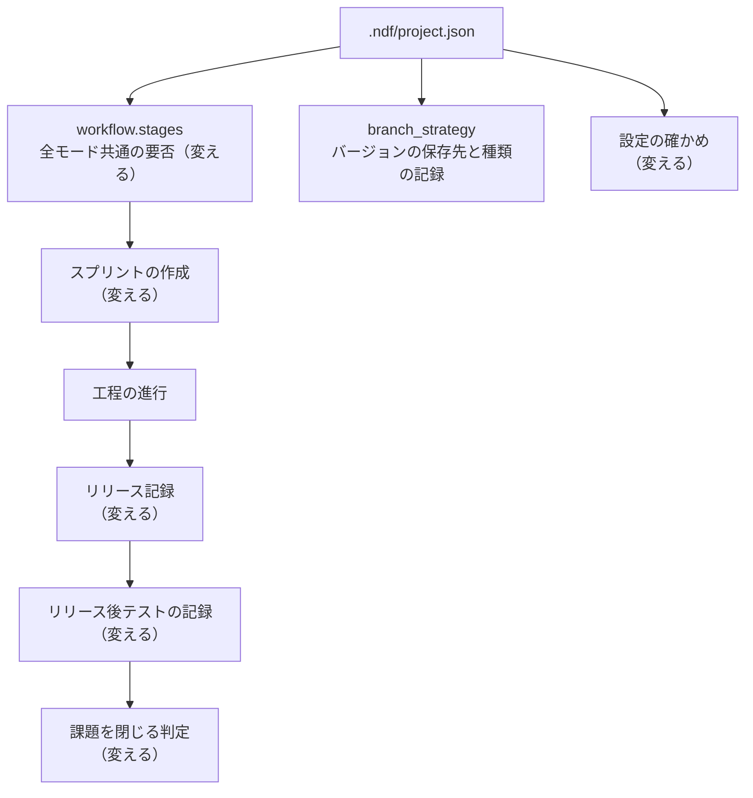
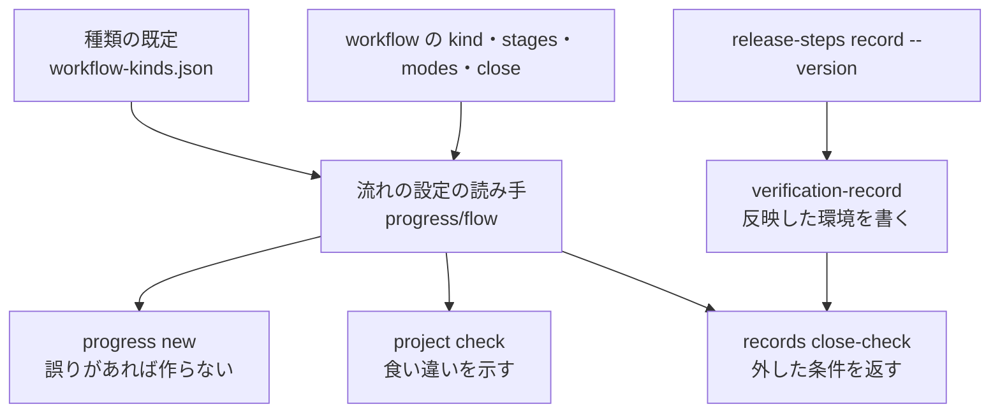
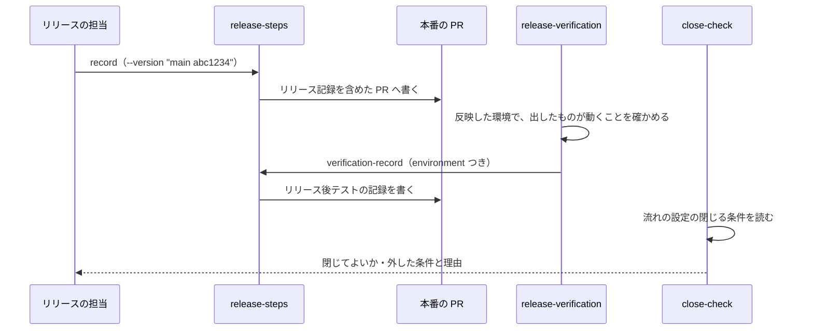

# 開発の流れ: リポジトリの形に合わせて、プロジェクトが設定で選べるようにする（#4580）

バージョン番号を持たないサービスのリポジトリでは、ai-plugins の形を前提にした手順がそのまま適用され、スプリントを手作業の回避なしに終えられない。今ある設定ファイルに、流れの項目（種類・モードごとの工程の要否・閉じる条件）を足す。バージョン番号の無いリリース記録とリリース後テストの記録も書けるようにする。急ぐ分（閉じる条件と記録）を先に出し、2 回に分けてリリースする。分け方と採らなかった案は「決定の記録」に、他の製品の解き方は「外部の調査」にある。

## 今の姿

何が起きたか・目的・受け入れ条件は要求仕様（[issue-4580-requirements.md](./issue-4580-requirements.md)、正は #4580 の本文）にある。この文書は「どう解くか」と「なぜその解き方か」だけを書く。



設計に要る今の構造は次のとおりである（コミット `c93e690ed` で読んだ）。

| 箇所 | 今の振る舞い |
| --- | --- |
| 工程の要否（`progress/stages.py` の `resolve_enabled`） | スプリントの `--disable` > `workflow.stages` > 工程の定義の条件。モードは区別しない。定義に無い工程の名前は読み飛ばす |
| 種類（`branch_strategy.kind`） | 設定を作った時の記録。回答で既定から変えると `custom` になる |
| 閉じる条件 | `ndf records close-check` はリリース後テストの記録だけを見る。「振り返り:」の行は手順書に従って AI が見る。どちらも外す設定は無い |
| リリース記録（`release-steps record`） | 本番へマージした PR の head がリリースブランチの名前でないと書かない。バージョンはブランチの名前から読む |
| リリース後テストの記録 | 同じバージョンのリリース記録を持つ PR にだけ書ける |

**バージョン番号を持たないサービスでは、リリース記録を書く手段が無い。** そのためリリース後テストの記録も書けず、課題を閉じる判定が読むものが無い。出したものを指す値の形をそろえる直し（結果 JSON と記録のスキーマの `version`）は、[バージョン番号の無いリポジトリでデプロイの工程が終わらない不具合](https://github.com/devbasex/ai-plugins/issues/4513) （#4513）の設計が持つ。

## 文脈と制約

- 流れの設定を足していないリポジトリは、今と同じに動く（受け入れ条件 1）。今ある `branch_strategy` は流れの設定に数えない
- #4513 の直しがリリースされていることを前提にする（設計は作業ブランチ `sprint/4513-deploy-without-version` にある）。結果 JSON の `product_version` と、リリース後テストの記録の `version` の形は、この課題では変えない
- 本番へのマージに承認が要るかの判定は変えない（[#4579 のマージ判定の直し](https://github.com/devbasex/ai-plugins/issues/4579) が持つ）
- 承認が要る工程は、どの設定でも無効にできない
- 工程の要否はスプリントの作成の時点で決まり、ステートマシンに保存される。保存の形（`enablement` の `source` の値の集合）は変えない
- NDF は流れの設定を書かない。書くのは利用者だけである

## 解き方の全体像



- 利用者は `.ndf/project.json` の `workflow` に、リポジトリの種類、モードごとの工程の要否、閉じる条件を書ける。何も書かなければ今と同じに動く
- 流れの設定を読んで判定する部品は 1 つで、スプリントの作成・設定の確かめ・閉じる判定が同じ部品を使う
- バージョン番号を持たないリポジトリは、出したものを指す値（例: `main abc1234`）でリリース記録とリリース後テストの記録を書く。記録には反映した環境の名前を残す

## ドメインモデル

### コンテキスト

| コンテキスト | 何の語が 1 つの意味に決まるか |
| --- | --- |
| NDF の開発ワークフロー | 流れの設定、工程の要否、閉じる条件 |
| NDF のリリース | リリース記録、リリース後テストの記録、出したものを指す値 |

関係は顧客と供給者である。閉じる判定（開発ワークフロー）は、リリースが書く記録の形に従う。

### 集約

| 集約 | オーナー（書き換えてよいもの） | 根 | エンティティ | 値オブジェクト |
| --- | --- | --- | --- | --- |
| 流れの設定 | 利用者 | `.ndf/project.json` の `workflow` | — | 工程の要否、閉じる条件の要否と理由 |
| スプリントの工程の要否 | `ndf progress` | ステートマシン | 工程 | 有効か、理由 |
| リリースの記録 | `ndf release-steps` | PR のコメント | リリース記録、リリース後テストの記録 | 出したものを指す値、反映した環境 |

### 不変条件

| # | 集約 | 条件 | 破れたときの扱い |
| --- | --- | --- | --- |
| I1 | スプリントの工程の要否 | 承認ゲートを持つ工程は、どの層の設定でも無効にならない | スプリントを作らず、工程の名前と理由を示す |
| I2 | リリースの記録 | 不合格の行がある課題は閉じない | `close-check` が閉じないと返す |
| I3 | 流れの設定 | NDF のコマンドは `workflow` の `kind`・`modes`・`close` を書かない | テストが落ちる |
| I4 | 流れの設定 | 流れの設定が無ければ、工程の要否と閉じる条件は変更の前と同じである | テストが落ちる |
| I5 | 流れの設定 | 工程の無効化と閉じる条件の除外は、理由を持つ | 形の誤りとして止まる |

### ドメインイベント

| # | イベント | 発生元 | 受け手 |
| --- | --- | --- | --- |
| E1 | 利用者が種類と流れを設定した | 利用者 | 設定の確かめ、スプリントの作成 |
| E2 | 設定の食い違いを確かめた | `ndf project check` | 利用者、起動時の conductor |
| E3 | スプリントの工程の要否が決まった | `ndf progress new` | 工程の進行 |
| E4 | 工程の結果を受け取った | 工程の進行 | リリースの記録 |
| E5 | 課題を閉じた、または閉じなかった | 閉じる担当（`close-check` の結果を読む） | 利用者 |

## 機能一覧

| # | 機能 | 誰が使うか |
| --- | --- | --- |
| F1 | リポジトリの種類とモードごとの工程の要否を指定する | プロジェクトの設定を書く人 |
| F2 | 閉じる条件を理由つきで外す | 同上 |
| F3 | 流れの設定の誤りと食い違いを知る | 同上、conductor |
| F4 | バージョン番号を持たないリリースとテストの結果を記録する | リリースの担当、オーガナイザー |
| F5 | 種類ごとの流れを 1 つの文書で読む | 利用者 |

## 構成要素

| 要素 | 責務 |
| --- | --- |
| 流れの設定の読み手（`progress/flow.py`、新設） | 工程の指定の 3 層（種類の既定・`stages`・`modes.<モード>.stages`）を 1 つに重ねる。誤りと食い違いの一覧を返す。閉じる条件の要否と理由を返す |
| 種類の既定（`contracts/data/workflow-kinds.json`、新設） | `workflow.kind` に書ける名前と、種類ごとに行わない工程と理由 |
| 設定のスキーマ（2 つの `project.schema.json` と `project-workflow.schema.json`） | `workflow` に `kind`・`modes`・`close` を足す |
| スプリントの作成（`progress/command.py`） | 重ねた指定を `resolve_enabled` へ渡し、作成を止める誤りがあれば作らない |
| 設定の確かめ（`domains/project/cli.py`） | 食い違いを結果の `items` に並べる |
| 閉じる判定（`domains/records/cli.py`） | 設定を読み、外した条件と理由を返す |
| リリースの記録（`domains/release` の `record`・`record_decide`・`cli`） | バージョン番号を持たないリポジトリのリリース記録を書く。テストの記録に反映した環境を持たせる |
| 手順書と文書 | 打ち方と、種類ごとの流れ（`development-workflow` の `references/project-flow.md`、新設） |

## 入出力のコントラクト

### 流れの設定の形

流れの設定の形は次のとおりである。どの項目も省ける。

```json
{
  "workflow": {
    "kind": "web-trunk",
    "stages": {"確定仕様化": {"enabled": false, "reason": "仕様は別の場所で管理する"}},
    "modes": {"standard": {"stages": {"振り返り": {"enabled": false, "reason": "週次でまとめて行う"}}}},
    "close": {
      "release_verification": {"required": false, "reason": "反映した環境は監視で確かめる"},
      "retrospective_line": {"required": false, "reason": "振り返りは週次の会で行う"}
    }
  }
}
```

| 項目 | 値 | 省いたとき |
| --- | --- | --- |
| `kind` | `web-develop`・`web-trunk`・`mobile`・`docs`・`plugin` | 種類の既定を当てない |
| `stages` | 工程の名前 → `enabled` と理由（今と同じ） | 今と同じ |
| `modes.<モード>.stages` | そのモードだけの工程の指定 | モードごとの指定なし |
| `close.<条件>` | `required` の真偽。偽なら `reason` が要る。条件は `release_verification` と `retrospective_line` の 2 つ | 求める |

工程の指定が重なるときは、次の順に勝つ。

`--disable` > `modes.<モード>.stages` > `stages` > 種類の既定 > 工程の定義の条件

### 変わるコマンド

| コマンド | 変わる点 | 失敗の形 | 互換性 |
| --- | --- | --- | --- |
| `ndf progress new` | 流れの設定を重ねて工程の要否を決める | 知らない種類・無いモードか工程の名前・承認の工程の無効化は、箇所と理由を示して作らない（`invalid`） | 流れの設定が無ければ同じ。今と違い、`stages` の工程の名前の誤りでも止まる |
| `ndf project check` | `items` に食い違いを足し、`summary` に件数を足す | 終了コードは設定の新しさだけで決め、食い違いでは変えない | 食い違いが無ければ同じ |
| `ndf records close-check` | 結果に、求める条件と外した条件（理由つき）を足す。`release_verification` を外すと `--require` を当てない | 流れの設定が形に合わなければ閉じない（`precondition`） | 流れの設定が無ければ判定は同じ |
| `ndf release-steps record` | 任意の引数 `--version <出したものを指す値>` を足す | バージョンの保存先が `none` でないリポジトリで渡すと `precondition`。本番ブランチへマージしていない PR は今と同じく書かない | 引数が無ければ同じ |
| `ndf release-steps verification-record` | 記録に任意の `environment`（反映した環境の名前）を持てる | バージョンの保存先が `none` で `environment` が無ければ書かない（`precondition`） | バージョンを持つリポジトリは同じ |

### 設定の確かめが示す食い違い

設定の確かめが示す食い違いは次の 5 つである。

| `items` の `kind` | 内容（受け入れ条件） | `progress new` が止まるか |
| --- | --- | --- |
| `flow_unknown_kind` | 知らない種類（10a） | 止まる |
| `flow_unknown_name` | 無いモードか工程の名前。モードの下の指定では、そのモードに無い工程も誤りにする（10b） | 止まる |
| `flow_gate_disabled` | 承認の工程の無効化（5） | 止まる |
| `flow_close_conflict` | あるモードで工程が無効なのに、閉じる条件がその工程の記録を求める。対応は、リリース後テストと `release_verification`、振り返りと `retrospective_line`（10c） | 止まらない |
| `flow_version_conflict` | バージョンの保存先が `none` なのに、バージョンを求める指定がある。該当する指定: バージョンを持つ種類の `workflow.kind`・`release.tag`・`release.github_release: true`・`deliveries` の `versioned: true` のどれか（10d） | 止まらない |

## 処理の流れ

バージョン番号を持たないリポジトリで、マージから課題を閉じるまでは次の順になる。



この図に含めない要素は、流れの設定の読み手・種類の既定・設定のスキーマ・スプリントの作成・設定の確かめ・流れの文書である。これらの関係は「解き方の全体像」の図にある。

「リリースの担当」は、1 つのスプリントではデプロイの工程の worker、並列の計画のまとめたリリースではオーガナイザーである。オーガナイザーは、レーンの PR ごとに `record` を打つ。その後、その PR を `ndf lanes release --release` に渡す。`record` を打ち忘れると `verification-record` が「リリース記録を持たない」で止まる。

## 決定の記録

### 決定 1: 同じ事実を 2 か所に持たないため、流れの設定を今の `.ndf/project.json` の `workflow` に足す

- **質問**: 流れの設定を、今の設定ファイルに足すか、別のファイル（`.ndf/flow.json`）にするか
- **選んだ案**: `workflow` に `kind`・`modes`・`close` を足す。工程の要否の `workflow.stages` と同じ場所である
- 採らなかった案: `.ndf/flow.json` を新設する（工程の要否が 2 つのファイルに分かれ、どちらが勝つかの決まりと、読み手の移行が要る）
- 採らなかった案: `branch_strategy` に足す（ブランチとリリースの決まりに、工程と閉じる条件が混ざる）
- **代償**: `project.json` のスキーマがさらに大きくなる。古いバージョンの NDF は新しい項目を形の誤りにする
- 根拠: Value 8 / Value 11（MVV バージョン 11）

### 決定 2: 今あるリポジトリの流れを変えないため、種類は `workflow.kind` に明示で指定する

- **質問**: 種類ごとの既定を、今ある `branch_strategy.kind` で当てるか、新しい項目で当てるか。サービス型の名前を新しくするか
- **選んだ案**: `workflow.kind` を書いたリポジトリにだけ種類の既定を当てる。名前はブランチ戦略の種類と同じにし、要求のサービス型は `web-trunk` である
- 採らなかった案: `branch_strategy.kind` で当てる（流れの設定を足していないリポジトリの振る舞いが変わる。値は作成の記録で、1 つ変えるだけで `custom` になる）
- 採らなかった案: サービス型の新しい名前を作る（同じリポジトリの形に名前が 2 つできる）
- **代償**: 「種類」という項目が 2 つになる。バージョンの食い違いは設定の確かめが示すが、名前の違いは示さない
- 根拠: Value 4 / Value 14（MVV バージョン 11）

### 決定 3: 確かめていないことを済んだと記録しないため、種類の既定は工程の無効化だけを持ち、閉じる条件はどの種類も外さない

- **質問**: 種類ごとの既定に、何を持たせるか
- **選んだ案**: `workflow-kinds.json` は行わない工程と理由だけを持つ。今の既定で当たるのは `docs` の「リファクタリング」である（業務文書だけのリポジトリは、直すコードの構造を持たない）。閉じる条件はどの種類も 2 つとも求め、外すのは利用者の `workflow.close` だけにする。リリースで求める結果の形は、ブランチ戦略の `release.version_store.kind` が決める（種類ごとの値は `branch-strategy-presets.json` にある）
- 採らなかった案: `web-trunk` の既定で閉じる条件を外す（利用者が何も書かないのに、テストの記録の無い課題が閉じる）
- 採らなかった案: バージョンの有無を `workflow-kinds.json` にも持つ（同じ事実が 2 か所になる）
- **代償**: `web-trunk` を指定しただけでは何も省かれない。省くには `close` を書く
- 根拠: Value 13 / Value 8（MVV バージョン 11）

### 決定 4: 工程の要否の決め方を 1 つに保つため、3 層の指定を重ねて今の `resolve_enabled` に渡す

- **質問**: モードごとの指定と種類の既定を、どこで効かせるか
- **選んだ案**: `progress/flow.py` が種類の既定、`stages`、`modes.<モード>.stages` の順に重ねる。重ねた 1 つの指定を `resolve_enabled` に渡す。保存する `source` は今の `project` のままで、種類の既定の理由は「種類 docs の既定: …」で始める。承認の工程の無効化は、重ねる前の層のどれにあっても断る
- 採らなかった案: `resolve_enabled` の順位を 5 段階にし、`source` に `kind` を足す（保存の形が変わり、前のバージョンが読めない）
- 採らなかった案: 設定の併合のライブラリを使う（重ねるのは工程の名前をキーにした辞書の更新 2 回で、依存を足す理由が無い）
- **代償**: 保存した記録からは、種類の既定か利用者の指定かを理由の文でしか見分けられない
- 作り方: 自前で作る
- 比べた候補: LIB1・LIB2
- 根拠: Value 9 / Value 12（MVV バージョン 11）

### 決定 5: 閉じる条件の判定を実行ごとにぶれさせないため、外した条件は `close-check` が設定を読んで返す

- **質問**: 閉じる条件の除外を、手順書を読む AI に任せるか、コマンドが返すか
- **選んだ案**: `close-check` が `workflow.close` を読み、求める条件と外した条件（理由つき）を結果に入れる。閉じる報告には外した条件を転記する。外せるのは「テストの記録があること」と「振り返りの行があること」だけである。記録があれば不合格は閉じず、保留は人が決める（今と同じ）
- 採らなかった案: 手順書に「設定を読む」と書くだけにする（読み方が実行ごとに変わり、テストで確かめられない）
- 採らなかった案: `close-check` が振り返りの行も GitHub から読んで判定する（今 AI が見ている条件をコマンドへ移すことになり、この要求の範囲の外である）
- **代償**: 振り返りの行を見るのは今と同じく AI で、コマンドは「求めるか」までを返す
- 根拠: Value 3 / Value 13（MVV バージョン 11）

### 決定 6: バージョンの無いリリースの後も課題を閉じられるようにするため、`release-steps record` に出したものを指す値を渡せるようにする

- **質問**: バージョン番号を持たないリポジトリのリリース記録を、誰がどう書くか
- **選んだ案**: `record --version <値>` を足す。バージョンの保存先が `none` のときだけ受ける。head の名前は問わない。本番ブランチへマージした PR と、その中の単位の PR を「含めた PR」にする。値はデプロイの工程の `product_version` と同じものを渡す
- 採らなかった案: 手順書の人が読む形のコメントを手で書く（テストの記録と閉じる判定は機械が読むマーカーの記録を求める）
- 採らなかった案: `verification-record` がリリース記録も書く（テストを外したリポジトリにリリース記録が残らない）
- 採らなかった案: 値をマージのコミットからコマンドが作る（まとめたリリースでオーガナイザーが記録した値と食い違う）
- 採らなかった案: GitHub の Deployments の記録へ移す（閉じる判定の読み先が 2 つになり、バージョンを持つ形も作り直しになる）
- **代償**: 打つ側が値を間違えると、その値が記録になる。テストの記録は同じ値でないと書けないので、食い違いはそこで止まる
- 作り方: 自前で作る・標準に倣う
- 比べた候補: STD1・PRD2
- 根拠: Value 3 / Value 15（MVV バージョン 11）

### 決定 7: 何を確かめたかが後で分かるように、バージョンの無いリポジトリのテストの記録は反映した環境の名前を持つ

- **質問**: 反映した環境を対象にしたテストの結果を、どう表すか
- **選んだ案**: 記録のスキーマに任意の `environment` を足し、バージョンの保存先が `none` のリポジトリでは必須にする。対象は「出したものを指す値」と「環境の名前」の 2 つで決まる
- 採らなかった案: バージョンの無いリポジトリ向けの別の記録を作る（閉じる判定の読み手が 2 つになる）
- 採らなかった案: `version` の値に環境の名前を混ぜる（リリース記録の値と一致しなくなる）
- **代償**: 必須かどうかはスキーマでなくコマンドが決める
- 作り方: 標準に倣う
- 比べた候補: STD1・PRD2
- 根拠: Value 13 / Value 8（MVV バージョン 11）

### 決定 8: 今動いているリポジトリを止めないため、誤りはスプリントの作成で止め、食い違いは設定の確かめで示すだけにする

- **質問**: 設定の問題を、どの時点で、どれだけ強く扱うか
- **選んだ案**: 知らない種類・無い名前・承認の工程の無効化は `progress new` が止める。閉じる条件とバージョンの食い違いは `project check` が示し、終了コードは変えない。起動時の手順書は、示された食い違いを利用者へ伝える
- 採らなかった案: 食い違いも `project check` の終了コードにする（起動の手順で「設定が壊れている」と同じ扱いになり、`workflow.stages` を既に書いたリポジトリが止まる）
- 採らなかった案: 知らない種類をスキーマの列挙で落とす（`project.json` を読むすべてのコマンドが止まり、確かめが箇所を示せない）
- **代償**: 食い違いは見落とされうる。閉じる条件の食い違いは、閉じる時点で「記録が無い」と分かる
- 根拠: Value 4 / Value 1（MVV バージョン 11）

### 決定 9: 止まっているプロジェクトを早く進めるため、2 回に分けて出す

- **質問**: 急ぐ分を小さく先に出すか（要求の未決の 1 つ目）
- **選んだ案**: レビューの単位を 2 つにし、単位ごとにリリースする

  | 順 | 単位 | 受け入れ条件 | 前提 |
  | --- | --- | --- | --- |
  | 先 | 閉じる条件の除外と、バージョンの無いリリースとテストの記録 | 1・6〜9・13（2 はこの単位と #4513 で満たす） | #4513 のリリース |
  | 後 | 種類の既定、モードごとの要否、設定の確かめ、流れの文書 | 3〜5・10〜12 | 先の単位 |

- 採らなかった案: 1 回で出す（止まっている点の直しが、急がない機能のレビューを待つ）
- 採らなかった案: 受け入れ条件 6・7 だけを先に出す（記録を書けないままで、バージョンの無いリポジトリは止まり続ける）
- **代償**: リリースとレビューが 2 回になる。同じスキーマと手順書を 2 回触る
- 根拠: Value 5（MVV バージョン 11）

### 決定 10: 利用者が 1 か所で読めるように、種類ごとの流れは `development-workflow` の参照文書に書く

- **質問**: 受け入れ条件 12 の文書を、どこに置くか
- **選んだ案**: `skills/development-workflow/references/project-flow.md` を新設する。表にするのは、種類ごとの行わない工程、閉じる条件、本番の承認の場面、結果の形である。値の正本（`workflow-kinds.json` と `branch-strategy-presets.json`）も指す。モードごとの工程の並びと要否は、同じ Skill の工程表へのリンクの先で読み、種類で変わる分だけをこの文書に書く
- 採らなかった案: `docs/specifications/` に置く（プラグインと一緒に利用者へ届かない）
- 採らなかった案: 表をコマンドで生成する（行が 5 つの表のために、生成の仕組みと検査が増える）
- **代償**: 既定を変えたら、データと文書の両方を直す
- 根拠: Value 11 / Value 4（MVV バージョン 11）

## 影響と危険

- **働く範囲**: NDF を使うすべてのリポジトリ。流れの設定を書かなければ、変わるのは `release-steps record --version` と記録の `environment` を使える点だけである
- **プロジェクトごとに違うもの**: 種類・工程の要否・閉じる条件は `workflow` の設定で受ける。バージョンの有無は `branch_strategy` の設定、出したものを指す値は引数で受ける
- **当たるモード**: 工程の要否は全モード。閉じる条件は課題を閉じる全経路
- **壊れうる箇所**: `workflow.stages` の工程の名前に誤りがあるリポジトリは、次のスプリントの作成で止まる（要求が認めた変化）
- **壊れうる箇所**: #4513 と同じファイルを触る（記録のスキーマと、`release`・`release-verification`・`progress-tracking` の手順書）。#4513 のマージの後に実装を始める
- **壊れうる箇所**: 閉じる条件を外すと、確かめていない課題が閉じる。理由を必須にし、閉じた報告に外した条件を載せる

### 代表のリポジトリでの振る舞い

| 代表のリポジトリ | 設定の要点 | 直した後に起きること | この種類で扱えなくなること |
| --- | --- | --- | --- |
| Web サービス | `version_store.kind` は `none` かファイル。`workflow.kind` は任意 | `none` は出したものを指す値で記録を書き、課題を閉じられる。バージョンを持つ形は同じ | 無し |
| モバイルアプリ | バージョンを持つ。流れの設定なし | 同じ | 無し |
| 業務文書だけ | `version_store.kind: none`。`workflow.kind: docs` は任意 | 記録をバージョンなしで書ける。`docs` を指定すると「リファクタリング」が理由つきで無効になる | 無し |

### ai-plugins だけの事情

- 無し（ai-plugins は流れの設定を足さず、バージョンの保存先は `plugin` のままである）

## 用語

| 用語 | 意味 | 用語集への反映 |
| --- | --- | --- |
| 流れの設定 | `.ndf/project.json` の `workflow` のうち、リポジトリの種類・工程の要否・閉じる条件を指定する項目 | 追加 |

## テスト設計

| 受け入れ条件・不変条件 | どの振る舞いで縛るか | どう壊したら落ちるべきか |
| --- | --- | --- |
| 1・I4 | 流れの設定が無いとき、全モードの工程の要否と `close-check` の判定が変更の前と同じである | 種類の既定を `branch_strategy.kind` から当てると落ちる |
| 2 | バージョンの無い設定で、リリース記録・テストの記録・閉じる判定が続けて通る | `record --version` が head の名前を求めると落ちる |
| 3 | `kind: docs` でスプリントを作ると、「リファクタリング」が理由つきで無効の行になる | 種類の既定を重ねないと落ちる |
| 4 | モードの下の指定は、そのモードだけで工程を無効にする。理由が無ければ作らない | モードを見ずに重ねる、または理由の無い指定を通すと落ちる |
| 5・I1 | `stages`・`modes` のどちらで承認の工程を無効にしても作らない。別の層で有効に戻しても作らない | 重ねた後の値だけを見ると落ちる |
| 6 | テストの記録を外すと、記録なしで `--require` を付けても閉じてよいと返し、外した条件と理由が結果に載る | 外した条件を結果に載せないと落ちる |
| 7 | 振り返りの行を外すと、結果がその条件を求めないと返し、理由が載る | 常に求めると返すと落ちる |
| 8・I2 | 両方の条件を外しても、不合格の行がある課題は閉じない | 外した条件の記録を読み飛ばすと落ちる |
| 9 | バージョンの無い値と `environment` のテストの記録を書け、`close-check` が読む。`environment` が無ければ書かない | `environment` を必須にしないと落ちる |
| 10 | (a)〜(d) のそれぞれで、箇所と理由が `items` に出る。食い違いの無い設定では出ず、終了コードは変わらない | 判定のどれか 1 つを外すと落ちる |
| 11 | 知らない種類か無い名前があると、ステートマシンを作らずに理由を示す | 無い名前を読み飛ばすと落ちる |
| 12 | 参照文書へのリンクが切れていない（文言は照合しない） | 文書を消すとリンクの検査が落ちる |
| 13・I3 | 流れの設定を持つリポジトリで `project write` と `branch-strategy` の書き出しを打っても、`workflow` が変わらない | 書き出しが `workflow` を落とすと落ちる |
| I5 | 理由の無い `required: false` は形の誤りになる | 理由を任意にすると落ちる |
| 決定 6 | バージョンを持つ設定で `--version` を渡すと書かずに止まる | 引数を常に受けると落ちる |

## 設計の結果

詳細設計は別ファイル `issue-4580-design-detail.md` にする（新設する関数が 2 つ以上あるため）。

| 課題 | 扱い | 統合先 | 触るファイル |
| --- | --- | --- | --- |
| #4580 | 実装する | — | `plugins/ndf/contracts/data/workflow-kinds.json`（新設）、`plugins/ndf/contracts/schemas/project-workflow.schema.json`、`plugins/ndf/contracts/schemas/ndf-settings/project.schema.json`、`plugins/ndf/skills/development-workflow/schemas/project.schema.json`、`plugins/ndf/contracts/schemas/release-verification.schema.json`、`plugins/ndf/contracts/schemas/io/records.result.schema.json`、`plugins/ndf/contracts/schemas/io/project.result.schema.json`、`plugins/ndf/contracts/schemas/io/release-steps.args.schema.json`、`plugins/ndf/src/ndf/progress/flow.py`（新設）、`plugins/ndf/src/ndf/progress/command.py`、`plugins/ndf/src/ndf/domains/project/cli.py`、`plugins/ndf/src/ndf/domains/records/cli.py`、`plugins/ndf/src/ndf/domains/release/record.py`、`plugins/ndf/src/ndf/domains/release/record_decide.py`、`plugins/ndf/src/ndf/domains/release/cli.py`、`plugins/ndf/skills/development-workflow/SKILL.md`、`plugins/ndf/skills/development-workflow/references/project-flow.md`（新設）、`plugins/ndf/skills/development-workflow/references/parallel.md`、`plugins/ndf/skills/progress-tracking/SKILL.md`、`plugins/ndf/skills/release/SKILL.md`、`plugins/ndf/skills/release/references/release-steps.md`、`plugins/ndf/skills/release-verification/SKILL.md`、`docs/glossary/glossary.json`、`docs/glossary.md`、`docs/glossary/ndf-workflow.md`、`plugins/ndf/tests/progress/test_flow.py`（新設）、`plugins/ndf/tests/progress/test_command.py`、`plugins/ndf/tests/domains/project/test_project_cli.py`、`plugins/ndf/tests/domains/records/test_cli.py`、`plugins/ndf/tests/domains/records/test_close.py`、`plugins/ndf/tests/domains/release/test_release_record.py` |

## 未確認のまま残ること

| 項目 | 内容 |
| --- | --- |
| サービス型のスプリントが、要求から棚卸しまで手作業なしに終わるか（受け入れ条件 2） | コードと手順書を読んで見つけたバージョンの前提は、結果の形（#4513）とリリース記録の 2 つである。ほかに無いことは、リリース後に使い捨てのリポジトリでスプリントを 1 本流して分かる |
| 問題が起きたリポジトリで、この変更で足りるか | そのリポジトリの設定はここから読めない。利用者がリリースの後に確かめる |

## 外部の調査

| 種類 | 調べるか | 理由 |
| --- | --- | --- |
| 標準・仕様 | 調べる | バージョンを持たない反映の対象を、広く使われる API がどう指すかを確かめる |
| 主要な製品 | 調べる | 種類ごとの既定と上書き、反映の記録の持ち方を比べる |
| ライブラリとサービス | 調べる | 設定の層の併合を自前で書くかを決める |

### 標準・仕様

| # | 標準・仕様 | 何を定めているか | 設計への反映 | 出典 |
| --- | --- | --- | --- | --- |
| STD1 | GitHub REST API の Deployments | 反映の対象は ref（ブランチ・SHA・タグ）で指し、環境の名前（`environment`）を持つ。バージョンは必須でない | 出したものを指す値と環境の名前の 2 つで対象を表す（決定 6・7） | https://docs.github.com/en/rest/deployments/deployments （2026-11-27） |

### 主要な製品

| # | 製品 | どう解いているか | 設計への反映 | 出典 |
| --- | --- | --- | --- | --- |
| PRD1 | release-please | パッケージの種類（`release-type`）が既定を持ち、パッケージごとに上書きする | 種類の既定を先に当て、利用者の指定で上書きする（決定 4） | https://github.com/googleapis/release-please/blob/main/docs/manifest-releaser.md （2026-11-27） |
| PRD2 | GitLab の Environments / Deployments | 反映を環境の名前とコミットで記録する | 同じ組をテストの記録に持つ（決定 7） | https://gitlab.com/gitlab-org/gitlab/-/blob/master/doc/ci/environments/deployments.md （2026-11-27） |

### ライブラリとサービス

| # | 候補 | バージョン | ライセンス | 最後のリリースの日付 | 終了のアナウンス | 要件を満たすか | 出典 |
| --- | --- | --- | --- | --- | --- | --- | --- |
| LIB1 | deepmerge | 4.0.0 | MIT | 2026-10-25 | 無し（PyPI の情報で確かめた範囲） | 併合はできるが、要るのは辞書の更新だけ | https://pypi.org/pypi/deepmerge/json （2026-11-27） |
| LIB2 | Dynaconf | 3.3.5 | MIT | 2026-08-05 | 無し（同上） | 層の併合はできるが、設定の読み方全体を置き換える | https://pypi.org/pypi/dynaconf/json （2026-11-27） |

調べた量: 候補 5 件・取得の試み 7 回。
