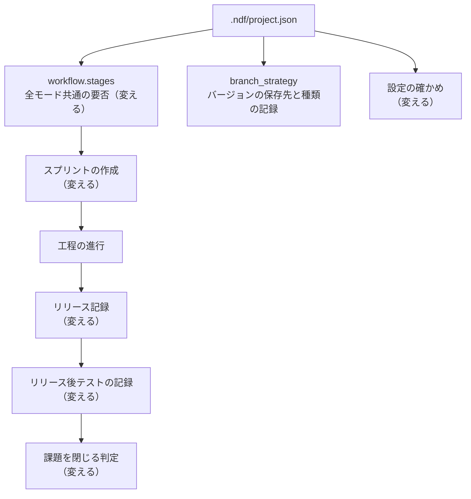
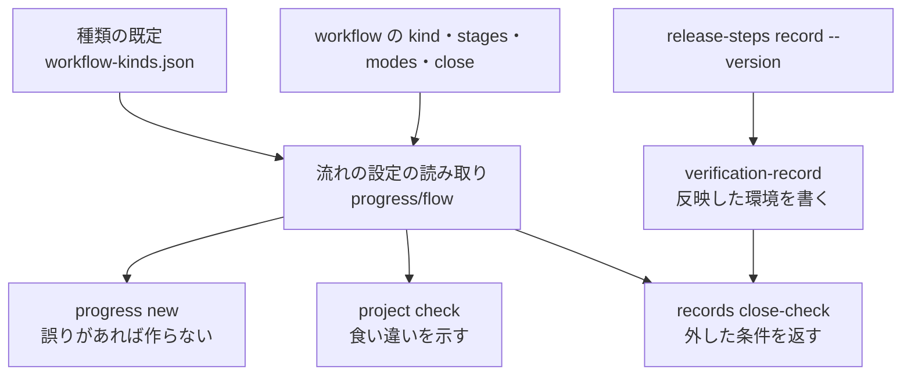

# 開発の流れ: リポジトリの形に合わせて、プロジェクトが設定で選べるようにする（#4580）

バージョン番号を持たないサービスのリポジトリでは、ai-plugins の形を前提にした手順がそのまま適用される。工程が止まり、人が結果の記録を作り直さないと、スプリントを最後まで進められない。この設計は、その作り直しを無くす。今ある設定ファイルに、流れの項目（種類・モードごとの工程の要否・閉じる条件）を足す。バージョン番号の無いリリース記録とリリース後テストの記録も書けるようにする。急ぐ分（閉じる条件と記録）を先に出し、2 回に分けてリリースする。分け方と採らなかった案は「決定の記録」に、他の製品の解き方は「外部の調査」にある。

## 今の姿

何が起きたか・目的・受け入れ条件は要求仕様（[issue-4580-requirements.md](./issue-4580-requirements.md)、正は #4580 の本文）にある。この文書は「どう解くか」と「なぜその解き方か」だけを書く。



設計に要る今の構造は次のとおりである（コミット `c93e690ed` で読んだ）。

| 箇所 | 今の振る舞い |
| --- | --- |
| 工程の要否（`progress/stages.py` の `resolve_enabled`） | スプリントの `--disable` > `workflow.stages` > 工程の定義の条件。モードは区別しない。定義に無い工程の名前は読み飛ばす |
| 種類（`branch_strategy.kind`） | 設定を作った時の記録。回答で既定から変えると `custom` になる |
| 閉じる条件 | `ndf records close-check` はリリース後テストの記録だけを見る。「振り返り:」の行は手順書に従って AI が見る。どちらも外す設定は無い |
| リリース記録（`release-steps record`） | 本番へマージした PR の head がリリースブランチの名前でないと書かない。バージョンはブランチの名前から読む |
| リリース後テストの記録 | 同じバージョンのリリース記録を持つ PR にだけ書ける |

**バージョン番号を持たないサービスでは、リリース記録を書く手段が無い。** そのためリリース後テストの記録も書けず、課題を閉じる判定が読むものが無い。出したものを指す値の形をそろえる直し（結果 JSON と記録のスキーマの `version`）は、[バージョン番号の無いリポジトリでデプロイの工程が終わらない不具合](https://github.com/devbasex/ai-plugins/issues/4513) （#4513）の設計が持つ。

## 文脈と制約

- 流れの設定（今ある `workflow.stages` を含む）を書いていないリポジトリは、今と同じに動く（受け入れ条件 1）。今ある `branch_strategy` は流れの設定に数えない
- #4513 の直しがリリースされていることを前提にする（設計は作業ブランチ `sprint/4513-deploy-without-version` にある）。結果 JSON の `product_version` と、リリース後テストの記録の `version` の形は、この課題では変えない
- 本番へのマージに承認が要るかの判定は変えない（[#4579 のマージ判定の直し](https://github.com/devbasex/ai-plugins/issues/4579) が持つ）
- 承認が要る工程は、どの設定でも無効にできない
- 工程の要否はスプリントの作成の時点で決まり、ステートマシンに保存される。保存の形（`enablement` の `source` の値の集合）は変えない
- NDF は流れの設定を書かない。書くのは利用者だけである

## 解き方の全体像



- 利用者は `.ndf/project.json` の `workflow` に、リポジトリの種類、モードごとの工程の要否、閉じる条件を書ける。何も書かなければ今と同じに動く
- 流れの設定を読んで判定する部品は 1 つで、スプリントの作成・設定の確かめ・閉じる判定が同じ部品を使う
- バージョン番号を持たないリポジトリは、出したものを指す値（例: `main abc1234`）でリリース記録とリリース後テストの記録を書く。記録には反映した本番の環境の名前（複数可）を残す。この文書で単に「値」と書くときは、記録の項目 `version` に入るものをいう。バージョン番号を持たないリポジトリでは出したものを指す値、持つリポジトリではバージョン番号である。「同じ値の記録」は、`version` が文字列として同じ記録をいう

## ドメインモデル

### コンテキスト

| コンテキスト | 何の語が 1 つの意味に決まるか |
| --- | --- |
| NDF の開発ワークフロー | 流れの設定、工程の要否、閉じる条件 |
| NDF のリリース | リリース記録、リリース後テストの記録、出したものを指す値 |

関係は顧客と供給者である。閉じる判定（開発ワークフロー）は、リリースが書く記録の形に従う。

### 集約

| 集約 | オーナー（書き換えてよいもの） | 根 | エンティティ | 値オブジェクト |
| --- | --- | --- | --- | --- |
| 流れの設定 | 利用者 | `.ndf/project.json` の `workflow` | — | 工程の要否、閉じる条件の要否と理由 |
| スプリントの工程の要否 | `ndf progress` | ステートマシン | 工程 | 有効か、理由 |
| リリースの記録 | `ndf release-steps` | PR のコメント | リリース記録、リリース後テストの記録 | 出したものを指す値、反映した環境 |

### 不変条件

| # | 集約 | 条件 | 破れたときの扱い |
| --- | --- | --- | --- |
| I1 | スプリントの工程の要否 | 承認ゲートを持つ工程（下の「承認ゲートを持つ工程の判定」）は、どの層の設定でも無効にならない | スプリントを作らず、工程の名前と理由を示す |
| I2 | リリースの記録 | 不合格の行がある課題は閉じない | `close-check` が閉じないと返す |
| I3 | 流れの設定 | NDF のコマンドは、利用者が指定した `workflow.kind`・`workflow.stages`・`workflow.modes`・`workflow.close` を保持する | テストが落ちる |
| I4 | 流れの設定 | 流れの設定が無ければ、工程の要否と閉じる条件は変更の前と同じである | テストが落ちる |
| I5 | 流れの設定 | 工程の無効化と閉じる条件の除外は、理由を持つ | 形の誤りとして止まる |

### 承認ゲートを持つ工程の判定

工程定義（`contracts/workflow/stages/*.json`）を読み、`StageDef.gates` が空でない工程を保護する。`gates` は承認ゲートのステップだけを数える。承認を求める前に、AI が承認資料と質問の文を読んで通じるかを確かめるステップ（読み手役のステップ）は、`gate` の項目を持っていても数えない。今の定義で当たるのは「設計」と「デプロイ」である。工程の名前の一覧はコードに持たない。

保護の確かめは、指定を重ねる前に層ごとに行う。`--disable` を拒否する今の振る舞いは変えない。

### ドメインイベント

| # | イベント | 発生元 | 受け手 |
| --- | --- | --- | --- |
| E1 | 利用者が種類と流れを設定した | 利用者 | 設定の確かめ、スプリントの作成 |
| E2 | 設定の食い違いを確かめた | `ndf project check` | 利用者、起動時の conductor（スプリントの工程を進める AI） |
| E3 | スプリントの工程の要否が決まった | `ndf progress new` | 工程の進行 |
| E4 | 工程の結果を受け取った | 工程の進行 | リリースの記録 |
| E5 | 課題を閉じた、または閉じなかった | 閉じる担当（`close-check` の結果を読む） | 利用者 |

## 機能一覧

| # | 機能 | 誰が使うか |
| --- | --- | --- |
| F1 | リポジトリの種類とモードごとの工程の要否を指定する | プロジェクトの設定を書く人 |
| F2 | 閉じる条件を理由つきで外す | 同上 |
| F3 | 流れの設定の誤りと食い違いを知る | 同上、conductor |
| F4 | バージョン番号を持たないリリースとテストの結果を記録する | リリースの担当、オーガナイザー |
| F5 | 種類ごとの流れを 1 つの文書で読む | 利用者 |

## 構成要素

| 要素 | 責務 |
| --- | --- |
| 流れの設定の読み取り（`progress/flow.py`、新設） | 工程の指定の 3 層（種類の既定・`stages`・`modes.<モード>.stages`）を 1 つに重ねる。誤りと食い違いの一覧を返す。閉じる条件の要否と理由を返す |
| 種類の既定（`contracts/data/workflow-kinds.json`、新設） | `workflow.kind` に書ける名前と、種類ごとに行わない工程と理由 |
| 設定のスキーマ（2 つの `project.schema.json` と `project-workflow.schema.json`） | `workflow` に `kind`・`modes`・`close` を足す |
| スプリントの作成（`progress/command.py`） | 重ねた指定を `resolve_enabled` へ渡し、作成を止める誤りがあれば作らない |
| 設定の確かめ（`domains/project/cli.py`） | 食い違いを結果の `items` に並べる |
| 閉じる判定（`domains/records/cli.py`・`close_decide.py`） | 設定を読み、外した条件と理由を返す |
| リリースの記録（`domains/release` の `record`・`record_decide`・`cli`） | バージョン番号を持たないリポジトリのリリース記録を書く。テストの記録に反映した環境を持たせる |
| 手順書と文書 | 打ち方と、種類ごとの流れ（`development-workflow` の `references/project-flow.md`、新設） |
| 流れの文書の生成（`scripts/check-ndf-contracts.py`） | 流れの文書の表と閉じる条件を正本から書き出し、書き出した内容と違えば違反にする（決定 10） |

## 入出力のコントラクト

### 流れの設定の形

流れの設定の形は次のとおりである。どの項目も省ける。

```json
{
  "workflow": {
    "kind": "web-trunk",
    "stages": {"確定仕様化": {"enabled": false, "reason": "仕様は別の場所で管理する"}},
    "modes": {"standard": {"stages": {"振り返り": {"enabled": false, "reason": "週次でまとめて行う"}}}},
    "close": {
      "release_verification": {"required": false, "reason": "反映した環境は監視で確かめる"},
      "retrospective_line": {"required": false, "reason": "振り返りは週次の会で行う"}
    }
  }
}
```

| 項目 | 値 | 省いたとき |
| --- | --- | --- |
| `kind` | `web-develop`・`web-trunk`・`mobile`・`docs`・`plugin` | 種類の既定を当てない |
| `stages` | 工程の名前 → `enabled` と理由（今と同じ） | 今と同じ |
| `modes.<モード>.stages` | そのモードだけの工程の指定 | モードごとの指定なし |
| `close.<条件>` | `required` の真偽。偽なら `reason` が要る。条件は `release_verification` と `retrospective_line` の 2 つ | 今と同じ。リリース後テストを通る経路でだけ、手順書が `--require` を付けて記録を求める（`required: true` も同じ。分けたファイルの「閉じる条件を外したときの閉じ方」） |

工程の指定が重なるときは、次の順に勝つ。

`--disable` > `modes.<モード>.stages` > `stages` > 種類の既定 > 工程の定義の条件

### 変わるコマンド

| コマンド | 変わる点 | 失敗の形 | 互換性 |
| --- | --- | --- | --- |
| `ndf progress new` | 流れの設定を重ねて工程の要否を決める | 知らない種類・無いモードか工程の名前（下の「名前の照合」）・承認の工程の無効化・後の工程が必ず読む出力を作る工程の無効化（下の「工程の入出力の確かめ」）は、箇所と理由を示して作らない（`invalid`） | 流れの設定が無ければ同じ。今と違い、`stages` の工程の名前の誤りでも止まる |
| `ndf project check` | `items` に食い違いを足し、`summary` に件数を足す | 終了コードは今と同じく設定の状態（`fresh`・`missing`・`stale`・`broken`）だけで決め、食い違いでは変えない | 食い違いが無ければ同じ |
| `ndf records close-check` | 任意の引数 `--records <ndf release-steps records の出力の JSON>` を足す。結果に、条件ごとの扱い（`outputs.conditions`）と、テストで確認できたか（`outputs.verified`）を足す（分けたファイルの「close-check の結果」） | 流れの設定が形に合わなければ閉じない（`precondition`）。`--records` と `--verification` を両方渡すと `precondition`。バージョンの保存先が `none` のリポジトリで `--verification` を渡しても `precondition`（分けたファイルの「close-check の結果」） | 流れの設定が無く `--records` を渡さなければ、バージョンを持つリポジトリの判定は同じ |
| `ndf release-steps record` | 任意の引数 `--version <出したものを指す値>`、`--environment <反映した本番の配布先の名前>`、`--target <今回の対象の配布先の名前>`、`--observed <配布先の名前>`（その配布先の宣言の `observe.url` を `record` が読んで確かめる）を足す（`--version` 以外は複数回指定できる）。対象の一覧を訂正する `--correct-targets --reason <理由>` も足す（分けたファイルの「対象の一覧の訂正」）。`--production-sha` は今と同じく受ける。結果の `outputs` に、対象の配布先の反映がそろったか（`complete`）、まだの配布先（`missing`）、今回書いた配布先（`recorded`）、記録が既にあって書かなかった配布先（`kept`）、CD の結果が失敗した配布先（`failed`）、未確定で書かなかった配布先（`pending`）を入れる | 結果の状態と終了コードは、分けたファイルの「`record` の終わり方」の表で決まる。本番ブランチへ入っていない PR は今と同じく書かない | 引数が無ければ同じ |
| `ndf release-steps verification-record` | 記録に任意の `environments`（確かめた本番の配布先の名前の一覧）と `unit`（配布単位の名前）を持てる。記録と同じ `version`（バージョン番号か、出したものを指す値）のリリース記録が配布単位を持つときは、`--unit` が要る。同じ値に、配布先ごとの記録を何件でも書ける。配布先と課題の組の今の判定の行が不合格なら、新しい行に理由（`retest_reason`）が要り、無ければ書かない（`precondition`。分けたファイルの「判定に使う行」） | バージョンの保存先が `none` で、次のどれかに当たれば書かない（`precondition`）。`environments` が無い。反映の記録が無い配布先を含む。`--pr` が記録の PR（リリース記録の `included` の最小の番号）でない。最後の場合は、正しい記録の PR の番号を `items` に入れて返す | バージョンを持つリポジトリは同じ |
| `ndf release-steps records` | 任意の引数 `--version <値>`・`--release <本番の PR>`・`--unit <配布単位の名前>` を足す。渡した項目（`version`、`release` は本番の PR の番号、`unit` は配布単位）が一致する記録だけから代表とテストの記録を選ぶ。閉じる手順は `--version` を必ず渡し、リリースが配布単位を 2 つ以上持つときは `--unit` も渡す。出力に、代表のリリース記録と同じ `version`・`unit` の有効なリリース記録（`releases`）と、今の対象の一覧（`targets`）を足す。任意の引数 `--bodies` で、代表のリリース記録の `included` の PR ごとの本文と、本文の書き手を信用するか（`bodies`）も返す。`--pr-body-only` を渡すと、リリース記録を選ばず、`--pr` の PR の本文だけを返す（デプロイを飛ばした経路で使う）。`--bodies` か `--issues <課題の番号>...` を渡したときは、テストを始めてよい配布先と課題の組（`to_test`、分けたファイルの「テストする組の引き方」）も返す。`--issues` では含めた PR の本文を読まず、渡した課題で組を作る | 今回のリリースに当たる候補のコメントと、本文を使う PR の書き手のうち、権限を照会できない書き手がいれば、記録を選ばずに失敗で返す。今回のリリースに当たらないコメントの書き手は照会しない（分けたファイルの「閉じる手順の読み取り」） | 今の出力の項目は変えない |

### 名前の照合

工程の名前は、指定した場所ごとに次の定義と照合する。

| 指定した場所 | 照合する定義 |
| --- | --- |
| `modes.<モード>.stages` | そのモードの工程の集合。モードの名前自体は、モードの定義の一覧と照合する |
| `stages`（全モード共通）と種類の既定 | 全モードの工程の和集合 |

共通の `stages` に、作ろうとするモードでは使わない工程があっても、ほかのモードにあれば誤りにしない。たとえば `stages` に「リファクタリング」の指定があっても、`light` のスプリントは作れる。

### 工程の入出力の確かめ

流れの設定で工程を無効にした結果、後の工程が必ず読む入力を作る工程が無くなるなら、スプリントを作らない。承認ゲートの保護だけでは、後の工程が入力の不足で途中で止まるスプリントが作られてしまうためである。

確かめは、工程の定義の `inputs`（必ず読むキー）と `outputs`（書くキー）だけを使い、工程の名前の一覧はコードに持たない。`optional_inputs` は無くても工程が流れるので数えない。

1. 重ねた後の指定で有効な工程を、モードの工程表の順に並べる
2. 有効な工程のそれぞれについて、`inputs` のキーごとに、作る元を探す。作る元は、スプリントの作成で文脈に入るキーか、その工程より前の有効な工程の `outputs` である
3. 作る元が無く、より前の無効にした工程の `outputs` にそのキーがあれば誤りにする。誤りには、無効にした工程・読めなくなる工程・キーの名前を載せる

流れの設定の 3 層（種類の既定・`stages`・`modes.<モード>.stages`）で無効にした工程だけを誤りの元に数える。実行時の条件（`when`）で省く工程と、`--disable` の扱いは今と変えない。後の工程にも入力の要らない流し方を足す案は採らない。工程ごとに、入力が無いときの別の手順を定義することになり、工程の定義を変える範囲がこの課題の外へ広がるためである。

### 設定の確かめが示す食い違い

設定の確かめが示す食い違いは次の 6 つである。

| `items` の `kind` | 内容（受け入れ条件） | `progress new` が止まるか |
| --- | --- | --- |
| `flow_unknown_kind` | 知らない種類（10a） | 止まる |
| `flow_unknown_name` | 無いモードか工程の名前。モードの下の指定では、そのモードに無い工程も誤りにする（10b） | 止まる |
| `flow_gate_disabled` | 承認の工程の無効化（5） | 止まる |
| `flow_input_missing` | 後の工程が必ず読む出力を作る工程の無効化（「工程の入出力の確かめ」）。モードごとに確かめる | 止まる |
| `flow_close_conflict` | 下の判定式に当たる（10c） | 止まらない |
| `flow_version_conflict` | `branch_strategy.release.version_store.kind` が `none` なのに、下のバージョンを求める指定がある（10d） | 止まらない |

`flow_close_conflict` は、モードごとに、次の 3 つがすべて成り立つときに示す。対応する組は、工程「リリース後テスト」と `release_verification`、工程「振り返り」と `retrospective_line` である。

1. そのモードの工程の集合に、その工程がある
2. 種類の既定・`stages`・`modes.<モード>.stages` を重ねた後の指定が `enabled: false` である
3. 対応する `close.<条件>.required` が `false` でない

モードの工程表に最初から無い工程と、実行時の条件（工程の定義の `when`）で省かれる工程は、無効に数えない。`--disable` はスプリントごとの指定なので、確かめの対象にしない。

バージョンを求める指定は、次の 2 つである。

| 指定 | 判定元 |
| --- | --- |
| `workflow.kind` が、バージョンを持つ種類である | `branch-strategy-presets.json` の `kinds.<種類>.section.release.version_store.kind` が `none` でない種類。今の値では `web-develop`・`mobile`・`plugin` |
| 配布経路の 1 つ以上が `versioned: true` である | `branch_strategy.release.deliveries` の全要素の `versioned` |

`release.tag` が `null` でない指定と `release.github_release: true` は、`version_store.kind: none` と組み合わせると設定のスキーマ（規則 R8）が形の誤りにする。食い違いとしては扱わない。

### 記録と閉じる判定のコントラクト

バージョンの無いリリースの記録と、課題を閉じる判定のコントラクトは、分けたファイル [issue-4580-design-release-records.md](./issue-4580-design-release-records.md) にある。「処理の流れ」もそのファイルにある。この文書で「分けたファイルの「…」」と書くときは、そのファイルの同じ名前のセクションを指す。

## 決定の記録

各決定の「根拠」の番号は、[プロジェクトの判断基準（MVV）](../.ndf/mvv.md) の次の項目を指す。

| 番号 | 項目 |
| --- | --- |
| Value 1 | 人の判断を、読み切れる量の大事な所だけにする |
| Value 3 | 同じ手順は毎回同じ結果になる |
| Value 4 | どのプロジェクトでもそのまま使える |
| Value 5 | 速く届く |
| Value 8 | 正しいデータ構造で作られる（同じ事実を 2 か所に持たない） |
| Value 9 | 責務の分かれた設計で作られる |
| Value 11 | 重複と冗長が無い（定義から作れるものは生成する） |
| Value 12 | 調べて分析した、実績のある最新のやり方で作られる |
| Value 13 | 確かめたことだけが済んだとされる |
| Value 14 | 判断の理由が残り、語がそろっている |
| Value 15 | 人も AI も同じ入口から使える |

### 決定 1: 同じ事実を 2 か所に持たないため、流れの設定を今の `.ndf/project.json` の `workflow` に足す

- **質問**: 流れの設定を、今の設定ファイルに足すか、別のファイル（`.ndf/flow.json`）にするか
- **選んだ案**: `workflow` に `kind`・`modes`・`close` を足す。工程の要否の `workflow.stages` と同じ場所である
- 採らなかった案: `.ndf/flow.json` を新設する（工程の要否が 2 つのファイルに分かれ、どちらが勝つかの決まりと、設定を読むコードの移行が要る）
- 採らなかった案: `branch_strategy` に足す（ブランチとリリースの決まりに、工程と閉じる条件が混ざる）
- **代償**: `project.json` のスキーマがさらに大きくなる。古いバージョンの NDF は新しい項目を形の誤りにする
- 根拠: Value 8 / Value 11（MVV バージョン 11）

### 決定 2: 今あるリポジトリの流れを変えないため、種類は `workflow.kind` に明示で指定する

- **質問**: 種類ごとの既定を、今ある `branch_strategy.kind` で当てるか、新しい項目で当てるか。サービス型の名前を新しくするか
- **選んだ案**: `workflow.kind` を書いたリポジトリにだけ種類の既定を当てる。名前はブランチ戦略の種類と同じにし、要求のサービス型は `web-trunk` である
- 採らなかった案: `branch_strategy.kind` で当てる（流れの設定を足していないリポジトリの振る舞いが変わる。値は作成の記録で、1 つ変えるだけで `custom` になる）
- 採らなかった案: サービス型の新しい名前を作る（同じリポジトリの形に名前が 2 つできる）
- **代償**: 「種類」という項目が 2 つになる。バージョンの食い違いは設定の確かめが示すが、名前の違いは示さない
- 根拠: Value 4 / Value 14（MVV バージョン 11）

### 決定 3: 確かめていないことを済んだと記録しないため、種類の既定は工程の無効化だけを持ち、閉じる条件はどの種類も外さない

- **質問**: 種類ごとの既定に、何を持たせるか
- **選んだ案**: `workflow-kinds.json` は行わない工程と理由だけを持つ。今の既定で当たるのは `docs` の「リファクタリング」である（業務文書だけのリポジトリは、直すコードの構造を持たない）。閉じる条件はどの種類も 2 つとも求め、外すのは利用者の `workflow.close` だけにする。リリースで求める結果は、ブランチ戦略の `release.version_store.kind` が決める。求める結果とは、デプロイの工程の出力 `product_version` に入れる値が、バージョン番号か、反映した変更を特定する値かである。種類ごとの値は `branch-strategy-presets.json` にある
- 採らなかった案: `web-trunk` の既定で閉じる条件を外す（利用者が何も書かないのに、テストの記録の無い課題が閉じる）
- 採らなかった案: バージョンの有無を `workflow-kinds.json` にも持つ（同じ事実が 2 か所になる）
- **代償**: `web-trunk` を指定しただけでは何も省かれない。省くには `close` を書く
- 根拠: Value 13 / Value 8（MVV バージョン 11）

### 決定 4: 工程の要否の決め方を 1 つに保つため、3 層の指定を重ねて今の `resolve_enabled` に渡す

- **質問**: モードごとの指定と種類の既定を、どこで効かせるか
- **選んだ案**: `progress/flow.py` が種類の既定、`stages`、`modes.<モード>.stages` の順に重ねる。重ねた 1 つの指定を `resolve_enabled` に渡す。保存する `source` は今の `project` のままで、種類の既定の理由は「種類 docs の既定: …」で始める。承認の工程の無効化は、重ねる前の層のどれにあっても断る
- 採らなかった案: `resolve_enabled` の順位を 5 段階にし、`source` に `kind` を足す（保存の形が変わり、前のバージョンが読めない）
- 採らなかった案: 設定の併合のライブラリを使う（重ねるのは工程の名前をキーにした辞書の更新 2 回で、依存を足す理由が無い）
- **代償**: 保存した記録からは、種類の既定か利用者の指定かを理由の文でしか見分けられない
- 作り方: 自前で作る
- 比べた候補: LIB1・LIB2
- 根拠: Value 9 / Value 12（MVV バージョン 11）

### 決定 5: 閉じる条件の判定を実行ごとにぶれさせないため、外した条件は `close-check` が設定を読んで返す

- **質問**: 閉じる条件の除外を、手順書を読む AI に任せるか、コマンドが返すか
- **選んだ案**: `close-check` が `workflow.close` を読み、条件ごとに 3 つを結果に入れる。設定で外したか（`excluded`）、その理由、今回の呼び出しで記録を必須にしたか（`enforced`）である（分けたファイルの「close-check の結果」）。閉じる報告には外した条件を転記する。外せるのは「テストの記録があること」と「振り返りの行があること」だけである。記録があれば不合格は閉じず、保留は人が決める（今と同じ）。テストの記録を外しても、手順書は既存の記録を取得して渡す。テストで確認できていない課題の受け入れ条件には、チェックを付けない（分けたファイルの「閉じる条件を外したときの閉じ方」）
- 採らなかった案: 手順書に「設定を読む」と書くだけにする（読み方が実行ごとに変わり、テストで確かめられない）
- 採らなかった案: `close-check` が振り返りの行も GitHub から読んで判定する（今 AI が見ている条件をコマンドへ移すことになり、この要求の範囲の外である）
- **代償**: 振り返りの行を見るのは今と同じく AI で、コマンドは「求めるか」までを返す
- 根拠: Value 3 / Value 13（MVV バージョン 11）

### 決定 6: バージョンの無いリリースの後も課題を閉じられるようにするため、`release-steps record` に出したものを指す値を渡せるようにする

- **質問**: バージョン番号を持たないリポジトリのリリース記録を、誰がどう書くか
- **選んだ案**: `record --version <値> --environment <配布先の名前>`（`--environment` は複数回指定できる）を足す。バージョンの保存先が `none` のときだけ受ける。head の名前は問わない。値には、デプロイの工程の出力 `product_version` と同じものを渡す。この値は、リリース記録とリリース後テストの記録では項目 `version` に入る。`record` は値を受け取るだけでなく、書く前に、本番の PR が本番ブランチへ入れたコミットの SHA が値に含まれることと、配布の結果を確かめる（分けたファイルの「バージョンの無いリリース記録の書き方」）。`strict` の squash で PR が閉じたまま本番へ入った場合は、今の `record` と同じく `--production-sha` と `landed_squash` で着地を確かめる。サービス型の初期設定は、merge queue を使えないと `strict` に切り替わるためである

  記録を書く先は次のとおりである。

  | 項目 | 決め方 |
  | --- | --- |
  | 含めた PR（`included`） | `--pr` に渡した本番の PR と、そのマージに含まれた作業の PR。作業の PR は、今の `record` と同じ規則で読む。リリースブランチで作業の PR をまとめる組み立て（`release-steps assemble`）を通ったときは、組み立てが本番へ入れるコミットのメッセージに書く「含む PR」の行（`Ndf-Included-Pulls: #12 #15` の形。承認資料に載せた作業の PR の番号の並び）から読む。組み立てを通らずに本番の PR をマージした（行が無い）ときは、本番の PR のコミットの件名から読む |
  | 作業の PR が無い直接のマージ | 含めた PR は本番の PR の 1 本だけになる |
  | リリース記録 | 含めた PR の各々のコメントに書く |
  | リリース後テストの記録 | 含めた PR のうち番号が最も小さい 1 本（記録の PR）に書く。`verification-record` は、ほかの含めた PR を `--pr` に渡されたら書かずに止まり、記録の PR の番号を返す。閉じる担当も同じ規則で選んで読む |

  単独のスプリントでも並列のまとめたリリースでも、決め方は同じである。信用する書き手のコメントだけを読む検査は、今のまま使う。打ち直しで同じ記録を重ねない確かめは、バージョンの保存先が `none` のときは `version` と `environments` の組で行う。対象の配布先の一覧が既存の記録と違えば止める（決定 7）
- 採らなかった案: 手順書の人が読む形のコメントを手で書く（テストの記録と閉じる判定は機械が読むマーカーの記録を求める）
- 採らなかった案: `verification-record` がリリース記録も書く（テストを外したリポジトリにリリース記録が残らない）
- 採らなかった案: 値をマージのコミットからコマンドが作る（まとめたリリースでオーガナイザーが記録した値と食い違う。コマンドは値を作らず、値が反映したコミットを指すかを確かめる）
- 採らなかった案: 値を照合せずに受け取る（別の変更を指す値を渡しても書けてしまう。後のテストの記録は同じ値でないと書けないが、同じ誤った値を引き継いだ場合は見つからない）
- 採らなかった案: GitHub の Deployments の記録へ移す（閉じる判定の読み先が 2 つになり、バージョン番号を持つリポジトリのリリース記録も作り直しになる）
- **代償**: 値は反映したコミットの SHA を含む形に限られる。`result` を宣言していない配布先（手動など）の配布の結果は、打つ人の申告のままである。申告と実環境の確認で受けた配布先は、記録の `confirmation` で CD の結果と見分け、閉じる報告に載せる（分けたファイルの「配布先ごとの反映の確かめ」）。打つ人が CD の成功を読んだ後でも、`record` は CD の結果を読み直すので、配布先ごとに照会が 1 回以上増える（分けたファイルの「記録の照会の回数」）
- 作り方: 自前で作る・標準に倣う
- 比べた候補: STD1・PRD2
- 根拠: Value 3 / Value 15（MVV バージョン 11）

### 決定 7: 何を確かめたかが後で分かり、先に反映した配布先のテストを待たせないため、バージョンの無いリポジトリの記録は配布先ごとに書く

- **質問**: 反映した本番の配布先を対象にしたテストの結果を、どう表すか。どの配布先がそろえば、リリースを済んだとするか
- **選んだ案**: リリース記録とテストの記録のスキーマに任意の `environments`（配布先の名前の一覧）を足し、バージョンの保存先が `none` のリポジトリでは必須にする。リリース記録は、加えて今回の対象の配布先の一覧（`targets`）を持つ。1 つの値（`version`）について、配布先へ反映するたびにリリース記録を 1 件足し、反映した配布先ですぐにテストして記録を 1 件足す。リリース全体の判定は、`close-check` が、`targets` のすべてに反映とテストの結果がそろった時点で確定させる
- **本番の配布先**: `branch_strategy.release.deliveries` の要素のうち、`channel` が `production`・省略・`null` で、`production` が `false` でないものをいう。手動の配布先（`kind: manual`）も含む。`channel` を省いた検証環境は、`production: false` の指定で本番から外れる
- **今回の対象の配布先（`targets`）**: 配布先の宣言に任意の `paths`（その配布先が配るファイルの glob の一覧。git の pathspec の `:(glob)` と同じ書き方）を足す。`paths` を持たない配布先はどのリリースでも対象で、`paths` を持つ配布先は、反映したコミットで変わったファイルが当たるときだけ対象になる。独立した複数のサービスを配るリポジトリは、サービスごとに `paths` を書けば、変えたサービスの配布だけで課題を閉じられる。宣言が無いプロジェクトでは、打つ人が `--target` で今回の対象の配布先をすべて渡す。毎回の `record` に同じ一覧を渡すので、段階的に配っても、最初の配布先だけで反映がそろったことにはならない
- **`record` の確かめ**: 分けたファイルの「バージョンの無いリリース記録の書き方」の表のとおりである。`--environment` は `targets` の部分集合でよい。結果を読む手段を宣言した配布先は、配布の結果が成功か、配布先の宣言の URL で反映したコミットを確かめられなければ書かない。配布先ごとに判定し、確かめた配布先だけを書く
- **打つ時点**: デプロイの担当は、配布先へ反映したことを配布の結果（CD の実行の結果か、手で実行した手順の結果）で確かめたら、その配布先の `record` をすぐに打つ。段階的に配るときも、最後の配布先を待たない。CD の照会で結果が未確定のときは、`--observed <配布先>` を渡す。`record` は、配布先の宣言の `observe.url` で、その配布先が反映したコミットを出していることを確かめて記録する。後で CD の照会の結果が確定すれば、同じ配布をやり直さずに、`--observed` なしで `record` を打ち直してもよい（重ねない判定で、すでに書いた PR は飛ばす）
- **打ち直しと並行**: 記録の PR にある同じ値の最初の記録の `targets` を正とし、確かめ・重ねない判定・読み取りの 3 か所で同じ正を使う（分けたファイルの「バージョンの無いリリース記録の書き方」）。宣言があれば `targets` は宣言と反映したコミットから決まるので、並行して打っても同じになる。宣言が無いときに違う `--target` で並行して打つと、後に書いた側は自分のコメントを消して止まり、正の一覧で打ち直せば終わる。最初に打った側の `--target` が誤っていた場合は、`record --correct-targets` で訂正の記録を足し、正の一覧を変える（分けたファイルの「対象の一覧の訂正」）。前の記録は消さないので、どの一覧で何を判定したかが残る。誤りを減らすため、段階的に配るリポジトリは配布先の宣言を書くことを `project-flow.md` で勧める
- **テストと閉じる判定**: `verification-record` は、`environments` のすべてに同じ値のリリース記録（反映の記録）があるときだけ、記録の PR へ書く。テストをする人は、反映した配布先ごとに、反映の直後にテストして記録する。課題を閉じてよいかは `close-check --records` が決める。`targets` のどれかに反映の記録が無ければ閉じない。配布先と課題の組ごとに、その両方を含む最後のテストの記録を読み、1 つでも不合格なら閉じない。すべての対象の配布先で合格したときだけ、テストで確認できた（`verified`）とする。テストの記録を条件から外した設定でも、反映の記録がそろうまでは閉じない。検証環境だけの合格では、本番の課題は確認済みにならない
- 採らなかった案: 全部の配布先へ反映した後に、リリース記録を 1 回だけ書く（段階的に配るとき、先に反映した配布先で独立にできるテストまで最後の配布先を待ち、不具合の発見が遅れる）
- 採らなかった案: 反映のたびに、環境の一覧を足したリリース記録で前の記録を置き換える（先の配布先の不合格が新しい一覧の判定から落ちる。並行して足すと片方の配布先が消える。配布先ごとに記録を足す形なら、どちらも起きない）
- 採らなかった案: 毎回の `record` の `--target` で正の一覧を置き換える（打ち間違えた一覧でも正を置き換えられ、並行して打ったときに一覧が 1 つに決まらなくなる）。訂正は理由つきの別の操作（`--correct-targets`）にし、記録の PR のコメントの順で 1 つに決める
- 採らなかった案: 誤った最初の記録を、人か `record` が消してから打ち直す（人の手作業が要り、消すと最初の判定に何を使ったかが残らない）
- 採らなかった案: 宣言が無いとき、最初の `record` の `--environment` を `targets` にする（段階的に配ると、最初の配布先だけで反映がそろったことになり、残りの配布先を確かめないまま課題が閉じる）
- 採らなかった案: 宣言された本番の配布先のすべてを、毎回のリリースの対象にする（独立したサービスを配るリポジトリでは、変えていないサービスを同じ変更で配り直さないと課題を閉じられない）
- 採らなかった案: 対象の配布先を `close-check` が閉じる時点で決める（決める時点が書く時点と閉じる時点の 2 つになる。`targets` を記録に書けば、`close-check` は記録どうしを照らすだけでよい）
- 採らなかった案: バージョンの無いリポジトリ向けの別の記録を作る（閉じる判定の読み手が 2 つになる）
- 採らなかった案: `version` の値に環境の名前を混ぜる（リリース記録の値と一致しなくなる）
- **代償**: 必須かどうかはスキーマでなくコマンドが決める。配布先の宣言に `paths` を書かないと、すべての本番の配布先が毎回の対象になる。閉じる担当の読み先は、記録の PR の全部のリリース記録とテストの記録になる。同じ値を記録した後で配布先の宣言を変えても、その値の `targets` は書き直せない（訂正は宣言の無いリポジトリだけで受ける）。訂正の記録という 3 つ目の記録の種類が増える
- 作り方: 標準に倣う
- 比べた候補: STD1・PRD2
- 根拠: Value 13 / Value 8 / Value 5 / Value 4（MVV バージョン 11）

### 決定 8: 今動いているリポジトリを止めないため、誤りはスプリントの作成で止め、食い違いは設定の確かめで示すだけにする

- **質問**: 設定の問題を、どの時点で、どれだけ強く扱うか
- **選んだ案**: 知らない種類・無い名前・承認の工程の無効化は `progress new` が止める。閉じる条件とバージョンの食い違いは `project check` が示し、終了コードは変えない。起動時の手順書は、示された食い違いを利用者へ伝える
- 採らなかった案: 食い違いも `project check` の終了コードにする（起動の手順で「設定が壊れている」と同じ扱いになり、`workflow.stages` を既に書いたリポジトリが止まる）
- 採らなかった案: 知らない種類をスキーマの列挙で落とす（`project.json` を読むすべてのコマンドが止まり、確かめが箇所を示せない）
- **代償**: 食い違いは見落とされうる。閉じる条件の食い違いは、閉じる時点で「記録が無い」と分かる
- 根拠: Value 4 / Value 1（MVV バージョン 11）

### 決定 9: 止まっているプロジェクトを早く進めるため、2 回に分けて出す

- **質問**: 急ぐ分を小さく先に出すか（要求の未決の 1 つ目）
- **選んだ案**: レビューの単位を 2 つにし、単位ごとにリリースする

  | 順 | 単位 | 受け入れ条件 | 前提 |
  | --- | --- | --- | --- |
  | 先 | 閉じる条件の除外と、バージョンの無いリリースとテストの記録 | 1・6〜9・13（2 はこの単位と #4513 で満たす） | #4513 のリリース |
  | 後 | 種類の既定、モードごとの要否、設定の確かめ、流れの文書 | 3〜5・10〜12 | 先の単位 |

- 採らなかった案: 1 回で出す（止まっている点の直しが、急がない機能のレビューを待つ）
- 採らなかった案: 受け入れ条件 6・7 だけを先に出す（記録を書けないままで、バージョンの無いリポジトリは止まり続ける）
- **代償**: リリースとレビューが 2 回になる。同じスキーマと手順書を 2 回触る
- 根拠: Value 5（MVV バージョン 11）

### 決定 10: 利用者が 1 か所で読み、値がずれないように、種類ごとの流れの文書は定義から生成する

- **質問**: 受け入れ条件 12 の文書を、どこに置き、どう保つか
- **選んだ案**: `skills/development-workflow/references/project-flow.md` を新設する。表は正本から生成し、手で書き写さない。このページだけで、閉じるために何が要るかと、何を記録するかが分かるようにする。操作の手順は `progress-tracking` へリンクする

  | 生成する表 | 正本 |
  | --- | --- |
  | モードごとの工程の並びと、条件で省く工程 | `contracts/workflow/modes/*.json` と工程の定義 |
  | 種類ごとに省く工程と理由 | `contracts/data/workflow-kinds.json` |
  | 種類ごとの本番の承認の場面と、リリースの結果として記録する値（保存先の種類が `none` なら反映した変更を特定する値、ほかはバージョン番号） | `contracts/data/branch-strategy-presets.json` |
  | 閉じる条件（リリース記録、リリース後テスト、最終工程の記録）と、利用者が外せる条件 | `progress-tracking` の SKILL.md の「閉じる条件」のセクション |

  閉じる条件はデータでなく手順書の本文が正本なので、生成は次のように行う。

  - 正本の「閉じる条件」のセクションに、`workflow.close` で外せる 2 つの条件と、それぞれで免除する範囲（分けたファイルの「閉じる条件を外したときの閉じ方」の表の内容）を書き足す
  - 生成は、見出し `### 閉じる条件` の次の行から、次の見出しの直前までを機械的に抜き出し、参照ページの生成の印で挟んだ範囲へそのまま書く。手では直さない
  - このセクションには相対リンクを置かない（置き場が変わると切れるため）

  生成と一致の確かめは、今ある `scripts/check-ndf-contracts.py` に足す（`--write` で書き出し、引数が無ければ違いを違反にする）。CI の job は増やさない
- **ページに書く適用条件**: 省く工程の既定は、`workflow.kind` を明示したときに適用される。本番の承認の場面と記録する値の表は、ブランチ戦略の初期設定の例である。実行時の値は、そのリポジトリの今の `branch_strategy` で決まる。`workflow.kind` を指定しても、本番の承認の場面とバージョンの保存先は切り替わらない
- 採らなかった案: `docs/specifications/` に置く（プラグインと一緒に利用者へ届かない）
- 採らなかった案: 表を手で書いて正本を指す（データと同じ値を 2 か所に持ち、更新漏れを検出できない）
- 採らなかった案: 値を書かず正本へのリンクだけにする（利用者が 1 つの文書で読めず、受け入れ条件 12 を満たせない）
- **代償**: 生成の部品が 1 つ増える。既定を変えたら、生成し直したファイルも差分に含める
- 根拠: Value 11 / Value 8（MVV バージョン 11）

## 影響と危険

- **働く範囲**: NDF を使うすべてのリポジトリ。流れの設定を書かなければ、工程の要否と課題を閉じる条件は今と変わらない。変わるのは次の 3 つだけである
  1. 新しい引数と記録の項目を使えるようになる。使わなければ今と同じに動く
     - `release-steps record` の `--version`・`--environment`・`--correct-targets`
     - 記録の `environments`・`targets`・`commit`・`push`・`confirmation`・`evidence`
     - テストの記録の `unit`・`retest_reason`
     - 配布先の宣言の `paths`・`observe`（`url`・`pointer`）
     - `close-check` の `--records`、`records` の `--version`・`--release`・`--unit`
  2. `close-check` と `records` の結果に項目が増える。今の項目は変えない
  3. 互換を壊す変化が 1 つある。バージョンの保存先が `none` のリポジトリで `close-check --verification` を打つと、流れの設定の有無によらず `precondition` で止まる（下の「壊れうる箇所」の 2 つ目）
- **プロジェクトごとに違うもの**: 種類・工程の要否・閉じる条件は `workflow` の設定で受ける。バージョンの有無は `branch_strategy` の設定、出したものを指す値は引数で受ける
- **当たるモード**: 工程の要否は全モード。閉じる条件は課題を閉じる全経路
- **壊れうる箇所**: `workflow.stages` の工程の名前に誤りがあるリポジトリは、次のスプリントの作成で止まる（要求が認めた変化）。後の工程が必ず読む出力を作る工程を `workflow.stages` で無効にしているリポジトリも、次のスプリントの作成で止まる。今は作成は通り、後の工程を起動するときに入力が無くて止まる（`progress/invoke.py` の、文脈から入力を取り出す処理）
- **壊れうる箇所**: バージョンの保存先が `none` のリポジトリで `close-check --verification` を打つ呼び出し（Neural Development Factory を含む。NDF を呼んで開発を進める、別のリポジトリの Web サービスである）は、流れの設定を書いていなくても `precondition` で止まる。`--records` へ移す必要がある。NDF の手順書（`progress-tracking`）は、この変更の 1 回目のリリースで `--records` へ移す（実装計画の Task 8）。Neural Development Factory の呼び出しを誰がいつ移すかは、この設計では決まっていない（Factory は別のリポジトリで開発する）。移すまでの間、Factory が流すバージョンの保存先が `none` のリポジトリでは、Factory の呼び出しの `close-check` が止まり、課題を閉じられない
- **壊れうる箇所**: #4513 と同じファイルを触る（記録のスキーマと、`release`・`release-verification`・`progress-tracking` の手順書）。#4513 のマージの後に実装を始める
- **戻せない操作**: `record` は、並行した書き込みで生じた自分のコメントを GitHub から消す（分けたファイルの「書く順」の手順 2・4）。消すのは、重なった自分のコメントと、負けた自分のコメント（正と違う `targets` か、値とコミットの組で無効になる記録）である。目的は、含めた PR に同じ記録の重複と正にならなかった記録を残さず、人が読む記録を 1 回で書けたときと同じ形に戻すことである。消すのは、その実行が書いたばかりのコメントだけで、ほかの実行や人のコメントは消さない。消せなかったときも判定は変わらない（分けたファイルの「失敗や重なりの後の動き」）
- **壊れうる箇所**: 閉じる条件を外すと、確かめていない課題が閉じる。理由を必須にし、閉じた報告に外した条件を載せる

### 代表のリポジトリでの振る舞い

| 代表のリポジトリ | 設定の要点 | 直した後に起きること | この種類で扱えなくなること |
| --- | --- | --- | --- |
| Web サービス | `version_store.kind` は `none` かファイル。`workflow.kind` は任意 | `none` は出したものを指す値で記録を書き、課題を閉じられる。保存先がファイル（バージョン番号を持つ）なら、今と同じに動く | 無し |
| モバイルアプリ | バージョンを持つ。流れの設定なし | 同じ | 無し |
| 業務文書だけ | `version_store.kind: none`。`workflow.kind: docs` は任意 | 記録をバージョンなしで書ける。`docs` を指定すると「リファクタリング」が理由つきで無効になる | 無し |

### ai-plugins だけの事情

- 無し（ai-plugins は流れの設定を足さず、バージョンの保存先（`version_store.kind`）は `plugin` のままである）

## 用語

| 用語 | 意味 | 用語集への反映 |
| --- | --- | --- |
| 流れの設定 | `.ndf/project.json` の `workflow` のうち、リポジトリの種類・工程の要否・閉じる条件を指定する項目 | 追加 |

## テスト設計

| 受け入れ条件・不変条件 | どの振る舞いで縛るか | どう壊したら落ちるべきか |
| --- | --- | --- |
| 1・I4 | 流れの設定が無いとき、全モードの工程の要否と `close-check` の判定が変更の前と同じである | 種類の既定を `branch_strategy.kind` から当てると落ちる |
| 2 | バージョンの無い設定で、リリース記録・テストの記録・閉じる判定が続けて通る | `record --version` が head の名前を求めると落ちる |
| 3 | `kind: docs` でスプリントを作ると、「リファクタリング」が理由つきで無効の行になる | 種類の既定を重ねないと落ちる |
| 4 | モードの下の指定は、そのモードだけで工程を無効にする。理由が無ければ作らない | モードを見ずに重ねる、または理由の無い指定を通すと落ちる |
| 5・I1 | `stages`・`modes` のどちらで承認の工程を無効にしても作らない。別の層で有効に戻しても作らない。保護する工程は、テスト用の工程定義の `StageDef.gates` で決まる | 重ねた後の値だけを見る、または工程の名前を固定すると落ちる |
| 6 | テストの記録を外すと、記録なしで `--require` を付けても閉じてよいと返し、`conditions.release_verification` の `excluded` が真・`enforced` が偽で理由が載り、`verified` は偽である。省略と `required: true` では、`--require` の有無どおりに判定し、`enforced` もそれに従う | 外した条件を結果に載せない、`required: true` で `--require` を足す、記録なしで `verified` を真にすると落ちる |
| 7 | 振り返りの行を外すと、結果がその条件を求めないと返し、理由が載る | 常に求めると返すと落ちる |
| 閉じる手順の読み取り | 候補のコメントか本文の書き手の権限の照会が 403・404（レート制限によるものを除く）になると、`records` は記録を選ばずに失敗で返す。候補でないコメントの書き手は照会せず、照会が失敗しても続ける。200 で `read` の書き手の候補は除いて続ける。`--bodies` で読んだ含めた PR の本文のうち、権限の照会が 200 で `read` を返した書き手の本文は、失敗にせず `bodies` の `trusted` を偽にする。正と違う記録が最後にあっても、`release` と `included` は正の記録から取る。`targets` を持たないバージョン付きの記録は、`targets` で絞らずに代表になる。記録の PR に後のリリースの記録があっても、`--version` で渡した値の記録を代表にする。同じ値に 2 つの配布単位の記録があると、`--unit` の単位の記録とテストの記録だけを使う。別のリリースの記録の書き手の照会が 403 になっても、今回のリリースの記録は読める。信用する書き手の訂正の記録があれば、その一覧の記録が代表になる。`--pr-body-only` では、別のリリース記録を持つ PR でも、その PR の本文だけを `trusted` つきで返す | 照会の失敗を `none` と同じに扱う、全部のコメントの書き手を照会する、絞る前に照会する、本文の書き手を確かめない、最後の記録をそのまま代表にする、バージョン付きの記録を `targets` で落とす、`--version` か `--unit` を見ずに選ぶ、訂正の記録を候補にしない、`--pr-body-only` で代表の `included` の本文を返すと落ちる |
| 閉じる手順の経路 | バージョンの保存先が `none` のリポジトリで `--verification` を渡すと `precondition`。`--records` も `--verification` も渡さない呼び出し（デプロイを飛ばした経路）は、リリース記録が無いことで閉じないとは返さない | `none` で `--verification` を受ける、または記録を渡さない呼び出しでリリース記録を求めると落ちる |
| 工程の入出力の確かめ | 流れの設定で、後の有効な工程の `inputs` を `outputs` に持つ唯一の工程を無効にすると、作らずに `flow_input_missing` を返す。`optional_inputs` だけを作る工程の無効化と、`when` で省く工程は誤りにしない | `inputs` を見ない、`optional_inputs` も数える、`when` の省略を誤りにすると落ちる |
| 8・I2 | 両方の条件を外した設定で、`close-check --require --verification <不合格の記録>` と、不合格の記録を含む `--records` が閉じないと返す。手順書が記録を取得して渡すことは文言のテストで縛らず、コードレビューと振る舞いの確認で見る | 条件を外したときに `--verification` を読み飛ばすと落ちる |
| 9 | バージョンの無い値と `environments` のテストの記録を書け、`close-check --records` が読む。`environments` が無いか、反映の記録が無い配布先を含めば書かない。記録の PR でない含めた PR を渡すと書かずに記録の PR を返す。別の課題の行しかない記録では `verified` が偽で、チェックの対象にならない。全部の対象の配布先に記録があっても、その課題の行が無い配布先があれば `--require` で閉じない。同じ配布先で別の課題だけを再テストした記録が後にあっても、その課題の不合格の行で閉じない | `environments` を必須にしない、リリース記録と照らさない、書き先を制限しない、または課題の行を見ずに `verified` を真にする、配布先を含む最後の記録を課題より先に選ぶと落ちる |
| 決定 7 | `production: false` の配布先か、宣言に無い名前か、`targets` の外の名前を渡した `record` は何も書かない。`paths` に当たらない配布先は `targets` に入らない。結果を読む手段を持つ配布先は、CD の結果が失敗なら書かない。未確定で `--observed` が無ければ書かない。未確定で `--observed` があり、`observe.url` の応答の中で `observe.pointer` が指す 1 つの値が push の `after` の SHA と一致すれば書き、読んだ URL と値を記録の `evidence` に残す。応答のほかの場所に SHA があっても書かない。`targets` が正の `targets`（訂正が無ければ記録の PR の最初の有効な記録の一覧）と違えば、どの PR にも書かない。ほかの PR に正と違う記録が残っていても、正の一覧なら書ける。同じ組の打ち直しは重ねない。同じ引数の 2 回を並行して書かせると、記録は各 PR に 1 件だけ残る。並行して打った後と、一部の PR への投稿が失敗した後に、正の一覧で打ち直すと残りの PR へ書ける。同じコミットを別の長さの SHA で書いた値は、既にある値を示して止まる。2 つの SHA を含む同じ値を別のコミットで打つと、既にあるコミットを示して止まる。宣言が無いのに `--target` が無ければ書かない。`complete` は全対象の反映がそろったときだけ真である。段階的に配ると、先の配布先のテストの記録を後の配布先の反映の前に書け、`close-check` は全対象の反映と合格がそろうまで閉じないか `verified` を偽にする | `production: false` を本番に数える、`paths` を見ない、照らす前に書き始める、正と違う記録を重ねない判定や代表に数える、未確定と失敗を同じに扱う、並行の重複を消さない、反映がそろう前に `verified` を真にすると落ちる |
| 10 | (a)〜(d) のそれぞれで、箇所と理由が `items` に出る。食い違いの無い設定では出ず、終了コードは変わらない。工程表に無い工程と `when` で省く工程は (c) にしない。(d) は種類と `deliveries` の `versioned` の両方で出る | 判定のどれか 1 つを外す、または工程の無いモードを (c) にすると落ちる |
| 11 | 知らない種類か無い名前があると、ステートマシンを作らずに理由を示す。共通の `stages` に別のモードだけの工程があっても作れる | 無い名前を読み飛ばす、または共通の `stages` を作るモードだけと照らすと落ちる |
| 12 | 参照文書の生成した範囲が、正本（データと「閉じる条件」のセクション）から生成し直した内容と同じである（`check-ndf-contracts.py`）。参照文書へのリンクが切れていない（文言は照合しない） | データか「閉じる条件」のセクションだけを変えると生成の確かめが落ちる。文書を消すとリンクの検査が落ちる |
| 13・I3 | `kind`・`stages`・`modes`・`close` を持つリポジトリで `project write` と `branch-strategy` の書き出しを打っても、4 つの指定が変わらない | 書き出しが `workflow` を落とすと落ちる |
| I5 | 理由の無い `required: false` は形の誤りになる | 理由を任意にすると落ちる |
| 決定 7 の記録の確かめ | rebase で複数のコミットを入れた PR では、最初のコミットで変えた `paths` の配布先も `targets` に入る。途中で変えて戻したパスは入らない。監視対象のディレクトリから外へ移したファイルも当たる。merge queue がまとめて入れた途中の PR は、その PR を含む push の `after` の CD の実行の結果で書ける。push の後に同じ workflow が何回動いても、その実行を選ぶ。PR を入れた push の配布が失敗し、後の push で revert してから配ると、記録は失敗のままである。同じ push の中で後の PR が変更を打ち消した配布先は、前の PR の対象に入らない。2 つの `--environment` の一方だけ CD が完了していると、待たずに完了した方だけを書いて `recorded` と `pending` に分けて返す。すべて未確定なら `precondition`、書けた配布先が無く失敗があれば `refused` で返す。`observe.pointer` の値が push の `after` と一致しない `--observed` と、`observe` を宣言していない配布先の `--observed` は `pending` に載せる。応答のほかの場所に SHA があっても数えない。CD が未完了で `--observed` があると、待たずに実環境の確認を試す。同じ引数の打ち直しでは CD を照会しない。信用しない書き手の最初の記録は正の一覧にならない。`--correct-targets` は `--environment` なしで受け、宣言のあるリポジトリと記録の無い値では止まる。記録の `confirmation` が区分どおりになり、`close-check` の `release.unconfirmed` に `observed`・`attested` の配布先が出る。違う長さの SHA の値で並行して書かせると、後の側が自分のコメントを消し、記録の PR には先の値だけが残る。`--correct-targets` は訂正の記録を記録の PR に足し、前の記録を消さない。訂正の後、新しい一覧で打ち直した配布先では、訂正の前のテストの記録が判定に使われる | 第一親との差分だけを使う、コミットごとの変更を足し合わせる、移動の前のパスを見ない、反映したコミットそのものの実行だけを探す、祖先関係で後の実行を選ぶ、`pointer` の外の SHA を数える、複数の配布先で待つ、1 つの未確定で全部を止める、URL を読まずに受ける、`commit` で照らさない、既存の記録を確かめる前に CD を照会する、書き手の権限を見ずに最初の記録を正にする、訂正で前の記録を消すか書き換えると落ちる |
| 引き継ぎ | `records --bodies` の `to_test` に、記録の無い組と保留の組が入り、合格の組と不合格の組は入らない。`record` の書き込みの直後に止めて打ち直しても、`to_test` でその配布先の組を引ける。`retest_reason` のある不合格のテストし直しの記録が後にあれば、その行が判定に使われる。理由の無い行は、不合格の組には `verification-record` が書かず、手で書かれていても `close-check` が飛ばす。`--issues` では含めた PR の本文を読まない | 行の有無だけで対象を決める、再開の後に `recorded` だけからテストを始める、テストし直しの記録を判定に使わない、理由の無い行で不合格を覆す、`--issues` で本文を読むと落ちる |
| 決定 6 | バージョンを持つ設定で `--version` を渡すと書かずに止まる。反映したコミットの SHA を含まない値は書かない。`strict` の squash で閉じた PR は `--production-sha` で書ける。含めた PR の各々へ書き、作業の PR が無ければ本番の PR へ書く。打ち直しで重ねない | 引数を常に受ける、値を照らさない、`--production-sha` を読まない、または本番の PR にだけ書くと落ちる |

## 設計の結果

詳細設計は別ファイル [issue-4580-design-detail.md](./issue-4580-design-detail.md) にする（新設する関数は 52 個、シグネチャを変える関数は 3 個。別ファイルにする条件は新設する関数が 2 つ以上か、シグネチャを変える関数があること）。

| 課題 | 扱い | 統合先 | 触るファイル |
| --- | --- | --- | --- |
| #4580 | 実装する | — | `plugins/ndf/contracts/data/workflow-kinds.json`（新設）、`plugins/ndf/contracts/schemas/project-workflow.schema.json`、`plugins/ndf/contracts/schemas/ndf-settings/project.schema.json`、`plugins/ndf/skills/development-workflow/schemas/project.schema.json`、`plugins/ndf/contracts/schemas/release-verification.schema.json`、`plugins/ndf/contracts/workflow/context.schema.json`、`plugins/ndf/contracts/schemas/io/records.result.schema.json`、`plugins/ndf/contracts/schemas/io/project.result.schema.json`、`plugins/ndf/contracts/schemas/io/release-steps.args.schema.json`、`plugins/ndf/contracts/schemas/io/release-steps.result.schema.json`、`plugins/ndf/src/ndf/progress/flow.py`（新設）、`plugins/ndf/src/ndf/progress/command.py`、`plugins/ndf/src/ndf/domains/project/cli.py`、`plugins/ndf/src/ndf/domains/records/cli.py`、`plugins/ndf/src/ndf/domains/records/close_decide.py`、`plugins/ndf/src/ndf/domains/release/record.py`、`plugins/ndf/src/ndf/domains/release/record_decide.py`、`plugins/ndf/src/ndf/domains/release/cli.py`、`plugins/ndf/src/ndf/adapters/github.py`、`plugins/ndf/skills/development-workflow/SKILL.md`、`plugins/ndf/skills/development-workflow/references/project-flow.md`（新設）、`plugins/ndf/skills/development-workflow/references/parallel.md`、`plugins/ndf/skills/progress-tracking/SKILL.md`、`plugins/ndf/skills/release/SKILL.md`、`plugins/ndf/skills/release/references/release-steps.md`、`plugins/ndf/skills/release-verification/SKILL.md`、`docs/glossary/glossary.json`、`docs/glossary.md`、`docs/glossary/ndf-workflow.md`、`plugins/ndf/tests/progress/test_flow.py`（新設）、`plugins/ndf/tests/progress/test_command.py`、`plugins/ndf/tests/domains/project/test_project_cli.py`、`plugins/ndf/tests/domains/records/test_cli.py`、`plugins/ndf/tests/domains/records/test_close.py`、`plugins/ndf/tests/domains/release/test_release_record.py`、`plugins/ndf/tests/adapters/test_github.py`、`scripts/check-ndf-contracts.py`、`scripts/contracts_lib/project_flow_doc.py`（新設）、`scripts/tests/test_check_ndf_contracts.py` |

## 未確認のまま残ること

| 項目 | 内容 |
| --- | --- |
| サービス型のスプリントが、要求から棚卸しまで手作業なしに終わるか（受け入れ条件 2） | コードと手順書を読んで見つけたバージョンの前提は、結果の形（#4513）とリリース記録の 2 つである。ほかに無いことは、リリース後に使い捨てのリポジトリでスプリントを 1 本流して分かる |
| 問題が起きたリポジトリで、この変更で足りるか | そのリポジトリの設定はここから読めない。利用者がリリースの後に確かめる |

## 外部の調査

| 種類 | 調べるか | 理由 |
| --- | --- | --- |
| 標準・仕様 | 調べる | バージョンを持たない反映の対象を、広く使われる API がどう指すかを確かめる |
| 主要な製品 | 調べる | 種類ごとの既定と上書き、反映の記録の持ち方を比べる |
| ライブラリとサービス | 調べる | 設定の層の併合を自前で書くかを決める |

### 標準・仕様

| # | 標準・仕様 | 何を定めているか | 設計への反映 | 出典 |
| --- | --- | --- | --- | --- |
| STD2 | GitHub REST API の List repository activities | ブランチの更新ごとに、更新の前と後のコミット（`before`・`after`）と種類（`push`・`pr_merge`・`merge_queue_merge` など）を返す | 反映したコミットを含む push を決め、CD の結果と配布の対象をその push に結び付ける（分けたファイルの「反映したコミットを含む push」） | https://docs.github.com/en/rest/repos/repos#list-repository-activities （2026-11-26） |
| STD1 | GitHub REST API の Deployments | 反映の対象は ref（ブランチ・SHA・タグ）で指し、環境の名前（`environment`）を持つ。バージョンは必須でない | 出したものを指す値と環境の名前の 2 つで対象を表す（決定 6・7） | https://docs.github.com/en/rest/deployments/deployments （2026-11-27） |

### 主要な製品

| # | 製品 | どう解いているか | 設計への反映 | 出典 |
| --- | --- | --- | --- | --- |
| PRD1 | release-please | パッケージの種類（`release-type`）が既定を持ち、パッケージごとに上書きする | 種類の既定を先に当て、利用者の指定で上書きする（決定 4） | https://github.com/googleapis/release-please/blob/main/docs/manifest-releaser.md （2026-11-27） |
| PRD2 | GitLab の Environments / Deployments | 反映を環境の名前とコミットで記録する | 同じ組をテストの記録に持つ（決定 7） | https://gitlab.com/gitlab-org/gitlab/-/blob/master/doc/ci/environments/deployments.md （2026-11-27） |

### ライブラリとサービス

| # | 候補 | バージョン | ライセンス | 最後のリリースの日付 | 終了のアナウンス | 要件を満たすか | 出典 |
| --- | --- | --- | --- | --- | --- | --- | --- |
| LIB1 | deepmerge | 4.0.0 | MIT | 2026-10-25 | 無し（PyPI の情報で確かめた範囲） | 併合はできるが、要るのは辞書の更新だけ | https://pypi.org/pypi/deepmerge/json （2026-11-27） |
| LIB2 | Dynaconf | 3.3.5 | MIT | 2026-08-05 | 無し（同上） | 層の併合はできるが、設定の読み方全体を置き換える | https://pypi.org/pypi/dynaconf/json （2026-11-27） |

調べた量: 候補 6 件・取得の試み 8 回。
