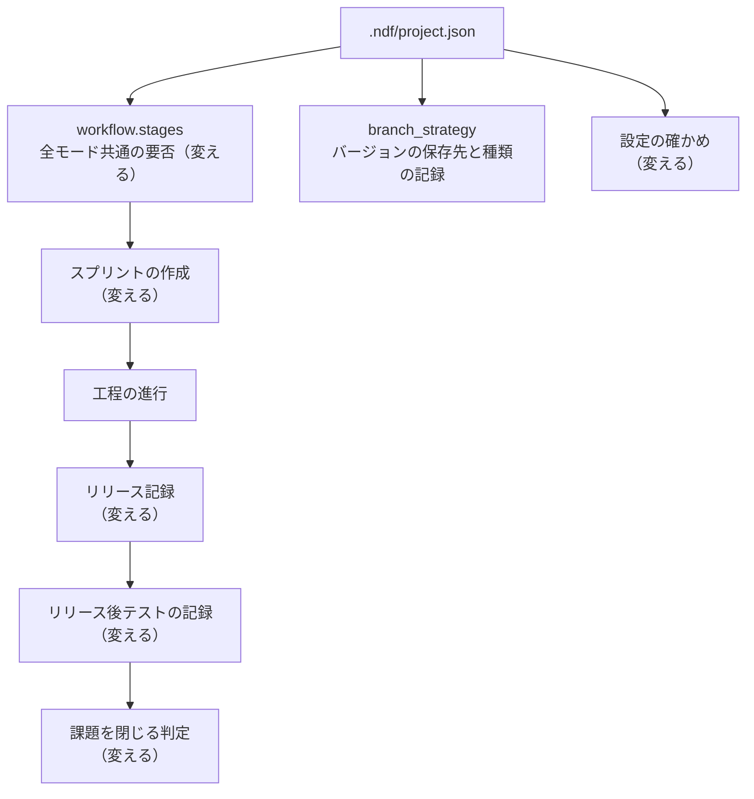
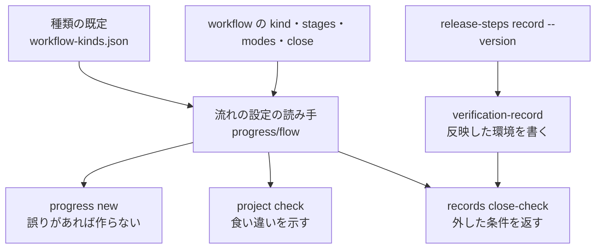
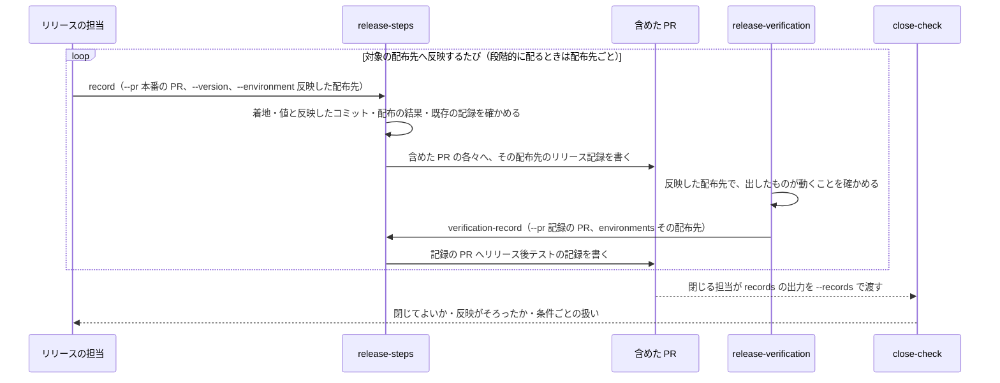

# 開発の流れ: リポジトリの形に合わせて、プロジェクトが設定で選べるようにする（#4580）

バージョン番号を持たないサービスのリポジトリでは、ai-plugins の形を前提にした手順がそのまま適用される。工程が止まり、人が結果の記録を作り直さないと、スプリントを最後まで進められない。この設計は、その作り直しを無くす。今ある設定ファイルに、流れの項目（種類・モードごとの工程の要否・閉じる条件）を足す。バージョン番号の無いリリース記録とリリース後テストの記録も書けるようにする。急ぐ分（閉じる条件と記録）を先に出し、2 回に分けてリリースする。分け方と採らなかった案は「決定の記録」に、他の製品の解き方は「外部の調査」にある。

## 今の姿

何が起きたか・目的・受け入れ条件は要求仕様（[issue-4580-requirements.md](./issue-4580-requirements.md)、正は #4580 の本文）にある。この文書は「どう解くか」と「なぜその解き方か」だけを書く。



設計に要る今の構造は次のとおりである（コミット `c93e690ed` で読んだ）。

| 箇所 | 今の振る舞い |
| --- | --- |
| 工程の要否（`progress/stages.py` の `resolve_enabled`） | スプリントの `--disable` > `workflow.stages` > 工程の定義の条件。モードは区別しない。定義に無い工程の名前は読み飛ばす |
| 種類（`branch_strategy.kind`） | 設定を作った時の記録。回答で既定から変えると `custom` になる |
| 閉じる条件 | `ndf records close-check` はリリース後テストの記録だけを見る。「振り返り:」の行は手順書に従って AI が見る。どちらも外す設定は無い |
| リリース記録（`release-steps record`） | 本番へマージした PR の head がリリースブランチの名前でないと書かない。バージョンはブランチの名前から読む |
| リリース後テストの記録 | 同じバージョンのリリース記録を持つ PR にだけ書ける |

**バージョン番号を持たないサービスでは、リリース記録を書く手段が無い。** そのためリリース後テストの記録も書けず、課題を閉じる判定が読むものが無い。出したものを指す値の形をそろえる直し（結果 JSON と記録のスキーマの `version`）は、[バージョン番号の無いリポジトリでデプロイの工程が終わらない不具合](https://github.com/devbasex/ai-plugins/issues/4513) （#4513）の設計が持つ。

## 文脈と制約

- 流れの設定（今ある `workflow.stages` を含む）を書いていないリポジトリは、今と同じに動く（受け入れ条件 1）。今ある `branch_strategy` は流れの設定に数えない
- #4513 の直しがリリースされていることを前提にする（設計は作業ブランチ `sprint/4513-deploy-without-version` にある）。結果 JSON の `product_version` と、リリース後テストの記録の `version` の形は、この課題では変えない
- 本番へのマージに承認が要るかの判定は変えない（[#4579 のマージ判定の直し](https://github.com/devbasex/ai-plugins/issues/4579) が持つ）
- 承認が要る工程は、どの設定でも無効にできない
- 工程の要否はスプリントの作成の時点で決まり、ステートマシンに保存される。保存の形（`enablement` の `source` の値の集合）は変えない
- NDF は流れの設定を書かない。書くのは利用者だけである

## 解き方の全体像



- 利用者は `.ndf/project.json` の `workflow` に、リポジトリの種類、モードごとの工程の要否、閉じる条件を書ける。何も書かなければ今と同じに動く
- 流れの設定を読んで判定する部品は 1 つで、スプリントの作成・設定の確かめ・閉じる判定が同じ部品を使う
- バージョン番号を持たないリポジトリは、出したものを指す値（例: `main abc1234`）でリリース記録とリリース後テストの記録を書く。記録には反映した本番の環境の名前（複数可）を残す

## ドメインモデル

### コンテキスト

| コンテキスト | 何の語が 1 つの意味に決まるか |
| --- | --- |
| NDF の開発ワークフロー | 流れの設定、工程の要否、閉じる条件 |
| NDF のリリース | リリース記録、リリース後テストの記録、出したものを指す値 |

関係は顧客と供給者である。閉じる判定（開発ワークフロー）は、リリースが書く記録の形に従う。

### 集約

| 集約 | オーナー（書き換えてよいもの） | 根 | エンティティ | 値オブジェクト |
| --- | --- | --- | --- | --- |
| 流れの設定 | 利用者 | `.ndf/project.json` の `workflow` | — | 工程の要否、閉じる条件の要否と理由 |
| スプリントの工程の要否 | `ndf progress` | ステートマシン | 工程 | 有効か、理由 |
| リリースの記録 | `ndf release-steps` | PR のコメント | リリース記録、リリース後テストの記録 | 出したものを指す値、反映した環境 |

### 不変条件

| # | 集約 | 条件 | 破れたときの扱い |
| --- | --- | --- | --- |
| I1 | スプリントの工程の要否 | 承認ゲートを持つ工程（下の「承認ゲートを持つ工程の判定」）は、どの層の設定でも無効にならない | スプリントを作らず、工程の名前と理由を示す |
| I2 | リリースの記録 | 不合格の行がある課題は閉じない | `close-check` が閉じないと返す |
| I3 | 流れの設定 | NDF のコマンドは、利用者が指定した `workflow.kind`・`workflow.stages`・`workflow.modes`・`workflow.close` を保持する | テストが落ちる |
| I4 | 流れの設定 | 流れの設定が無ければ、工程の要否と閉じる条件は変更の前と同じである | テストが落ちる |
| I5 | 流れの設定 | 工程の無効化と閉じる条件の除外は、理由を持つ | 形の誤りとして止まる |

### 承認ゲートを持つ工程の判定

工程定義（`contracts/workflow/stages/*.json`）を読み、`StageDef.gates` が空でない工程を保護する。`gates` は承認ゲートのステップだけを数える。承認を求める前に、AI が承認資料と質問の文を読んで通じるかを確かめるステップ（読み手役のステップ）は、`gate` の項目を持っていても数えない。今の定義で当たるのは「設計」と「デプロイ」である。工程の名前の一覧はコードに持たない。

保護の確かめは、指定を重ねる前に層ごとに行う。`--disable` を拒否する今の振る舞いは変えない。

### ドメインイベント

| # | イベント | 発生元 | 受け手 |
| --- | --- | --- | --- |
| E1 | 利用者が種類と流れを設定した | 利用者 | 設定の確かめ、スプリントの作成 |
| E2 | 設定の食い違いを確かめた | `ndf project check` | 利用者、起動時の conductor |
| E3 | スプリントの工程の要否が決まった | `ndf progress new` | 工程の進行 |
| E4 | 工程の結果を受け取った | 工程の進行 | リリースの記録 |
| E5 | 課題を閉じた、または閉じなかった | 閉じる担当（`close-check` の結果を読む） | 利用者 |

## 機能一覧

| # | 機能 | 誰が使うか |
| --- | --- | --- |
| F1 | リポジトリの種類とモードごとの工程の要否を指定する | プロジェクトの設定を書く人 |
| F2 | 閉じる条件を理由つきで外す | 同上 |
| F3 | 流れの設定の誤りと食い違いを知る | 同上、conductor |
| F4 | バージョン番号を持たないリリースとテストの結果を記録する | リリースの担当、オーガナイザー |
| F5 | 種類ごとの流れを 1 つの文書で読む | 利用者 |

## 構成要素

| 要素 | 責務 |
| --- | --- |
| 流れの設定の読み手（`progress/flow.py`、新設） | 工程の指定の 3 層（種類の既定・`stages`・`modes.<モード>.stages`）を 1 つに重ねる。誤りと食い違いの一覧を返す。閉じる条件の要否と理由を返す |
| 種類の既定（`contracts/data/workflow-kinds.json`、新設） | `workflow.kind` に書ける名前と、種類ごとに行わない工程と理由 |
| 設定のスキーマ（2 つの `project.schema.json` と `project-workflow.schema.json`） | `workflow` に `kind`・`modes`・`close` を足す |
| スプリントの作成（`progress/command.py`） | 重ねた指定を `resolve_enabled` へ渡し、作成を止める誤りがあれば作らない |
| 設定の確かめ（`domains/project/cli.py`） | 食い違いを結果の `items` に並べる |
| 閉じる判定（`domains/records/cli.py`） | 設定を読み、外した条件と理由を返す |
| リリースの記録（`domains/release` の `record`・`record_decide`・`cli`） | バージョン番号を持たないリポジトリのリリース記録を書く。テストの記録に反映した環境を持たせる |
| 手順書と文書 | 打ち方と、種類ごとの流れ（`development-workflow` の `references/project-flow.md`、新設） |
| 流れの文書の生成（`scripts/check-ndf-contracts.py`） | 流れの文書の表と閉じる条件を正本から書き出し、書き出した内容と違えば違反にする（決定 10） |

## 入出力のコントラクト

### 流れの設定の形

流れの設定の形は次のとおりである。どの項目も省ける。

```json
{
  "workflow": {
    "kind": "web-trunk",
    "stages": {"確定仕様化": {"enabled": false, "reason": "仕様は別の場所で管理する"}},
    "modes": {"standard": {"stages": {"振り返り": {"enabled": false, "reason": "週次でまとめて行う"}}}},
    "close": {
      "release_verification": {"required": false, "reason": "反映した環境は監視で確かめる"},
      "retrospective_line": {"required": false, "reason": "振り返りは週次の会で行う"}
    }
  }
}
```

| 項目 | 値 | 省いたとき |
| --- | --- | --- |
| `kind` | `web-develop`・`web-trunk`・`mobile`・`docs`・`plugin` | 種類の既定を当てない |
| `stages` | 工程の名前 → `enabled` と理由（今と同じ） | 今と同じ |
| `modes.<モード>.stages` | そのモードだけの工程の指定 | モードごとの指定なし |
| `close.<条件>` | `required` の真偽。偽なら `reason` が要る。条件は `release_verification` と `retrospective_line` の 2 つ | 今の手順書の経路ごとの指定に従う（`required: true` も同じ） |

工程の指定が重なるときは、次の順に勝つ。

`--disable` > `modes.<モード>.stages` > `stages` > 種類の既定 > 工程の定義の条件

### 変わるコマンド

| コマンド | 変わる点 | 失敗の形 | 互換性 |
| --- | --- | --- | --- |
| `ndf progress new` | 流れの設定を重ねて工程の要否を決める | 知らない種類・無いモードか工程の名前（下の「名前の照合」）・承認の工程の無効化は、箇所と理由を示して作らない（`invalid`） | 流れの設定が無ければ同じ。今と違い、`stages` の工程の名前の誤りでも止まる |
| `ndf project check` | `items` に食い違いを足し、`summary` に件数を足す | 終了コードは設定の新しさだけで決め、食い違いでは変えない | 食い違いが無ければ同じ |
| `ndf records close-check` | 任意の引数 `--records <ndf release-steps records の出力の JSON>` を足す。結果に、条件ごとの扱い（`outputs.conditions`）と、テストで確認できたか（`outputs.verified`）を足す（下の「close-check の結果」） | 流れの設定が形に合わなければ閉じない（`precondition`）。`--records` と `--verification` を両方渡すと `precondition` | 流れの設定が無く `--records` を渡さなければ判定は同じ |
| `ndf release-steps record` | 任意の引数 `--version <出したものを指す値>`、`--environment <反映した本番の配布先の名前>`、`--target <今回の対象の配布先の名前>`、`--observed <配布先の名前>=<実環境で確かめた証跡>` を足す（`--version` 以外は複数回指定できる）。`--production-sha` は今と同じく受ける。結果の `outputs` に、対象の配布先の反映がそろったか（`complete`）と、まだの配布先（`missing`）を入れる | 何も書かずに `precondition` で止まる場合は、下の「バージョンの無いリリース記録の書き方」の確かめのどれかに当たったときである。本番ブランチへ入っていない PR は今と同じく書かない | 引数が無ければ同じ |
| `ndf release-steps verification-record` | 記録に任意の `environments`（確かめた本番の配布先の名前の一覧）を持てる。同じ値に、配布先ごとの記録を何件でも書ける | バージョンの保存先が `none` で、次のどれかに当たれば書かない（`precondition`）。`environments` が無い。反映の記録が無い配布先を含む。`--pr` が記録の PR（リリース記録の `included` の最小の番号）でない。最後の場合は、正しい記録の PR の番号を `items` に入れて返す | バージョンを持つリポジトリは同じ |
| `ndf release-steps records` | 出力に、代表のリリース記録と同じ `version` の有効なリリース記録（`releases`）を足す。任意の引数 `--bodies` で、代表のリリース記録の `included` の PR ごとの本文と、本文の書き手を信用するか（`bodies`）も返す | リリース記録・テストの記録の候補のコメントと、本文を使う PR の書き手のうち、権限を照会できない書き手がいれば、記録を選ばずに失敗で返す。候補でないコメントの書き手は照会しない（下の「閉じる手順の読み取り」） | 今の出力の項目は変えない |

### 名前の照合

工程の名前は、指定した場所ごとに次の定義と照合する。

| 指定した場所 | 照合する定義 |
| --- | --- |
| `modes.<モード>.stages` | そのモードの工程の集合。モードの名前自体は、モードの定義の一覧と照合する |
| `stages`（全モード共通）と種類の既定 | 全モードの工程の和集合 |

共通の `stages` に、作ろうとするモードでは使わない工程があっても、ほかのモードにあれば誤りにしない。たとえば `stages` に「リファクタリング」の指定があっても、`light` のスプリントは作れる。

### 閉じる条件を外したときの閉じ方

`close-check` の `--require` は、リリース後テストの記録が無ければ課題を閉じない指定である。今の手順書は、リリース後テストを通る経路でだけ付ける。設定とこの引数の組み合わせは次のとおりである。

| `close.release_verification` | リリース後テストの記録が無いときの判定 | 記録を渡したとき |
| --- | --- | --- |
| 省略、または `required: true` | 今と同じ。`--require` があれば閉じない。無ければ、この条件で閉じることを妨げない | 今と同じ。不合格は閉じず、保留は人が決める |
| `required: false` | `--require` があっても、この条件で閉じることを妨げない | 同上 |

`required: true` では、呼び出し元が渡した `--require` をそのまま使う。リリース後テストを通らない経路（`light` など）では、呼び出し元は `--require` を付けない。設定だけを理由に記録を求めると、記録が作られない経路で課題を閉じられなくなるためである。

`progress-tracking` の手順書の「閉じる条件」は次の 3 つである。この節の条件の番号は、この表の番号を指す。

| # | 今の閉じる条件 |
| --- | --- |
| 1 | 本番へ入れたリリースのリリース記録がある（デプロイを飛ばした実行は、飛ばした記録がある） |
| 2 | リリース後テストの記録がある経路では、その課題の行に不合格も保留も無い。保留があれば、閉じるかを人が決める。`--require` では記録そのものが要る |
| 3 | その課題の最終工程の記録がある。最終工程が「デプロイ」なら条件 1、「リリース後テスト」なら条件 2 の記録、「振り返り」なら課題の本文の「振り返り:」の行である |

条件を外す設定は、`close-check` の判定だけでなく、条件 3（最終工程の記録がある）にも適用する。条件 3 は、最終工程ごとに同じ記録を求めているためである。

| 外した条件 | 手順書で免除するもの | 引き続き確かめるもの |
| --- | --- | --- |
| `release_verification` | 条件 2 の記録の存在。最終工程が「リリース後テスト」なら、条件 3 の記録の存在も免除する | リリース記録（条件 1）、渡した記録の不合格と保留、ほかの有効な条件 |
| `retrospective_line` | 条件 3 の「振り返り:」の行だけ | リリース記録（条件 1）、条件 2、ほかの有効な条件 |

閉じる手順は、記録の PR のコメントと、含めた PR の本文を、書き手の権限を確かめるコマンドで 1 回だけ読み、その出力をそのまま使う。手順書（`progress-tracking` の「スプリントを閉じる」）の手順 1〜3 を次のように変える。条件を外していても同じである。

- 手順 1 は、`gh pr view --json body,comments` でなく `ndf release-steps records --pr <記録の PR> --bodies` を打ち、出力をファイルに保存する。このコマンドは、書き手が対象のリポジトリで write 以上の権限を持つかを確かめ、信用する書き手のコメントだけからリリース記録とテストの記録を選ぶ。所属の区分（`author_association`）は、権限を照会するかどうかを決めるだけに使う（今の `GitHub.trusts` と同じ）。OWNER は照会せずに信用する。MEMBER・COLLABORATOR は照会し、write 以上のときだけ信用する。ほかの区分は照会せずに信用しない。出力には、含めた PR ごとの本文と、その本文の書き手を信用するかも入る
- 手順 2 は、`gh` を打たず、手順 1 の出力の `bodies` から課題を集める。書き手を信用しない本文（`trusted` が偽）からは課題を集めず、その PR の番号と「本文の書き手に write 以上の権限が無い」を報告に載せる。権限の無い PR の作成者が本文に別の課題を閉じる指定を書いても、閉じる候補に入らないようにするためである
- 手順 3 は、手順 1 で保存したファイルを `close-check --records` に渡す。今回のリリースと `version` が同じテストの記録を選ぶのは `close-check` で、手順書の AI は選ばない
- 手順 1 のコマンドが失敗したときは、記録が無いとは扱わず、課題を閉じずに「失敗」と報告する

受け入れ条件のチェック（`[x]`）の付け方は、経路で変わる。

| 経路 | チェックの付け方 |
| --- | --- |
| バージョンの保存先が `none`（流れの設定の有無を問わない） | `close-check` の結果の `outputs.verified` が真のときだけ付ける。偽なら変えず、閉じる報告に「テストで未確認」と書く |
| バージョンを持つ経路で `release_verification.required: false`（両方の条件を外した場合を含む） | 同上 |
| バージョンを持つ経路で、上に当たらない | 今と同じ |

バージョンの保存先が `none` の経路で設定を問わないのは、記録を必須にしない呼び出し（`enforced` が偽）では、課題の行が無い配布先があっても閉じることを妨げないためである。たとえば別の課題の行しか持たない記録しか無くても、課題は閉じられる。そのため、チェックは `verified` で別に決める。`verified` が真になるのは、その課題の行が、今回の対象の配布先のすべてで合格したときだけである（下の「close-check の結果」）。

### 閉じる手順の読み取り

閉じる判定に使うコメントと本文は、権限を照会できなかった書き手を「権限が無い」と扱わずに、読み取りの失敗として止める。今の `GitHub.permission` は、上限でない 403・404 を `none` に変え、`GitHub.trusts` はその書き手のコメントを除いて続ける。この扱いのままでは、照会に失敗した書き手の新しい不合格の記録が落ち、古い合格の記録で課題を閉じてしまう。

| 照会の結果 | 今の `trusts` | `records` の扱い |
| --- | --- | --- |
| 200 で `admin`・`maintain`・`write` | 信用する | 信用する |
| 200 で `read`・`triage`・`none` | 信用しない | 信用しない（権限が足りない） |
| 403・404（上限でない） | 信用しない（`none` と同じ） | 照会できない。記録を選ばず、照会できなかった書き手の名前を載せて失敗で返す |
| 上限・ほかの失敗 | 例外 | 失敗で返す（今と同じ） |

`GitHub` に、照会できないことを例外で返す読み方（`permission_strict`）を足し、`records` はこれを使う。ほかの読み手（承認の記録の読み取りなど）の扱いは変えない。

照会するのは、判定に使うものの書き手だけである。記録と関係のない会話のコメントの書き手を照会できないだけで、課題を閉じられなくならないようにするためである。`records` は次の順に読む。

1. 記録の PR のコメントを全部読み、リリース記録かテストの記録のマーカーを持つコメントだけを候補にする。今の `_trusted_bodies` のように、全部のコメントの書き手を先に照会しない
2. 候補のコメントの書き手を照会し、信用する書き手の候補だけを残す
3. 残った候補のうち、正の `targets`（「バージョンの無いリリース記録の書き方」）を持つリリース記録だけに絞る。絞った中の最後の 1 件を代表のリリース記録とし、出力の `release` と、本文を読む PR の一覧（`included`）はこの代表から取る。正と違う記録が後にあっても、代表にも `included` の出どころにもしない
4. `--bodies` があれば、代表の `included` の PR ごとに本文を書き手つきで読み（`GitHub.issue_body`）、書き手を照会して `trusted` を付ける

照会の回数は次のとおりである。C は記録の PR のコメントの数、N は含めた PR の数である。ページの大きさは、REST も `gh` の GraphQL も 100 件である。

| 読み方 | 記録の PR のコメントの取得 | 本文の取得 | 権限の照会 | `gh`・`ndf` の起動 |
| --- | --- | --- | --- | --- |
| 今（手順 1 の `gh pr view --json body,comments` と、手順 2 の `gh pr view --json body`） | GraphQL で ⌈C/100⌉ 回 | N 回（記録の PR を含む） | 無し（権限を確かめていない） | N + 1 回 |
| この設計（`records --bodies`） | REST で ⌈C/100⌉ 回 | N 回 | 候補のコメントと本文の書き手のうち、MEMBER・COLLABORATOR の人 1 人につき 1 回（同じ実行の中では 1 人 1 回。OWNER は照会しない） | 1 回 |
| 採らなかった案: 手順 2 は今のまま `gh` で本文を読む | REST で ⌈C/100⌉ 回 | N 回 | 候補のコメントの書き手だけ（本文の書き手は確かめない） | N + 1 回 |
| 採らなかった案: 対象のリポジトリの collaborators を一覧で読む | REST で ⌈C/100⌉ 回 | N 回 | 一覧のページ数だけ（書き手の数によらない） | 1 回 |

コメントと本文の取得の回数は今と同じで、ページ送りも同じだけ増える。起動は N + 1 回から 1 回に減る。増えるのは権限の照会だけで、write 以上の書き手の記録と本文だけを使うために要る。照会は書き手ごとなので、NDF が書いた記録と PR だけなら、1 回か 2 回で済む。collaborators の一覧を読む案は、一覧を読む権限（push 以上）が token に要り、大きな組織のリポジトリではページ送りが書き手の数より多くなるので採らない。

### close-check の結果

`close-check` は、条件ごとの扱いを `outputs.conditions` に、テストでの確認を `outputs.verified` に入れる。設定で外したかと、今回の呼び出しで記録を必須にしたかは、別の項目にする。

| 項目 | 値 | 決め方 |
| --- | --- | --- |
| `conditions.release_verification.excluded` | 真偽 | `close.release_verification.required` が `false` なら真 |
| `conditions.release_verification.reason` | 文字列か `null` | 外したときの理由。外していなければ `null` |
| `conditions.release_verification.enforced` | 真偽 | `--require` があり、`excluded` が偽のときだけ真。真なら、その課題の行を持つテストの記録が無い課題を閉じない。`--records` では、対象の配布先のどれか 1 つでもその課題の行が無ければ閉じない（配布先ごとの記録があるだけでは足りない） |
| `conditions.retrospective_line.excluded` | 真偽 | `close.retrospective_line.required` が `false` なら真 |
| `conditions.retrospective_line.reason` | 文字列か `null` | 同上 |
| `conditions.retrospective_line.enforced` | 真偽 | `excluded` の否定。真なら、最終工程が「振り返り」の経路で、手順書の AI が条件 3 の行を確かめる（行は `close-check` が読まない） |
| `verified` | 真偽 | 下の規則 |
| `release.complete` | 真偽か `null` | `--records` を渡したときだけ値を持つ。同じ値のリリース記録の `environments` の和集合が `targets` を覆えば真 |
| `release.missing` | 名前の配列 | 反映の記録がまだ無い対象の配布先 |

条件 3 の扱いは、`conditions` から次のように決まる。最終工程が「リリース後テスト」の経路では、`conditions.release_verification.excluded` が真なら条件 3 の記録の存在を免除する。最終工程が「振り返り」の経路では、`conditions.retrospective_line.enforced` が偽なら「振り返り:」の行を確かめない。`light` のように `--require` を付けない経路では、`enforced` は偽なので、無い記録を求めて閉じられなくなることは無い。

`verified` は次のときだけ真である。

- `--verification` を渡したとき: 渡した記録にその課題の行があり、すべて合格
- `--records` を渡したとき: `release.complete` が真で、対象の配布先のそれぞれについて、その配布先とその課題の行の両方を含む最後のテストの記録の行が合格

`--records` を渡したときは、配布先と課題の組ごとに、その配布先とその課題の行の両方を含む最後のテストの記録を選ぶ。配布先を含む最後の記録を先に選ぶと、同じ配布先で別の課題だけを再テストした記録が、その課題の不合格を覆い隠すためである。その課題の行を持たない記録は、その課題の判定に使わない。

判定は次のとおりである。

| 状態 | 判定 |
| --- | --- |
| リリース記録が無いか、`release.complete` が偽 | 閉じない（条件 1） |
| どれかの対象の配布先で、選んだ行が不合格 | 閉じない |
| 不合格が無く、どれかの対象の配布先で選んだ行が保留 | 人が決める |
| その課題の行が無い対象の配布先があり、`enforced` が真 | 閉じない |
| その課題の行が無い対象の配布先があり、`enforced` が偽 | 閉じることを妨げない。`verified` は偽で、チェックは付けない |
| すべての対象の配布先で選んだ行が合格 | 閉じてよい。`verified` は真 |

バージョンを持つリポジトリの記録（`targets` を持たない）を `--records` で渡したときは、反映の判定をせず、`release.complete` は `null` になる。テストの記録は、最後のリリース記録と `version` が同じ最後のものを選び、`--verification` に渡したときと同じに判定する。

### バージョンの無いリリース記録の書き方

`record --version` は、渡された値と配布先を、本番ブランチに入ったコミットと配布の結果で確かめてから書く。リリース記録は配布先ごとの反映の記録で、同じ値に何件でも書ける（決定 7）。どのリリース記録も、今回の対象の配布先の一覧（`targets`）を持つ。

```bash
ndf release-steps record --pr <本番の PR> --version "main abc1234" --environment web [--target web --target worker] [--observed web=<証跡>] [--production-sha <SHA>]
```

`record` は次の順に確かめる。どれかに当たれば、どの PR にも書かずに `precondition` で止まる。

| # | 確かめること | 止まるとき |
| --- | --- | --- |
| 0 | 引数の組。`--version` と `--environment`（1 つ以上）はそろえて渡し、バージョンの保存先が `none` のリポジトリでだけ受ける。配布先の宣言が無いリポジトリでは `--target` が 1 つ以上要り、宣言があるリポジトリでは `--target` を受けない | 保存先が `none` でないのに `--version` か `--environment` を渡した。片方だけを渡した。宣言が無いのに `--target` が無い。宣言があるのに `--target` を渡した |
| 1 | 本番の PR が本番ブランチへ入ったか。今の `record` と同じく、PR がマージ済みでなければ、`--production-sha` のコミットを `landed_squash` で正規の squash と確かめ、その PR をマージしたものとして読む | マージ済みでなく、`--production-sha` が無いか、正規の squash でない |
| 2 | 反映したコミット（マージのコミット、`strict` の squash では `--production-sha`）が値と対応するか。値の中に、そのコミットの SHA の先頭 7 文字以上と一致する 16 進の語があること | 一致する語が無い。止まる文に、反映したコミットの SHA を載せる |
| 3 | 今回の対象の配布先（`targets`）を決める。宣言（`branch_strategy.release.deliveries`）がある場合は、本番の配布先（決定 7）のうち、`paths` を持たないものと、反映したコミットで変わったファイル（`git diff --name-only <コミット>^1 <コミット>`）が `paths` のどれかに当たるものである。宣言が無い場合は `--target` の集合である。どちらの場合も、毎回の `record` が反映した配布先によらず同じ `targets` を求める | 宣言があって `targets` が空 |
| 4 | `--environment` が `targets` の部分集合か | 宣言に無い名前か、`targets` の外の名前がある |
| 5 | `--environment` の配布先のうち、結果を読む手段（`result`）を宣言したものは、今の CD の結果の読み方（[release-steps.md](../plugins/ndf/skills/release/references/release-steps.md) の「CD の結果」）で、反映したコミットの結果が成功か。結果が未確定（実行が見つからない・待ちの上限に当たった）の配布先は、`--observed` で実環境での確認の証跡を渡せば受け、証跡をその配布先の記録に残す。`result` の無い配布先（手動など）は、打つ人が配布の結果を確かめた申告として受ける | 結果が失敗。または未確定で `--observed` が無い |
| 6 | 正の `targets` と照らす。正は、記録の PR にある、同じ値の最初のリリース記録の `targets` である。記録の PR にまだ記録が無ければ、今回の `targets` が正の候補になる | 今回の `targets` が正と違う。止まる文に、正の一覧を載せる |
| 7 | 同じ反映したコミットに、別の値の記録が無いか。記録の PR の有効なリリース記録のうち、確かめ 2 で同じコミットに当たる値が、今回の `--version` と文字列として違えば止まる。`main abc1234` と `main abc123456` のように、同じコミットを違う長さの SHA で書いた値は、記録が別々に集まり、反映がそろわないためである | 同じコミットの記録が別の値で既にある。止まる文に、既にある値を載せ、その値で打ち直すよう示す |

「正の `targets`」は、確かめ 6・重ねない判定・読み取りの 3 か所で同じものを使う。記録の PR にある、同じ値の最初のリリース記録の `targets` である。正と違う `targets` の記録は、どの PR にあっても、重ねない判定にも、`verification-record`・`close-check` の判定にも、`record` の結果の `complete` にも数えない。

書く順は次のとおりである。確かめ 0〜7 を済ませてから書き始める。

1. 記録の PR に、同じ値・同じ `environments`・正の `targets` の記録が無ければ書く
2. 記録の PR を読み直し、正の `targets` を決め直す。並行して打たれた `record` のどちらかが先に書いた記録が正になる。自分の `targets` が正と違えば、ほかの PR へは書かずに止まり、正の一覧を示す
3. 残りの含めた PR のうち、同じ値・同じ `environments`・正の `targets` の記録が無い PR へ書く
4. 書いた PR をそれぞれ読み直す。自分のコメントより前に、同じ値・同じ `environments`・正の `targets` の記録があれば、自分のコメントを消す。同じ引数の `record` が並行して打たれ、両方が書く前の確かめを通った場合に、記録を 1 件に戻すためである。いちばん前の記録は、自分より前に同じ記録が無いので消されない。消すのは、この実行が書いたばかりのコメントだけである

失敗や重なりの後の動きは次のとおりである。最後の場合を除き、正しい引数で打ち直せば残りの PR へ書いて終わり、結果は 1 回で書けたときと同じになる。最後の場合だけは、人が誤った記録を消す必要がある。

| 場合 | 打ち直したときの動き |
| --- | --- |
| 一部の PR への投稿が失敗した | 書けた PR は重ねない判定で飛ばし、書けなかった PR だけへ書く |
| 並行して打たれ、自分の `targets` が正でなかった | 記録の PR に残った自分の記録は正と違うので数えない。正の `targets` で打ち直せば、確かめ 6 を通り、残りの PR へ書く |
| 同じ引数で 2 回打った | すべての PR で重ねない判定に当たり、何も書かない |
| 同じ引数の 2 回が並行して走り、両方が書いた | 後に書いた側が手順 4 で自分のコメントを消し、記録は 1 件に戻る |
| 宣言が無いリポジトリで、最初の `record` の `--target` が誤っていた | `record` では直せない。人が記録の PR と含めた PR で、誤った一覧を持つリリース記録のコメントを消してから、正しい `--target` で打ち直す。最初の記録が消えると、次の有効な記録が正になる。その誤った一覧で書いたテストの記録も、正の `targets` に無い配布先の分は数えない |

### 設定の確かめが示す食い違い

設定の確かめが示す食い違いは次の 5 つである。

| `items` の `kind` | 内容（受け入れ条件） | `progress new` が止まるか |
| --- | --- | --- |
| `flow_unknown_kind` | 知らない種類（10a） | 止まる |
| `flow_unknown_name` | 無いモードか工程の名前。モードの下の指定では、そのモードに無い工程も誤りにする（10b） | 止まる |
| `flow_gate_disabled` | 承認の工程の無効化（5） | 止まる |
| `flow_close_conflict` | 下の判定式に当たる（10c） | 止まらない |
| `flow_version_conflict` | `branch_strategy.release.version_store.kind` が `none` なのに、下のバージョンを求める指定がある（10d） | 止まらない |

`flow_close_conflict` は、モードごとに、次の 3 つがすべて成り立つときに示す。対応する組は、工程「リリース後テスト」と `release_verification`、工程「振り返り」と `retrospective_line` である。

1. そのモードの工程の集合に、その工程がある
2. 種類の既定・`stages`・`modes.<モード>.stages` を重ねた後の指定が `enabled: false` である
3. 対応する `close.<条件>.required` が `false` でない

モードの工程表に最初から無い工程と、実行時の条件（工程の定義の `when`）で省かれる工程は、無効に数えない。`--disable` はスプリントごとの指定なので、確かめの対象にしない。

バージョンを求める指定は、次の 2 つである。

| 指定 | 判定元 |
| --- | --- |
| `workflow.kind` が、バージョンを持つ種類である | `branch-strategy-presets.json` の `kinds.<種類>.section.release.version_store.kind` が `none` でない種類。今の値では `web-develop`・`mobile`・`plugin` |
| 配布経路の 1 つ以上が `versioned: true` である | `branch_strategy.release.deliveries` の全要素の `versioned` |

`release.tag` が `null` でない指定と `release.github_release: true` は、`version_store.kind: none` と組み合わせると設定のスキーマ（規則 R8）が形の誤りにする。食い違いとしては扱わない。

## 処理の流れ

バージョン番号を持たないリポジトリでは、マージから課題を閉じるまでが次の順になる。「本番の PR」は本番ブランチへマージした PR、「作業の PR」はそのマージに含まれた変更の PR である。「含めた PR」はこの 2 つを合わせた、リリース記録を書く先である（決定 6）。



この図に含めない要素は、流れの設定の読み手・種類の既定・設定のスキーマ・スプリントの作成・設定の確かめ・流れの文書である。これらの関係は「解き方の全体像」の図にある。

「リリースの担当」は、進め方で次のように変わる。

| 進め方 | 記録する人 | `record` の結果の `complete` が偽のとき | `complete` が真のとき |
| --- | --- | --- | --- |
| スプリントを 1 つだけ進める | デプロイ担当の実行役（worker。作業を 1 つ受け持つ AI） | 反映した配布先のリリース後テストを始める。デプロイの工程は終えず、残りの配布先の反映を続ける | デプロイの工程を終える |
| 複数のスプリントを別々の作業単位（レーン）で進め、まとめて本番へ出す | 並列作業の取りまとめ役（オーガナイザー） | 反映した配布先のリリース後テストを始める。`ndf lanes release` は打たない | `ndf lanes release` で各レーンへリリース結果を知らせる |

知らせは 2 つあり、発火の条件が違う。配布先ごとのテストを始めてよいのは、その配布先の `record` が成功したときである。デプロイの工程を終えること、レーンへのリリース結果の知らせは、`record` の結果の `complete` が真になったとき（対象の配布先のすべてに反映の記録がそろったとき）だけ行う。`complete` が偽のままでデプロイの工程を終えたりレーンへ知らせたりすると、残りの配布先が未反映のままレーンが最終工程へ進むためである。配布先ごとに始めたテストの記録は、デプロイの工程が終わった後のリリース後テストの工程が引き継ぐ。引き継ぎは、閉じる判定と同じく配布先と課題の組で行う。リリース後テストの工程は、対象の配布先とスプリントの課題の組のうち、その課題の行を持つ記録がまだ無い組だけをテストする。先のテストで一部の課題だけを確かめた配布先でも、残りの課題はテストする。

レーンを進める役は、スプリントの進行担当（conductor）である。役割の説明は [3 層で工程を通す](../plugins/ndf/skills/development-workflow/references/agent-layers.md) と [並列開発のオーガナイザー](../plugins/ndf/skills/development-workflow/references/parallel.md) にある。

`record` は、本番の PR ごとに、反映を確かめた時点ごとに打つ。対象の配布先へまとめて反映したなら 1 回で、段階的に配るなら配布先ごとに打つ。含めた PR の全部へ 1 回で書くので、N 本のレーンの変更を 1 本の本番の PR にまとめたときも、配布先ごとに 1 回で済む。レーンの PR を 1 本ずつ本番ブランチへマージしたときは、本番の PR が N 本あるので、その N 倍になる。ある配布先の `record` を打ち忘れると、その配布先の `verification-record` が「反映の記録が無い」で止まり、`close-check` は「反映がそろっていない」で閉じない。

記録の PR は、本番の PR ごとに、その含めた PR の中で番号が最も小さいものにする。全部の本番の PR を通した最小の番号ではない。使う場所は次のとおりである。

| 使う場所 | 本番の PR が複数あるときの扱い |
| --- | --- |
| リリース後テストの記録の書き先 | 本番の PR ごとの記録の PR |
| `ndf lanes release --release` | 本番の PR ごとに 1 回打つ。その本番の PR に変更が含まれるレーンのリクエストを並べ、その記録の PR を渡す |
| 課題を閉じるときの読み先 | レーンが受け取った記録の PR。そのリリース記録の `included` の最小の番号が、同じ PR になる |

## 決定の記録

各決定の「根拠」の番号は、[プロジェクトの判断基準（MVV）](../.ndf/mvv.md) の次の項目を指す。

| 番号 | 項目 |
| --- | --- |
| Value 1 | 人の判断を、読み切れる量の大事な所だけにする |
| Value 3 | 同じ手順は毎回同じ結果になる |
| Value 4 | どのプロジェクトでもそのまま使える |
| Value 5 | 速く届く |
| Value 8 | 正しいデータ構造で作られる（同じ事実を 2 か所に持たない） |
| Value 9 | 責務の分かれた設計で作られる |
| Value 11 | 重複と冗長が無い（定義から作れるものは生成する） |
| Value 12 | 調べて分析した、実績のある最新のやり方で作られる |
| Value 13 | 確かめたことだけが済んだとされる |
| Value 14 | 判断の理由が残り、語がそろっている |
| Value 15 | 人も AI も同じ入口から使える |

### 決定 1: 同じ事実を 2 か所に持たないため、流れの設定を今の `.ndf/project.json` の `workflow` に足す

- **質問**: 流れの設定を、今の設定ファイルに足すか、別のファイル（`.ndf/flow.json`）にするか
- **選んだ案**: `workflow` に `kind`・`modes`・`close` を足す。工程の要否の `workflow.stages` と同じ場所である
- 採らなかった案: `.ndf/flow.json` を新設する（工程の要否が 2 つのファイルに分かれ、どちらが勝つかの決まりと、読み手の移行が要る）
- 採らなかった案: `branch_strategy` に足す（ブランチとリリースの決まりに、工程と閉じる条件が混ざる）
- **代償**: `project.json` のスキーマがさらに大きくなる。古いバージョンの NDF は新しい項目を形の誤りにする
- 根拠: Value 8 / Value 11（MVV バージョン 11）

### 決定 2: 今あるリポジトリの流れを変えないため、種類は `workflow.kind` に明示で指定する

- **質問**: 種類ごとの既定を、今ある `branch_strategy.kind` で当てるか、新しい項目で当てるか。サービス型の名前を新しくするか
- **選んだ案**: `workflow.kind` を書いたリポジトリにだけ種類の既定を当てる。名前はブランチ戦略の種類と同じにし、要求のサービス型は `web-trunk` である
- 採らなかった案: `branch_strategy.kind` で当てる（流れの設定を足していないリポジトリの振る舞いが変わる。値は作成の記録で、1 つ変えるだけで `custom` になる）
- 採らなかった案: サービス型の新しい名前を作る（同じリポジトリの形に名前が 2 つできる）
- **代償**: 「種類」という項目が 2 つになる。バージョンの食い違いは設定の確かめが示すが、名前の違いは示さない
- 根拠: Value 4 / Value 14（MVV バージョン 11）

### 決定 3: 確かめていないことを済んだと記録しないため、種類の既定は工程の無効化だけを持ち、閉じる条件はどの種類も外さない

- **質問**: 種類ごとの既定に、何を持たせるか
- **選んだ案**: `workflow-kinds.json` は行わない工程と理由だけを持つ。今の既定で当たるのは `docs` の「リファクタリング」である（業務文書だけのリポジトリは、直すコードの構造を持たない）。閉じる条件はどの種類も 2 つとも求め、外すのは利用者の `workflow.close` だけにする。リリースで求める結果（デプロイの工程の出力 `product_version` に入れる値が、バージョン番号か、反映した変更を特定する値か）は、ブランチ戦略の `release.version_store.kind` が決める（種類ごとの値は `branch-strategy-presets.json` にある）
- 採らなかった案: `web-trunk` の既定で閉じる条件を外す（利用者が何も書かないのに、テストの記録の無い課題が閉じる）
- 採らなかった案: バージョンの有無を `workflow-kinds.json` にも持つ（同じ事実が 2 か所になる）
- **代償**: `web-trunk` を指定しただけでは何も省かれない。省くには `close` を書く
- 根拠: Value 13 / Value 8（MVV バージョン 11）

### 決定 4: 工程の要否の決め方を 1 つに保つため、3 層の指定を重ねて今の `resolve_enabled` に渡す

- **質問**: モードごとの指定と種類の既定を、どこで効かせるか
- **選んだ案**: `progress/flow.py` が種類の既定、`stages`、`modes.<モード>.stages` の順に重ねる。重ねた 1 つの指定を `resolve_enabled` に渡す。保存する `source` は今の `project` のままで、種類の既定の理由は「種類 docs の既定: …」で始める。承認の工程の無効化は、重ねる前の層のどれにあっても断る
- 採らなかった案: `resolve_enabled` の順位を 5 段階にし、`source` に `kind` を足す（保存の形が変わり、前のバージョンが読めない）
- 採らなかった案: 設定の併合のライブラリを使う（重ねるのは工程の名前をキーにした辞書の更新 2 回で、依存を足す理由が無い）
- **代償**: 保存した記録からは、種類の既定か利用者の指定かを理由の文でしか見分けられない
- 作り方: 自前で作る
- 比べた候補: LIB1・LIB2
- 根拠: Value 9 / Value 12（MVV バージョン 11）

### 決定 5: 閉じる条件の判定を実行ごとにぶれさせないため、外した条件は `close-check` が設定を読んで返す

- **質問**: 閉じる条件の除外を、手順書を読む AI に任せるか、コマンドが返すか
- **選んだ案**: `close-check` が `workflow.close` を読み、条件ごとに、設定で外したか（`excluded`）と理由、今回の呼び出しで記録を必須にしたか（`enforced`）を結果に入れる（「close-check の結果」）。閉じる報告には外した条件を転記する。外せるのは「テストの記録があること」と「振り返りの行があること」だけである。記録があれば不合格は閉じず、保留は人が決める（今と同じ）。テストの記録を外しても、手順書は既存の記録を取得して渡す。テストで確認できていない課題の受け入れ条件には、チェックを付けない（「閉じる条件を外したときの閉じ方」）
- 採らなかった案: 手順書に「設定を読む」と書くだけにする（読み方が実行ごとに変わり、テストで確かめられない）
- 採らなかった案: `close-check` が振り返りの行も GitHub から読んで判定する（今 AI が見ている条件をコマンドへ移すことになり、この要求の範囲の外である）
- **代償**: 振り返りの行を見るのは今と同じく AI で、コマンドは「求めるか」までを返す
- 根拠: Value 3 / Value 13（MVV バージョン 11）

### 決定 6: バージョンの無いリリースの後も課題を閉じられるようにするため、`release-steps record` に出したものを指す値を渡せるようにする

- **質問**: バージョン番号を持たないリポジトリのリリース記録を、誰がどう書くか
- **選んだ案**: `record --version <値> --environment <配布先の名前>`（`--environment` は複数回指定できる）を足す。バージョンの保存先が `none` のときだけ受ける。head の名前は問わない。値には、デプロイの工程の出力 `product_version` と同じものを渡す。この値は、リリース記録とリリース後テストの記録では項目 `version` に入る。`record` は値を受け取るだけでなく、書く前に、本番の PR が本番ブランチへ入れたコミットの SHA が値に含まれることと、配布の結果を確かめる（「バージョンの無いリリース記録の書き方」）。`strict` の squash で PR が閉じたまま本番へ入った場合は、今の `record` と同じく `--production-sha` と `landed_squash` で着地を確かめる。サービス型の初期設定は、merge queue を使えないと `strict` に切り替わるためである

  記録を書く先は次のとおりである。

  | 項目 | 決め方 |
  | --- | --- |
  | 含めた PR（`included`） | `--pr` に渡した本番の PR と、そのマージに含まれた作業の PR。作業の PR は、今の `record` と同じ規則（リリースのコミットの「含む PR」の行、無ければ本番の PR のコミットの件名）で読む |
  | 作業の PR が無い直接のマージ | 含めた PR は本番の PR の 1 本だけになる |
  | リリース記録 | 含めた PR の各々のコメントに書く |
  | リリース後テストの記録 | 含めた PR のうち番号が最も小さい 1 本（記録の PR）に書く。`verification-record` は、ほかの含めた PR を `--pr` に渡されたら書かずに止まり、記録の PR の番号を返す。閉じる担当も同じ規則で選んで読む |

  単独のスプリントでも並列のまとめたリリースでも、決め方は同じである。信用する書き手のコメントだけを読む検査は、今のまま使う。打ち直しで同じ記録を重ねない確かめは、バージョンの保存先が `none` のときは `version` と `environments` の組で行う。対象の配布先の一覧が既存の記録と違えば止める（決定 7）
- 採らなかった案: 手順書の人が読む形のコメントを手で書く（テストの記録と閉じる判定は機械が読むマーカーの記録を求める）
- 採らなかった案: `verification-record` がリリース記録も書く（テストを外したリポジトリにリリース記録が残らない）
- 採らなかった案: 値をマージのコミットからコマンドが作る（まとめたリリースでオーガナイザーが記録した値と食い違う。コマンドは値を作らず、値が反映したコミットを指すかを確かめる）
- 採らなかった案: 値を照合せずに受け取る（別の変更を指す値を渡しても書けてしまう。後のテストの記録は同じ値でないと書けないが、同じ誤った値を引き継いだ場合は見つからない）
- 採らなかった案: GitHub の Deployments の記録へ移す（閉じる判定の読み先が 2 つになり、バージョンを持つ形も作り直しになる）
- **代償**: 値は反映したコミットの SHA を含む形に限られる。`result` を宣言していない配布先（手動など）の配布の結果は、打つ人の申告のままである
- 作り方: 自前で作る・標準に倣う
- 比べた候補: STD1・PRD2
- 根拠: Value 3 / Value 15（MVV バージョン 11）

### 決定 7: 何を確かめたかが後で分かり、先に反映した配布先のテストを待たせないため、バージョンの無いリポジトリの記録は配布先ごとに書く

- **質問**: 反映した本番の配布先を対象にしたテストの結果を、どう表すか。どの配布先がそろえば、リリースを済んだとするか
- **選んだ案**: リリース記録とテストの記録のスキーマに任意の `environments`（配布先の名前の一覧）を足し、バージョンの保存先が `none` のリポジトリでは必須にする。リリース記録は、加えて今回の対象の配布先の一覧（`targets`）を持つ。1 つの値（`version`）について、配布先へ反映するたびにリリース記録を 1 件足し、反映した配布先ですぐにテストして記録を 1 件足す。リリース全体の判定は、`close-check` が、`targets` のすべてに反映とテストの結果がそろった時点で確定させる
- **本番の配布先**: `branch_strategy.release.deliveries` の要素のうち、`channel` が `production`・省略・`null` で、`production` が `false` でないものをいう。手動の配布先（`kind: manual`）も含む。`channel` を省いた検証環境は、`production: false` の指定で本番から外れる
- **今回の対象の配布先（`targets`）**: 配布先の宣言に任意の `paths`（その配布先が配るファイルの glob の一覧。git の pathspec の `:(glob)` と同じ書き方）を足す。`paths` を持たない配布先はどのリリースでも対象で、`paths` を持つ配布先は、反映したコミットで変わったファイルが当たるときだけ対象になる。独立した複数のサービスを配るリポジトリは、サービスごとに `paths` を書けば、変えたサービスの配布だけで課題を閉じられる。宣言が無いプロジェクトでは、打つ人が `--target` で今回の対象の配布先をすべて渡す。毎回の `record` に同じ一覧を渡すので、段階的に配っても、最初の配布先だけで反映がそろったことにはならない
- **`record` の確かめ**: 「バージョンの無いリリース記録の書き方」の表のとおりである。`--environment` は `targets` の部分集合でよい。結果を読む手段を宣言した配布先は、配布の結果が成功でなければ書かない
- **打つ時点**: デプロイの担当は、配布先へ反映したことを配布の結果（CD の実行の結果か、手で実行した手順の結果）で確かめたら、その配布先の `record` をすぐに打つ。段階的に配るときも、最後の配布先を待たない。CD の照会で結果が未確定のときは、実環境でその配布先が反映したコミットを出していることを確かめ、その証跡を `--observed` で渡して記録する。照会が後で直れば、同じ配布をやり直さずに、`--observed` なしで `record` を打ち直してもよい（重ねない判定で、すでに書いた PR は飛ばす）
- **打ち直しと並行**: 記録の PR にある同じ値の最初の記録の `targets` を正とし、確かめ・重ねない判定・読み取りの 3 か所で同じ正を使う（「バージョンの無いリリース記録の書き方」）。宣言があれば `targets` は宣言と反映したコミットから決まるので、並行して打っても同じになる。宣言が無いときに違う `--target` で並行して打つと、後に書いた側は残りの PR へ書かずに止まり、正の一覧で打ち直せば終わる。最初に打った側の `--target` が誤っていた場合は、`record` では直せない。誤りに気づいた人が誤った記録のコメントを消してから打ち直す（「バージョンの無いリリース記録の書き方」の表）。誤りを減らすため、段階的に配るリポジトリは配布先の宣言を書くことを `project-flow.md` で勧める
- **テストと閉じる判定**: `verification-record` は、`environments` のすべてに同じ値のリリース記録（反映の記録）があるときだけ、記録の PR へ書く。テストをする人は、反映した配布先ごとに、反映の直後にテストして記録する。課題を閉じてよいかは `close-check --records` が決める。`targets` のどれかに反映の記録が無ければ閉じない。配布先と課題の組ごとに、その両方を含む最後のテストの記録を読み、1 つでも不合格なら閉じない。すべての対象の配布先で合格したときだけ、テストで確認できた（`verified`）とする。テストの記録を条件から外した設定でも、反映の記録がそろうまでは閉じない。検証環境だけの合格では、本番の課題は確認済みにならない
- 採らなかった案: 全部の配布先へ反映した後に、リリース記録を 1 回だけ書く（段階的に配るとき、先に反映した配布先で独立にできるテストまで最後の配布先を待ち、不具合の発見が遅れる）
- 採らなかった案: 反映のたびに、環境の一覧を足したリリース記録で前の記録を置き換える（先の配布先の不合格が新しい一覧の判定から落ちる。並行して足すと片方の配布先が消える。配布先ごとに記録を足す形なら、どちらも起きない）
- 採らなかった案: `record` に正の一覧を置き換える引数を足す（後から打った誤った一覧でも正を置き換えられ、並行して打ったときに一覧が 1 つに決まらなくなる）
- 採らなかった案: 宣言が無いとき、最初の `record` の `--environment` を `targets` にする（段階的に配ると、最初の配布先だけで反映がそろったことになり、残りの配布先を確かめないまま課題が閉じる）
- 採らなかった案: 宣言された本番の配布先のすべてを、毎回のリリースの対象にする（独立したサービスを配るリポジトリでは、変えていないサービスを同じ変更で配り直さないと課題を閉じられない）
- 採らなかった案: 対象の配布先を `close-check` が閉じる時点で決める（決める時点が書く時点と閉じる時点の 2 つになる。`targets` を記録に書けば、`close-check` は記録どうしを照らすだけでよい）
- 採らなかった案: バージョンの無いリポジトリ向けの別の記録を作る（閉じる判定の読み手が 2 つになる）
- 採らなかった案: `version` の値に環境の名前を混ぜる（リリース記録の値と一致しなくなる）
- **代償**: 必須かどうかはスキーマでなくコマンドが決める。配布先の宣言に `paths` を書かないと、すべての本番の配布先が毎回の対象になる。閉じる担当の読み先は、記録の PR の全部のリリース記録とテストの記録になる。同じ値を記録した後で配布先の宣言を変えても、その値の `targets` は書き直せない
- 作り方: 標準に倣う
- 比べた候補: STD1・PRD2
- 根拠: Value 13 / Value 8 / Value 5 / Value 4（MVV バージョン 11）

### 決定 8: 今動いているリポジトリを止めないため、誤りはスプリントの作成で止め、食い違いは設定の確かめで示すだけにする

- **質問**: 設定の問題を、どの時点で、どれだけ強く扱うか
- **選んだ案**: 知らない種類・無い名前・承認の工程の無効化は `progress new` が止める。閉じる条件とバージョンの食い違いは `project check` が示し、終了コードは変えない。起動時の手順書は、示された食い違いを利用者へ伝える
- 採らなかった案: 食い違いも `project check` の終了コードにする（起動の手順で「設定が壊れている」と同じ扱いになり、`workflow.stages` を既に書いたリポジトリが止まる）
- 採らなかった案: 知らない種類をスキーマの列挙で落とす（`project.json` を読むすべてのコマンドが止まり、確かめが箇所を示せない）
- **代償**: 食い違いは見落とされうる。閉じる条件の食い違いは、閉じる時点で「記録が無い」と分かる
- 根拠: Value 4 / Value 1（MVV バージョン 11）

### 決定 9: 止まっているプロジェクトを早く進めるため、2 回に分けて出す

- **質問**: 急ぐ分を小さく先に出すか（要求の未決の 1 つ目）
- **選んだ案**: レビューの単位を 2 つにし、単位ごとにリリースする

  | 順 | 単位 | 受け入れ条件 | 前提 |
  | --- | --- | --- | --- |
  | 先 | 閉じる条件の除外と、バージョンの無いリリースとテストの記録 | 1・6〜9・13（2 はこの単位と #4513 で満たす） | #4513 のリリース |
  | 後 | 種類の既定、モードごとの要否、設定の確かめ、流れの文書 | 3〜5・10〜12 | 先の単位 |

- 採らなかった案: 1 回で出す（止まっている点の直しが、急がない機能のレビューを待つ）
- 採らなかった案: 受け入れ条件 6・7 だけを先に出す（記録を書けないままで、バージョンの無いリポジトリは止まり続ける）
- **代償**: リリースとレビューが 2 回になる。同じスキーマと手順書を 2 回触る
- 根拠: Value 5（MVV バージョン 11）

### 決定 10: 利用者が 1 か所で読み、値がずれないように、種類ごとの流れの文書は定義から生成する

- **質問**: 受け入れ条件 12 の文書を、どこに置き、どう保つか
- **選んだ案**: `skills/development-workflow/references/project-flow.md` を新設する。表は正本から生成し、手で書き写さない。このページだけで、閉じるために何が要るかと、何を記録するかが分かるようにする。操作の手順は `progress-tracking` へリンクする

  | 生成する表 | 正本 |
  | --- | --- |
  | モードごとの工程の並びと、条件で省く工程 | `contracts/workflow/modes/*.json` と工程の定義 |
  | 種類ごとに省く工程と理由 | `contracts/data/workflow-kinds.json` |
  | 種類ごとの本番の承認の場面と、リリースの結果として記録する値（保存先の種類が `none` なら反映した変更を特定する値、ほかはバージョン番号） | `contracts/data/branch-strategy-presets.json` |
  | 閉じる条件（リリース記録、リリース後テスト、最終工程の記録）と、利用者が外せる条件 | `progress-tracking` の SKILL.md の「閉じる条件」のセクション |

  閉じる条件はデータでなく手順書の本文が正本なので、生成は次のように行う。

  - 正本の「閉じる条件」のセクションに、`workflow.close` で外せる 2 つの条件と、それぞれで免除する範囲（「閉じる条件を外したときの閉じ方」の表の内容）を書き足す
  - 生成は、見出し `### 閉じる条件` の次の行から、次の見出しの直前までを機械的に抜き出し、参照ページの生成の印で挟んだ範囲へそのまま書く。手では直さない
  - このセクションには相対リンクを置かない（置き場が変わると切れるため）

  生成と一致の確かめは、今ある `scripts/check-ndf-contracts.py` に足す（`--write` で書き出し、引数が無ければ違いを違反にする）。CI の job は増やさない
- **ページに書く適用条件**: 省く工程の既定は、`workflow.kind` を明示したときに適用される。本番の承認の場面と記録する値の表は、ブランチ戦略の初期設定の例である。実行時の値は、そのリポジトリの今の `branch_strategy` で決まる。`workflow.kind` を指定しても、本番の承認の場面とバージョンの保存先は切り替わらない
- 採らなかった案: `docs/specifications/` に置く（プラグインと一緒に利用者へ届かない）
- 採らなかった案: 表を手で書いて正本を指す（データと同じ値を 2 か所に持ち、更新漏れを検出できない）
- 採らなかった案: 値を書かず正本へのリンクだけにする（利用者が 1 つの文書で読めず、受け入れ条件 12 を満たせない）
- **代償**: 生成の部品が 1 つ増える。既定を変えたら、生成し直したファイルも差分に含める
- 根拠: Value 11 / Value 8（MVV バージョン 11）

## 影響と危険

- **働く範囲**: NDF を使うすべてのリポジトリ。流れの設定を書かなければ、変わるのは `release-steps record` の `--version`・`--environment`、記録の `environments`・`targets`、配布先の宣言の `paths`、`close-check` の `--records` を使える点と、`close-check` と `records` の結果に項目が増える点だけである
- **プロジェクトごとに違うもの**: 種類・工程の要否・閉じる条件は `workflow` の設定で受ける。バージョンの有無は `branch_strategy` の設定、出したものを指す値は引数で受ける
- **当たるモード**: 工程の要否は全モード。閉じる条件は課題を閉じる全経路
- **壊れうる箇所**: `workflow.stages` の工程の名前に誤りがあるリポジトリは、次のスプリントの作成で止まる（要求が認めた変化）
- **壊れうる箇所**: #4513 と同じファイルを触る（記録のスキーマと、`release`・`release-verification`・`progress-tracking` の手順書）。#4513 のマージの後に実装を始める
- **壊れうる箇所**: 閉じる条件を外すと、確かめていない課題が閉じる。理由を必須にし、閉じた報告に外した条件を載せる

### 代表のリポジトリでの振る舞い

| 代表のリポジトリ | 設定の要点 | 直した後に起きること | この種類で扱えなくなること |
| --- | --- | --- | --- |
| Web サービス | `version_store.kind` は `none` かファイル。`workflow.kind` は任意 | `none` は出したものを指す値で記録を書き、課題を閉じられる。バージョンを持つ形は同じ | 無し |
| モバイルアプリ | バージョンを持つ。流れの設定なし | 同じ | 無し |
| 業務文書だけ | `version_store.kind: none`。`workflow.kind: docs` は任意 | 記録をバージョンなしで書ける。`docs` を指定すると「リファクタリング」が理由つきで無効になる | 無し |

### ai-plugins だけの事情

- 無し（ai-plugins は流れの設定を足さず、バージョンの保存先は `plugin` のままである）

## 用語

| 用語 | 意味 | 用語集への反映 |
| --- | --- | --- |
| 流れの設定 | `.ndf/project.json` の `workflow` のうち、リポジトリの種類・工程の要否・閉じる条件を指定する項目 | 追加 |

## テスト設計

| 受け入れ条件・不変条件 | どの振る舞いで縛るか | どう壊したら落ちるべきか |
| --- | --- | --- |
| 1・I4 | 流れの設定が無いとき、全モードの工程の要否と `close-check` の判定が変更の前と同じである | 種類の既定を `branch_strategy.kind` から当てると落ちる |
| 2 | バージョンの無い設定で、リリース記録・テストの記録・閉じる判定が続けて通る | `record --version` が head の名前を求めると落ちる |
| 3 | `kind: docs` でスプリントを作ると、「リファクタリング」が理由つきで無効の行になる | 種類の既定を重ねないと落ちる |
| 4 | モードの下の指定は、そのモードだけで工程を無効にする。理由が無ければ作らない | モードを見ずに重ねる、または理由の無い指定を通すと落ちる |
| 5・I1 | `stages`・`modes` のどちらで承認の工程を無効にしても作らない。別の層で有効に戻しても作らない。保護する工程は、テスト用の工程定義の `StageDef.gates` で決まる | 重ねた後の値だけを見る、または工程の名前を固定すると落ちる |
| 6 | テストの記録を外すと、記録なしで `--require` を付けても閉じてよいと返し、`conditions.release_verification` の `excluded` が真・`enforced` が偽で理由が載り、`verified` は偽である。省略と `required: true` では、`--require` の有無どおりに判定し、`enforced` もそれに従う | 外した条件を結果に載せない、`required: true` で `--require` を足す、記録なしで `verified` を真にすると落ちる |
| 7 | 振り返りの行を外すと、結果がその条件を求めないと返し、理由が載る | 常に求めると返すと落ちる |
| 閉じる手順の読み取り | 候補のコメントか本文の書き手の権限の照会が 403・404 になると、`records` は記録を選ばずに失敗で返す。候補でないコメントの書き手は照会せず、照会が失敗しても続ける。200 で `read` の書き手の候補は除いて続ける。`read` の書き手の本文は `trusted` が偽になる。正と違う記録が最後にあっても、`release` と `included` は正の記録から取る | 照会の失敗を `none` と同じに扱う、全部のコメントの書き手を照会する、本文の書き手を確かめない、最後の記録をそのまま代表にすると落ちる |
| 8・I2 | 両方の条件を外した設定で、`close-check --require --verification <不合格の記録>` と、不合格の記録を含む `--records` が閉じないと返す。手順書が記録を取得して渡すことは文言のテストで縛らず、コードレビューと振る舞いの確認で見る | 条件を外したときに `--verification` を読み飛ばすと落ちる |
| 9 | バージョンの無い値と `environments` のテストの記録を書け、`close-check --records` が読む。`environments` が無いか、反映の記録が無い配布先を含めば書かない。記録の PR でない含めた PR を渡すと書かずに記録の PR を返す。別の課題の行しかない記録では `verified` が偽で、チェックの対象にならない。全部の対象の配布先に記録があっても、その課題の行が無い配布先があれば `--require` で閉じない。同じ配布先で別の課題だけを再テストした記録が後にあっても、その課題の不合格の行で閉じない | `environments` を必須にしない、リリース記録と照らさない、書き先を制限しない、または課題の行を見ずに `verified` を真にする、配布先を含む最後の記録を課題より先に選ぶと落ちる |
| 決定 7 | `production: false` の配布先か、宣言に無い名前か、`targets` の外の名前を渡した `record` は何も書かない。`paths` に当たらない配布先は `targets` に入らない。結果を読む手段を持つ配布先は、CD の結果が失敗なら書かない。未確定で `--observed` が無ければ書かない。未確定で `--observed` があれば書き、証跡を記録に残す。`targets` が記録の PR の最初の有効な記録と違えば、どの PR にも書かない。ほかの PR に正と違う記録が残っていても、正の一覧なら書ける。同じ組の打ち直しは重ねない。同じ引数の 2 回を並行して書かせると、記録は各 PR に 1 件だけ残る。並行して打った後と、一部の PR への投稿が失敗した後に、正の一覧で打ち直すと残りの PR へ書ける。同じコミットを別の長さの SHA で書いた値は、既にある値を示して止まる。宣言が無いのに `--target` が無ければ書かない。`complete` は全対象の反映がそろったときだけ真である。段階的に配ると、先の配布先のテストの記録を後の配布先の反映の前に書け、`close-check` は全対象の反映と合格がそろうまで閉じないか `verified` を偽にする | `production: false` を本番に数える、`paths` を見ない、照らす前に書き始める、正と違う記録を重ねない判定や代表に数える、未確定と失敗を同じに扱う、並行の重複を消さない、反映がそろう前に `verified` を真にすると落ちる |
| 10 | (a)〜(d) のそれぞれで、箇所と理由が `items` に出る。食い違いの無い設定では出ず、終了コードは変わらない。工程表に無い工程と `when` で省く工程は (c) にしない。(d) は種類と `deliveries` の `versioned` の両方で出る | 判定のどれか 1 つを外す、または工程の無いモードを (c) にすると落ちる |
| 11 | 知らない種類か無い名前があると、ステートマシンを作らずに理由を示す。共通の `stages` に別のモードだけの工程があっても作れる | 無い名前を読み飛ばす、または共通の `stages` を作るモードだけと照らすと落ちる |
| 12 | 参照文書の生成した範囲が、正本（データと「閉じる条件」のセクション）から生成し直した内容と同じである（`check-ndf-contracts.py`）。参照文書へのリンクが切れていない（文言は照合しない） | データか「閉じる条件」のセクションだけを変えると生成の確かめが落ちる。文書を消すとリンクの検査が落ちる |
| 13・I3 | `kind`・`stages`・`modes`・`close` を持つリポジトリで `project write` と `branch-strategy` の書き出しを打っても、4 つの指定が変わらない | 書き出しが `workflow` を落とすと落ちる |
| I5 | 理由の無い `required: false` は形の誤りになる | 理由を任意にすると落ちる |
| 決定 6 | バージョンを持つ設定で `--version` を渡すと書かずに止まる。反映したコミットの SHA を含まない値は書かない。`strict` の squash で閉じた PR は `--production-sha` で書ける。含めた PR の各々へ書き、作業の PR が無ければ本番の PR へ書く。打ち直しで重ねない | 引数を常に受ける、値を照らさない、`--production-sha` を読まない、または本番の PR にだけ書くと落ちる |

## 設計の結果

詳細設計は別ファイル `issue-4580-design-detail.md` にする（新設する関数が 2 つ以上あるため）。

| 課題 | 扱い | 統合先 | 触るファイル |
| --- | --- | --- | --- |
| #4580 | 実装する | — | `plugins/ndf/contracts/data/workflow-kinds.json`（新設）、`plugins/ndf/contracts/schemas/project-workflow.schema.json`、`plugins/ndf/contracts/schemas/ndf-settings/project.schema.json`、`plugins/ndf/skills/development-workflow/schemas/project.schema.json`、`plugins/ndf/contracts/schemas/release-verification.schema.json`、`plugins/ndf/contracts/workflow/context.schema.json`、`plugins/ndf/contracts/schemas/io/records.result.schema.json`、`plugins/ndf/contracts/schemas/io/project.result.schema.json`、`plugins/ndf/contracts/schemas/io/release-steps.args.schema.json`、`plugins/ndf/src/ndf/progress/flow.py`（新設）、`plugins/ndf/src/ndf/progress/command.py`、`plugins/ndf/src/ndf/domains/project/cli.py`、`plugins/ndf/src/ndf/domains/records/cli.py`、`plugins/ndf/src/ndf/domains/release/record.py`、`plugins/ndf/src/ndf/domains/release/record_decide.py`、`plugins/ndf/src/ndf/domains/release/cli.py`、`plugins/ndf/src/ndf/adapters/github.py`、`plugins/ndf/skills/development-workflow/SKILL.md`、`plugins/ndf/skills/development-workflow/references/project-flow.md`（新設）、`plugins/ndf/skills/development-workflow/references/parallel.md`、`plugins/ndf/skills/progress-tracking/SKILL.md`、`plugins/ndf/skills/release/SKILL.md`、`plugins/ndf/skills/release/references/release-steps.md`、`plugins/ndf/skills/release-verification/SKILL.md`、`docs/glossary/glossary.json`、`docs/glossary.md`、`docs/glossary/ndf-workflow.md`、`plugins/ndf/tests/progress/test_flow.py`（新設）、`plugins/ndf/tests/progress/test_command.py`、`plugins/ndf/tests/domains/project/test_project_cli.py`、`plugins/ndf/tests/domains/records/test_cli.py`、`plugins/ndf/tests/domains/records/test_close.py`、`plugins/ndf/tests/domains/release/test_release_record.py`、`plugins/ndf/tests/adapters/test_github.py`、`scripts/check-ndf-contracts.py`、`scripts/contracts_lib/project_flow_doc.py`（新設） |

## 未確認のまま残ること

| 項目 | 内容 |
| --- | --- |
| サービス型のスプリントが、要求から棚卸しまで手作業なしに終わるか（受け入れ条件 2） | コードと手順書を読んで見つけたバージョンの前提は、結果の形（#4513）とリリース記録の 2 つである。ほかに無いことは、リリース後に使い捨てのリポジトリでスプリントを 1 本流して分かる |
| 問題が起きたリポジトリで、この変更で足りるか | そのリポジトリの設定はここから読めない。利用者がリリースの後に確かめる |

## 外部の調査

| 種類 | 調べるか | 理由 |
| --- | --- | --- |
| 標準・仕様 | 調べる | バージョンを持たない反映の対象を、広く使われる API がどう指すかを確かめる |
| 主要な製品 | 調べる | 種類ごとの既定と上書き、反映の記録の持ち方を比べる |
| ライブラリとサービス | 調べる | 設定の層の併合を自前で書くかを決める |

### 標準・仕様

| # | 標準・仕様 | 何を定めているか | 設計への反映 | 出典 |
| --- | --- | --- | --- | --- |
| STD1 | GitHub REST API の Deployments | 反映の対象は ref（ブランチ・SHA・タグ）で指し、環境の名前（`environment`）を持つ。バージョンは必須でない | 出したものを指す値と環境の名前の 2 つで対象を表す（決定 6・7） | https://docs.github.com/en/rest/deployments/deployments （2026-11-27） |

### 主要な製品

| # | 製品 | どう解いているか | 設計への反映 | 出典 |
| --- | --- | --- | --- | --- |
| PRD1 | release-please | パッケージの種類（`release-type`）が既定を持ち、パッケージごとに上書きする | 種類の既定を先に当て、利用者の指定で上書きする（決定 4） | https://github.com/googleapis/release-please/blob/main/docs/manifest-releaser.md （2026-11-27） |
| PRD2 | GitLab の Environments / Deployments | 反映を環境の名前とコミットで記録する | 同じ組をテストの記録に持つ（決定 7） | https://gitlab.com/gitlab-org/gitlab/-/blob/master/doc/ci/environments/deployments.md （2026-11-27） |

### ライブラリとサービス

| # | 候補 | バージョン | ライセンス | 最後のリリースの日付 | 終了のアナウンス | 要件を満たすか | 出典 |
| --- | --- | --- | --- | --- | --- | --- | --- |
| LIB1 | deepmerge | 4.0.0 | MIT | 2026-10-25 | 無し（PyPI の情報で確かめた範囲） | 併合はできるが、要るのは辞書の更新だけ | https://pypi.org/pypi/deepmerge/json （2026-11-27） |
| LIB2 | Dynaconf | 3.3.5 | MIT | 2026-08-05 | 無し（同上） | 層の併合はできるが、設定の読み方全体を置き換える | https://pypi.org/pypi/dynaconf/json （2026-11-27） |

調べた量: 候補 5 件・取得の試み 7 回。
