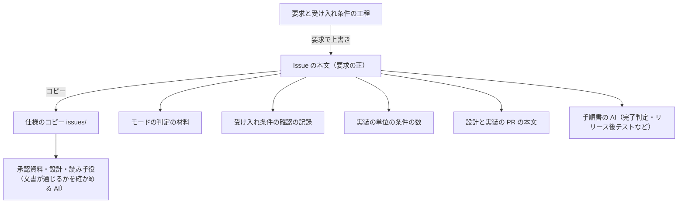
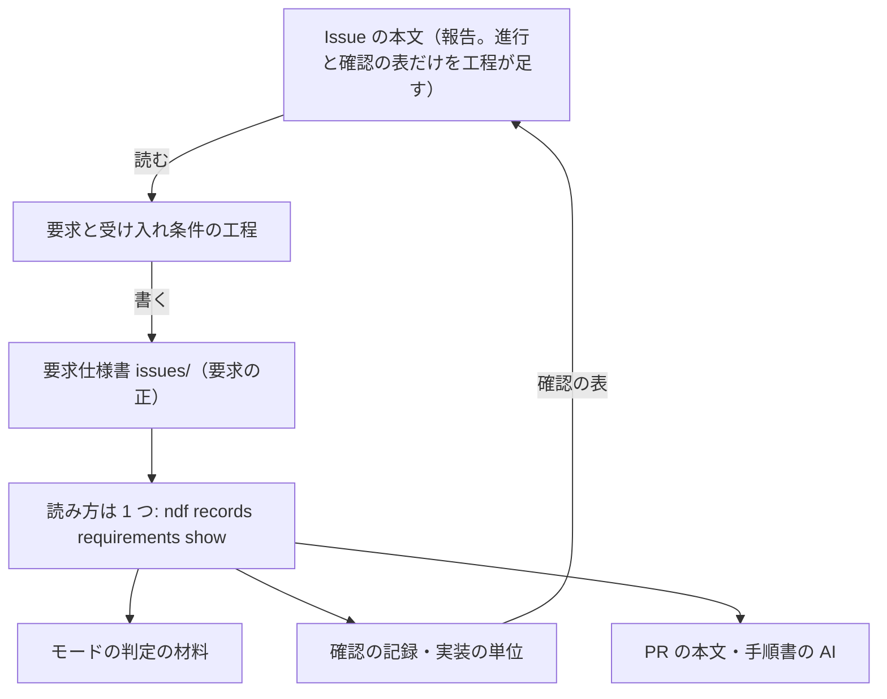
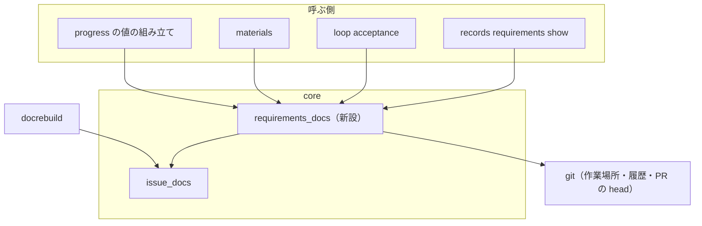

# 要求と受け入れ条件: Issue の報告を残したまま、要求をファイルで管理できるようにする（#4735）

要求の正が Issue の本文にあるため、本文とそのコピー（仕様のコピー）を一致させる手順で工程が止まり、起票した人の報告も要求で置き換わっていた。要求仕様書（`issues/` の追跡するファイル）を要求の正にし、本文を読んでいた処理は、共通の読み方で要求仕様書を読む。受け入れ条件ごとの確認の区分と手段の表は、作業中は工程の記録として Issue の本文に置き、配布の時点でリリース記録にコピーする。比べた製品と採らなかった案は、末尾の「外部の調査」と「決定の記録」にある。

## 今の姿

何が起きたか・目的・受け入れ条件は要求仕様書（[issue-4735-requirements.md](./issue-4735-requirements.md)）にある。この文書は「どう解くか」と「なぜその解き方か」だけを書く。



### Issue の本文を読んでいる処理（受け入れ条件 8 の一覧）

| # | 処理 | 場所 | 本文から読むもの | 変えた後の読み先 |
| --- | --- | --- | --- | --- |
| 1 | モードの判定の材料（`ndf materials`） | `domains/materials/` | 種類・影響・触るファイルの候補 | 要求仕様書（候補は報告の本文からも拾う） |
| 2 | 受け入れ条件の確認の記録（`ndf loop acceptance`） | `domains/loop/` | 受け入れ条件・確認の表 | 条件は要求仕様書、確認の表は本文のまま |
| 3 | 実装の単位を組むときの条件の数 | `progress/units_invoke.py` | 受け入れ条件の数 | 要求仕様書 |
| 4 | 設計と実装の PR の本文 | `progress/issue_values.py` | 本文の全文 | 要求仕様書へのリンクと、対象の Issue の `Refs` |
| 5 | 実装の worker・完了判定・PR レビュー・リリース後テスト | 手順書と `core/worker.py` | 受け入れ条件・リリース後の確認の計画 | 要求仕様書 |
| 6 | スプリントを閉じる（受け入れ条件のマーカー） | `progress-tracking` の手順書 | 受け入れ条件のチェックボックス（書き込み） | 書き込みをやめる（決定 5）。代わりに本文の確認の表を整理する |
| 7 | 要求への指摘の直し・実装で変えた条件の直し | `fix`・`quality-gates` の手順書 | 受け入れ条件（書き込み） | 要求仕様書の差分 |

次の処理は要求を本文から読んでいないので変えない。

| 処理 | 確かめた根拠 |
| --- | --- |
| コミットから組む PR の本文（`pr` のテンプレート） | `contracts/templates/pr.json` はコミットの件名と `Refs` の行だけで組む |
| 閉じる判定（`ndf records close-check`） | `domains/records/close_decide.py` はリリース記録とテストの記録の行だけを読む |
| 棚卸し | `backlog-refinement` が確かめるのは、報告の記載項目と、本文が現状と合うかである。要求仕様の内容は書かない |
| 進行とクリーンアップの記録 | `progress/records.py`・`domains/records/cleanup_stage.py` は「進行」のセクションだけを扱う。読み先は変えないが、本文の書き込みは確認の記録と共通にする（「Issue の本文の書き換え」） |

承認資料の項目をどこから拾うかは、出所の表（`approval-request.md`）が決める。今の出所の表は、「目的」「起票者の推定」「満たすこと」を仕様のコピーから拾っており、「種類」と「影響」の行は無い。`ndf materials` はモードの判定の材料を集めるコマンドで、承認資料は作らない。受け入れ条件 6 をどちらで満たすかは決定 7 で決める。

### この文書で使う工程の言葉

| 言葉 | 意味 |
| --- | --- |
| モード | 変更の種類と大きさで選ぶ工程の組。`standard`・`light`・`operation`・`documentation`・`legacy-refactor` の 5 つで、`legacy-refactor`（テストの少ないコードの構造だけを直す）は要求の工程を通らない |
| 作業場所 | その変更だけを置く git の worktree。用意する前の工程は、clone した元のディレクトリ（メインディレクトリ）で行う |
| 設計のプラン | 要求と受け入れ条件・設計・設計レビューを順に自動で実行する手順の並び |
| 実装の単位 | 実装を分けて並行に進める 1 まとまり。単位ごとに PR を出す |
| 確定仕様化 | 実装の後に、開発中の文書（`issues/`）の内容を恒久の仕様書（`docs/`）へ移して元のファイルを消す工程 |
| NDF の更新 | 利用者の環境の NDF を、この変更を含む版へ入れ替えること |
| 工程の入力 | ステートマシン（1 回の作業の進み具合を持つ記録）を作るときに決めて持たせる値。対象の Issue の番号やモードなど |
| スプリント PR | 実装の単位の PR を集めたブランチ（スプリントブランチ）を、ベースブランチへ出す PR |
| 単位の経路 | 実装を「レビューの単位」（実装計画で分けた、PR を 1 本ずつ出すまとまり）に分け、工程が自動で進めるやり方 |
| リリース記録・記録の PR | リリースを実施した後に、出したバージョンと段階を PR のコメントに残したものがリリース記録で、それを置いた PR が記録の PR である。workflow でリリースする場合は、含めた PR の各々に workflow が書く。それ以外は担当が 1 つの PR に書く |
| `strict` の squash | 本番へのマージの方式の設定（`merge.method`）が `strict` で、squash したコミットを本番ブランチへ入れる形。リリースの PR はマージされないまま閉じることがある |
| 信用する書き手 | リポジトリのオーナーか、write 以上の権限を持つメンバー・コラボレーター |

## 文脈と制約

- 要求と受け入れ条件の工程は作業場所の用意より前にあり、メインディレクトリの `issues/` で実行する
- 確定仕様化は元の文書を消す（`ndf records spec finalize --remove`）。要求仕様書も消えることがあり、その後にリリース後テストが受け入れ条件を読む
- 工程の順序は、確定仕様化 → デプロイ → リリース後テストである
- ベースブランチは保護されうる。マージの後にファイルへ書き足すには Pull Request が要る
- 並行する実装の単位は、同じ受け入れ条件の確認の表へ同時に書く（今は表を本文に置き、ロックで衝突を防いでいる）
- 過去の Issue の移行と、本文の要求を読む互換の経路は持たない（要求仕様書の前提 2）

## 解き方の全体像



- 要求と受け入れ条件の工程は、報告を読んで現状と根本原因を調べ、要求仕様書を書く。Issue の本文は書き換えない
- 要求仕様書は元の Issue の URL を持ち、根本原因が共通の Issue は 1 本にまとめる
- 作業場所の用意が要求仕様書を worktree へ移してコミットし、以後の直しはファイルの差分になる
- コードも手順書の AI も同じコマンドで読む。確定仕様化でファイルが消えた後は、作業中なら git の履歴から、リリースの後はリリース記録が指す配布コミットと PR から読む

## ドメインモデル

### コンテキスト

| コンテキスト | 何の語が 1 つの意味に決まるか |
| --- | --- |
| ndf-design（要求と設計） | 要求仕様書・受け入れ条件 |
| ndf-workflow（工程） | 受け入れ条件の番号・確認の区分・進行 |

ndf-workflow は ndf-design の要求仕様書を読むだけで、書き換えない（顧客と供給者の関係で、供給者は ndf-design）。

### 集約

| 集約 | オーナー（書き換えてよいもの） | 根 | エンティティ | 値オブジェクト |
| --- | --- | --- | --- | --- |
| 要求仕様書 | 要求と受け入れ条件の工程、設計と実装の工程の直し役 | 要求仕様書のファイル | 受け入れ条件 | 元の Issue の URL・種類・影響 |
| Issue の報告 | 起票した人。棚卸しは事実の訂正だけを行える | Issue の本文の「進行」より前 | — | — |
| 確認の記録 | `ndf loop acceptance` | 代表の Issue の本文の確認の表（実行と要求仕様書の組ごとに 1 つ） | — | 実行の印・要求仕様書のパス・条件の版・区分・手段（条件の番号は表示用） |
| リリースの対応の記録 | `ndf release-steps record`・`record-acceptance` | 記録の PR のリリース記録のコメントの `acceptance` | — | 配布コミット・含めた PR の head・実行の印とモード・配布の時点の確認の記録 |

代表の Issue は、要求仕様書の名前に含む番号のうち最も小さい番号の Issue とする。

### 不変条件

| # | 集約 | 条件 | 破れたときの扱い |
| --- | --- | --- | --- |
| I1 | Issue の報告 | 工程は本文の報告を要求の内容で書き換えない | 手順書に本文へ要求を書くステップを置かない |
| I2 | 要求仕様書 | 名前に含むすべての番号の Issue の URL を持つ | 読むコマンドが `check_failed` で止まる |
| I3 | 要求仕様書 | 1 つの Issue の番号を含む要求仕様書は、1 つの読み先の中で 1 本である | 読むコマンドが候補を並べて止まる |
| I4 | 確認の記録 | 同じ要求仕様書の記録を書く先は、代表の Issue の 1 か所である | どの番号で打っても代表の Issue へ書く |
| I5 | 確認の記録 | 記録は、書いた実行・要求仕様書・条件の文にだけ効く。同じ要求仕様書の中で番号が変わっても、文が同じなら効く。書き込みは、実行か要求仕様書が違う表を変えない | どれか 1 つでも指定と違う記録は、数えない |
| I6 | 要求仕様書 | 受け入れ条件の文は、1 本の中で重ならない | 読むコマンドが重なる番号を挙げて `check_failed` で止まる |

### ドメインイベント

| # | イベント | 発生元 | 受け手 |
| --- | --- | --- | --- |
| E1 | 起票した人が Issue に報告を書いた | 起票 | 要求と受け入れ条件の工程 |
| E2 | 要求仕様書を書いた | 要求と受け入れ条件の工程 | 作業場所の用意、モードの判定の材料 |
| E3 | 要求仕様書が元の Issue へのリンクを持った | E2 と同じ書き込み | 読むコマンドの確かめ |
| E4 | 要求仕様書への指摘を差分で直した | 直し役 | 設計レビュー、設計承認ゲート |
| E5 | 承認資料が要求仕様書を読んだ | 設計承認ゲート | 承認する人 |
| E6 | 確認の区分と手段を記録した（マージの前） | `ndf loop acceptance record` | 実装のプラン、承認資料 |
| E7 | 条件ごとの合否を記録した（リリースの後） | リリース後テスト | スプリントを閉じる工程 |
| E8 | 受け入れ条件の合否で Issue を閉じた | スプリントを閉じる工程 | 起票した人 |

## 構成要素

| 要素 | 責務 |
| --- | --- |
| 要求仕様書の名前と形（`core/issue_docs.py`、変更） | ファイル名の番号の並びと、元の Issue の行の読み方を 1 か所で持つ |
| 要求仕様書の読み出し（`core/requirements_docs.py`、新設） | Issue の番号から要求仕様書を探して返す。探す順と失敗の形を持つ |
| 読むコマンド（`ndf records requirements show`、`domains/records/cli.py` に追加） | 手順書の AI が同じ読み方を使うインターフェース |
| 確認の記録（`domains/loop/`、変更） | 条件を要求仕様書から、確認の表を代表の Issue の本文から読む。記録を実行・要求仕様書・条件の版で結ぶ |
| Issue の本文の書き換え（`core/issue_body.py`、新設） | 確認の記録・進行の記録・クリーンアップの記録が共に使う。同じロックの中で読み、自分のセクションだけを差し替える |
| モードの判定の材料（`domains/materials/`、変更） | 種類・影響を要求仕様書から読む |
| 工程へ渡す値の組み立て（`progress/units_invoke.py`・`issue_values.py`、変更） | 条件の数と PR の本文を要求仕様書から作る。実行の印を単位の指示と `check` へ渡す。スプリント PR の前に全条件を照らす |
| 進行の記録（`progress/records.py`、変更）・クリーンアップの記録（`domains/records/cleanup_stage.py`、変更） | 本文を共通の書き換えを通して書く。進行の記録は、スプリント PR の「通した工程」に対象の Issue・実行の印・モード・要求仕様書ごとの確認の表の Issue も書く |
| リリースの対応の記録（`domains/release/`、変更） | 配布コミット、Issue・実行の印・モードの対応、確認の記録のコピーを記録の PR のリリース記録に固定する。`records` は対象の Issue をこの記録から返す |
| 実行の印（`progress/command.py`、変更） | ステートマシンを作るときに決め、`--carry` では引き継ぎ元の値をコピーする。値を持たない旧いステートマシンは ID から導く |
| ドキュメント再構成（`domains/docrebuild/drive.py`、変更） | 複数の Issue をまとめた要求仕様書も設計書と組にする |
| worker の起動指示（`contracts/worker/`・`core/worker.py`、変更） | 要求の書き先と読み先を要求仕様書にする |
| 手順書（Skill と参照、変更） | 本文へ要求を書く手順と一致の確かめを消し、要求仕様書を読み書きする手順にする |



worker の起動指示と手順書は、コードの依存を持たないので図に描かない。

## データ構造

要求仕様書は次の形を持つ。見出しとセクションの順は今の `spec-template.md` と `document-roles.md` のままで、冒頭の行が加わる。

| 要素 | 形 |
| --- | --- |
| パス | `issues/issue-<番号の並び>-requirements.md`。並びは番号の昇順を `-` でつなぐ（例 `issue-7-8-requirements.md`） |
| 元の Issue の行 | 最初の `##` の前に `元の Issue: <URL>`。Issue ごとに 1 行 |
| 受け入れ条件 | `## 受け入れ条件` のチェックボックス。番号は上から 1 始まり（数え方は今と同じ） |
| 種類・影響 | `## 種類` の 1 行目と、`## 影響` の表の「公開インタフェース」の行（今と同じ） |
| 根本原因 | 不具合では「今の姿」に、起きる原因を書く（決定 8） |

代表の Issue の本文の `## 受け入れ条件の確認` のセクションは、実行と要求仕様書の組ごとに表を 1 つ持つ。見出しに実行の印と要求仕様書のパスを書き、表に「条件の版」の列を足す。新しい組は表を足し、ほかの組の表は残す。本文の表は作業中の保存先である。配布の時点の内容はリリース記録にコピーし、Issue を閉じるときに本文から消す（「閉じるときの表の整理」）。

```markdown
## 受け入れ条件の確認

### 実行 5d1c9e0a44b7 / issues/issue-7-8-requirements.md

| 条件 | 区分 | 手段 | 条件の版 |
| :--- | :--- | :--- | :--- |
| 1 | マージ前 | test_requirements_docs | 3f9a0c1b7d2e |
| 2 | リリース後 | — | 8b41e6a0c95f |
```

| 要素 | 形 |
| --- | --- |
| 区分 | `マージ前`（マージの前に確かめた。手段にテスト名か実行したコマンドを書く）か `リリース後`（リリースの後でしか確かめられない） |
| 条件の版 | 条件の文の SHA-256 の先頭 12 桁。文は、チェックボックスの印と先頭の番号（`1.`）を除き、前後の空白を落としたもの。並べ替えと印の付け外しでは変わらず、文を直すと変わる |
| 条件 | 書いた時点の条件の番号。人が読むための値で、記録と条件は番号でなく条件の版で結ぶ |
| 見出しの要求仕様書 | 記録した時点の要求仕様書のパス。まとめる Issue が変わるとパスも変わり、別の表になる |
| 実行の印 | 1 回の作業を指す 12 桁の値。出し方は下の表 |

条件の番号を実装計画に書き写す場合に備えて、「条件一覧の版」も定める。条件の版を番号の順に改行でつないだ文字列の、SHA-256 の先頭 12 桁である。条件を足す・消す・並べ替える・直すと変わる。

実行の印は作業の始め方で決まる。作業ごとに必ず別の値になるようにし、共通の既定値は持たない。

| 作業の始め方 | 値 |
| --- | --- |
| 新しいステートマシン | ステートマシンの ID の SHA-256 の先頭 12 桁。作るときに工程の文脈に持つ |
| `--carry` で作り直す | 引き継ぎ元の値をコピーする（中止済み・同じリポジトリ・同じ Issue の確かめは今の `--carry` のまま） |
| NDF の更新より前に作ったステートマシン | 文脈に値が無いので、読むときにそのステートマシンの ID から同じ式で導く。そこから `--carry` した場合は、引き継ぎ元の ID から導いた値をコピーする |
| ステートマシンを使わずにプランを組む | プランを組むコードが無作為な値を発行してプランに持ち、worker の指示と `check` に同じ値を書く。打ち直しはプランの値を使う |
| 手で作業する | 担当が作業の始めに `ndf loop acceptance new-run` で無作為な値を発行し、その作業の `record` と `check` に渡す。値が分からなくなったら発行し直し、確かめ直して記録する |

実行の印は、確認を行った側が `--run` で渡す。`record` と `check` では必須で、コマンドが本文の今の状態から推し量ることはしない。

| 受け取る側 | 値の出所 |
| --- | --- |
| 実装の worker と `check` | 工程が単位の指示と実装のプランに書き込む |
| 手で打つ担当 | `ndf progress show` の出力か `new-run` |
| リリース後テスト | リリースの対応の記録（下の「リリースの対応の記録」） |

スプリント PR の「通した工程」には、工程が次の行を書く。確認の表は要求仕様書ごとの代表の Issue にあるので、`確認の表` の行は要求仕様書 1 本につき 1 行になる。代表の番号とパスは、工程が要求仕様書の名前から求める。次は、#7 と #8 が 1 つの要求仕様書を持ち、#9 が別の要求仕様書を持つ例である。

```text
対象の Issue: #7 #8 #9
確認の表: #7 issues/issue-7-8-requirements.md
確認の表: #9 issues/issue-9-requirements.md
実行: 5d1c9e0a44b7
モード: standard
```

この本文はマージの後も編集できるので、リリース後テストは直接読まない。

### リリースの対応の記録

何を配布し、どの実行で何を確かめたかは、リリースした時点でリリース記録のコメントに固定する。リリース後テストは、この記録だけを読み、PR の本文と Issue の確認の表を読み直さない。どちらもマージの後に書き換えられるためである。

```json
"acceptance": {
  "commit": "<配布コミット>",
  "release_pr": 30,
  "release_head": "<リリースの PR の head>",
  "runs": [{
    "pr": 21, "head": "<マージした時点の head>", "base": "<マージコミットの第 1 親>", "merged_at": "<時刻>",
    "issues": [7, 8], "run": "5d1c9e0a44b7", "mode": "standard",
    "tables": [{"requirements": "issues/issue-7-8-requirements.md",
                "rows": [{"criterion": "3f9a0c1b7d2e", "kind": "マージ前", "means": "test_requirements_docs"}]}]
  }],
  "targets": [{"issue": 7, "target": "c41d0a97e2b5"}, {"issue": 8, "target": "0f6b2d8a13ce"}]
}
```

以下で「値」は、リリース記録を書くコマンドに `--version <値>` で渡すものを指す。

| 要素 | 形 |
| --- | --- |
| 配布コミット | 本番へ入れたコミット。今の `landed_commit` が返すもので、`strict` の squash でリリースの PR が未マージのまま閉じる場合も含む。リリースブランチに追加した直しも入っている |
| `release_pr`・`release_head` | 本番へ入れた PR とその head。コメントを置く記録の PR とは別の項目である。リリースの PR を作らない形では、2 つとも省く |
| `runs` | 配布に含めた PR ごとに 1 件。「通した工程」の行をコピーする。行が無い PR は、`Refs` と closing keywords の Issue を `issues` にし、`run` と `mode` を空、`tables` を空の配列にする |
| `head`・`base`・`merged_at` | 書いた時点の値を固定する。`release_pr` と同じ PR が `strict` の squash で未マージの場合は、`base` を配布コミットの第 1 親、`merged_at` を空にする。読む側は、`merged_at` が空の PR を最も新しくマージしたものとして扱う。ほかの PR はマージ済みでなければ、何も書かずに `precondition` で止まる |
| `tables` | その実行の確認の表をコピーする。「通した工程」の `確認の表` の行ごとに、その Issue の本文から、その実行の印と要求仕様書のパスの表を取る。すべての行の表を並べる |
| 要求仕様書の本文 | 持たない。固定したコミットから同じ結果に決まるためである |
| `targets` | Issue ごとの確認対象の版。テストの合否をどの内容に対するものかに結ぶ値で、書くコマンドが決める（下の「確認対象の版」） |

| リリースの形 | 書くコマンド |
| --- | --- |
| workflow でリリースする | 今の `ndf release-steps record`。記録の PR へ書くリリース記録の JSON に `acceptance` を入れる。コメントは増えない |
| バージョン番号を持たないリポジトリ | `ndf release-steps record --version <値> --environment <届け先>`（今の別の経路。`record_unversioned`）。記録の PR へ書くリリース記録の JSON に `acceptance` を入れる |
| それ以外（3 行の `## リリース記録` を手で置く） | 続けて `ndf release-steps record-acceptance --pr <記録の PR> --version <値> --commit <配布コミット> [--release-pr <番号>] --included <PR>... [--unit <単位>]` を打つ。`--included` は `スプリント:` の行の PR である。記録を置いた PR がリリースの PR でなければ、それも含める。リリースの PR は `--release-pr` で渡し、それ自体がスプリントの変更を持つ場合だけ `--included` にも並べる |

**対応の記録は、記録の PR の 1 か所にだけ置く。** 記録の PR はリリースの形で決まる。workflow でリリースする形とバージョン番号を持たないリポジトリでは、`included` のうち番号が最も小さい PR である。それ以外では、担当がリリース記録を置いた PR である。ほかの含めた PR のリリース記録には `acceptance` を入れない。

一度確定した対応の記録は作り直さない。書くコマンドは、記録の PR に同じ値と単位の有効な `acceptance` があれば、PR の本文と確認の表を読み直さずに、残りのリリース記録だけを書く。

| 場面 | 扱い |
| --- | --- |
| `record` が途中の PR で失敗し、打ち直す | 記録の PR へ最初に書くので、`acceptance` は 1 回目の内容のまま残る。残りの PR へは、今と同じくリリース記録だけを書く |
| バージョン番号を持たないリポジトリで、2 つ目以降の届け先を記録する | 記録の PR の `acceptance` があるので、足すリリース記録には入れない |
| 同じリポジトリで、届け先の一覧を訂正する（`--correct-targets`） | 訂正するのは届け先の一覧だけで、`acceptance` は作り直さない |
| 並行して打った 2 つの `record` が、両方とも `acceptance` を書いた | 読む側は、訂正が無ければ最初に投稿されたものを使う |

書くときに増える GitHub の読み出しは、含めた PR の照会と、`確認の表` の Issue の本文の照会である。どちらも今の GitHub アダプターのまとめた読み取りを 1 回呼ぶ。HTTP の要求は `github.graphql-batch`（100 件）ごとに 1 回で、100 件までは各 1 回である。

リリースの単位が 2 つ以上のときは、今のリリース記録の選び方と同じく単位ごとに 1 件を持つ。`runs` は、その単位の記録の `included` の PR だけから作る。書く側・読む側とも `--unit <単位>` を受け、単位が複数あるのに指定が無ければ `precondition` で止まる。

重ねて書くかは、同じリリース記録（バージョンと単位）を指す有効な `acceptance` の有無で決める。

| 状態 | 扱い |
| --- | --- |
| 記録の PR に有効な `acceptance` がある | 追記せず、作り直さない |
| リリース記録はあるが `acceptance` が無い（NDF の更新より前の記録） | `record-acceptance` が、元の記録を指すコメントを 1 回だけ追記する |
| 配布した内容の記録に誤りがある | 担当が `record-acceptance --reason <理由>` を打つ。記録の PR へ、元の記録を指す訂正のコメントを追記し、読む側は最も新しい訂正を使う。元のコメントは残す |

読む側は、信用する書き手が投稿した `acceptance` だけを有効なものとして読む。投稿の後に編集されたコメントは読まずに `precondition` で止まる。

#### 確認対象の版

**テストの合否は、確かめた時点の対応の記録に結ぶ。** 訂正で配布の内容や確認する対象が変わった後に、古い合格で Issue を閉じないためである。結ぶ値を「確認対象の版」と呼ぶ。版は Issue ごとに持ち、その Issue のテストで実際に読む内容が変わったときだけ変える。対応の記録を書くコマンドが決めて `targets` に入れ、読む側は計算し直さない。

| 書く場面 | 版の決め方 |
| --- | --- |
| 最初の対応の記録 | `commit`、Issue の番号、その Issue に選ぶ実行（マージが最も新しい実行）の `pr`・`head`・`run`・`mode`・`tables` の SHA-256 の先頭 12 桁。固定したコミットから読む要求仕様書は決まるので、要求仕様書は読まない |
| 訂正（`record-acceptance --reason`） | 訂正の前と後の記録で、Issue ごとに読み出し結果を比べる。同じなら前の版を引き継ぎ、違うか Issue が足されたら新しい版にする |

比べる読み出し結果は、`commit`、選ぶ実行の値のうち上の表に挙げたもの（`pr`・`head`・`run`・`mode`・`tables`）、`--release` で読む要求仕様書のパスと内容である。別の PR の `base` や `merged_at` の訂正は、選ぶ要求仕様書か確認の表が変わらない限り、版を変えない。どちらかの記録で要求仕様書を読めない Issue は、違うものとして扱う。両方の記録で要求仕様書が無い Issue は、残りの値で比べる。

新しい版は、前の版と訂正後の読み出し結果をつないだものの SHA-256 の先頭 12 桁である。訂正を取り消して元の内容に戻しても、前の版には戻らない。値を JSON にするときは、キーを名前順に並べて空白を入れず（UTF-8）、`tables` は要求仕様書のパス、`rows` は条件の版の順に並べる。

| 段階 | すること |
| --- | --- |
| `ndf release-steps records`（以下 `records`） | Issue ごとの版と、最初の記録（訂正の前）から版が変わったか足されたかを `outputs.acceptance_targets` で返す |
| `acceptance show --release` | テストの始めか再開で保存した `records` の出力を `--records` で受ける。自分が読んだ記録の Issue の集合と版を、保存した `acceptance_targets` の全体と比べる。`--issue` に渡していない Issue の追加や削除も含め、違えば何も返さずに `precondition` で止まる。担当は `records` から打ち直す |
| `verification-record` | 同じ出力を `--records` で受け取り、記録の行の `target` に版を書く。担当は値を手でコピーしない。対応の記録がある値で `--records` が無ければ、何も書かずに `precondition` |
| `verification-record` の再テストの理由の検査（バージョン番号を持たないリポジトリ） | 再テストの理由を求めるかの判定には、版が今の確認対象の版と同じ行だけを使う。訂正で無効になった不合格には `retest_reason` を求めない |
| `to_test` | 版が今と同じ行だけを数える。数える行の無い届け先と Issue の組は未実施として返す |
| `close-check` | 版が今と同じ行だけを数える。下の 2 つの表で判定する |

#### 閉じる判定（`close-check`）

`close-check` は、対応の記録がある値では Issue ごとに次の順で当てはめる。バージョン番号を持たないリポジトリでは、届け先ごとに当てはめる。

| Issue の状態 | 扱い |
| --- | --- |
| 数える行がある | 次の表の求め方で合否を出し、今の決まりのとおり判定する |
| 数える行が無く、版の違う行か版の無い行がある | 閉じずに「再検証待ち」を理由にする |
| 数える行が無く、`--require` が有効で、設定でリリース後テストの条件を外していない | 訂正の有無によらず閉じない。ほかの Issue の記録があるだけで、この Issue を閉じないようにするためである |
| 数える行が無く、訂正で確認対象の版が変わった Issue か、訂正で足された Issue で、そのリリースと単位にテストの記録が 1 件以上ある（別の Issue の記録も含む） | 今の版の行ができるまで閉じない。設定でリリース後テストの条件を外している場合は当てない |
| ほか | 今の「その Issue の行が無い」扱い |

数える行から合否を出す方法は、リポジトリの形で違う。

| 形 | 合否の求め方 |
| --- | --- |
| バージョン番号を持つ | 同じ値・単位の記録のうち、その Issue の数える行を持つ最後の 1 件の行で出す |
| バージョン番号を持たない | 1 件に絞らず、版が同じすべての行を、届け先と Issue の組ごとに今の `pair_verdict` でまとめる。`retest_reason` を持つ最後の行より前を捨て、残りに不合格があれば不合格、無くて合格があれば合格、保留だけなら保留 |

対応の記録がある値では、版を持たない行は数えない。どの版を確かめた行かを特定できないためである。NDF の更新より前にテストした後で対応の記録を足した場合は、確かめ直しになる。テストと閉じる工程の GitHub の読み出しは増えない。版は、各コマンドが今読むコメントに入っている。

**テストの記録を直接渡す `close-check --verification` は、デプロイを飛ばした実行だけで受ける。** 版を照らさずに判定する経路が、リリースのある Issue に使えないようにするためである。`--skipped-deploy <ステートマシンの ID>` を必須にする。コマンドはステートマシンを読み、デプロイの工程が飛ばされ、対象の Issue がその実行の入力にあることを確かめる。テストの記録の JSON には、テストした実行の ID を `state_machine` に書く。コマンドは、この値が `--skipped-deploy` の ID と同じことも確かめる。前の実行の記録で今回の Issue を閉じないためである。どれか 1 つでも確かめられなければ `precondition` で止まる。リリースのある実行は `--records` を渡す。

#### 閉じた後の照合し直し

**閉じた直後に、対応の記録を照合し直す。** `close-check` は保存した `records` の出力だけを見るので、保存した後の訂正を知らない。対応の記録がある値では、閉じる工程を次の順で進める。

閉じた Issue と照合に使った版は、実行の記録（`records` の出力を置くのと同じ作業の保存先の `closing.json`）に残す。中身はリリースの単位ごとに、最初に使った `acceptance_targets` と、この実行が閉じる Issue の番号とその版の並びである。番号と版は `gh issue close` の直前に書き足し、打ち直しでも消さずに残す。

| 順 | すること |
| --- | --- |
| 1 | 保存した `records` の出力で `close-check` し、閉じてよい Issue は番号と版を `closing.json` に書いてから閉じる |
| 2 | すべて閉じた後に、`records` をリリースの単位ごとに 1 回打ち直す |
| 3 | `closing.json` と比べ、閉じたときの版と違う Issue と、最初の `acceptance_targets` に無かった Issue を、新しい出力で `close-check` し直す |
| 4 | 閉じてよいとならない Issue のうち、`closing.json` にあり閉じているものは `gh issue reopen` で開き直し、「再検証待ち」と報告する |
| 5 | その後で、閉じたままの Issue の表を `prune` で整理する |

順 2 が失敗した場合は、閉じる工程を完了にせず「失敗」と報告する。打ち直しは `closing.json` を読む。まだ閉じていない Issue があれば順 1 で閉じ、順 2 からの照合と開き直しを続ける。このため、失敗の前にこの実行が閉じた Issue も自動で開き直せる。`closing.json` に無い、前から閉じていた Issue も `close-check` し、閉じてよいとならなければ報告に載せる。開き直すかは、今の決まりのとおり人が決める。順 5 まで終えたら `closing.json` を消す。

#### 閉じるときの表の整理

確認の表は、Issue を閉じるときに本文から消す。保留の解消と再検証に使う内容は、リリース記録のコピーにあるためである。閉じる工程は、閉じた Issue をまとめて `ndf loop acceptance prune` を 1 回打つ。番号は Issue ごとに `--issue` を指定する（`--issue 7 --issue 8 --release <記録の PR> --version <値> [--unit <単位>]`）。`--unit` には、閉じる手順の最初に記録の読み取りで選んだ単位を渡す。

整理は閉じる条件に含めない。閉じるかは今の閉じる条件だけで決め、整理は閉じた後に行う。整理が失敗しても閉じた Issue は開き直さず、失敗を報告に載せる。

デプロイを飛ばした実行はリリース記録が無い。閉じた後に `ndf loop acceptance prune --issue 7 --issue 8 --no-release` のように打つ。照らすコピーが無いので、渡した Issue の本文にある表は、すべて Issue のコメントに残してから本文から消す。要求仕様書もリリース記録も読まない。代表の Issue をまだ閉じていなければ、その表は代表の Issue を閉じるときに整理する。

| 表の状態 | 扱い |
| --- | --- |
| 対応の記録のコピーと同じ | 本文から消す |
| コピーが無い、またはコピーと違う（中止した実行など） | 表を Issue のコメントに残してから、本文から消す |

本文の書き換えは、下の「Issue の本文の書き換え」の関数を使う。表が無ければ、読み 1 回で終える。

コメントに残す表には、表の文の SHA-256 の先頭 12 桁を持つ識別子（`<!-- ndf:acceptance-table <値> -->`）を付ける。コメントの投稿に成功して本文の更新に失敗した場合に、打ち直しで同じ表を重ねて投稿しないためである。`prune` は残す表があるときだけ、その Issue のコメントを読む。信用する書き手のコメントに、同じ識別子と同じ表の両方があれば、投稿せずに本文の更新から再開する。

コメントの照会と投稿の間に、本文が画面から編集されうる。このため `prune` は、退避する表があるときは、最初に読んだ本文を PATCH に使わない。コメントに残ったことを確かめた後で、「Issue の本文の書き換え」の関数がロックの中で本文を読み直す。そこから、退避した表と文が同じ表だけを消して、すぐに PATCH する。その間に変わった表は消さずに残し、報告に載せる。次の `prune` が同じ手順で扱う。退避する表が無いときは、ロックの中の最初の読み出しでコピーと比べ、そのまま PATCH する（本文の読み出しは 1 回）。

回数は次のとおりである。まとめる単位は実行 1 件で、CLI の起動は閉じた Issue の数に依らず 1 回である。

| 場面 | GitHub の読み出し | GitHub の書き込み |
| --- | --- | --- |
| 表が無い | Issue ごとに本文 1 回 | 無し |
| コピーと同じ表を消す | Issue ごとに本文 1 回 | Issue ごとに本文の更新 1 回 |
| 表をコメントに残して消す（デプロイを飛ばした実行は常にこれ） | Issue ごとに本文 2 回（投稿の後の読み直しを含む）とコメント 1 回 | Issue ごとにコメントの投稿 1 回と本文の更新 1 回 |

`--release` を渡す場合は、この表に記録の PR のコメントの照会 1 回が加わる。表を本文に残したままにすれば、起動も読み書きも増えない。しかし閉じた Issue の本文に工程の表が残り続けるので、採らない（Value 6）。

## 入出力のコントラクト

### 読むコマンド（追加）

| 項目 | 内容 |
| --- | --- |
| 名前 | `ndf records requirements show` |
| 入力 | `--issue <N>`（必須。繰り返せる）。読み先を選ぶ `--ref <コミットかブランチ>`・`--release <記録の PR>`（`--version <値>` と、必要なら `--unit <単位>` を一緒に渡す）は、どちらか 1 つだけ渡せる。ほかに `--base <ブランチ>`（省けば設定のベースブランチ）、`--out <ディレクトリ>`、`--cwd <作業場所>` |
| 出力 | 結果 JSON の `items` に、要求仕様書 1 本につき 1 要素。パス（`path`）・読んだ先（`source`）・読んだコミット（`commit`）・まとめた Issue の番号（`issues`）・条件一覧の版（`criteria_digest`）・本文（`body`）。同じ要求仕様書を指す番号を複数渡しても、本文は 1 回だけ返す |
| `--out` | 本文を指定のディレクトリへ要求仕様書と同じファイル名で書き、`body` の代わりにそのパスを `body_path` で返す。書き方と検査は下の「読み書きするファイルの検査」 |
| 失敗の形 | 見つからない番号がある: `incomplete`（番号を `gaps` に載せる）。同じ読み先に 2 本以上、通常ファイルでない候補、ほかの利用者が差し替えられるパス、git か PR を読めない、リリースの対応の記録が無いか編集されている、履歴が浅い: `precondition`。元の Issue の URL が欠ける、受け入れ条件の文が重なる: `check_failed` |
| 互換性 | 追加だけで、既存の呼び出しは変わらない |

もう 1 つのサブコマンドは `ndf records requirements stamp --plan <実装計画>` である。実装計画が指す条件の番号を読み、要求仕様書を 1 回読んで、条件一覧の版の行を実装計画へ書く。同じ読み出しから、番号ごとの条件の文を出力する（使い方は「実装計画の条件の番号」）。書き換える対象の制限は「読み書きするファイルの検査」にある。

`--ref` はそのツリーだけを読む。`--ref` も `--release` も無ければ次の順に探し、最初に見つかったものを返す。

| 順 | 読み先 | 当てはまる場面 |
| --- | --- | --- |
| 1 | 作業場所のファイル（追跡していないファイルを含む） | 要求を書いた直後、実装の worktree |
| 2 | `<起点コミット>..HEAD` の範囲で削除されている場合の、削除直前の内容 | スプリントブランチで確定仕様化した後 |
| 3 | 起点コミットのツリー | 別の作業場所、設計 PR のマージの後 |

起点コミットは、リモート追跡ブランチ `<リモート>/<ベースブランチ>` をコマンドの始めに 1 回だけコミットに解決したものである。順 2 と順 3 は同じコミットを使う。ローカルのベースブランチは古いことがあり、前のスプリントの削除まで範囲に入るので使わない。

2 の範囲で要求仕様書が消えている場合に、どれを返すかは下の「消えた要求仕様書の最終版の選び方」で決める。

2 を 3 より先に見る。順を逆にすると、このブランチで直してから消した要求より先に、ベースブランチに残る古い版が返るためである。範囲を起点コミットより後のこのブランチのコミットに限るので、前のスプリントの削除は拾わない。複数の Issue を扱うコードの呼び出し（確認の記録・材料・PR の本文）は、履歴の照会とツリーの一覧を 1 回ずつ取って共有する。

**通常ファイルだけを読む。** git のツリーでは、エントリが通常ファイル（モード 100644 か 100755）であることを確かめる。作業場所のファイルは次の節の検査を通す。外れる候補は内容を読まずに止まる。

#### `--release` の読み方

`--release` は、リリースで配布した内容を読む。起点はリリースの対応の記録の配布コミットである。手元のブランチとベースブランチは読まないので、いつ打っても同じ内容が返る。

| 項目 | 内容 |
| --- | --- |
| 記録の読み出し | `--release` の PR のコメントから、`--version`（と `--unit`）の対応の記録を 1 回の照会で読む。PR の情報は記録が持つので、読み直さない |
| 取得 | 手元に無いコミットだけを、記録の SHA を指定した 1 回の `git fetch` でまとめて取得する。ブランチの名前や `refs/pull/<N>/head` は使わないので、後で参照先が変わっても同じコミットを読む。取得できなければ `precondition` |
| 触れた要求仕様書 | `git log` を 1 回打つ。`git log` の始点には、配布コミット・`release_head`・`runs` の `head` と `base` を渡す。そこからたどれるコミットのうち、最も古くマージされた PR の `base` より後のものを読む。コミットごとに親と変えたファイルも取り、PR ごとの範囲はメモリ上で求める |
| ファイルが残っている | 触れた要求仕様書が配布コミットのツリーにあれば、その内容を返す。配布の直前に足した直しも入っている |
| ファイルが消えている | 確定仕様化で消えた場合である。下の「消えた要求仕様書の最終版の選び方」で選ぶ |
| どの PR も触れていない | 配布コミットのツリーから読む。そこにも無ければ `incomplete` |

Git の起動は、次の各 1 回以下で、PR と Issue の数に比例しない。取得の前にコミットが手元にあるかの確かめ、`git fetch`、`git log`、ツリーの一覧、内容の読み出しである。

#### 消えた要求仕様書の最終版の選び方

対象は、その番号を名前に含み、読み先のツリーに無い要求仕様書である。調べる履歴をすべて読んでから、次の順で 1 つに決める。見つけた順では決めない。

| 順 | すること |
| --- | --- |
| 1 | 統合・分割で消えた旧版を除く。旧版とは、消したコミットのツリーに同じ番号の別の要求仕様書があるか、消した後の履歴で同じ番号の別の要求仕様書が足されたファイルである |
| 2 | 残ったファイルが 1 つなら、そのファイルを削除したコミットを、PR の head の履歴（`release_head` と `runs` の `head`）からすべて探す。1 つも無いときだけ、配布コミットの履歴を探す。squash のコミットは途中の直しを持たないためである |
| 3 | 削除直前の内容がすべて同じなら、それを返す。違えば、ほかの削除コミットをすべて祖先に持つ削除コミット（最も後の削除）の直前の内容を返す |
| 4 | 残るファイルが 2 つ以上ある、または前後の分からない削除で内容が違えば、どれも返さずに `precondition` で止まる |

`--release` が無い順 2 では、`<起点コミット>..HEAD` を調べる履歴にする。

squash マージでは、同じスプリントで足して消したファイルがベースブランチの履歴に一度も現れない。このためベースブランチの履歴は読み先にしない。

#### リリース後テストでの読み出し

**リリース後テストは、リリース 1 件につきコマンドを 1 回だけ打つ。** 工程の始めに `ndf loop acceptance show` を打つ。対象のうち新方式の Issue のすべてを `--issue`、記録の PR を `--release`、バージョンを `--version`、書き出し先を `--out` で渡す。新方式と旧方式の分けは「マージ済みで残るのがリリース後テストだけの場合」にある。リリースの単位が 2 つ以上なら、`records` で記録を選んだときと同じ単位を `--unit` で渡す。直前に保存した `records` の出力も `--records` で渡す。要求仕様書の本文のファイルと確認の区分が同じ結果に返る。区分は対応の記録のコピーから読み、Issue の本文は読まない。

要素は要求仕様書 1 本につき 1 つで、本文は 1 回だけ返す。確認の記録は、その中で Issue と実行を区別して返す。

```json
"checks": [{"issues": [7], "run": "5d1c9e0a44b7", "pr": 21, "rows": []},
           {"issues": [8], "run": "a02f7be19c3d", "pr": 34, "rows": []}]
```

Issue ごとに、`runs` のうちその Issue を含み、マージが最も新しい実行を 1 つ選ぶ。違う実行の行は 1 つにまとめず、ある Issue の確認の記録を別の Issue に当てない。そのような実行が無いか、実行の印が空の Issue は区分を返さず、担当はすべての条件を確かめる。

**区分が `マージ前` というだけでは合格にしない。** 確かめた後に、別の実装の単位やリリースブランチで対象のコードが変わることがある。リリース後テストが実行し直さずに合格にできるのは、次をすべて確かめられる条件だけで、証跡にはその URL と対象のコミットを書く。1 つでも確かめられなければ、配布した版で確かめる。

- 手段に書かれたテストかコマンドの成功が、マージした PR の CI か完了判定の記録にあり、対象のコミットが分かる
- 記録の後に条件の文が変わっていない（行の条件の版が、配布した要求仕様書の条件の文と合う）
- 証跡が宣言した検証の対象範囲（完了判定の記録の「対象範囲」）に、対象のコミットと配布コミットの差分が無い（`git diff --quiet <対象のコミット> <配布コミット> -- <対象範囲のパス>...`）。別のスプリントの変更も、この差分に含まれる。対象範囲はリポジトリルートからのファイルまたはディレクトリのパスで指定する。差分は `git --literal-pathspecs` を付けて、パスを文字どおりに扱う。対象範囲の宣言が無い、パスで書かれていない、依存先や共通設定を含めて影響する範囲を決められない場合は、確かめられないとして扱う
- 差分を見る前に、末尾の `/` を除いたリテラルパスの存在を、対象のコミットのツリーで検査する。`git diff --quiet` は、どちらのコミットにも無いパスを渡しても終了コード 0 を返すためである。検査では、証跡を使うすべての条件の `<対象のコミット>:<パス>` を重複なく並べる。それを `git cat-file --batch-check` の標準入力へ 1 回で渡す。`missing` と返るパスが 1 つでもある条件は、確かめられないとして扱う。`git ls-tree` は使わない。親子のパスを一緒に渡すと、親が出力に現れないためである

#### 読み書きするファイルの検査

ほかの利用者が、AI に渡る要求仕様書の内容を差し替えられないようにする。検査は今の `contracts/worker_paths` の関数を使い、個人グループだけが書ける権限などの扱いもそれに合わせる。

| 場面 | 検査 |
| --- | --- |
| 作業場所のファイルを読む | `issues/` をリンクをたどらずに 1 回だけ開き、その記述子を通して確かめて読む。候補はリンクでも特殊ファイルでもなく、呼んだ利用者か root の持ち物で、ほかの利用者が書き込めないこと（`check_owned`）。候補と、`issues/` から根までの項目を、ほかの利用者が差し替えられないこと（`check_unshared`）。加えて、本文を読む記述子で macOS の拡張 ACL を確かめ、項目がある、または確かめられなければ読まない。`check_owned` はモードだけを見て、ファイルの ACL を見ないためである |
| `--out` へ書く | ディレクトリを 1 回だけ開き、ほかの利用者が中の名前を作れず、差し替えられないことを確かめる。ファイルは所有者だけが読み書きできる権限（0600）にして書き先の名前で置き、置き換える前のファイルの権限は引き継がない。今の `write_file(private=True)` は書き込みの権限だけを外して読み取りの権限を引き継ぐので、`write_file` に所有者だけの権限で置く指定を足す。書き先がリンク・ディレクトリ・特殊ファイルなら何も書かない |
| `body_path` を返す | 後の処理はパスから開き直すので、返す前にそのファイル名と祖先が差し替えられないことを確かめる（`check_unshared`） |
| 要求の工程の出力を記録する | 「作業場所のファイルを読む」の行と同じ検査を通して 1 回読み、読んだバイト列の SHA-256 を持つ |
| 作業場所の用意がファイルを移す | 移送元は同じ検査を通して読む。移送先はリンク・ディレクトリ・特殊ファイルなら書かずに止まる。手順は「処理の流れ」の移送 |
| `stamp` が実装計画を書き換える | `--plan` は、対象の worktree の `issues/` にある実装計画の通常ファイルだけを受ける。実装計画は、名前が実装計画の形（`core/issue_docs` の `PLAN_PATH`）で、「レビューの単位」の節を持つファイルである。条件を指す Issue の番号が、ファイル名の番号と 1 つも重ならない計画も受けない。要求仕様書・設計書・別の Issue の計画、リンク・特殊ファイル・外のパスは、何も書かずに止まる。読むときは上の行と同じ検査を通す。置き換える直前にもう一度読み、最初に読んだ内容と違えば何も書かずに止まる。変えるのは版の行だけである |

### 変わるコマンド

| 名前 | 変わること | 失敗の形 | 互換性 |
| --- | --- | --- | --- |
| `ndf materials` | 種類と公開インタフェースを要求仕様書から読む。触るファイルの候補の出所に「要求仕様書」が加わる。このコマンドは要求の工程の前（最初のモードの判定）にも打つので、要求仕様書が無い Issue は種類と公開インタフェースを `記載なし` にし、候補を報告の本文から拾って返す | 要求仕様書が 2 本以上ある・元の Issue の URL が欠けるなど、読むコマンドが止まる場合は同じく止まる | 互換なし（本文の種類と影響を読まない） |
| `ndf loop acceptance record` | 要求仕様書と代表の Issue を決めてから、Issue の本文の書き換えのロックを代表の番号で取り、読み・書き・読み直す。`--run <実行の印>` と `--criteria-digest <条件一覧の版>` が必須になる。指した実行と要求仕様書の組の表に、条件の版を一緒に書く | 要求仕様書が無ければ何も書かずに `incomplete`。条件一覧の版が今と違えば何も書かずに `check_failed`。`--run` が無ければ `invalid` | 互換なし |
| `ndf loop acceptance show` | `--issue` を繰り返せる。要求仕様書ごとに、読むコマンドと同じ要素と、Issue と実行ごとの条件の区分・手段（`checks`）を返す。数えない行は理由を付けて別に挙げる。読む先は、`--run <実行の印>` なら代表の Issue の本文の表、`--release` なら対応の記録のコピーである。`--release <記録の PR>`・`--version <値>`・`--unit <単位>`・`--out <ディレクトリ>`（意味は読むコマンドと同じ）が加わる。`--release` には `--records <records の出力>` が必須である | 読むコマンドと同じ。`--records` の Issue の集合か版が今読んだ記録と違えば `precondition` | 互換なし |
| `ndf loop acceptance check` | 下の「突き合わせ」。`--run <実行の印>`（必須）・`--mode <モード>`・`--criteria-digest <Issue>:<条件一覧の版>` が加わる | 要求仕様書が無ければ `incomplete`。`--mode legacy-refactor` だけは `ok` | 互換なし |
| `ndf release-steps records` | 対応の記録がある値では、対象の Issue を `runs` の `issues` の和にして `outputs.issues` で返し、Issue ごとの確認対象の版を `outputs.acceptance_targets` で返す。`--issues` を渡しても記録の一覧を使う。`to_test` は `--bodies` と `--issues` が無くても返し、`--issues` が無ければこの一覧から作る。`--bodies` を渡しても PR の本文と書き手の権限は読まず、`bodies` は `null` にする。届け先は今と同じくリリース記録から選ぶ。対応の記録が無ければ今のままで、`outputs.issues` は返さない | 今のまま | 出力のキーが増える。対応の記録がある値では、Issue の出所が変わる |
| `ndf loop acceptance new-run`（追加） | 手の作業の実行の印を発行して返す | — | 追加だけ |
| `ndf release-steps record`・`record-acceptance`（後者は追加） | 「リリースの対応の記録」。`targets` を書き、`record-acceptance --reason` は訂正の前後の読み出し結果を比べて版を決める | 配布コミットを確かめられない、マージしていない PR がある、単位を選べない場合は、何も書かずに `precondition` | リリース記録の JSON にキーが増える |
| `ndf loop acceptance prune`（追加） | `--issue 7 --issue 8` のように、Issue ごとに `--issue` を指定する。`--release`（と `--version`）か `--no-release` のどちらか 1 つが必須。`--unit` を受ける。ほかは「閉じるときの表の整理」 | 対応の記録を読めなければ本文を変えずに `precondition` | 追加だけ |
| `ndf progress move-requirements <ステートマシンの ID> --to <worktree>`（追加） | 「処理の流れ」の移送 | 記録と内容が違う、検査に通らない、移送先に未コミットの違う内容があれば、移さずに `precondition` | 追加だけ |
| `ndf progress finish`（要求の工程） | 完了した要求の工程にも打てる。状態は変えず、出力の記録（`outputs_recorded`）だけを足す | 出力が規約に合わなければ書かない | 完了した工程への打ち直しを断らなくなる |
| `ndf release-steps verification-record` | `--records <records の出力>` を受け、記録の行の `target` に確認対象の版を書く。再テストの理由の検査は、版が今と同じ行だけを見る | 対応の記録がある値で `--records` が無ければ `precondition` | 対応の記録がある値では引数が必須 |
| `ndf records close-check` | `records.json` の `acceptance_targets` と版が同じテストの行だけを数える。`--verification` には `--skipped-deploy <ステートマシンの ID>` と、記録の `state_machine` が必須になる | 再検証待ちの Issue は閉じない。実行を確かめられない `--verification` は `precondition` | `--verification` は引数と記録のキーが増える |

`record` は、条件を確かめたときの条件一覧の版を受け取る。確かめてから書くまでに条件が並び替わると、同じ番号が別の条件を指すためである。担当は、確かめた条件の番号と版を、単位の指示（単位の経路）か読むコマンドの出力から同時に受け取る。

#### リリースの後の対象の Issue

**リリースの後の対象の Issue は、対応の記録から決める。** 新方式の PR は `Refs` で Issue を指すため、今の closing keywords だけの集め方では対象から落ちる。

`records` の呼び出しでは、`outputs.issues` のキーがあるかで出所を分ける。キーがあれば、空の配列でもその一覧を使う。空なら対象の Issue は無く、PR の本文からは集めない。キーが無いのは対応の記録が無いリリースで、今と同じく、信用する書き手の本文から集めた一覧と `to_test` を使う。

| 手順 | `records` の打ち方 | 対象の Issue の出所（キーがあるとき） |
| --- | --- | --- |
| デプロイの工程で最初の `record` の後 | 今と同じ `records --bodies` | `outputs.issues` を作業の保存先へ保存し、`to_test` と一緒に使う |
| デプロイの工程で 2 つ目以降の届け先の `record` の後 | 打たない（今と同じ） | 保存した一覧 |
| リリース後テストの工程の始めと、止まった実行の再開 | 下の表 | `outputs.issues`。保存した一覧は今回の出力で置き換える。新方式の Issue がある場合だけ、その番号を `acceptance show` に渡す。旧方式の Issue は「進行中の作業」の手順で個別に読む |
| スプリントを閉じる工程の手順 2 | 今の手順 1 の `records --bodies` | `outputs.issues`。デプロイを飛ばした実行は、今と同じく PR の本文から集める |

テストの工程の始めと再開の打ち方は、保存した一覧で決まる。どれも `records` は 1 回である。対応の記録があるリリースでは、`--issues` を渡しても記録の一覧を使う。

| 保存した一覧 | 打ち方 | 対応の記録が無いリリースでの費用 |
| --- | --- | --- |
| 1 件以上 | `records --issues <保存した一覧>` | 今と同じ。PR の本文と権限は読まない |
| 0 件 | `records`（`--bodies` と `--issues` を付けない） | 記録の PR のコメントの照会が 1 回増える（今は打たない）。訂正で対象が足されたかを知るためである |
| 無い | `records --bodies` | 今の再開と同じ |

始めと再開で常に `records --bodies` を打つ案は採らない。対応の記録が無いリリースで、含めた PR ごとの本文の照会と、書き手ごとの権限の照会が毎回増えるためである。出力は作業の保存先に置き、`verification-record --records` に渡す。

対応の記録を `record-acceptance --reason` で訂正した担当は、`records` を打ち直し、保存した一覧と `to_test` を置き換える。リリース後テストの始めと再開でも打ち直すので、訂正の前の一覧は使われない。どの呼び出しにも、単位が 2 つ以上なら `--unit` を付ける。

対応の記録の `issues` を PR の本文から取る場合は、今と同じく write 以上の権限を持つ書き手の本文だけを使う。権限の無い人の PR の本文で、テストと閉じる対象の Issue を選ばせないためである。そのため対応の記録を初めて書くときは、書き手の権限の照会が増える。オーナー以外のメンバーとコラボレーターの PR の書き手ごとに、REST の要求が 1 回である（同じ実行で照会済みの書き手は除く）。対応の記録がある値の `records` は PR の本文を読まないので、読むたびの照会は増えない。

#### 増える起動と読み出し

| 経路 | 増える CLI の起動 | 増える読み出し |
| --- | --- | --- |
| 実装計画を書く・条件を直す | `stamp` が 1 回 | 手元の要求仕様書の読み出し 1 回 |
| 単位の起動の前 | 無し | 無し（読み先が変わるだけ） |
| スプリント PR の前 | 無し | 代表の Issue の本文の照会 1 回 |
| リリース記録を書く（workflow・バージョン番号を持たないリポジトリ） | 無し | 最初の 1 回だけ、PR と Issue の本文の照会が各 1 回と、未照会の PR の書き手ごとの権限の照会（REST）が 1 回 |
| リリース記録を手で置く | `record-acceptance` が 1 回 | 記録の PR のコメント、PR と Issue の本文の照会が各 1 回と、未照会の PR の書き手ごとの権限の照会（REST）が 1 回 |
| 対応の記録を訂正する | `record-acceptance --reason` が 1 回 | 記録を手で置く場合の照会に加え、訂正の前後の要求仕様書を読むための `git fetch` が 1 回までと、手元の git の読み出し |
| 作業場所の用意 | `move-requirements` が 1 回 | 手元のファイルの読み出しだけ |
| 設計と実装のプランの `pr-body`（初回） | プラン 1 本につき `pr-body` が 1 回（対象の Issue が無いときと `legacy-refactor` でも起動する） | 対象の Issue があるモードは、手元の git だけ。直前の `push` のステップが反映を確かめた SHA を使うので、`git ls-remote` は増えない |
| `pr-body` で止まった後の打ち直し | `pr-body` が打ち直し 1 回につき 1 回 | `HEAD` が記録の SHA と同じなら手元の git だけ。違うか記録が無ければ `git ls-remote` が 1 回 |
| リリース後テスト | リリース 1 件につき `acceptance show` が 1 回 | 記録の PR のコメントの照会 1 回と、`git fetch` が 1 回まで。保存した一覧が 0 件なら `records` の照会が 1 回 |
| リリース後テストでマージの前の証跡を使う | `git cat-file --batch-check` が 1 回と、`git diff --quiet` が条件ごとに最大 1 回 | 手元の git だけ |
| スプリントを閉じる | リリース 1 件につき `prune` が 1 回。対応の記録がある値は、閉じた後の照合し直しの `records` が 1 回（版が変わっていれば、その Issue の `close-check` も打つ） | 記録の PR のコメントの照会が、`prune` と照合し直しで各 1 回。本文とコメントの読み書きは「閉じるときの表の整理」の回数の表のとおりで、コピーと違う表をコメントに退避する Issue は本文を 2 回読む |
| デプロイを飛ばした実行を閉じる | 実行 1 件につき `prune --no-release` が 1 回 | 閉じた Issue ごとの本文の読み 1 回。表がある Issue は、コメントの読み 1 回・投稿 1 回・本文の読み直し 1 回・本文の更新 1 回 |

照会 1 回は、100 件までの入力の場合である。この表で増えるコマンドの起動は、今ある呼び出しに組み込まない。

| 起動 | 組み込まない理由 |
| --- | --- |
| `stamp` | 実装計画を書く時点には、今打っているコマンドが無い |
| `move-requirements` | 作業場所の用意は担当が手順書のコマンドを打つ工程で、照合と移送を 1 つの操作にできる既存のコマンドが無い。手順を分けたままにする案は、照合の後の書き換えを防げないので採らない |
| `record-acceptance` | 手でリリース記録を置く形には、記録を書くコマンドが今は無い |
| `acceptance show` | `records` に組み込むと、リリースの記録を扱う層が要求仕様書の読み出しと書き出しを持つことになる |
| `prune` | 閉じる前の `close-check` は判定だけを行い、GitHub へ書かない |

`git diff --quiet` と `git cat-file` は、テストを実行し直さずに合格にするための確認である。起動しない代わりの案は条件をすべて確かめ直すことで、テストの時間と token が多くかかる。

#### 条件と記録の結び方

記録は、`--run` で指した実行と、今の要求仕様書のパスの組の表から数える。読むのは代表の Issue の本文だけである。その表の中でも、行の条件の版が条件の文と違う行は数えない。文を直した条件である。並べ替えただけの条件は、行が付いたままになる。

組の表が無ければ、記録は 0 件である。開き直した Issue の次のスプリントは実行の印が違うので、前の実行の表を数えない。Issue をまとめた・分けた後はパスが違うので、前の表を数えない。

ほかの Issue の表からは引き継がない。別々の Issue で同じ文言だった条件を、片方の確認だけで両方確認済みにしないためである。Issue をまとめた後は、記録の無い条件を確かめ直して `record` で書く。

`record` は代表の Issue の、指した組の表だけを書き換え、版の合わない行は消さずに残す。並行する作業場所が古い条件一覧を持っていても、ほかの単位の記録を失わないためである。統合の前のパスを持つ作業場所が遅れて打っても、書かれるのは前の組の表だけで、統合の後の記録は残る。

#### Issue の本文の書き換え

同じ Issue の本文を PATCH で丸ごと書き換える処理は 3 つある。次の 3 つである。

- 確認の記録（`record`）
- 進行の記録（`progress/records.py`）
- クリーンアップの記録（`domains/records/cleanup_stage.py` の `record_issue`）

どれかが古い本文を書くと、ほかのセクションが消える。このため、3 つは同じ 1 つの関数で本文を書き換える。

| 順 | すること |
| --- | --- |
| 1 | Issue の番号ごとのロックを取る。保存先は今の確認の記録のロックと同じで、同じリポジトリの worktree のすべてが共有する。確認の記録は代表の番号、ほかの 2 つは書き換える Issue の番号で取る |
| 2 | ロックの中で本文を読み、自分のセクションだけを差し替える |
| 3 | 本文が変わらなければ、PATCH もそれ以上の読み出しもせずに終える |
| 4 | 変わるなら、すぐに PATCH する |
| 5 | 確認の記録だけは、今と同じく PATCH の後に読み直し、記録がそろっていなければ 2 からやり直す。回数の上限は今の当て直しと同じで、超えれば `incomplete` |

GitHub API の呼び出しは、今から増えない。

| 書き手 | 変更なし | 変更あり（成功した場合） |
| --- | --- | --- |
| 進行の記録・クリーンアップの記録 | 読み 1 回 | 読み 1 回・PATCH 1 回 |
| 確認の記録 | 読み 1 回 | 読み 1 回・PATCH 1 回・読み直し 1 回 |

起票した人の画面での編集や、別のマシンからの書き込みは、このロックの外にある。GitHub の Issue の更新には「読んだ版のままなら書く」という条件指定が無いので、2 の読み出しと PATCH の間に入った編集は防げない。この間隔は読み出しの直後に PATCH して最も短くし、消えた内容は GitHub が持つ本文の編集履歴から戻す。次の 2 つの方法は採らない。

| 方法 | 採らない理由 |
| --- | --- |
| PATCH の直前にもう一度読み、違えばやり直す | 間隔は無くならず、呼び出しが書き込みのたびに 1 回増える。2 の読み出しがすでに直前の読み出しである |
| 進行とクリーンアップの記録でも PATCH の後に読み直す | 呼び出しが 1 回増える。どちらも打ち直せば同じ内容を書き直せるので、消えても次の実行で戻る |

#### 突き合わせ

`check` は `--issue` の Issue を要求仕様書ごとにまとめ、仕様書 1 本につき 1 回、受け入れ条件の一覧と確認の記録を照らす。上の結び方で数える行の無い条件を、記録の無い条件として `gaps` に載せる。

`--criteria <Issue>:<条件の番号>` は、指定した Issue に対応する要求仕様書の `## 受け入れ条件` から、上から数えて `<条件の番号>` 番目の条件を選ぶ。その番号の条件が無ければ、今の `check` と同じく失敗を返す。

どの条件を照らすかは、要求仕様書ごとに決める。

| その要求仕様書に対応する `--issue` | 照らす条件 |
| --- | --- |
| すべてに `--criteria` がある | 指定された条件の和集合 |
| `--criteria` の無いものが 1 つでもある | その要求仕様書のすべての条件 |

`--issue 7 --issue 8 --criteria 7:1` で 7 と 8 の要求仕様書が別なら、7 の仕様書は条件 1 を、8 の仕様書は全条件を照らす。`--no-criteria` は今のままで、何も読まずに `ok` を返す。

#### 実装計画の条件の番号

実装計画のレビューの単位は条件を番号で指すので、並べ替えの後は別の条件を指しうる。番号を選んだ時点の条件一覧の版を、実装計画から `check` まで運んで比べる。

| 段階 | すること |
| --- | --- |
| 実装計画を書く | 番号を書いた後に `ndf records requirements stamp --plan <実装計画>` を打つ。`受け入れ条件の版: #<番号>=<条件一覧の版>` の行はこのコマンドが書き、担当は手でコピーしない。担当は、出力の番号ごとの条件の文を見て、番号が意図した条件を指すかを確かめる |
| 単位の並びを作る | 版の行が今の条件一覧の版と違うか、無ければ `invalid` で止まる。要求仕様書の条件のうち、どの単位にも、次の行の「単位の外」にも無いものがあれば、条件を挙げて `invalid` で止まる。単位を起動する前の確認で、読み出しは増えない。版は `units.json` に単位ごとに持ち、単位の指示にも番号と一緒に書く |
| 単位の外で確かめる条件 | どの単位も扱わない条件は、実装計画の「レビューの単位」の表の後に `単位の外: #<番号>:<条件の番号>（<区分>、<記録する担当>）` の行を書く。区分が `リリース後` の条件は、スプリント PR を開く前に区分 `リリース後` を `record` するだけでよい。実際の検証と合否の記録はリリース後テストで行う。区分が `マージ前` の条件は、担当がスプリント PR の前に確かめて手段を `record` する |
| `check` | `--criteria` には、その Issue の要求仕様書の `--criteria-digest` が要る（無ければ `invalid`）。今の版と違えば `check_failed`。`--run` は工程が実装のプランに書き込む |
| 打ち直し | `units.json` の版が今の版と違えば、並びを実装計画から作り直す。実装計画が直っていなければ、同じ理由で止まる |
| スプリント PR の前 | 要求仕様書を持つモードに限り（`legacy-refactor` では行わない。「本文を読むモード」）、すべての単位をマージした後、スプリント PR を開く前に、全 Issue の全条件を `--criteria` なしで 1 回、実際の記録と照らす。今の単位の経路には、この全件の確認が無い。単位の外の条件や、飛ばしたマージ済みの単位の条件に記録が無ければ、条件を挙げて止まる。代表の Issue の本文は、要求仕様書が何本でも 1 回の照会でまとめて読む。単位ごとに照らすと本文の取得が単位の数だけ増えるので、採らない。プランの中の関数呼び出しで行い、子プロセスは増やさない。HTTP の要求は `github.graphql-batch`（100 件）ごとに 1 回なので、要求仕様書が 100 本までは 1 回である |

条件を直した担当は、同じコミットで実装計画の番号を直し、`stamp` を打ち直す。スプリント PR の前の確認で止まった担当は、実装が要る条件を新しい名前の単位に割り当て、実装が要らない条件は確かめ直して `record` で書く。

#### 本文を読むモード

要求仕様書の代わりに Issue の本文を使うのは、要求の工程を通らない `legacy-refactor` だけである。モードは今の工程の入力で判定する。Issue の本文の「進行」は読まない。過去の実行の欄が残っていることがあるためである。

| 処理 | `legacy-refactor` の扱い |
| --- | --- |
| `check` | `--mode legacy-refactor` のときだけ、突き合わせるものが無いとして `ok` を返す。工程から組む実装のプランは、工程の入力のモードを `--mode` に渡す。手でプランを組む例（`agent-layers.md`）にも `--mode` を足す。`--mode` が無ければ例外を当てない |
| 単位の並びの条件の数 | 今のまま本文から数え、版の行は求めない |
| スプリント PR の前の全件の確認 | 行わない。要求仕様書も、単位ごとの確認の記録も求めない。モードの分け方は `check` と同じ 1 つの関数を使う |
| PR の本文 | 今のまま Issue の本文 |
| リリース後テスト | 要求仕様書を求めない。導入の確認と、構造を変えた後も振る舞いが変わらないことの確認だけを行う |

リリース後テストは、1 回のリリースに複数のスプリントが入るので、モードをリリースの対応の記録の実行ごとに読む。`acceptance show` が Issue を「要求仕様書なし」の要素として返すのは、次のすべてを満たす場合だけである。

- その Issue を含む実行が `runs` に 1 件以上ある
- そのすべての実行の `mode` が分かる
- そのすべてが `legacy-refactor` である

実行が 0 件の場合や、`mode` が空の実行が混じる場合は、ほかのモードと同じく要求仕様書を求める。

ほかのモードでは、要求仕様書の欠落・複数の候補・URL の欠けを、そのまま失敗として返す。

### PR の本文

置き換えるのは、PR の本文のうち要求の本文（今は Issue の本文の全文）の部分だけである。`pr` の手順が書く概要と「決めたこと」は今のまま残し、承認の前の「決定の記録」との突き合わせも変えない。

| モード | 要求の本文の部分に書くもの |
| --- | --- |
| `legacy-refactor` | 今のまま Issue の本文 |
| ほか | 下の 2 つ。要求仕様書を読めなければ PR を作らずに止まる |

```markdown
要求仕様書: [issues/issue-7-8-requirements.md](https://github.com/<owner>/<repo>/blob/<読んだ版を含むコミット>/issues/issue-7-8-requirements.md)
Refs #7
Refs #8
```

- 要求仕様書の行は、工程の対象の Issue が指す要求仕様書ごとに 1 行を書く。リンクは PR を作る時点の版を指し、後の直しは PR の差分で読む
- 要求仕様書は、PR の head にするブランチを push した後に、その head のコミットを `--ref` に渡して読む。リンクのコミットは、その出力の `commit` である。作業場所の追跡していないファイルと未コミットの変更からはリンクを作らない。head に要求仕様書が無いか、作業場所の内容が head と違えば、PR を作らずに止まる
- 設計と実装のテンプレートは、`push` と PR を作るステップの間に `ndf records requirements pr-body` のステップを持つ。このステップが本文のファイルを head から作り直す。`push` のステップは反映を確かめた head の SHA を実行の保存先に書き、このステップは `HEAD` がその SHA と違うか記録が無いときだけ、リモートに照会し直す。プランを組む時点では要求仕様書を読まない。その時点の `HEAD` は worker のコミットの前で、PR の head ではないためである
- `Refs #<番号>` は工程の対象のすべての Issue に 1 行ずつ書く。スプリントを閉じる工程は closing keywords と `Refs` から Issue を集め、番号の列挙は読まない

Issue の作成者の権限の確かめと、PR の題の元（Issue の題）は変えない。

### 承認資料

`approval-request.md` を次のとおり変える。`legacy-refactor` の出所は変えない。

| 項目 | 変えた後 |
| --- | --- |
| 出所の表 | 「目的」「起票者の推定」「満たすこと」の出所を要求仕様書にする。「種類と影響」の行を足し、要求仕様書の「種類」と、「影響」の表の公開インタフェースの行を出所にする |
| 要求と設計の対応 | `ndf records requirements show --ref <承認対象の head>` を 1 回だけ打ち、承認対象の工程の入力の Issue をすべて `--issue` に並べる。返った要素の `issues` が Issue と仕様書の対応になる。設計書のファイル名からは番号を取らないので、設計書を省いた `standard`（要求仕様書と実装計画の設計 PR）でも同じ手順になる。単番号のファイル名は組み立てない |
| 要求仕様書を複数の Issue が共有する | 目的・起票者の推定・種類と影響・満たすことは仕様書ごとに 1 回出し、見出しに Issue の番号を並べる |
| 受け入れ条件の件数 | 仕様書ごとに 1 回数え、合計は仕様書の件数の和にする |
| 要求仕様書を読めない | 承認資料を出さずに止まる（「無し」と出さない） |

## 処理の流れ


### 要求の工程の飛ばし方と出力の記録

要求の工程を飛ばすのは、今の実行の工程の記録で、その工程が完了している場合だけである。「本文と仕様のコピーが一致すれば飛ばす」という条件は無くし、ファイルがあることを理由に飛ばす条件も置かない。メインディレクトリには中止した前の試行のファイルが残ることがあり、ファイルだけでは今の作業の成果物と見分けられないためである。

| 項目 | 内容 |
| --- | --- |
| 出力の規約 | 文脈のキー `requirements_docs` を `contracts/workflow/context.schema.json` に足し、要求の工程の定義（`contracts/workflow/stages/requirements.json`）の `outputs` に宣言する。今の定義は出力のキーを持たず、`finish` は宣言の無いキーを捨てるためである |
| 成果物の記録 | 要求の工程の出力は、要求仕様書のパスの一覧である。出力を文脈へ書くコマンドがファイルを読み、パスごとに内容の SHA-256 を添えて今の実行（ステートマシン）に持つ。担当はハッシュを書かない |
| 同じ検査を通すエントリポイント | 工程を流すプラン、`ndf progress finish`（工程の外で書いた要求仕様書）、`ndf progress new --requirements`。対象の Issue のどれかを名前に含むパスが無いか、ファイルを読めなければ完了にしない |
| 要求の工程を無効にして作る実行 | 要求の工程は出力のキーを持つ工程になる。このため今の決まりのとおり `--carry` が要り、引き継ぎ元の `requirements_docs` をコピーする |
| 新しく始めた実行 | 記録が無いので要求の工程が走る。前の試行のファイルやベースブランチの旧版があれば、読んで今の報告に合わせて書き直す |

### 要求仕様書の移送

**移送は、照合と書き込みと片付けを 1 つのコマンドで行う。** 照合と移送を別の操作にすると、その間に同じ Issue の別の試行が同じパスを書き直し、別の内容を移すか失うためである。`ndf progress move-requirements` は、記録のあるパスごとに次の順で進める。

退避先は、`issues/` の中の所有者だけのディレクトリで、名前をステートマシンの ID とファイル名から決める。打ち直したコマンドが、前の実行の退避ファイルを見つけられるようにするためである。

同じ移送を二重に起動しても退避ファイルを失わないように、実行とパスの組ごとにファイルのロックを取る。ロックは進捗を読む前に取り、順 6 が終わるまで持つ。退避は、退避先に既にファイルがあれば失敗する方法で行う。既にあれば上書きせず、下の再開の表で中身を検査する。

進捗はパスと記録した SHA-256 の組ごとに、ステートマシンの事象（`requirements_move`）として追記する。移送先の内容が記録と同じでも、移送を終えた証拠にはならないためである。

| 順 | すること | 終えた後に追記する進捗 |
| --- | --- | --- |
| 1 | 元のファイルを退避先へ名前ごと移す | 退避した |
| 2 | 退避したファイルを「読み書きするファイルの検査」を通して 1 回読み、SHA-256 を記録と照らす | — |
| 3 | 違えば元の名前へ戻し、`precondition` で止まる。元の名前に別のファイルができていれば上書きせず、退避先に残してその場所を知らせる | — |
| 4 | 一致すれば、読んだバイト列そのものを作業場所へ書く。元のファイルから読み直さない。作業場所の同じパスに未コミットの別の内容があれば書かず、順 3 と同じく戻して止まる。コミット済みの旧版は置き換える | 書いた |
| 5 | 退避したファイルをもう一度読み、照合した内容と同じなら消す。違えば順 3 と同じく戻して止まる | — |
| 6 | 元が追跡ファイルなら、メインディレクトリのそのパスをコミット済みの内容へ戻す。元の名前が空の場合だけ、既にあれば失敗する方法で作る。別のファイルができていれば戻さず、その場所を知らせて止まる。名前にある内容がコミット済みの内容と同じなら、戻し終えたものとする | 完了 |

順 3 と順 5 の戻し方も、順 6 と同じく既存のファイルを上書きしない。

打ち直しでは、進捗と退避ファイルの有無で、再開する順を決める。操作の直後で進捗を追記する前に中断した場合も、この表で扱える。

| 最後の進捗 | 退避ファイル | 再開の仕方 |
| --- | --- | --- |
| 無い | 無い | 順 1 から。作業場所に同じ内容があっても、元のファイルを照合して移す。元のファイルが無ければ `precondition` |
| 無いか「退避した」 | ある | 順 2 から |
| 「退避した」 | 無い | 順 1 から（順 3 で元の名前へ戻した後である） |
| 「書いた」 | ある | 順 5 から |
| 「書いた」 | 無い | 順 6 から |
| 「完了」 | 問わない | このパスは何もしない |

止まったときは、担当が内容を読む。今の内容でよければ `ndf progress finish` で記録し直し、よくなければ要求仕様書を直してから記録し直す。完了した要求の工程への `finish` は、状態を変えずに出力だけを記録する。`retry` は失敗した工程にしか打てないので使わない。照らすのは移すときだけで、作業場所へ移した後の直しは差分で読む。作業場所の用意の工程の定義（`worktree.json`）は、`requirements_docs` を任意の入力に持つ。

**NDF の更新より前に作った実行にも、同じ経路が働くようにする。** 実行は作成時の工程定義を保存して使うので、新しい定義を配るだけでは `finish` が `requirements_docs` を捨てる。内部データの形のバージョンを 1 つ上げる。保存した定義を読むときの移し方（`contracts/internal.py`）で、要求の工程の `outputs` と作業場所の用意の任意の入力にこのキーを足す。保存した行と進行の事象は書き換えない。

| 更新の時点の実行 | 再開の仕方 |
| --- | --- |
| 要求の工程が未完了 | そのまま再開する |
| 要求の工程が完了し、作業場所が無い | 「進行中の作業」の表で要求仕様書を用意し、`ndf progress finish` で出力を記録する。要求の工程はやり直さない。記録の前に作業場所の用意を流すと、`precondition` で止まる |
| 作業場所を用意した後 | 移送は済んでいるので、記録は要らない |
| 引き継ぎ元に `requirements_docs` が無い中止した実行から作り直す | 要求の工程を無効にせず、`ndf progress new --requirements` で記録する |

作業場所の用意が移すのは、対象の番号の要求仕様書だけである。ステートマシンを使わない作業は照合する記録が無いので、今のメインディレクトリの変更を移す手順（`worktree` の手順 3）を使う。

## 決定の記録

### 決定 1: 要求の正を 1 か所にするため、要求仕様書を `issues/` の追跡するファイルに置き、Issue の本文へは何もコピーしない

- **質問**: 要求仕様書をどこに置き、どの名前にするか
- **選んだ案**: 今の仕様のコピーと同じ `issues/issue-<番号の並び>-requirements.md` に置く。番号の並びと元の Issue の行で、複数の Issue を 1 本にまとめる。5 つのモードのうち要求の工程を通る 4 つ（`standard`・`light`・`operation`・`documentation`）で同じ置き方にする
- 採らなかった案: Issue のコメントに置く（差分でレビューできず、指摘の直しがまた GitHub の書き換えになる）
- 採らなかった案: `docs/` に置く（確定仕様と開発中の文書が混ざり、確定仕様化の対象を分けられない）
- **代償**: 受け入れ条件を GitHub の Issue の画面で読めなくなり、設計 PR かファイルを開く
- 根拠: Value 11（MVV バージョン 11）。同じ要求の正本を 1 か所にし、ほかはそこを指す（Value 11: 重複と冗長が無い）。ファイルを正にする形は PRD1・PRD2（末尾の「主要な製品」）を参考にした

### 決定 2: どの時点でも同じ要求が読めるよう、作業場所・ベースブランチ・履歴を順にたどる読み方を 1 つ持つ

- **質問**: マージの前、マージの後、確定仕様化でファイルが消えた後に、どこから読むか
- **選んだ案**: 「入出力のコントラクト」の読み方を持つコマンドを 1 つ作り、コードと手順書の AI が共に使う。承認資料を作るときは承認する対象の head を `--ref` に、リリース後テストはリリース記録の PR を `--release` に渡す。`--release` は配布コミットのツリーを先に読み、確定仕様化で消えたファイルだけを削除の前の履歴から読む。参考にした 2 製品（PRD1 の GitHub Spec Kit と PRD2 の Kiro の spec。末尾の「主要な製品」）はどちらも仕様のファイルをリポジトリで版管理するが、調べたページには Issue の番号やリリースと対応させる読み出しが無い。そこで対応づけの部分は NDF で書く。git の操作は今の Git アダプター（`ndf.adapters.git`）、Markdown の解析は今使っている markdown-it-py を使う
- 採らなかった案: 確定仕様化で要求仕様書を残し、スプリントを閉じた後に消す（消すためだけの Pull Request が増え、消し忘れが溜まる）
- 採らなかった案: 要求仕様書を恒久の文書として残し続ける（確定仕様と同じ事実が 2 か所になり、`issues/` が増え続ける）
- 採らなかった案: 読む側ごとにブランチを指定する（AI がパスと ref を選び、古いバージョンを読む）
- 採らなかった案: 最後の読み先をベースブランチの削除履歴にする（squash マージでは、同じスプリントで足して消したファイルが履歴に残らない）
- 採らなかった案: 最後にマージされた PR の head かマージコミットを読む（リリースブランチで足した直しが配布されているのに読めない。`strict` の squash では、リリースの PR がマージ済みにならない）
- 採らなかった案: リリース後テストの時点の PR の本文から実行の印とモードを読む（マージの後の編集で選ぶ表が変わり、Issue に言及しただけの PR を実行元と取り違える）
- 採らなかった案: 配布の後も確認の区分を Issue の本文の表から読む（同じ実行の `record` で表が変わり、再検証の結果が変わる。表は閉じた後も本文に残り続ける）
- 採らなかった案: PR ごとに `git merge-base` と探索を打つ（Git の起動が PR の数だけ増える）
- 採らなかった案: HEAD の削除履歴を、現行のファイルが見つからないときだけ調べる（ベースブランチの旧版が、このブランチで直してから消した版より先に返る）
- **代償**: 浅い clone では履歴から読めず止まる。メインディレクトリが古いと、古いバージョンが先に見つかる。作業場所にファイルが無い呼び出しでは、ローカルの履歴の照会が 1 回増える（API の呼び出しではなく、範囲はこのブランチのコミットに限る）。`--release` はコマンド 1 回につき、記録の読み出し 1 回と、手元に無いコミットの取得 1 回を行う。リリース記録を書く側は、PR と Issue の本文の照会が各 1 回増える。Git の起動も PR の数によらず各 1 回以下である。リリース後テストはリリース 1 件につき `acceptance show` を 1 回打つだけなので、どちらも PR と Issue の件数に比例しない
- 作り方: 自前で作る（Issue の番号やリリースとの対応づけ）・ライブラリやサービスを使う（git の操作と Markdown の解析）
- 比べた候補: PRD1 / PRD2
- 根拠: Value 3 / Value 6（MVV バージョン 11）。版の更新やセッションの入れ替えの後も同じ要求を読めるように探し方を 1 つにする（Value 3: 同じ手順は毎回同じ結果になる）。開発中の文書は役目を終えたら片付ける（Value 6: 使うほど散らからない）

### 決定 3: 工程の順を変えずにコミットできるよう、要求の工程はメインディレクトリに書き、作業場所の用意が worktree へ移す

- **質問**: 作業場所の用意より前の工程が書くファイルを、どうやって設計 PR に載せるか
- **選んだ案**: 要求の工程はメインディレクトリの `issues/`（編集してよい場所）に書く。作業場所の用意が、対象の番号のファイルを worktree へ移してコミットする。worktree を使わない変更では、要求仕様書をそのまま置き、その変更のコミットに含める
- 採らなかった案: 作業場所の用意を要求の工程より前へ移す（モードが決まる前に worktree とブランチ名を決めることになり、5 つのモードの定義がすべて変わる）
- 採らなかった案: 要求の工程が自分で worktree を作る（作業場所を作る手順が 2 か所になる）
- **代償**: 移すまでの間、追跡していないファイルがメインディレクトリに残る
- 根拠: Value 11（MVV バージョン 11）。作業場所を作る手順を 1 か所のまま保つ（Value 11: 重複と冗長が無い）

### 決定 4: 並行する書き込みとマージの後の記録を受けられるよう、確認の区分の記録は代表の Issue の本文に残す

- **質問**: 受け入れ条件の確認の区分の記録を、要求仕様書のどこに書くか
- **選んだ案**: 要求仕様書には書かず、今の `## 受け入れ条件の確認` の表を代表の Issue の本文に置く。記録は要求ではなく工程の状態で、「進行」と同じ扱いにする。本文は作業中の保存先にし、配布の時点の内容はリリース記録にコピーして、Issue を閉じるときに本文の表を消す。表は実行と要求仕様書の組ごとに分けて足し、条件とは条件の版で結ぶ。実行の印は確認を行った側が渡し、番号は表示に使う。本文の書き換えは進行とクリーンアップの記録と 1 つの関数にそろえる
- 採らなかった案: 番号だけで結ぶ（条件を足す・並べ替える・直すと、古い記録が別の条件の確認済みとして通る）
- 採らなかった案: Issue をまとめた後に、ほかの Issue の表から同じ文の行を引き継ぐ（同じ文言の別の条件を区別できず、確かめていない条件が確認済みになる。区別するには出所の対応と食い違いの扱いが要る）
- 採らなかった案: 記録を移すコマンドを足し、担当の AI が打つ（判断の要らない手順が増え、打ち忘れと打ち方の違いが起きる）
- 採らなかった案: 条件の版だけで結ぶ（開き直した Issue で、前の実行の記録が同じ文の条件に効く）
- 採らなかった案: 実行の印を Issue の「進行」から読む（古い実行の担当の打ち直しが新しい実行の記録になり、「進行」が一部の Issue だけ更新された状態でも取り違える）
- 採らなかった案: 表を 1 つだけ持ち、次の実行で上書きする（リリースの時点の区分と手段を読み直せない）
- 採らなかった案: 確認の記録を本文からコメントへ移して、本文の書き換えの競合を無くす（「進行」の保存先は対象の外で、本文を書き換える処理は残る）
- 採らなかった案: 要求仕様書に表を持つ（並行する実装の単位が同じ表を書いて衝突し、ファイルが消えた後は書けない）
- 採らなかった案: Issue のコメントに追記する（読み書きの形を作り直すが、今の表とロックで足りる）
- **代償**: Issue を閉じるまで、本文の末尾に実行と要求仕様書の組の数だけ工程の表が残る。受け入れ条件の文は表に無く、番号でファイルを引く。条件の文を直すと、言い回しだけの直しでも記録し直しになり、実装計画では `stamp` を打ち直す。Issue をまとめた後と、`--carry` を使わずにステートマシンを作り直した後は、確かめた条件も記録し直す。画面での編集と PATCH が同時になると、読み出しの後の編集は失われうる
- 根拠: Value 3 / Value 8 / Value 11 / Value 13（MVV バージョン 11）。条件の文は要求仕様書にだけ置き、確認の表には文から計算した値（条件の版）を持つ（Value 8: 同じ事実を 2 か所に持たない、Value 11: 重複と冗長が無い）。前の実行の記録は上書きせず、表を足して残す（Value 8: 履歴を残す事実は追記だけで持つ）。確かめていない条件を済んだことにしない（Value 13: 確かめたことだけが済んだとされる）。中止した作業を引き継いで再開しても記録は失われず、どの記録を有効とするかはコードが決める（Value 3: 版上げ・再起動をまたいでも止まった所から続く）

### 決定 5: マージの後の書き込みを無くすため、閉じるときに受け入れ条件へマーカーを付けない

- **質問**: 受け入れ条件のマーカー（`[x]`）をどこに付けるか
- **選んだ案**: 付けない。合否はリリース記録とテストの記録に残し、閉じるコメントがその URL を示す
- 採らなかった案: 要求仕様書へ付ける（閉じる時点ではマージ済みか消えていて、付けるためだけの Pull Request が要る）
- 採らなかった案: 本文へ条件をコピーしてマーカーを付ける（要求のコピーが本文に戻る）
- **代償**: Issue の画面のチェックの数で達成を見られなくなる
- 根拠: Value 6 / Value 11（MVV バージョン 11）。後片付けのための PR を増やさず（Value 6: 使うほど散らからない）、要求のコピーを作らない（Value 11: 重複と冗長が無い）

### 決定 6: 古くなるリンクを作らないため、本文の「進行」に要求仕様書へのリンクを足さない

- **質問**: Issue から要求仕様書へたどるリンクを、工程が「進行」に足すか
- **選んだ案**: 足さない。設計 PR と実装 PR は元の Issue の番号を本文に持つので、Issue のタイムラインから PR を開ける
- 採らなかった案: 「進行」にファイルの URL を足す（ブランチの削除と確定仕様化でリンクが切れ、コミットを固定すると直した後の内容を指さない）
- **代償**: Issue から要求仕様書を開くのに 1 回多くたどる
- 根拠: Value 6（MVV バージョン 11）。切れたリンクを Issue に溜めない（Value 6: 使うほど散らからない）

### 決定 7: 承認する人が要求の種類と影響を読めるよう、材料の収集と承認資料の両方が要求仕様書から読む

- **質問**: 受け入れ条件 6 の「承認資料が種類と影響を読む」を、どの出力で満たすか
- **選んだ案**: 受け入れ条件 6 を満たす出力は、設計承認ゲートの承認資料である。「承認資料」の表のとおりに手順（`approval-request.md`）を変える。あわせて、本文の種類と影響を読むコード（`ndf materials`）の読み先も要求仕様書へ変える（受け入れ条件 8）
- 採らなかった案: `ndf materials` だけを変える（このコマンドはモードの判定の材料を返すだけで、承認する人に種類と影響が届かない）
- **代償**: 設計の承認資料が 1 行増える
- 根拠: Value 1（MVV バージョン 11）。承認する人が判断の材料を 1 回で読めるようにする（Value 1: 人の判断を、読み切れる量の大事な所だけにする）

### 決定 8: 要求を調査と分析の成果にするため、根本原因は要求仕様書が持ち、直す場所は設計書が持つ

- **質問**: 調べた根本原因を、要求仕様書と設計書のどちらに書くか
- **選んだ案**: 不具合の要求仕様書の「今の姿」に起きる原因を書く。設計書は原因をコピーせずにリンクで指し、どこで直すかと、検査で拾えなかった理由を書く。見出しの順は変えない
- 採らなかった案: 根本原因を設計書だけに置く（要求仕様書が報告の言い直しになり、何を根から解くかを承認できない）
- **代償**: 要求の工程で原因の調査が要る。決められないときは「未決」に残す
- 根拠: Value 7 / Value 14（MVV バージョン 11）。直す前に原因を承認の対象にし（Value 7: 不具合が根本原因から直される）、なぜそう決めたかを後から読めるようにする（Value 14: 判断の理由が残り、語がそろっている）

### 決定 9: PR の本文と要求仕様書が食い違わないよう、設計と実装の PR の本文は要求をコピーせずに参照だけを持つ

- **質問**: Issue の本文をそのまま使っていた PR の本文を、何から作るか
- **選んだ案**: 要求の本文の部分を、要求仕様書へのリンクと Issue の参照に置き換える（形は「PR の本文」）。概要と「決めたこと」は残す
- 採らなかった案: PR の本文全体を参照だけにする（承認の前に「決めたこと」を設計書と突き合わせる手順が成り立たず、承認する人が PR で決定を読めない）
- 採らなかった案: 要求仕様書の全文を本文にする（直すたびに古くなる。原文の引用が、本文の長さの上限を超えたり、GitHub の closing keywords に当たったりしうる）
- 採らなかった案: 報告の本文を使い続ける（レビュー担当が要求でなく報告を受け入れ条件として読む）
- **代償**: PR の画面だけでは受け入れ条件が読めない
- 根拠: Value 11（MVV バージョン 11）。要求のコピーを PR に作らない（Value 11: 重複と冗長が無い）

### 決定 10: 要求の無いまま先へ進まないよう、要求仕様書が見つからないコマンドは止まる

- **質問**: 要求仕様書が無いとき、本文へ戻して読むか、止めるか
- **選んだ案**: 要求仕様書を読むコマンドと PR の本文の組み立ては止まる。本文を使うのは「本文を読むモード」の `legacy-refactor` だけにする。`ndf materials` は要求の工程の前にも打つので止まらず、本文の種類と影響を代わりに読むこともせずに `記載なし` を返す
- 採らなかった案: 本文から読む経路を残す（要求の正が 2 つになる）
- 採らなかった案: 条件が 0 件として `ok` を返す（要求仕様書を失ったスプリントが確かめずに通る）
- **代償**: NDF の更新より前に本文へ要求を書いた開いた Issue は、要求仕様書を用意するまで進めない（手順は「影響と危険」の「進行中の作業」）
- 根拠: Value 13 / Value 3（MVV バージョン 11）。要求を確かめずに済んだことにしない（Value 13: 確かめたことだけが済んだとされる）。どの実行でも要求の読み先を 1 つにする（Value 3: 同じ手順は毎回同じ結果になる）

## 影響と危険

- **働く範囲**: NDF を使うすべてのプロジェクト。Issue の保存先とベースブランチの名前に依らず同じ形で働く
- **プロジェクトごとに違うもの**: ベースブランチは設定（`.ndf/project.json`）から読み、`--base` で上書きできる
- **当たるモード**: `standard`・`light`・`operation`・`documentation`（要求の工程を通る 4 つ）。`legacy-refactor` は要求の工程を通らないので、例外の扱いだけが関わる。条件の突き合わせ（`ndf loop acceptance check`）は照らすものが無いとして通し、PR の本文は今のまま Issue の本文から作る（「本文を読むモード」）
- **進行中の作業**: NDF の更新より前に始めたスプリントは、下の「進行中の作業」の手順で続ける
- **同じファイルを触る変更**: Issue 4543（ https://github.com/devbasex/ai-plugins/issues/4543 。概要で今の状態と変えることを書き分ける）は `requirements-design`・`design` の手順書を触る。実装の順で後になる側が差分を取り込む
- **壊れうる箇所**: 開き直した Issue の 2 回目のスプリントでは、前回の要求仕様書がベースブランチに残っていることがある。ファイルがあるだけでは要求の工程を飛ばさず、書き直す（「処理の流れ」）。前のスプリントで消えた版は、ベースブランチの履歴から読み出さない
- **記録の引き継ぎ**: 要求仕様書をまとめる・条件を直すときの扱いは次のとおりである（「条件と記録の結び方」「実装計画の条件の番号」）
  - Issue をまとめると、それまでの確認の記録は無効になる。条件の文を直した場合も、その条件の記録は無効になる
  - 要求を直した時点では、確かめ直しを求めない。記録の無い条件は実装の工程で確かめる
  - 実装をレビューの単位に分けて進める場合は、スプリント PR を出す前に、全条件に記録があるかを照らす

### 進行中の作業

NDF の更新の後で最初に要求仕様書を読む工程の担当（その工程の AI）が、次の表のうち当たる行を 1 回だけ行ってから再開する。手順は `requirements-design` の手順書に置き、本文を自動で読む経路はコードに持たない。

要求仕様書を用意・修正した場合は、作業場所があればそのブランチへコミットし、PR があれば送ってから再開する。承認資料は承認対象の head の中だけを読むためである。作業場所が無ければメインディレクトリに置き、作業場所の用意が移す。

| 更新の時点の状態 | 担当がすること |
| --- | --- |
| 仕様のコピーがある | ファイル名の番号と元の Issue を確かめ、本文は変えずに `元の Issue:` の行を足す |
| 要求が Issue の本文にだけある | 本文の「進行」より前をコピーして要求仕様書のファイルを作り、そのファイルに `元の Issue:` の行を足す。Issue の本文は変えない |
| 確定仕様化でコピーを消した後（ベースブランチへマージする前） | 削除直前の版を git の履歴から復元し、`元の Issue:` の行を足してコミットしてから、もう一度消すコミットを重ねる。読むコマンドは削除直前の版を返す |
| コピーを消したスプリントがベースブランチへマージ済み | 下の「マージ済みで残るのがリリース後テストだけの場合」 |
| 実装計画が条件を番号で指している | 番号が今の条件を指すことを確かめ、版の行を足す |
| 確認の表に「条件の版」の列が無い | 旧い行は引き継がない（記録した時点の条件の文が分からないため）。旧い行の手段を今の条件の文に対して実行し直し、`record` で書く。`--run` の値はコードがステートマシンの ID から導くので、担当の移行の作業は無い |

#### マージ済みで残るのがリリース後テストだけの場合

NDF の更新より前に実装がマージされた Issue（以下、旧方式の Issue）は、要求仕様書を読むコマンドに渡さない。マージ済みのファイルには `元の Issue:` の行を足せず、旧い確認表には実行の印と条件の版が無いためである。同じリリースに新旧が混ざる場合は、次のとおりに分ける。

| Issue | 受け入れ条件と区分の読み方 |
| --- | --- |
| 新方式 | `acceptance show` を 1 回打つ。`--issue` には新方式の Issue だけ、`--release` にはリリース記録の PR を渡す。更新より前の workflow が書いた記録で対応の記録が無ければ、先に `record-acceptance` を打つ（単位が複数なら `--unit` を付ける） |
| 旧方式 | 担当が手で読む（下の手順） |

担当は、旧方式の Issue ごとに次の順で終える。

1. 受け入れ条件を、次の表の元から読む

   | 更新の前の状態 | 条件を読む元 |
   | --- | --- |
   | 仕様のコピーがマージ後のツリーに残る | そのファイル |
   | 仕様のコピーを確定仕様化で消した | スプリントの PR の head を `refs/pull/<N>/head` から取得し、削除したコミットの直前の版 |
   | 仕様のコピーを作っていない（`light`・`operation`・`documentation` など） | Issue の本文の「進行」より前 |

2. 先にリリース後の確認の計画を読む。計画が「次のリリースの後」としている条件は保留にし、確かめる版を書く（今のリリース後テストと同じ）。旧い確認表の区分は見ない

3. 残りの条件は、旧い確認表と証跡で扱いを決める

   | 条件の状態 | 扱い |
   | --- | --- |
   | 旧い表が `マージ前` で、下の確認がすべて通る | 実行し直さず合格にし、証跡にその URL と対象のコミットを書く |
   | 旧い表が `マージ前` だが、確かめられないものがある | 今回確かめる |
   | 旧い表が `リリース後`、または表も行も無く区分が分からない | 今回確かめる |

   確かめる内容は、新方式と同じである（「読むコマンド（追加）」の「区分が `マージ前` というだけでは合格にしない」）。旧い表には条件の版が無いので、「記録の後に条件の文が変わっていない」は担当が条件の文を比べて確かめる。

4. 今のリリース後テストと同じく、結果の表と `ndf release-steps verification-record` で、新方式の Issue の結果と一緒に合否を記録する。このコマンドと閉じる判定（`ndf records close-check`）は要求仕様書を読まない

保存済みの回答と工程の状態は消さない。コミットを足して head が変わった後に、済んだ承認がその head に効くかは、今の承認ゲートの判定に従う。承認し直しになることがある。

### 代表のリポジトリでの振る舞い

| 代表のリポジトリ | 設定の要点 | 直した後に起きること | この種類で扱えなくなること |
| --- | --- | --- | --- |
| Web サービス | ブランチを分けて本番へ届ける。CI あり | 要求仕様書が設計 PR の差分に載る。確定仕様化の後のリリース後テストは配布コミットと PR の履歴から読む | 無し |
| モバイルアプリ | 審査があり、確認がリリースの後になる条件が多い | 確認の区分は今と同じ表に残り、条件の文は要求仕様書から読む | 無し |
| 業務文書だけ | コードと CI が無い。`documentation` モード | 要求仕様書が `issues/` に置かれ、読み手へ渡す文書の変更と同じコミットの流れに乗る | 無し |

### このリポジトリだけの事情

| 値 | 置く所 | 持つ Issue |
| --- | --- | --- |
| ベースブランチ `main`、merge queue | `.ndf/project.json` の `branch_strategy` | 無し（今の設定のまま） |

## 用語

| 用語 | 意味 | 用語集への反映 |
| --- | --- | --- |
| 要求仕様書 | Issue の報告をもとに現状と根本原因を調べ、解決の要求と受け入れ条件を書く、要求の正のファイル（`issues/issue-<番号の並び>-requirements.md`） | 追加 |
| 受け入れ条件の番号 | 要求仕様書の受け入れ条件のチェックボックスを上から数えた順（1 から） | 意味の変更 |
| 仕様のコピー | 今の「本文の要求をコピーしたファイル」。要求仕様書に置き換わる | 廃止（実装で手順書と同じ変更の中で用語集から外す） |
| 受け入れ条件のマーカー | 閉じるときに付ける `[x]` | 廃止（実装で用語集から外す） |

## テスト設計

| 受け入れ条件・不変条件 | どの振る舞いで縛るか | どう壊したら落ちるべきか |
| --- | --- | --- |
| 1・I1 | 手順書と起動指示の変更はレビューで確かめ、配ったバージョンで要求の工程を通して本文が変わらないことを見る（手動） | 手動の確認で本文の差が出る |
| 2・I2 | 元の Issue の URL がそろう要求仕様書は読め、1 つ欠けると止まる | URL の確かめを外すと落ちる |
| 3 | 手順書の変更はレビューで確かめる | — |
| 4 | 一致を確かめる手順とコードが残っていないことをレビューで確かめる | — |
| 5 | 直し役の手順が要求仕様書の差分を直すことをレビューで確かめる | — |
| 6 | 手順書の変更はレビューで確かめる。配ったバージョンの設計承認ゲートで、承認対象の head の種類と影響が承認資料に載ることを手動で確かめる。確かめる場合は、本文に種類と影響が無いものと、まとめた要求仕様書を両方の Issue から引くものの 2 つ | 手動の確認で承認資料の行が欠ける |
| 8 | 本文に種類と影響が無く、要求仕様書にあるとき、`ndf materials` がその値を返す | 本文を読む実装に戻すと落ちる |
| 8・決定 10 | 要求仕様書が無い Issue でも `ndf materials` は `ok` で、種類と公開インタフェースは `記載なし`、候補は報告の本文から返る。本文に種類と影響があっても使わない | 無いときに止まる、本文の種類と影響を返すと落ちる |
| 7 | 本文に受け入れ条件が無くても、要求仕様書の番号で確認の区分を記録できる。無い番号は断る | 条件を本文から数えると落ちる |
| 7・決定 10 | 要求仕様書が無ければ何も書かずに止まり、`--mode legacy-refactor` の突き合わせだけは `ok`。本文の「進行」が `legacy-refactor` でも `--mode` が違うか無ければ止まる。ほかのモードは URL の欠けと複数の候補も失敗で返す | 無いときに `ok` を返す、例外を外す、本文の「進行」でモードを決めると落ちる |
| 7・I5 | 記録の後で条件の文を直すと記録の無い条件になる。並べ替え・チェックの印・先頭の番号の違いでは、記録は同じ文の条件に付いたままになる | 番号だけで照らすと落ちる |
| 7・I5 | Issue をまとめた後は、旧い表の同じ文の行を数えない。`--run` が違う表は数えず、前の実行の `record` は後の実行の表を変えない。統合の前のパスを持つ `record` は、統合の後の表を変えない。同じ実行・同じ要求仕様書で版の合わない行は、`record` が消さずに残す | パスを比べずに行を数える、本文の今の状態から実行を推し量る、ほかの表を上書きすると落ちる |
| 7・I5 | 実行の印は、別のステートマシンで変わり、`--carry` で作り直すと引き継ぎ元と同じになる。値を持たない旧いステートマシンは、再開しても `--carry` しても元の ID から導いた値になる。スプリント PR の「通した工程」に対象の Issue・確認の表の Issue・実行の印・モードが載る | `--carry` で値が変わる、旧いステートマシンで止まる、印を書かないと落ちる |
| I5 | `new-run` は打つたびに違う値を返し、`record` と `check` は `--run` が無ければ `invalid` になる | 共通の既定値を持つと落ちる |
| 10・I4 | 確認の記録と、進行・クリーンアップの記録の書き込みが重なっても、両方の内容が残る。本文が変わらない書き込みは読み 1 回だけで終わる | 別々のロックにする、ロックの外で読んだ本文を PATCH する、変更なしで PATCH や追加の読み出しをすると落ちる |
| 7 | `record` は、渡した条件一覧の版が今と違えば何も書かない | 版を照らさずに番号で書くと落ちる |
| I6 | 同じ文の条件が 2 つある要求仕様書は、読むと止まる | 重なりを許すと落ちる |
| 7・I5 | 条件を並べ替えた後は、古い条件一覧の版を持つ単位の並びと `check` が止まり、版の行の無い `--criteria` も断る | 番号だけで単位を照らすと落ちる |
| 7 | どの単位にも「単位の外」にも無い条件があると、単位を起動せずに止まる。「単位の外」の条件に記録が無ければ、スプリント PR を作らずに止まる。区分 `リリース後` を記録した条件は、検証の結果が無くても PR を開ける | 起動の後で見つける、単位の条件だけを照らす、配布後の検証結果を求めると落ちる |
| 7 | スプリント PR の前の突き合わせは、単位と要求仕様書の数によらず Issue の本文の照会 1 回で終わる（呼び出しの差し替えで数える） | 仕様書ごとか単位ごとに読むと落ちる |
| 決定 10 | `legacy-refactor` は、単位をすべてマージした後、要求仕様書も確認の行も無いままスプリント PR を開ける | 全件の確認をモードで分けないと落ちる |
| 7 | `stamp` は、要求仕様書と設計書、別の Issue の計画、リンクと worktree の外の計画を拒み、読んだ後に計画が変わっていれば書かない | 検査を外すと落ちる |
| 6 | 設計書を省いた `standard` の承認資料の手順は、工程の入力の Issue から要求仕様書を引くことをレビューで確かめ、配った版で手動で確かめる | 手動の確認で承認資料の行が欠ける |
| 決定 2 | 統合で旧いファイルを消した後に最終版も消すと、最終版が返る（`--release` でも同じ）。同じスプリントで統合と削除を行って squash でリリースし、配布コミットの履歴に旧いファイルの削除だけが残る場合も、PR の head の最終版が返る。最終版を決められなければ止まる | 履歴を探した順の最初の削除を返す、旧いファイルを返すと落ちる |
| 決定 2 | リリースブランチで要求仕様書を直して配布すると、`--release` は直した内容を返す。`strict` の squash でリリースの PR が未マージでも読める | スプリント PR の時点の内容を返す、未マージで止まると落ちる |
| 決定 2 | 対応の記録を書いた後に、PR の本文、Issue の確認の表、PR の参照先を変えても、`--release` は同じ区分と同じ内容を返す。編集された対応の記録は読まない | 本文か `refs/pull` を読み直すと落ちる |
| 決定 2 | 手で置いた記録がリリースの PR にあり、`strict` の squash で未マージでも `record-acceptance` が書ける。リリースの PR が無い形では `release_pr` と `release_head` が無くても読める | リリースの PR にマージを求めると落ちる |
| 決定 2 | `acceptance` の無い旧い記録には 1 回だけ追記し、2 回目は何も書かない。訂正は元を残して追記する。単位が 2 つのバージョンでは、指定した単位の PR だけが `runs` に入り、指定が無ければ止まる | 記録の有無だけで重複を決める、単位を混ぜると落ちる |
| 決定 2 | まとめた要求仕様書の 2 つの Issue が別々の実行で確かめられていると、本文は 1 本、確認の記録は Issue と実行ごとに返る | 1 つの表にまとめると落ちる |
| 決定 4 | 閉じるときの整理で、コピーと同じ表は消え、コピーの無い表はコメントに残ってから消える。単位が 2 つのバージョンでは、指定した単位のコピーと比べる | 表を残す、コメントに残さず消す、単位を混ぜると落ちる |
| 決定 4 | `prune --no-release` は、表をコメントに残してから本文から消す。`--release` も `--no-release` も無ければ何も変えない | 表を残す、コメントに残さず消す、指定が無いまま消すと落ちる |
| 決定 4 | コメントの投稿の後で本文の更新に失敗し、打ち直すと、コメントは増えずに本文の表が消える。信用しない書き手の同じ識別子のコメントでは投稿を省かない | 打ち直しで再投稿する、書き手を見ないと落ちる |
| 決定 4 | コメントの投稿の間に本文の報告を変えても、その変更は残る | 最初に読んだ本文を PATCH すると落ちる |
| 決定 2 | 対応の記録を訂正して対象が変わった Issue は、前の合格が残っていても `to_test` に入り、`close-check` は閉じない。対象が変わらない Issue の合格はそのまま数える | 版と単位と Issue だけで合否を選ぶと落ちる |
| 決定 2 | 選ぶ要求仕様書か確認の表が変わる訂正は版を変える。別の PR の `base` か `merged_at` を訂正しても読み出し結果が同じ Issue は版が変わらず、前の合格を数える | 記録の値をすべて版に含める、読み出し結果を比べずに引き継ぐと落ちる |
| 決定 2 | A から B に訂正して A に戻すと、B の間に書いた合格は数えない。対応の記録がある値の版の無い行も数えない | 最初の版との比較だけで版の無い行を採ると落ちる |
| 決定 2 | 訂正で足した Issue は、別の Issue のテストの記録だけがあっても、今の版の行ができるまで閉じない。訂正が無くても `--require` が有効なら、その Issue の行が無ければ閉じない。設定でリリース後テストの条件を外していれば当てない | 行が無いことを合格と同じに扱うと落ちる |
| 決定 2 | バージョン番号を持たないリポジトリでは、同じ版の合格の後に保留の記録を足しても合格のまま | 最後の記録だけで判定すると落ちる |
| 決定 2 | 閉じた後の照合し直しの前に訂正が入ると、版の変わった Issue は開き直る | 保存した出力だけで終えると落ちる |
| 決定 2 | 閉じた直後の `records` が失敗し、打ち直す前に訂正が入っても、失敗の前にこの実行が閉じた Issue は開き直る（手順書の変更はレビューで確かめる） | `closing.json` を残さないと、開き直す対象が分からない |
| 決定 2 | バージョン番号を持たないリポジトリで、訂正の前に不合格だった組は、`retest_reason` なしで今の版の結果を書ける | 版を絞らずに今の判定を求めると落ちる |
| 決定 2 | `records` の後に対応の記録を訂正すると、`acceptance show --records` は止まる。別の PR の訂正で Issue が足されただけでも止まる | 渡した Issue の版だけを比べると落ちる |
| 決定 2 | `close-check --verification` は、デプロイを飛ばした実行の対象の Issue と、その実行の ID を持つ記録だけを受ける | `--skipped-deploy` なし、デプロイを通った実行、前の実行の記録で判定すると落ちる |
| 決定 2 | 更新より前の定義を保存した実行で、完了した要求の工程に `finish` を打つと `requirements_docs` が残り、工程の状態は変わらない | 保存した定義のまま出力を捨てる、完了した工程を断ると落ちる |
| 決定 2 | 移送は照合したバイト列を作業場所へ書く。照合の後に元の名前へ書かれた内容は、移送先に混ざらず、消されず、コミット済みの内容で上書きされない | 照合の後に読み直す、元の名前を消すか無条件に戻すと落ちる |
| 決定 2 | 退避した直後と作業場所へ書いた直後に中断し、打ち直すと、移送が終わって退避ファイルが残らない。作業場所に同じ内容が先にあっても、移送していなければ元のファイルを移す | 退避ファイルがあるだけで止まる、移送先の内容だけで完了とすると落ちる |
| 決定 2 | 同じ移送を二重に起動しても、退避ファイルは上書きされない | ロックを取らない、退避先を上書きすると落ちる |
| 決定 2 | 要求仕様書が 2 本あるスプリントでは、「通した工程」に `確認の表` の行が 2 つ載り、対応の記録の `tables` に両方の表が入る | 代表の Issue を 1 つだけ読むと落ちる |
| 決定 2 | `record` が途中の PR で失敗した後に確認の表を変えて打ち直しても、記録の PR の `acceptance` は変わらず、増えない | 打ち直しで作り直すと落ちる |
| 決定 2 | バージョン番号を持たないリポジトリで、最初の届け先の記録に `acceptance` が入り、2 つ目の届け先と届け先の一覧の訂正の後も同じ内容が読める | 通常の `record` にだけ入れる、届け先ごとに作り直すと落ちる |
| 決定 2 | `Refs` だけを持つ PR の Issue が、`records` の `outputs.issues` と `to_test` に入り、PR の本文を後で直しても変わらない | closing keywords だけを読むと落ちる |
| 決定 9 | PR の本文のリンクは head のコミットを指し、head に無いか未コミットで変わった要求仕様書では PR を作らない | 作業場所のファイルからリンクを作ると落ちる |
| 決定 10 | リリース後テストで「要求仕様書なし」になるのは、実行が 1 件以上あり、すべて `legacy-refactor` の Issue だけである。実行が 0 件、モードが空の実行が混じる場合は要求仕様書を求める | 条件を 1 つ外すと落ちる |
| 7 | `stamp` は番号と版を同じ読み出しから作り、版の行を書いて番号ごとの条件の文を返す | 版を引数で受け取る、別の読み出しの版を書くと落ちる |
| 7 | `--criteria` は指した Issue の要求仕様書の条件を選び、無い番号は失敗にする。同じ仕様書の指定は和集合になり、指定の無い Issue が混ざれば全条件を照らす | 番号をすべての仕様書へ当てる、無い番号を空の指定として通すと落ちる |
| 8 | 実装の単位の条件の数と PR の本文が、要求仕様書から作られる。PR の本文は仕様書ごとのリンクと全 Issue の `Refs` を持つ。要求仕様書が無ければ、`legacy-refactor` だけが Issue の本文を使い、ほかは止まる | どれかを本文から作る、`Refs` が 1 件欠ける、無いときに本文へ戻すと落ちる |
| 9・I4 | 2 つの Issue をまとめた要求仕様書で、どちらの番号でも材料と記録が作れ、記録は代表の Issue に 1 つ残る。どちらの番号の `record` も代表の番号のロックを取る | 番号ごとに別の本文へ書くか、引数の番号でロックを取ると落ちる |
| 10 | 進行とクリーンアップの記録の今のテストが通る | 本文の書き換えの範囲を変えると落ちる |
| I3 | 同じ読み先に同じ番号の要求仕様書が 2 本あると止まる | 先頭を選ぶと落ちる |
| 決定 2 | 追跡していないファイル、このブランチで消した後の HEAD、ベースブランチだけにあるファイルのそれぞれが読める。ローカルのベースブランチが古くても、起点コミットより前に消した版は返らない | 探す順の 1 つを抜く、ローカルのベースブランチを範囲の起点にすると落ちる |
| 決定 2 | squash でマージし、スプリントブランチを消した後も、`--release` で削除直前の版が読める。マージの後にベースブランチが進み、手元に別の版があっても、同じ記録から同じ版が返る | ベースブランチの履歴・手元のファイル・今のベースブランチからの範囲を使うと落ちる |
| 決定 2 | 同じ要求仕様書を指す複数の番号は要素 1 つで返る。`acceptance show --release` は本文のファイルと確認の区分を 1 回で返し、記録の読み出しと、Git の起動（有無の確かめ・取得・`git log`・ツリーの一覧・内容の読み出し）は、PR と Issue の件数によらず各 1 回以下（呼び出しの差し替えで数える） | 番号か PR ごとに読むと落ちる |
| 決定 2 | 候補がリンク・特殊ファイル、git のツリーのリンクのエントリなら、内容を返さずに止まる | リンクをたどると落ちる |
| 決定 2 | `--out` は書いたファイルを `body_path` で返す。書き先がリンク、またはほかの利用者が差し替えられるディレクトリなら何も書かずに止まり、読む側の `issues/` が差し替えられる場合も内容を返さない | リンクの先へ書く、ディレクトリの権限を確かめないと落ちる |
| 決定 2 | グループやほかの利用者が読める同名のファイルがある書き先でも、公開したファイルは所有者だけが読める | 既存の権限を引き継ぐと落ちる |
| 決定 2 | モードでは書き込めないが拡張 ACL の項目があるファイル（ACL の確かめをテストで差し替える）は、内容を返さない | モードだけを見ると落ちる |
| 決定 2 | 要求仕様書のファイルがあっても、今の実行に要求の工程の完了が無ければ工程を飛ばさない。`finish` と `new --requirements` は対象の Issue のパスが欠けた出力を断り、通した出力は内容の SHA-256 と一緒に文脈に残る | ファイルの有無で飛ばす、欠けた出力を通す、出力を捨てると落ちる |
| 決定 2 | 要求の工程の完了の後に同じパスが書き直されると、`move-requirements` はファイルを移さず元の名前に残して止まる | 照らさずに移すと落ちる |
| 決定 2 | 対応の記録がある値の `records --bodies` は、PR の本文を読まずに `outputs.issues` と `to_test` を返し、`--bodies` が無くても返す。対応の記録が無い値は `outputs.issues` のキーを持たない | 本文と権限を読む、`to_test` を返さない、無い値で空の配列を返すと落ちる |
| 決定 2 | まとめた番号の要求仕様書を、ドキュメント再構成が設計書と組にする | 番号 1 つの名前だけで探すと落ちる |

詳細設計は [issue-4735-design-detail.md](./issue-4735-design-detail.md) にある（新設する関数が 2 つ以上あり、既存の関数のシグネチャも変えるため別ファイルにした）。

## 設計の結果

| 課題 | 扱い | 統合先 | 触るファイル |
| --- | --- | --- | --- |
| #4735 | 実装する | — | `plugins/ndf/src/ndf/core/requirements_decide.py`（新設）、`plugins/ndf/src/ndf/core/requirements_docs.py`（新設）、`plugins/ndf/src/ndf/core/run_trailer_decide.py`（新設）、`plugins/ndf/src/ndf/core/requirements_history.py`（新設）、`plugins/ndf/src/ndf/progress/requirements_stage.py`（新設）、`plugins/ndf/src/ndf/domains/records/requirements_cmd.py`（新設）、`plugins/ndf/src/ndf/domains/loop/acceptance_release.py`（新設）、`plugins/ndf/src/ndf/domains/release/acceptance_record.py`（新設）、`plugins/ndf/src/ndf/domains/release/acceptance_record_decide.py`（新設）、`plugins/ndf/src/ndf/core/issue_docs.py`、`plugins/ndf/src/ndf/core/issue_body.py`（新設）、`plugins/ndf/src/ndf/progress/command.py`、`plugins/ndf/contracts/workflow/context.schema.json`、`plugins/ndf/contracts/workflow/stages/requirements.json`、`plugins/ndf/contracts/workflow/stages/worktree.json`、`plugins/ndf/src/ndf/core/worker.py`、`plugins/ndf/src/ndf/adapters/git.py`、`plugins/ndf/src/ndf/core/plan/inputs_decide.py`、`plugins/ndf/src/ndf/core/plan/review_units_decide.py`、`plugins/ndf/src/ndf/core/route/__init__.py`、`plugins/ndf/contracts/templates/params.json`、`plugins/ndf/contracts/templates/design.json`、`plugins/ndf/contracts/templates/impl.json`、`plugins/ndf/skills/development-workflow/references/agent-layers.md`、`plugins/ndf/src/ndf/domains/records/cli.py`、`plugins/ndf/src/ndf/domains/loop/acceptance.py`、`plugins/ndf/src/ndf/domains/loop/acceptance_decide.py`、`plugins/ndf/src/ndf/domains/loop/cli.py`、`plugins/ndf/src/ndf/domains/materials/cli.py`、`plugins/ndf/src/ndf/domains/materials/collect.py`、`plugins/ndf/src/ndf/domains/docrebuild/drive.py`、`plugins/ndf/src/ndf/progress/units_invoke.py`、`plugins/ndf/src/ndf/progress/invoke.py`、`plugins/ndf/src/ndf/progress/records.py`、`plugins/ndf/src/ndf/domains/records/cleanup_stage.py`、`plugins/ndf/src/ndf/domains/release/record.py`、`plugins/ndf/src/ndf/domains/release/record_read.py`、`plugins/ndf/src/ndf/domains/release/record_unversioned.py`、`plugins/ndf/src/ndf/domains/release/record_decide.py`、`plugins/ndf/src/ndf/domains/records/close_decide.py`、`plugins/ndf/contracts/schemas/release-verification.schema.json`、`plugins/ndf/contracts/workflow/progress.json`、`plugins/ndf/src/ndf/contracts/internal.py`、`plugins/ndf/contracts/schemas/internal/common.schema.json`、`plugins/ndf/src/ndf/domains/release/cli.py`、`plugins/ndf/skills/release/SKILL.md`、`plugins/ndf/skills/release/references/release-steps.md`、`plugins/ndf/src/ndf/contracts/worker_paths.py`、`plugins/ndf/src/ndf/progress/issue_values.py`、`plugins/ndf/contracts/schemas/io/records.args.schema.json`、`plugins/ndf/contracts/schemas/io/loop.args.schema.json`、`plugins/ndf/contracts/schemas/io/loop.result.schema.json`、`plugins/ndf/contracts/schemas/io/progress.args.schema.json`、`plugins/ndf/contracts/schemas/io/progress.result.schema.json`、`plugins/ndf/contracts/schemas/io/release-steps.args.schema.json`、`plugins/ndf/contracts/schemas/io/release-steps.result.schema.json`、`plugins/ndf/contracts/schemas/io/records.result.schema.json`、`plugins/ndf/contracts/schemas/io/materials.result.schema.json`、`plugins/ndf/contracts/domains/ndf-files.json`、`plugins/ndf/contracts/worker/kinds.json`、`plugins/ndf/contracts/worker/document-rebuild.md`、`plugins/ndf/docs/contracts/commands.md`、`plugins/ndf/docs/contracts/files.md`、`plugins/ndf/skills/requirements-design/SKILL.md`、`plugins/ndf/skills/requirements-design/references/spec-template.md`、`plugins/ndf/skills/requirements-design/references/document-roles.md`、`plugins/ndf/skills/design/SKILL.md`、`plugins/ndf/skills/design/references/design-template.md`、`plugins/ndf/skills/design/references/deliverables.md`、`plugins/ndf/skills/development-workflow/SKILL.md`、`plugins/ndf/skills/development-workflow/references/approval-request.md`、`plugins/ndf/skills/development-workflow/references/glossary.md`、`plugins/ndf/skills/progress-tracking/SKILL.md`、`plugins/ndf/skills/quality-gates/SKILL.md`、`plugins/ndf/skills/quality-gates/references/design-match.md`、`plugins/ndf/skills/quality-gates/references/definition-of-done.md`、`plugins/ndf/skills/release-verification/SKILL.md`、`plugins/ndf/skills/fix/SKILL.md`、`plugins/ndf/skills/pr-review/SKILL.md`、`plugins/ndf/skills/pr/SKILL.md`、`plugins/ndf/skills/worktree/SKILL.md`、`plugins/ndf/skills/document-rebuild/SKILL.md`、`plugins/ndf/skills/implementation-plan/SKILL.md`、`docs/glossary/glossary.json`、`docs/glossary.md`、`docs/glossary/ndf-design.md`、`docs/glossary/ndf-workflow.md`、`plugins/ndf/tests/core/test_requirements_docs.py`（新設）、`plugins/ndf/tests/core/test_requirements_history.py`（新設）、`plugins/ndf/tests/core/test_issue_body.py`（新設）、`plugins/ndf/tests/progress/test_requirements_stage.py`（新設）、`plugins/ndf/tests/domains/records/test_requirements_cmd.py`（新設）、`plugins/ndf/tests/domains/loop/test_acceptance_release.py`（新設）、`plugins/ndf/tests/domains/release/test_acceptance_record.py`（新設）、`plugins/ndf/tests/core/test_issue_docs.py`、`plugins/ndf/tests/domains/loop/test_loop_acceptance.py`、`plugins/ndf/tests/domains/materials/test_materials_cli.py`、`plugins/ndf/tests/progress/test_units_run.py`、`plugins/ndf/tests/progress/test_sprint_templates.py`、`plugins/ndf/tests/progress/test_invoke_issue_copies.py`、`plugins/ndf/tests/domains/docrebuild/test_docrebuild_run.py` |

## 未確認のまま残ること

| 項目 | 内容 |
| --- | --- |
| 配ったバージョンでの通し | 要求の工程の後に本文が変わらないことと、要求仕様書から承認資料と確認の記録ができることは、リリースの後の最初のスプリントで分かる |
| 浅い clone の環境 | 履歴から読めずに止まる環境がどれだけあるかは、利用先で使うまで分からない |
| 進行中の作業の引き継ぎ | 「進行中の作業」の手順で再開できるかは、更新をまたぐスプリントが出た時点で分かる |

## 外部の調査

| 種類 | 調べるか | 理由 |
| --- | --- | --- |
| 標準・仕様 | 調べない | 要求の保存先とファイルの名前を定める標準に、この設計は準拠を求められていない |
| 主要な製品 | 調べる | 要求をリポジトリのファイルに置く開発の Tool の形を比べる |
| ライブラリとサービス | 調べない | 読み出しは今の Git アダプターと、今使っている Markdown の解析（markdown-it-py）で足り、新しい依存を足さない |

### 主要な製品

| # | 製品 | どう解いているか | 設計への反映 | 出典 |
| --- | --- | --- | --- | --- |
| PRD1 | GitHub Spec Kit | 機能ごとのディレクトリ（`specs/<ブランチ名>/`）に仕様・計画・タスクのファイルを置く。番号は既存の仕様を数えて振り、ブランチを作って版管理する | 要求をファイルの正にする。保存先は今の `issues/`、番号は Issue の番号を使う | https://github.com/github/spec-kit/blob/main/spec-driven.md （2026-11-28、ページの本文を取得） |
| PRD2 | Kiro の spec | 機能ごとのディレクトリ（`.kiro/specs/<機能>/`）に要求（`requirements.md` か `bugfix.md`）・設計・タスクの Markdown を置き、リポジトリで版管理することを勧める | 要求の直しをファイルの差分にする | https://kiro.dev/docs/specs/ ・ https://kiro.dev/docs/specs/best-practices/ （2026-11-28、ページの本文を取得） |

### 確かめられなかったこと

| 対象 | 試した手段 | 結果と理由 |
| --- | --- | --- |
| 2 製品が Issue の番号と仕様のファイルを対応させる仕組みと、削除した仕様を読み戻す仕組みを持つか | 上の 3 ページの本文を読む | 3 ページに記載は無かった。製品のソースとほかのページは読んでいないので、機能が無いとは言い切らない |

調べた量: 候補 2 件・本文を取得したページ 3 件。
