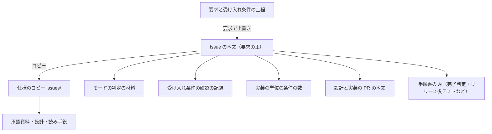
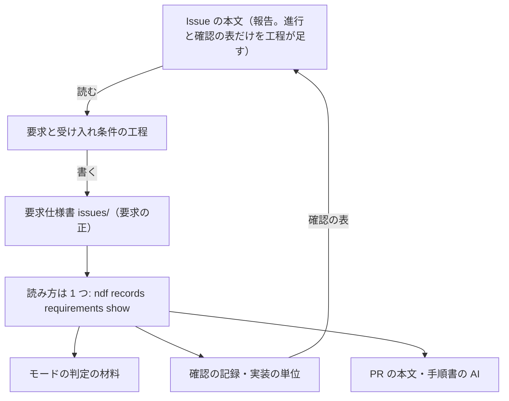
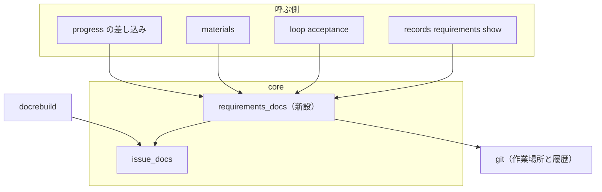
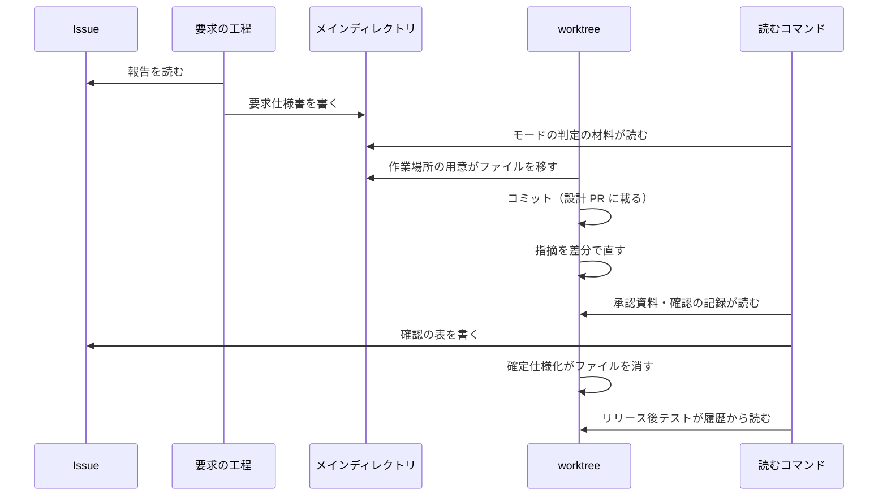

# 要求仕様書: Issue の報告を残したまま、要求をファイルで管理できるようにする（#4735）

要求の正が Issue の本文にあるため、仕様のコピーを一致させる手順で工程が止まり、起票した人の報告も要求で置き換わっていた。要求仕様書（`issues/` の追跡するファイル）を要求の正にし、本文を読んでいた処理は 1 つの読み方で要求仕様書を読む。受け入れ条件の確認の区分の記録は、工程の記録として Issue の本文に残す。比べた製品と採らなかった案は、末尾の「外部の調査」と「決定の記録」にある。

## 今の姿

何が起きたか・目的・受け入れ条件は要求仕様書（[issue-4735-requirements.md](./issue-4735-requirements.md)）にある。この文書は「どう解くか」と「なぜその解き方か」だけを書く。

### Issue の本文を読んでいる処理（受け入れ条件 8 の一覧）

| # | 処理 | 場所 | 本文から読むもの | 変えた後の読み先 |
| --- | --- | --- | --- | --- |
| 1 | モードの判定の材料（`ndf materials`） | `domains/materials/` | 種類・影響・触るファイルの候補 | 要求仕様書（候補は報告の本文からも拾う） |
| 2 | 受け入れ条件の確認の記録（`ndf loop acceptance`） | `domains/loop/` | 受け入れ条件・確認の表 | 条件は要求仕様書、確認の表は本文のまま |
| 3 | 実装の単位を組むときの条件の数 | `progress/units_invoke.py` | 受け入れ条件の数 | 要求仕様書 |
| 4 | 設計と実装の PR の本文 | `progress/issue_values.py` | 本文の全文 | 要求仕様書へのパスと元の Issue の番号 |
| 5 | 実装の worker・完了判定・PR レビュー・リリース後テスト | 手順書と `core/worker.py` | 受け入れ条件・リリース後の確認の計画 | 要求仕様書 |
| 6 | スプリントを閉じる（受け入れ条件のマーカー） | `progress-tracking` の手順書 | 受け入れ条件のチェックボックス（書き込み） | 書き込みをやめる（決定 5） |
| 7 | 要求への指摘の直し・実装で変えた条件の直し | `fix`・`quality-gates` の手順書 | 受け入れ条件（書き込み） | 要求仕様書の差分 |

次の処理は要求を本文から読んでいないので変えない。

| 処理 | 確かめた根拠 |
| --- | --- |
| コミットから組む PR の本文（`pr` のテンプレート） | `contracts/templates/pr.json` はコミットの件名と `Refs` の行だけで組む |
| 閉じる判定（`ndf records close-check`） | `domains/records/close_decide.py` はリリース記録とテストの記録の行だけを読む |
| 棚卸し | `backlog-refinement` が読むのは報告の記載項目と、本文が現状と合うかである。要求仕様の内容は書かない |
| 進行とクリーンアップの記録 | `progress/records.py`・`domains/records/cleanup_stage.py` は「進行」のセクションだけを扱う |

承認資料の出所の表（`approval-request.md`）は、目的・起票者の推定・満たすことを今も仕様のコピーから拾う。「種類」と「影響」の行は表に無い。要求仕様書が「承認資料の材料」と呼ぶ `domains/materials/cli.py` は、モードの判定の材料を集めるコマンドである（決定 7）。

## 文脈と制約

- 要求と受け入れ条件の工程は作業場所の用意より前にあり、メインディレクトリの `issues/` で打つ
- 確定仕様化は元の文書を消す（`ndf records spec finalize --remove`）。要求仕様書も消えることがあり、その後にリリース後テストが受け入れ条件を読む
- 工程の順序は、確定仕様化 → デプロイ → リリース後テストである
- ベースブランチは保護されうる。マージの後にファイルへ書き足すには Pull Request が要る
- 並行する実装の単位は、同じ受け入れ条件の確認の表へ同時に書く（今は本文とロックで受けている）
- 過去の Issue の移行と、本文の要求を読む互換の経路は持たない（要求仕様書の前提 2）

## 解き方の全体像

- 要求と受け入れ条件の工程は、報告を読んで現状と根本原因を調べ、要求仕様書を書く。Issue の本文は書き換えない
- 要求仕様書は元の Issue の URL を持ち、根本原因が共通の Issue は 1 本にまとめる
- 作業場所の用意が要求仕様書を worktree へ移してコミットし、以後の直しはファイルの差分になる
- コードも手順書の AI も同じコマンドで読む。確定仕様化でファイルが消えた後は git の履歴から読む

## ドメインモデル

### コンテキスト

| コンテキスト | 何の語が 1 つの意味に決まるか |
| --- | --- |
| ndf-design（要求と設計） | 要求仕様書・受け入れ条件 |
| ndf-workflow（工程） | 受け入れ条件の番号・確認の区分・進行 |

ndf-workflow は ndf-design の要求仕様書を読むだけで、書き換えない（顧客と供給者の関係で、供給者は ndf-design）。

### 集約

| 集約 | オーナー（書き換えてよいもの） | 根 | エンティティ | 値オブジェクト |
| --- | --- | --- | --- | --- |
| 要求仕様書 | 要求と受け入れ条件の工程、設計と実装の工程の直し役 | 要求仕様書のファイル | 受け入れ条件 | 元の Issue の URL・種類・影響 |
| Issue の報告 | 起票した人（棚卸しは事実の訂正だけ） | Issue の本文の「進行」より前 | — | — |
| 確認の記録 | `ndf loop acceptance` | 代表の Issue の本文の確認の表 | — | 条件の番号・区分・手段 |

代表の Issue は、要求仕様書の名前に含む番号のうち最も小さい番号の Issue とする。

### 不変条件

| # | 集約 | 条件 | 破れたときの扱い |
| --- | --- | --- | --- |
| I1 | Issue の報告 | 工程は本文の報告を要求の内容で書き換えない | 手順書に本文へ要求を書くステップを置かない |
| I2 | 要求仕様書 | 名前に含むすべての番号の Issue の URL を持つ | 読むコマンドが `check_failed` で止まる |
| I3 | 要求仕様書 | 1 つの Issue の番号を含む要求仕様書は、1 つの読み先の中で 1 本である | 読むコマンドが候補を並べて止まる |
| I4 | 確認の記録 | 同じ要求仕様書の記録は代表の Issue の 1 か所に置く | どの番号で打っても代表の Issue を読み書きする |

### ドメインイベント

| # | イベント | 発生元 | 受け手 |
| --- | --- | --- | --- |
| E1 | 起票した人が Issue に報告を書いた | 起票 | 要求と受け入れ条件の工程 |
| E2 | 要求仕様書を書いた | 要求と受け入れ条件の工程 | 作業場所の用意、モードの判定の材料 |
| E3 | 要求仕様書が元の Issue へのリンクを持った | E2 と同じ書き込み | 読むコマンドの確かめ |
| E4 | 要求仕様書への指摘を差分で直した | 直し役 | 設計レビュー、設計承認ゲート |
| E5 | 承認資料が要求仕様書を読んだ | 設計承認ゲート | 承認する人 |
| E6 | 確認の区分を記録した | `ndf loop acceptance record` | 実装のプラン、承認資料 |
| E7 | 受け入れ条件の合否で Issue を閉じた | スプリントを閉じる工程 | 起票した人 |

## 構成要素

| 要素 | 責務 |
| --- | --- |
| 要求仕様書の名前と形（`core/issue_docs.py`、変更） | ファイル名の番号の並びと、元の Issue の行の読み方を 1 か所で持つ |
| 要求仕様書の読み出し（`core/requirements_docs.py`、新設） | Issue の番号から要求仕様書を探して返す。探す順と失敗の形を持つ |
| 読むコマンド（`ndf records requirements show`、`domains/records/cli.py` に追加） | 手順書の AI が同じ読み方を使う口 |
| 確認の記録（`domains/loop/`、変更） | 条件を要求仕様書から、確認の表を代表の Issue の本文から読む |
| モードの判定の材料（`domains/materials/`、変更） | 種類・影響を要求仕様書から読む |
| 工程の差し込み（`progress/units_invoke.py`・`issue_values.py`、変更） | 条件の数と PR の本文を要求仕様書から作る |
| ドキュメント再構成（`domains/docrebuild/drive.py`、変更） | 番号をまとめた要求仕様書も設計書と組にする |
| worker の起動指示（`contracts/worker/`・`core/worker.py`、変更） | 要求の書き先と読み先を要求仕様書にする |
| 手順書（Skill と参照、変更） | 本文へ要求を書く手順と一致の確かめを消し、要求仕様書を読み書きする手順にする |

worker の起動指示と手順書は、コードの依存を持たないので図に描かない。

## データ構造

要求仕様書は次の形を持つ。見出しとセクションの順は今の `spec-template.md` と `document-roles.md` のままで、頭の行が加わる。

| 要素 | 形 |
| --- | --- |
| パス | `issues/issue-<番号の並び>-requirements.md`。並びは番号の昇順を `-` でつなぐ（例 `issue-7-8-requirements.md`） |
| 元の Issue の行 | 最初の `##` の前に `元の Issue: <URL>`。Issue ごとに 1 行 |
| 受け入れ条件 | `## 受け入れ条件` のチェックボックス。番号は上から 1 始まり（数え方は今と同じ） |
| 種類・影響 | `## 種類` の 1 行目と、`## 影響` の表の「公開インタフェース」の行（今と同じ） |
| 根本原因 | 不具合では「今の姿」に、起きる原因を書く（決定 8） |

代表の Issue の本文の `## 受け入れ条件の確認` の表（条件・区分・手段）は、今の形のまま使う。

## 入出力のコントラクト

### 読むコマンド（追加）

| 項目 | 内容 |
| --- | --- |
| 名前 | `ndf records requirements show` |
| 入力 | `--issue <N>`（必須）、`--ref <コミットかブランチ>`（任意）、`--current`（任意。履歴を読まない）、`--base <ブランチ>`（任意。省けば設定のベースブランチ）、`--cwd <作業場所>`（任意） |
| 出力 | パス・読んだ先（作業場所・ref・履歴のコミット）・まとめた Issue の番号・本文。読んだ本文はファイルへ書いてパスで返せる |
| 失敗の形 | 見つからない: `incomplete`。同じ読み先に 2 本以上: `precondition`。元の Issue の URL が欠ける: `check_failed`。git を読めない・履歴が浅い: `precondition` |
| 互換性 | 追加だけで、既存の呼び出しは変わらない |

`--ref` を渡すとその木だけを読む。渡さなければ次の順に探し、最初に見つかったものを返す。

| 順 | 読み先 | 当たる場面 |
| --- | --- | --- |
| 1 | 作業場所のファイル（追跡していないファイルを含む） | 要求を書いた直後、実装の worktree |
| 2 | HEAD の履歴で消した直前の版 | スプリントブランチで確定仕様化した後 |
| 3 | `<リモート>/<ベースブランチ>` の木 | 別の作業場所、設計 PR のマージの後 |
| 4 | ベースブランチの履歴で消した直前の版 | 確定仕様化をマージした後のリリース後テスト |

`--current` は 1 と 3 だけを読む。設計のプランが要求の工程を飛ばすかを決めるときに使う。

### 変わるコマンド

| 名前 | 変わること | 失敗の形 | 互換性 |
| --- | --- | --- | --- |
| `ndf materials` | 種類と公開インタフェースを要求仕様書から読む。候補の出所に「要求仕様書」が加わる | 要求仕様書が無い Issue は `gaps` に載せて `incomplete` | 互換なし（本文の種類と影響を読まない） |
| `ndf loop acceptance record` | 条件の番号を要求仕様書で確かめ、表は代表の Issue の本文へ書く | 要求仕様書が無ければ何も書かずに `incomplete` | 互換なし |
| `ndf loop acceptance show` | 代表の Issue の本文の表を読む | 同上 | 互換なし |
| `ndf loop acceptance check` | 同じ要求仕様書を指す Issue は 1 回だけ照らし、`--criteria` の番号は和を取る | 要求仕様書が無ければ `incomplete`。例外として、本文の「進行」のモードが `legacy-refactor` なら照らすものが無いとして `ok` | 互換なし |

引数は変えない。`legacy-refactor` を例外にするのは、このモードが要求の工程を通らないためである。

### PR の本文

| 条件 | 設計と実装の PR の本文 |
| --- | --- |
| 代表の Issue の要求仕様書がある | 要求仕様書のパスと、元の Issue の番号の一覧だけ |
| 要求仕様書が無い（`legacy-refactor` など） | 今のまま Issue の本文 |

Issue の作成者の権限の確かめと、PR の題の元（Issue の題）は変えない。

## 処理の流れ

要求の工程を飛ばす条件は、「本文と仕様のコピーが一致する」から「対象のすべての Issue の要求仕様書が `--current` で読める」に変える。作業場所の用意は、今のメインディレクトリの変更を移す手順（`worktree` の手順 3）で、対象の番号の要求仕様書だけを移す。

## 決定の記録

### 決定 1: 要求の正を 1 か所にするため、要求仕様書を `issues/` の追跡するファイルに置き、Issue の本文へは何も写さない

- **質問**: 要求仕様書をどこに置き、どの名前にするか
- **選んだ案**: 今の仕様のコピーと同じ `issues/issue-<番号の並び>-requirements.md` に置く。番号の並びと元の Issue の行で、複数の Issue を 1 本にまとめる。5 つのモードのうち要求の工程を通る 4 つで同じ置き方にする
- 採らなかった案: Issue のコメントに置く（差分でレビューできず、指摘の直しがまた GitHub の書き換えになる）
- 採らなかった案: `docs/` に置く（確定仕様と開発中の文書が混ざり、確定仕様化の対象を分けられない）
- **代償**: 受け入れ条件を GitHub の Issue の画面で読めなくなり、設計 PR かファイルを開く
- 根拠: Value 11（MVV バージョン 11）。PRD1・PRD2

### 決定 2: どの時点でも同じ要求が読めるよう、作業場所・ベースブランチ・履歴を順にたどる読み方を 1 つ持つ

- **質問**: マージの前、マージの後、確定仕様化でファイルが消えた後に、どこから読むか
- **選んだ案**: 「入出力のコントラクト」の順で探すコマンドを 1 つ作り、コードと手順書の AI が共に使う。承認資料は承認する head を `--ref` で渡す
- 採らなかった案: 確定仕様化で要求仕様書を残し、スプリントを閉じた後に消す（消すためだけの Pull Request が増え、消し忘れが溜まる）
- 採らなかった案: 要求仕様書を恒久の文書として残し続ける（確定仕様と同じ事実が 2 か所になり、`issues/` が増え続ける）
- 採らなかった案: 読む側ごとにブランチを指定する（AI がパスと ref を選び、古い版を読む）
- **代償**: 浅い clone では履歴から読めず止まる。メインディレクトリが古いと、古い版が先に当たる
- 作り方: 自前で作る
- 比べた候補: PRD1 / PRD2
- 根拠: Value 3 / Value 6（MVV バージョン 11）

### 決定 3: 工程の順を変えずにコミットできるよう、要求の工程はメインディレクトリに書き、作業場所の用意が worktree へ移す

- **質問**: 作業場所の用意より前の工程が書くファイルを、どうやって設計 PR に載せるか
- **選んだ案**: 要求の工程はメインディレクトリの `issues/` に書き（編集してよい場所）、作業場所の用意が対象の番号のファイルを worktree へ移してコミットする。worktree を使わない変更はそのまま置き、その変更のコミットに含める
- 採らなかった案: 作業場所の用意を要求の工程より前へ移す（モードが決まる前に worktree とブランチ名を決めることになり、5 つのモードの定義がすべて変わる）
- 採らなかった案: 要求の工程が自分で worktree を作る（作業場所を作る手順が 2 か所になる）
- **代償**: 移すまでの間、追跡していないファイルがメインディレクトリに残る
- 根拠: Value 11（MVV バージョン 11）

### 決定 4: 並行する書き込みとマージの後の記録を受けられるよう、確認の区分の記録は代表の Issue の本文に残す

- **質問**: 受け入れ条件の確認の区分の記録を、要求仕様書のどこに書くか
- **選んだ案**: 要求仕様書には書かず、今の `## 受け入れ条件の確認` の表を代表の Issue の本文に置く。記録は要求ではなく工程の状態で、「進行」と同じ扱いにする。条件の番号だけで要求仕様書と結ぶ
- 採らなかった案: 要求仕様書に表を持つ（並行する実装の単位が同じ表を書いて衝突し、ファイルが消えた後は書けない）
- 採らなかった案: Issue のコメントに追記する（読み書きの形を作り直すが、今の表とロックで足りる）
- **代償**: 本文の末尾に工程の表が残る。受け入れ条件の文は表に無く、番号でファイルを引く
- 根拠: Value 8 / Value 11（MVV バージョン 11）

### 決定 5: マージの後の書き込みを無くすため、閉じるときに受け入れ条件へマーカーを付けない

- **質問**: 受け入れ条件のマーカー（`[x]`）をどこに付けるか
- **選んだ案**: 付けない。合否はリリース記録とテストの記録が持ち、閉じるコメントがその URL を示す
- 採らなかった案: 要求仕様書へ付ける（閉じる時点ではマージ済みか消えていて、付けるためだけの Pull Request が要る）
- 採らなかった案: 本文へ条件を写してマーカーを付ける（要求の写しが本文に戻る）
- **代償**: Issue の画面のチェックの数で達成を見られなくなる
- 根拠: Value 6 / Value 11（MVV バージョン 11）

### 決定 6: 古くなるリンクを作らないため、本文の「進行」に要求仕様書へのリンクを足さない

- **質問**: Issue から要求仕様書へたどるリンクを、工程が「進行」に足すか
- **選んだ案**: 足さない。設計 PR と実装 PR は元の Issue の番号を本文に持つので、Issue のタイムラインから PR を開ける
- 採らなかった案: 「進行」にファイルの URL を足す（ブランチの削除と確定仕様化でリンクが切れ、コミットを固定すると直しの後の版を指さない）
- **代償**: Issue から要求仕様書を開くのに 1 回多くたどる
- 根拠: Value 6（MVV バージョン 11）

### 決定 7: 承認する人が要求の種類と影響を読めるよう、材料の収集と承認資料の両方が要求仕様書から読む

- **質問**: 受け入れ条件 6 の「承認資料が種類と影響を読む」を、どの出力で満たすか
- **選んだ案**: 本文の種類と影響を読むコード（`ndf materials`）の読み先を要求仕様書へ変える。あわせて承認資料の出所の表に、要求仕様書の「種類」と「影響」の公開インタフェースの行を 1 行で足す
- 採らなかった案: `ndf materials` だけを変える（承認資料の出所の表に種類と影響が無く、条件の文のとおりにならない）
- **代償**: 設計の承認資料が 1 行増える
- 根拠: Value 1（MVV バージョン 11）

### 決定 8: 要求を調査と分析の成果にするため、根本原因は要求仕様書が持ち、直す場所は設計書が持つ

- **質問**: 調べた根本原因を、要求仕様書と設計書のどちらに書くか
- **選んだ案**: 不具合の要求仕様書の「今の姿」に起きる原因を書く。設計書は原因を写さずにリンクで指し、どこで直すかと、検査で拾えなかった理由を書く。見出しの順は変えない
- 採らなかった案: 根本原因を設計書だけに置く（要求仕様書が報告の言い直しになり、何を根から解くかを承認できない）
- **代償**: 要求の工程で原因の調査が要る。決められないときは「未決」に残す
- 根拠: Value 7 / Value 14（MVV バージョン 11）

### 決定 9: PR の本文と要求仕様書が食い違わないよう、設計と実装の PR の本文は要求を写さずに参照だけを持つ

- **質問**: Issue の本文をそのまま使っていた PR の本文を、何から作るか
- **選んだ案**: 要求仕様書のパスと元の Issue の番号だけを書く
- 採らなかった案: 要求仕様書の全文を本文にする（直すたびに古くなり、原文の引用で本文の長さの上限と GitHub の closing keywords に当たりうる）
- 採らなかった案: 報告の本文を使い続ける（レビュー担当が要求でなく報告を受け入れ条件として読む）
- **代償**: PR の画面だけでは受け入れ条件が読めない
- 根拠: Value 11（MVV バージョン 11）

### 決定 10: 要求の無いまま先へ進まないよう、要求仕様書が見つからないコマンドは止まる

- **質問**: 要求仕様書が無いとき、本文へ戻して読むか、止めるか
- **選んだ案**: `ndf materials` と `ndf loop acceptance` は止まる。例外は「入出力のコントラクト」の `legacy-refactor` の照らし合わせだけにする
- 採らなかった案: 本文から読む経路を残す（要求の正が 2 つになる）
- 採らなかった案: 条件が 0 件として `ok` を返す（要求仕様書を失ったスプリントが確かめずに通る）
- **代償**: 反映の前に本文へ要求を書いた開いた Issue は、要求仕様書を作り直すまで進めない
- 根拠: Value 13 / Value 3（MVV バージョン 11）

## 影響と危険

- **働く範囲**: NDF を使うすべてのプロジェクト。Issue の保存先とベースブランチの名前に依らず同じ形で働く
- **プロジェクトごとに違うもの**: ベースブランチは設定（`.ndf/project.json`）から読み、`--base` で上書きできる
- **当たるモード**: `standard`・`light`・`operation`・`documentation`（要求の工程を通る 4 つ）。`legacy-refactor` は確認の記録の例外と PR の本文の元だけが関わる
- **進行中の作業**: 反映の前に作った仕様のコピーは同じ名前なので読まれる。元の Issue の行が無いと `check_failed` で止まるので、行を足す
- **同じファイルを触る変更**: Issue 4543（ https://github.com/devbasex/ai-plugins/issues/4543 。概要で今の状態と変えることを書き分ける）は `requirements-design`・`design` の手順書を触る。実装の順で後になる側が差分を取り込む
- **壊れうる箇所**: 番号の再利用（開き直した Issue の 2 回目のスプリント）では、履歴の古い版が残る。要求の工程を飛ばすかは `--current` で決めるので、履歴の版では飛ばさない。ベースブランチに残った古いファイルは、要求の工程が上書きする
- **記録の場所の移り変わり**: 同じ Issue を後から別の要求仕様書にまとめると、代表の番号が変わる。まとめた側で記録を打ち直す

### 代表のリポジトリでの振る舞い

| 代表のリポジトリ | 設定の要点 | 直した後に起きること | この種類で扱えなくなること |
| --- | --- | --- | --- |
| Web サービス | ブランチを分けて本番へ届ける。CI あり | 要求仕様書が設計 PR の差分に載る。確定仕様化の後のリリース後テストは履歴から読む | 無し |
| モバイルアプリ | 審査があり、確認がリリースの後になる条件が多い | 確認の区分は今と同じ表に残り、条件の文は要求仕様書から読む | 無し |
| 業務文書だけ | コードと CI が無い。`documentation` モード | 要求仕様書が `issues/` に置かれ、読み手へ渡す文書の変更と同じコミットの流れに乗る | 無し |

### このリポジトリだけの事情

| 値 | 置く所 | 持つ Issue |
| --- | --- | --- |
| ベースブランチ `main`、merge queue | `.ndf/project.json` の `branch_strategy` | 無し（今の設定のまま） |

## 用語

| 用語 | 意味 | 用語集への反映 |
| --- | --- | --- |
| 要求仕様書 | Issue の報告をもとに現状と根本原因を調べ、解決の要求と受け入れ条件を書く、要求の正のファイル（`issues/issue-<番号の並び>-requirements.md`） | 追加 |
| 受け入れ条件の番号 | 要求仕様書の受け入れ条件のチェックボックスを上から数えた順（1 から） | 意味の変更 |
| 仕様のコピー | 今の「本文の要求を写したファイル」。要求仕様書に置き換わる | 廃止（実装で手順書と同じ変更の中で用語集から外す） |
| 受け入れ条件のマーカー | 閉じるときに付ける `[x]` | 廃止（実装で用語集から外す） |

## テスト設計

| 受け入れ条件・不変条件 | どの振る舞いで縛るか | どう壊したら落ちるべきか |
| --- | --- | --- |
| 1・I1 | 手順書と起動指示の変更はレビューで確かめ、配ったバージョンで要求の工程を通して本文が変わらないことを見る（手動） | 手動の確認で本文の差が出る |
| 2・I2 | 元の Issue の URL がそろう要求仕様書は読め、1 つ欠けると止まる | URL の確かめを外すと落ちる |
| 3 | 同上（手順書の変更はレビューで確かめる） | — |
| 4 | 一致を確かめる手順とコードが残っていないことをレビューで確かめる | — |
| 5 | 直し役の手順が要求仕様書の差分を直すことをレビューで確かめる | — |
| 6 | 本文に種類と影響が無く、要求仕様書にあるとき、`ndf materials` がその値を返す | 本文を読む実装に戻すと落ちる |
| 6・決定 10 | 要求仕様書が無い Issue は `gaps` に載って止まる | 本文へ戻して読むと落ちる |
| 7 | 本文に受け入れ条件が無くても、要求仕様書の番号で確認の区分を記録できる。無い番号は断る | 条件を本文から数えると落ちる |
| 7・決定 10 | 要求仕様書が無ければ何も書かずに止まり、`legacy-refactor` の照らし合わせだけは `ok` | 無いときに `ok` を返す、または例外を外すと落ちる |
| 8 | 実装の単位の条件の数と PR の本文が、要求仕様書から作られる。無ければ PR の本文は Issue の本文 | どちらかを本文から作ると落ちる |
| 9・I4 | 2 つの Issue をまとめた要求仕様書で、どちらの番号でも材料と記録が作れ、記録は代表の Issue に 1 つ残る | 番号ごとに別の本文へ書くと落ちる |
| 10 | 進行とクリーンアップの記録の今のテストが通る | 本文の書き換えの範囲を変えると落ちる |
| I3 | 同じ読み先に同じ番号の要求仕様書が 2 本あると止まる | 先頭を選ぶと落ちる |
| 決定 2 | 追跡していないファイル、消したコミットの後の HEAD、ベースブランチだけにあるファイルのそれぞれが読める。`--current` は消した版を返さない | 探す順の 1 段を抜くと落ちる |
| 決定 2 | まとめた番号の要求仕様書を、ドキュメント再構成が設計書と組にする | 番号 1 つの名前だけで探すと落ちる |

## 設計の結果

| 課題 | 扱い | 統合先 | 触るファイル |
| --- | --- | --- | --- |
| #4735 | 実装する | — | `plugins/ndf/src/ndf/core/requirements_docs.py`（新設）、`plugins/ndf/src/ndf/core/issue_docs.py`、`plugins/ndf/src/ndf/core/worker.py`、`plugins/ndf/src/ndf/core/plan/inputs_decide.py`、`plugins/ndf/src/ndf/domains/records/cli.py`、`plugins/ndf/src/ndf/domains/loop/acceptance.py`、`plugins/ndf/src/ndf/domains/loop/acceptance_decide.py`、`plugins/ndf/src/ndf/domains/loop/cli.py`、`plugins/ndf/src/ndf/domains/materials/cli.py`、`plugins/ndf/src/ndf/domains/materials/collect.py`、`plugins/ndf/src/ndf/domains/docrebuild/drive.py`、`plugins/ndf/src/ndf/progress/units_invoke.py`、`plugins/ndf/src/ndf/progress/issue_values.py`、`plugins/ndf/contracts/schemas/io/records.args.schema.json`、`plugins/ndf/contracts/schemas/io/records.result.schema.json`、`plugins/ndf/contracts/schemas/io/materials.result.schema.json`、`plugins/ndf/contracts/domains/ndf-files.json`、`plugins/ndf/contracts/worker/kinds.json`、`plugins/ndf/contracts/worker/document-rebuild.md`、`plugins/ndf/docs/contracts/commands.md`、`plugins/ndf/docs/contracts/files.md`、`plugins/ndf/skills/requirements-design/SKILL.md`、`plugins/ndf/skills/requirements-design/references/spec-template.md`、`plugins/ndf/skills/requirements-design/references/document-roles.md`、`plugins/ndf/skills/design/SKILL.md`、`plugins/ndf/skills/design/references/design-template.md`、`plugins/ndf/skills/design/references/deliverables.md`、`plugins/ndf/skills/development-workflow/SKILL.md`、`plugins/ndf/skills/development-workflow/references/approval-request.md`、`plugins/ndf/skills/development-workflow/references/glossary.md`、`plugins/ndf/skills/progress-tracking/SKILL.md`、`plugins/ndf/skills/quality-gates/SKILL.md`、`plugins/ndf/skills/quality-gates/references/design-match.md`、`plugins/ndf/skills/quality-gates/references/definition-of-done.md`、`plugins/ndf/skills/release-verification/SKILL.md`、`plugins/ndf/skills/fix/SKILL.md`、`plugins/ndf/skills/pr-review/SKILL.md`、`plugins/ndf/skills/pr/SKILL.md`、`plugins/ndf/skills/worktree/SKILL.md`、`plugins/ndf/skills/document-rebuild/SKILL.md`、`plugins/ndf/skills/implementation-plan/SKILL.md`、`docs/glossary/glossary.json`、`docs/glossary.md`、`docs/glossary/ndf-design.md`、`docs/glossary/ndf-workflow.md`、`plugins/ndf/tests/core/test_requirements_docs.py`（新設）、`plugins/ndf/tests/core/test_issue_docs.py`、`plugins/ndf/tests/domains/loop/test_loop_acceptance.py`、`plugins/ndf/tests/domains/materials/test_materials_cli.py`、`plugins/ndf/tests/progress/test_units_run.py`、`plugins/ndf/tests/progress/test_invoke_issue_copies.py`、`plugins/ndf/tests/domains/docrebuild/test_docrebuild_run.py` |

## 未確認のまま残ること

| 項目 | 内容 |
| --- | --- |
| 配ったバージョンでの通し | 要求の工程の後に本文が変わらないことと、要求仕様書から承認資料と確認の記録ができることは、リリースの後の最初のスプリントで分かる |
| 浅い clone の環境 | 履歴から読めずに止まる環境がどれだけあるかは、利用先で使うまで分からない |

## 外部の調査

| 種類 | 調べるか | 理由 |
| --- | --- | --- |
| 標準・仕様 | 調べない | 要求の置き場所とファイルの名前を定める標準に、この設計は準拠を求められていない |
| 主要な製品 | 調べる | 要求をリポジトリのファイルに置く開発の Tool の形を比べる |
| ライブラリとサービス | 調べない | 読み出しは git と、今使っている Markdown の読み取り（markdown-it-py）で足りる |

### 主要な製品

| # | 製品 | どう解いているか | 設計への反映 | 出典 |
| --- | --- | --- | --- | --- |
| PRD1 | GitHub Spec Kit | 機能ごとのディレクトリ（`specs/<機能>/`）に仕様・計画・タスクのファイルを置く | 要求をファイルの正にする。置き場所は今の `issues/` を使う | https://learn.microsoft.com/en-us/training/modules/spec-driven-development-github-spec-kit-enterprise-developers/3-examine-github-spec-kit （2026-11-28、検索の結果の要約） |
| PRD2 | Kiro の spec | 機能ごとのディレクトリ（`.kiro/specs/<機能>/`）に要求・設計・タスクの Markdown を置き、直接編集できる | 要求の直しをファイルの差分にする | https://kiro.dev/docs/specs/ （2026-11-28、検索の結果の要約） |

### 確かめられなかったこと

| 対象 | 試した手段 | 結果と理由 |
| --- | --- | --- |
| 2 製品が Issue の本文と仕様のファイルの対応をどう持つか | 検索 2 回（Spec Kit の置き場所、Kiro の spec） | 検索の結果の要約に記載が無かった。ページの本文は取得していない |

調べた量: 候補 2 件・取得の試み 2 回。
