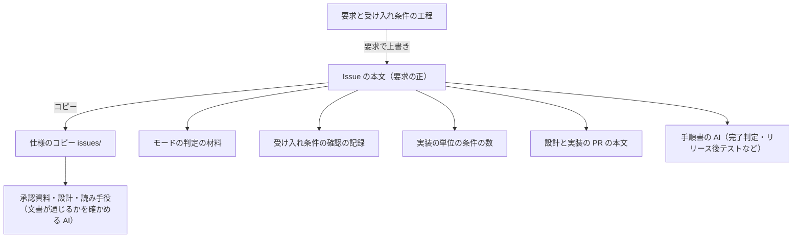
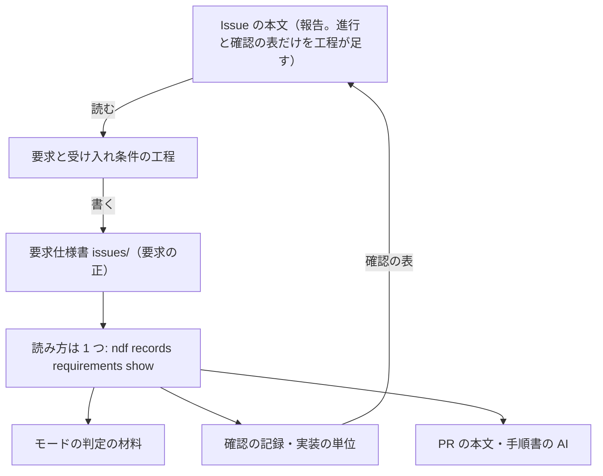
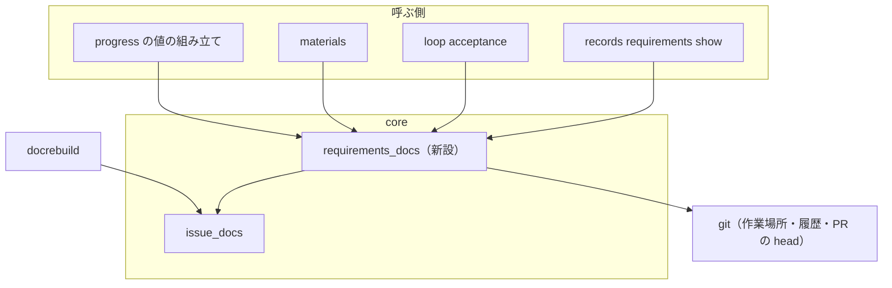
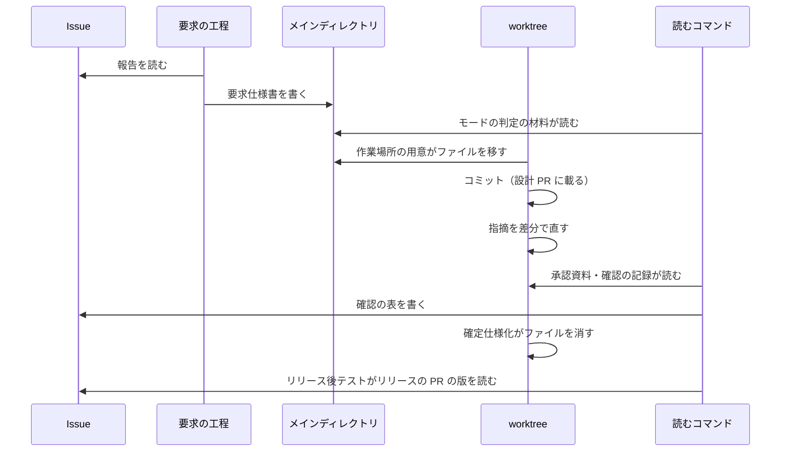

# 要求と受け入れ条件: Issue の報告を残したまま、要求をファイルで管理できるようにする（#4735）

要求の正が Issue の本文にあるため、本文とそのコピー（仕様のコピー）を一致させる手順で工程が止まり、起票した人の報告も要求で置き換わっていた。要求仕様書（`issues/` の追跡するファイル）を要求の正にし、本文を読んでいた処理は、共通の読み方で要求仕様書を読む。受け入れ条件ごとの確認の区分と手段の表は、工程の記録として Issue の本文に残す。比べた製品と採らなかった案は、末尾の「外部の調査」と「決定の記録」にある。

## 今の姿

何が起きたか・目的・受け入れ条件は要求仕様書（[issue-4735-requirements.md](./issue-4735-requirements.md)）にある。この文書は「どう解くか」と「なぜその解き方か」だけを書く。



### Issue の本文を読んでいる処理（受け入れ条件 8 の一覧）

| # | 処理 | 場所 | 本文から読むもの | 変えた後の読み先 |
| --- | --- | --- | --- | --- |
| 1 | モードの判定の材料（`ndf materials`） | `domains/materials/` | 種類・影響・触るファイルの候補 | 要求仕様書（候補は報告の本文からも拾う） |
| 2 | 受け入れ条件の確認の記録（`ndf loop acceptance`） | `domains/loop/` | 受け入れ条件・確認の表 | 条件は要求仕様書、確認の表は本文のまま |
| 3 | 実装の単位を組むときの条件の数 | `progress/units_invoke.py` | 受け入れ条件の数 | 要求仕様書 |
| 4 | 設計と実装の PR の本文 | `progress/issue_values.py` | 本文の全文 | 要求仕様書へのリンクと、対象の Issue の `Refs` |
| 5 | 実装の worker・完了判定・PR レビュー・リリース後テスト | 手順書と `core/worker.py` | 受け入れ条件・リリース後の確認の計画 | 要求仕様書 |
| 6 | スプリントを閉じる（受け入れ条件のマーカー） | `progress-tracking` の手順書 | 受け入れ条件のチェックボックス（書き込み） | 書き込みをやめる（決定 5） |
| 7 | 要求への指摘の直し・実装で変えた条件の直し | `fix`・`quality-gates` の手順書 | 受け入れ条件（書き込み） | 要求仕様書の差分 |

次の処理は要求を本文から読んでいないので変えない。

| 処理 | 確かめた根拠 |
| --- | --- |
| コミットから組む PR の本文（`pr` のテンプレート） | `contracts/templates/pr.json` はコミットの件名と `Refs` の行だけで組む |
| 閉じる判定（`ndf records close-check`） | `domains/records/close_decide.py` はリリース記録とテストの記録の行だけを読む |
| 棚卸し | `backlog-refinement` が確かめるのは、報告の記載項目と、本文が現状と合うかである。要求仕様の内容は書かない |
| 進行とクリーンアップの記録 | `progress/records.py`・`domains/records/cleanup_stage.py` は「進行」のセクションだけを扱う |

承認資料の項目をどこから拾うかは、出所の表（`approval-request.md`）が決める。この表では、「目的」「起票者の推定」「満たすこと」を今も仕様のコピーから拾い、「種類」と「影響」の行は無い。`ndf materials` はモードの判定の材料を集めるコマンドで、承認資料は作らない。受け入れ条件 6 をどちらで満たすかは決定 7 で決める。

### この文書で使う工程の言葉

| 言葉 | 意味 |
| --- | --- |
| モード | 変更の種類と大きさで選ぶ工程の組。`standard`・`light`・`operation`・`documentation`・`legacy-refactor` の 5 つで、`legacy-refactor`（テストの少ないコードの構造だけを直す）は要求の工程を通らない |
| 作業場所 | その変更だけを置く git の worktree。用意する前の工程は、clone した元のディレクトリ（メインディレクトリ）で行う |
| 設計のプラン | 要求と受け入れ条件・設計・設計レビューを順に自動で実行する手順の並び |
| 実装の単位 | 実装を分けて並行に進める 1 まとまり。単位ごとに PR を出す |
| 確定仕様化 | 実装の後に、開発中の文書（`issues/`）の内容を恒久の仕様書（`docs/`）へ移して元のファイルを消す工程 |
| NDF の更新 | 利用者の環境の NDF を、この変更を含む版へ入れ替えること |

## 文脈と制約

- 要求と受け入れ条件の工程は作業場所の用意より前にあり、メインディレクトリの `issues/` で実行する
- 確定仕様化は元の文書を消す（`ndf records spec finalize --remove`）。要求仕様書も消えることがあり、その後にリリース後テストが受け入れ条件を読む
- 工程の順序は、確定仕様化 → デプロイ → リリース後テストである
- ベースブランチは保護されうる。マージの後にファイルへ書き足すには Pull Request が要る
- 並行する実装の単位は、同じ受け入れ条件の確認の表へ同時に書く（今は表を本文に置き、ロックで衝突を防いでいる）
- 過去の Issue の移行と、本文の要求を読む互換の経路は持たない（要求仕様書の前提 2）

## 解き方の全体像



- 要求と受け入れ条件の工程は、報告を読んで現状と根本原因を調べ、要求仕様書を書く。Issue の本文は書き換えない
- 要求仕様書は元の Issue の URL を持ち、根本原因が共通の Issue は 1 本にまとめる
- 作業場所の用意が要求仕様書を worktree へ移してコミットし、以後の直しはファイルの差分になる
- コードも手順書の AI も同じコマンドで読む。確定仕様化でファイルが消えた後は、作業中なら git の履歴から、リリースの後はそのリリースの PR から読む

## ドメインモデル

### コンテキスト

| コンテキスト | 何の語が 1 つの意味に決まるか |
| --- | --- |
| ndf-design（要求と設計） | 要求仕様書・受け入れ条件 |
| ndf-workflow（工程） | 受け入れ条件の番号・確認の区分・進行 |

ndf-workflow は ndf-design の要求仕様書を読むだけで、書き換えない（顧客と供給者の関係で、供給者は ndf-design）。

### 集約

| 集約 | オーナー（書き換えてよいもの） | 根 | エンティティ | 値オブジェクト |
| --- | --- | --- | --- | --- |
| 要求仕様書 | 要求と受け入れ条件の工程、設計と実装の工程の直し役 | 要求仕様書のファイル | 受け入れ条件 | 元の Issue の URL・種類・影響 |
| Issue の報告 | 起票した人。棚卸しは事実の訂正だけを行える | Issue の本文の「進行」より前 | — | — |
| 確認の記録 | `ndf loop acceptance` | 代表の Issue の本文の確認の表 | — | 要求仕様書のパス・実行の印・条件の版・区分・手段（条件の番号は表示用） |

代表の Issue は、要求仕様書の名前に含む番号のうち最も小さい番号の Issue とする。

### 不変条件

| # | 集約 | 条件 | 破れたときの扱い |
| --- | --- | --- | --- |
| I1 | Issue の報告 | 工程は本文の報告を要求の内容で書き換えない | 手順書に本文へ要求を書くステップを置かない |
| I2 | 要求仕様書 | 名前に含むすべての番号の Issue の URL を持つ | 読むコマンドが `check_failed` で止まる |
| I3 | 要求仕様書 | 1 つの Issue の番号を含む要求仕様書は、1 つの読み先の中で 1 本である | 読むコマンドが候補を並べて止まる |
| I4 | 確認の記録 | 同じ要求仕様書の記録を書く先は、代表の Issue の 1 か所である | どの番号で打っても代表の Issue へ書く |
| I5 | 確認の記録 | 記録は、書いた時点の要求仕様書・実行・条件の文にだけ効く。同じ要求仕様書の中で番号が変わっても、文が同じなら効く | どれか 1 つでも今と違う記録は、数えない |
| I6 | 要求仕様書 | 受け入れ条件の文は、1 本の中で重ならない | 読むコマンドが重なる番号を挙げて `check_failed` で止まる |

### ドメインイベント

| # | イベント | 発生元 | 受け手 |
| --- | --- | --- | --- |
| E1 | 起票した人が Issue に報告を書いた | 起票 | 要求と受け入れ条件の工程 |
| E2 | 要求仕様書を書いた | 要求と受け入れ条件の工程 | 作業場所の用意、モードの判定の材料 |
| E3 | 要求仕様書が元の Issue へのリンクを持った | E2 と同じ書き込み | 読むコマンドの確かめ |
| E4 | 要求仕様書への指摘を差分で直した | 直し役 | 設計レビュー、設計承認ゲート |
| E5 | 承認資料が要求仕様書を読んだ | 設計承認ゲート | 承認する人 |
| E6 | 確認の区分と手段を記録した（マージの前） | `ndf loop acceptance record` | 実装のプラン、承認資料 |
| E7 | 条件ごとの合否を記録した（リリースの後） | リリース後テスト | スプリントを閉じる工程 |
| E8 | 受け入れ条件の合否で Issue を閉じた | スプリントを閉じる工程 | 起票した人 |

## 構成要素

| 要素 | 責務 |
| --- | --- |
| 要求仕様書の名前と形（`core/issue_docs.py`、変更） | ファイル名の番号の並びと、元の Issue の行の読み方を 1 か所で持つ |
| 要求仕様書の読み出し（`core/requirements_docs.py`、新設） | Issue の番号から要求仕様書を探して返す。探す順と失敗の形を持つ |
| 読むコマンド（`ndf records requirements show`、`domains/records/cli.py` に追加） | 手順書の AI が同じ読み方を使うインターフェース |
| 確認の記録（`domains/loop/`、変更） | 条件を要求仕様書から、確認の表を代表の Issue の本文から読む。記録を要求仕様書・実行・条件の版で結ぶ |
| モードの判定の材料（`domains/materials/`、変更） | 種類・影響を要求仕様書から読む |
| 工程へ渡す値の組み立て（`progress/units_invoke.py`・`issue_values.py`、変更） | 条件の数と PR の本文を要求仕様書から作る。マージ済みの単位の条件を照らし直す |
| 進行の記録（`progress/records.py`、変更） | 「進行」のセクションに実行の印を書く |
| ドキュメント再構成（`domains/docrebuild/drive.py`、変更） | 複数の Issue をまとめた要求仕様書も設計書と組にする |
| worker の起動指示（`contracts/worker/`・`core/worker.py`、変更） | 要求の書き先と読み先を要求仕様書にする |
| 手順書（Skill と参照、変更） | 本文へ要求を書く手順と一致の確かめを消し、要求仕様書を読み書きする手順にする |



worker の起動指示と手順書は、コードの依存を持たないので図に描かない。

## データ構造

要求仕様書は次の形を持つ。見出しとセクションの順は今の `spec-template.md` と `document-roles.md` のままで、冒頭の行が加わる。

| 要素 | 形 |
| --- | --- |
| パス | `issues/issue-<番号の並び>-requirements.md`。並びは番号の昇順を `-` でつなぐ（例 `issue-7-8-requirements.md`） |
| 元の Issue の行 | 最初の `##` の前に `元の Issue: <URL>`。Issue ごとに 1 行 |
| 受け入れ条件 | `## 受け入れ条件` のチェックボックス。番号は上から 1 始まり（数え方は今と同じ） |
| 種類・影響 | `## 種類` の 1 行目と、`## 影響` の表の「公開インタフェース」の行（今と同じ） |
| 根本原因 | 不具合では「今の姿」に、起きる原因を書く（決定 8） |

代表の Issue の本文の `## 受け入れ条件の確認` のセクションは、今の表に、要求仕様書の行・実行の行・「条件の版」の列を足す。

```markdown
## 受け入れ条件の確認

要求仕様書: issues/issue-7-8-requirements.md
実行: 5d1c9e0a44b7

| 条件 | 区分 | 手段 | 条件の版 |
| :--- | :--- | :--- | :--- |
| 1 | マージ前 | test_requirements_docs | 3f9a0c1b7d2e |
| 2 | リリース後 | — | 8b41e6a0c95f |
```

| 要素 | 形 |
| --- | --- |
| 区分 | `マージ前`（マージの前に確かめた。手段にテスト名か実行したコマンドを書く）か `リリース後`（リリースの後でしか確かめられない） |
| 条件の版 | 条件の文の SHA-256 の先頭 12 桁。文は、チェックボックスの印と先頭の番号（`1.`）を除き、前後の空白を落としたもの。並べ替えと印の付け外しでは変わらず、文を直すと変わる |
| 条件 | 書いた時点の条件の番号。人が読むための値で、記録と条件は番号でなく条件の版で結ぶ |
| 要求仕様書の行 | 記録した時点の要求仕様書のパス。まとめる Issue が変わるとパスも変わる |
| 実行の行 | 記録した時点の、`--issue` の Issue の「進行」にある実行の印 |
| 実行の印 | 進行の記録が「進行」のセクションに書く `実行: <値>` の行。値はステートマシンの ID の SHA-256 の先頭 12 桁で、ステートマシンを作り直すと変わる。工程が書くので、担当の AI は写さない |

条件の番号を実装計画に書き写す場合に備えて、「条件一覧の版」も定める。条件の版を番号の順に改行でつないだ文字列の、SHA-256 の先頭 12 桁である。条件を足す・消す・並べ替える・直すと変わる。

## 入出力のコントラクト

### 読むコマンド（追加）

| 項目 | 内容 |
| --- | --- |
| 名前 | `ndf records requirements show` |
| 入力 | `--issue <N>`（必須。繰り返せる）。読み先を選ぶ `--ref <コミットかブランチ>`・`--current`・`--pr <番号>`（繰り返せる）は、どれか 1 つだけ渡せる。ほかに `--base <ブランチ>`（省けば設定のベースブランチ）、`--out <ディレクトリ>`、`--cwd <作業場所>` |
| 出力 | 結果 JSON の `items` に、要求仕様書 1 本につき 1 要素。パス（`path`）・読んだ先（`source`）・読んだコミット（`commit`）・まとめた Issue の番号（`issues`）・今回の作業で書いたか（`changed_here`）・条件一覧の版（`criteria_digest`）・本文（`body`）。同じ要求仕様書を指す番号を複数渡しても、本文は 1 回だけ返す |
| `--out` | 本文を指定のディレクトリへ要求仕様書と同じファイル名で書き、`body` の代わりにそのパスを `body_path` で返す。書き方と検査は下の「読み書きするディレクトリの検査」 |
| 失敗の形 | 見つからない番号がある: `incomplete`（番号を `gaps` に載せる）。同じ読み先に 2 本以上、通常ファイルでない候補、ほかの利用者が差し替えられるパス、git か PR を読めない、履歴が浅い: `precondition`。元の Issue の URL が欠ける、受け入れ条件の文が重なる: `check_failed` |
| 互換性 | 追加だけで、既存の呼び出しは変わらない |

もう 1 つのサブコマンド `ndf records requirements stamp --plan <実装計画>` は、実装計画が指す条件の番号を読み、要求仕様書を 1 回読んで条件一覧の版の行を実装計画へ書く。同じ読み出しから、番号ごとの条件の文を出力する（使い方は「実装計画の条件の番号」）。

`--ref` はそのツリーだけを読む。`--ref` も `--pr` も無ければ次の順に探し、最初に見つかったものを返す。

| 順 | 読み先 | 当てはまる場面 |
| --- | --- | --- |
| 1 | 作業場所のファイル（追跡していないファイルを含む） | 要求を書いた直後、実装の worktree |
| 2 | `<ベースブランチ>..HEAD` の範囲で削除されている場合の、削除直前の内容 | スプリントブランチで確定仕様化した後 |
| 3 | `<リモート>/<ベースブランチ>` のツリー | 別の作業場所、設計 PR のマージの後 |

2 を 3 より先に見るのは、このブランチで直してから消した要求より、ベースブランチに残る古い版を先に返さないためである。範囲をこのブランチのコミットに限るので、前のスプリントの削除は拾わない。複数の Issue を扱うコードの呼び出し（確認の記録・材料・PR の本文）は、履歴の照会とツリーの一覧を 1 回ずつ取って共有する。

`--current` は 1 と 3 だけを読み、要求仕様書があるかを確かめる。`changed_here` は、そのファイルが追跡されていないか未コミットで変わっているか、`<ベースブランチ>..HEAD` で足されたか変わったときに真になる。

**通常ファイルだけを読む。** git のツリーでは、エントリが通常ファイル（モード 100644 か 100755）であることを確かめる。作業場所のファイルは次の節の検査を通す。外れる候補は内容を読まずに止まる。

`--pr` は、リリースが採用した版を読む。手元のブランチとベースブランチは読まないので、同じ番号を渡せば、いつ打っても同じ内容が返る。

| 項目 | 内容 |
| --- | --- |
| 渡す番号 | 対象のリリース記録の `included` の PR。手で置いた記録では、記録を置いた PR と `スプリント:` の行の PR。すべてマージ済みでなければ `precondition` |
| PR の情報 | 渡した全 PR の head のコミット・マージコミットとその第 1 親・マージの時刻を、1 回の GraphQL の照会で読む。どれもマージの後は変わらない |
| 取得 | 手元に無いコミットだけを、1 回の `git fetch` でまとめて取得する（head は `refs/pull/<N>/head`）。ブランチを消した後も、squash マージの後も残る |
| PR が持ち込んだ範囲 | `git merge-base <マージコミットの第 1 親> <head>` から head まで。ベースブランチが後で進んでも同じ範囲になる |
| 選び方 | 持ち込んだ範囲が要求仕様書に触れた PR のうち、最後にマージされたもの。head にファイルがあればその内容、消していれば削除直前の内容 |
| どれも触れていない | 最後にマージされた PR の head のツリーから読む。そこにも無ければ `incomplete` |

squash マージでは、同じスプリントで足して消したファイルがベースブランチの履歴に一度も現れない。このためベースブランチの履歴は読み先にしない。

**リリース後テストは、リリース 1 件につきコマンドを 1 回だけ打つ。** 工程の始めに `ndf loop acceptance show` へ対象の全 Issue を `--issue`、全 PR を `--pr`、書き出し先を `--out` で渡す。要求仕様書の本文のファイルと確認の区分が同じ結果に返り、PR の情報の照会は 1 回で済む。課題ごとの確認はその結果を使う。

#### 読み書きするディレクトリの検査

ほかの利用者が、AI に渡る要求仕様書の内容を差し替えられないようにする。検査は今の `contracts/worker_paths` の関数を使い、個人グループだけが書ける権限などの扱いもそれに合わせる。

| 場面 | 検査 |
| --- | --- |
| 作業場所のファイルを読む | `issues/` をリンクをたどらずに 1 回だけ開き、その記述子を通して確かめて読む。候補はリンクでも特殊ファイルでもなく、呼んだ利用者か root の持ち物で、ほかの利用者が書き込めないこと（`check_owned`）。候補と、`issues/` から根までの項目を、ほかの利用者が差し替えられないこと（`check_unshared`）。加えて、本文を読む記述子で macOS の拡張 ACL を確かめ、項目がある、または確かめられなければ読まない。`check_owned` はモードだけを見て、ファイルの ACL を見ないためである |
| `--out` へ書く | ディレクトリを 1 回だけ開き、ほかの利用者が中の名前を作れず、差し替えられないことを確かめる。ファイルは所有者だけが読み書きできる権限（0600）で公開し、置き換える前のファイルの権限は引き継がない。今の `write_file(private=True)` は書き込みの権限だけを外して読み取りの権限を引き継ぐので、`write_file` に所有者だけの権限で公開する指定を足す。書き先がリンク・ディレクトリ・特殊ファイルなら何も書かない |
| `body_path` を返す | 後の処理はパスから開き直すので、返す前にそのファイル名と祖先が差し替えられないことを確かめる（`check_unshared`） |

### 変わるコマンド

| 名前 | 変わること | 失敗の形 | 互換性 |
| --- | --- | --- | --- |
| `ndf materials` | 種類と公開インタフェースを要求仕様書から読む。触るファイルの候補の出所に「要求仕様書」が加わる | 要求仕様書が無い Issue は `gaps` に載せて `incomplete` | 互換なし（本文の種類と影響を読まない） |
| `ndf loop acceptance record` | 要求仕様書と代表の Issue を決めてから、代表の番号でロックを取り、読み・書き・読み直す。`--criteria-digest <条件一覧の版>` が必須になる。要求仕様書の行・実行の行・条件の版を一緒に書く | 要求仕様書が無ければ何も書かずに `incomplete`。条件一覧の版が今と違えば何も書かずに `check_failed` | 互換なし |
| `ndf loop acceptance show` | `--issue` を繰り返せる。要求仕様書ごとに、読むコマンドと同じ要素と、条件ごとの区分・手段を返す。数えない行は理由を付けて別に挙げる。任意の `--pr <番号>` と `--out <ディレクトリ>`（意味は読むコマンドと同じ）が加わる | 読むコマンドと同じ | 互換なし |
| `ndf loop acceptance check` | 下の「突き合わせ」。`--mode <モード>` と `--criteria-digest <Issue>:<条件一覧の版>` が加わる | 要求仕様書が無ければ `incomplete`。`--mode legacy-refactor` だけは `ok` | 互換なし |

`record` は、条件を確かめたときの条件一覧の版を受け取る。確かめてから書くまでに条件が並び替わると、同じ番号が別の条件を指すためである。担当は、確かめた条件の番号と版を、単位の指示（単位の経路）か読むコマンドの出力から同時に受け取る。

#### 条件と記録の結び方

記録は、次の 3 つがすべて今と同じ行だけを数える。読む表は代表の Issue の 1 つだけである。

| 比べるもの | 違うとき |
| --- | --- |
| 要求仕様書の行と、今の要求仕様書のパス | Issue をまとめた・分けた後である。表の行はどれも数えない |
| 実行の行と、`--issue` の Issue の「進行」にある実行の印 | 開き直した Issue の次のスプリントなど、別の実行の記録である。表の行はどれも数えない。両方に印が無ければ同じとみなす |
| 行の条件の版と、条件の文 | 文を直した条件である。その行は数えない。並べ替えただけの条件は、行が付いたままになる |

過去の記録を使ってよいのは、3 つがそろう場合だけである。ほかの Issue の表からは引き継がない。別々の Issue で同じ文言だった条件を、片方の確認だけで両方確認済みにしないためである。Issue をまとめた後は、記録の無い条件を確かめ直して `record` で書く。

`record` は代表の表だけを書き換える。要求仕様書の行か実行の行が今と違う表は、今の値で書き直す。2 つが同じ表では、版の合わない行を消さずに残す。並行する作業場所が古い条件一覧を持っていても、ほかの単位の記録を失わないためである。

`record` のロックを `--issue` の番号で取ると、同じ要求仕様書の別の番号で並行に打ったとき、別々のロックで同じ本文を書き換える。このため、ロック・読み直し・当て直しはすべて解決した代表の番号で行う。表の読み直しもロックの中で行う。

#### 突き合わせ

`check` は `--issue` の Issue を要求仕様書ごとにまとめ、仕様書 1 本につき 1 回、受け入れ条件の一覧と確認の記録を照らす。上の結び方で数える行の無い条件を、記録の無い条件として `gaps` に載せる。

`--criteria <Issue>:<条件の番号>` は、指定した Issue に対応する要求仕様書の `## 受け入れ条件` から、上から数えて `<条件の番号>` 番目の条件を選ぶ。その番号の条件が無ければ、今の `check` と同じく失敗を返す。

どの条件を照らすかは、要求仕様書ごとに決める。

| その要求仕様書に対応する `--issue` | 照らす条件 |
| --- | --- |
| すべてに `--criteria` がある | 指定された条件の和集合 |
| `--criteria` の無いものが 1 つでもある | その要求仕様書のすべての条件 |

`--issue 7 --issue 8 --criteria 7:1` で 7 と 8 の要求仕様書が別なら、7 の仕様書は条件 1 を、8 の仕様書は全条件を照らす。`--no-criteria` は今のままで、何も読まずに `ok` を返す。

#### 実装計画の条件の番号

実装計画のレビューの単位は条件を番号で指すので、並べ替えの後は別の条件を指しうる。番号を選んだ時点の条件一覧の版を、実装計画から `check` まで運んで比べる。

| 段階 | すること |
| --- | --- |
| 実装計画を書く | 番号を書いた後に `ndf records requirements stamp --plan <実装計画>` を打つ。`受け入れ条件の版: #<番号>=<条件一覧の版>` の行はこのコマンドが書き、担当は手で写さない。担当は、出力の番号ごとの条件の文を見て、番号が意図した条件を指すかを確かめる |
| 単位の並びを作る | 版の行が今の条件一覧の版と違うか、無ければ `invalid` で止まる。版は `units.json` に単位ごとに持ち、単位の指示にも番号と一緒に書く |
| `check` | `--criteria` には、その Issue の要求仕様書の `--criteria-digest` が要る（無ければ `invalid`）。今の版と違えば `check_failed` |
| 打ち直し | `units.json` の版が今の版と違えば、並びを実装計画から作り直す。実装計画が直っていなければ、同じ理由で止まる |
| マージ済みの単位 | 今の `run_stage` は、マージ済みの PR を持つ名前の単位を飛ばす（`already_merged`）。飛ばす前に、それらの単位に今割り当ててある条件をまとめて 1 回照らす。記録の無い条件があれば、単位と条件を挙げて止まる |

条件を直した担当は、同じコミットで実装計画の番号を直し、`stamp` を打ち直す。マージ済みの単位の条件で止まった担当は、実装が要る条件を新しい名前の単位に割り当て、実装が要らない条件は確かめ直して `record` で書く。

#### 本文を読むモード

要求仕様書の代わりに Issue の本文を使うのは、要求の工程を通らない `legacy-refactor` だけである。モードは今の工程の入力で判定する。Issue の本文の「進行」は読まない。過去の実行の欄が残っていることがあるためである。

| 処理 | `legacy-refactor` の扱い |
| --- | --- |
| `check` | `--mode legacy-refactor` のときだけ、突き合わせるものが無いとして `ok` を返す。工程から組む実装のプランは、工程の入力のモードを `--mode` に渡す。手でプランを組む例（`agent-layers.md`）にも `--mode` を足す。`--mode` が無ければ例外を当てない |
| 単位の並びの条件の数 | 今のまま本文から数え、版の行は求めない |
| PR の本文 | 今のまま Issue の本文 |

ほかのモードでは、要求仕様書の欠落・複数の候補・URL の欠けを、そのまま失敗として返す。

### PR の本文

置き換えるのは、PR の本文のうち要求の本文（今は Issue の本文の全文）の部分だけである。`pr` の手順が書く概要と「決めたこと」は今のまま残し、承認の前の「決定の記録」との突き合わせも変えない。

| モード | 要求の本文の部分に書くもの |
| --- | --- |
| `legacy-refactor` | 今のまま Issue の本文 |
| ほか | 下の 2 つ。要求仕様書を読めなければ PR を作らずに止まる |

```markdown
要求仕様書: [issues/issue-7-8-requirements.md](https://github.com/<owner>/<repo>/blob/<読んだ版を含むコミット>/issues/issue-7-8-requirements.md)
Refs #7
Refs #8
```

- 要求仕様書の行は、工程の対象の Issue が指す要求仕様書ごとに 1 行を書く。リンクは PR を作る時点の版を指し、後の直しは PR の差分で読む
- `Refs #<番号>` は工程の対象のすべての Issue に 1 行ずつ書く。スプリントを閉じる工程は closing keywords と `Refs` から Issue を集め、番号の列挙は読まない

Issue の作成者の権限の確かめと、PR の題の元（Issue の題）は変えない。

### 承認資料

`approval-request.md` を次のとおり変える。`legacy-refactor` の出所は変えない。

| 項目 | 変えた後 |
| --- | --- |
| 出所の表 | 「目的」「起票者の推定」「満たすこと」の出所を要求仕様書にする。「種類と影響」の行を足し、要求仕様書の「種類」と、「影響」の表の公開インタフェースの行を出所にする |
| 要求と設計の対応 | `ndf records requirements show --ref <承認対象の head>` を 1 回だけ打ち、設計書の名前の番号をすべて `--issue` に並べる。返った要素の `issues` で設計書と組にする。単番号のファイル名は組み立てない |
| 要求仕様書を複数の Issue が共有する | 目的・起票者の推定・種類と影響・満たすことは仕様書ごとに 1 回出し、見出しに Issue の番号を並べる |
| 受け入れ条件の件数 | 仕様書ごとに 1 回数え、合計は仕様書の件数の和にする |
| 要求仕様書を読めない | 承認資料を出さずに止まる（「無し」と出さない） |

## 処理の流れ



要求の工程を飛ばす条件は、「本文と仕様のコピーが一致する」から次の 2 つの両方に変える。進行の記録で工程が完了していれば、今までどおり実行し直さない。

| 判定 | 見るもの |
| --- | --- |
| 要求仕様書がある | 対象のすべての Issue の要求仕様書が `--current` で読める |
| 今回の作業のものである | そのすべてで `changed_here` が真 |

ベースブランチと同じ内容があるだけでは飛ばさない。番号を再利用した Issue（開き直した Issue など）にベースブランチの旧版が残っていても、要求の工程が走り、旧版を読んで今の報告に合わせて書き直す。

作業場所の用意が移すのは、対象の番号の要求仕様書だけである。移し方は、今のメインディレクトリの変更を移す手順（`worktree` の手順 3）を使う。

## 決定の記録

### 決定 1: 要求の正を 1 か所にするため、要求仕様書を `issues/` の追跡するファイルに置き、Issue の本文へは何もコピーしない

- **質問**: 要求仕様書をどこに置き、どの名前にするか
- **選んだ案**: 今の仕様のコピーと同じ `issues/issue-<番号の並び>-requirements.md` に置く。番号の並びと元の Issue の行で、複数の Issue を 1 本にまとめる。5 つのモードのうち要求の工程を通る 4 つ（`standard`・`light`・`operation`・`documentation`）で同じ置き方にする
- 採らなかった案: Issue のコメントに置く（差分でレビューできず、指摘の直しがまた GitHub の書き換えになる）
- 採らなかった案: `docs/` に置く（確定仕様と開発中の文書が混ざり、確定仕様化の対象を分けられない）
- **代償**: 受け入れ条件を GitHub の Issue の画面で読めなくなり、設計 PR かファイルを開く
- 根拠: Value 11（MVV バージョン 11）。同じ要求の正本を 1 か所にし、ほかはそこを指す（Value 11: 重複と冗長が無い）。ファイルを正にする形は PRD1・PRD2 を参考にした

### 決定 2: どの時点でも同じ要求が読めるよう、作業場所・ベースブランチ・履歴を順にたどる読み方を 1 つ持つ

- **質問**: マージの前、マージの後、確定仕様化でファイルが消えた後に、どこから読むか
- **選んだ案**: 「入出力のコントラクト」の読み方を持つコマンドを 1 つ作り、コードと手順書の AI が共に使う。承認資料を作るときは承認する対象の head を `--ref` に、リリース後テストはリリース記録の PR を `--pr` に渡す。参考にした 2 製品はどちらも仕様のファイルをリポジトリで版管理するが、調べたページには Issue の番号やリリースと対応させる読み出しが無い。そこで対応づけの部分は NDF で書き、git の操作は今の Git アダプター（`ndf.adapters.git`）、Markdown の解析は今使っている markdown-it-py を使う
- 採らなかった案: 確定仕様化で要求仕様書を残し、スプリントを閉じた後に消す（消すためだけの Pull Request が増え、消し忘れが溜まる）
- 採らなかった案: 要求仕様書を恒久の文書として残し続ける（確定仕様と同じ事実が 2 か所になり、`issues/` が増え続ける）
- 採らなかった案: 読む側ごとにブランチを指定する（AI がパスと ref を選び、古いバージョンを読む）
- 採らなかった案: 最後の読み先をベースブランチの削除履歴にする（squash マージでは、同じスプリントで足して消したファイルが履歴に残らない）
- 採らなかった案: HEAD の削除履歴を、現行のファイルが見つからないときだけ調べる（ベースブランチの旧版が、このブランチで直してから消した版より先に返る）
- **代償**: 浅い clone では履歴から読めず止まる。メインディレクトリが古いと、古いバージョンが先に見つかる。作業場所にファイルが無い呼び出しでは、ローカルの履歴の照会が 1 回増える（API の呼び出しではなく、範囲はこのブランチのコミットに限る）。`--pr` はコマンド 1 回につき、PR の情報の照会 1 回と、手元に無いコミットの取得 1 回を行う。リリース後テストはリリース 1 件につき `acceptance show` を 1 回打つだけなので、どちらも PR と Issue の件数に比例しない
- 作り方: 自前で作る・ライブラリやサービスを使う
- 比べた候補: PRD1 / PRD2
- 根拠: Value 3 / Value 6（MVV バージョン 11）。版の更新やセッションの入れ替えの後も同じ要求を読めるように探し方を 1 つにする（Value 3: 同じ手順は毎回同じ結果になる）。開発中の文書は役目を終えたら片付ける（Value 6: 使うほど散らからない）

### 決定 3: 工程の順を変えずにコミットできるよう、要求の工程はメインディレクトリに書き、作業場所の用意が worktree へ移す

- **質問**: 作業場所の用意より前の工程が書くファイルを、どうやって設計 PR に載せるか
- **選んだ案**: 要求の工程はメインディレクトリの `issues/`（編集してよい場所）に書く。作業場所の用意が、対象の番号のファイルを worktree へ移してコミットする。worktree を使わない変更では、要求仕様書をそのまま置き、その変更のコミットに含める
- 採らなかった案: 作業場所の用意を要求の工程より前へ移す（モードが決まる前に worktree とブランチ名を決めることになり、5 つのモードの定義がすべて変わる）
- 採らなかった案: 要求の工程が自分で worktree を作る（作業場所を作る手順が 2 か所になる）
- **代償**: 移すまでの間、追跡していないファイルがメインディレクトリに残る
- 根拠: Value 11（MVV バージョン 11）。作業場所を作る手順を 1 か所のまま保つ（Value 11: 重複と冗長が無い）

### 決定 4: 並行する書き込みとマージの後の記録を受けられるよう、確認の区分の記録は代表の Issue の本文に残す

- **質問**: 受け入れ条件の確認の区分の記録を、要求仕様書のどこに書くか
- **選んだ案**: 要求仕様書には書かず、今の `## 受け入れ条件の確認` の表を代表の Issue の本文に置く。記録は要求ではなく工程の状態で、「進行」と同じ扱いにする。要求仕様書とは、パス・実行の印・条件の版の 3 つで結び、番号は表示に使う
- 採らなかった案: 番号だけで結ぶ（条件を足す・並べ替える・直すと、古い記録が別の条件の確認済みとして通る）
- 採らなかった案: Issue をまとめた後に、ほかの Issue の表から同じ文の行を引き継ぐ（同じ文言の別の条件を区別できず、確かめていない条件が確認済みになる。区別するには出所の対応と食い違いの扱いが要る）
- 採らなかった案: 記録を移すコマンドを足し、担当の AI が打つ（判断の要らない手順が増え、打ち忘れと打ち方の違いが起きる）
- 採らなかった案: 条件の版だけで結ぶ（開き直した Issue で、前の実行の記録が同じ文の条件に効く）
- 採らなかった案: 要求仕様書に表を持つ（並行する実装の単位が同じ表を書いて衝突し、ファイルが消えた後は書けない）
- 採らなかった案: Issue のコメントに追記する（読み書きの形を作り直すが、今の表とロックで足りる）
- **代償**: 本文の末尾に工程の表が残る。受け入れ条件の文は表に無く、番号でファイルを引く。条件の文を直すと、言い回しだけの直しでも記録し直しになり、実装計画では `stamp` を打ち直す。Issue をまとめた後と、ステートマシンを作り直した後（`--carry` を含む）は、確かめた条件も記録し直す
- 根拠: Value 3 / Value 8 / Value 11 / Value 13（MVV バージョン 11）。表には条件の文を写さず、版の値だけを持つ（Value 8: 同じ事実を 2 か所に持たない、Value 11: 重複と冗長が無い）。確かめていない条件を済んだことにしない（Value 13: 確かめたことだけが済んだとされる）。どの記録を数えるかはコードが決め、担当の AI の判断を挟まない（Value 3: 同じ手順は毎回同じ結果になる）

### 決定 5: マージの後の書き込みを無くすため、閉じるときに受け入れ条件へマーカーを付けない

- **質問**: 受け入れ条件のマーカー（`[x]`）をどこに付けるか
- **選んだ案**: 付けない。合否はリリース記録とテストの記録に残し、閉じるコメントがその URL を示す
- 採らなかった案: 要求仕様書へ付ける（閉じる時点ではマージ済みか消えていて、付けるためだけの Pull Request が要る）
- 採らなかった案: 本文へ条件をコピーしてマーカーを付ける（要求のコピーが本文に戻る）
- **代償**: Issue の画面のチェックの数で達成を見られなくなる
- 根拠: Value 6 / Value 11（MVV バージョン 11）。後片付けのための PR を増やさず（Value 6: 使うほど散らからない）、要求の写しを作らない（Value 11: 重複と冗長が無い）

### 決定 6: 古くなるリンクを作らないため、本文の「進行」に要求仕様書へのリンクを足さない

- **質問**: Issue から要求仕様書へたどるリンクを、工程が「進行」に足すか
- **選んだ案**: 足さない。設計 PR と実装 PR は元の Issue の番号を本文に持つので、Issue のタイムラインから PR を開ける
- 採らなかった案: 「進行」にファイルの URL を足す（ブランチの削除と確定仕様化でリンクが切れ、コミットを固定すると直した後の内容を指さない）
- **代償**: Issue から要求仕様書を開くのに 1 回多くたどる
- 根拠: Value 6（MVV バージョン 11）。切れたリンクを Issue に溜めない（Value 6: 使うほど散らからない）

### 決定 7: 承認する人が要求の種類と影響を読めるよう、材料の収集と承認資料の両方が要求仕様書から読む

- **質問**: 受け入れ条件 6 の「承認資料が種類と影響を読む」を、どの出力で満たすか
- **選んだ案**: 受け入れ条件 6 を満たす出力は、設計承認ゲートの承認資料である。「承認資料」の表のとおりに手順（`approval-request.md`）を変える。あわせて、本文の種類と影響を読むコード（`ndf materials`）の読み先も要求仕様書へ変える（受け入れ条件 8）
- 採らなかった案: `ndf materials` だけを変える（このコマンドはモードの判定の材料を返すだけで、承認する人に種類と影響が届かない）
- **代償**: 設計の承認資料が 1 行増える
- 根拠: Value 1（MVV バージョン 11）。承認する人が判断の材料を 1 回で読めるようにする（Value 1: 人の判断を、読み切れる量の大事な所だけにする）

### 決定 8: 要求を調査と分析の成果にするため、根本原因は要求仕様書が持ち、直す場所は設計書が持つ

- **質問**: 調べた根本原因を、要求仕様書と設計書のどちらに書くか
- **選んだ案**: 不具合の要求仕様書の「今の姿」に起きる原因を書く。設計書は原因をコピーせずにリンクで指し、どこで直すかと、検査で拾えなかった理由を書く。見出しの順は変えない
- 採らなかった案: 根本原因を設計書だけに置く（要求仕様書が報告の言い直しになり、何を根から解くかを承認できない）
- **代償**: 要求の工程で原因の調査が要る。決められないときは「未決」に残す
- 根拠: Value 7 / Value 14（MVV バージョン 11）。直す前に原因を承認の対象にし（Value 7: 不具合が根本原因から直される）、なぜそう決めたかを後から読めるようにする（Value 14: 判断の理由が残り、語がそろっている）

### 決定 9: PR の本文と要求仕様書が食い違わないよう、設計と実装の PR の本文は要求をコピーせずに参照だけを持つ

- **質問**: Issue の本文をそのまま使っていた PR の本文を、何から作るか
- **選んだ案**: 要求の本文の部分を、要求仕様書へのリンクと Issue の参照に置き換える（形は「PR の本文」）。概要と「決めたこと」は残す
- 採らなかった案: PR の本文全体を参照だけにする（承認の前に「決めたこと」を設計書と突き合わせる手順が成り立たず、承認する人が PR で決定を読めない）
- 採らなかった案: 要求仕様書の全文を本文にする（直すたびに古くなる。原文の引用が、本文の長さの上限を超えたり、GitHub の closing keywords に当たったりしうる）
- 採らなかった案: 報告の本文を使い続ける（レビュー担当が要求でなく報告を受け入れ条件として読む）
- **代償**: PR の画面だけでは受け入れ条件が読めない
- 根拠: Value 11（MVV バージョン 11）。要求の写しを PR に作らない（Value 11: 重複と冗長が無い）

### 決定 10: 要求の無いまま先へ進まないよう、要求仕様書が見つからないコマンドは止まる

- **質問**: 要求仕様書が無いとき、本文へ戻して読むか、止めるか
- **選んだ案**: 要求仕様書を読むコマンドと PR の本文の組み立ては止まる。本文を使うのは「本文を読むモード」の `legacy-refactor` だけにする
- 採らなかった案: 本文から読む経路を残す（要求の正が 2 つになる）
- 採らなかった案: 条件が 0 件として `ok` を返す（要求仕様書を失ったスプリントが確かめずに通る）
- **代償**: NDF の更新より前に本文へ要求を書いた開いた Issue は、要求仕様書を用意するまで進めない（手順は「影響と危険」の「進行中の作業」）
- 根拠: Value 13 / Value 3（MVV バージョン 11）。要求を確かめずに済んだことにしない（Value 13: 確かめたことだけが済んだとされる）。どの実行でも要求の読み先を 1 つにする（Value 3: 同じ手順は毎回同じ結果になる）

## 影響と危険

- **働く範囲**: NDF を使うすべてのプロジェクト。Issue の保存先とベースブランチの名前に依らず同じ形で働く
- **プロジェクトごとに違うもの**: ベースブランチは設定（`.ndf/project.json`）から読み、`--base` で上書きできる
- **当たるモード**: `standard`・`light`・`operation`・`documentation`（要求の工程を通る 4 つ）。`legacy-refactor` は本文を読む例外（`check` と PR の本文）だけが関わる
- **進行中の作業**: NDF の更新より前に始めたスプリントは、下の「進行中の作業」の手順で続ける
- **同じファイルを触る変更**: Issue 4543（ https://github.com/devbasex/ai-plugins/issues/4543 。概要で今の状態と変えることを書き分ける）は `requirements-design`・`design` の手順書を触る。実装の順で後になる側が差分を取り込む
- **壊れうる箇所**: 番号を再利用した Issue（開き直した Issue の 2 回目のスプリント）には、古い版が残りうる。ベースブランチの旧版では要求の工程を飛ばさず（「処理の流れ」）、読み出しはベースブランチの履歴をたどらない
- **記録の引き継ぎ**: 要求仕様書をまとめる・条件を直すときは「条件と記録の結び方」と「実装計画の条件の番号」のとおりに扱う。Issue をまとめると、それまでの確認の記録は数えない。要求を直す時点で確認は求めない。記録の無い条件は実装の工程で確かめ、全条件の `check` は今のとおりマージの前に行う

### 進行中の作業

NDF の更新の後で最初に要求仕様書を読む工程の担当（その工程の AI）が、次の表のうち当たる行を 1 回だけ行ってから再開する。手順は `requirements-design` の手順書に置き、本文を自動で読む経路はコードに持たない。

要求仕様書を用意・修正した場合は、作業場所があればそのブランチへコミットし、PR があれば送ってから再開する。承認資料は承認対象の head の中だけを読むためである。作業場所が無ければメインディレクトリに置き、作業場所の用意が移す。

| 更新の時点の状態 | 担当がすること |
| --- | --- |
| 仕様のコピーがある | ファイル名の番号と元の Issue を確かめ、本文は変えずに `元の Issue:` の行を足す |
| 要求が Issue の本文にだけある | 本文の「進行」より前に `元の Issue:` の行を足して、要求仕様書に保存する。Issue の本文は変えない |
| 確定仕様化でコピーを消した後（ベースブランチへマージする前） | 削除直前の版を git の履歴から復元し、`元の Issue:` の行を足してコミットしてから、もう一度消すコミットを重ねる。読むコマンドは削除直前の版を返す |
| コピーを消したスプリントがベースブランチへマージ済み | 下の「マージ済みで残るのがリリース後テストだけの場合」 |
| 実装計画が条件を番号で指している | 番号が今の条件を指すことを確かめ、版の行を足す |
| 確認の表に「条件の版」の列が無い | 旧い行は引き継がない（記録した時点の条件の文が分からないため）。旧い行の手段を今の条件の文に対して実行し直し、`record` で書く |

#### マージ済みで残るのがリリース後テストだけの場合

マージ済みのコピーには `元の Issue:` の行を足せず、旧い確認の表には条件の版が無い。このスプリントだけは、要求仕様書を読むコマンド（`requirements show`・`acceptance show`）を打たずに、担当が次の順で終える。

1. スプリントの PR の head を `refs/pull/<N>/head` から取得し、削除したコミットの直前の版を git の履歴から読む
2. その版の受け入れ条件をすべて確かめる。確認の区分は Issue の本文の旧い表を参考にする。区分が分からなくても、条件はすべて確かめるので結果は変わらない
3. 今のリリース後テストと同じく、結果の表と `ndf release-steps verification-record` で合否を記録する。このコマンドと閉じる判定（`ndf records close-check`）は要求仕様書を読まない

保存済みの回答と工程の状態は消さない。コミットを足して head が変わった後に、済んだ承認がその head に効くかは、今の承認ゲートの判定に従う。承認し直しになることがある。

### 代表のリポジトリでの振る舞い

| 代表のリポジトリ | 設定の要点 | 直した後に起きること | この種類で扱えなくなること |
| --- | --- | --- | --- |
| Web サービス | ブランチを分けて本番へ届ける。CI あり | 要求仕様書が設計 PR の差分に載る。確定仕様化の後のリリース後テストはリリースの PR から読む | 無し |
| モバイルアプリ | 審査があり、確認がリリースの後になる条件が多い | 確認の区分は今と同じ表に残り、条件の文は要求仕様書から読む | 無し |
| 業務文書だけ | コードと CI が無い。`documentation` モード | 要求仕様書が `issues/` に置かれ、読み手へ渡す文書の変更と同じコミットの流れに乗る | 無し |

### このリポジトリだけの事情

| 値 | 置く所 | 持つ Issue |
| --- | --- | --- |
| ベースブランチ `main`、merge queue | `.ndf/project.json` の `branch_strategy` | 無し（今の設定のまま） |

## 用語

| 用語 | 意味 | 用語集への反映 |
| --- | --- | --- |
| 要求仕様書 | Issue の報告をもとに現状と根本原因を調べ、解決の要求と受け入れ条件を書く、要求の正のファイル（`issues/issue-<番号の並び>-requirements.md`） | 追加 |
| 受け入れ条件の番号 | 要求仕様書の受け入れ条件のチェックボックスを上から数えた順（1 から） | 意味の変更 |
| 仕様のコピー | 今の「本文の要求をコピーしたファイル」。要求仕様書に置き換わる | 廃止（実装で手順書と同じ変更の中で用語集から外す） |
| 受け入れ条件のマーカー | 閉じるときに付ける `[x]` | 廃止（実装で用語集から外す） |

## テスト設計

| 受け入れ条件・不変条件 | どの振る舞いで縛るか | どう壊したら落ちるべきか |
| --- | --- | --- |
| 1・I1 | 手順書と起動指示の変更はレビューで確かめ、配ったバージョンで要求の工程を通して本文が変わらないことを見る（手動） | 手動の確認で本文の差が出る |
| 2・I2 | 元の Issue の URL がそろう要求仕様書は読め、1 つ欠けると止まる | URL の確かめを外すと落ちる |
| 3 | 手順書の変更はレビューで確かめる | — |
| 4 | 一致を確かめる手順とコードが残っていないことをレビューで確かめる | — |
| 5 | 直し役の手順が要求仕様書の差分を直すことをレビューで確かめる | — |
| 6 | 手順書の変更はレビューで確かめる。配ったバージョンの設計承認ゲートで、承認対象の head の種類と影響が承認資料に載ることを手動で確かめる。確かめる場合は、本文に種類と影響が無いものと、まとめた要求仕様書を両方の Issue から引くものの 2 つ | 手動の確認で承認資料の行が欠ける |
| 8 | 本文に種類と影響が無く、要求仕様書にあるとき、`ndf materials` がその値を返す | 本文を読む実装に戻すと落ちる |
| 8・決定 10 | 要求仕様書が無い Issue は `gaps` に載って止まる | 本文へ戻して読むと落ちる |
| 7 | 本文に受け入れ条件が無くても、要求仕様書の番号で確認の区分を記録できる。無い番号は断る | 条件を本文から数えると落ちる |
| 7・決定 10 | 要求仕様書が無ければ何も書かずに止まり、`--mode legacy-refactor` の突き合わせだけは `ok`。本文の「進行」が `legacy-refactor` でも `--mode` が違うか無ければ止まる。ほかのモードは URL の欠けと複数の候補も失敗で返す | 無いときに `ok` を返す、例外を外す、本文の「進行」でモードを決めると落ちる |
| 7・I5 | 記録の後で条件の文を直すと記録の無い条件になる。並べ替え・チェックの印・先頭の番号の違いでは、記録は同じ文の条件に付いたままになる | 番号だけで照らすと落ちる |
| 7・I5 | Issue をまとめた後は、旧い表の同じ文の行を数えない。別の実行の印を持つ表も数えない。同じ実行・同じ要求仕様書で版の合わない行は、`record` が消さずに残す | パスか実行の印を比べずに行を数える、ほかの Issue の表を読む、合わない行を消すと落ちる |
| 7・I5 | 「進行」の実行の印は、同じステートマシンの書き直しで変わらず、別のステートマシンで変わる | 印を書かないと落ちる |
| 7 | `record` は、渡した条件一覧の版が今と違えば何も書かない | 版を照らさずに番号で書くと落ちる |
| I6 | 同じ文の条件が 2 つある要求仕様書は、読むと止まる | 重なりを許すと落ちる |
| 7・I5 | 条件を並べ替えた後は、古い条件一覧の版を持つ単位の並びと `check` が止まり、版の行の無い `--criteria` も断る | 番号だけで単位を照らすと落ちる |
| 7 | マージ済みの単位を飛ばす前に、その単位の条件の記録が無ければ止まる | 照らさずに飛ばすと落ちる |
| 7 | `stamp` は番号と版を同じ読み出しから作り、版の行を書いて番号ごとの条件の文を返す | 版を引数で受け取る、別の読み出しの版を書くと落ちる |
| 7 | `--criteria` は指した Issue の要求仕様書の条件を選び、無い番号は失敗にする。同じ仕様書の指定は和集合になり、指定の無い Issue が混ざれば全条件を照らす | 番号をすべての仕様書へ当てる、無い番号を空の指定として通すと落ちる |
| 8 | 実装の単位の条件の数と PR の本文が、要求仕様書から作られる。PR の本文は仕様書ごとのリンクと全 Issue の `Refs` を持つ。要求仕様書が無ければ、`legacy-refactor` だけが Issue の本文を使い、ほかは止まる | どれかを本文から作る、`Refs` が 1 件欠ける、無いときに本文へ戻すと落ちる |
| 9・I4 | 2 つの Issue をまとめた要求仕様書で、どちらの番号でも材料と記録が作れ、記録は代表の Issue に 1 つ残る。どちらの番号の `record` も代表の番号のロックを取る | 番号ごとに別の本文へ書くか、引数の番号でロックを取ると落ちる |
| 10 | 進行とクリーンアップの記録の今のテストが通る | 本文の書き換えの範囲を変えると落ちる |
| I3 | 同じ読み先に同じ番号の要求仕様書が 2 本あると止まる | 先頭を選ぶと落ちる |
| 決定 2 | 追跡していないファイル、このブランチで消した後の HEAD、ベースブランチだけにあるファイルのそれぞれが読める。`--current` は消した内容を返さない | 探す順の 1 つを抜くと落ちる |
| 決定 2 | squash でマージし、スプリントブランチを消した後も、`--pr` で削除直前の版が読める。マージの後にベースブランチが進み、手元に別の版があっても、同じ PR の同じ版が返る | ベースブランチの履歴・手元のファイル・今のベースブランチからの範囲を使うと落ちる |
| 決定 2 | 同じ要求仕様書を指す複数の番号は要素 1 つで返る。`acceptance show --pr` は本文のファイルと確認の区分を 1 回で返し、PR の情報の照会と取得は PR と Issue の件数によらず各 1 回以下 | 番号か PR ごとに読むと落ちる |
| 決定 2 | 候補がリンク・特殊ファイル、git のツリーのリンクのエントリなら、内容を返さずに止まる | リンクをたどると落ちる |
| 決定 2 | `--out` は書いたファイルを `body_path` で返す。書き先がリンク、またはほかの利用者が差し替えられるディレクトリなら何も書かずに止まり、読む側の `issues/` が差し替えられる場合も内容を返さない | リンクの先へ書く、ディレクトリの権限を確かめないと落ちる |
| 決定 2 | グループやほかの利用者が読める同名のファイルがある書き先でも、公開したファイルは所有者だけが読める | 既存の権限を引き継ぐと落ちる |
| 決定 2 | モードでは書き込めないが拡張 ACL の項目があるファイル（ACL の確かめをテストで差し替える）は、内容を返さない | モードだけを見ると落ちる |
| 決定 2 | ベースブランチと同じ内容だけの要求仕様書は `changed_here` が偽、追跡していないか、このブランチで変えたものは真 | ファイルがあるだけで真にすると落ちる |
| 決定 2 | まとめた番号の要求仕様書を、ドキュメント再構成が設計書と組にする | 番号 1 つの名前だけで探すと落ちる |

## 設計の結果

| 課題 | 扱い | 統合先 | 触るファイル |
| --- | --- | --- | --- |
| #4735 | 実装する | — | `plugins/ndf/src/ndf/core/requirements_docs.py`（新設）、`plugins/ndf/src/ndf/core/issue_docs.py`、`plugins/ndf/src/ndf/core/worker.py`、`plugins/ndf/src/ndf/adapters/git.py`、`plugins/ndf/src/ndf/core/plan/inputs_decide.py`、`plugins/ndf/src/ndf/core/plan/review_units_decide.py`、`plugins/ndf/src/ndf/core/route/__init__.py`、`plugins/ndf/contracts/templates/params.json`、`plugins/ndf/skills/development-workflow/references/agent-layers.md`、`plugins/ndf/src/ndf/domains/records/cli.py`、`plugins/ndf/src/ndf/domains/loop/acceptance.py`、`plugins/ndf/src/ndf/domains/loop/acceptance_decide.py`、`plugins/ndf/src/ndf/domains/loop/cli.py`、`plugins/ndf/src/ndf/domains/materials/cli.py`、`plugins/ndf/src/ndf/domains/materials/collect.py`、`plugins/ndf/src/ndf/domains/docrebuild/drive.py`、`plugins/ndf/src/ndf/progress/units_invoke.py`、`plugins/ndf/src/ndf/progress/invoke.py`、`plugins/ndf/src/ndf/progress/records.py`、`plugins/ndf/src/ndf/contracts/worker_paths.py`、`plugins/ndf/src/ndf/progress/issue_values.py`、`plugins/ndf/contracts/schemas/io/records.args.schema.json`、`plugins/ndf/contracts/schemas/io/records.result.schema.json`、`plugins/ndf/contracts/schemas/io/materials.result.schema.json`、`plugins/ndf/contracts/domains/ndf-files.json`、`plugins/ndf/contracts/worker/kinds.json`、`plugins/ndf/contracts/worker/document-rebuild.md`、`plugins/ndf/docs/contracts/commands.md`、`plugins/ndf/docs/contracts/files.md`、`plugins/ndf/skills/requirements-design/SKILL.md`、`plugins/ndf/skills/requirements-design/references/spec-template.md`、`plugins/ndf/skills/requirements-design/references/document-roles.md`、`plugins/ndf/skills/design/SKILL.md`、`plugins/ndf/skills/design/references/design-template.md`、`plugins/ndf/skills/design/references/deliverables.md`、`plugins/ndf/skills/development-workflow/SKILL.md`、`plugins/ndf/skills/development-workflow/references/approval-request.md`、`plugins/ndf/skills/development-workflow/references/glossary.md`、`plugins/ndf/skills/progress-tracking/SKILL.md`、`plugins/ndf/skills/quality-gates/SKILL.md`、`plugins/ndf/skills/quality-gates/references/design-match.md`、`plugins/ndf/skills/quality-gates/references/definition-of-done.md`、`plugins/ndf/skills/release-verification/SKILL.md`、`plugins/ndf/skills/fix/SKILL.md`、`plugins/ndf/skills/pr-review/SKILL.md`、`plugins/ndf/skills/pr/SKILL.md`、`plugins/ndf/skills/worktree/SKILL.md`、`plugins/ndf/skills/document-rebuild/SKILL.md`、`plugins/ndf/skills/implementation-plan/SKILL.md`、`docs/glossary/glossary.json`、`docs/glossary.md`、`docs/glossary/ndf-design.md`、`docs/glossary/ndf-workflow.md`、`plugins/ndf/tests/core/test_requirements_docs.py`（新設）、`plugins/ndf/tests/core/test_issue_docs.py`、`plugins/ndf/tests/domains/loop/test_loop_acceptance.py`、`plugins/ndf/tests/domains/materials/test_materials_cli.py`、`plugins/ndf/tests/progress/test_units_run.py`、`plugins/ndf/tests/progress/test_invoke_issue_copies.py`、`plugins/ndf/tests/domains/docrebuild/test_docrebuild_run.py` |

## 未確認のまま残ること

| 項目 | 内容 |
| --- | --- |
| 配ったバージョンでの通し | 要求の工程の後に本文が変わらないことと、要求仕様書から承認資料と確認の記録ができることは、リリースの後の最初のスプリントで分かる |
| 浅い clone の環境 | 履歴から読めずに止まる環境がどれだけあるかは、利用先で使うまで分からない |
| 進行中の作業の引き継ぎ | 「進行中の作業」の手順で再開できるかは、更新をまたぐスプリントが出た時点で分かる |

## 外部の調査

| 種類 | 調べるか | 理由 |
| --- | --- | --- |
| 標準・仕様 | 調べない | 要求の保存先とファイルの名前を定める標準に、この設計は準拠を求められていない |
| 主要な製品 | 調べる | 要求をリポジトリのファイルに置く開発の Tool の形を比べる |
| ライブラリとサービス | 調べない | 読み出しは今の Git アダプターと、今使っている Markdown の解析（markdown-it-py）で足り、新しい依存を足さない |

### 主要な製品

| # | 製品 | どう解いているか | 設計への反映 | 出典 |
| --- | --- | --- | --- | --- |
| PRD1 | GitHub Spec Kit | 機能ごとのディレクトリ（`specs/<ブランチ名>/`）に仕様・計画・タスクのファイルを置く。番号は既存の仕様を数えて振り、ブランチを作って版管理する | 要求をファイルの正にする。保存先は今の `issues/`、番号は Issue の番号を使う | https://github.com/github/spec-kit/blob/main/spec-driven.md （2026-11-28、ページの本文を取得） |
| PRD2 | Kiro の spec | 機能ごとのディレクトリ（`.kiro/specs/<機能>/`）に要求（`requirements.md` か `bugfix.md`）・設計・タスクの Markdown を置き、リポジトリで版管理することを勧める | 要求の直しをファイルの差分にする | https://kiro.dev/docs/specs/ ・ https://kiro.dev/docs/specs/best-practices/ （2026-11-28、ページの本文を取得） |

### 確かめられなかったこと

| 対象 | 試した手段 | 結果と理由 |
| --- | --- | --- |
| 2 製品が Issue の番号と仕様のファイルを対応させる仕組みと、削除した仕様を読み戻す仕組みを持つか | 上の 3 ページの本文を読む | 3 ページに記載は無かった。製品のソースとほかのページは読んでいないので、機能が無いとは言い切らない |

調べた量: 候補 2 件・本文を取得したページ 3 件。
