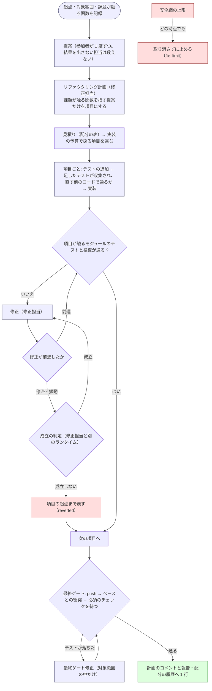

# 多ランタイム・リファクタリング（実装の予算で選び、選んだ項目をやり通す 1 回のリファクタリング計画の実行）

**提案の参加者が 1 度ずつ提案し、修正担当（claude）が実装の予算に収まる分をリファクタリング計画・テスト追加・実装・検証する。**
1 回の実行を提案から最終ゲートまで進めるのは `ndf refactor run` で、メインは打って結果を読むだけである。実装の予算
（`--budget-minutes`）は何件を採るかを決めるためだけに使い、選んだ項目を時間で打ち切らない。止まるのは安全網の上限に当たった
ときと最終ゲートが通らないときで、どちらも採った項目を取り消さずに人へ渡す。

`refactoring` Skill は「テストで守りながら 1 手ずつ直す」手順を持つが、
**何を直すかの発見**と**直した結果の検証**を持たない。この Skill がその 2 つを補う。

**工程表では `standard` と `legacy-refactor` のリファクタリングがこの Skill を指す。**
前提を満たせないときの退避先は `development-workflow` の
`references/workflow-modes.md`「リファクタリングの退避先」にある。

- [docs/01-state-and-propose.md](docs/01-state-and-propose.md) — 作業場所・状態ファイル・再開・課題が触る関数・提案
- [docs/02-plan-and-implement.md](docs/02-plan-and-implement.md) — リファクタリング計画と予算・項目ごとのテスト追加・実装・検証と修正
- [docs/04-verify-and-report.md](docs/04-verify-and-report.md) — 最終ゲート・配分の表・計画のコメントと報告
- `ndf refactor run` — 1 回の実行を提案から最終ゲートまで進める（作業場所の準備・担当の起動・状態ファイル・計画のコメント・報告を受け持つ）。下位の命令と引数は [commands.md](../../docs/contracts/commands.md) の `ndf refactor`

## この Skill で使う語

| 語 | 意味 |
| --- | --- |
| 修正担当 | リファクタリング計画・テスト追加・実装・修正・最終ゲート修正を通して担う claude。書き込み用の作業ディレクトリで動く |
| 提案の参加者 | 提案を 1 度ずつ出すランタイム（既定の席か `--participants`）。読み取り用ディレクトリで読むだけの起動をする |
| 課題が触る関数 | `--base` と HEAD の分岐点からの差分（`--base...HEAD`）が触る関数・クラス（`--symbols` で渡せば差分から引かない）。提案と計画の項目は、ここを指すものだけを採る |
| 項目 | リファクタリング計画が採った提案。`I-001` の形の番号と、状態（`open` 未着手・`adopted` 採った・`reverted` 戻した・`deferred` 見送った）を持つ |
| 項目の起点 | 項目に着手した時点の HEAD（`start`）。戻すときはここまで戻す |
| 実装の予算 | `--budget-minutes` の値。採る項目の見積り（テストの追加と実装の和）の合計の上限で、**選定にだけ使う** |
| 実効の予算 | グレード high の見積りの和が予算と設定の倍率 × 予算の間なら、その和まで延ばした予算 |
| 安全網の上限 | コードを書く工程の起動の秒の累計に置く上限（`--safety-net-minutes`、既定は実効の予算 × 設定の倍率）。当たったら取り消さずに止める |
| 配分の表 | 種類（テストの追加・手法ごとの実装・検証・修正）ごとの 1 件あたりの所要。初期値・設定・履歴の実測から計画のたびに組み、見積りに使う |
| 成立の判定 | 修正が停滞か振動した項目を、振る舞いを変えずに直し切れるかを、修正担当と別のランタイムが判定すること |
| 停滞 / 振動 | 修正の後の落ちたキーの集合が前の回と同じ（停滞）か、前に見た集合へ戻る（振動）こと |
| フレーキー | 打ち直すと通る失敗。項目の失敗に数えず、実行の中で 1 度だけ直しを求める |
| 最終ゲート | 項目を流し終えた後、PR の head へ送って CI の必須のチェックを待つ確かめ（[docs/04](docs/04-verify-and-report.md)） |
| リファクタリング計画 | 採る項目と見送った提案とその理由。PR のコメントに残す |

**「バッチ」「パッチ」の語は使わない。** 読み手が別の意味で知っている語である。

## 設計方針

参加者・時間・検証の単位・収束しない項目・見積り・範囲・公開の責務・最終ゲートの方針は
[references/design-principles.md](references/design-principles.md) にある。

## 引数

`ndf refactor run` の引数である（`ndf refactor run --help`）。

| 引数 | 意味 | 既定 |
| --- | --- | --- |
| `--pr N` | 対象の Pull Request | 必須 |
| `--branch NAME` | PR の head ブランチ | 必須 |
| `--base BRANCH` | 差分の起点（プランと同じく、ブランチ戦略のスプリントの PR のマージ先） | 必須 |
| `--scope PATH...` | 対象範囲。**提案が無制限に広がらないよう必須。** 検証にも効くので、現状固定テストの置く場所も含める。検査のプランと同じ範囲は `ndf refactor scope-args --base <B>` の `items[0].paths` から組める | 必須 |
| `--required CHECK...` | 最終ゲートで待つ必須のチェック（`.ndf/project.json` の `ci.required_checks`） | 必須 |
| `--ci-test NAME...` | CI のテストのチェックの名前。落ちたら最終ゲート修正へ回す | なし |
| `--symbols FILE:NAME...` | 課題が触る関数を差分から引かずに渡す（`ndf refactor touched` と同じ形） | 差分から引く |
| `--participants RUNTIME...` | 提案の参加者 | 既定の席 |
| `--max-fix N` | 項目ごとの修正と、最終ゲート修正の回数の上限 | `2` |
| `--budget-minutes N` | 実装の予算（分）。採る項目を選ぶのにだけ使う | `contracts/limits/cross-refactoring.default-budget.json` |
| `--safety-net-minutes N` | 安全網の上限（分）。止まった実行は、より大きい値で同じコマンドを打ち直すと続く | 実効の予算 × 設定の倍率 |
| `--target-branch NAME` | PR のマージ先のブランチ。`--base` がコミットのときだけ使い、渡すと GitHub から読まない | GitHub から読む |
| `--work DIR` | 対象のリポジトリの中の位置 | `.` |

```text
ndf refactor run --pr 130 --branch feat/x --base <ベースブランチ> --scope src/services tests/services --required test
ndf refactor run --pr 130 --branch feat/x --base <ベースブランチ> --scope src tests --required test lint --budget-minutes 30 --safety-net-minutes 90
```

**CI テストの設定（`test.ci.only`）があるリポジトリでは、テストを手元で走らせない。** 合否は最終ゲートが待つ CI の
必須のチェックで読む。

## 担当の決め方

**提案する参加者は、cross-review の相手役と同じ既定の席（ランタイムの表の `default_seat`）である。** `--participants` で名指しすると
その並びで回す。選び方は `ndf.core.converge.participants` が 2 つの Skill で 1 つだけ持つ。

- **提案の担当は読み取り用の作業ディレクトリで、読むだけの起動をする。** 結果は標準出力の最後の JSON で返す
- **結果を出さない担当は数えずに続ける。**

**リファクタリング計画・テスト追加・実装・修正・最終ゲート修正は、修正担当（claude）1 者が通す。** 書き込み用の作業ディレクトリで動き、
項目ごとにコミットする。担当が結果を出さずに終わったら、工程の起点まで取り消して項目を見送る。

## 前提

- `gh` CLI と git が origin へ送れる。提案の参加者の CLI と修正担当の claude がログイン済みで、PATH にある。`run` は起動の前に
  ログインを確かめない。起動できなかった提案の担当は数えずに続ける
- 対象の Pull Request が開いている（未作成なら `/ndf:pr` で先に作る。Draft かどうかは問わない）
- 対象のリポジトリ（またはその worktree）の中で会話を始めている。単独起動のコマンドは**すべてそこで打ち**、Skill の
  ディレクトリへ移らない。対象のリポジトリは打った場所が属する git のworktreeの根で決まり、git のworktreeでない
  場所では `ndf progress docs-only` も `ndf refactor run` も止まる
- プロダクションコードの差分がある。起動の前に `ndf progress docs-only` を打ち、飛ばしてよいかを見る（読み方は下の表）

差分の確かめは、対象のリポジトリの中で次の 1 行を打ち、結果 JSON の `status` と `cause.kind` を見る。

```bash
ndf progress docs-only --base <マージ先のブランチ>
```

| 結果 | 意味 | cross-refactoring を |
| --- | --- | --- |
| `ok` | 差分が文書だけでない（プロダクションコードの差分がある） | 起動する |
| `stopped`・`not_applicable` | 差分が文書だけ（飛ばしてよい） | 起動しない |
| `stopped`・`precondition` / `invalid` | 差分を読めない・`--base` の誤り（判定していない） | 飛ばしてよいとは読まない。対象のリポジトリの中で、起点を直して打ち直す |
| `stopped`・`deps_missing` | 依存が欠けた（判定していない） | 起動するかを決めない。理由を見て依存を入れ、打ち直す |


## 全体フロー



打ち直すと通る失敗はフレーキーとして項目の失敗に数えず、実行の中で 1 度だけ直しを求める。項目の起点から在った失敗は、その
項目の失敗に数えない。予算に収まらずに見送った提案は、理由（`budget`）とともにリファクタリング計画に残る。

## 実行

メインが決めるのは `--scope`・`--required`（と、あれば `--ci-test`・`--symbols`）である。`--scope` は検査のプランと同じく
`ndf refactor scope-args --base <マージ先のブランチ>` の結果の `items[0].paths` から組んでよい。決めたら「前提」と同じ対象の
リポジトリの中で次の 1 行を打ち、最後の行の結果 JSON の `status` と終了コードを見る。

待ちはコマンドの中で行う（1 回の実行で 1 時間を超えうる）。Claude Code では Bash の `run_in_background` で起動し、完了通知を
1 回受ける。NDF のコマンドは 1 回の呼び出しに 1 つだけ打つ（`&&`・`;`・パイプ・ループでつなぐと hook が止める）。

```bash
ndf refactor run --pr <PR> --branch <head ブランチ> --base <マージ先のブランチ> --scope <範囲...> --required <必須のチェック...> \
  [--ci-test <名前...>] [--symbols <ファイル>:<名前>...] [--participants <ランタイム...>] [--max-fix N] \
  [--budget-minutes N] [--safety-net-minutes N]
```

| 引数 | 意味 |
| --- | --- |
| `--scope` | 対象範囲（「引数」の `--scope`） |
| `--required` | 最終ゲートで待つ必須のチェック（`.ndf/project.json` の `ci.required_checks`） |
| `--ci-test` | CI のテストのチェックの名前（落ちたら最終ゲート修正へ回す） |
| `--symbols` | 課題が触る関数を差分から引かずに渡す（`ndf refactor touched` と同じ形） |
| `--participants` | 提案の参加者（省けば既定の参加者） |
| `--max-fix` | 項目ごとの修正と、最終ゲート修正の回数の上限（既定 2） |
| `--budget-minutes` / `--safety-net-minutes` | 実装の予算と安全網の上限（「引数」と同じ） |

待ち方の規約は [waiting.md](../development-workflow/references/waiting.md)、待ちから戻った後に同じ応答で次の手順へ
進む規則は [agent-layers.md](../development-workflow/references/agent-layers.md) の supervisor の規則にある。
結果の形と終了コードは [exit-codes.md](../../docs/contracts/exit-codes.md) と結果のコントラクト
（[result.schema.json](../../contracts/schemas/result.schema.json)）にある。

| 結果（`status`・`cause.kind`） | 止まった地点 | すること |
| --- | --- | --- |
| `ok` | 最終ゲートまで終わった | `metrics.report`（作業場所の logs の `report.md`）と `metrics` を「完了報告」へ写す |
| `stopped`・`fix_limit` | 安全網の上限に当たった。項目は取り消さず、HEAD をそのまま残す | 人へ渡す。続けるなら（安全網なら `--safety-net-minutes` を大きくして）同じコマンドを打ち直す。やめるなら項目のコミットを `git revert` する |
| `stopped`・`refused` | 最終ゲート修正がリファクタリング計画の対象範囲の外を変えた（マージせずに戻した） | `summary` を報告して止まる |
| `stopped`・`base_conflict` | PR がベースブランチと衝突している（CI を待たずに止めた） | 衝突を解いて push し、同じコマンドを打ち直す |
| `stopped`・`test_failed` | 最終ゲート修正を `--max-fix` の回数まで回しても CI のテストが落ちる | 落ちたテストを報告して止まる。続けるなら `--max-fix` を大きくして打ち直す |
| `stopped`・ほか（`invalid`・`precondition`・`push_rejected`・`work_stopped` など） | 中断 | `summary` を報告して止まる。**握り潰さない**（検証を通っていない変更が残る） |

再開は同じコマンドを打ち直すだけである。止まった実行は状態ファイルを残し、終わった工程を流し直さずに続ける。対象ブランチか
結果を変える引数が前回と違えば `invalid` で止まる（前と同じ引数で打ち直すか、状態ファイルを消してから打ち直す）。完了の記録が
あり PR の head と引数（`--base` がコミットなら `--target-branch` も）が同じなら、前回の結果を返す。状態ファイルの中身（項目・工程の起点・最終ゲートの記録）は
`ndf refactor state --pr <PR>` で読める。作業場所を片付けるときは `ndf refactor release --pr <PR>` を打つ。

### 提案と計画の担当へ MVV を渡す

`ndf refactor run` は、起動の始めにベースブランチの承認済みの MVV を 1 回だけ読み、提案と計画の担当の指示文に次を載せる。ほかの
工程の指示文には載せない。打つ側ですることは無い。

- 承認されたバージョン
- 本文と NDF の共通原則のスナップショットのパス
- 作業の前に 2 つのファイルの全体を読み、判断の基準にする指示

読むブランチは `--base` で決まる。

| `--base` の値 | MVV を読むブランチ |
| --- | --- |
| ブランチか `<リモート>/<ブランチ>` | そのブランチの、リモートの最新のコミット |
| コミットの SHA・タグなど | PR のマージ先のブランチの、リモートの最新のコミット（`--target-branch` を渡さなければ GitHub から 1 回読む） |

再開で、計画に使った MVV と今の承認済みの MVV が違えば（計画の MVV を記録していない状態も）、未着手の項目を計画の担当に今の
MVV で 1 回確かめさせ、反する項目を見送ってから続ける。確かめの担当が結果を出さなければ `work_stopped` で止まる。

承認済みの MVV が無いリポジトリでは何も載せない。ブランチを取得できない・MVV を読めない・本文が承認の記録と合わない・
スナップショットを保存できないときは、担当を起動せずに `precondition` で止まる。`summary` の理由を報告して止まる。

提案と計画の指示のテンプレート（[prompts/propose.md](prompts/propose.md)・[prompts/plan.md](prompts/plan.md)）を `run` は使わない。
テンプレートから指示を作るときは、`ndf records mvv current --base <マージ先のブランチ>` の結果で `$RF_MVV` を埋める。

| `outputs.mvv.state` | `$RF_MVV` に入れる文 |
| --- | --- |
| `approved` | `MVV: バージョン <version>・本文 <path>・共通原則 <principles_path>（承認済み）。作業の前に 2 つのファイルの全体を読み、判断の基準にする。作業ディレクトリの外にあるが、この 2 つは読んでよい。` |
| `absent`・`unapproved` | `MVV: 無し（<state>）。mvv_basis は空にする。` |

`status` が `stopped` なら指示を作らず、`summary` の理由を報告して止まる。1 行の形と結果の読み方は
[project-mvv.md の「工程での読み方」](../development-workflow/references/project-mvv.md#工程での読み方) にある。

### リファクタリング計画のコメントを書き直す時点

`run` は結果の出口（完了・止まった）で、Pull Request のリファクタリング計画のコメントを書く。前に書いた本文と同じなら書かず、
書けなくても結果は変えない（`metrics.plan_comment` が `written` / `unchanged` / `failed` / `skipped`）。リファクタリング計画が
できる前に止まった実行ではコメントを作らない。

`run` が終わった後に項目のコミットを `git revert` で取り消して push したとき（プランの外の取り消し）は、`run` はコメントを
読み直さない。コメントの該当する項目の状態を手で「取り消し」に直す（`gh pr view <PR> --comments` でコメントを探し、GitHub の画面で
書き換える）。

最終ゲートは起動のされ方によらず CI の必須のチェック（`--required`）で判定する（[docs/04-verify-and-report.md](docs/04-verify-and-report.md)）。
単独起動で Pull Request 全体を承認収束にかけるなら、`run` が `ok` で終わった後に `/ndf:cross-review <PR>` を打つ。最終ゲート修正は
`--max-fix` の回数まで回し、尽きたら取り消さずに止めて人へ渡す（`test_failed`）。

## アンチパターン

| してはいけないこと | なぜ |
| --- | --- |
| ホストのサブエージェントで実装する | ホストの作業文脈に差分が載り、提案した者と実装する者の独立性が崩れる |
| `--scope` を省く / テストの置く場所を入れない | 提案が発散する。足したテストが範囲外になり、最終ゲート修正は範囲の外を変えると `refused` で止まる |
| 予算から締め切りを導いて選んだ項目を打ち切る | 選んだ項目が時間切れで消え、採用が 0 件になる回が出る。**予算は選定にだけ使い、時間の上限は安全網だけに置く** |
| 修正担当自身に成立を判定させる | 直している当人は成立しないと言う理由を持たない。判定は別のランタイムが行う |
| 状態ファイルを手で書き換える | 再開が結果を変える引数を比べて止まる。続けられないときは状態ファイルを消して打ち直す |
| `git push --force` / `--no-verify` を使う | 他者の作業を消す。検証を飛ばす |
| 提案手順でコードを直す | 提案は読むだけ。直すのは修正担当 1 者に集約する |

## 完了報告

`ndf refactor run` が作業場所の logs へ書く報告（`metrics.report` のパス）と結果 JSON を材料に、次を報告する。

- 項目の表（番号・`<ファイル>#<シンボル>`・状態・理由）と、採った・戻した・見送った件数（`metrics`）
- 見送った提案の理由別の件数（範囲外・予算に入らない・見積りが無い）
- 工程別の所要と、予算・実効の予算・安全網の累計と上限（`metrics.budget_minutes`・`safety_net_minutes`・`coding_minutes`）
- 成立の判定の件数（`metrics.judged`）とフレーキーの直しの件数（`metrics.flaky_fixed`）
- 最終ゲートの記録（通ったか・回った回数・送った head）
- リファクタリング計画のコメント（`metrics.plan_comment`）。URL は生の URL で書く
