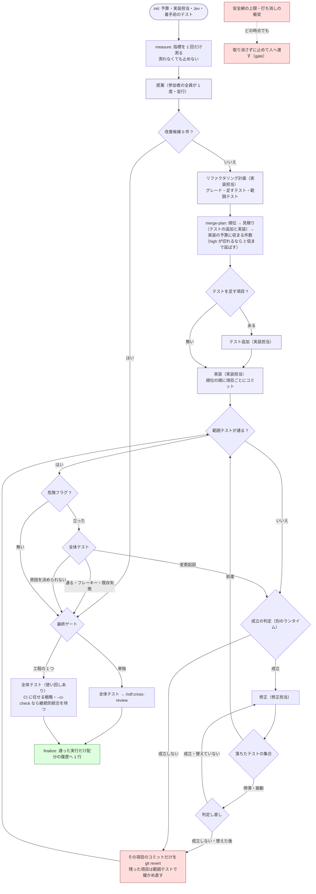

# 多ランタイム・リファクタリング（実装の予算で選び、選んだ項目をやり通す 1 回のリファクタリング計画の実行）

**参加者の全員が 1 度だけ多面的に提案し、選ばれた 1 者が実装の予算に収まる分を
リファクタリング計画・テスト追加・実装・検証する。** 実装の予算（`--budget-minutes`、既定 60 分）は何件を選ぶかを
決めるためだけに使い、選んだ改善項目を時間で打ち切らない。止まるのは安全網の上限（既定で実効の予算の 2 倍）に
当たったときと、打ち消しが衝突したときだけで、どちらも項目を取り消さずに人へ渡す。

`refactoring` Skill は「テストで守りながら 1 手ずつ直す」手順を持つが、
**何を直すかの発見**と**直した結果の検証**を持たない。この Skill がその 2 つを補う。
実装を担う側は `refactoring` を手順として読む。

**工程表では `standard` と `legacy-refactor` のリファクタリングがこの Skill を指す。**
前提を満たせないときの退避先は `development-workflow` の
`references/workflow-modes.md`「リファクタリングの退避先」にある。

- [docs/01-state-and-propose.md](docs/01-state-and-propose.md) — 初期化・再開・提案
- [docs/02-plan-and-implement.md](docs/02-plan-and-implement.md) — リファクタリング計画・テスト追加・実装
- [docs/03-review-viewpoints.md](docs/03-review-viewpoints.md) — 最終ゲートの `cross-review` へ渡す観点
- [docs/04-verify-and-report.md](docs/04-verify-and-report.md) — 検証/修正・危険フラグ・最終ゲート・配分テーブル・報告
- [scripts/refactor.py](scripts/refactor.py) — 状態管理。外部パッケージ（`md` / `mdtable` のグループ）を import の前に `deps.require` で用意する（import できなければ uv の環境で起動し直す）
- [scripts/prepare-worktrees.sh](scripts/prepare-worktrees.sh) — 作業ディレクトリ準備と Skill 配置
- [scripts/launch-cli.sh](scripts/launch-cli.sh) — 手順ごとのプロンプト組み立てと CLI 起動
- 監視と CLI 起動の実体は `../../scripts/lib/`（プラグインルート直下の収束ループの共通ライブラリ）

## この Skill で使う語

| 語 | 意味 |
| --- | --- |
| 実装の予算 | `--budget-minutes` の値（既定 60 分）。採る改善項目の見積り（テストの追加と実装の和）の合計の上限で、**選定にだけ使う**。テストの実行・CI の待ち・経過時間を数えず、締め切りを導かない |
| 実効の予算 | 予算の延長を当てた後の実装の予算。グレード high の候補の見積りの和が予算と 2 倍の間なら、その和まで延ばす |
| 安全網の上限 | コーディングの CLI（テストの追加・実装・修正・最終ゲート修正）の起動の秒の累計に置く上限（`--safety-net-minutes`、既定は実効の予算 × 2）。異常の検知にだけ使い、当たっても取り消さずに止めて人へ渡す |
| 成立の判定 | 変更起因で落ちた改善項目が、振る舞いを変えずに直し切れる見込みがあるか（リファクタリングの成立）を、実装担当と別のランタイム（判定の担い手）が判定すること。成立しない項目だけを打ち消す |
| 停滞 / 振動 | 修正の後の落ちたテストの集合が前の回と同じ（停滞）か、前に見た集合へ戻る（振動）こと。前進している間は回数の上限なく修正を続ける |
| 差し戻し | 改善項目の中の手順の違反（記名の欠け・期待値の欠け・文言を固定するテスト・計画に無いコミット）を、項目を取り消さずに担当へ直させること |
| 落ちたテストの材料 | 落ちたテストの ID・ログの置き場・走らせ直すコマンドの組。JUnit を読めないときもログから組み、修正と成立の判定へ渡す |
| 手順 | 提案・リファクタリング計画・テスト追加・実装・検証/修正の 5 つ。**それぞれ 1 回だけ**行う（検証と修正の繰り返しを除く） |
| 実装担当 | リファクタリング計画以降の 4 つの手順を通して担う 1 ランタイム |
| 改善候補 | 提案を鍵（`path` + `symbol` + `smell`）で集約したもの。リファクタリング計画へ渡す |
| 改善項目 | リファクタリング計画が採った改善候補。`I-001` の形の ID を持ち、`Item-Id` の同じコミットを何件でも持てる（改名と中身の変更を分けるなど。テストを足すコミットは 1 件） |
| 新しいファイル | リファクタリング計画の起点（`plan.base_sha`）のツリーに無かったパス。分割・抽出の行き先で、どこに置いても範囲の中として扱う |
| 呼び手の書き換え | 範囲の外の既存のファイルで、項目が変えた名前の読み込み・呼び出しだけを書き換える変更。機械がハンクごとに判定し、通したファイルを最終ゲートのレビューへ引き継ぐ |
| グレード | 改善候補ごとに付ける適用の価値（`tier`: high / medium / low）。Jev か実装担当が付け、改善項目の順位の最初の鍵にする |
| 配分テーブル | 種類（`test` / `structure/<手法>` / `verify` / `fix`）ごとの 1 件あたりの所要。履歴の直近 10 回からリファクタリング計画のたびに集計する |
| テストの戦略 | 範囲テストの走らせ方・全体テストの置き場（手元か CI か）・落ちたテストの見分け方の組。`local-full` / `local-scoped-ci-whole` / `round-only`。宣言（`.ndf/project.json` の `test.strategy`）か、同じ関数が所要から導く |
| 範囲テスト | 項目が触った箇所に限って走らせるテスト。宣言の `scope_command`（`{paths}` のテンプレート）に、テストの suite はリファクタリング計画の `test_targets` を、静的解析の suite は項目のコミットが変えたファイルを入れてオーケストレーターが組み立て、シェルで走らせる |
| suite の種別 | 宣言の suite がテスト（`test`）か静的解析（`lint`。整形の検査を含む）か。書かなければテスト。テスト整備ラウンドと `--scope` のテストの置き場所の検査はテストの suite があるときだけ行い、静的解析の全体テストはどの戦略でも着手前と最終ゲートで手元で走らせる |
| 起動の失敗 | テストのコマンドを起動できない（終了コード 126 / 127）こと。落ちたとは扱わず、その時点で項目を取り消さずに中断（終了コード 4）し、報告にコマンドと理由を書く |
| 危険フラグ | 範囲テストでは覆えない変更（D1〜D5）。立ったら全体テストを走らせる（全体テストを CI に任せる戦略では最終ゲートへ寄せる）。全体テストを走らせる理由であって、失敗の原因を指さない |
| 原因の項目 | 全体テストで変更起因として落ちたテストを、その変更で落とした改善項目。落ちたテストの出力に現れるパス（`path`）か、項目を外した走らせ直し（`isolate`）で決め、決まらなければ `undetermined`。修正はこの項目へ向き、決まらなければ取り消さずに最終ゲート修正へ寄せる |
| フレーキー / 既存失敗 / 変更起因 | 全体テスト（着手前・危険フラグ・最終ゲート）で落ちたテストの 3 つの分類。ID は JUnit XML から読み、落ちたファイルだけを HEAD と着手前の HEAD で走らせ直して分ける |
| リファクタリング計画 | 採る改善項目と、見送った提案とその理由を決める手順と、その出力（PR のコメントか `--plan-file`） |

**「バッチ」「パッチ」の語は使わない。** 読み手が別の意味で知っている語である。

## 設計方針

参加者・実装担当・時間・検証の単位・取り消し・見積り・判断・範囲・公開の責務・最終ゲートの方針は
[references/design-principles.md](references/design-principles.md) にある。

## 引数

| 引数 | 意味 | 既定 |
| --- | --- | --- |
| `[PR番号]` | 対象の Pull Request | 必須 |
| `--scope PATH...` | 対象範囲。**提案が無制限に広がらないよう必須。** 検証にも効くので、現状固定テストの置き場所も含める | 必須 |
| `--budget-minutes N` | 実装の予算（分）。1 以上の整数でなければ `init` が止める（終了コード 4）。選定にだけ使う | `limits.json` の `cross-refactoring.default-budget`（60 分） |
| `--safety-net-minutes N` | 安全網の上限（分）。止まった実行は、より大きい値で同じコマンドを打ち直すと続く | 実効の予算 × `cross-refactoring.safety-net` の倍率（2） |
| `--implementer NAME` | リファクタリング計画以降を担う 1 者。参加者に無ければ `init` が止める | ホスト → 先頭 |
| `--host claude\|codex\|agy\|kiro` | ホストの明示指定。未指定時は環境変数から推定（agy は推定できないため明示する） | 推定 |
| `--exclude NAMES` | 参加者から外す者（カンマ区切り・繰り返し可）。再開で `none` を渡すと空へ戻す | なし |
| `--include NAMES` | 参加者に足す者（例: `--include agy`） | なし |
| `--require-all` | 確認を通らない者が 1 者でもいれば中断する（終了コード 4） | 外して続ける |
| `--model RT=MODEL` | ランタイムごとのモデル。繰り返し指定できる | CLI の既定 |
| `--baseline-test CMD` | 全体テスト。`{paths}` を含めば範囲テストのテンプレート（全体は宣言の同じ種別の `command`、無ければテストは `{paths}` を `.` にしたもの、静的解析は `{paths}` を `--scope` で埋めたもの）、含まなければ全体テストとしてそのまま走らせる（戦略は `round-only`）。文字列の中身は解析しない | 宣言の `test` を読む |
| `--round-test CMD` | ラウンドテスト。`{paths}` を含めば範囲テストのテンプレート、含まなければ項目ごとにそのまま走らせる（戦略は `round-only`）。宣言に `test` が無いときの逃げ道 | なし |
| `--test-kind test\|lint` | `--baseline-test` と `--round-test` のテンプレートの種別（`lint` = 静的解析）。テンプレートの語から種別を推測しない | `test` |
| `--ci-check NAME` | 最終ゲートで待つチェックの名前。宣言の `test.ci.check` より先に効き、`limits.ci_wait_timeout` まで待つ | 宣言の `test.ci.check` |
| `--workflow-step` | `development-workflow` の 1 工程として起動したことを伝える。`cross-review` を省く | 単独起動 |
| `--severity-threshold LEVEL` | この重要度未満は `threshold` で見送る | `minor` |
| `--sync-command CMD` | 生成物を同期するコマンド。push の直前にオーケストレーターが実行する | なし |
| `--plan-file PATH` | リファクタリング計画を**ファイル**へ書き出す先（対象リポジトリからの相対）。空文字なら記録しない | PR のコメント 1 件 |
| `--no-code-metrics` | 提案の前に指標を測らない。言語ごとのツールの置き換えは引数でなく `.ndf/code-metrics.json` で行う（[docs/01](docs/01-state-and-propose.md) の「指標の測定」） | 測る |

**値を使わない引数**: `--max-test-rounds` / `--max-outer-rounds` / `--max-items-per-round` /
`--max-fix-rounds` / `--test-timeout` は、渡すと使わないことを知らせる 1 行を出して**値を使わずに続ける**。
修正は前進している限り続け（停滞か振動で判定し直す）、テスト 1 回の上限は所要の記録から導く（予算に依らない）。

```text
/ndf:cross-refactoring 130 --scope src/services tests/services
/ndf:cross-refactoring 130 --scope src tests --budget-minutes 30 --safety-net-minutes 90
/ndf:cross-refactoring 130 --scope src tests --implementer codex --sync-command "make generate"
/ndf:cross-refactoring 130 --scope src tests --include agy --exclude kiro
/ndf:cross-refactoring 130 --scope src tests --round-test "make test-unit"   # 宣言に test が無いリポジトリ
```

**テストの走らせ方は宣言（`.ndf/project.json` の `test`）の戦略で決まる**（[docs/01](docs/01-state-and-propose.md) の「テストの戦略」）。
`init` は `STRATEGY` / `STRATEGY_SOURCE` を返し、コマンドの文字列を解析しない。

**継続的統合のジョブのうち宣言に無いものは、`init` が知らせる（止めない）**。宣言の `ci.provider` が `github-actions` のとき、
作業ディレクトリの `.github/workflows/` のジョブを、suite の `ci_jobs` と `test.ci_exempt` に照らす。どちらにも無いジョブは
手元の検証で走らないため、識別子（`<ワークフローのパス>#<job id>`）を挙げて状態ファイルの `ci_coverage` にも残す。
手元で同じ検査を走らせる suite の `ci_jobs` に書くか、走らせない理由を添えて `test.ci_exempt`（`{"job", "reason"}`）に書く。
識別子から `#<job id>` を省くと、そのファイルのジョブすべてを指す。照合は文字列の一致だけで、glob は使わない。

**実際に動いたモデルは、`--model` を指定しなくても claude と codex なら記録される**。
claude は出力の `modelUsage`、codex はセッションの記録（`$CODEX_HOME/sessions`）から取り、状態ファイルの
`implementer_model.observed` に入れる。取れなければ取れなかった理由を `implementer_model.unobserved` に残す。
agy と kiro は取れないため、モデルを比べたいなら `--model agy=<name>` / `--model kiro=<name>` を指定する
（指定値で代用して集計に入れる）。指定も実測値も無い実行は、集計から分離される。

## 担当の決め方

**提案する参加者は、cross-review と同じく claude / codex / kiro と、この Skill を動かしているランタイム（ホスト）である。**
ホストは claude / codex / kiro のどれかなら 3 者、agy なら 4 者になる。選び方は共通ライブラリ
（`scripts/lib/assignment.py` の `default_pool`）が 2 つの Skill で 1 つだけ持つ。

- **ホストも別の CLI プロセスとして起動する。** ホストの会話の文脈を持ち込まずに、独立した提案を 1 つ得られる
- **agy はホストのときだけ入る。** 起動の失敗と所要が最も多いためである。足すときは `--include agy`、外すときは `--exclude kiro` のように名指しする
- **リポジトリの `.ndf/runtimes.json` の宣言の外のランタイムは参加させない**。参加者プールを宣言の `allowed` で絞り、宣言の外を `--include` / `--implementer` で渡すと作業ディレクトリを用意する前に止まる
- **起動の前に各 CLI のログイン状態を確かめ**（コマンドは「前提」の節）、ログインしていない者を外して続ける。全員が揃わなければ止めたいときは `--require-all`

**リファクタリング計画・テスト追加・実装・修正・最終ゲート修正は、実装担当 1 者が通す。** 実装担当は
`--implementer` → ホスト（参加者にいれば）→ 参加者の先頭の順で決まり、多くはホストになる。

- **再開で参加者を作り直し、実装担当が外れたら**、リファクタリング計画の前なら決め方を当て直し、リファクタリング計画の後なら止める。
  結果なしの記録で外した担当は、作り直した参加者にいても実装担当に戻さない
- **実装担当が結果を残さなかったら**（利用上限・起動し直した後の結果なし）、同じ実行の中で振り替える。実装担当が替わるのは
  このときだけで、リファクタリング計画の後でも止めない。規則と工程ごとの扱いは
  [docs/02-plan-and-implement.md](docs/02-plan-and-implement.md) の「結果を残さなかった担当の振り替え」にある

## 前提

- `gh` CLI が認証済みで、`jq` と `uv`（または Python 3.10 以上）が使える
- 参加者の CLI がログイン済みで、モデルを引ける。`init` が認証確認（claude: `claude auth status` /
  codex: `codex login status` / agy: `agy models` / kiro: `kiro-cli whoami`）と、担当の起動と同じ
  モデルの指定での 1 回の呼び出しで確かめ、通らない者を理由を出して外して続ける。`--model` で明示して
  いないモデルを引けないときは既定のモデルで担当に入れる（誤検知するときは `NDF_SKIP_AUTH_CHECK=1`）
- 対象の Pull Request が開いている（未作成なら `/ndf:pr` で先に作る。Draft かどうかは問わない）。`init` が作業ディレクトリを
  用意する前に Pull Request の状態を確かめ、閉じている・マージ済み・状態を判定できないときは、番号と満たさなかった条件と
  直し方を出して終了コード 4 で止まる。新しい実行も再開も同じ判定を受ける
- 対象のリポジトリ（またはその worktree）の中で会話を始めている。単独起動のコマンドは**すべてそこで打ち**、Skill の
  ディレクトリへ移らない。対象のリポジトリは打った場所が属する git のworktreeの根で決まり、git のworktreeでない
  場所では assess も drive も「対象のリポジトリを決められない」と出して止まる
- プロダクションコードの差分がある。起動の前に `assess` を打ち、飛ばしてよいかを見る（読み方は下の終了コードの表）

シェルの変数は呼び出しをまたいで残らないため、この節と「実行」の各ブロックを 1 回の呼び出しとし、先頭で毎回 `$R` を
決め直す。`<入口を探すコマンド>` の行は [scripts-lookup.md](../development-workflow/references/scripts-lookup.md) の
「入口を探すコマンド」の for 文である（Codex / Kiro / agy では `${CLAUDE_PLUGIN_ROOT}` が置き換わらないため、この for 文で探す）。
スクリプトの位置は解決のエントリポイント（`resolve.sh`）が導入先から求める。

```bash
<入口を探すコマンド>   # scripts-lookup.md の「入口を探すコマンド」の for 文。$R を決める
[ -n "$R" ] || exit 2   # 入口を探せない = 判定できない（3 の「飛ばしてよい」と取り違えない）
RF=$(bash "$R/scripts/resolve.sh" scripts cross-refactoring) || exit 2
BASE="<開発の起点>"   # worktree-setup.sh check の「開発の起点:」の行の名前
python3 "$RF/refactor.py" assess --base "origin/$BASE"; echo "exit=$?"
```

| 終了コード | 意味 | cross-refactoring を |
| --- | --- | --- |
| 0 | プロダクションコードの差分がある | 起動する |
| 3 | 差分が無い（飛ばしてよい） | 起動しない |
| 2 | 対象のリポジトリか `<base>` を解けない（判定できない） | 飛ばしてよいとは読まない。対象のリポジトリの中で、起点を直して打ち直す |
| 69 | 依存が欠けた（`deps.require` が外部パッケージを用意できずに止めた。判定していない）。標準エラーに `❌ [ndf deps]` の行 | 起動するかを決めない（起動しないとも飛ばしてよいとも読まない）。理由を見て依存を入れ、打ち直す |
| 1 | `uv run` 自身が失敗した（ネットワークが無い・lock を解決できない。判定していない）。標準エラーは uv の `error:` の行 | 69 と同じに扱う |

- Jev を使うには、環境変数 `AI_GATEWAY_API_KEY` があり、対象が公開リポジトリであること。
  `NDF_JEV=0` で使わない。使えなければ実装担当が同じ判断をする（止まらない）

## 全体フロー



**駆動の繰り返しは検証と修正の 1 つだけである。** 見送った提案は理由（`budget` / `rank` /
`duplicate` / `vocabulary` / `threshold` / `no_target` / `not_done`）と
ともにリファクタリング計画に残る。

## 実行

メインが決めるのは `--scope` / `--sync-command`（宣言に `test` が無ければ `--round-test`）である。決めたら「前提」と
同じ対象のリポジトリの中で次のブロックを打ち、最後の行の結果 JSON の `status` と終了コードを見る。

待ちはコマンドの中で行う。Claude Code では `run_in_background` で起動し、完了通知を 1 回受ける。

```bash
<入口を探すコマンド>   # scripts-lookup.md の「入口を探すコマンド」の for 文。$R を決める
[ -n "$R" ] || exit 3
RF=$(bash "$R/scripts/resolve.sh" scripts cross-refactoring) || exit 3
python3 "$RF/drive.py" <PR> --scope <範囲...> [「引数」の表のうち値のあるもの]
```

Codex / Kiro / agy では共通ライブラリの `bg-wait.sh` でバックグラウンドに起動し、区切った待ちを 124 が返るあいだ**別の呼び出しとして**
打ち直す。終わると駆動の出力の全体を出し、駆動の終了コードで終わる。`RC` は run と wait で同じ文字列にする。

```bash
# 起動（1 回の呼び出し）
<入口を探すコマンド>   # scripts-lookup.md の「入口を探すコマンド」の for 文。$R を決める
[ -n "$R" ] || exit 3
RF=$(bash "$R/scripts/resolve.sh" scripts cross-refactoring) || exit 3
LIB=$(bash "$R/scripts/resolve.sh" scripts)/lib || exit 3
RC="${TMPDIR:-/tmp}/cross-refactoring-drive-pr<PR>.rc"
bash "$LIB/bg-wait.sh" run "$RC" -- python3 "$RF/drive.py" <PR> --scope <範囲...> [上と同じ引数]
```

```bash
# 待ち（124 が返るあいだ、別の呼び出しとして打ち直す）
<入口を探すコマンド>   # scripts-lookup.md の「入口を探すコマンド」の for 文。$R を決める
[ -n "$R" ] || exit 3
LIB=$(bash "$R/scripts/resolve.sh" scripts)/lib || exit 3
RC="${TMPDIR:-/tmp}/cross-refactoring-drive-pr<PR>.rc"
bash "$LIB/bg-wait.sh" wait "$RC"   # 1 回 540 秒以内。124 = まだ終わっていない
```

待ち方の規約は [waiting.md](../development-workflow/references/waiting.md)、待ちから戻った後に同じ応答で次の手順へ
進む規則は [agent-layers.md](../development-workflow/references/agent-layers.md) の supervisor の規則にある。
参加者が全て CLI なので、止まるのは単独起動の最終ゲートだけである。JSON の形と終了コードの表は共通ライブラリの
`scripts/lib/drive_pause.py` にあり、cross-review の駆動と同じ表を使う。

| 終了コード（`items[0].pause`） | 止まった地点 | すること |
| --- | --- | --- |
| 0 | finalize まで終わった | `items[0].report`（`refactor.py report` の出力）と `metrics` を「完了報告」へ写す |
| 23（`cross-review`） | 単独起動の最終ゲート | `prompt_file` を読み、`items[0].cwd`（対象のリポジトリの根）で `items[0].command`（cross-review の駆動）を回す。最終ステータスは cross-review の駆動が `result_file` へ書き、自分では書かない。同じコマンドを打ち直し、結果 JSON の `metrics.review_status` が `approved` のときだけ Draft を解除する。それ以外は Draft のまま最終ステータスを報告して止まる |
| 10（`status: gate`） | 止めて人へ渡した（安全網の上限に当たった・打ち消しが衝突した・判定の担い手が居ないまま停滞した・最終ゲート修正が修正担当を替えた後も停滞した）。項目は取り消さず、HEAD をそのまま残す。`next` に止めた理由と打ち直しか打ち切りの 1 行、`items[0].refactor_items` に項目ごとの状態・落ちているテスト・修正の履歴が載る | 人へ渡す。続けるなら（安全網なら `--safety-net-minutes` を大きくして）同じコマンドを打ち直す。やめるなら項目のコミットを `git revert` して `plan-comment --scan-reverts` を打つ。検査のプランでは承認ゲートとして止まる |
| 6 | 着手前のテストがハングの検知の上限で終わらずリファクタリングを飛ばした（`metrics.skipped` に種類 `init-timeout` と理由、`gaps` に 1 件。`metrics.exit` は 4） | 理由を報告する。検査のプランは `on_exit` の `"6"` でコードレビューへ進む |
| 1 | 中断（`metrics.exit` に元の終了コード。4 = 対象の Pull Request が閉じている・マージ済み・状態を判定できない（作業ディレクトリを作らず、担当の CLI を起動しない）・予算の指定の誤り・範囲テストのテンプレートが `{paths}` に入るテストのファイルを受けない（着手前のテストの後に試走で見分けた。受けるかを確かめられないときも止め、直す箇所と記録 `template-check.json` を出す）・`--round-test` が要る・旧い状態ファイル・どの項目にも属さないコミットの打ち消しが衝突した・push の直前に残すコミットでないもの（見放した担当の残留コミットなど）がある・範囲を確定できない など。最終ゲートを経ずに終わった実行もここで、`metrics.adopted` は 0・`metrics.unconfirmed` に残った項目の数） | `summary` を報告して止まる。**握り潰さない**（検証を通っていない変更が残る） |

再開は同じコマンドを打ち直すだけである。進みは耐久の記録（既定の置き場は `<git の共通ディレクトリ>/ndf/state/dbos/refactor-<鍵>.sqlite` ）が持ち、
記録のある手順は流し直さない。`metrics` は状態ファイルから数えた件数（`items` / `adopted` / `reverted` /
`deferred`（見送った改善項目と、時間で見送り項目に入っていない候補の数。#1944） / `fix_rounds` / `final_gate` / `reassigned`（結果を残さなかった担当を振り替えた回数。0 でも出す） / `review_status`）と、最終ゲートを経ていない実行の `unconfirmed`、手元の HEAD が
公開した地点より進んでいるかの `unpublished`（真偽。判定できなければ `null`）と、予算と判定の件数（`budget_minutes` / `effective_budget_minutes` /
`budget_extension`（`{from, to, reason}` か `null`） / `safety_net_minutes` / `coding_minutes` / `judged` / `stalled` / `flaky_fixed`）である。
`items[0].refactor_items[]` に項目ごとの `id`・`target`・`status`・`feasibility[]`・`failing`・`fix_history[]`・`outside_scope[]`・
`estimate_minutes`・`coding_seconds` が載る。

### リファクタリング計画のコメントを書き直す時点

駆動は done・中断・最終ゲートの止まり（23）の各出口で、結果 JSON を組む前に `refactor.py plan-comment <PR>` を 1 度だけ
打ち、Pull Request のリファクタリング計画のコメントを書き直す。push が落ちた実行でもコメントができ、公開の行に落ちた理由と
未公開の改善項目があることが載る。コメントの件数（採用・未確認・取り消し・見送り）は結果 JSON の `metrics` と同じ集計から出る。
投稿に失敗しても駆動の結果と終了コードは変わらない。リファクタリング計画ができる前に止まった実行と、置き場所が
`--plan-file` か「記録しない」の実行ではコメントを作らない。

駆動が終わった後に項目のコミットを `git revert` で取り消して push したとき（プランの外の取り消し）は、次の 1 行を打つ。
origin の head ブランチの `This reverts commit <SHA>` を読み、実装コミットが取り消されたままの項目を「取り消し」に、
取り消しが取り消された項目を元の状態へ戻してから書き直す。状態ファイルは環境変数・現在地に無ければ既定の worktree の置き場から探す。
「前提」と同じく対象のリポジトリの中で打つ（既定の置き場は対象のリポジトリの origin から決まる）。

```bash
<入口を探すコマンド>   # scripts-lookup.md の「入口を探すコマンド」の for 文。$R を決める
[ -n "$R" ] || exit 3
RF=$(bash "$R/scripts/resolve.sh" scripts cross-refactoring) || exit 3
python3 "$RF/refactor.py" plan-comment <PR> --scan-reverts
```

| 終了コード | 意味 |
| --- | --- |
| 0 | 書き直した・書く対象が無い（`PLAN_COMMENT=skipped`） |
| 1 | 投稿・編集に失敗した（`PLAN_COMMENT=failed`） |
| 4 | 状態ファイルが無い・origin を取り込めない（コメントも状態も変えない） |

最終ゲートの判定の相手は起動のされ方で変わる（[docs/04-verify-and-report.md](docs/04-verify-and-report.md)）。
`--workflow-step` なら全体テスト（CI に任せる戦略か `--ci-check` なら継続的統合）で判定して finalize まで進み、単独起動なら
cross-review の最終ステータスを受けてから finalize を呼ぶ。最終ゲート修正は前進している限り続け、修正担当を替えた後も停滞
したら取り消さずに止めて人へ渡す（終了コード 10）。木が起点と同じでも確かめを省かない。

## アンチパターン

| してはいけないこと | なぜ |
| --- | --- |
| ホストのサブエージェントで実装する | ホストの作業文脈に差分が載り、提案した者と実装する者の独立性が崩れる |
| `launch-cli.sh` に「ホストなら起動しない」分岐を入れる | ホストは実装担当として起動しうる。分岐はランタイム名だけで行う |
| `--scope` を省く / テストの置き場所を入れない | 提案が発散する。足したテストが範囲外になる。**`init` が止める** |
| 実装担当に生成物を同期させる・push させる | 生成物の差分が項目に混ざる。検証を通る前に公開される |
| 予算から締め切りを導いて選んだ項目を打ち切る | 選んだ項目が時間切れで消え、採用が 0 件になる回が出る（PR 2452）。**予算は選定にだけ使い、時間の上限はハングの検知と安全網だけに置く** |
| テストの失敗・範囲の外の変更・記名の欠けを理由に項目を取り消す | 直せる項目が消える。失敗は修正へ、手順の違反は差し戻しへ回し、取り消すのは成立しないと判定した項目だけにする |
| 実装担当自身に成立を判定させる | 直している当人は成立しないと言う理由を持たない。判定は別のランタイムが行う |
| `reset --hard` で項目を外す・起点の木へ戻すコミットを積む | 取り込んだベースブランチの変更まで消える（#2323）。打ち消しは項目のコミットの `git revert` だけにする |
| 結果ファイルの申告（所要・コミット）を材料にする | JSON を書き換えるだけで通るチェックになる。対応は `Item-Id`、所要は時計とコミットの時刻 |
| リファクタリング計画の URL を Markdown のリンクで書く | 読み手の画面から URL を取り出せない。**生の URL で書く** |
| 取り消した項目の内訳を Pull Request の文章へ並べる | 同じ一覧が 2 か所になり、片方だけが古くなる |
| `git push --force` / `--no-verify` を使う | 他者の作業を消す。検証を飛ばす |
| 提案手順でコードを直す | 提案は読むだけ。直すのは実装担当 1 者に集約する |

## 完了報告

`refactor.py report "$ID"` が次を出す。

- 手順ごとの所要、実装の予算と延長、安全網の累計と上限（`cross-review` を除く）
- 項目ごとの成立の判定（担い手・理由）・修正担当の替え・打ち消した理由・差し戻し・範囲の外で変えたファイル、止めた理由
- 改善項目の表（**`<ファイル>#<シンボル>`**・兆候・手法・グレード・見積り・状態・危険フラグ・修正の回数）
- 採用・未確認・取り消し・見送りの件数（リファクタリング計画のコメントと結果 JSON の `metrics` と同じ集計。「見送り」は見送った改善項目の数）と、
  別の行に**見送った提案の総数と理由別の件数**（計画に入らなかった提案を含む。理由別の `not_done` が見送った改善項目の数）。
  内訳は**リファクタリング計画の生の URL**
- 着手前の全体テストの結果（通過か失敗・秒・HEAD）と、検証の中で全体テストを走らせたか、走らせた理由（危険フラグ）、落ちたときの見分け（フレーキー・既存失敗・変更起因）とその結果
- 判断に Jev を使ったか（使わなかった理由・呼び出しの失敗の数）
- 最終ゲートの結果（`cross-review` の収束、または全体テスト／継続的統合の合否）
- 監視が手順の上限で CLI を止めた手順と、固定のまま残した値（OS の後始末と通信の待ち）
- 指標の測定（言語・ツール・版・ランナー・所要秒と、測れなかった言語と理由の識別子）。リファクタリング計画と同じ表
