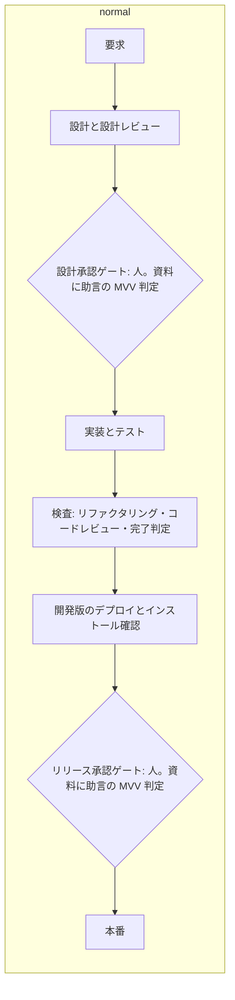
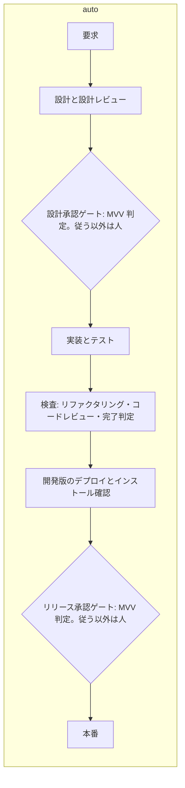
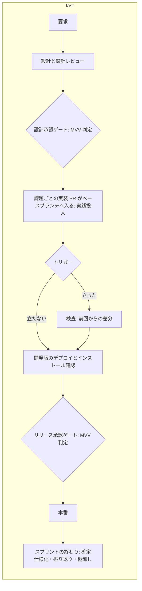

# 進め方（`pace`）

SKILL.md の「進め方（`pace`）」の続きである。3 つの進め方の定義の表は SKILL.md にあり、この文書は
進め方ごとのフロー・`fast` の工程の区分・`fast` と `auto` の使ってよい条件・設定の形・工程の進行表での流し方・
リリースのプランの版・承認ゲートで止まった後の続け方・検査のトリガー・MVV 判定・記録の読み方を持つ。

**目次:** [具体例: マイルストーン 26 の 2026-09-25 のリリース差分](#具体例-マイルストーン-26-の-2026-09-25-のリリース差分) / [フロー](#フロー) / [工程の区分（fast）](#工程の区分fast) / [使ってよい条件](#使ってよい条件) / [設定（.ndf/pace.json）](#設定ndfpacejson) / [スプリントを始める](#スプリントを始める) / [工程の進行表で流す](#工程の進行表で流す) / [リリースのプランの版](#リリースのプランの版) / [承認ゲートで止まった後の続け方](#承認ゲートで止まった後の続け方) / [検査のトリガー](#検査のトリガー) / [流出不具合の記録](#流出不具合の記録) / [MVV 判定（mvv-gate.py check）](#mvv-判定mvv-gatepy-check) / [記録の読み方と閾値の見直し](#記録の読み方と閾値の見直し)

## 具体例: マイルストーン 26 の 2026-09-25 のリリース差分

タグ `ndf--v10.17.10` から `ndf--v10.17.18` までに、リリースを除く Pull Request 41 本をベースブランチへマージし、本番へ
8 回リリースした。検査は Pull Request ごとに通さず、確定仕様化と振り返りは課題ごとに行わず、後で棚卸しを 55 件
まとめて行った。同じリリース差分を 3 つの進め方で回すと、次のように動く。

| 何が | `normal` | `auto` | `fast` |
| --- | --- | --- | --- |
| 承認 | 設計承認ゲート・リリース承認ゲートを利用者が承認する（8 版なら 16 回） | 各回を `mvv-gate.py` が判定し、「従う」なら通す。ほかは利用者が承認する | `auto` と同じ。利用者が承認するのはスプリントの開始時の MVV 1 回だけのこともある |
| リファクタリングとコードレビュー | スプリントのベースブランチ宛 Pull Request で 1 回ずつ、デプロイの前に | `normal` と同じ | `check-trigger.py eval` が点数 15・変更量 5,000 行・流出不具合の重なり・期限 24 時間を見て、立ったときだけ次の開発版の前に検査のプラン 1 本が入る。このリリース差分なら約 4 回（PR 約 10 本・約 2 時間に 1 回） |
| 単位 | スプリントブランチへ集めて 1 版 | `normal` と同じ | 課題ごとの Pull Request がベースブランチへ入り、開発版も課題ごと |
| 確定仕様化・受け入れ条件の確認・振り返り・棚卸し | 課題ごとに本番の後で | `normal` と同じ | 工程の進行表のまとめの行が、スプリントの終わりに 1 回ずつ流す |
| 工程の飛ばしの案内 | 全工程の記録を求める | `normal` と同じ | `構造改善`・`実装レビュー` を `トリガー:`、確定仕様化・振り返り・棚卸しを `まとめる:` の行に出し、記録を求めない |

## フロー

3 つとも左から右へ時間が進む。菱形は承認ゲートで、担い手を中に書く。`normal` と `auto` はノードの並びが同じで、
菱形の中だけが違う。検証（設計レビュー・テスト・検査）はデプロイの前に各工程で行う。





`fast` は実践投入（実装の Pull Request がベースブランチへ入り、開発版としてデプロイされ使われること）が検査より前に来る。
検査はトリガーが立ったときだけ、デプロイの後にまとめて通る。



`normal` と `auto` の確定仕様化・振り返り・棚卸しは、工程表どおり課題ごとに本番の後で行うため図に入れない。

## 工程の区分（`fast`）

**`fast` を指定したときだけ工程が次の区分に分かれる。** モードが対象外（—）とする工程は対象外のままである。
`auto` は `normal` と同じく全工程を工程表のとおりに通す。

| 区分 | 工程表の行 | いつ通すか |
| --- | --- | --- |
| その場で通す | 作業場所の用意 / 計画 / 実装 / 完了判定 / Pull Request / 後片付け / デプロイ / リリース後テスト | 課題ごと。実装のプランが範囲テスト → Draft の Pull Request（CI と並べる）→ 全体テスト → doc-lint → マージまでを通す。リリースは開発版と verify-install まで。本番は下のリリース承認ゲートに従う |
| トリガーで通す | リファクタリング / コードレビュー | 検査のトリガーが立ったとき、次の開発版の前に 1 回。範囲は前回の検査からの差分 |
| スプリントの終わりにまとめる | 確定仕様化 / 振り返り / 課題を閉じる（受け入れ条件の確認を含む。`progress-tracking` の「スプリントを閉じる」）/ 棚卸し | スプリントの終わりに 1 回ずつ |
| 省かない | 要求と受け入れ条件 / 設計 / ドキュメント再構成 / ドキュメントレビュー | モードの定めどおり。設計の承認が要る変更は設計 Pull Request を出す |

| 承認ゲート | `normal` | `auto` | `fast` |
| --- | --- | --- | --- |
| 設計承認ゲート（設計 Pull Request のマージ） | 利用者が承認する。`--state` を渡したスプリントでは、助言の MVV 判定（`mvv-gate.py check --advise`）の判定・理由・根拠を承認資料に載せる（どの判定でも人が承認する） | `mvv-gate.py` が「従う」と判定し、レッドラインに当たらなければ通す。ほかは利用者が承認する | `auto` と同じ |
| リリース承認ゲート（本番系へ届く操作） | 同上 | 同上 | 同上 |

## 使ってよい条件

**`progress.py new --pace fast|auto --state <スプリント状態ファイル>` が機械で確かめる。** 1 つでも欠ければ
`stopped`（終了コード 3）で進行表を作らず、`next` に `--pace normal` で打ち直す案内を示す。
conductor は `normal` で進める。`fast` と `auto` の条件は同じで、読む `.ndf/pace.json` の節（`<節>` は `fast` か `auto`）
だけが違う。ほかの節の値は使わない（`fast` だけを許した宣言では `auto` を断る）。

| 条件 | 確かめ方 |
| --- | --- |
| 開発版のチャネルがある | `.ndf/worktree.json` の `base_branch` が `production_branch`（無ければ既定ブランチ）と違う。同じなら、手動反映の本番系の形（下）であること |
| 導入の確認がある | `.ndf/pace.json` の `<節>.verify` にコマンドが書かれている。確認が走る置き場は下の「リリースの経路からステージを組む」 |
| リポジトリが許している | `.ndf/pace.json` の `<節>.enabled` が `true`。節が無ければ許さない |
| モードが対象に入る | `--mode` が `<節>.modes`（既定 `light` / `standard` / `legacy-refactor`）に入る。`operation` と `documentation` は書いても入らない |
| MVV が承認済み | スプリント状態ファイルに承認ゲート `MVV` の記録があり、その `sha256` が今の `mvv.md` と一致する。スプリント MVV が無いスプリントは、承認済みのプロジェクト MVV（[project-mvv.md](project-mvv.md)）と状態に残した参照（`project_mvv.sha256`）が一致する |
| プロジェクト MVV が改訂されていない | 状態の `project_mvv.sha256` が今の `.ndf/mvv.md` と一致する。宣言が 未承認・承認と一致しない・壊れている なら断る |

**手動反映の本番系の形。** 起点と本番チャネルが同じ（例 carmo-cdk: どちらも既定ブランチ。本番へは手で打つ `cdk deploy` で届く）でも、
`.ndf/project.json` の `delivery` が次をすべて満たせば開発版のチャネルがあると数える（判定は `lib/delivery.py` の `dev_channel`）。

- 読めて、`production: true`（本番系へ届く）の行が 1 つ以上ある。`production` は利用者が書く（解析は書かない）
- `production: true` の行がすべて `kind: manual`
- 本番チャネルへのマージで自動で反映する行（`kind: auto`・`branch` が本番チャネル・`production` が `false` でない）が無い

`delivery` が無い・不明・読めない、`production: true` の行が無いときは断る。この形では本番チャネルへのマージは本番系へ届かず、
`merge-gate` もリリース承認ゲートに数えない。リリース承認ゲートは手で行う本番のデプロイの前に掛かる（下の「リリースの経路からステージを組む」）。

**使ってはいけない場面:** 開発版のチャネルが無いリポジトリ（マージがそのまま本番に届く・本番系の行を宣言していない）、
インストールを確かめる手段が無いリリース、戻すのが高い変更（利用者のデータの移行など。下の「レッドライン」に当たるものは承認ゲートを省かない）。

## 設定（`.ndf/pace.json`）

**プロジェクトごとに違うものはこの設定で受け、スクリプトに埋め込まない。** 利用者が変える設定であり、
リポジトリに置いてレビューを通す。

| 項目 | 型 | 空・無いとき | 意味 |
| --- | --- | --- | --- |
| `version` | 数 | 許さない（`1` だけ。必須） | 宣言の形の版。無い・`1` 以外なら `check-trigger` / `mvv-gate` / `progress.py new --pace fast|auto` が止まる |
| `fast.enabled` | bool | 偽 | `fast` を許すか |
| `fast.modes` | 文字列の配列 | 既定の 3 つ | `fast` を使ってよいモード |
| `fast.verify` | 文字列 | `fast` を断る | 導入の確認のコマンド |
| `auto.enabled` | bool | 偽 | `auto` を許すか |
| `auto.modes` | 文字列の配列 | 既定の 3 つ | `auto` を使ってよいモード |
| `auto.verify` | 文字列 | `auto` を断る | 導入の確認のコマンド（`fast.verify` と共有しない） |
| `areas[].name` / `common` / `paths` | 文字列 / bool / glob の配列 | name と paths は許さない | 領域。`common` が真なら重点領域で、触った Pull Request は `common_weight` 点。流出不具合の重なりはこの単位で数える |
| `boundary_paths` | glob の配列 | 機械のチェックは無し | レッドラインに当たるファイル |
| `triggers.score` / `common_weight` / `lines` / `escapes` / `hours` | 数 | 15 / 2 / 5000 / 2 / 24 | トリガーの閾値 |
| `loop.enabled` | bool | 偽（ループを断る） | 開発ループ（`--loop`）を許すか。ループの 1 回は `auto` で組むため `auto` 節も要る。手順は [loop.md](loop.md) |
| `loop.budget.laps` / `usd` / `hours` | 正の数か `null` | 無制限（書かない・`null`） | ループの予算（ループの回数・費用・動いていた時間）。書いた単位だけ効き、予算以上になったループの 1 回の境で止まる |
| `loop.same_failure` | 1 以上の整数 | 2 | 同じ失敗（課題の組・計画の種類・止まったところ）が続いたら止まる回数 |
| `loop.max_issues` | 1 以上の整数 | 3 | 1 周の課題の上限。候補は `loop start` の実行環境の調査が出し、書くのは人である |
| `parallel.answer_limit.plan` / `lane` | 正の整数 | 8 / 3（正の整数でない値は既定へ戻して警告を出す） | 並列の計画の答え待ちの閾値。超えるとレーンが区切りで止まる。手順は [parallel.md](parallel.md) の「答え待ちの停止」 |
| `business_hours` | オブジェクト | 宣言なし（業務時間内として扱う） | 業務時間。下の「業務時間」 |

**`loop` 節は `read_loop` だけが読む。** 節の形が誤っていても、`fast` / `auto` / トリガー / MVV 判定は今どおり動き、
ループの開始だけが断る。

glob の `**` は区切りをまたぎ、`*` と `?` はまたがない。どの領域にも当たらないファイルは、ディレクトリの
先頭 3 階層（例 `plugins/ndf/skills`）を領域の名前にする。

### 業務時間

業務時間は、利用者が承認ゲートへ答えられる時間帯である。書いたリポジトリでは、業務時間外に開発ループが設計を要る課題を先に選び
（[loop.md](loop.md) の「業務時間外の選定」）、オーガナイザーが設計の承認と問いを溜めて業務時間の始めにまとめて示す
（[parallel.md](parallel.md) の「業務時間外の依頼」）。値は利用者が書く。

```json
{"version": 1, "business_hours": {"timezone": "Asia/Tokyo", "days": ["mon", "tue", "wed", "thu", "fri"], "start": "09:00", "end": "18:00"}}
```

| 項目 | 規則 |
| --- | --- |
| `timezone` | IANA の時刻帯の名前（必須）。判定はこの時刻帯だけで行い、実行するマシンの時刻帯に依らない。`+09:00` のようなオフセットは受けない |
| `days` | `mon`〜`sun` の重ならない 1 個以上の配列 |
| `start` / `end` | `HH:MM`（00:00〜23:59）。`start` を含み `end` を含まない。`start` は `end` より前にする（日をまたぐ宣言は受けない） |

- 不正な宣言は、宣言全体を無いものとして扱う（一部の項目だけを既定へ戻さない）。`loop start`・`parallel.py check`・`start` が
  `rule: business-hours` の警告を出し、ループも計画も止めない
- 祝日と休暇は扱わない。止めたい日は `days` を書き換える
- 判定はループの 1 回の境とオーガナイザーの `wait` でだけ行う。動いているプランと流れているリリースは、業務時間の境をまたいでも止めない

## スプリントを始める

**承認の記録が無いうちは `progress.py new --pace fast|auto` が進行表を作らないため、設計は始まらない。** 手順は
`fast` と `auto` で同じで、`<値>` に進め方を入れる。

| 順 | 打つもの | 失敗・未承認のとき |
| --- | --- | --- |
| 1 | `sprint-state.py init <状態> --name <名> --pace <値> --milestone <M>` | 終了コード 3（説明に `## Mission` / `## Vision` / `## Value` がそろわない・読めない）: 利用者に説明を直してもらい打ち直す |
| 2 | conductor が `mvv.md`（スプリント状態ファイルの隣）を利用者へ示し、承認を得る（設計承認ゲートの委任の承認として `AskUserQuestion` に `ndf-gate:1` を付ける） | 承認されない: 説明を直して 1 から。`normal` で進めてもよい |
| 3 | `sprint-state.py gate <状態> MVV --what <要約>` | — |
| 4 | `progress.py new ... --pace <値> --state <状態>` | 終了コード 3（承認の記録が無い・ハッシュ不一致・宣言が許していない）: 2 へ戻るか `normal` で進める |

`--mvv <ファイル>` を渡すと、マイルストーンからコピーせずにそのファイルを使う。承認済みのプロジェクト MVV がある
リポジトリ（`--root`）では、`init` がその参照（版・sha256）を状態に書き、スプリント MVV を `project-mvv.py vet --kind sprint` に
通す。プロジェクト MVV のレッドラインを緩める・Value を打ち消すスプリント MVV は、状態を書かずに箇所を示して止まる（終了コード 1）。
照合の入力（判定の指示・共通原則・プロジェクト MVV・照合する本文）が前と 1 字も変わらず、同じ入力の最新の判定が「従う」なら、
`init` は LLM を呼ばずにその判定を使い、照合の記録へ再利用の行（`reused_from` に元の判定の時刻）を足す。入力が変わったとき・
最新の判定が「従う」でないときは LLM で判定し直す。`project-mvv.py vet` は毎回 LLM で判定するため、判定をやり直したいときに打つ。
`--milestone` も `--mvv` も渡さなければ、プロジェクト MVV だけで判定する（承認ゲート `MVV` の記録は要らない）。**承認の後に MVV を書き換えると
ハッシュが食い違い、判定は利用者の承認へ戻る。**

## 工程の進行表で流す

**どの進め方でも、スプリントの工程の並びは工程の定義（`plugins/ndf/contracts/workflow/modes/<モード>.json`）が持ち、
`progress.py new` が進行表を作り、`progress.py next` が次の工程を流す。** 開発ループのループの 1 回も同じ進行表で流す
（`sprint-state.py loop sprint` が `progress.py new --pace auto` を打つ）。流し方・再開・待ちの答え方は
[waiting.md](waiting.md) の「スプリントを流すコマンド」にある。

| 進め方 | 待ちの行（`ドキュメントレビュー` の承認・`デプロイ` のリリース）での扱い |
| --- | --- |
| `normal` | `progress.py next` が終了コード 10 で待ちに入る。利用者が答える |
| `auto` / `fast` | 待ちに入る前に `mvv-gate.py check` を打ち、「従う」なら `by: mvv` の答えを書いて止まらずに続ける。ほかは終了コード 10 で利用者の答えを待つ。オーガナイザーへリリースの依頼を送った待ちには当てない |

**`progress.py new --pace fast|auto --state <状態>` は、使ってよい条件を何かを書く前に確かめる。** 宣言・開発版のチャネル・
MVV の承認の記録に加え、`fast` はスプリントブランチを本番まで使う取り込み方（`.ndf/worktree.json` の `branch_flow.promotion`）と
組めない。外れれば進行表を作らずに止まる。

**デプロイの工程は、開発版のリリースのプラン（`supervise.py new release --channel dev`）を流してから、リリースの答えを待つ。**
並列の計画のレーンで作った進行表（`--lane`）では、待ちの前にオーガナイザーへリリースの依頼（`parallel.py request`）を送る。

## リリースのプランの版

**テンプレートの経路の版数は、リリースのプランを流す時点に決まる。** `--version` は明示の版で、
省けばプランは具体的な版の代わりに版の差し込み（`{release_version}`・`{release_base}`）を持ち、作業場所・`branch`・承認資料の
パスも差し込みで書く。キュー（`supervise.py queue`）が開発版のプランを流す直前に origin のベースブランチの版と最新のリリースタグから次に空いている
版を決め（新しい系列を始めるときの上げ幅は `--level`、既定は `patch`）、プランの状態ディレクトリの版の記録（`version.json`）へ
決めた版・読んだ値・上げ幅を書いてから差し込みを埋める。流し直しは記録の版を使い、自分のデプロイがベースブランチへマージされる
前に別のスプリントがその版を出していたときだけ、次に空いている版へ決め直す（前の版・理由・前の作業場所と `branch` は
記録の `history` に残し、前のステップの記録は状態ディレクトリの `superseded/v<前の版>/` へ移してプランを頭から流す）。
本番のプランは開発版のプラン `release` の版の記録の `base` で出す。

**次のときはプランを流さずに止まる。** queue の結果は `stopped` で、流さなかったプランの項目の `version` に `cause` と
材料が載る。別の版で黙って進めないため、どの版で出すかは人へ戻す。

| `cause` | いつ | 載る材料 |
| --- | --- | --- |
| `taken` | 明示の版がすでに出ている（開発版はベースブランチの版が同じか大きい、正式版は同じ版のタグがある）。本番の版のタグがすでにある | `existing`（既に出ている版）・`next_free`（次に空いている版） |
| `unreadable` | origin のベースブランチ・本番のブランチ・タグのどれか、または自分のリリースの PR の照会を読めない | `unreadable`（読めなかったもの） |
| `no_series` | 本番が版を読む開発版のプランの版の記録が無い | — |
| `series_changed` | リリース承認ゲートを通った後に、開発版の記録の版が変わった | `existing`（承認した版）・`version`（新しい版） |

リリースの `bump` も、新しい版がベースブランチの版以下か、既にタグのある正式版なら書き換えずに止まる（終了コード 3。
読めなければ 2）。どちらも judge を通らずにプランが止まる。版の差し込みを持たない前のプランにも、この止まり方が当たる。

## 承認ゲートで止まった後の続け方

**待ちに入ったら、conductor は承認資料（`approval-request.md` の形）に判定・理由・根拠の項目（`mvv-gate.py` の結果の
`items`）を添えて利用者へ示す。** 利用者の答えを `progress.py answer <進行表の ID> <待っている行> --approved|--rejected` で書いてから
`progress.py next` を打ち直す（続きの位置は進行表が決める）。工程のプランの中で止まったステップの続き（`merge-gate` の承認の後の
`merge-approved`、差し戻しの後の `reject` など）は、答えの後に `progress.py next` が同じプランの止まったステップの次から流す。

**判定と食い違う答えは覆しとして残る。** 「従う」で自動に通った後の差し戻しは `override_reject`、「従わない」「判定できない」で
止まった後の承認は `override_pass` になる（[project-mvv.md](project-mvv.md) の「改訂の兆候」）。`handoff` で止まった後は
`by: mvv` の記録が外れているため、承認も差し戻しも覆しとして書かれない。マージ済みの変更を戻す操作そのものは、取り消しの
Pull Request で行う。

## 検査のトリガー

**検査のトリガーは `fast` だけが使う。** トリガーの判定はスクリプトが行い（`check-trigger.py eval`）、通信しない**（git の履歴だけを読む）。立てば
終了コード 0、立たなければ 3、設定が読めない・git が無い・範囲を決められないときは 2。**読めないのに黙って飛ばすと
検査が永久に立たなくなるため、2 と 3 を混ぜない。**

| トリガー | 立つ条件 | 数え方 |
| --- | --- | --- |
| `score` | 点数 ≥ `triggers.score` | 範囲の `Merge pull request #N from <所有者>/<ブランチ>`（`release/` と `check/` を除く）を 1 本とし、重点領域を触れば `common_weight` 点、ほかは 1 点 |
| `lines` | 行数 > `triggers.lines` | `git diff --shortstat <from> <to>` の追加 + 削除 |
| `escapes` | ある領域の流出不具合 ≥ `triggers.escapes` | 前回の検査の後の記録を領域ごとに数える。1 件の領域は検査の範囲の 2 番目の群へ入れるだけ |
| `hours` | 経過 ≥ `triggers.hours` かつ PR ≥ 1 | 前回の検査の時刻から今まで |
| `final` | `--final` を渡し、PR ≥ 1 | 範囲が空なら立たない（最終の検査を飛ばす）。`--sprint` があれば範囲は下の「最終の検査の範囲」で、文書のファイルだけでも立たない |
| `review` | `--review` を渡し、PR ≥ 1 | 範囲の起点は、レビューだけの回を含む前回の検査。ほかのトリガーは見ない |

**コードレビューは開発版ごとに 1 回通し、リファクタリングはトリガーが立ったときだけ通す。** 実装の Pull Request は
レビューを通らずにベースブランチへ入るため、トリガーだけに頼るとレビューの無いリリースが続く。レビューだけの回の記録は
`only: review` を持ち、リファクタリングを含む検査の範囲の起点にならない（レビューを通すたびにリファクタリングのトリガーが
数え直しにならない）。

**最終の検査の範囲**（`eval` と `prepare` の `--sprint <M> --issue <課題>...`）は、範囲の起点から先頭までの Pull Request のうち、
スプリントに属し（head のブランチの最後の区切りが `M`（`sprint/<M>`・`spec/<M>`）か、ブランチ名が課題の番号を `issue-<番号>` の形で持つ）、
まだ検査していないものだけである。PR を指す検査の行（スプリントの検査）の `target_pr` は、コードレビューだけの回でも検査済みに数える。
差分の検査の行の `prs` は、リファクタリングを含む最終の検査ではリファクタリングを含む回だけを数える。`--sprint` のある判定は `final`
（`--review` なら `review`）のトリガーだけを見て、範囲が空か、範囲のファイルが文書のファイルだけ（`.ndf/project.json` の `docs`。振る舞いを
決める文書は数えない）なら立たない。判定の出力の `metrics` は外した Pull Request（`other`・`checked`）・範囲の間に挟まったほかの Pull Request の
数（`interleaved`）・印を進めてよい位置（`advance_to`）を持つ。`prepare` は `check-base/<名>` を範囲の最初の Pull Request の手前に置き、
作業ブランチを範囲の最後の Pull Request のマージのコミットへ合わせる。`record` は検査の行を `scope: sprint` で書き、検査の印を
`advance_to`（まだその種類の検査を通していない最初の Pull Request の手前）までだけ進める。

**重点領域を触ったことは単独のトリガーにしない。** 2026-09-25 のリリース差分では 41 本のうち 31 本（76%）が重点領域を触っており、
単独で立てると PR ごとの検査と変わらない。点数の重みと、検査の中で先に見る範囲にだけ使う。

**前回の検査は、origin のブランチ `check-done/review`（コードレビュー）と `check-done/check`（リファクタリングを含む
検査）が持つ。** `record` は結果が `merged` か `no_change` のとき、見終えた位置（`to`）をこのブランチへ送る
（リファクタリングを含む検査は両方、`--review-only` は `check-done/review` だけ）。その位置が次の範囲の `from` になり、
時刻が期限の起点になる。ブランチが無ければ、手元の記録の最新の行、`--since <ref>`、リリースの設定（`.ndf/supervise.json`
の `release`。`package-plugin` なら `<plugin>--v*`）が決める最新の正式版のタグ、ベースブランチとの分岐点の順に使う。

**見終えた位置を origin に置くのは、検査を通らずにリリースされた変更を次の検査で必ず見るためである。** 手元の記録は
置き場が消えれば失われ、別のマシンからは見えない。失われたまま正式版のタグへ戻ると、トリガーが立たずにリリースされた
Pull Request が範囲から外れる。ブランチはリポジトリにあるため、PR のマージの仕方（merge / squash）にも依らない。
**初めて使うリポジトリでは、どこまで見たかを渡す**（プランは `new check --since-last --since-ref <ref>`、直接なら `eval --since <ref>`。渡さなければ最新の正式版のタグから）。

### 検査のプラン（`new check --since-last --id <名>`）

範囲は**前回の検査の時点（`check-base/<名>`）を宛先にした Pull Request** で表す。`cross-refactoring` と
`cross-review` は Pull Request 1 本を入力に取るため、駆動を変えずに差分全体を見られる。

| ステップ | 内容 |
| --- | --- |
| `prepare` | `check-trigger.py prepare`: `check-base/<名>` を `from` に作って送る（残っていれば付け直す）。範囲を状態ディレクトリの `check.json` へ |
| `pr` → `assess` → `refactor` → `review` → `base-sync` → `test-all` | いつもの検査と同じ。`base-sync` は起点のブランチを取り込んで push し（`merged-steps.py base-sync`。衝突が残れば `fix-base` が解く）、全体テストの修正の後も `base-sync` から測り直す。`refactor` の範囲は `check-trigger.py scope`（重点領域 → 流出不具合の領域 → その他）。`--review-only` は `assess` と `refactor` を持たず、`pr` → `review` と進む |
| `finish` | 宛先をベースブランチへ付け替える。検査で変更が無ければ Pull Request を閉じて `record` へ飛ぶ |
| `ready` → `merge` → `record` | マージして検査の記録を足し、`check-base/<名>` を消す |
| `abort` / `abort-before-pr` | 落ちたステップと judge の止める判断（`abort`）の行き先。`result: failed` と落ちたステップを記録し、`check-base/<名>` を消し、Pull Request を閉じて止まる |

**`failed` の後の次の評価は同じ `from` から数え直すため、範囲を取りこぼさない。**

## 流出不具合の記録

流出不具合の記録は `fast` の検査のトリガーの材料である。**マージ済みの変更の不具合を即時修正すると決めたら、`new fix --escape-of <持ち込んだ PR>` でプランを組む**
（直した作業場所を テスト → Pull Request → `merge-when-green` で流す。worker に直させるなら `new impl --escape-of`）。
即時修正にする条件はどの `pace` でも同じで、[../SKILL.md](../SKILL.md) の「即時修正」にある。
マージの後に `check-trigger.py escape` のステップが入り、直した Pull Request が触った領域を記録する。持ち込んだ
Pull Request が分からなければ `0`（不明）を渡す。`fix/` のブランチの本数では数えない。
前から起票されていた不具合が大半で、題名で数えると重なりのトリガーが毎回立つ。

## MVV 判定（`mvv-gate.py check`）

```text
mvv-gate.py check --sprint <状態> --gate design|release [--material F...] [--pr N...] [--mode M] [--root DIR] [--note F]
```

**機械のチェックを LLM の判定より先に通し、1 つでも外れれば LLM を呼ばずに承認ゲート（終了コード 10）へ戻す。**

1. プロジェクト MVV が 未承認・承認と一致しない・壊れている のどれでもない
2. MVV の承認の記録があり、今の `mvv.md` のハッシュ・状態の `mvv.sha256`・承認の記録の `sha256` が一致する（スプリント MVV が
   無ければ、承認済みのプロジェクト MVV と状態の参照が一致する）
3. `--mode` が `operation` でも `documentation` でもない
4. `--pr` の変更したファイルが `boundary_paths` に当たらない
5. `--pr` が `.ndf/mvv.md`・`.ndf/mvv.json` を変えない（共通原則の C7。宣言では外せない）

通れば最小構成の `claude -p` に MVV の節（NDF の共通原則 → プロジェクト MVV → スプリント MVV → 判断の決まり）とエビデンスを
渡し、`verdict`（follow / not_follow / unknown）・`reasons`・`boundary`・`basis`（根拠の項目）を JSON で返させる。**「従う」で `boundary` が空のときだけ** `sprint-state.py gate` で承認ゲートの記録（`by: mvv`・判定・
理由・ログのパス）を書いて 0 を返す。ほか（従わない・判定できない・読めない・エビデンスが無い・記録を書けない）は 10 で、
利用者の承認へ戻る。判定はすべて `mvv-gate.jsonl` へ 1 行ずつ残る（`project_mvv` の参照と `basis` を含む）。
利用者が承認ゲートで答えたら `sprint-state.py gate <状態> <承認ゲート> --what <要約> --by user [--pr <設計 PR>] --outcome approved|rejected` を打つ。
答えが直前の MVV 判定と食い違えば改訂の兆候（覆し）が残る（[project-mvv.md](project-mvv.md) の「改訂の兆候」）。**リリースの前に取れない実測（リリースした後の効果）は
判定の対象にせず、リリースの後の測定へ回す。**

### 助言の MVV 判定（`normal`）

**`mvv-gate.py check --advise` は、承認ゲートの記録を書かない助言の判定である。** 判定の規則・機械のチェック・レッドラインは上と同じで、
違いは次の 4 点である。

| 違い | `--advise` の扱い |
| --- | --- |
| 承認ゲートの記録 | 書かない（`by: mvv` は無い）。どの判定でも利用者が承認する |
| 終了コード | どの判定でも 0。機械のチェックで外れたときも、外れた理由を判定の記録の理由の欄に載せて 0 |
| プロジェクト MVV が承認済みでない | LLM も `mvv-gate.jsonl` の行も判定の記録も出さず、`verdict: none` を返す。承認資料には「MVV なし」と書く |
| スプリント MVV・進め方の宣言 | スプリント MVV の承認の記録（承認ゲート `MVV`）を求めず、ファイルと状態の sha256 の一致だけを見る。`.ndf/pace.json` が無ければレッドラインのパスを空とする |

判定の行は `mvv-gate.jsonl` に `pace: normal` として残り、改訂の兆候は `auto` / `fast` と分けずに数える。`sprint-state.py init` は
どの進め方でも承認済みのプロジェクト MVV の参照を状態へ書き、`normal` でも `--mvv` か `--milestone` からスプリント MVV をコピーする
（コピーできなくても止めず、照合もしない）。この参照を持たない `normal` の状態では、判定が「機械のチェックで外れた」になる。

### レッドライン

**次のどれかに当たれば、判定が「従う」でも利用者の承認を求める。** 問いは承認ゲートの場で出し、`metadata.source` はその承認ゲートの `ndf-gate:<番号>` にする。

| 種類 | 機械で見る所 | LLM で見る所 |
| --- | --- | --- |
| 秘密（トークン・鍵・認証情報）・認証認可・利用者のデータ | `boundary_paths` に当たるファイルを変えた | `boundary` 欄 |
| 戻せない操作（履歴の書き換え・強制 push・データの削除。本番へのリリースの定型の手順が打つマージとタグは含めない） | — | 同上 |
| 他のリポジトリへの公開 | — | 同上 |
| `operation` / `documentation` のモード | プランの `モード` | — |
| MVV が承認されていない、または承認の後に変わった | `mvv.sha256` と承認の記録の `sha256` | — |

**MVV の承認を設計承認ゲート・リリース承認ゲートの事前の許可として扱うのは、承認の記録・ハッシュの一致・判定の記録（スプリント状態ファイルと
Pull Request のコメント）の 3 つがそろったときに限る。** レビューの approve（`gh pr review --approve`）は `fast`
と `auto` でもしない（`AGENTS.md`）。

## 記録の読み方と閾値の見直し

自動で通した承認ゲートの記録と、検査の記録の読み方・閾値の見直しは [pace-records.md](pace-records.md) にある。
