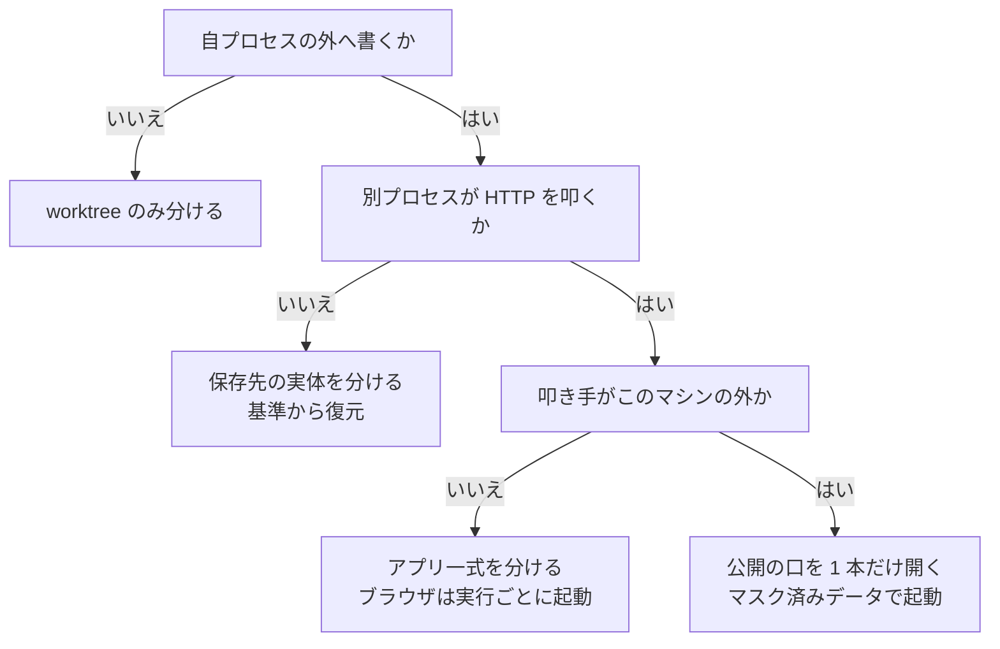

# worktree でのテスト実行

必要な分離の範囲は、テストが自プロセスの外へ何を書き、誰がそれを叩くかで決まる。
外部依存が無ければ worktree のファイルだけ、データ保存先へ書くならその実体ごと、画面を
開くならアプリ一式、外から到達させるなら公開のエンドポイントを分ける。

## この文書が受け取る値

| 変数 | 値 | 決め方 |
| --- | --- | --- |
| `$SCRIPTS` | プラグインの `scripts/` の絶対パス | [SKILL.md](../SKILL.md) の手順 0。シェルが変わったら決め直す |
| `$WT` | 対象の worktree の絶対パス | 呼び出し側が決める |

**続けて実行するときは 1 つの bash ブロックへまとめる。** 先頭で 1 度決めれば、後続のコマンドは決め直さずに済む（推奨であり、1 コマンドずつ実行してもよい）。

## この文書での「テスト環境」

**1 つの worktree に対応して立ち上げる、テスト実行に必要なサービスの一式**を指す。
番号で識別され、他の worktree のものとポート・データ保存先・ネットワークを共有しない。

[`local-environment.md`](local-environment.md) が扱う「ローカル環境」とは用途が異なる。
ローカル環境は人が画面を触って確かめるためのもので、メインディレクトリの 1 セットを共有する
ことが既定である。テスト環境は自動テストのために worktree ごとに立て、使い終えたら破棄する。

## 分離の範囲を決める



| 種類 | 外部依存 | 分離の範囲 | 同時実行 |
| --- | --- | --- | --- |
| 単体（外部依存なし） | なし | worktree のファイルと依存物 | 可 |
| データ保存先を要する | データベース・キャッシュ | 保存先の実体とアプリのプロセス | 可（メモリ上限まで） |
| ブラウザを使う | 上記 + HTTP のエントリポイント + ブラウザ | アプリ一式・ブラウザ・証跡の出力先 | 可（同上） |
| 実機・外部サービス受信 | 上記 + 外部からの到達 | 公開ホスト名と折り返し先 | 折り返しを使う検証は 1 本のみ |

**テストの置き場所やスイート名で判定しない。** 確認した構成では、外部依存が無いはずの区分に
置かれた 839 件のうち 511 件が、データベースを使う仕組みを取り込んでいた。判定は依存を
持ち込む記述の有無で行い、判定コマンドは設定の `testenv.test_kinds.<種類>.select` が持つ。

この判定でも取りこぼしは残る。初回は 1 度走らせ、落ちたものを外部依存ありへ移す。

## 採番

```bash
bash "$SCRIPTS/worktree-testenv.sh" env "$WT"
```

環境名・スロット・ポートを出力し、worktree レジストリへ記録する。**同じ worktree には常に同じ値が返る。**

| 対象 | 規則 |
| --- | --- |
| 環境名 | `<リポジトリ>-wt-<ブランチ>-<ブランチの要約値 6 桁>`（小文字英数と `-`、40 文字で切る）。**切るのはブランチの側で、要約値は必ず残す** |
| スロット | worktree レジストリが 0〜63 の最小空き番号を割り当て、以後同じ番号を返す |
| ポート | `<帯の下限> + スロット*20 + 役割番号`。帯と役割番号は設定が持つ。**帯の上限を超える採番は拒否する** |
| 保存先の名前 | 変えない。実体が別なので衝突しない |
| 公開ホスト名 | `wt<スロット>.<公開の基底名>` |

worktree レジストリは共通の git ディレクトリ配下（`.git/ndf/worktree-registry.json`）に置く。worktree の
中に置くと、その worktree を削除した時点で割り当ての記録が消える。

**割り当てを解放しても行は消さず、解放の時刻を書き込む。** 同じ番号を別の worktree が
使った履歴と、外部公開の記録が残る。空きの判定は解放時刻が空の行だけを見るため、履歴は
判定に影響しない。定義は [`../schemas/registry.schema.json`](../schemas/registry.schema.json)。

## データ保存先を要するテスト

**分離は名前の付け替えではなく、保存先の実体を分けることで行う。** 初期化の処理が接続先を
記述の中に固定していると、名前を変える方式は成立しない。実測では、副系統を指す記述を含む
スクリプトが 109 本と 15 本存在した。実体を分ければ名前を変えずに済む。

1. **採番する** — `worktree-testenv.sh env "$WT"`

2. **依存物を持ち込む** — 手順は [`local-environment.md`](local-environment.md) と共通。
   ハードリンク複製を使い、書き換えられるディレクトリだけ実体を複製する。**symlink は
   使わない**（worktree のテストがメインディレクトリのコードを読む）

3. **環境ファイルを置く** — 追跡外のため worktree へは複製されず、読み込み処理は例外を
   出さずに既定値へ落ちる。置き忘れは接続先の取り違えとして現れる。スロット固有の上書き値は
   共通の git ディレクトリ配下へ所有者のみ読み書きできる権限で置く。**worktree の中には
   資格情報を増やさない**

4. **基準を焼く（初回とデータ構造の変更時のみ）** — タグはデータ構造を定める資産の内容から
   決まる。同じ内容なら焼き直しは発生しない

   ```bash
   TAG=$(bash "$SCRIPTS/worktree-testenv.sh" tag "$WT")
   bash "$SCRIPTS/worktree-testenv.sh" bake --tag "$TAG"   # 2 なら同じタグの基準が既にある
   ```

5. **復元して起動する** — `worktree-testenv.sh up "$WT" --profile core`。ホストポートは
   公開しない。**定義に無いコンテナを削除する指定を付けない**（稼働中のプロジェクトに定義外の
   コンテナが属していることがある）

   起動時に採番した値が環境変数で定義へ渡る。**定義側がこれを参照しないと分離は効かない。**

   | 変数 | 値 |
   | --- | --- |
   | `NDF_ENVIRONMENT` | 環境名（compose のプロジェクト名にも使う） |
   | `NDF_SLOT` | スロット番号 |
   | `NDF_WORKTREE` | worktree の絶対パス |
   | `NDF_SHARED_NETWORK` | 設定の `shared_network` |
   | `NDF_PORT_<役割名>` | 採番したポート。役割名は大文字にし、英数以外は `_` へ置き換える |

   ```yaml
   # docker-compose.worktree.yml の例
   services:
     nginx:
       ports:
         - "${NDF_PORT_HTTP}:80"
   ```

6. **差分を当てる** — ブランチがデータ構造の変更を追加していれば、更新を 1 回だけ流す

7. **実行する** — 初期化を抑止する指定は設定の `skip_reset` が持ち、実行時に渡る。渡らないと
   最初のテストが全体を作り直す構成がある（実測では 1,790 本の定義を流し直した）

   ```bash
   bash "$SCRIPTS/worktree-testenv.sh" test "$WT" --kind stateful
   ```

`test` は**実行したコマンドの終了コードをそのまま返す**。テストの成否を包み隠さないためである。

保存先へ管理権限で接続するときは、資格情報をコマンドの引数に置かない。引数はプロセス一覧から
読める。対象コンテナ自身が持つ環境変数をその場で参照する。

## ブラウザを使うテスト

1. 上の手順 1〜6 を済ませ、画面の配信に要るサービスまで含めて起動する
   （`up "$WT" --profile browser`）

2. **エントリポイントはコンテナ間の名前で指し、ホストポートを使わない。** HTTP を配信するサービスを、
   テストを実行する場所から届くネットワークへ参加させる。ネットワーク名は設定の
   `shared_network` が持ち、無ければ作る。テストの実行がホストで行われる構成では、代わりに
   採番したポートを 1 つ公開する

3. アプリが組み立てる絶対 URL を到達先へ揃える

4. **ブラウザは実行ごとに起動する構成を選ぶ。** 常駐しているブラウザへ接続する構成は、
   接続先が 1 つで既存のタブをそのまま操作するため、2 本の実行が同じタブを奪い合う

5. 接続先と出力先は環境変数で外から与える（`base_url_env` / `out_env`）。エントリポイントの役割名は
   `port_role` で指定する（既定は `http`）

   ```bash
   bash "$SCRIPTS/worktree-testenv.sh" test "$WT" --kind browser
   ```

証跡の置き場所は、その worktree 限りの除外設定（`.git/info/exclude`）へ自動で登録される。
リポジトリの `.gitignore` は触らない。

**証跡は worktree 配下へ固定する。** 既定の出力先が秒単位の識別子しか持たない場合、同じ
ディレクトリで同時に開始した 2 本が同じ場所へ書き合う。環境名を出力先に含めて避ける。
共有の保管先へは送らない。

## 実機や外部サービスからの通信を受ける検証

**公開するのは、マスク済みデータで焼いた基準を載せたテスト環境だけとする。**

```bash
bash "$SCRIPTS/worktree-testenv.sh" expose "$WT"     # 0 完了 / 1 条件を満たさず拒否
bash "$SCRIPTS/worktree-testenv.sh" unexpose "$WT"
```

拒否する条件は次の 3 つで、1 つでも該当すれば公開しない（終了コード 1）。どれに当たったかは
標準エラーへ出る。

1. 設定の `testenv.expose.enabled` が偽（**既定**）
2. 載っている基準の識別子が `testenv.expose.public_tag` と一致しない。行に基準の識別子が無い割り当ての `up` は、同じプロジェクトのボリュームが残っているか確かめられないときは識別子を書かない。古いデータの上で照合を通さないためで、`down "$WT" --volumes` の後に `up` を打ち直すと書かれる
3. 折り返しを使う公開が既に別のテスト環境で開いている

**公開のエンドポイントを開ける手段は設定が持つ。** 共有のエントリポイントの設定や折り返しのラッパーの作り方はリポジトリごとに
違うため、`testenv.expose.open_command` と `close_command` に書く。設定が無ければ公開せず、
終了コード 2 で終わる（記録も残さない）。どちらのコマンドにも `NDF_EXPOSE_URL` /
`NDF_EXPOSE_HOST` / `NDF_EXPOSE_ENVIRONMENT` / `NDF_EXPOSE_SLOT` が環境変数で渡る。閉じる側にも
同じ値を渡すのは、環境名やスロットを資源の名前に使っている構成で、URL だけでは後片付けの対象を
特定できないためである。

記録を先に置いてからコマンドを実行するのは、先着 1 本だけが通る排他を通ったことを示すためである。
**開けるコマンドが失敗すれば記録を戻す。** 残すと、次の公開が「別が公開中」で拒まれ続ける。

**閉じるコマンドが失敗したときは、worktree レジストリを閉じない**（`unexpose` は終了コード 1 を返す）。
閉じられていないのにworktree レジストリだけ閉じると、エンドポイントが開いたまま次の公開が通る。手で閉じてから
`unexpose` をやり直す。

あわせて次を満たさない限り公開しない。仕組みで判定できないため、手順として置く。

- デバッグ用の表示を止める。例外の画面が環境変数を、計測用の表示が発行済みの問い合わせを
  見せる経路が実在する
- **公開のエンドポイントはホストポート 1 本に集約する。** 共有のエントリポイントが要求先の名前で振り分け、既定は
  全拒否とする
- 画面を開く経路には認証を前置する。外すのは、署名の検証を自前で行う経路に限る
- 折り返しのラッパーでは要求先の名前を保ち、圧縮や本文の書き換えを挟まない。署名の検証対象が壊れる
- 公開するのは HTTP を配信するサービスだけとする。保存先・オブジェクトストレージ・
  メール受信・検索は公開しない
- 公開中に取った証跡には利用者の入力と資格情報が含まれる。共有の保管先へ送らず worktree 内に
  留める

同一ネットワーク内の実機からは、採番したポートを 1 つだけ公開して
`http://<ホストの LAN IP>:<ポート>` で開く。**安全な文脈を要する機能（カメラ取得・
常駐ワーカー・端末認証）は、暗号化されていない経路では確認できない。** その場合は固定の
ホスト名を持つラッパーを使う。

切り分けは、コンテナからエントリポイント、ホストから公開ポート、同一ネットワークから公開ポート、実機の
順に行う。

## コンテナで走るテストの到達の確認

コンテナの中でテストを走らせるリポジトリでは、コンテナがメインディレクトリをマウントしていると、テストは
メインディレクトリのコードで走り、worktree の変更を見ないまま通ってしまう。NDF は走らせる前に、そのコンテナが
worktree を見ているかを確かめ（到達の確認）、見ていなければテスト環境を起こして確かめ直す（テスト環境の用意）。
それでも見ていなければ走らせない。

対象は次の 2 つだけである。コマンドの語からは判定しない。

| 書く場所 | 何を書くか | 確かめる経路 |
| --- | --- | --- |
| `.ndf/project.json` の `test.suites[].container` | `service`（とテスト環境が無いときの `compose_files`） | `test-run.py`（3 層）・cross-refactoring の範囲テストと全体テスト |
| `.ndf/worktree.json` の `testenv.test_kinds.<種類>.service` | サービス名 | `worktree-testenv.sh test` |

確かめ方: worktree に探りの印（`.ndf-evidence/reach-<乱数>`）を置き、`worktree-testenv.sh compose-env` が出す
テスト環境の値（`NDF_*`・`COMPOSE_PROJECT_NAME`・`COMPOSE_FILE`）を付けて `docker compose exec -T <サービス> cat <印>`
を打つ。中身が一致すれば、同じ値を付けてテストのコマンドを走らせる。印は共通の git ディレクトリの
`info/exclude` へ `.ndf-evidence/` を登録してから置き、確かめた後に消す。

```bash
bash "$SCRIPTS/worktree-testenv.sh" compose-env "$WT"   # 割り当て済みのテスト環境へ向ける値（割り当てを新しく取らない）
python3 "$SCRIPTS/lib/container_reach.py" probe "$WT" --service app; echo $?  # 0 届いた / 1 届かない / 2 実行系が無い
```

届かないときの扱い:

| 経路 | 扱い |
| --- | --- |
| `test-run.py` | テスト環境を用意する。それでも届かなければ走らせずに 2（判断できない）で終わり、`summary` に理由を出す |
| cross-refactoring | テスト環境を用意する。それでも届かなければ走らせずに止まる。着手前のテストでも既存失敗として記録しない |
| 落ちたテストの見分け（着手前の HEAD の一時の worktree） | 見分けられないとして扱う（既存失敗とみなさない） |
| `worktree-testenv.sh test` | 起こさない。走らせずに 1（実行系が無ければ 2）で終わり、起こし方（`worktree-testenv.sh up <worktree>`）を出す |

**テスト環境の用意の決まり。** `test-run.py` と cross-refactoring は、テストを走らせる前に宣言のすべてのサービスを
確かめる。コンテナが動いていない・別のディレクトリを見ている・答えないサービスが 1 つでもあれば、次を 1 度だけ行い、
全部を確かめ直す。既に届く worktree では起動のコマンドを打たない。

1. `worktree-testenv.sh env` で割り当てを取る
2. 同じプロジェクト名で残っているボリュームを読む（`testenv[].reused_volumes` へ載せる。テストは止めない）
3. `worktree-testenv.sh up <worktree> --wait-service <サービス>` を上限 300 秒で打つ。`up -d` の後に、宣言のサービスと
   その依存だけが準備できるのを待つ。依存の準備を待てるのは、依存が healthcheck を持つときである

コンテナの実行系が無い・テスト環境の値を読めない・探りの印を置けないときは、起こしても直らないため起こさない。
用意の秒はテストの上限へ数えず、プランのステップの `timeout` へ 300 秒足す。起こした結果は `test-run.py` の結果の
`items[].testenv` に環境名・結果（`woken` / `failed`）・秒・理由を持つ。

起こせないときの `summary`:

| 場合 | 理由 |
| --- | --- |
| `testenv` の宣言が無い | `.ndf/worktree.json` への宣言を求める |
| `localenv.compose_files` が無い | `.ndf/worktree.json` への宣言を求める |
| 空きスロットが無い・起動の失敗 | サービス名と、`worktree-testenv.sh` の標準エラーの末尾 |
| 上限の超過 | サービス名と上限の秒 |
| 起こしても届かない | 2 度目の到達の確認の理由 |

テスト環境の compose の定義は `NDF_WORKTREE` をアプリのコードの位置へマウントしておく。ホストの Docker を共有する
コンテナの中（DooD）では、バインド元をデーモンから見たパスにするのはプロジェクトの compose の定義の持ち物である。
worktree をデーモンから見える場所へ置くのは NDF が行う（cross-review と cross-refactoring の worktree は、
コンテナの宣言があるリポジトリでは `<メインディレクトリ>/.worktrees/.ndf` の下に置く）。

**detached HEAD の worktree も同じに扱う。** 環境名は `<リポジトリ>-wt-detached-<worktree のディレクトリ名>-<worktree の
パスの要約値 6 桁>` で、HEAD が動いても変わらない。worktree レジストリの行の `branch` は空である。

**コンテナで走る suite のコマンドには `-p`・`-f` を書かない。** `COMPOSE_PROJECT_NAME`・`COMPOSE_FILE` は環境変数で
渡すため、コマンドで固定すると到達の確認と実際の実行が別のコンテナを見る。環境変数の `COMPOSE_PROJECT_NAME` は
`.env` の値より優先される。

## 後片付け

| 目的 | コマンド | 残るもの |
| --- | --- | --- |
| 作業を止める | `stop "$WT"` | データ。再開は保存先の再構築を伴わない |
| 使われていないものを止める | `reap --idle 45m` | 同上 |
| 公開を閉じる | `unexpose "$WT"` | worktree レジストリの行と URL（`expose.closed_at` に終了の時刻） |
| 破棄する | `down "$WT"` | worktree レジストリの行（`released_at` に解放の時刻）。`testenv.discard_volumes` が `false` のときはボリュームも残る |
| 宣言より優先してボリュームも消す | `down "$WT" --volumes` | 同上。ボリュームは残らない |
| 消えた worktree のテスト環境を回収する | `reclaim` | worktree レジストリの行（`released_at` に解放の時刻）。`testenv.discard_volumes` が `false` のときはボリュームも残る |

`reap` は、最後に使った時刻が `--idle` の期間より古い割り当てだけを対象にする。時刻は
`up` と `test` がworktree レジストリへ記録する。**実行中の worktree はロックを握るため対象から外れる。**
持ち主を書く前に落ちたプロセスのロックが残っても、5 分（`NDF_LOCK_STALE_MINUTES`）を過ぎれば
握られていないと読み、対象へ戻る。残ったロックのディレクトリは `reap` が取り除かず、次の
`test` の取得が捨てる。

**worktree の削除に合わせて、NDF がテスト環境を破棄する。** `/ndf:merged` の後片付けと、持ち主の終わった状態の
片付けは、worktree を外す直前に開いた公開を閉じ（`unexpose`）、続けて `down "$WT"` を打つ。割り当ても公開も無ければ
コンテナの実行系を呼ばない。手で worktree を消すときは、先に `down "$WT"` を打つ。データ領域（実測でテスト環境
1 つあたり約 400 MB）とスロットを返してから削除する。順序を逆にしたときと、破棄に失敗したまま worktree を外したときは、
下の回収が片付ける。

| 場合 | worktree | 結果 |
| --- | --- | --- |
| 追跡ファイルに未コミットの差分がある | 外さない | 破棄もしない |
| 公開を閉じられない | 外さない（`kept`） | `reason` に環境名・URL・打ち直しのコマンドが載る。スロットは解放しない。閉じる手段を直した次の後片付けで外れる |
| 行の `golden_tag` を消せない | 外さない（`kept`） | `down` は破棄へ進まず終了コード 3 で返る。`reason` に環境名と打ち直しのコマンドが載る |
| 破棄できない・上限の時間で終わらない | 外す | `reason` に環境名が載る。スロットは解放しない。行の `golden_tag` は破棄の前に消えている |

**`down` はボリュームも既定で消す。** 消えたデータは戻せない。`.ndf/worktree.json` の `testenv.discard_volumes` が
無し・`null`・`true` のときに消し、`false` と真偽値以外の値のときは残す。人が打つ `down "$WT"` も同じである。データを
残したまま止めたいときは `stop "$WT"` を打つ。`--volumes` は宣言より優先して消す。作り直せないデータを持つプロジェクトは
`false` を宣言する。

ボリュームが残るのは、`false` の宣言・破棄の失敗・`down` を通らずに消えた worktree のときである。同じブランチ名か
同じパスの worktree を作り直すと同じプロジェクト名になり、古いボリュームを読む。起こすときに `reused_volumes` で
知らせる。匿名ボリュームは `false` の宣言で残り、どの環境の物かは見分けられない。残ったボリュームは手で消す。

```bash
docker volume ls -q --filter label=com.docker.compose.project=<環境名>  # 残っているものを見る
docker volume ls -q --filter label=com.docker.compose.project=<環境名> | xargs -r docker volume rm
```

**worktree が消えた割り当ては、NDF が回収する。** worktree が無いと `down` は compose の定義を読めない。`reclaim` は
環境名だけで定義なしに破棄し（`docker compose -p <環境名> down`）、解放の時刻を書く。人が打たなくても次の 2 か所で走る。

| いつ | 範囲 | 上限 |
| --- | --- | --- |
| `/ndf:merged` の後片付けのたび | 残った割り当てすべて | 全体で 300 秒。上限を超えた分は次の後片付けへ残す |
| `env` でスロットが尽きたとき | 1 環境を空けたら止める | 同上。`env` と `up` で起動の上限 300 秒を分け合う |

対象は、解放の時刻が空で、worktree のディレクトリが無く、`git worktree lock` もされていない行である。ボリュームを消すかは
`down` と同じく宣言で決め、`--volumes` は宣言より優先する。手で確かめるときはリポジトリの中から打つ。

```bash
bash "$SCRIPTS/worktree-testenv.sh" reclaim "$MAIN"          # 結果を 1 行の JSON で出す
```

環境ごとの結果は `items[].result` に載る。終了コードを 1 にするのは `failed` と、何も回収しなかったとき（`not_run`）だけである。

| 結果 | 意味 | 行 | すること |
| --- | --- | --- | --- |
| `reclaimed` | 破棄して解放した | 解放 | 無し |
| `released` | 生きた行と環境名を共有するため、破棄せず解放した | 解放 | 無し |
| `failed` | 破棄か解放ができなかった | 残る | `reason` を見て直す。次の回収でやり直す |
| `foreign` | 別の位置から起動されたコンテナがある（同じ名前の別の複製など） | 残る | 相手の環境が消えた後の回収で解放される |
| `exposed` | 公開が開いている | 残る | 閉じる手段は worktree で動くため自動で閉じない。`url` を見て手で閉じる |
| `deferred` | 上限に達したか、別の回収やテストが同じ環境を処理している | 残る | 次の回収の対象である |
| `unseen` | 見えない位置の割り当てである（メインディレクトリの外で、親のディレクトリが無いか、別のファイルシステムにある） | 残る | 自動で解放する手段は無い。別のコンテナの `/tmp` などの生きた worktree を消さないために外す。置き場をメインディレクトリと同じファイルシステムへ宣言すれば起きない |

コンテナが無く名前付きボリュームだけが残った環境は、ボリュームを消さずに解放する（`volumes` は `kept`）。ボリュームのラベルには
作業ディレクトリが無く、持ち主を確かめられないためである。残ったボリュームは上のコマンドで手で消す。

回収が同じ環境名を処理している間、`env`・`up`・`test` は 5 秒待ち、終わらなければ「同じ環境名のテスト環境を回収しています」で
終了コード 1 になる。打ち直せば通る。別のコンテナの回収が異常終了したときは、回収の予約の上限 330 秒まで同じ理由で止まる。

依存物のハードリンク複製は worktree の削除で消える。実体はメインディレクトリ側に残る。

## 手元で確かめたこと

| 項目 | 結果 |
| --- | --- |
| テストの区分と実際の依存 | 外部依存なしの区分 839 件のうち 511 件がデータベースを使う仕組みを取り込んでいた |
| 初期化の抑止 | 渡さないと最初のテストが全テーブルを削除し、1,790 本の定義を流し直した |
| テスト環境 1 つのメモリ | 中核サービス合計で約 753 MiB（保存先 475.6 / アプリ 250.2 / エントリポイント 11.3 / キャッシュ 15.9） |

## 未確認のまま残ること

- テスト環境の起動時間。保存先の健全性確認の間隔が未指定で既定値が適用され、アプリの起動が
  それを待つ設定になっていた構成がある。停止と再開を繰り返す運用ではこの待ちを毎回払う
- 同時に立てられるテスト環境数。測定時のホストは確保できる量が 9,758 MB ある一方、退避領域が
  2,047 MB 中 1,731 MB（85%）使用済みだった。**確保できる量の側で見れば 3 本は収まるが、
  その大半は再利用可能な内部のキャッシュである。** 各サービスへメモリ上限を置き、同時稼働数の
  上限を設ける
- 基準の初回作成コスト。導入初日は数分規模の待ちが発生する
- データ領域の複製手段。使えない場合は正常停止後のファイル複製へ切り替える
- マスク済みのデータセットは未整備。整うまで外部への公開を伴う検証は実行できない
- 実機からの到達性。無線側の端末間分離、ローカル名の解決、アドレスの固定はいずれも未確認
- **worktree は、コンテナから見える領域に置く必要がある。** 既定の一時ディレクトリが
  コンテナの外にある構成では、そこに作った worktree はアプリのコンテナから見えない
- レビュー用の一時 worktree はこの手順の対象外とする。読み取り用で寿命が短く、一式を立てる
  利点が無い
